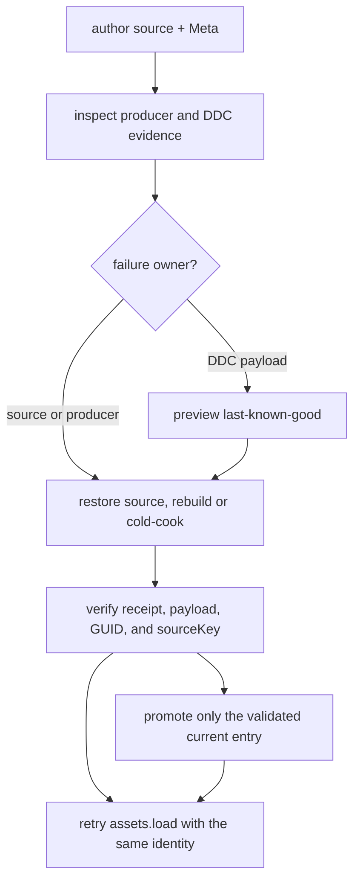

# ForgeaX format tier one


> [!IMPORTANT]
> This app is a format-tier1 runtime dogfood fixture. Captured reports and images are generated locally under the ignored root `artifacts/format-tier1/` directory and are not committed. This page does not load saved-run reports, so saved-run status panels remain blocked.

## Start here

| Need | Canonical entry | What it answers |
|:--|:--|:--|
| Immutable request | `forgeax-format-classification.csv` | Which rows are in tier one; source SHA-256 is `a87159400f5de776ce46304540999c2e7f84cec07defceaa661d0a0926a9c2d5`. |
| Support-matrix schema | [`format-support-matrix.schema.json`](evidence/format-support-matrix.schema.json) | Contract for locally generated support records. |
| Judgment input | `judgment-input.md` | Release decision, acceptance mapping, and remaining blockers. |
| Browser dogfood producer | [`apps/hello/format-tier1`](.) | Vite page at `http://127.0.0.1:5173/`; the glTF fixture is built by `gltfImporter` into Pack/Catalog and loaded through the asset owner’s `assets.load` route. |
| Recovery evidence | [`run-format-tier1-recovery.mjs`](../../../scripts/forgeax/run-format-tier1-recovery.mjs) | Inspect, producer failure, rebuild/cold-cook, same-identity verify for all three formats. |
| AI index | `ai-discovery.md` | Short route from a format, error, GUID, or evidence cell to its owner. |

## Tier-one scope

| CSV row | Format | Current feature boundary | Saved result |
|--:|:--|:--|:--|
| 8 | Meshopt | glTF source decode and runtime asset path | No saved result is checked in; run the local producer to inspect current output. |
| 18 | KTX2 / Basis | KTX2/Basis source and target capability selection | No saved result is checked in; run the local producer to inspect current output. |
| 26 | Morph targets | glTF imported animation plus FBX static/no-animation boundary | No saved result is checked in; run the local producer to inspect current output. |

## Evidence flow



The recovery runner is deliberately producer-shaped. It never mints a new GUID, changes `sourceKey`, or treats a cache hit as proof. A failed cook leaves `currentKey` and `lastKnownGoodKey` observable; a successful retry is current only after receipt and payload verification.

## Structured failure vocabulary

| Failure code | Owner | Required next action |
|:--|:--|:--|
| `format-tier1-meshopt-source-invalid` | Meshopt importer | Inspect the source and rerun the producer rebuild/cold-cook. |
| `format-tier1-ktx2-ddc-payload-invalid` | DDC validation plus KTX2/Basis producer | Inspect the receipt, keep LKG read-only, delete the invalid payload, and cold-cook. |
| `format-tier1-morph-source-invalid` | glTF/FBX Morph importer | Repair target/weight cardinality, then rebuild/cold-cook. |
| `ddc-entry-invalid` | DDC entry store | Follow `.expected` and `.hint`; do not publish the unreadable entry. |

Every failure is machine-readable as `.code`, `.expected`, `.hint`, and `.detail`. The canonical runtime asset route remains `assets.load`; source GUIDs identify imported content; managed handles identify the owner’s runtime content.

## Local gates

- [x] CSV provenance and first-tier rows 8, 18, and 26 are pinned.
- [ ] Run the local importer, runtime, GPU, recovery, and browser gates against the current source revision.
- [ ] Review generated records under `artifacts/format-tier1/`; they are local run output and must stay out of commits.

<details>
<summary>Run the M6 recovery evidence locally</summary>

```sh
pnpm --filter @forgeax/engine-ddc build
node scripts/forgeax/run-format-tier1-recovery.mjs --json
node --test apps/hello/format-tier1/evidence/__tests__/recovery-scenarios.test.mjs
```

The command creates a temporary DDC root and removes it after verification. It does not mutate the project Catalog or the immutable CSV.

</details>

<details>
<summary>Run the Morph importer and GPU evidence locally</summary>

```sh
pnpm --filter @forgeax/engine-render build
node apps/hello/format-tier1/scripts/smoke-dawn.mjs
```

The Dawn runner writes its imported `assets.load`, standard-lane, and receipt-bound report to `artifacts/format-tier1/morph-visual-evidence.json`. Headed browser captures and other run records also stay under the ignored root `artifacts/` directory.

</details>

<details>
<summary>Run the feature-owned browser dogfood producer</summary>

```sh
pnpm --filter @forgeax/hello-format-tier1 dev --host 127.0.0.1 --port 5173
```

Open `http://127.0.0.1:5173/` and inspect the Meshopt consumer, the four KTX2/Basis blocked input cells, and the four Morph states. Each Morph card reports the real imported weights consumed by `MorphWeights` and the standard MeshFilter/MeshRenderer lane; saved-run report panels remain blocked because this page does not fetch local capture files.

</details>

<details>
<summary>Run the M7 final gates locally</summary>

```sh
node apps/hello/format-tier1/scripts/run-final-gates.mjs
node --test apps/hello/format-tier1/evidence/__tests__/format-support-matrix.schema.test.mjs
```

The runner exits non-zero while any required release capability remains unresolved. That is intentional: command records and structured GPU witnesses remain usable, and release cannot be mistaken for a green result. KTX2/Basis normalized failures, HDR unsupported cells, and the FBX static/no-animation boundary remain visible in the report.

</details>
