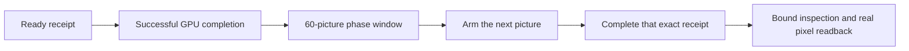

# FXAA comparison and dark-gradient fixture

The ordinary demo toggles Camera anti-aliasing with Space. The dark-gradient
route compares the fixed scene without anti-aliasing and with FXAA, on the same
backend and render lane. [Fixture facts](dark-gradient-fixture.json) and the
[report producer](scripts/dark-gradient-fixture.mjs) own the frozen pixel gates.

Each phase collects 60 successful `presentation: ready` completions before
arming its following capture picture. Pending warmup submissions and failed
completions earn no sample credit. The captured picture is additional to the
sample window; its actual frame identity need not be 60 or 120. Inspection is
retained at that picture's submission and published after its completion,
rather than rereading whichever frame happens to be current later.

| Evidence | Owner |
|:--|:--|
| Completed sample window and capture identity | `src/dark-gradient-sampler.ts` |
| Browser raw readback or fallback compositor pixels | `scripts/smoke-browser.mjs` |
| Native Dawn scene and readback | `scripts/smoke-dawn.mjs` |

Run `pnpm --filter @forgeax/hello-fxaa smoke:browser` for browser pixels and
`pnpm --filter @forgeax/hello-fxaa smoke` for native Dawn. Select `direct` or
`clustered` with `FORGEAX_DARK_GRADIENT_LANE`. The root Vitest project
`@forgeax/hello-fxaa` runs the sampler, backend-identity and report contracts.
The 60-picture requirement is functional evidence, not an FPS measurement.
