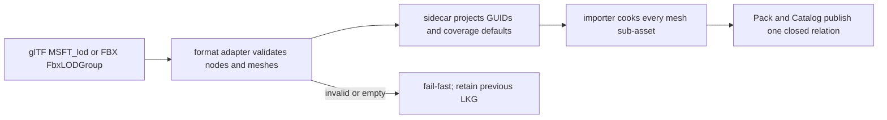

# hello-lod-occlusion

This fixture consumes a real `lod-scene.gltf` and its producer-authored
`lod-scene.gltf.meta.json` sidecar through Vite `pluginPack` and the glTF
importer. The root node uses standard `MSFT_lod` node relationships; the
sidecar records the two lower-detail mesh GUIDs and absolute projected-height
coverage values `0.5` and `0.2`.

## Source and sidecar contract

The source format owns the relationship, while the sidecar owns the durable
engine identity and coverage facts. A standard glTF file places
`MSFT_lod.ids` on the highest-detail node and puts the
`MSFT_screencoverage` array in that node's `extras`. The standard array has one
entry for each root/lower range plus a terminal discard threshold. For example,
`[0.5, 0.2, 0.01]` describes ranges `1.0..0.5`, `0.5..0.2`, and
`0.2..0.01`; the terminal discard value is intentionally not copied into
`MeshAsset.lods`. The importer also reads the repository's older document-level
coverage fixture only as an internal compatibility adapter.

```json
{
  "extensions": { "MSFT_lod": { "ids": [1, 2] } },
  "extras": { "MSFT_screencoverage": [0.5, 0.2, 0.01] }
}
```

FBX `FbxLODGroup` levels follow the same ordered root-to-lower projection. FBX
does not provide a portable screen-coverage scale, so a first import with no
explicit sidecar values uses the shared deterministic default for `n` lower
levels:

$$c_i = round6(0.5 \times 0.4^{i-1}), \qquad i = 1 \ldots n$$

| Total authored LODs | Lower levels (`n`) | Generated `screenCoverage` |
|:--:|:--:|:--|
| 2 | 1 | `0.5` |
| 3 | 2 | `0.5, 0.2` |
| 4 | 3 | `0.5, 0.2, 0.08` |

Existing legal sidecar values always win; only an appended suffix receives
defaults. Every referenced root/lower mesh must produce a non-empty mesh
sub-asset before publication. Empty primitives, missing mesh rows, malformed
coverage, or an unresolved GUID fail the import and leave the previous sidecar
and last-known-good Pack authoritative.



`lod-scene.gltf` contains three UV spheres with smooth per-vertex normals and
intentionally different payload sizes (LOD0: 48x32 segments, 1617
vertices/8928 indices; LOD1: 16x12, 221/1056; LOD2: 8x6, 63/240). Rebuild the app after changing
the source or sidecar; ignored `dist/` output is disposable and must never be
treated as an independently authored asset.

The browser and Dawn scripts fail closed when their backend or compositor is
unavailable. They do not replace the asset with procedural geometry, hand-write
a pack index, or treat canvas liveness as visual evidence. Renderer inspection
is a detached bounded POD containing source identity, view/slot generations,
LOD histogram, GPU HZB occlusion counts, and at most 64 stable samples. The
performance producer also records renderer-owned CPU draw process time and
GPU-selected index work.
CPU A/B p50/p95 values use only the post-warm-up retained window, matching the
GPU timing sample window; warm-up CPU values remain diagnostics and never enter
the regression ratio. CPU p95 remains diagnostic because hosted runner tails
can contain an isolated GC or scheduler interruption; admission uses the paired
post-warm-up CPU median with a bounded 20% regression allowance. GPU admission
keeps a hard 15% median-improvement floor and a <=5% p95 regression ceiling;
these are GPU timestamp thresholds, not wall-clock measurements.

```bash
pnpm --filter @forgeax/hello-lod-occlusion build
export FORGEAX_E03_INPUTS_DIR=/tmp/e03-inputs
node apps/hello/lod-occlusion/scripts/prepare-lod-incremental-inputs.mjs \
  --output "$FORGEAX_E03_INPUTS_DIR" \
  --shader-manifest apps/hello/lod-occlusion/dist/shaders/manifest.json
pnpm --filter @forgeax/hello-lod-occlusion smoke
pnpm --filter @forgeax/hello-lod-occlusion smoke:browser
```

When the app build selects `FORGEAX_SHARED_APP_INPUTS_MANIFEST`, keep that same
selection for the browser dev server so both consume the verified shader bytes.

To use an existing browser, set `FORGEAX_E03_CDP_ENDPOINT` and
`FORGEAX_E03_URL` to the browser-accessible app URL. The smoke owns one fresh
context and closes it on completion; disconnecting leaves the browser running.
Without those variables it starts sandboxed Chromium and a local Vite server.

The producer output directory must not already exist. Both regular smokes select
that directory explicitly and verify its manifest against the checkout's source,
Meta and resolved public producer entry bytes. They bind the browser's fetched
manifest to the selected SHA256 and require the loaded shader publication to match.
The producer HEAD defaults to the current checkout HEAD. When only the sample has
changed since production, set `FORGEAX_E03_PRODUCER_HEAD` to that exact producer
commit; source, module, shader and payload verification still applies. Reports
retain the actual producer HEAD and input digests. CPU admission does not prove GPU
readiness; both backends must complete all five receipt phases. See
the input contract.

The existing LOD inspection's `root.guid` is a diagnostic string:
`asset-handle:<World assetHandle>`. It is not the source Pack `AssetGuid`.
This single-mesh fixture compares it with the actual `MeshFilter.assetHandle`
read from its World after each completed receipt, including revision replacement.
Pack GUID/source/build/shader identity is verified independently before admission.
The two CameraViews must still belong to the same submitted World and receipt;
these single-mesh checks do not attribute a multi-asset World's aggregate counts
to its first mesh.

The hidden phase checks the actual World `Visibility` and a `draws` observation
from the same completed receipt. It requires `status: 'complete'` with no draws,
plus both rendered CameraViews attached to that World. An unavailable draw
observation, including a visible GPU lane, is rejected. The hidden report retains
the original LOD observation (which can be unavailable when its World rows are
empty); it publishes no invented LOD histogram or candidate counts. Visible
phases still require the complete per-view LOD evidence above. Both paths retain
the same 60-frame completion, receipt, generation and phase-order checks.

The revision race prepares both real candidates before accepting revision 4.
Acceptance owns cleanup of the superseded revision 3 credential; its later reuse
must return `dynamic-geometry-candidate-not-found`. The fixture does not cancel
that retired credential again. It checks that the World still holds revision 4's
mesh handle and that an actual completed frame consumes revision 4.

## What this fixture proves

- [x] The input is a real glTF file with standard `MSFT_lod` node relations.
- [x] The producer sidecar supplies stable mesh GUIDs, Pack references, and
  absolute projected-height coverage.
- [x] Vite `pluginPack` builds the source through the registered glTF importer;
  the generated `dist/pack-index.json` is an output, not a hand-written input.
- [x] Runtime inspection is bounded and detached, with explicit readiness and
  generation identity.
- [ ] GPU performance acceptance: `smoke:performance` remains fail-closed until
  the local `artifacts/gpu-frame-samples.json` contains same-device Browser/Dawn samples.

The v4 performance schema reserves 32 warm-up frames and retains 64 GPU samples for
each A/B order (128 retained GPU samples total). It rejects synthetic samples,
unavailable backends, and identity mismatches. The regular `smoke` and
`smoke:browser` commands are asset/consumer checks; they are not substitutes
for a compositor screenshot or GPU timestamp evidence.

The producer keeps one locked 128-candidate fixture (16 visible / 112
occluded) and records four structural groups: `control` and the A/B baseline
(root-pinned LOD0, no occluder), `lodOnly` (LOD-on, no occluder),
`occlusionOnly` (root-pinned LOD0, occluder-on), and `treatment` (LOD-on,
occluder-on). GPU timing is still the two-order baseline / treatment
comparison. CPU median admission and p95 diagnostics compare `treatment` with `occlusionOnly`, which
holds the occluder and two-phase HZB cost constant and isolates incremental
LOD work; the no-occluder baseline remains the GPU control.
Every CPU condition runs in both orders with the same 32 warm-up and 32 retained
observations per window: 64 retained CPU samples per condition, 192 total.
All three enable GPU timestamp capture and await timing observation on retained
frames, including `occlusionOnly`; only baseline/treatment emit GPU rows, so
the original 128-sample GPU contract remains unchanged. The CPU metric remains
`process.cpuUsage()` around synchronous draw and renderer error inspection;
it includes CPU consumed by other process threads during that span.
The evidence stores raw user/system microseconds, order, retained frame index,
renderer receipt and observation flags. The validator derives pooled p50/p95
from those counters and rejects asymmetric observation, duplicate receipts,
missing windows or summaries that disagree with raw data. Capture failures
retain completed CPU counters and available GPU observations in the unavailable
report. Earlier v3 artifacts remain historical evidence; rerun the official
producer to establish a v4 result rather than converting an earlier summary.
With `FORGEAX_LOD_PROFILE=1`, all six condition/order windows also record the
same bounded ProfileCapture; diagnostic/status v2 includes the CPU control.
A cold 16-frame CPU control is rejected. The separate LOD-only structural row runs
for `SETTLE_SUBMITS` (16) submits, which covers the
asynchronous LOD-selection readback lag, and then require stable observations.
Each row
also reports `batchCount` (all selector/filtered plan batches) and
`indirectDrawCount` (non-zero-capacity raster commands actually encoded).
Suppressed-only batches remain in selector accounting but do not create a
zero-sized storage binding or an empty raster command, so
`0 < indirectDrawCount <= batchCount` is the expected relation. The current
topology key may still turn 128 LOD candidates into 128 singleton selector
batches, and that cost must remain visible in production evidence. The renderer
inspection v3 publishes rows for every World attachment
and marks their attribution mode. When the renderer joins every row to the
same submit it publishes same-submit per-World GPU facts; missing rows or
projection-only attribution keep the World-reorder falsification unavailable.
The producer never infers attribution from array position or aggregate counts;
missing rows or unavailable attribution remain fail-closed.

The authored occluder is sanity-calibrated with one central-hidden and one
side-visible sentinel using the same imported payload and GPU HZB path. That
calibration does not stand in for the locked 16/112 workload. The
`gpu-occlusion-off` falsifier keeps the occluder and LOD policy, disables only
the Standard `gpuOcclusion` config, and requires 128 visible / 0 occluded;
re-enabling it must restore 16 / 112, so every occluded count is owned by
two-phase HZB.

> [!IMPORTANT]
> When inspection reports `producer-failed`, repair the source Meta or importer
> and rebuild through the import owner. Occlusion never removes a draw without
> a valid HZB: the first frame and every history reset rasterize all
> frustum-visible candidates.
