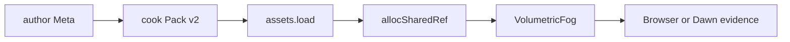
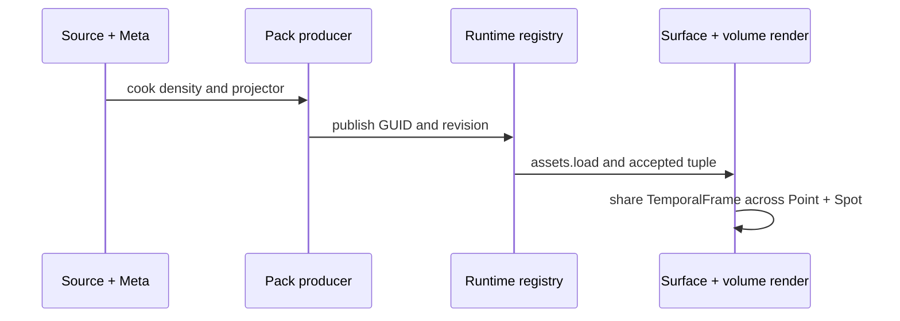

<!-- LANG-SWITCH -->
**Language**: **English** · [简体中文](README.zh-CN.md)

# Hello volumetric fog

## AI-first MVD route

This minimal public example consumes 3D density textures and volumetric fog using
existing Engine TextureAsset, AssetRegistry, VolumetricFog and RenderGraph.
Engine owners retain fog sampling, lighting and recovery.



### Copyable 128³ density route

The fixture below is the complete author-to-World path. Keep the GUID and
`sourceKey` unchanged when the producer is repaired; they are the identity
facts that connect Meta, Pack, and the runtime registry.

`assets/density.volume.json`:

```json
{
  "format": "forgeax-volumetric-density",
  "width": 128,
  "height": 128,
  "depth": 128,
  "base": 90,
  "gradient": 18
}
```

`assets/density.volume.json.meta.json`:

```json
{
  "schemaVersion": "1.0.0",
  "kind": "external-asset-package",
  "importer": "volumetric-density",
  "revision": { "digest": "volumetric-density-v1", "observedAt": 1, "rootId": "volumetric-density" },
  "source": "density.volume.json",
  "importSettings": {},
  "subAssets": [{
    "guid": "019f0000-0000-7000-8000-0000000003f1",
    "sourceIndex": 0,
    "sourceKey": "volumetric-fog/density.raw",
    "name": "volumetric-density",
    "kind": "volumetric-density"
  }]
}
```

After the [`volumetric-density` importer](./src/volumetric-density-importer.ts)
publishes Pack v2, the runtime half is deliberately small:

```ts
import { SpotLight, VolumetricFog } from '@forgeax/engine-render';
import { Transform } from '@forgeax/engine-scene';

// App has installed the texture decoder and configured the Pack Catalog.
const guid = assets.parseGuid('019f0000-0000-7000-8000-0000000003f1');
const result = await assets.load(guid, 'texture');
if (!result.ok) throw new Error(`density load failed: ${result.error.code}`);
const density = result.value;
const selectedSpot = world.spawn(
  { component: Transform, data: { pos: [0, 5.6, 0] } },
  {
    component: SpotLight,
    data: {
      direction: [0, -1, 0],
      intensity: 100,
      range: 12,
      innerConeDeg: 14,
      outerConeDeg: 28,
    },
  },
).unwrap();

world.spawn({
  component: VolumetricFog,
  data: {
    light: selectedSpot,
    density,
    boundsMin: [-1, -1, -1], boundsMax: [1, 1, 1],
    extinction: [0.2, 0.2, 0.2], albedo: [0.8, 0.8, 0.8],
    emission: [0, 0, 0], anisotropy: 0, maxDistance: 50,
  },
}).unwrap();
```

The resulting `TextureAsset` is `shape.viewDimension: '3d'` with a
`128 × 128 × 128` extent and linear `r8unorm` data. For the source descriptor and
raw-byte sibling contract, see [`packages/image/README.md`](../../../packages/image/README.md).

## Official Three.js volume-lighting parity scene

The runnable scene is deliberately a direct consumer of Engine owners. It
matches the pinned Three.js example with a procedural `TeapotGeometry(0.8,
18)`, a `100 × 100` floor at `y = -3`, a `20 × 10 × 20` volume, and the exact
camera and light fields recorded in
[`threejs-volume-lighting-parity.json`](./threejs-volume-lighting-parity.json).



The projector bytes are vendored under
`forgeax-engine-assets/threejs/webgpu-volume-lighting/` with MIT notice and
SHA-256 provenance. They are not a fake beam, a second fog shader, or a second
renderer. The `acceptedTuple` is exactly
`guid/generation/view/sampler/projection/revision`; invalid publication stays
on the LKG recovery path.

The imported texture is an authored linear source tile. The production volume
integrator samples it in repeated world-space coordinates, applies the pinned
three-octave `smokeAmount` mapping, and advects those coordinates from World
time. This keeps density motion deterministic without rebuilding the texture;
the point/spot light and projector ownership remain unchanged. Density uses 96
base ray intervals with local refinement near punctual lights; the reference
scene's twelve steps are not an Engine-wide integration budget.

| Reference scene fact | Value |
|:--|:--|
| Camera | `PerspectiveCamera(60, 0.1, 100)` at `(-8, 1, -6)` looking at origin |
| PointLight | `#f9bb50`, intensity `3`, range `100`, `(0, 1.4, 0)` |
| SpotLight | white, intensity `100`, angle `PI / 6`, penumbra `1`, decay `2`, `(2.5, 5, 2.5)` |
| Volume | `128³`, 12 steps, resolution `0.25`, denoise `0.6`, intensity `1` |
| Output | Neutral tone mapping, exposure `2`, raw paired capture `1920 × 1080` |

### Verification

- Browser: `pnpm --filter @forgeax/hello-volumetric-fog build`, then smoke:browser.
  Receipts must include backend, pixel, provenance, verdict and confidence.
- Browser receipt: `FORGEAX_FOG_RECEIPT=/tmp/volumetric-fog-receipt.json FORGEAX_FOG_URL=http://127.0.0.1:5173/ pnpm --filter @forgeax/hello-volumetric-fog smoke:browser`, then run
  `node scripts/smoke-falsify.mjs --receipt /tmp/volumetric-fog-receipt.json --head "$(git rev-parse HEAD)"`。
  Receipt backend, temporal limits, volume identity and renderer errors come from
  one settled renderer.inspect(); the falsifier checks their consistency.
- Dawn: `pnpm --filter @forgeax/hello-volumetric-fog smoke`; output includes fresh
  HEAD, limits, memory, sampling and recovery facts.
- Falsification：`node scripts/smoke-falsify.mjs --receipt <receipt.json>`；backend、GUID、
  Generation or exact-HEAD mismatches must exit 1.

> [!IMPORTANT]
> Inspect failures first, then follow error hint to repair Meta/import/Pack producers.
> The example uses no fallback, atlas, stand-in or app-local fog shader.

## Density Owner CPU Lifecycle Contract

src/__tests__/volumetric-owner-contract.unit.test.ts uses a real ECS World, public
VolumetricFog, real World-managed shared TextureAsset handles and public
extractVolumetricFog admission. Tests cover eight admitted owners, structured
rejection of the ninth, shared-reference release/re-admission on despawn, and
rejection of 2D density or reversed bounds without changing the live World or accepted inputs.

Run the CPU fixture here:

```powershell
corepack pnpm@11.7.0 exec vitest run --config vitest.config.ts src/__tests__/volumetric-owner-contract.unit.test.ts
```

## Same-Renderer Dawn Fixture Preparation

scripts/smoke-dawn.mjs creates one real Runtime Renderer, one World and one
attachment with two ordinary VolumetricFog owners. One camera moves from inside
both volumes to outside and back. world.set then rebinds one owner's density
to another 3D TextureAsset; actual pixels are read from the same Dawn canvas
before and after. This replaces owner references, not an in-place Catalog hot update.

Smoke counts only successfully completed receipts, requiring at least 60.
Pixel comparison requires changedPixels>0.01 and meanRgbDelta>0.01. CPU tests
check only ECS ownership/refcounts, rebinding and smoke source contracts. That preparation stage ran no Dawn and produced no passing pixel evidence.

Browser parity retains the teapot/floor. ?variant=transparent-subject adds ordinary
MeshFilter/MeshRenderer and a standard alpha-blend MaterialAsset in the same World/Renderer.
Dawn smoke adds an ordinary transparent mesh to its two-volume, inside/outside
camera and density-rebinding fixture, requiring inspect().transparency.sortedDrawCount
>0 and a submitted transparent pass. That smoke had not run at this stage; no completed-frame or passing pixel evidence was produced.

## Fox and Transparent-Subject Composition Preparation

?variant=transparent-subject loads the pinned public Fox scene in the same App World through configured Packs and assets.load(guid,'scene')/instantiate, alongside an ordinary transparent MeshRenderer. Vite Pack roots pin forgeax-engine-assets/khronos-gltf-samples/Fox and use gltfImporter; skinningPlugin() registers Skin.

The Dawn fixture uses built assets from the same Fox.glb and Meta, assembles Catalog through useBuiltAssetSource, then calls assets.load(sceneGuid,'scene') / assets.instantiate and the Skin path. Fox, the transparent subject and two volumes share one World, Renderer and attachment. This prepares actual ownership only; no Dawn/GPU/Browser/Host ran at that stage. Real composition, density pixel differences and 60 completed receipts still require a separate GPU run.
## Smoke Failure Cleanup and Composition Evidence
Dawn smoke finally releases acquired readback buffers, attachment leases, World plugin Fibers, Renderer, manifest object URLs, canvas target and temporary Dawn globals. Renderer.dispose() cleans renderer resources/DeviceScope but does not destroy a backend-created raw device. Smoke destroys the raw device it intercepts from requestDevice(), after retiring attachment, Renderer and canvas target, covering failure before or after Renderer construction. World has no public dispose(); disposing Cordis Fibers revokes installed plugins, after which the local World is garbage-collectable. Cleanup continues after errors and reports them with the original smoke failure. CPU fault tests prove source cleanup order and error retention only, not real Dawn/GPU release.

Smoke creates no independent Engine Input and registers no external canvas event listeners; mock-canvas listener methods are empty.

Real Fox Skin and alpha-blended transparent mesh paths share one World/Renderer with the volumes. compositionGaps still records that Fox/transparent pixel composition order has not been compared directly; remove that gap only after actual pixel assertions pass.
