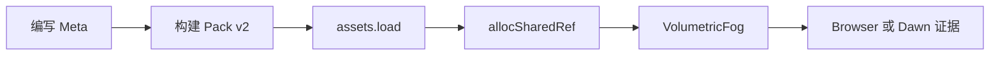
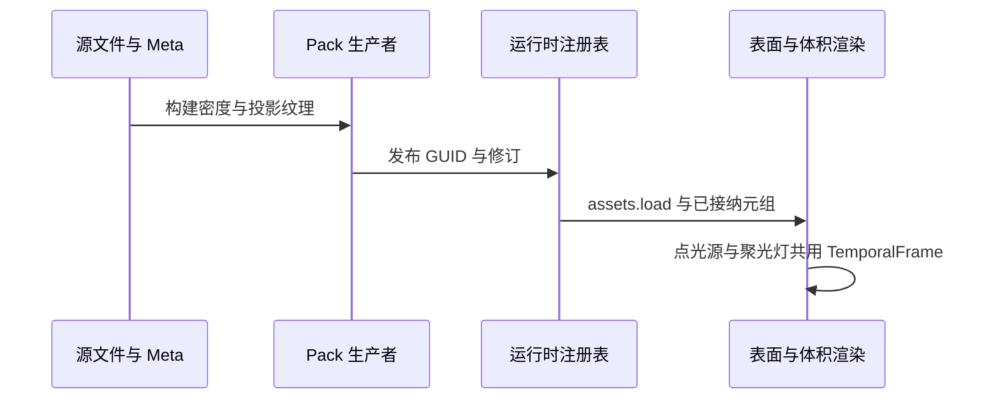

<!-- LANG-SWITCH -->
**语言**：[English](README.md) · **简体中文**

# 体积雾示例

## 面向 AI 的最小体积密度路径

这是公开 3D density texture 与 volumetric fog 的最小消费示例。它只组合 Engine 已有的
`TextureAsset`、`AssetRegistry`、`VolumetricFog` 与 RenderGraph；fog 的采样、光照和恢复
仍由 Engine owner 执行。



### 可复制的 128³ 密度数据路径

以下夹具给出从创作源到 World 的完整路径。修复生产者时保持 GUID 和 `sourceKey`
不变；它们是连接 Meta、Pack 与运行时注册表的身份依据。

`assets/density.volume.json`:

```json
{
  "format": "forgeax-volumetric-density",
  "width": 128,
  "height": 128,
  "depth": 128,
  "base": 90,
  "gradient": 18
}
```

`assets/density.volume.json.meta.json`:

```json
{
  "schemaVersion": "1.0.0",
  "kind": "external-asset-package",
  "importer": "volumetric-density",
  "revision": { "digest": "volumetric-density-v1", "observedAt": 1, "rootId": "volumetric-density" },
  "source": "density.volume.json",
  "importSettings": {},
  "subAssets": [{
    "guid": "019f0000-0000-7000-8000-0000000003f1",
    "sourceIndex": 0,
    "sourceKey": "volumetric-fog/density.raw",
    "name": "volumetric-density",
    "kind": "volumetric-density"
  }]
}
```

[`volumetric-density` 导入器](./src/volumetric-density-importer.ts) 发布 Pack v2 后，
运行时只需完成以下装配：

```ts
import { SpotLight, VolumetricFog } from '@forgeax/engine-render';
import { Transform } from '@forgeax/engine-scene';

// App has installed the texture decoder and configured the Pack Catalog.
const guid = assets.parseGuid('019f0000-0000-7000-8000-0000000003f1');
const result = await assets.load(guid, 'texture');
if (!result.ok) throw new Error(`density load failed: ${result.error.code}`);
const density = result.value;
const selectedSpot = world.spawn(
  { component: Transform, data: { pos: [0, 5.6, 0] } },
  {
    component: SpotLight,
    data: {
      direction: [0, -1, 0],
      intensity: 100,
      range: 12,
      innerConeDeg: 14,
      outerConeDeg: 28,
    },
  },
).unwrap();

world.spawn({
  component: VolumetricFog,
  data: {
    light: selectedSpot,
    density,
    boundsMin: [-1, -1, -1], boundsMax: [1, 1, 1],
    extinction: [0.2, 0.2, 0.2], albedo: [0.8, 0.8, 0.8],
    emission: [0, 0, 0], anisotropy: 0, maxDistance: 50,
  },
}).unwrap();
```

生成的 `TextureAsset` 使用 `shape.viewDimension: '3d'`，尺寸为
`128 × 128 × 128`，数据格式为线性 `r8unorm`。源描述符和原始字节伴随文件契约见
[`packages/image/README.md`](../../../packages/image/README.md)。

## 官方 Three.js 体积光照对齐场景

可运行场景直接使用 Engine 的所属模块。它与固定版本的 Three.js 示例对齐：
程序化 `TeapotGeometry(0.8, 18)`、位于 `y = -3` 的 `100 × 100` 地面、
`20 × 10 × 20` 体积，以及
[`threejs-volume-lighting-parity.json`](./threejs-volume-lighting-parity.json)
记录的精确相机和光照字段。



投影纹理字节保存在 `forgeax-engine-assets/threejs/webgpu-volume-lighting/`，
带有 MIT 声明和 SHA-256 来源记录。它们不是伪造光束、额外雾着色器或第二个渲染器。
`acceptedTuple` 精确包含 `guid/generation/view/sampler/projection/revision`；
无效发布继续走最近有效版本（LKG）恢复路径。

导入纹理是创作期定义的线性平铺源。生产用体积积分器在重复的世界坐标中采样，应用固定的
三层倍频 `smokeAmount` 映射，并依据 World 时间平流这些坐标。密度运动因此保持确定性，
无需重建纹理；点光源、聚光灯和投影纹理的所有权保持不变。密度积分使用 96 个基础射线区间，
在点状光源附近局部细化；参考场景的 12 步不是 Engine 的通用积分预算。

| 参考场景事实 | 数值 |
|:--|:--|
| 相机 | `PerspectiveCamera(60, 0.1, 100)`，位置 `(-8, 1, -6)`，朝向原点 |
| 点光源 | `#f9bb50`，强度 `3`，范围 `100`，位置 `(0, 1.4, 0)` |
| 聚光灯 | 白色，强度 `100`，角度 `PI / 6`，半影 `1`，衰减 `2`，位置 `(2.5, 5, 2.5)` |
| 体积 | `128³`，12 步，分辨率 `0.25`，降噪 `0.6`，强度 `1` |
| 输出 | Neutral 色调映射，曝光 `2`，成对原始捕获尺寸 `1920 × 1080` |

### 验证

- Browser：`pnpm --filter @forgeax/hello-volumetric-fog build`，再运行 `smoke:browser`；
  receipt 必须带 backend、pixel、provenance、verdict 与 confidence。
- Browser receipt：`FORGEAX_FOG_RECEIPT=/tmp/volumetric-fog-receipt.json FORGEAX_FOG_URL=http://127.0.0.1:5173/ pnpm --filter @forgeax/hello-volumetric-fog smoke:browser`，然后运行
  `node scripts/smoke-falsify.mjs --receipt /tmp/volumetric-fog-receipt.json --head "$(git rev-parse HEAD)"`。
  receipt 的 backend、temporal limits、volume identity 与 renderer errors 均来自一次 settle 后的
  `renderer.inspect()`，falsifier 会检查它们之间的一致性。
- Dawn：`pnpm --filter @forgeax/hello-volumetric-fog smoke`；输出包含 fresh HEAD、limits、
  memory、sample 与 recovery facts。
- Falsification：`node scripts/smoke-falsify.mjs --receipt <receipt.json>`；backend、GUID、
  generation 或 exact head 不一致时必须退出 1。

> [!IMPORTANT]
> 失败先执行 inspect，再按错误 `hint` 修复 Meta/import/Pack producer。示例不使用 fallback、
> atlas、stand-in 或 app-local fog shader。

## 密度所有者的 CPU 生命周期契约

`src/__tests__/volumetric-owner-contract.unit.test.ts` 使用真实 ECS `World`、
公开 `VolumetricFog` 组件、由 World 管理的真实共享 `TextureAsset` handle 和公开
`extractVolumetricFog` admission 函数。测试覆盖 8 个 owner 的上限、第 9 个 owner
的结构化拒绝、despawn 时释放共享引用并重新接纳，以及拒绝 2D density 和反向
bounds 时不改变存活 World 或已接受输入。

在本目录运行此 CPU fixture：

```powershell
corepack pnpm@11.7.0 exec vitest run --config vitest.config.ts src/__tests__/volumetric-owner-contract.unit.test.ts
```

## 同一渲染器的 Dawn 夹具准备

`scripts/smoke-dawn.mjs` 现在只创建一个真实 Runtime Renderer、一个 `World` 和一个
attachment，在同一世界里提交两个普通 `VolumetricFog` owner。场景让同一相机从两个
volume 内移到外，再回到原位；随后用 `world.set` 把同一 owner 的 density 字段重绑定到
另一份 3D `TextureAsset`，并在更新前后从同一 Dawn canvas target 读回真实像素。该路径
替换的是 owner 引用，不声称是 Catalog 原位热更新。

smoke 只在 `receipt.completed` 成功后计数，至少要求 60 个真实完成 receipt。像素对照
要求 `changedPixels > 0.01` 且 `meanRgbDelta > 0.01`。CPU 测试只检查 ECS owner/refcount
重绑定和 smoke 源码契约；本阶段没有运行 Dawn，也没有产生像素通过证据。

Browser parity baseline 保持 teapot/floor 不变；`?variant=transparent-subject` 会在同一
World/Renderer 中添加普通 `MeshFilter`/`MeshRenderer` 和标准 alpha-blend `MaterialAsset`。
Dawn smoke 也在已有双 volume、相机内外、density 重绑定 fixture 中加入一个普通透明 mesh，
并要求实际 `renderer.inspect().transparency.sortedDrawCount` 大于零且已提交图包含
`transparent` pass。该 smoke 尚未运行，因此没有实帧或像素通过证据。

## Fox 与透明 subject 合成准备

`?variant=transparent-subject` 会在同一个 App `World` 中通过已配置的 Pack 和 `assets.load(guid, 'scene')/instantiate` 加载固定公开 Fox 场景，同时提交普通透明 `MeshRenderer`。Vite Pack 根使用固定 `forgeax-engine-assets/khronos-gltf-samples/Fox`，并由既有 `gltfImporter` 生产；Skin 组件由 `skinningPlugin()` 注册。

Dawn smoke fixture 使用同一固定 `Fox.glb` 与 Meta 产生的构建资产，经 `useBuiltAssetSource` 装配 Catalog，再走 `assets.load(sceneGuid, 'scene')` + `assets.instantiate` 和 Skin 路径，并与透明 subject、两个 volume 共用一个 World、一个 Renderer 和一个 attachment。该改动只准备真实 owner 路径；本阶段没有启动 Dawn/GPU/Browser/Host，因此透明与 Fox 的实际像素合成、density 像素差异和 60 个 completed receipt 仍待单独 GPU 窗口执行。
## Smoke 失败清理与合成证据
Dawn smoke 在 finally 中释放已取得的 readback buffer、attachment lease、World 插件 Fiber、Renderer、manifest object URL、canvas target 和临时 Dawn 全局对象。公开 Renderer.dispose() 会清理 renderer resources 与 DeviceScope，但不会销毁 backend 创建的 raw device；smoke 始终负责销毁自己从 requestDevice() 截获的 raw device。清理栈先退休 attachment、Renderer 和 canvas target，再销毁该 raw device，因此 Renderer 构造前后失败都覆盖同一设备所有权路径。World 没有公开 dispose()；销毁 Cordis Fiber 会撤销已安装插件，随后本地 World 可由 GC 回收。清理会继续处理后续资源，并将清理错误与原始 smoke 错误一起报告。CPU fault test 只验证源码清理顺序与错误保留，不证明真实 Dawn/GPU 释放。

该 smoke 不创建独立 Engine Input 或注册外部 canvas 事件监听；mock canvas 的监听接口为空实现。

Smoke 中存在真实 Fox `Skin` 路径和 alpha-blended 透明 mesh，二者与 volumes 共用一个 World/Renderer。`compositionGaps` 仍记录 Fox/透明物体的像素合成顺序尚未直接比较；只有后续真实像素断言通过后才能移除此 gap。
