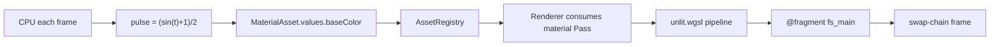

<!-- LANG-SWITCH -->
**Language**: **English** · [简体中文](README.zh-CN.md)

# Shaders (LearnOpenGL §1.3)

> [!NOTE]
> **Original chapter**: [LearnOpenGL 1.3 Shaders](https://learnopengl.com/Getting-started/Shaders)
>
> **Engine capability**: feat-20260515-learn-render-getting-started -- material `passes[].program` selects `forgeax::default-unlit` with a pulsing fragment uniform. `packages/shader/src/unlit.wgsl` drives rendering; `src/shaders/play.wgsl` documents the LO-to-ForgeaX shader-stage mapping.

## What This Example Shows

LO 1.3 sends CPU data to a fragment shader through uniforms so color pulses over time. ForgeaX separates that into three layers:

1. **Create a material asset**: `assets.create` accepts a declaration with `passes` and `values.baseColor`, returning runtime identity.
2. **Reference assets in ECS**: `MeshFilter.assetHandle` references the triangle; `MeshRenderer.materials` references the material. Pass program declarations select the pipeline.
3. **Drive pulse in rAF**: `Math.sin(elapsedSeconds)` updates `pulse: number` each frame, exposed through `globalThis.__captureShadersPulse` for DevTools / bench-screenshot observation.

> [!IMPORTANT]
> **ForgeaX does not expose OpenGL state-machine entries such as `glUseProgram` / `glGetUniformLocation`.** Material Pass program declarations choose shaders (charter P4). An unlit pulsing color requires MaterialAsset POD and a sine-driven scalar, without GL state-machine vocabulary.

## Rendering Flow



## Engine Usage

[src/index.ts](src/index.ts) creates a triangle and an unlit Forward Pass material through the current World's asset owner:

```ts
import { createPrimitiveMesh } from '@forgeax/engine-geometry';

const triangle = assets.create(createPrimitiveMesh('triangle').unwrap()).unwrap();
const material = assets.create({
  kind: 'material',
  passes: [{
    name: 'Forward',
    program: { module: 'forgeax::default-unlit' },
    renderState: { tags: { LightMode: 'Forward' }, queue: 2000 },
  }],
  values: { baseColor: [1, 0.5, 0.2, 1] },
}).unwrap();
world.spawn(
  { component: Transform, data: { pos: [0, 0, 0] } },
  { component: MeshFilter, data: { assetHandle: triangle } },
  { component: MeshRenderer, data: { materials: [material] } },
).unwrap();
```

See source for the pulse observation hook and camera assembly. To change actual material color, call `assets.update(material, { values: { baseColor: [1, pulse, 0.2, 1] } }).unwrap()`. The asset owner publishes versions and Renderer consumes updates.

## Differences From LO

| Dimension | Original LO (C++ / GLSL 330) | ForgeaX (TS / WGSL) |
|:--|:--|:--|
| Shader language | GLSL 330 (`#version 330 core`, `void main()`) | WGSL (`@vertex` / `@fragment`, `fn vs_main` / `fn fs_main`) |
| Shader selection | Manually sequence `glCreateShader`, `glShaderSource`, `glCompileShader`, `glAttachShader`, `glLinkProgram`, `glUseProgram` | `MaterialAsset.passes[].program` selects a compiled program |
| Uniforms | Manually call `glGetUniformLocation(program, "ourColor")` and `glUniform4f(loc, r, g, b, a)` every frame | Create with `assets.create(material)`, update with `assets.update(handle, patch)`; ECS `MeshRenderer.materials` references handles |
| Time pulse | `float timeValue = glfwGetTime(); float green = sin(timeValue) / 2.0 + 0.5;` in the GLFW loop | `computePulse(performance.now(), basePulseTime)` in rAF; `globalThis.__captureShadersPulse` exposes observation |
| Errors | Parse `glGetShaderiv(GL_COMPILE_STATUS)` / `glGetShaderInfoLog` strings; compilation may fail silently or print to cerr | Structured `err.code` (`ShaderErrorCode`, seven members) with `expected`, `hint`, `detail`; exhaustive switch instead of parsing messages (charter P3) |
| Resources | `Shader ourShader("vs.vs", "fs.fs")` loads file paths | No render-time paths: `@forgeax/engine-shader` ShaderRegistry indexes manifest hashes; `vite-plugin-shader` compiles custom WGSL at build time |
| Vertex inputs | Manual `glVertexAttribPointer(0, 3, GL_FLOAT, ...)` layout | `MeshFilter { assetHandle: triangle }` references managed Geometry output; Engine binds `@location(0) pos` |

## Key Source Files

| File | Lines | Role |
|:--|---:|:--|
| `src/index.ts` | ~250 | Three sections (Engine usage, example glue, bootstrap), pulse calculation and capture hook |
| `src/shaders/play.wgsl` | ~75 | LO 1.3 shader-stage mapping: vertex, fragment and pulse uniform |
| `src/__tests__/shaders.browser.test.ts` | ~130 | Vitest browser e2e (AC-05, AC-06, AC-22) |

## Run

```bash
# Dev server (Vite preview port 5182)
pnpm --filter "@forgeax/app-learn-render-1-getting-started-3-shaders" dev

# Build dist/
pnpm --filter "@forgeax/app-learn-render-1-getting-started-3-shaders" build

# vitest browser e2e（chromium + WebGPU）
pnpm test:browser

# Record a golden PNG in the forgeax-engine-assets submodule
pnpm --filter "@forgeax/app-learn-render-1-getting-started-3-shaders" exec node scripts/bench-screenshot.mjs
```

<details>
<summary>Original LO C++/GLSL excerpts (reference)</summary>

Core LO 1.3 code from `src/1.getting_started/3.1.shaders_uniform/shaders_uniform.cpp`, `3.1.shader.fs` and `3.1.shader.vs` ([JoeyDeVries/LearnOpenGL master](https://github.com/JoeyDeVries/LearnOpenGL)):

```glsl
// 3.1.shader.vs (vertex shader, GLSL 330)
#version 330 core
layout (location = 0) in vec3 aPos;

void main()
{
    gl_Position = vec4(aPos.x, aPos.y, aPos.z, 1.0);
}
```

```glsl
// 3.1.shader.fs (fragment shader, GLSL 330)
#version 330 core
out vec4 FragColor;

uniform vec4 ourColor;

void main()
{
    FragColor = ourColor;
}
```

```cpp
// shaders_uniform.cpp -- shader compile + link + uniform pulse loop
unsigned int vertexShader = glCreateShader(GL_VERTEX_SHADER);
glShaderSource(vertexShader, 1, &vertexShaderSource, NULL);
glCompileShader(vertexShader);

int success;
char infoLog[512];
glGetShaderiv(vertexShader, GL_COMPILE_STATUS, &success);
if (!success)
{
    glGetShaderInfoLog(vertexShader, 512, NULL, infoLog);
    std::cout << "ERROR::SHADER::VERTEX::COMPILATION_FAILED\n" << infoLog << std::endl;
}

// fragment shader compile (GL_FRAGMENT_SHADER) + link program + cleanup omitted

while (!glfwWindowShouldClose(window))
{
    processInput(window);

    glClearColor(0.2f, 0.3f, 0.3f, 1.0f);
    glClear(GL_COLOR_BUFFER_BIT);

    // be sure to activate the shader before any calls to glUniform
    glUseProgram(shaderProgram);

    // update the uniform color
    float timeValue = glfwGetTime();
    float greenValue = sin(timeValue) / 2.0f + 0.5f;
    int vertexColorLocation = glGetUniformLocation(shaderProgram, "ourColor");
    glUniform4f(vertexColorLocation, 0.0f, greenValue, 0.0f, 1.0f);

    // now render the triangle
    glBindVertexArray(VAO);
    glDrawArrays(GL_TRIANGLES, 0, 3);

    glfwSwapBuffers(window);
    glfwPollEvents();
}
```

This block contains all seven required GL identifiers: `glUseProgram`, `glGetUniformLocation`, `glUniform4f`, shader compilation fragment, `void main`, `gl_Position`, `glClear` (AC-23 grep gate).

</details>
