<!-- LANG-SWITCH -->
**Language**: **English** · [简体中文](README.zh-CN.md)

# Textures (LearnOpenGL §1.4)

> [!NOTE]
> **Original chapter**: [LearnOpenGL 1.4 Textures](https://learnopengl.com/Getting-started/Textures)
>
> **Engine capability**: feat-20260515-learn-render-getting-started -- `@forgeax/engine-image` decoding, `forgeax asset import` sidecars and GUID-addressed `assets.load(guid, 'texture')`. Renderer consumes material `values.baseColorTexture` automatically.

## What This Example Shows

LO 1.4 shows how a disk image becomes a material sampling input. This example loads textures through Catalog, creates a cube and material at runtime and binds asset handles to ECS entities.

1. `forgeax asset import` maintains GUIDs and import settings in image sidecars.
2. `assets.load(textureGuid, 'texture')` returns a managed texture handle.
3. `assets.create(mesh)` and `assets.create(material)` create geometry/materials; `values.baseColorTexture` references the texture.
4. `MeshFilter.assetHandle` and `MeshRenderer.materials` reference these handles. Renderer owns upload, binding and later asset updates.

## Rendering Flow

```mermaid
flowchart LR
  Disk["assets/wood-container.jpg<br/>+ .meta.json"] --> Imp["forgeax asset import"]
  Imp --> Sidecar["GUID written to sidecar<br/>(UUIDv7)"]
  Sidecar --> RT["assets.load(guid, 'texture')"]
  RT --> Reg["AssetRegistry"]
  Reg --> Up["uploadTexture<br/>(rgba8unorm-srgb)"]
  Up --> Mat["UnlitMaterialAsset<br/>baseColorTexture"]
  Mat --> Spawn["world.spawn<br/>MeshRenderer"]
  Spawn --> RS["RenderSystem extract<br/>materialBindGroup"]
  RS --> Pipe["unlit.wgsl + sampler2D"]
  Pipe --> Frame["swap-chain frame"]
```



## Engine Usage

Asset calls come from [src/index.ts](src/index.ts)'s bootstrap. `assets` and `world` belong to an existing App, `textureGuid` is a verified texture GUID, and `materialEntry.payload` is the example Pack's material declaration.

```ts
import { createBoxGeometry } from '@forgeax/engine-geometry';
import { MeshFilter, MeshRenderer } from '@forgeax/engine-render';
import { Transform } from '@forgeax/engine-scene';

configureRuntimeAssetCatalog(assets, runtimeBinding);
const texture = (await assets.load(textureGuid, 'texture')).unwrap();
const cube = assets.create(createBoxGeometry(1, 1, 1).unwrap()).unwrap();
const material = assets.create({
  ...materialEntry.payload,
  values: { ...materialEntry.payload.values, baseColorTexture: texture },
}).unwrap();
world.spawn(
  { component: Transform, data: { pos: [0, 0, 0] } },
  { component: MeshFilter, data: { assetHandle: cube } },
  { component: MeshRenderer, data: { materials: [material] } },
).unwrap();
```

Textures load by Catalog GUID; `assets.create` establishes runtime geometry/material identity directly. Cameras and Update systems remain in the example's ECS composition; `app.start()` drives the frame loop. Update material color with `assets.update(material, { values: { baseColor: [1, 0.5, 0.2, 1] } }).unwrap()`; the asset owner maintains versions and rendering updates.

## Differences From LO

| Dimension | Original LO (C++ / GLSL 330) | ForgeaX (TS / WGSL) |
|:--|:--|:--|
| Decoding | Synchronous, single-threaded `stbi_load("container.jpg", &w, &h, &nrChannels, 0)` in `stb_image.h` | Build-time `@forgeax/engine-image` decodes and writes sidecars during `forgeax asset import`; runtime stays isolated from decoding (charter P5 / research F-4) |
| GPU upload | Manually sequence `glGenTextures(1, &id)`, `glBindTexture(GL_TEXTURE_2D, id)`, `glTexImage2D(GL_TEXTURE_2D, 0, GL_RGB, w, h, 0, GL_RGB, GL_UNSIGNED_BYTE, data)` | `assets.load(woodGuid, 'texture')` enters Engine `uploadTexture` and automatic materialBindGroup binding (`render-system-extract.ts`, `mat.shadingModel`) |
| Sampler | Several calls such as `glTexParameteri(GL_TEXTURE_2D, GL_TEXTURE_WRAP_S, GL_REPEAT)` / `GL_TEXTURE_MIN_FILTER, GL_LINEAR` | Sidecar `importSettings: { colorSpace, mipmap, addressMode, filterMode }`; byte-identical reimport (AC-16) |
| Color space | Manual `glTexImage2D(internalformat=GL_SRGB)` and tutorial advice on linear space | `TextureAsset.format: 'rgba8unorm-srgb' \| 'rgba8unorm'`, `colorSpace: 'srgb' \| 'linear'`; conflicting linear/sRGB produces `image-format-unsupported.detail.formatColorSpaceConflict` in Dawn tests (AC-08) |
| Sampling | GLSL `texture(ourTexture, TexCoord)`, sampler2D uniform, manual `glUniform1i(loc, 0)` | Engine lays out WGSL `@group(?) @binding(?) var sampler_0: sampler` / `var texture_0: texture_2d<f32>`; AI users choose no binding numbers |
| Errors | `if (data) { ... glTexImage2D(...); stbi_image_free(data); } else { std::cout << "Failed to load texture" << std::endl; }` can print or continue silently | Structured `err.code` (AssetErrorCode 4, PackErrorCode 8, image-format-unsupported / image-meta-missing), with exhaustive narrowing rather than message parsing (charter P3) |
| Addressing | Physical path in `stbi_load("container.jpg", ...)` | Runtime accepts only GUIDs. `vite-plugin-pack` maintains pack-index.json `guid`, `packageUrl`, `kind`, `sourcePath` during build/dev |
| Vertex layout | Manual pos/uv `glVertexAttribPointer(0, 3, GL_FLOAT, ...)`, `glEnableVertexAttribArray(0)`, `glVertexAttribPointer(1, 2, GL_FLOAT, ...)` | Managed `MeshFilter { assetHandle: cubeHandleRes.value }`; Engine binds `@location(0) pos` and `@location(1) uv` |

## Key Source Files

| File | Lines | Role |
|:--|---:|:--|
| `src/index.ts` | ~390 | Three sections (Engine usage, glue, bootstrap), four-step recipe, `// ac-09:` anchor and `__captureTextures` hook |
| `assets/wood-container.meta.json` | ~30 | `kind=external-asset-package` sidecar: subAssets[0]={kind,sourceIndex,guid}, five importSettings fields |
| `assets/material-wood.pack.json` | ~25 | `kind=internal-text-package`（UnlitMaterialAsset payload + baseColorTexture refs[0]） |
| `src/__tests__/textures.browser.test.ts` | ~150 | Vitest browser e2e (AC-08, AC-09, AC-13, AC-15(c), AC-17(a)) |
| `src/__tests__/textures-srgb.dawn.test.ts` | ~110 | Dawn sRGB/linear conflict counterexample (AC-08 image-format-unsupported.detail.formatColorSpaceConflict) |
| `scripts/smoke-dawn.mjs` | ~330 | Dawn e2e: decode, upload, 60 frames, five-pixel readback grid and AC-25 wall-time monitoring |

## HMR manual verification

The `@forgeax/engine-vite-plugin-pack` `configureServer` middleware watches the asset directory tree with five file-extension suffixes (`.meta.json`, `.pack.json`, `.jpg`, `.jpeg`, `.png`) and publishes the neutral catalog change. This app explicitly chooses `refresh: reloadAssetHost()` in `vite.config.ts`, so its host requests Vite `full-reload` after a watched change. This demo's source-file refresh policy is independent of runtime asset edits: accepted `assets.update` / `assets.writeRange` operations publish changes through the asset owner without reloading the App.

| Trigger | File | Observed effect |
|:--|:--|:--|
| (1) sidecar `importSettings` change | `assets/wood-container.meta.json` (e.g. flip `mipmap: "auto"` <-> `mipmap: "none"`) | Plugin rebuilds the catalog; browser reloads; the rendered cube reflects the new sampler / mipmap state. |
| (2) pack-index indirect change | rename / delete a `.pack.json` or `.meta.json` entry | Plugin rebuilds the catalog; browser reloads; `assets.load` against the changed GUID resolves the new payload. |
| (3) JPG content change | `assets/wood-container.jpg` (e.g. re-export from imagemagick + same path) | No catalog row changes because rows derive from sidecars, not bytes; this app's explicit host refresh requests browser reload, then the rendered cube shows the new pixels. |

To exercise manually:

```bash
pnpm --filter "@forgeax/app-learn-render-1-getting-started-4-textures" dev
# In another terminal, edit one of the three trigger paths above; observe
# the `[forgeax-pack] ... changed: <filename>` warn line on stderr and the
# vite [vite] hmr update log on stdout. Confirm the canvas redraws with
# the new asset state after the reload completes.
```

Failure surface: the dev plugin does not block on schema errors; malformed sidecars are skipped with a `[forgeax-pack] scan error` console warn so iteration is uninterrupted. Schema-level enforcement runs through `forgeax asset verify --root <project> --json` (8-step fail-fast scanner; the dev path optimises for iteration cadence).

## Run

```bash
# Dev server (Vite port 5183)
pnpm --filter "@forgeax/app-learn-render-1-getting-started-4-textures" dev

# Build dist/
pnpm --filter "@forgeax/app-learn-render-1-getting-started-4-textures" build

# vitest browser e2e（chromium + WebGPU）
pnpm test:browser

# Vitest Dawn e2e (sRGB / linear consistency)
pnpm test:dawn

# dawn-node smoke (60 frames + pixel readback epsilon <= 0.05)
pnpm --filter "@forgeax/app-learn-render-1-getting-started-4-textures" smoke

# Record a golden PNG in the forgeax-engine-assets submodule
pnpm --filter "@forgeax/app-learn-render-1-getting-started-4-textures" exec node scripts/bench-screenshot.mjs

# Build-time importer: sidecars and byte-identical reimport (AC-16)
pnpm exec forgeax asset import \
  apps/learn-render/1.getting-started/4.textures/assets/wood-container.jpg
pnpm exec forgeax asset verify \
  apps/learn-render/1.getting-started/4.textures/assets/
```

<details>
<summary>Original LO C++/GLSL excerpts (reference)</summary>

Core LO 1.4 code from `src/1.getting_started/4.1.textures/textures.cpp`, `4.1.texture.fs` and `4.1.texture.vs` ([JoeyDeVries/LearnOpenGL master](https://github.com/JoeyDeVries/LearnOpenGL)):

```glsl
// 4.1.texture.vs (vertex shader, GLSL 330)
#version 330 core
layout (location = 0) in vec3 aPos;
layout (location = 1) in vec3 aColor;
layout (location = 2) in vec2 aTexCoord;

out vec3 ourColor;
out vec2 TexCoord;

void main()
{
    gl_Position = vec4(aPos, 1.0);
    ourColor = aColor;
    TexCoord = vec2(aTexCoord.x, aTexCoord.y);
}
```

```glsl
// 4.1.texture.fs (fragment shader, GLSL 330)
#version 330 core
out vec4 FragColor;

in vec3 ourColor;
in vec2 TexCoord;

uniform sampler2D ourTexture;

void main()
{
    FragColor = texture(ourTexture, TexCoord);
}
```

```cpp
// textures.cpp -- stb_image load + glTexImage2D upload + sampler config
#define STB_IMAGE_IMPLEMENTATION
#include "stb_image.h"

// load and create a texture
unsigned int texture;
glGenTextures(1, &texture);
glBindTexture(GL_TEXTURE_2D, texture);

// set the texture wrapping parameters
glTexParameteri(GL_TEXTURE_2D, GL_TEXTURE_WRAP_S, GL_REPEAT);
glTexParameteri(GL_TEXTURE_2D, GL_TEXTURE_WRAP_T, GL_REPEAT);
// set texture filtering parameters
glTexParameteri(GL_TEXTURE_2D, GL_TEXTURE_MIN_FILTER, GL_LINEAR);
glTexParameteri(GL_TEXTURE_2D, GL_TEXTURE_MAG_FILTER, GL_LINEAR);

// load image, create texture and generate mipmaps
int width, height, nrChannels;
unsigned char *data = stbi_load("resources/textures/container.jpg", &width, &height, &nrChannels, 0);
if (data)
{
    glTexImage2D(GL_TEXTURE_2D, 0, GL_RGB, width, height, 0, GL_RGB, GL_UNSIGNED_BYTE, data);
    glGenerateMipmap(GL_TEXTURE_2D);
}
else
{
    std::cout << "Failed to load texture" << std::endl;
}
stbi_image_free(data);

while (!glfwWindowShouldClose(window))
{
    // bind Texture
    glBindTexture(GL_TEXTURE_2D, texture);

    // render container
    glUseProgram(shaderProgram);
    glBindVertexArray(VAO);
    glDrawArrays(GL_TRIANGLES, 0, 6);

    glfwSwapBuffers(window);
    glfwPollEvents();
}
```

This block contains all ten required LO 1.4 identifiers: `stb_image.h`, `stbi_load`, `glGenTextures`, `glBindTexture`, `glTexImage2D`, `glTexParameteri`, `glGenerateMipmap`, `texture(sampler2D, ...)`, `void main`, `gl_Position` (AC-23 and T-M8-05).

</details>
