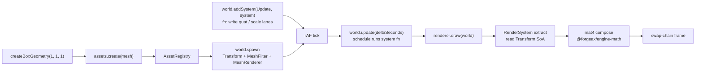

<!-- LANG-SWITCH -->
**Language**: **English** · [简体中文](README.zh-CN.md)

# Transformations (LearnOpenGL §1.5)

> [!NOTE]
> **Original chapter**: [LearnOpenGL 1.5 Transformations](https://learnopengl.com/Getting-started/Transformations)
>
> **Engine capability**: feat-20260515-learn-render-getting-started / feat-20260519 (createApp, textured cube, sine pulse): `@forgeax/engine-runtime` Transform `pos`/`quat`/`scale` array<f32,N> columns, quaternion order [x,y,z,w]; per-frame systems via `world.addSystem(Update, system)`; `@forgeax/engine-app` createApp owns rAF and Time. RenderSystem composes TRS into `worldFromLocal: mat4` with `@forgeax/engine-math` and uploads it (charter P4 / AC-04).

## LO 1.5 Subexample Coverage

| LO subexample | Coverage | ForgeaX differences |
|:--|:--|:--|
| **5.1 transformations** (translate, rotate, scale, textured wood container) | Visuals and state values align | Engine composes matrices; the demo writes Transform columns only (OOS-11). Static `glm::vec3(0.5)` scale becomes sine pulse `0.5 + 0.5*sin(t*2π/3)`, briefly invisible at zero (D-8 / OOS-8). |
| **5.2 ex2 awesomeface mix** (`mix(texture(tex0, uv), texture(tex1, uv), 0.2)`) | Out of scope | Requires literal fragment mix() and two sampler2D bindings. One unlit baseColorTexture slot already verifies matrix animation; multi-texture material support remains future work. |

## What This Example Shows

LO 1.5 multiplies translate/rotate/scale into a CPU glm::mat4 and uploads it as a vertex uniform each frame. ForgeaX splits those semantics into three layers (charter P4 / AC-04):

1. **Runtime geometry/materials**: load the texture via `assets.load(textureGuid, 'texture')`, create `createBoxGeometry(1, 1, 1)` and material declarations with `assets.create`, then reference returned handles.
2. **ECS Transform columns**: spawn Transform, MeshFilter{cube} and MeshRenderer{material}; `pos`/`quat`/`scale` are array<f32,N> columns. Identity corresponds to `pos=[0,0,0], quat=[0,0,0,1], scale=[1,1,1]`.
3. **Per-frame row mutation**: register `world.addSystem(Update, { queries: [{ write: [Transform], with: [MeshFilter] }], fn: (_world, queries) => { for (const row of queries[0]) row.mut(Transform).quat.set(...); } })`. rAF calls `world.update(deltaSeconds)`; `draw(world)` reads current columns and composes mat4.

> [!IMPORTANT]
> **The example does not expose CPU mat4 multiplication such as `glm::translate / glm::rotate / glm::scale`.** Rotating a cube around Z and pulsing its scale means registering an Update system and mutating quaternion/scale through `QueryRow.mut(Transform)`. `RenderSystem.draw()` composes and uploads the matrix (charter P4); users need no direct mat4 construction.

## Rendering Flow



## Engine Usage

Asset calls come from [src/index.ts](src/index.ts)'s bootstrap. `assets`/`world` belong to an existing App, `textureGuid` is verified and `materialEntry.payload` is the example Pack's material declaration.

```ts
import { createBoxGeometry } from '@forgeax/engine-geometry';
import { MeshFilter, MeshRenderer } from '@forgeax/engine-render';
import { Transform } from '@forgeax/engine-scene';

configureRuntimeAssetCatalog(assets, runtimeBinding);
const texture = (await assets.load(textureGuid, 'texture')).unwrap();
const cube = assets.create(createBoxGeometry(1, 1, 1).unwrap()).unwrap();
const material = assets.create({
  ...materialEntry.payload,
  values: { ...materialEntry.payload.values, baseColorTexture: texture },
}).unwrap();
world.spawn(
  { component: Transform, data: { pos: [0, 0, 0] } },
  { component: MeshFilter, data: { assetHandle: cube } },
  { component: MeshRenderer, data: { materials: [material] } },
).unwrap();
```

Catalog GUIDs load textures; `assets.create` establishes geometry/material runtime identity. Cameras and Update systems stay in the example's ECS composition, driven by `app.start()`. Update material color with `assets.update(material, { values: { baseColor: [1, 0.5, 0.2, 1] } }).unwrap()`; the asset owner maintains versions/render updates.

## Differences From LO

| Dimension | Original LO (C++ / GLSL 330) | ForgeaX (TS / WGSL) |
|:--|:--|:--|
| Transform data | CPU `glm::mat4 trans = glm::mat4(1.0f)` accumulated with translate/rotate/scale | Transform pos/quat/scale array<f32,N> columns, quat [x,y,z,w]; RenderSystem composes worldFromLocal with mat4.compose |
| Rotation | Accumulate `glm::rotate(trans, angle, glm::vec3(0,0,1))` | `row.mut(Transform).quat.set([0, 0, sin(angle/2), cos(angle/2)])`; Engine rebuilds mat4 every frame |
| Scale | Accumulate `glm::scale(trans, glm::vec3(0.5, 0.5, 0.5))` | `row.mut(Transform).scale.set([pulse, pulse, pulse])` |
| Translation | Accumulate `glm::translate(trans, glm::vec3(0.5, -0.5, 0.0))` | `row.mut(Transform).pos.set([0.5, -0.5, 0])` |
| Uniform upload | Manually bind/upload with `glGetUniformLocation(prog, "transform")` and `glUniformMatrix4fv(loc, 1, GL_FALSE, glm::value_ptr(trans))` | `renderer.draw(world)` reads Transform columns and queue.writeBuffer uploads storage data; no glUniform* calls |
| Frame updates | Direct glm::rotate using glfwGetTime() inside `while (!glfwWindowShouldClose)` | Register `world.addSystem(Update, { fn: ... })` once; world.update(deltaSeconds) invokes SoA writes, Engine composes matrices separately (charter P4) |
| Errors | glm has no default errors; upload failure requires global glGetError polling | Structured err.code (RhiErrorCode 18 / EcsErrorCode 23), expected/hint/detail and exhaustive switch, without message parsing (charter P3) |
| Vertices | Manual `glVertexAttribPointer(0, 3, GL_FLOAT, ...)` / glEnableVertexAttribArray for pos/uv | `MeshFilter { assetHandle: cubeHandle }` references the built-in cube; Engine binds @location(0) pos |
| Data flow | CPU computes mat4, uploads uniforms, draws sequentially | Systems write columns, RenderSystem reads/composes/draws; column storage supports future SIMD batch animation |
| Texture/animation | glBindTexture plus static glm::vec3(0.5) scale | LO wood-container visual via assets/wood-container.jpg, material-wood.pack.json and baseColorTexture. Transform.pos=[0.5,-0.5,0] and a Z quaternion match teaching constants. Engine composes matrices (OOS-11); sine scale `0.5+0.5*sin(t*2π/3)` replaces static 0.5 and briefly vanishes at zero (D-8 / OOS-8) |
| Main loop | Application owns while/glfwSwapBuffers and manual glClear | `await createApp(canvas, { clearColor })` then `app.start()`; App owns rAF, dt clamp, Time and error fan-out. Demo writes no requestAnimationFrame (charter P4 / AC-07) |

## Key Source Files

| File | Lines | Role |
|:--|---:|:--|
| `src/index.ts` | ~340 | Three sections, cube spawn, Update animation system and capture hook |
| `src/__tests__/transformations.browser.test.ts` | ~140 | Vitest browser e2e: markers, cube-mesh.stub.meta.json schema and Engine WebGPU path (AC-04/05/06/22) |
| `scripts/bench-screenshot.mjs` | ~180 | Playwright/chrome-beta records round-5-transformations.png in forgeax-engine-assets |

## Run

```bash
# Dev server (Vite preview port 5184)
pnpm --filter "@forgeax/app-learn-render-1-getting-started-5-transformations" dev

# Build dist/
pnpm --filter "@forgeax/app-learn-render-1-getting-started-5-transformations" build

# vitest browser e2e（chromium + WebGPU）
pnpm test:browser

# Record a golden PNG in forgeax-engine-assets
pnpm --filter "@forgeax/app-learn-render-1-getting-started-5-transformations" exec node scripts/bench-screenshot.mjs

# Pixel-parity benchmark, including round-5-transformations.png
pnpm bench:pixel-parity
```

<details>
<summary>Original LO C++/GLSL excerpts (reference)</summary>

Core LO 1.5 code from `src/1.getting_started/5.1.transformations/transformations.cpp`, `5.1.transform.fs` and `5.1.transform.vs` ([JoeyDeVries/LearnOpenGL master](https://github.com/JoeyDeVries/LearnOpenGL)):

```glsl
// 5.1.transform.vs (vertex shader, GLSL 330)
#version 330 core
layout (location = 0) in vec3 aPos;
layout (location = 1) in vec2 aTexCoord;

out vec2 TexCoord;

uniform mat4 transform;

void main()
{
    gl_Position = transform * vec4(aPos, 1.0f);
    TexCoord = vec2(aTexCoord.x, aTexCoord.y);
}
```

```glsl
// 5.1.transform.fs (fragment shader, GLSL 330)
#version 330 core
out vec4 FragColor;

in vec2 TexCoord;

uniform sampler2D texture1;
uniform sampler2D texture2;

void main()
{
    FragColor = mix(texture(texture1, TexCoord), texture(texture2, TexCoord), 0.2);
}
```

```cpp
// transformations.cpp -- glm mat4 translate + rotate + scale composition
#include <glm/glm.hpp>
#include <glm/gtc/matrix_transform.hpp>
#include <glm/gtc/type_ptr.hpp>

while (!glfwWindowShouldClose(window))
{
    processInput(window);

    glClearColor(0.2f, 0.3f, 0.3f, 1.0f);
    glClear(GL_COLOR_BUFFER_BIT);

    // bind textures on corresponding texture units
    glActiveTexture(GL_TEXTURE0);
    glBindTexture(GL_TEXTURE_2D, texture1);
    glActiveTexture(GL_TEXTURE1);
    glBindTexture(GL_TEXTURE_2D, texture2);

    // create transformations
    glm::mat4 transform = glm::mat4(1.0f);
    transform = glm::translate(transform, glm::vec3(0.5f, -0.5f, 0.0f));
    transform = glm::rotate(transform, (float)glfwGetTime(), glm::vec3(0.0f, 0.0f, 1.0f));
    transform = glm::scale(transform, glm::vec3(0.5, 0.5, 0.5));

    // get matrix's uniform location and set matrix
    ourShader.use();
    unsigned int transformLoc = glGetUniformLocation(ourShader.ID, "transform");
    glUniformMatrix4fv(transformLoc, 1, GL_FALSE, glm::value_ptr(transform));

    // render container
    glBindVertexArray(VAO);
    glDrawElements(GL_TRIANGLES, 6, GL_UNSIGNED_INT, 0);

    glfwSwapBuffers(window);
    glfwPollEvents();
}
```

This block contains all twelve required GLM/GL identifiers: `glm::mat4(1.0f)`, `glm::translate`, `glm::rotate`, `glm::scale`, `glm::vec3`, `glUniformMatrix4fv`, `glGetUniformLocation`, `glm::value_ptr`, `gl_Position`, `void main`, `glClear`, `transform * vec4(aPos, 1.0f)` (AC-23 / T-M9-03).

</details>
