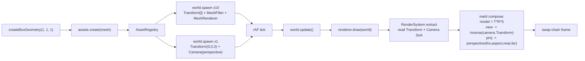

<!-- LANG-SWITCH -->
**Language**: **English** · [简体中文](README.zh-CN.md)

# Coordinate Systems (LearnOpenGL §1.6)

> [!NOTE]
> **Original chapter**: [LearnOpenGL 1.6 Coordinate Systems](https://learnopengl.com/Getting-started/Coordinate-Systems)
>
> **Engine capability**: feat-20260515 / feat-20260519 (createApp, ten textured cubes, V-3 deferral removed): Camera has nine f32 SoA columns (fov/aspect/near/far, discrete projection, orthographic left/right/bottom/top); Transform has ten. Multiple entities use world.spawn. RenderSystem composes model/view/projection with engine-math and chooses perspective/orthographic by Camera.projection (charter P4 / AC-04).

## LO 1.6 Subexample Coverage

| LO subexample | Coverage | ForgeaX differences |
|:--|:--|:--|
| **6.1 single textured cube + MVP** (`model = translate * rotate(time)`) | Partial: ten-cube entry includes static models; time rotation uses 1.5 sine pulse | A separate single-cube document adds little value (OOS-4 / Q3); this example starts at 6.3. |
| **6.2 depth-test on/off** (`glEnable(GL_DEPTH_TEST)`) | Partial: enabled by default, prose comparison and counterexample PNG; no separate source | RenderSystem enables depth testing and exposes no toggle in packages/runtime/src/render-system-record.ts. LO begins disabled. See the depth-test section and screenshots/depth-disabled-vs-default.png, currently a placeholder (C-5 / charter F2). |
| **6.3 multiple cubes** (ten cubePositions with per-index axis-angle rotation) | Covered: literal LO positions and textured wood container | `glm::rotate(model, glm::radians(20.0f * i), vec3(1, 0.3, 0.5))` is baked into each spawn's Transform.quat; no per-frame accumulation. Engine composes mat4 (OOS-11). |
| **6.4 ex3** (free-fly/FPS camera) | Out of scope | This previews LO 1.7; input belongs to 7.camera (charter P5 producer/consumer split). |

## What This Example Shows

LO 1.6 constructs model with glm::translate(cubePositions[i]), view with glm::translate(..., glm::vec3(0,0,-3)), and projection with glm::perspective(glm::radians(45.0f), w/h, 0.1f, 100.0f), then uploads three uniforms. ForgeaX splits the same semantics into three layers (charter P4 / AC-04):

1. **Runtime assets**: load the texture with `assets.load(textureGuid, 'texture')`, create box geometry/material declarations with `assets.create`, then reference handles.
2. **Ten cube entities and one camera**: spawn Transform/MeshFilter/MeshRenderer using LO cubePositions; each position/quaternion encodes translate followed by per-index rotation. Camera Transform supplies view: LO view translation -3 corresponds to camera pos=[0,0,3]. Camera supplies projection.
3. **Camera scalars**: set `projection: CAMERA_PROJECTION_PERSPECTIVE`, fov/aspect/near/far. `draw(world)` uses cameraProjectionFromF32(camera.projection) to select perspective/orthographic matrices. OOS-1 retains projection's discrete 0/1 mode and future extension boundary.

> [!IMPORTANT]
> **No direct glm::lookAt / glm::perspective / glm::mat4 construction is required.** To view -Z from (0,0,3), use `world.spawn(Transform{posZ:3,quatW:1}, Camera{fov:Math.PI/4, aspect, near:0.1, far:100, projection:CAMERA_PROJECTION_PERSPECTIVE})`. RenderSystem inverts the camera Transform and selects projection before GPU upload (charter P4). Transform and Camera expose nineteen f32 columns.

## Depth Testing: Enabled by Default Versus Disabled

LO 1.6.2 teaches the depth-test toggle separately. Its key statement:

> "OpenGL stores all its depth information in a z-buffer, also known as a depth buffer. ... The depth is stored within each fragment (as the fragment's z value) and whenever the fragment wants to output its color, OpenGL compares its depth values with the z-buffer and if the current fragment is behind the other fragment it is discarded, otherwise overwritten. This process is called depth testing and is done automatically by OpenGL." — [LearnOpenGL §1.6 Coordinate Systems](https://learnopengl.com/Getting-started/Coordinate-Systems#:~:text=depth%20testing)

LO C++ begins **disabled**: explicit `glEnable(GL_DEPTH_TEST)` establishes correct depth. Commenting it out makes fragments overwrite by draw order, so distant cubes can cover nearer ones.

ForgeaX RenderSystem **enables depth testing by default**. packages/runtime/src/render-system-record.ts exposes no enableDepthTest field; pipelineState configures a depth attachment and depthCompare:'less' during Engine.create/createApp. The ten cubes therefore begin with correct depth, without copying glEnable (charter P4).

| Dimension | LO default (off) | ForgeaX default (on) |
|:--|:--|:--|
| Enable | Explicit `glEnable(GL_DEPTH_TEST)` | No toggle; RenderSystem enables it |
| Depth attachment | Manually glClear(GL_DEPTH_BUFFER_BIT) each frame | Engine.create({clearColor}) declares and clears with clearDepth:1.0 |
| Teaching sequence | Disabled, incorrect overlap, enabled, correct depth | Correct depth immediately |
| AI-user vocabulary | GL_DEPTH_TEST and glClear bitmasks | No GL enable/clear vocabulary (OOS-11) |
| Disabled appearance | Far cubes overwrite nearer cubes | Same semantics, but no demo toggle; screenshots/depth-disabled-vs-default.png is a 1x1 placeholder. This prose states the intended counterexample until actual sandbox Playwright replacement (charter F2). |

> [!NOTE]
> **Counterexample PNG replacement (C-5 SHOULD):** screenshots/depth-disabled-vs-default.png is currently 1x1 (feat-20260519 implement-decisions D-9: sandbox harness unavailable, placeholder plus prose used for AC-04). Once available, run `pnpm exec playwright test --project=sandbox` to capture the real enabled/disabled comparison. Since Engine exposes no enableDepthTest toggle, monkey-patch RenderSystem only in the sandbox, not in demo source (charter F2).

`screenshots/depth-disabled-vs-default.png`: depth-disabled versus default placeholder

## Rendering Flow



## Engine Usage

Calls come from [src/index.ts](src/index.ts)'s bootstrap. `assets`/`world` belong to an existing App; textureGuid is verified and materialEntry.payload is the example Pack's material declaration.

```ts
import { createBoxGeometry } from '@forgeax/engine-geometry';
import { MeshFilter, MeshRenderer } from '@forgeax/engine-render';
import { Transform } from '@forgeax/engine-scene';

configureRuntimeAssetCatalog(assets, runtimeBinding);
const texture = (await assets.load(textureGuid, 'texture')).unwrap();
const cube = assets.create(createBoxGeometry(1, 1, 1).unwrap()).unwrap();
const material = assets.create({
  ...materialEntry.payload,
  values: { ...materialEntry.payload.values, baseColorTexture: texture },
}).unwrap();
world.spawn(
  { component: Transform, data: { pos: [0, 0, 0] } },
  { component: MeshFilter, data: { assetHandle: cube } },
  { component: MeshRenderer, data: { materials: [material] } },
).unwrap();
```

Catalog GUIDs load textures; assets.create establishes geometry/material identity. Cameras/Update systems remain in the example's ECS composition and app.start() drives frames. Update color with `assets.update(material, { values: { baseColor: [1, 0.5, 0.2, 1] } }).unwrap()`; the asset owner maintains versions/render updates.

## Differences From LO

| Dimension | Original LO (C++ / GLSL 330) | ForgeaX (TS / WGSL) |
|:--|:--|:--|
| Model | `glm::mat4 model = glm::mat4(1.0f); model = glm::translate(model, cubePositions[i]); model = glm::rotate(model, glm::radians(20.0f * i), glm::vec3(1.0f, 0.3f, 0.5f))` per cube | Write Transform.pos/quaternion; RenderSystem composes worldFromLocal each frame through engine-math mat4.compose |
| View | `glm::mat4 view = glm::mat4(1.0f); view = glm::translate(view, glm::vec3(0.0f, 0.0f, -3.0f))`, or glm::lookAt | Camera Transform.posZ=3; Engine inverts it each frame into viewFromWorld, without caller lookAt |
| Projection | `glm::perspective(glm::radians(45.0f), (float)w/(float)h, 0.1f, 100.0f)` | Five Camera scalars: fov/aspect/near/far/projection. Literal 0 narrows to perspective, then Engine calls mat4.perspective |
| Projection mode | Replace glm::perspective with glm::ortho(left,right,bottom,top,near,far) in source | Set Camera.projection=CAMERA_PROJECTION_ORTHOGRAPHIC and left/right/bottom/top. One nine-column component supports both modes (charter P4) |
| Uniforms | Three glGetUniformLocation / glUniformMatrix4fv calls with glm::value_ptr | Renderer composes model/view/projection and queue.writeBuffer uploads shared storage; no caller glUniform* |
| Multiple entities | Loop ten times, update model uniform and glDrawArrays on one VAO | Loop world.spawn(Transform[i],MeshFilter,MeshRenderer); Engine extracts archetype SoA and uploads shared storage without caller draw calls |
| Errors | glm degeneracy such as fov<=0 silently yields NaN; upload errors need global glGetError | Structured err.code (RhiErrorCode 18 / EcsErrorCode 23), expected/hint/detail; exhaustive switch instead of parsing messages (charter P3) |
| Vertices | Manual glVertexAttribPointer / glEnableVertexAttribArray for pos/uv | Managed cubeHandle in MeshFilter; Engine binds @location(0) pos |
| Data flow | Per cube: compute model, upload uniform, draw; ten calls | Spawn ten entities; one RenderSystem query reads Transform SoA, choosing batch/per-draw paths by archetype |

## Key Source Files

| File | Lines | Role |
|:--|---:|:--|
| `src/index.ts` | ~370 | Three sections, ten cubes, perspective camera and capture hook |
| `src/__tests__/coordinate-systems.browser.test.ts` | ~155 | Vitest browser e2e: markers, cube metadata, WebGPU, ten cubes and perspective Camera (AC-04/05/06/22) |
| `scripts/bench-screenshot.mjs` | ~180 | Playwright/chrome-beta records round-6-coordinate-systems.png in forgeax-engine-assets |

## Run

```bash
# Dev server (Vite preview port 5185)
pnpm --filter "@forgeax/app-learn-render-1-getting-started-6-coordinate-systems" dev

# Build dist/
pnpm --filter "@forgeax/app-learn-render-1-getting-started-6-coordinate-systems" build

# vitest browser e2e（chromium + WebGPU）
pnpm test:browser

# Record golden PNG in forgeax-engine-assets
pnpm --filter "@forgeax/app-learn-render-1-getting-started-6-coordinate-systems" exec node scripts/bench-screenshot.mjs

# Pixel parity, including round-6-coordinate-systems.png
pnpm bench:pixel-parity
```

<details>
<summary>Original LO C++/GLSL excerpts (reference)</summary>

Core LO 1.6 from `src/1.getting_started/6.1.coordinate_systems/coordinate_systems.cpp`, `6.1.coordinate_systems.fs` and `6.1.coordinate_systems.vs` ([JoeyDeVries/LearnOpenGL master](https://github.com/JoeyDeVries/LearnOpenGL)):

```glsl
// 6.1.coordinate_systems.vs (vertex shader, GLSL 330)
#version 330 core
layout (location = 0) in vec3 aPos;
layout (location = 1) in vec2 aTexCoord;

out vec2 TexCoord;

uniform mat4 model;
uniform mat4 view;
uniform mat4 projection;

void main()
{
    gl_Position = projection * view * model * vec4(aPos, 1.0);
    TexCoord = vec2(aTexCoord.x, aTexCoord.y);
}
```

```glsl
// 6.1.coordinate_systems.fs (fragment shader, GLSL 330)
#version 330 core
out vec4 FragColor;

in vec2 TexCoord;

uniform sampler2D texture1;
uniform sampler2D texture2;

void main()
{
    FragColor = mix(texture(texture1, TexCoord), texture(texture2, TexCoord), 0.2);
}
```

```cpp
// coordinate_systems.cpp -- glm mat4 model / view / projection chain
#include <glm/glm.hpp>
#include <glm/gtc/matrix_transform.hpp>
#include <glm/gtc/type_ptr.hpp>

// world space positions of our cubes (LO cubePositions[] array)
glm::vec3 cubePositions[] = {
    glm::vec3( 0.0f,  0.0f,  0.0f),
    glm::vec3( 2.0f,  5.0f, -15.0f),
    glm::vec3(-1.5f, -2.2f, -2.5f),
    glm::vec3(-3.8f, -2.0f, -12.3f),
    glm::vec3( 2.4f, -0.4f, -3.5f),
    glm::vec3(-1.7f,  3.0f, -7.5f),
    glm::vec3( 1.3f, -2.0f, -2.5f),
    glm::vec3( 1.5f,  2.0f, -2.5f),
    glm::vec3( 1.5f,  0.2f, -1.5f),
    glm::vec3(-1.3f,  1.0f, -1.5f)
};

while (!glfwWindowShouldClose(window))
{
    processInput(window);

    glClearColor(0.2f, 0.3f, 0.3f, 1.0f);
    glClear(GL_COLOR_BUFFER_BIT | GL_DEPTH_BUFFER_BIT);

    // bind textures on corresponding texture units
    glActiveTexture(GL_TEXTURE0);
    glBindTexture(GL_TEXTURE_2D, texture1);
    glActiveTexture(GL_TEXTURE1);
    glBindTexture(GL_TEXTURE_2D, texture2);

    // activate shader
    ourShader.use();

    // create transformations
    glm::mat4 view          = glm::mat4(1.0f);
    glm::mat4 projection    = glm::mat4(1.0f);
    projection = glm::perspective(glm::radians(45.0f), (float)SCR_WIDTH / (float)SCR_HEIGHT, 0.1f, 100.0f);
    view       = glm::translate(view, glm::vec3(0.0f, 0.0f, -3.0f));

    // pass them to the shaders (3 different ways)
    ourShader.setMat4("projection", projection);
    ourShader.setMat4("view", view);

    // alternative: lookAt camera basis (used in later chapters)
    glm::vec3 cameraPos    = glm::vec3(0.0f, 0.0f, 3.0f);
    glm::vec3 cameraTarget = glm::vec3(0.0f, 0.0f, 0.0f);
    glm::vec3 cameraUp     = glm::vec3(0.0f, 1.0f, 0.0f);
    glm::mat4 lookAtView   = glm::lookAt(cameraPos, cameraTarget, cameraUp);

    // render boxes
    glBindVertexArray(VAO);
    for (unsigned int i = 0; i < 10; i++)
    {
        // calculate the model matrix for each object and pass it to shader before drawing
        glm::mat4 model = glm::mat4(1.0f);
        model = glm::translate(model, cubePositions[i]);
        float angle = 20.0f * i;
        model = glm::rotate(model, glm::radians(angle), glm::vec3(1.0f, 0.3f, 0.5f));
        ourShader.setMat4("model", model);

        glDrawArrays(GL_TRIANGLES, 0, 36);
    }

    glfwSwapBuffers(window);
    glfwPollEvents();
}
```

The block contains all fifteen required identifiers: `glm::mat4(1.0f)`, `glm::translate`, `glm::rotate`, `glm::perspective`, `glm::lookAt`, `glm::vec3`, `glm::radians`, `glUniformMatrix4fv`, `glGetUniformLocation`, `glm::value_ptr`, `gl_Position`, `void main`, `glClear`, `projection * view * model * vec4(aPos, 1.0)`, `cubePositions[]` (AC-23 / T-M10-03).

</details>
