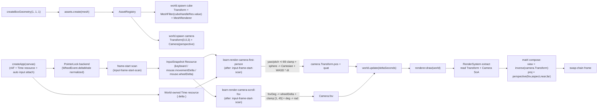

<!-- LANG-SWITCH -->
**Language**: **English** · [简体中文](README.zh-CN.md)

# Camera (LearnOpenGL §1.7)

> [!NOTE]
> **Original chapter**: [LearnOpenGL 1.7 Camera](https://learnopengl.com/Getting-started/Camera)
>
> **Engine capability**: feat-20260515 / feat-20260519: createApp, dt compensation, wheel FoV, first-class facade and resolved V-3 deferral. engine-input owns InputSnapshot Resource, wheelDelta, frame-start scanning and PointerLock. `renderer.input.snapshot(world)` exposes input; Camera has nine f32 SoA columns and Transform ten. createApp owns rAF, Time and input attachment; ECS addSystem schedules updates (charter P4 / AC-04/05/06/09). WASD with dt compensation, yaw/pitch and wheel zoom hide DOM, deltaMode normalization and firstMouse state behind one snapshot entry.

## LO 1.7 Subexample Coverage

| LO subexample | Coverage | ForgeaX differences |
|:--|:--|:--|
| **7.1 circle camera** (`time = glfwGetTime(); cameraPos = vec3(sin(t)*radius, 0, cos(t)*radius)`) | Out of scope | Starts directly at 7.2/7.3 first-person control with one cube (OOS-9). |
| **7.2 keyboard_dt** (`cameraSpeed = 2.5f * deltaTime`) | Covered: first-person-controls.ts CAMERA_SPEED_PER_SECOND=2.5 and world.getResource(Time).delta | LO maintains lastFrame/currentFrame using glfwGetTime(); World-owned Time supplies delta without extending system callback signatures (D-1). |
| **7.3 mouse_zoom** (`fov -= yoffset`) | Covered: createScrollFovAccumulator starts fovDeg=45, clamps [1,45], writes Camera.fov=fovDeg*Math.PI/180 | LO uses degrees; Camera.fov uses radians, converted inside the system (D-4). wheelDelta is sign-discrete notches, not raw deltaY pixels (D-5). |
| **7.4 camera_class** (Position/Front/Up/Right, ProcessKeyboard/MouseMovement/MouseScroll) | Out of scope | No OOP Camera wrapper: Transform owns position/orientation, Camera owns projection, system closures own yaw/pitch/fov accumulators (OOS-9). |

## What This Example Shows

LO 1.7 receives absolute mouse coordinates through glfwSetCursorPosCallback/mouse_callback and derives deltas with lastX/lastY/firstMouse, changes fov through scroll_callback, and moves through processInput/glfwGetKey using 2.5*deltaTime. ForgeaX splits this into three layers (charter P4 / AC-05/06/09):

1. **Five-field snapshot SDK**: keyboard.down/up, mouse.movementDelta, mouse.button(0|1|2), mouse.wheelDelta (D-7). Frame-start scanning freezes InputBackend.sample() accumulators into InputSnapshot. Users write no mousemove/wheel listeners, requestPointerLock, firstMouse initialization or deltaMode branches; call renderer.input.snapshot(world).

2. **dt compensation**: frame start updates World-owned Time; the first-person system reads world.getResource(Time).delta (D-1). Displacement uses cameraSpeed*dt; two 60fps frames equal one 30fps frame, covered by camera-dt-equivalence.test.ts.

3. **Wheel FoV**: a separate scroll-system closure retains fovDeg=45, clamps [1,45], consumes discrete wheelDelta (D-5) and writes Camera.fov=fovDeg*Math.PI/180 (D-4).

> [!IMPORTANT]
> **Browser/GLFW details stay behind the snapshot API.** Register an Update system that reads renderer.input.snapshot(world) and Time.delta, then writes Transform/Camera. world.update(deltaSeconds) orders frame-start scanning before camera/scroll systems (D-1/2/4/5/7). The public vocabulary is five snapshot fields, Transform/Camera SoA data and Time, without glfwSetCursorPosCallback, glfwSetScrollCallback, processInput, firstMouse, glfwGetKey, glm::lookAt or WheelEvent.deltaMode.

## dt Speed Compensation (LO 1.7.2)

LO 1.7.2 teaches `cameraSpeed = 2.5f * deltaTime` explicitly:

> "When pressing W you would move the position of the camera with cameraSpeed * cameraFront ... however an issue arises when working with movement that's based on the speed at which a frame can be processed: the user with the slow system would move much slower than the user with the fast system. ... A common technique is to use deltaTime ..." — [LearnOpenGL §1.7.2 Camera (Movement Speed)](https://learnopengl.com/Getting-started/Camera#:~:text=cameraSpeed%20%3D%202.5f%20%2A%20deltaTime)

The C++ loop computes `currentFrame = glfwGetTime(); deltaTime = currentFrame - lastFrame; lastFrame = currentFrame;`, then processInput uses `cameraSpeed = 2.5f * deltaTime`.

World-owned Time centralizes dt (D-1). The system reads `const dt = world.getResource(Time).delta;` without changing addSystem callback signatures (OOS-6). Pure `first-person-controls.ts#computeWasdDisplacement(dt, fwd, right, held)` is shared by tests and the system (charter P5).

| Dimension | LO C++ default | ForgeaX default |
|:--|:--|:--|
| dt | glfwGetTime() and manual lastFrame | World-owned Time; system reads world.getResource(Time).delta |
| Speed | 2.5f magic number | CAMERA_SPEED_PER_SECOND=2.5 in first-person-controls.ts |
| Equivalence | Tutorial prose | camera-dt-equivalence.test.ts: two 60fps frames versus one 30fps frame, epsilon <= 1e-9 |

## scroll-wheel FoV zoom（LO §1.7.3）

LO 1.7.3 teaches wheel zoom separately:

> "We're going to introduce a small zoom interface ... Whenever the user scrolls, the yoffset value tells us the amount we scrolled vertically. When the scroll_callback function is called we change the contents of the globally declared fov variable. Because 45.0 is the default fov value we want to constrain the zoom level between 1.0 and 45.0." — [LearnOpenGL §1.7.3 Camera (Zoom)](https://learnopengl.com/Getting-started/Camera#:~:text=void%20scroll_callback)

C++ uses `scroll_callback(double xoffset, double yoffset) { fov -= (float)yoffset; if (fov < 1.0f) fov = 1.0f; if (fov > 45.0f) fov = 45.0f; }`, then glm::perspective(glm::radians(fov), ...) converts degrees for upload.

PointerLock backend uses Math.sign(event.deltaY) for +/-1 notches instead of raw accumulation. Cross-browser deltaMode can yield trackpad deltaY above 100 and hit the clamp in one frame. D-5 trades fine trackpad zoom speed for consistent discrete input. InputSnapshot.mouse.wheelDelta is discrete notches per frame with direction in its sign (D-7).

The demo's separate scroll system retains degree-valued fovDeg, subtracts wheelDelta, clamps [1,45] and writes radians to Camera.fov (D-4). Pure closure factory createScrollFovAccumulator() is shared by camera-fov-zoom.test.ts and the system (charter P5).

| Dimension | LO C++ default | ForgeaX default |
|:--|:--|:--|
| Wheel source | Global glfwSetScrollCallback(window, scroll_callback) | Internal backend wheel listener; InputSnapshot.mouse.wheelDelta |
| Normalization | Direct yoffset; GLFW specifies notches | Math.sign(event.deltaY), preventing trackpad deltaMode from immediately hitting clamps (D-5) |
| FoV units | Global degrees, 45.0f / 1.0f | Camera.fov radians; Math.PI/4=45 degrees |
| Conversion | glm::perspective(glm::radians(fov), ...) in main loop | Scroll system writes Camera.fov=fovDeg*Math.PI/180 (D-4) |
| Clamp | `if (fov < 1.0f) fov = 1.0f; if (fov > 45.0f) fov = 45.0f;` | `if (fovDeg < 1) fovDeg = 1; if (fovDeg > 45) fovDeg = 45;`, retaining LO degree constants |

## Rendering Flow



## Engine Usage

Calls come from [src/index.ts](src/index.ts)'s bootstrap. assets/world belong to an existing App; textureGuid is verified and materialEntry.payload is the example Pack's material declaration.

```ts
import { createBoxGeometry } from '@forgeax/engine-geometry';
import { MeshFilter, MeshRenderer } from '@forgeax/engine-render';
import { Transform } from '@forgeax/engine-scene';

configureRuntimeAssetCatalog(assets, runtimeBinding);
const texture = (await assets.load(textureGuid, 'texture')).unwrap();
const cube = assets.create(createBoxGeometry(1, 1, 1).unwrap()).unwrap();
const material = assets.create({
  ...materialEntry.payload,
  values: { ...materialEntry.payload.values, baseColorTexture: texture },
}).unwrap();
world.spawn(
  { component: Transform, data: { pos: [0, 0, 0] } },
  { component: MeshFilter, data: { assetHandle: cube } },
  { component: MeshRenderer, data: { materials: [material] } },
).unwrap();
```

Catalog GUIDs load textures; assets.create establishes geometry/material identity. Cameras/Update systems remain in the example's ECS composition; app.start() drives frames. Update color with `assets.update(material, { values: { baseColor: [1, 0.5, 0.2, 1] } }).unwrap()`; the asset owner maintains versions/render updates.

## Differences From LO

| Dimension | Original LO (C++ / GLFW) | ForgeaX (TS / WGSL) |
|:--|:--|:--|
| Mouse events | Global glfwSetCursorPosCallback/window mouse_callback receives absolute xpos/ypos | attachBrowserInputBackend hides PointerLock/mousemove/keydown/keyup in InputBackend.sample(); engine.input.snapshot() supplies per-frame movementDelta={x,y} |
| First-frame jumps | firstMouse/lastX/lastY globals plus initialization branch | PointerLock movementX/Y already provides relative deltas (W3C); no firstMouse branch (charter P4) |
| Y inversion | lastY-ypos flips downward-growing screen coordinates | Preserve movementY; first-person system uses pitch-=dy for upward-look semantics (LO Look around, paragraph 2) |
| Sensitivity | xoffset*=sensitivity; yoffset*=sensitivity in callback | MOUSE_SENSITIVITY applied in first-person system, e.g. yaw+=dx*MOUSE_SENSITIVITY |
| Pitch clamp | Degrees: if(pitch>89) pitch=89; if(pitch<-89) pitch=-89 | Radians via PITCH_CLAMP_RAD, matching Math.sin/cos |
| Spherical to Cartesian | `front.x = cos(glm::radians(yaw)) * cos(glm::radians(pitch)); front.y = sin(glm::radians(pitch)); front.z = sin(glm::radians(yaw)) * cos(glm::radians(pitch)); cameraFront = glm::normalize(front);` | `fwdX=cos(yaw)*cos(pitch); fwdY=sin(pitch); fwdZ=sin(yaw)*cos(pitch);`; radians directly, no normalize because cos²(pitch)+sin²(pitch)=1 |
| View | Explicit glm::lookAt(cameraPos,cameraPos+cameraFront,cameraUp) | System writes Tait-Bryan Y*X quaternion to camera Transform; RenderSystem computes inverse(camera.Transform) |
| WASD | Main-loop processInput uses glfwGetKey and cameraSpeed*cameraFront | System reads snapshot.keyboard.down('KeyW'); addSystem is the common schedule entry, without processInput wrapper (charter P4) |
| Key names | GLFW_KEY_W/S/A/D integer enums | KeyboardEvent.code literals 'KeyW'/'KeyS'/'KeyA'/'KeyD', independent of keyboard layout (W3C UI Events) |
| cameraSpeed*deltaTime | `float cameraSpeed = 2.5f * deltaTime;` | Historical M11 MVP used KEYBOARD_SPEED without normalization (feat-20260515 OOS-1); see the dt-compensation section for the later implementation |
| Cursor/capture | Explicit glfwSetInputMode(window,GLFW_CURSOR,GLFW_CURSOR_DISABLED) | attachBrowserInputBackend's internal click handler calls canvas.requestPointerLock(); first click activates it, with no user glue (charter P4) |
| Errors | glm/callbacks return none; missing firstMouse or pitch clamps silently cause jumps/flips | Structured err.code (RhiErrorCode 18 / EcsErrorCode 23), expected/hint/detail and exhaustive narrowing, without message parsing (charter P3) |
| Flow | DOM/mouse_callback mutates global lastX/lastY/yaw/pitch, processInput changes cameraPos, uniform upload, draw | DOM accumulates in InputBackend; scan freezes InputSnapshot; camera system reads it and writes Transform SoA; RenderSystem queries, composes mat4, draws |

## Key Source Files

| File | Lines | Role |
|:--|---:|:--|
| `src/index.ts` | ~430 | Three sections, cube/camera spawn, first-person system, capture hook and automatic test harness |
| `src/__tests__/camera.browser.test.ts` | ~230 | Vitest browser e2e: markers/input, cube metadata, WebGPU, +/-89-degree clamp and spherical/Cartesian mapping (AC-04/05/06/07/22) |
| `src/__tests__/camera-input.dawn.test.ts` | ~140 | Dawn e2e: Resource writes, held WASD, per-frame mouse delta and release-edge collapse (AC-07) |
| `scripts/smoke-dawn.mjs` | ~430 | Build/start/cube load, synthetic InputBackend (60 W frames, 60 D, 80 yaw, 80 pitch), 300 frames and pixel readback epsilon <=0.05 |
| `scripts/bench-screenshot.mjs` | ~180 | Playwright/chrome-beta records round-7-camera.png in forgeax-engine-assets |

## Run

```bash
# Dev server (Vite preview port 5186)
pnpm --filter "@forgeax/app-learn-render-1-getting-started-7-camera" dev

# Build dist/
pnpm --filter "@forgeax/app-learn-render-1-getting-started-7-camera" build

# vitest browser e2e（chromium + WebGPU）
pnpm test:browser

# Vitest Dawn e2e (native dawn-node bindings)
pnpm test:dawn

# Dawn: 300 frames and pixel readback
pnpm --filter "@forgeax/app-learn-render-1-getting-started-7-camera" smoke

# Record golden PNG in forgeax-engine-assets
pnpm --filter "@forgeax/app-learn-render-1-getting-started-7-camera" exec node scripts/bench-screenshot.mjs

# Pixel parity, including round-7-camera.png
pnpm bench:pixel-parity
```

<details>
<summary>Original LO C++/GLSL excerpts (reference)</summary>

Core LO 1.7 from `src/1.getting_started/7.4.camera_class/camera_class.cpp` and `7.3.camera_mouse_zoom/camera_mouse_zoom.cpp` ([JoeyDeVries/LearnOpenGL master](https://github.com/JoeyDeVries/LearnOpenGL)):

```cpp
// camera_mouse_zoom.cpp -- glfw mouse_callback + processInput + WASD
#include <GLFW/glfw3.h>
#include <glm/glm.hpp>
#include <glm/gtc/matrix_transform.hpp>

// camera state
glm::vec3 cameraPos   = glm::vec3(0.0f, 0.0f,  3.0f);
glm::vec3 cameraFront = glm::vec3(0.0f, 0.0f, -1.0f);
glm::vec3 cameraUp    = glm::vec3(0.0f, 1.0f,  0.0f);

// mouse callback state
bool firstMouse = true;
float yaw   = -90.0f; // initial yaw -90 so cameraFront points at -z
float pitch =   0.0f;
float lastX =  800.0f / 2.0f;
float lastY =  600.0f / 2.0f;
float fov   =  45.0f;

// glfwSetCursorPosCallback wires this into the GLFW window
void mouse_callback(GLFWwindow* window, double xpos, double ypos)
{
    if (firstMouse)
    {
        lastX = xpos;
        lastY = ypos;
        firstMouse = false;
    }

    float xoffset = xpos - lastX;
    float yoffset = lastY - ypos; // reversed: y-coordinates go from bottom to top
    lastX = xpos;
    lastY = ypos;

    float sensitivity = 0.1f;
    xoffset *= sensitivity;
    yoffset *= sensitivity;

    yaw   += xoffset;
    pitch += yoffset;

    // make sure that when pitch is out of bounds, screen doesn't get flipped
    if (pitch > 89.0f)
        pitch = 89.0f;
    if (pitch < -89.0f)
        pitch = -89.0f;

    glm::vec3 front;
    front.x = cos(glm::radians(yaw)) * cos(glm::radians(pitch));
    front.y = sin(glm::radians(pitch));
    front.z = sin(glm::radians(yaw)) * cos(glm::radians(pitch));
    cameraFront = glm::normalize(front);
}

void processInput(GLFWwindow *window)
{
    if (glfwGetKey(window, GLFW_KEY_ESCAPE) == GLFW_PRESS)
        glfwSetWindowShouldClose(window, true);

    float cameraSpeed = static_cast<float>(2.5 * deltaTime);
    if (glfwGetKey(window, GLFW_KEY_W) == GLFW_PRESS)
        cameraPos += cameraSpeed * cameraFront;
    if (glfwGetKey(window, GLFW_KEY_S) == GLFW_PRESS)
        cameraPos -= cameraSpeed * cameraFront;
    if (glfwGetKey(window, GLFW_KEY_A) == GLFW_PRESS)
        cameraPos -= glm::normalize(glm::cross(cameraFront, cameraUp)) * cameraSpeed;
    if (glfwGetKey(window, GLFW_KEY_D) == GLFW_PRESS)
        cameraPos += glm::normalize(glm::cross(cameraFront, cameraUp)) * cameraSpeed;
}

int main()
{
    // ... (glfwInit, window creation, GLAD load, shader compile)

    // hide cursor + capture into the window
    glfwSetInputMode(window, GLFW_CURSOR, GLFW_CURSOR_DISABLED);
    glfwSetCursorPosCallback(window, mouse_callback);

    while (!glfwWindowShouldClose(window))
    {
        processInput(window);

        glClearColor(0.2f, 0.3f, 0.3f, 1.0f);
        glClear(GL_COLOR_BUFFER_BIT | GL_DEPTH_BUFFER_BIT);

        ourShader.use();

        glm::mat4 projection = glm::perspective(glm::radians(fov), (float)SCR_WIDTH / (float)SCR_HEIGHT, 0.1f, 100.0f);
        ourShader.setMat4("projection", projection);

        glm::mat4 view = glm::lookAt(cameraPos, cameraPos + cameraFront, cameraUp);
        ourShader.setMat4("view", view);

        // ... (draw cubes)

        glfwSwapBuffers(window);
        glfwPollEvents();
    }
}
```

This block contains all thirty required LO 1.7 GLFW/GLM identifiers: `glfwSetCursorPosCallback`, `mouse_callback`, `processInput`, `firstMouse`, `lastX`, `lastY`, `yaw`, `pitch`, `pitch > 89.0f`, `pitch < -89.0f`, `glm::radians(yaw)`, `glm::radians(pitch)`, `cos(glm::radians(yaw)) * cos(glm::radians(pitch))`, `sin(glm::radians(pitch))`, `glm::normalize(front)`, `cameraFront`, `cameraPos`, `cameraUp`, `cameraSpeed * cameraFront`, `glm::cross(cameraFront, cameraUp)`, `glm::lookAt(cameraPos, cameraPos + cameraFront, cameraUp)`, `glfwGetKey(window, GLFW_KEY_W)`, `GLFW_KEY_W`, `GLFW_KEY_S`, `GLFW_KEY_A`, `GLFW_KEY_D`, `GLFW_CURSOR_DISABLED`, `glfwSetInputMode` (AC-23 / T-M11-04).

</details>

> [!IMPORTANT]
> **AC-24 err.code comparison:** browser mouse.movementDelta already contains PointerLock per-frame deltas (W3C movementX/Y), requiring no firstMouse. InputSnapshot hides browser details. Scan failures, world.update(deltaSeconds) scheduling failures and Camera.fov===0 use closed err.code families (RhiErrorCode 18 / EcsErrorCode 23 / InspectorErrorCode 6) plus expected/hint/detail, enabling exhaustive switch (charter P3).
