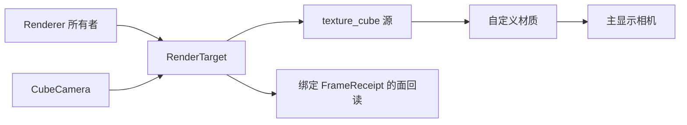
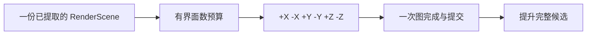

<!-- LANG-SWITCH -->
**语言**：[English](README.md) · **简体中文**

# RenderTarget、CubeCamera 与 ReflectionProbe

> [!NOTE]
> 这个由 Engine 维护的消费示例展示 PBR 反射路径使用的公开渲染目标契约。

## 这个示例展示什么

常规示例创建立方体 `RenderTarget`，将纹理公开为 `texture_cube` 材质源，再由 `CubeCamera` 用六种确定颜色填充六个面。六面候选被提升为当前版本后，显示网格采样同一立方体源，浏览器冒烟测试检查其真实画布像素。可选的反射模式继续验证 `ReflectionProbe` 原始捕获和粗糙度 Mip 层级。

Browser 和 Dawn 证据脚本运行相同公开消费者。健康渲染器的 `recover()` 按契约返回 `renderer-state-invalid`，这是对健康状态恢复请求的保护，不代表设备丢失。实际恢复通过所属模块的失效和重建路径执行；设备 generation 改变后不能再观察旧回执。

## 渲染流程



## 引擎用法

```ts
const targetResult = renderer.createRenderTarget({
  shape: 'cube',
  width: 64,
  height: 64,
  format: 'rgba8unorm-srgb',
  mipLevels: 1,
  sampleCount: 4,
  sampled: true,
  readback: true,
});
if (!targetResult.ok) throw targetResult.error;
const target = targetResult.value;
const sourceResult = renderer.createRenderTargetTextureSource(target, {
  aspect: 'color',
  dimension: 'cube',
  mipLevel: 0,
});
if (!sourceResult.ok) throw sourceResult.error;
const source = sourceResult.value;
const targetHandle = world.allocSharedRef('RenderTarget', target);
const sourceHandle = { source };
const material = assets.create({
  kind: 'material',
  passes: [{ name: 'Forward', program: {
    module: 'learn_render::6_4_cube_reflection',
    vertexEntry: 'vs_main', fragmentEntry: 'fs_main',
  } }],
  parameters: [
    { name: 'baseColor', type: 'color' },
    { name: 'cubeTexture', type: 'texture_cube' },
  ],
  values: { baseColor: [1, 1, 1, 1], cubeTexture: sourceHandle },
}).unwrap();
world.spawn({
  component: CubeCamera,
  data: { target: targetHandle, near: 0.1, far: 20, updateIntent: 0, requestVersion: 0, faceBudget: 6 },
});
// Bind `material` to the display mesh; it samples the promoted cube source.
const ticketResult = renderer.requestTargetReadback(target, { mipLevel: 0, layer: 0 });
if (!ticketResult.ok) throw ticketResult.error;
const ticket = ticketResult.value;
const receiptResult = renderer.draw({ source: lease });
if (!receiptResult.ok) throw receiptResult.error;
const receipt = receiptResult.value;
const completed = await receipt.completed;
if (!completed.ok) throw completed.error;
const result = await renderer.observe(receipt, {
  include: ['target-readbacks'],
  targetReadbacks: [ticket],
});
if (!result.ok) throw result.error;
```

完整消费者位于 `src/index.ts`，通过 `__renderTargetReflectionReport` 发布稳定目标 ID、启动 URL、回执帧与 generation、回读字节数和恢复码，供冒烟断言使用。

常规路径的报告还包含 `materialSampling`：自定义着色器 ID、立方体源形状、主画布中心像素，以及它与最接近期望立方体面颜色的误差。这是对 `CubeCamera -> RenderTarget -> RenderTargetTextureSource -> texture_cube binding -> draw` 产生可见像素的端到端断言。

## CubeCamera 捕获

`CubeCamera` 是瞬时捕获意图，与 `Transform` 和共享立方体 `RenderTarget` 配对。渲染器在同一显示帧内完成捕获：



规范面顺序为 `+X, -X, +Y, -Y, +Z, -Z`。六个面共享同一成功 `FrameReceipt` 后，候选才可被采样和提升；失败或嵌套捕获保留上一个活动 generation，或使用文档约定的中性回退。Standard 捕获贡献排除调试层、UI 覆盖层和候选目标本身。

CPU 朝向基准由 `src/__tests__/cube-camera.browser.test.ts` 覆盖。Browser 和 Dawn 证据入口为 `scripts/smoke-cube-camera-browser.mjs`、`scripts/smoke-cube-camera-dawn.mjs`；它们必须发布六面回读值、真实 `texture_cube` 材质消费者像素、resolve 身份、后端、源 SHA 和未捕获 GPU 错误，才能作为像素证据。创作着色器及其生成的立方体绑定位于 `src/cube-reflection.wgsl`、`src/cube-reflection.pack.json`。

## ReflectionProbe M4 证据

Engine 通过公开渲染接口提供 ReflectionProbe 组件、由渲染器拥有的原始立方体捕获、
增量 PMREM 过滤、最近有效版本提升、场景选择、局部盒投影、粗糙度 LOD 和 Skylight 回退。
`renderer.inspect().reflectionProbes.selection` 报告选中探针的 `entityKey`，
或 `{ kind: 'skylight' }` 回退。
配套契约测试为 `src/__tests__/reflection-probe.browser.test.ts` 和
`src/__tests__/reflection-probe.browser.test.ts`。

M4 冒烟入口为 `scripts/smoke-reflection-probe-browser.mjs` 和
`scripts/smoke-reflection-probe-dawn.mjs`。Browser 捕获真实显示 PNG 和 ROI；
两条路径都断言六个原始捕获面、全部 30 个 PMREM 面/Mip 步骤、0..4 的 Mip 范围、
没有未捕获 GPU 错误，以及探针内和探针外 Skylight 的夹具。每份报告都包含精确源修订。

五个稳定目标 ID 和四条配套证据命令见 `src/feature-manifest.json`；
它仅是消费者清单，运行时不会读取它。

## SSR 依赖回退证据

仅含回退的依赖夹具在 `artifacts/ssr-fallback/` 发布配套 Browser、Dawn 清单。
两条路径绑定同一源 HEAD、源树、锁文件哈希、Render 构建哈希、夹具修订和 60 帧运行。
先读 `manifest.json` 的 `status`、`identity` 和每项期望的
`observed`/`verdict`/`confidence`，再沿 `readback.locator`、`png.locator`、
`readback.validationLog` 查看原始证据。固定阈值为线性 HDR 绝对误差 `<= 0.05`、
HDR 亮度相对误差 `<= 0.02`。

配套命令是 `scripts/smoke-browser.mjs` 和 `scripts/smoke-dawn.mjs`，分别独立执行
WebGPU 与 Dawn，页面存活、RhiNull 输出或另一后端都不能替代它们。
`scripts/falsification.mjs` 中仅用于开发的变异会故意让候选可见性、BRDF 源不匹配、
缺少 r32float storage 用途等检查失败；这些变异不是 CI 证据。

此补充只开放依赖证据，不实现 SSR v1、Hi-Z、光线步进、时域 resolve、合成或历史。
任何回执缺失或不匹配时，上层 SSR 消费者继续保持仅回退模式。

AI 恢复路径从 `renderer.inspect()` 和配套清单身份开始，再遵循结构化失败的
`expected`、`hint` 及 owner/action 详情。只通过所属模块重建或恢复，重新提交并检查。
夹具发布脱离运行态的证据，不公开存活 GPU 句柄，也不建立第二份报告权威。
`artifacts/ssr-fallback/README.md` 是面向机器的证据层级、定位信息与恢复语义索引。

## 与 LO 原版的差异

| 维度 | LearnOpenGL 风格 | ForgeAX 方式 |
|:--|:--|:--|
| 渲染目的地 | 通过全局 OpenGL 状态管理帧缓冲和纹理 | `Renderer` 拥有不透明的目标与源句柄 |
| 相机职责 | 捕获相机写入手动管理的帧缓冲 | `CubeCamera` 声明显式且有界的捕获意图，显示相机消费结果源 |
| 回读 | 调用方临时同步后读取像素 | 观察回读票据前必须取得匹配的 `FrameReceipt` |
| 错误处理 | 字符串日志或未检查的 API 错误 | 结构化 `err.code`、`err.expected`、`err.hint` 和可判别的 `err.detail` 指引恢复 |

## 运行

```bash
pnpm --filter @forgeax/app-learn-render-6-pbr-4-render-target-reflection dev
pnpm --filter @forgeax/app-learn-render-6-pbr-4-render-target-reflection build
pnpm --filter @forgeax/app-learn-render-6-pbr-4-render-target-reflection smoke
pnpm --filter @forgeax/app-learn-render-6-pbr-4-render-target-reflection smoke:browser
```

<details>
<summary>LearnOpenGL 帧缓冲术语</summary>

原始 OpenGL 路径围绕帧缓冲对象使用 `glBindTexture`、`glClear`、`glFramebufferTexture2D` 等标识符。ForgeAX 在有类型的渲染器所属模块内部管理这些概念，只向消费者公开 target/source 契约。

</details>
