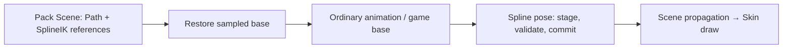

# `@forgeax/engine-animation`

> [!IMPORTANT]
> Ordinary entities and skin joints use the same `AnimationTargetId` model. A
> TRS target needs `Transform`, but does not need `Skin` or a renderer component.
> Explicit object/component property tracks do not need `Transform`.

`animationPlugin()` consumes the runtime asset owner attached to its World.
Clips and graphs created or loaded by that owner bind directly to `AnimationPlayer`.
Edits are sampled at the next playback step; player clocks and weights remain World state.
There is no separately injected payload lookup or World asset registration.

## Quick start

```ts
import {
  AnimationPlayer,
  animationClipContribution,
  AnimationTargetId,
  animationPlugin,
  bindAnimationTargets,
  deriveAnimationTargetId,
} from '@forgeax/engine-animation';
import { AssetRegistry } from '@forgeax/engine-assets-runtime';
import { createWorldContext, World } from '@forgeax/engine-ecs';
import { ChildOf, Name, Transform } from '@forgeax/engine-scene';
import type { AnimationClip } from '@forgeax/engine-types';

const assets = new AssetRegistry();
assets.installDecoder(animationClipContribution.kind, animationClipContribution.decoder);
const world = new World({ assets });
const context = await createWorldContext(world, [animationPlugin()]);

const targetId = deriveAnimationTargetId(['Root', 'Planet']);
const clip = {
  kind: 'animation-clip',
  duration: 1,
  channels: [{
    targetId,
    property: 'translation',
    sampler: {
      input: new Float32Array([0, 1]),
      output: new Float32Array([0, 0, 0, 4, 0, 0]),
      interpolation: 'LINEAR',
    },
  }],
} satisfies AnimationClip;
const clipHandle = assets.create(clip).unwrap();
const slots = {
  clips: [clipHandle],
  times: [0],
  weights: [1],
  speeds: [1],
};
const player = world.spawn(
  { component: Transform, data: {} },
  { component: Name, data: { value: 'Root' } },
  { component: AnimationPlayer, data: slots },
).unwrap();
const target = world.spawn(
  { component: Transform, data: {} },
  { component: Name, data: { value: 'Planet' } },
  { component: ChildOf, data: { parent: player } },
  { component: AnimationTargetId, data: { value: targetId } },
).unwrap();

const bound = bindAnimationTargets(world, player, [target]);
if (!bound.ok) throw bound.error;
world.update(1 / 60);
await context.fiber.restart();
```

For imported scenes, collect targets explicitly from `SceneInstance.mapping`.
Only `ENTITY_NULL_RAW` is absent from that mapping; entity handle `0` is valid.
Adding an `AnimationPlayer` does not scan the scene tree. `AnimationGraph`
playback uses the same player, target IDs, channels, and update system.

The existing target binding cache assigns dense joint indices. Evaluation reuses
numeric accumulators and output vectors through those indices, with independent
scratch for nested calls. Each player starts a new accumulator generation; absent
channels retain their current Transform values. World still receives at most one
changed Transform write per target, with f32 and signed-zero comparisons. Scratch
retains no component or asset objects; diagnostic and property maps remain local.

## Presentation timing

AnimationTargetId requires Scene's transient TransformInterpolation marker,
without requiring Transform for ordinary component/property targets. Fixed
TRS animation uses the same final-two-tick sampler as physics. Update TRS
animation uses its current sample on the parent's interpolated hierarchy.
Render and skin palettes consume `readPresentationWorldMatrix`; animation
continues to write only local Transform and never owns a renderer pose cache.

## Identity and ownership

- `AnimationTargetId` is the stable authored identity. Its wire value is exactly
  **32 lowercase hexadecimal** characters.
- `deriveAnimationTargetId(path)` length-prefixes the UTF-8 path segments under
  a fixed namespace, hashes them with BLAKE3, and writes the UUID v8 version and
  variant bits before rendering that wire value.
- `AnimatedBy` stores the target's one live player owner.
- `AnimationTargets` is the ECS-maintained reverse relationship on that player.
- `bindAnimationTargets(world, player, targets)` validates the complete explicit
  batch before assigning missing IDs or ownership. Repeating the same batch is
  idempotent.
- An existing ID survives rename or reparent. When binding creates a missing ID,
  it derives it from the complete `Name` lineage from the player through the
  target, including both endpoints.
- Importers and other authoring tools instead persist IDs derived from the source
  asset root through each target. A synthetic runtime controller above that
  asset root is not part of the authored path, so multiple instances of one
  asset reuse the same target IDs. Importers write those IDs to animated glTF/FBX
  scene entities and matching clip channels.

Animation channels contain one `targetId`. The previous `targetPath` wire was a
clean cut: there is no dual read, adapter, or fallback.

Published clips keep numeric sampler `input`/`output` arrays in the
`animation-clip/samples.bin` artifact (little-endian f32); the payload holds
`{ offset, count }` element windows into it. String and boolean property outputs
stay inline. Pack's `encodeAnimationClipSamples` is the single producer codec
used by the glTF, FBX and ScriptablePack producers, and the decoder resolves the
windows to `Float32Array` views before ordinary sampler validation. In-memory
clips and inline JSON arrays still decode unchanged.

## TypeScript-first animation control

> [!IMPORTANT]
> TypeScript is the primary animation-control language. ForgeaX does not require
> or provide a native animation FSM, transition-condition language, or controller
> asset. An FSM used by a game is a specialization of ordinary TypeScript control
> code; it must not become the mandatory execution or authoring boundary.

| Concern | Owner |
|:--|:--|
| Which clips play, conditional selection and transition policy | Typed game components and ordinary Update systems |
| Reusable control code, configuration and clip GUID references | Existing PluginAsset / Pack program compilation and native plugin lifecycle |
| Playback clocks, weights, sampling and pose output | AnimationPlayer and the existing animation schedule |

Install control systems through the existing World/plugin contribution lifecycle.
Keep per-entity control state in ECS and reuse gameplay state instead of mirroring
it into a second animation state machine. A PluginAsset carries the program and
configuration; it does not replace runtime playback state. See the
[plugin contract](../plugin/README.md).

For direct playback (`graph == 0`), code controls `clips`, `times`, `weights` and
`speeds`; keep all four columns length-aligned and run control before
`advanceAnimationPlayer`. For graph playback, code controls `nodeWeights`,
`nodeTimes`, `nodeSpeeds` and clip-node `nodeMasks` before `evaluateAnimationGraph`; the evaluator owns
the derived slots. Graph clip/blend/add nodes describe pose composition, not
conditional gameplay control flow.

Shared transition, phase-sync, BlendSpace or mask mechanisms must be justified
and verified by their playback result independently of a control-language choice.
This policy does not claim those mechanisms are all delivered, or that code is
inherently faster. No additional animation-controller asset or parallel registry
is needed to make TypeScript control reusable.

## BlendSpace weights and target masks

> [!TIP]
> Compile reusable data once. Ordinary TypeScript Update systems sample parameters
> and write the existing player controls; no new graph node or controller asset is required.

| Mechanism | Contract |
|:--|:--|
| `createBlendSpace1D(samples)` | Finite, distinct positions; original sample order is preserved. Linear interpolation uses the nearest two neighbors, clamping outside to an endpoint. One sample is valid. |
| `createBlendSpace2D({ points, triangles })` | Explicit authored triangle indices, either winding, every sample covered. Barycentric weights inside a triangle; nearest triangle-edge projection outside. Author valid non-overlapping topology; shared edges are continuous. Overlaps use the first containing triangle. Automatic triangulation is outside this first stage. |
| `space.sample(weights, ...)` | Writes a caller-owned `Float32Array` of exactly `sampleCount` entries. Nonnegative weights sum to one within Float32 precision. Invalid input preserves the output. Layouts are copied at compilation; sampling allocates a Result but no scratch arrays. |
| `defineAnimationMask(targets, defaultWeight = 0)` | Snapshots immutable reusable `{ targetId, weight }` data. Finite weights lie in `[0,1]`; each canonical target ID appears once. Unlisted targets use the default. IDs apply equally to joints, ordinary transforms, morphs and property tracks. |
| `AnimationPlayer.masks` | Empty means all unmasked. Otherwise length equals `clips.length`; `0` is unmasked, other entries are World-local shared mask handles. |
| `AnimationPlayer.nodeMasks` | Graph-node indices; missing entries mean unmasked. Only clip nodes accept nonzero handles. Graph evaluation derives slot masks and retains the existing clock owner. |

```ts
import { createBlendSpace1D, defineAnimationMask } from '@forgeax/engine/animation';
import { toShared } from '@forgeax/engine/types';

// Store this program/configuration in an ordinary PluginAsset when reuse is needed.
const locomotion = createBlendSpace1D([0, 1, 4]).unwrap();
const weights = new Float32Array(locomotion.sampleCount);
const upper = world.allocSharedRef('AnimationMask',
  defineAnimationMask(upperJointIds.map(targetId => ({ targetId, weight: 1 }))).unwrap());

// In an Update system before advanceAnimationPlayer:
locomotion.sample(weights, speed).unwrap();
world.set(player, AnimationPlayer, { weights }).unwrap();
// A separate two-clip player can combine a base and a complete overlay clip:
world.set(layeredPlayer, AnimationPlayer, { masks: [toShared<'AnimationMask'>(0), upper] }).unwrap();
```

A mask multiplies slot weight **before the existing per-channel normalization**.
It expresses relative influence, not absolute alpha against a reference pose:
base weight `0.25` plus overlay weight `0.75` with target mask `0.5` gives overlay
influence `0.375 / (0.25 + 0.375) = 0.6`. A zero mask skips that channel, including
missing-target diagnostics. When every influence is zero, the current pose stays
unchanged while playback clocks follow their ordinary controls.

Masks follow existing shared-reference ownership: retain a World-local handle in
player controls, release the caller lease when appropriate, and rebuild bindings
for a new World. Definitions are reusable across Worlds; handles are not. The two mask columns
are transient: Scene collection omits them, and the existing PluginAsset control
program recreates bindings from its reusable configuration. Masks add no asset kind.
Synchronized normalized phase remains ordinary code: write `times[i] = phase *
clip.duration` with `speeds[i] = 0`, or equivalent `nodeTimes`/`nodeSpeeds` before
graph evaluation. Marker-based synchronization and reference-pose/additive layer
semantics are separate capabilities.

`AnimationBlendErrorCode` is the closed error vocabulary for invalid layouts,
mask definitions and mask-column lengths. Compile/sample failures return a
`Result`; playback failures follow the existing failed-World recovery contract.
Mask validation precedes clock and pose writes for the affected player.

See the visual `animation-blending` Feature Lab case, the playback integration
regression, and `packages/animation/bench/blending.mjs` for effect and scaling checks.

## Playback and diagnostics

Direct slots and `AnimationGraph` output both flow through `AnimationPlayer` and
the default animation schedule. Translation, rotation, and scale are blended
before at most one final local `Transform` write. Only vectors whose values differ
from the current destination after Float32 rounding are submitted; signed zero
is preserved and NaN samples retain explicit writes. Player clocks, timeline
events, and pose sampling still advance normally. Comparing the current columns
also restores external author edits without a second pose cache. Normal scene
propagation then computes world transforms.

Development diagnostics are structured objects with `code`, `hint`, and
`detail`. They skip only the malformed channel or target and let valid sibling
players continue. `console.warn` aggregates repeated channel failures by player,
target, and reason. `subscribeAnimationDiagnostics(listener)` separately emits
each unique player/clip/channel/target/reason fact so editor diagnostics can
group and locate failures without parsing console text. The subscription is a
read-only observation seam, not a queue or ECS resource. Production builds
silently skip malformed entries without emitting these diagnostics.

## Error recovery

Never parse `message`. Branch on `error.code`, use `error.detail` to locate the
entity, and follow `error.hint`.

| Code | Repair |
|:--|:--|
| `animation-target-player-invalid` | Keep a live player entity with `AnimationPlayer`. |
| `animation-target-invalid` | Keep a live target with `Transform`. |
| `animation-target-outside-player-root` | Parent the target below the selected player. |
| `animation-target-name-missing` | Add `Name` to every lineage entity before deriving an ID. |
| `animation-target-id-invalid` | Replace the value with a valid derived or imported wire. |
| `animation-target-id-duplicate` | Give distinct targets distinct authored IDs. |
| `animation-target-player-conflict` | Unbind the live owner or bind through that owner. |
| `animation-target-capacity-reserve-failed` | Reduce the batch or free managed-buffer capacity before retrying. |
| `animation-target-bind-failed` | Inspect the ECS failure detail and retry with live entities. |

## Example and boundaries

Run `pnpm --filter @forgeax/bevy-animated-transform dev` or inspect
`apps/bevy/animated-transform`. The demo uses `createApp` defaults, three
hierarchical entities without `Skin`, direct and graph players, controls, and
two isolated instances sharing one clip and target IDs.

The animation of arbitrary component properties and native object properties uses explicit compiled
bindings. IK and reference-pose skeletal retargeting write ordinary local
`Transform` through the World. They do not create a second skeleton or take
ownership of rendering. Animation control follows the
[TypeScript-first policy](#typescript-first-animation-control); reusable target masks also cover skeleton joints. editor UI remains outside
the current package surface.

## Managed spring and physical bone motion

Install `animationPlugin({ cadence: 'fixed' })` and
`skeletalMotionPlugin({ physics: true })` from `@forgeax/engine/animation/skeletal-motion` in the same World as Scene and Rapier3D. The focused subpath keeps this optional Physics dependency out of ordinary animation playback and App Worker bundles.
Omit the Physics option for spring-only characters. Default animation playback
remains `Update`; motion admission rejects that cadence rather than integrating
an Update pose with a second clock. Canvas Apps select `animation: { cadence: 'fixed' }` in
`createApp` options; App forwards this same POD to Host and Engine Worker profiles
and retains it across rebuilds.

```ts
import { bindSkeletalMotion, skeletalMotionPlugin } from '@forgeax/engine/animation/skeletal-motion';

const binding = bindSkeletalMotion(world, player, savedDefinition).unwrap();
binding.simulate(physicalTargetIds).unwrap(); // Exact subset; [] stops all bodies.
binding.setPhysicsWeight(0.5).unwrap();       // Visual blend, independent of simulation.
binding.setSpringWeight(0, 1).unwrap();
binding.reset();                            // Discontinuity, applied at the next fixed step.
binding.dispose();                          // Restore last base and retire owned resources.
```

| Authored input | Admission and meaning |
|:--|:--|
| `SkeletalMotionDefinition` | Ordinary JSON / PluginAsset config; stable AnimationTargetId values scoped to one player. Admission takes a detached immutable snapshot. Dispose and rebind to adopt new config/reference pose. |
| Spring chain | 2..33 contiguous joints, at most 1024 chains; the final joint is a tail, earlier joints own rotation overlays. Stiffness is attraction acceleration/displacement in s^-2, damping is a decay rate in s^-1, gravity is world-space units/s^2. Translation and scale are retained. |
| Spring constraints | World-space length from the current base and a radian swing cone about its animated direction. Bone-local sphere centers refer to stable targets. Radius scales with its owner; endpoint spheres receive 1..16 bounded projection iterations, default 8. No segment/mesh/self-cloth collision. |
| Physical rig | 1..128 parent-first Scene bones and at most 256 hinges; capsule/sphere/cuboid, positive mass, bone-local body offset/orientation, unscaled body-local anchors, unit axes and radian limits. Collision groups use the existing packed Physics u32. |
| Scale | Finite unit quaternion and positive uniform scale throughout the captured hierarchy. Scaled body dimensions and density must fit finite Float32. Physical scale changes require rebind before body geometry changes. Spring lengths follow current uniform scale. |
| Authority | Independent unparented ordinary body entities receive Physics writeback. Original bone entities cannot carry RigidBody. Physical bones and every spring chain target must be disjoint. A physical torso may parent a distinct spring hair chain. |

Spring integration uses offsets from the current chain anchor, so a constant
character world translation preserves the local rotation overlay. Moving the
anchor changes the retained points' coordinate basis while keeping world-space
velocity and gravity; teleport still uses explicit reset. Ordinary Scene
Transform and GlobalTransform remain Float32, including their world-position
rounding at large coordinates.

The binding captures its reference local pose once. Each fixed iteration restores
that reference before existing clip/graph sampling, captures the animated base,
synchronizes bodies, creates the atomic managed joint lease, performs the existing
native Physics step, blends body results into bone local TRS, then applies spring
rotations on that current composed pose. There is one final motion pose commit;
base restoration and existing animation sampling remain their own scheduled writes.

> [!IMPORTANT]
> Physics writes only the detached managed body entities after base capture. Compose
> therefore consumes that captured bone pose directly; rereading bone `Transform`
> after Physics would add work without changing the declared fixed-step authority.

```mermaid
flowchart LR
  R["Restore captured reference"] --> A["Fixed clip / graph sampling"]
  A --> C["Capture animated base"]
  C --> P["Scene fixed propagation / Physics sync"]
  P --> J["Managed joint preparation / velocity handoff"]
  J --> S["Native step / body writeback"]
  S --> M["Body blend / spring overlay / local commit"]
  M --> G["Update Scene propagation / ordinary Skin extraction"]
```



Game IK/retarget systems declare `after: [ADVANCE_ANIMATION_PLAYER_SYSTEM]` and
`before: [CAPTURE_SKELETAL_MOTION_BASE]` in FixedUpdate. Target masks remain ordinary
AnimationPlayer masks. Root-motion extraction retains its existing accumulator;
the game consumes it once for actor movement. Motion does not consume root deltas
or move the actor. During ragdoll the game must stop its actor motor when desired.
No extra FSM, clip player, interpolation clock, or skeleton authority is installed.

`binding.writerEntities` reports the actual controlled Scene entities, while
`skeletalMotionWriterEntities(world)` derives their union from the existing live
bindings in that World. Both return detached snapshots; they allocate on observation
and neither reserve writers nor expose private pose scratch. Ancestors, spring tail
points and collision-only inputs are excluded unless they are also actual writers;
managed `bodyEntities` are separate Physics entities. Zero-weight and waiting-physics
bindings still own their restore/compose targets. Failed/disposed bindings release
their observation; an absent motion plugin yields an empty World snapshot.

An external pose owner that supports only disjoint motion chains checks its actual
Scene writer intersection at binding and before every restore/solve write, using a
fresh World snapshot so a subsequently installed motion binding cannot be missed.
That owner reports its own structured conflict before writing. This observation
does not qualify same-chain spline composition: the fixed sampling/capture seam
above, a single base restore owner and real integration evidence remain required.

Presentation holds the last completed fixed pose. Render-only updates and zero dt
do not integrate it. World owns catch-up, dropped time and the fixed-step limit.
Pausing the App holds both domains; pausing AnimationPlayer holds animation time
while live physics/secondary motion continues. Reset after teleport, discontinuous
clip/reference change, moved collision geometry, or resumption requiring a fresh
secondary state. Reset seeds requested dynamic bodies at the next fixed step,
with zero velocity; ordinary animation-to-physics handoff uses finite continuous
base history for linear and shortest-arc angular velocity. Without history it uses
zero velocity. Weight zero retains animated bones while dynamic bodies continue;
changing visual weight never teleports those bodies.

`springEvidence` measures maximum length error and endpoint penetration on the
committed weighted pose. With reduced overlay weight, the blend may re-enter a
sphere; conflicting cone/contact geometry can also retain measured penetration
after the bounded iteration budget. Inspect evidence against the authored budget.
Author explicit Skeleton/Mesh bounds enclosing all procedural poses; imported
clip bounds alone do not include secondary motion or ragdoll displacement.

The native manager activates only after its declared Physics service exists;
binding before activation returns unavailable without allocating bodies. Once
bound, missing native bodies keep `waiting-physics` until sync. Target removal,
reparent/rebind, body removal, or backend generation change fails the binding and
retires resources. Despawn and native Fiber/World teardown dispose it. Rebinding
creates independent native state; shared definitions do not share simulation.
Unexpected partial Transform write failure escapes the system and poisons the World
through the existing ECS recovery path. Branch on `SkeletalMotionFailure.code`;
use `failure.detail`, repair the input/topology, then explicitly rebind.

The generated [hello-skin rig](../../apps/hello/skin/assets/skeletal-motion.pack.ts)
uses 14 Skin joints, eight physical bodies, seven planar hinges and a five-segment
hair chain through ordinary Pack, Scene, Skin and material assets. This bounded
hinge rig does not claim unrestricted anatomical ball joints, cloth, automatic
rig generation, auto-get-up, spline IK, or motion warping.

## Object and component property tracks

`AnimationPropertyChannel` adds `property: 'property'` and an authored `binding`
name to the existing clip. Target IDs stay the same 32-character wire, scoped to
the player. Numeric scalar/vector tracks use `Float32Array` LINEAR/STEP/CUBICSPLINE sampling;
boolean/string tracks use homogeneous arrays and STEP. Quaternion bindings
explicitly request `quaternion: true` and use slerp plus sign-corrected normalized
weighted blending. Ordinary numeric vectors use weighted arithmetic blending.
Discrete values select the strongest slot; equal weights keep the earlier slot.
Direct clips and graph output share the existing clocks, pause, speed and slot
weights. JSON Pack transport preserves discrete values and restores numeric
arrays before playback.

```ts
const track = {
  targetId,
  property: 'property',
  binding: 'intensity',
  sampler: {
    input: new Float32Array([0, 1]),
    output: new Float32Array([0, 5]),
    interpolation: 'LINEAR',
  },
} satisfies AnimationPropertyChannel;
const release = bindComponentProperty(world, player, targetId, 'intensity', {
  entity: light, component: DirectionalLight, field: 'intensity',
}).unwrap();
const releaseOpacity = bindObjectProperty(world, player, targetId, 'opacity', {
  object: parameters, path: ['material', 'opacity'],
}).unwrap();
```

Import the functions from `@forgeax/engine/animation`, the channel type from
`@forgeax/engine/types`, and the component from its owning package. Add the track
to an ordinary clip and bind after adding `AnimationPlayer`. Component bindings
use the schema and `World.set`, retaining change evidence; entity/asset reference
fields are rejected. Object paths resolve once within the current realm and
accept own writable numeric, array, boolean or string leaves. They reject
prototype traversal and readonly leaves. Keep and call the disposer before
destroying/replacing the object or player; replacing a parent requires rebinding.
Native array replacement or native/component array resizing becomes a stale-target
diagnostic before writing; rebind after changing the intended vector width.
An adopted graph/clip version is immutable; managed edits are sampled at the next
playback step while player clocks and property bindings retain their existing policy. Unbound, stale or malformed property
channels skip with `animation-property-invalid`, retaining valid sibling channels.
Plugin disposal releases the World's bindings. Bindings themselves do not cross
Workers: transport clips as POD and bind at the component/object owner.

## IK and reference-pose retargeting

| Operation | Contract |
|:--|:--|
| `createIKSolver(world, { joints, maxIterations?, tolerance?, maxAngle?, limits? })` | Compile 2..256 unique contiguous joints from root to effector; bounded CCD, default 32 iterations and 1e-4 world-unit tolerance. `maxAngle` caps each rotation step; optional `IKJointLimit` entries constrain intrinsic XYZ radians relative to each compiled local reference rotation. X/Z use [-π,π], Y uses [-π/2,π/2]; equal bounds lock an axis. Limits apply to seed, CCD and final weighted output; weight zero leaves the input untouched. |
| `solver.solve(worldTarget, { weight?, pole? })` | Read current local pose and ancestors; write local rotations; return actual residual, reached and iteration count. A world-space pole selects the bend of a three-joint analytical limb. Weight is [0,1]; unreachable targets remain a bounded result. |
| `createSkeletonRetargeter(world, { pairs, rootTranslationScale? })` | Capture both reference poses before animation. First pair names the roots; 1..256 unique target joints; the compiled source and target hierarchies must be disjoint. Names are never inferred. |
| `retargeter.retarget(weight?)` | Transfer source model-space rotation delta onto target reference global rotation, then convert through current target parent. Preserve target bone positions/scales. Optional explicit root-motion scale transfers source root translation delta. |

Run these calls in an Update system **after `advanceAnimationPlayer` and before
`propagateTransforms`**. Apply partial-weight overlays to a freshly evaluated
base pose each tick. IK goals and poles are world-space; retargeting excludes the
skeleton root's external parent so differently placed instances stay separate.
Topology and scratch buffers compile once; live TRS is reread each call rather
than using last frame's `GlobalTransform`. Both source and target require finite
unit quaternions and positive uniform scales; nonuniform/reflected scales fail
explicitly. Hierarchy edits or deleted components require rebuilding. Writes use
`World.setArrayRange` on the existing fixed TRS columns and omit only identical
Float32 values. Representable small motion is preserved; full-weight retargeting
publishes a normalized target rotation independently of the preceding target pose.
Procedural motion requires explicit mesh bounds covering it.

These are bounded limb/chain IK and mapped FK retargeting. They do not claim
full-body constraints, automatic humanoid mapping, chain
resampling or the entire Unreal IK Rig toolset.

### Offline retargeting

`retargetAnimationClip(world, { pairs, clip, fps, rootTranslationScale? })` captures
current reference poses and returns an ordinary `AnimationClip`. It uses the same
model-space transfer and channel sampler as live playback. Attach valid, unique
`AnimationTargetId` values to source channel entities and every mapped target.
Animated source intermediates may carry IDs without being a mapped pair.

| Bake fact | Contract |
|:--|:--|
| Sampling | FPS grid plus all original keys, including zero and the exact Float32 terminal time; original duration is retained. |
| Output | Translation, rotation and scale for each mapped target, using its authored ID. Target proportions remain those of the captured reference pose. |
| Root motion | Explicit scale assigns source delta once; absent preserves captured target translation. Loop wrapping belongs to AnimationPlayer and is never baked as extra displacement. |
| State | Baking writes no World component, advances no player, and allocates no shared asset reference. Publish the returned clip through the existing asset owner. |
| Interpolation | LINEAR and CUBICSPLINE TRS share the playback sampler and produce sampled LINEAR tracks. Cubic tangent triples remain time-scaled Hermite inputs; rotation key values must be unit quaternions, while finite tangents need not be. Homogeneous STEP includes source discontinuities and produces STEP. Mixing STEP with smooth channels, or supplying property/morph channels, fails explicitly. |
| Bounds | FPS in (0,1000], at most 65,536 samples and 16,777,216 output scalars. Invalid IDs, duplicate tracks, bad keys, scales and nonfinite derived poses fail before any output publication. |

Smooth bake interpolation is an approximation: choose FPS and compare angular and
translation error at non-key times for the intended clip. The package regressions
use 0.002 rad and 1e-5 translation tolerances on a nonidentity three-joint mapping.
This is not an error guarantee for arbitrary input curves. XYZ angular bounds use
a canonical chart; they are not a full-body anatomical constraint model. At a
collinear pole, the solver preserves the current elbow plane when available;
otherwise it chooses a deterministic plane. An opposite, nondegenerate pole
explicitly requests the opposite bend.

Failures are a discriminated `AnimationError` union: branch on `.code`, then use
the narrowed `.detail` and `.hint`. Property binding failures name player, target
and binding; stale pose failures name entity/field; invalid skeleton/options
fail before writing. Unexpected internal programming errors still propagate.

Feature Lab has ON/OFF scenes for **Object property animation**, **Inverse
kinematics** and **Skeleton retargeting**. Reproduce deeper capture/readback with
`FEATURE_LAB_RHI_DEBUG=1 pnpm --filter @forgeax/feature-lab dev -- --port 5196`,
then `node apps/feature-lab/scripts/verify-animation.mjs`. It compares live/replay
pixels and inspects the actual bound GPU skin palettes. CPU scaling samples use
`node packages/animation/bench/animation.mjs` or
`node --expose-gc packages/animation/bench/maturity.mjs`; they include current-pose reads and
World writes, report raw distributions, and exclude rendering. They are not an
FPS or cross-engine performance claim.
`node packages/animation/bench/bake.mjs` compares live and baked playback at
601 independent times for each of 15/30/60/120 FPS, retaining the error curves
and ordinary clip JSON size.

## Imported animation bounds

The pure `@forgeax/engine-animation/animated-bounds` subpath serves the glTF and
FBX import producers. It encloses influenced vertices after inverse-bind
transforms across imported LINEAR/STEP TRS clips and the cubic control-point envelopes supplied by import producers, their convex blends, and
the supplied morph-weight envelope. The published six-float AABB is in mesh
local coordinates, including every instance using the skeleton.

| Producer fact | Enclosure |
|:--|:--|
| Translation and scale | Rest pose plus key extrema; cubic producers include the Hermite-to-Bezier control-point envelope |
| Animated rotation | Complete unit-quaternion orbit, including between-key extrema |
| Shared mesh/joint ancestors | Cancel before enclosure propagation |
| Deep joint chains | Radius preserved under rotation; no repeated box-to-sphere inflation |
| Missing influence facts, invalid hierarchy, or singular inverse mesh transform | No automatic bound |

Explicit source or sidecar bounds remain authoritative. The importer does this
work once; the renderer consumes the resulting Skeleton metadata without
sampling animation to invent bounds each frame. Bounds certify the imported
clip closure. Reimport after editing source clips; external procedural joint
motion needs explicit bounds covering that motion. Conservative bounds may be
larger than a sampled pose, which trades some culling precision for correctness.

## Discrete timeline effects

`AnimationClip.events` contains sorted `AnimationTimelineKey` POD values. Each
key names an explicit target ID and one closed action: `method` (name and scalar
arguments), `audio` (clip GUID or null stop, start position), or `animation`
(clip GUID or null stop, start position). It shares the existing direct/graph
clock; no controller asset, native method name lookup or second animation player
is introduced. Adopted clip versions remain immutable; managed edits take effect
at the next playback step without replaying past timeline events. The Import
producer includes audio and child-clip GUIDs in the ordinary asset closure;
Pack JSON restoration preserves keys and numeric sampler arrays.

`AnimationPlayer.times` and graph `nodeTimes` are `Float64Array` clocks.
Keeping the interval endpoint in the same precision prevents Float32 rounding
from skipping or repeating a nearby key. Duration boundaries within one clock
ulp are canonicalized, so decimal update steps reach the terminal pose;
mid-clip event times are never snapped. Samplers and pose output remain Float32.

```ts
const events = [
  { time: 0.25, targetId, action: { kind: 'method', name: 'footstep', args: ['left'] } },
  { time: 0.5, targetId, action: { kind: 'audio', clip: audioGuid, fromPosition: 0 } },
  { time: 0.75, targetId, action: { kind: 'animation', clip: childClipGuid, fromPosition: 0.2 } },
] satisfies AnimationTimelineKey[];
```

Import the key type from `@forgeax/engine/types`. Put these keys in an ordinary
clip alongside its channels. Consume `drainAnimationEvents(world, player)` in an
Update system after `advanceAnimationPlayer`. Each result carries player, clip
handle, slot, key index, cycle, direction and tick fraction. The cycle index is relative to this update's normalized start, not a lifetime loop counter. Explicit game code
maps target IDs to its method receiver, AudioSource or child AnimationPlayer.
Resolve GUIDs at that owner; write `AudioSource.playing/fromPosition` or the
child player's existing clip/time columns there. Host Web Audio remains the
only decode/playback owner. Null means stop; it is not a missing asset.

| Playback case | Effect rule |
|:--|:--|
| Forward | Cross `(previous, advanced]`; include the arrival key once. |
| Reverse | Cross `[advanced, previous)` in traversal order; publish the authored action with `direction: -1`. The consumer explicitly decides whether to play or suppress a reverse sound/method. |
| Loop / large step | Enumerate every crossed key and cycle before modulo, including distinct zero/end keys at a seam. Sort by tick fraction, then slot; at a shared seam, forward ends the departing cycle before its next zero key, reverse does the opposite. Equal authored times retain key order. |
| Seek / clip replacement | Editing `times` or graph `nodeTimes` establishes the next interval's start; skipped history emits no effects or motion. A zero-delta pose refresh emits nothing. |
| Pause / zero speed / zero duration | No crossing, hence no effects. |
| Weight / mask | Every positive slot dispatches once; zero-weight slots advance silently. Pose masks do not filter discrete commands. |
| Deferred mutation | All player poses complete before a consumer runs. Child playback starts on the next animation update; there is no same-tick recursive timeline evaluation. |
| Unread frame / removed player | Results replace each tick and drain once. Consumers that intentionally skip a tick do not receive delayed side effects. Plugin disposal clears pending results. |
| Bounds / malformed data | At most 1024 keys per clip and 2048 crossed effects per player/tick; overflow fails explicitly instead of dropping keys or allocating without a bound. |

The timeline produces realm-neutral POD. Consume and transport it inside the
owning Engine realm; callback objects and Web Audio nodes never cross Workers.
Repeated play/stop commands inside one tick require processing in event order
at the effect owner rather than reducing them to one final boolean. Timeline
failures have a closed `AnimationPlaybackFailure` union. A scheduled failure
appears as `system-failed.detail.cause`; the World must be rebuilt through its
owner as with other failed systems.

## Root motion

Add `AnimationRootMotion { targetId }` to an AnimationPlayer to extract the root's
rigid motion before clock wrapping. The root's translation/rotation pose is
locked to that clip's time-zero reference; scale and other targets keep ordinary
sampling. Movement and physics remain game-owned. Read `position` and `rotation`
after `advanceAnimationPlayer`, apply the parent-space rigid delta through the actor's
current orientation, then let Scene propagate transforms. The component also
publishes `accumulatedPosition` and `accumulatedRotation`; reset those explicitly
when starting a new movement sequence. Stopping, pausing, empty slots and
zero-weight playback publish an identity delta rather than repeating old motion.

For a parent-space root curve $S(t)$ and reference-relative curve $T(t)=S(t)S(0)^{-1}$, full-cycle transform $C=T(D)$ and
phase $r=t-\lfloor t/D\rfloor D$:

$$
U(t)=C^{\lfloor t/D\rfloor}T(r),\qquad
\Delta=T_{previous}^{-1}T_{advanced}=U(previous)^{-1}U(advanced).
$$

This composes translation in the rotated basis, handles nonzero reference roots,
reverse playback and arbitrarily many representable complete cycles. Cycle
powers take logarithmic work. Translation deltas use weighted averaging;
rotations use sign-corrected normalized blending. Root masks multiply slot
weights before that normalization; a positive stationary/missing-root slot
contributes an identity delta. Curves must have finite vec3 translation and unit
quaternion rotation, with at most one channel per rigid property. Root scale
extraction, collision solving, motion warping and gait retiming are not part of
this rigid-delta contract.

The Feature Lab `geometry-scene-animation/timeline-root-motion` scene exercises
loop-safe actor travel, a method, actual Host WAV decode/playback, child animation
and a disabled control. Reproduce with `FEATURE_LAB_RHI_DEBUG=1`, then
`ANIMATION_FEATURES=timeline-root-motion node apps/feature-lab/scripts/verify-animation.mjs`.
It compares bound GPU skin palettes to analytic CPU matrices, checks zero-palette
falsification, and compares live pixels with fresh-device replay. CPU scaling is
measured with `node packages/animation/bench/timeline-root-motion.mjs`.

## Spline IK

Use `@forgeax/engine/animation/spline-ik`. `createSplineIKSolver(world, { joints,
forwardAxis, upAxis })` compiles 2–256 explicitly ordered, contiguous Scene
joints against their current ancestors. It consumes the existing Path owner's
`PreparedPath`; no PathFollower, SkinAsset, physics backend or animation FSM is
required. The chain uses ordinary `Transform` values and the existing Skin
palette path. Signed axes use `PathAxis`.



Install `splineIKPlugin()` beside Scene and Animation in the same native Context.
An ordinary saved `SplineIK` component names `path`, `root` and `tip`; Scene
resolves these entity references independently for each instance. The plugin
restores the previous sampled base before `evaluateAnimationGraph` and
`advanceAnimationPlayer`, solves after animation and before `propagateTransforms`,
and shares one prepared table per Path. Base-authoring game systems must run
between `animation/restore-spline-base` and `animation/solve-spline-ik`.
Changing curve points or its linear transform rebuilds the table; translation
uses the current ancestor pose without rebuilding it. Disabled/removed
controllers restore their base and release control. Re-enabling compiles from
the current base. This ordering does not depend on Render extraction.

| Control | Contract |
|:--|:--|
| `lengthMode: preserve` / `SplineIKLength.preserve` | Keep current segment lengths; take a forward sphere/chord intersection. Short open curves extend along the endpoint tangent. An unreachable closed segment rejects the entire pose. |
| `lengthMode: fit` / `SplineIKLength.fit` | Distribute joints by cumulative base-length fraction across the remaining open span or one closed lap. Translation may stretch or collapse; scale is unchanged. Open offsets clamp to the endpoint. |
| `weight` | 0–1. Zero samples the current base without writing. Intermediate preserve weights rotate local segment directions while retaining length; fit weights blend translation. Rotation uses normalized shortest quaternion interpolation. |
| `reverse`, `offset` | Traverse from the opposite open endpoint or backward around a closed curve. Offset is world distance from that traversal start. |
| `twistStart`, `twistEnd` | Radians around the transported tangent. Open curves interpolate across cumulative chain base length. Closed curves interpolate by traversal distance over curve length, with a whole-turn delta to preserve the seam, including wrapped offsets. |
| `forwardAxis`, `upAxis` | Distinct signed author axes. Tangent orientation and exact chord placement are separate geometric facts on a bend. |
| Topology and scale | Positive uniform ancestor scale and unit quaternions; no singular or nonuniform scale. Curves cannot depend on joints they control; overlapping spline chains reject. A topology change invalidates a compiled solver; recreate it or rebuild the owning World rather than applying a stale pose. |

For manual integration call `restoreBase()` before sampling this frame's base,
then `solve(preparedPath, controls)` and let Scene propagate. Every solve stages
all output and validates before publishing the chain. Failure returns the
closed union in [spline-ik-errors.ts](src/spline-ik-errors.ts). The managed plugin
throws a structured system failure by default; `onError` may observe rejected
controllers without writing their staged pose. Unexpected system failure
follows the existing World recovery contract.

Spline owns its compiled chain only. Shared `SkeletonPose`, joint vocabulary,
spring and physical rig composition remain with the rig owner. Until a rig
explicitly composes these writes, use disjoint chains; no implicit same-joint
spring/physical ordering is promised by this plugin.
The automatic plugin derives its schedule from the one installed animation
playback system; install animation before Spline IK. It adds no cadence option
or player clock. With `{ cadence: 'fixed' }`, restore and solve use FixedUpdate,
with solve after `advanceAnimationPlayer` and before
`CAPTURE_SKELETAL_MOTION_BASE` and fixed Scene propagation. Ordinary default
App playback uses the existing Update schedule. World remains the sole clock. The solver queries the public
`skeletalMotionWriterEntities(world)` at binding and before every restore and
solve, including zero-weight calls, and rejects a shared writer with
`spline-ik-conflict` before any transform write. Disjoint chains retain their
existing restore authority. Same-chain composition is not supported.

The [ordinary Pack example and frozen acceptance](../../scripts/dev-verify/roi-24-spline-ik/README.md)
exercise public subpaths, Scene JSON, independent double-precision curve/frame
references and actual Skin qualification. This link is a reproduction entry,
not a claim that every qualification gate has passed.
