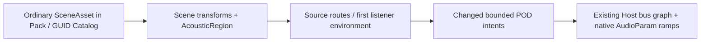

# Acoustic regions acceptance contract

Frozen before implementation, 2026-10-07. Baseline `938e64d59b4f27c0ca2fb85977a47afbfcdc3b97`; feature branch `feat/roi-22-acoustic-regions`. This document fixes acceptance, not measured results.



| Workload | Frozen inputs and oracle | Acceptance |
|:--|:--|:--|
| Geometry | Seed 2207; box and sphere, rotated / scaled / parented; interior, transition, outside; overlapping same and different priorities; independent double-precision inverse / point reference | Weight error <= 2e-5; deterministic entity-ID order; highest-priority group only, normalized sum <= 1; residual goes to latest manual/author route |
| Native room round trip | Chromium native OfflineAudioContext, stereo 48 kHz; tone + impulses; 60 Hz path outdoors / boundary / indoors / outdoors; shared convolution, delayed impulse oracle independent of production controls | Steady RMS relative error <= 1%; transition sample error <= 2e-4 against analytic gain envelope; wet tail energy > dry negative control by 20 dB; zero wet / send off / regions off detected as missing effect |
| Lifecycle | Pending native decode, pause/resume, source/listener/region removal, bus reference refusal, Context close, new World/consumer | No stale play resurrection or old environment; invalid request keeps accepted graph; source removal returns source node count to zero; graph disposed on close |
| Cost matrix | 32 / 256 active sources x 1 / 32 / 128 regions; overlap 1 / 8 / all; 0 / 50 / 100% moving; same clip and quality; 64 warmup + 240 measured updates, 3 interleaved enabled/off rounds; native AudioContext, full World Update and Host consumer | Audio Update p95 <= 8 ms and full World/App Update p95 <= 16.67 ms on this Mac (60 Hz frame target; audio gets at most half the frame); cold preparation <= 250 ms; changed batch <= 256 KiB; unchanged region route/environment emits zero intents |
| Resources | Instrument actual native node creation/disconnection, encoded/decoded bytes, heap before/peak/after, region compilation and publication bytes | At most 64 buses, 32 sends/bus, 128 active regions, 256 playing regional sources, <= 17000 retained native nodes; no node creation during steady movement after route warmup; no retained source routing nodes after stop; heap recovery measured, no invented platform memory guarantee |
| Asset/public consumption | Authored SceneAsset -> ordinary Import/Cook/Pack -> Catalog -> browser JSON fetch/parse -> loadByGuid -> Scene instantiate -> region system -> native audio; umbrella public subpaths | Same saved fields and GUID after re-load; no second resource registry; public SDK consumer runs same capability |

> [!IMPORTANT]
> Keep all failed rounds, native WAVs, raw samples/timelines, environment identity and source/artifact digests. Performance and native capture run separately with physical-device exclusivity through the maintained lease entry; CPU build stays outside. Complete Browser, Dawn and the entire 60-completed-frame smoke roster remain mandatory. No rendering changes are planned; audio DSP evidence is the relevant backend proof.

## Mechanism and ownership references

| Fixed source | Mechanism read | ForgeaX decision |
|:--|:--|:--|
| [Three.js r184 Audio](https://github.com/mrdoob/three.js/blob/d3b629c0c2097cec664ad16369bb6eae3b10e335/src/audio/Audio.js), [PositionalAudio](https://github.com/mrdoob/three.js/blob/d3b629c0c2097cec664ad16369bb6eae3b10e335/src/audio/PositionalAudio.js) | Native source/filter/panner chain and currentTime automation; positional transforms update the panner. No region-selection owner in these files | Keep native nodes Host-owned, derive positions from Scene. Do not treat panning as room routing parity |
| [Godot Area3D](https://github.com/godotengine/godot/blob/ed1daf0bf001b61586d9930840f2f1394092c079/scene/3d/physics/area_3d.cpp), [AudioStreamPlayer3D](https://github.com/godotengine/godot/blob/ed1daf0bf001b61586d9930840f2f1394092c079/scene/3d/audio_stream_player_3d.cpp), [AudioServer](https://github.com/godotengine/godot/blob/ed1daf0bf001b61586d9930840f2f1394092c079/servers/audio/audio_server.cpp) | Area bus/reverb parameters; bounded physics point intersections select an overriding area; playback uses bus-volume maps, with separate reverb contribution and AudioServer consumption | Adopt bounded bus weights, retain deterministic overlaps. Scene-based geometry avoids a physics-trigger requirement; bad references fail explicitly instead of silently becoming Master |
| UE 5.8.1 `71fe36aac5a8df5ccd66c763ffc902b29b6a9c43`, `Engine/Source/Runtime/Engine/Private/AudioVolume.cpp` (licensed reference checkout) | Registered audio-thread proxy, descending priority, transform updates, remove/invalidate on unregister, listener interior/reverb transitions | Reuse World lifecycle and POD publication; no parallel volume authority/audio clock. Publish original analysis only, no licensed source copy |

Region fields persist in the existing keyed SceneAsset component map. Bus references are existing graph IDs, not assets of a new kind. Audio owns selection and weights; Host owns actual graph admission and currentTime ramps. Explicit source bus/volume edits remain the base layer; automatic weights overlay it. Listener environment controls shared effect wet/send parameters; it does not choose source routes or introduce multiple-listener mixing. Local blend distance follows the authored shape's local units, including nonuniform Scene scale.

## Measurement preparation receipt

Before any cost round, the harness was extended to admit the full matrix through real `App.stepFrame` calls and await each completion receipt. The retained production `audioPlugin` callback, public World Update, and actual Host `consume` calls receive identical timing observers in enabled/off cases. Audio-tick time includes query/compile/publication and synchronous Host work; it is a conservative upper bound on acoustic selection, not a claimed isolated geometric-kernel duration. Cold admission records the first cache construction separately. Moving cases change both source and region transforms. The frozen 64 warmup / 240 measured / three rounds, roster, oracle and budgets above are unchanged.

Functional PCM/App/Worker evidence and performance have separate prepared lease owners (`FORGEAX_AUDIO_PHASE=native` / `perf`). Functional runs preserve App timings as environment diagnostics but do not accept performance on a busy machine. Following the user's later capacity constraint, performance requires a clean committed input identity and a pre-lease 60-second receipt: interval CPU busy <=20%, load1 <=3, normal memory pressure and no observed swap growth. The leased owner rejects missing, mismatched or older-than-60-second receipts before launching the browser; a long lease wait requires another natural attempt with a fresh coordinated receipt. A low load reading alone does not prove owner exclusivity. Heap measurements report observer release; actual owner/descendant `ps` RSS samples retain process residency high-water and cleanup, with possible shared-page double counting. Source connections and Host admission counts provide explicit lifecycle evidence. No immediate garbage-collector or native DSP-memory guarantee is inferred.

Mac memory pressure uses the userspace dispatch mask from [Apple's sysctl conversion](https://github.com/apple-oss-distributions/xnu/blob/main/bsd/kern/kern_memorystatus_notify.c) and [normal mask definition](https://github.com/apple-oss-distributions/xnu/blob/main/bsd/sys/event_private.h), rather than the different internal pressure enum. Raw sysctl output remains in each sample. This read-only preflight never acquires or edits the GPU lock:

```bash
node packages/audio-webaudio/bench/acoustic/quiet-preflight.mjs artifacts/roi22-acoustics/quiet.json
FORGEAX_AUDIO_QUIET_RECEIPT=artifacts/roi22-acoustics/quiet.json \
FORGEAX_AUDIO_PHASE=perf FORGEAX_LOCAL_GPU_LEASE=1 \
node scripts/ci/local-gpu-lease.mjs --timeout-ms 2700000 -- node packages/audio-webaudio/bench/acoustic/run.mjs
```

These commands require actual owner coordination before invocation; the receipt
does not reserve the device or authorize disruption of another frozen gate.
Build the performance site with `FORGEAX_AUDIO_RHI_CAPTURE=0` before quiet
preflight. A `perf` run refuses the capture-enabled site; functional capture
uses its separate prepared input identity. Neither capture nor fresh-device
replay runs inside a measured cost case.

## Cost coverage refinement before the first measurement

After the complete functional native pass, the unmeasured cost fixture was
extended to use the same four-bus/shared-convolver graph in both enabled/off
cases. Authored regions control source routes plus listener wet/send; moving
cases also move the listener. This covers the complete automatic control path
without changing the 324 rows, 64 warmup/240 measured completed frames, three
rounds, clip, native sample rate, thresholds or resource budgets. No prior cost
result exists. Initial publication bytes are recorded separately from the warm
changed-batch budget. Receipt completion latency is recorded with its own
p50/p95 and raw samples, separately from App/World/audio CPU time; its 5 ms
observer polling and asynchronous rendering delay are included and it is not a
GPU timestamp or an isolated acoustic-kernel measurement.

Pending admission high-water is observed from actual emitted play IDs until
the engine's native play callback admits them, and must return to zero after
stop. It is not assigned from the requested voice count. Publication size is
the UTF-8 JSON size of each actual emitted POD intent; the native Worker's
internal wire representation is not exposed, so no exact wire-byte claim is
made. The same observers are present in both matched cases.

Before the first performance run, full frame CPU samples were corrected to
include controlled source/region/listener pose writes plus synchronous
`App.stepFrame`. The actual App Update, World Update and audio callback retain
separate raw timings; completion latency includes its own asynchronous receipt
wait. The same 16.67 ms frame budget now covers all controlled CPU work instead
of excluding pose writes. Workload, warmup/measured frames, rounds and all
budgets are unchanged. No performance result predates this correction.

## Installed SDK consumer identity

The source-checkout fixture links only its public facade for development. The
installed SDK run copies the same fixture under the external project's
`packages/audio-webaudio/bench/acoustic/` directory and sets
`FORGEAX_AUDIO_SDK_ROOT` to the verified extracted SDK. Preparation then requires
the installed Engine version to match that SDK and never creates a workspace
link. The native input inventory records the SDK's Engine commit/version,
installed owner module bytes, external project lockfile, authored fixture and
actual emitted site. The external project's Git commit is recorded separately
from the SDK Engine commit. Installed native acceptance remains pending until
that real path executes.
