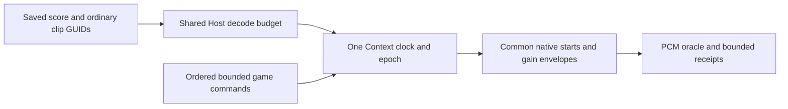

# ROI 23 native musical transport acceptance

Frozen before implementation on 2026-10-07; baseline `938e64d59b4f27c0ca2fb85977a47afbfcdc3b97`. The handoff remains the delivery contract. Measurement results belong in the final report, including failed runs.

> [!IMPORTANT]
> Native PCM is the timing oracle. Receipts certify native admission, never physical loudspeaker latency. AudioContext time is the transport authority; World delta, wall clocks and frame callbacks do not start individual stems.

## Frozen workloads and budgets

| Workload | Independent oracle / threshold | Budget / falsifier |
|:--|:--|:--|
| 1 / 4 / 16 ordinary buffered stems, 48 kHz and resampled 44.1 kHz | Independently encoded impulses; native rendered PCM onset against absolute expected sample; relative onset <= 1 sample | <=16 loop sources +16 gains; shared encoded+decoded cache <=64 MiB |
| 1 / 32 / 128 pending requests, beat / bar, offset / loop seams | Rational tempo/sample oracle, >=100 transitions and 600 audio seconds; no accumulated drift >1 sample from exact rounded targets | <=128 future events, <=256 receipts; overflow must reject before native changes |
| 0 / 1 / 3 delayed frames, both sides of 20 ms scheduling margin | Same target PCM; explicit missed target rejection or next boundary receipt | Immediate sequential play under adversarial per-stem delay must fail alignment oracle |
| Cancel / duplicate / epoch / replacement / tempo / pause / suspend / destroy | Canceled or old-epoch impulses absent; native gain ramp independently compared; tempo preserves beat, changes sample advance with pitch | No canceled schedule resurrects; destroyed nodes/cache/pending return to zero; closed Context fails structurally |
| Native AudioContext + complete App main / engine-worker / shared | Real Context, ordinary Pack/Catalog clips, existing frame transport and public imports; receipt consumed by game/Host | No dedicated game music timer; streaming rejects structurally; output device latency reported separately |
| Cold decode / warm schedule / cancel, interleaved 5 rounds | Retain every raw timing, p50/p95, bytes and queue/node/cache high water | warm schedule p95 <=2 ms at16 stems/128 pending; cancellation p95 <=2 ms; Host audio frame p95 <=4 ms; cold fixture preload <=1000 ms; no GPU timing claim |

CPU budgets reserve a small part of a 60 Hz frame for this bounded Host capability. Cold decode budget applies to generated bounded fixtures, not arbitrary media. Native PCM budgets follow common sample-rate scheduling; no threshold will be fitted to observed data. Capture/debug runs and performance rounds are separate. Host/load/browser/sample rate/device identity and build/input digests accompany raw data. Performance requires exclusive device admission via maintained lease; preparation stays outside.



## Fixed source mechanisms and ownership

| Source / revision | Mechanism read | ForgeaX choice |
|:--|:--|:--|
| [Three.js Audio.js](https://github.com/mrdoob/three.js/blob/d3b629c0c2097cec664ad16369bb6eae3b10e335/src/audio/Audio.js), r184 | Context-relative start/stop; loop offset and rate-adjusted pause progress | Reuse native scheduling, add bounded musical semantics in Audio/Host rather than per-game delay arithmetic |
| [Godot interactive music](https://github.com/godotengine/godot/blob/ed1daf0bf001b61586d9930840f2f1394092c079/modules/interactive_music/audio_stream_interactive.cpp), `ed1daf0bf001b61586d9930840f2f1394092c079` | Queued transitions, beat/bar remainders, source/destination fade wait and cancellation | Explicit complete stem weight vectors; gameplay owns section policy, no second transition FSM or music registry |
| UE Quartz, authorized `71fe36aac5a8df5ccd66c763ffc902b29b6a9c43`, AudioMixerQuantizedCommands.cpp | Mixer frame offset for admitted play, owning-clock cancellation, anticipatory queue and tick-rate change | Host owns sample-rounded target and admission receipts; epoch retires native work; licensed source is not redistributed |
| [Web Audio specification](https://www.w3.org/TR/2026/WD-webaudio-1.1-20260922/) | Native source starts and parameter automation on Context time | Same existing Context/bus graph; no audio objects cross Worker |

Audio owns saved score vocabulary, ordered POD commands and receipt failures. Host owns prepared native buffers, transport epoch and native queue. Assets/Import/Pack/Catalog retain ordinary clip identity. App carries bounded command/state data through its existing frame protocol. ROI22 owns independent region/source/bus automatic gain; private music gains multiply that existing bus output. Tempo changes preserve current beat and change native sample rate with pitch; time stretching, MIDI and streaming synchronization remain unsupported.

## Required delivery evidence

Full build/typecheck/unit/lint, public SDK consumer, Browser/Dawn and complete 60-frame hello/learn-render roster, final-head required CI, admin merge and remote-main ancestry are mandatory. No rendering changes are planned; audio PCM does not require an invented RHI capture. Any actual rendering change adds the handoff's RHI work/resource/readback/fresh-device replay requirements.

## Follow-up source inspection

At the same fixed Godot revision, [AudioStreamPlaybackSynchronized](https://github.com/godotengine/godot/blob/ed1daf0bf001b61586d9930840f2f1394092c079/modules/interactive_music/audio_stream_synchronized.cpp) starts/seeks all children at one position and mixes them into one mixer block with per-stream dB gains. ForgeaX uses the same shared phase and bounded layer idea, while native Web Audio source starts and envelopes execute against one Context clock. This inspection adds source detail; the frozen workloads and thresholds are unchanged.

## Quiet measurement admission

Frozen before performance execution in response to the shared-host capacity observations. These observations are environment evidence, not a cause of a particular failure. Functional diagnostics under contention retain their actual failures and never qualify as clean performance.

| Admission | Required evidence |
|:--|:--|
| Owner coordination | Active owners report ready at natural scheduling boundaries; no cancellation, restart, source-epoch change or lock deletion to obtain a slot |
| Prepared source epoch | Committed exact HEAD, compiled public bundles, source hashes, matched WASM/native provenance and shader profile; preparation processes finished before device admission |
| CPU and memory | 60-second preflight: total CPU busy <=20%, one-minute load <=3, normal memory pressure and no swap growth; process inventory confirms no overlapping build/Rust/shader/native/performance job |
| Device | Prepared standalone probe acquires the maintained per-owner lease; GPU vacancy alone does not qualify CPU quietness |
| Continuous window | Background process/resource observations retained throughout; new overlapping heavy owner work invalidates clean performance classification while preserving all raw diagnostics |

The full probe needs an estimated 30–45 continuous minutes, including real 600-second native PCM and the complete interleaved cost/App workload. This is a scheduling estimate, not a measured duration or a promised start time. Existing services continue running. All original performance budgets, functional deadlines, rosters, 60 completed frames, pixel criteria and falsifiers remain unchanged.

## Complete PCM evidence retention

The native recorder still retains all 28,800,000 mono float32 samples at 48 kHz
before checking the independent 4,800 pulse observations. Its WAV remains
115,200,044 bytes. Evidence publication streams a 44-byte header followed by
at most one MiB of little-endian samples per awaited Host write; it never
assembles another complete PCM/WAV buffer or a complete base64 string.
The existing source and installed-SDK runners share one ordered file sink.
After a successful native acknowledgment, a saved row drops its duplicate WAV
array before the final result return. Rejected or absent sinks keep the original
bytes. The A/B players acquire their complete Blob before that acknowledgment;
legacy artifact names copy the persisted file, preserving every byte.

| Invariant | Regression / retained witness |
|:--|:--|
| Exact bytes, including chunk boundaries | Native FileReader browser test plus complete retained 600-second WAV SHA comparison |
| One publication in flight, bounded scratch | Await each sink acknowledgment; browser test verifies one MiB maximum and serial delivery |
| No missing, overlapping or reordered samples | Validate recorder frame spans before header publication; Host rejects offset mismatch, duplicate start and oversized chunks without overwriting retained bytes |
| Observable bounded export | `complete-PCM-export` publishes begin/complete/failure with a 30-second ceiling; this newly bounded evidence stage does not increase the existing complete-process or PCM-transfer deadlines |

The original byte-correct exporter and its excessive allocation profile remain
negative memory evidence. Serialization-only replay does not replace the real
600-second recording, complete App/cost matrix, clean-performance admission or
final CI. No forced GC, shorter recording, altered timing oracle or runtime
audio clock is involved.

## Complete native process boundary

Frozen before the next native epoch after adopting main PR #3701. Earlier Music
and installed-SDK callbacks had no complete process ceiling. Both prepared native
owners now declare **2,700,000 ms**, the existing 45-minute Browser process
envelope, as a final cleanup backstop. This is a newly declared outer bound;
the 30–45-minute slot estimate is not its source or a measured duration.
The bound starts after admission. Timeout is exit 124 and incomplete/failed
acceptance; it cannot credit remaining work or replace any inner deadline.

| Owner | Preparation outside lease | Preserved native contract |
|:--|:--|:--|
| Full Music | Ordinary Pack/Vite build, source/site hashes, device inventory, optional strict 60-second quiet preflight | All 27 App cases, 3 falsifiers, real 600 seconds, 5 interleaved cost rounds; original 10/30/90-second stage budgets, 60 frames and 120/20 ms margins |
| Installed SDK witness | Immutable artifact verification, ordinary public CLI project/install, strict author typecheck, Vite build and author/site hashes | All declared PCM and 3 App tiers, both rebuilds, 3 falsifiers, original deadlines and 60 frames; does not replace full Music or four SDK consumers |

Short native PCM witnesses explicitly flush the final partial AudioWorklet block before serialization and reject a zero-only WAV when onset detection observed signal. This preserves the actual captured samples without changing any frame or stage deadline.

```sh
node packages/audio-webaudio/bench/music/prepare.mjs
FORGEAX_MUSIC_RUN=final node packages/audio-webaudio/bench/music/run.mjs --prepare-only
FORGEAX_LOCAL_GPU_LEASE=1 FORGEAX_MUSIC_RUN=final \
  node scripts/ci/local-gpu-lease.mjs --timeout-ms 2700000 -- \
  node packages/audio-webaudio/bench/music/run.mjs --native-only
```

For clean performance, the coordinator's owner-ready receipt is supplied as
`FORGEAX_MUSIC_QUIET_RECEIPT` to `--prepare-only`; all frozen quiet conditions
must remain true at admission and throughout execution. `--effects-only`,
`--short` and `--app-case` diagnoses use the same flags in both phases and retain
their explicit incomplete scope. They never qualify full acceptance.

```sh
node packages/audio-webaudio/bench/music/sdk-consumer.mjs --prepare-only \
  --sdk /absolute/sdk --project /absolute/external-project \
  --output /absolute/evidence --expected-head FINAL_40_DIGIT_HEAD \
  --package-archives /absolute/sdk-seed/npm/packages \
  --package-checksums /absolute/sdk-seed/SHA256SUMS
FORGEAX_LOCAL_GPU_LEASE=1 \
  node scripts/ci/local-gpu-lease.mjs --timeout-ms 2700000 -- \
  node packages/audio-webaudio/bench/music/sdk-consumer.mjs --native-only \
  --sdk /absolute/sdk --project /absolute/external-project \
  --output /absolute/evidence --expected-head FINAL_40_DIGIT_HEAD \
  --package-archives /absolute/sdk-seed/npm/packages \
  --package-checksums /absolute/sdk-seed/SHA256SUMS
```

Use the `npm/packages` directory and `SHA256SUMS` from the same SDK seed that
contains `/absolute/sdk`. Preparation verifies every Engine tarball against
that checksum file, then serves those exact package archives through a temporary
loopback registry; only third-party packages fall back to npmjs. A missing
`@forgeax/engine*` archive is a hard failure, so an unpublished PR version can
never silently resolve to the latest released Engine. The native phase rechecks
the same archive identities before launching browser work inside the maintained lease.

Native entry rejects execution outside the maintained process owner before
reading inputs. No nested lease or manually set held marker is allowed. A native
page crash records failure and retires its existing browser; the outer owner
still drains actual owned descendants before release. Crash or timeout does not
prove which internal startup await failed. Preserve the original epoch's logs,
PCM and unavailable-capture receipts separately from a later successful run.

## Native control workload detail

Before the first performance execution, freeze every future mix to a complete alternating 0.25 / 0.75 stem vector, inverted on each command. This replaces the unexecuted all-zero draft pattern so every admitted command changes native gain targets. The five interleaved rounds, 1 / 4 / 16 stems, 1 / 32 / 128 pending requests, five warm batches, twenty measured batches, three cancellation orders, retained samples and original budgets remain unchanged. Targets remain in the future; this is a control-cost workload, not an audible performance oracle.

## Native Kernel Worker retirement regression

The standalone `--worker-retirement` observation runs after the original App
cases have disposed. It captures real native memory-infra allocators and target
inventory with no forced GC or disposal delay. Both retained native Worker
GlobalScopes and Worker targets must be zero; functional music output alone
does not satisfy this lifetime oracle. Missing capture is a failure.

| Evidence | Boundary |
|:--|:--|
| Original three shared App cases | Four stems, three delayed frames, immediate falsifier and 60 completed frames each; actual shared dispatch must complete |
| Native lifetime | Zero targets and GlobalScopes after disposal; retain the complete trace, summary and failure before browser cleanup |
| Observation budgets | Each CDP request 5 seconds, trace completion 10 seconds and artifact at most 128 MiB; original App, process and performance budgets remain unchanged |
| Performance | Host forwards lane jobs to native sibling Workers; retain measured Host/Engine/kernel p50/p95, and require the original quiet admission before any clean performance claim |

```bash
FORGEAX_MUSIC_SITE=artifacts/roi-23/frozen-site FORGEAX_MUSIC_RUN=kernel-retirement \
  node packages/audio-webaudio/bench/music/run.mjs --prepare-only --worker-retirement \
  --app-case '{"tier":"shared","count":4,"delayFrames":3,"falsifier":true}' --app-repeat 3
FORGEAX_MUSIC_SITE=artifacts/roi-23/frozen-site FORGEAX_MUSIC_RUN=kernel-retirement \
  FORGEAX_LOCAL_GPU_LEASE=1 node scripts/ci/local-gpu-lease.mjs --timeout-ms 300000 -- \
  node packages/audio-webaudio/bench/music/run.mjs --native-only --worker-retirement \
  --app-case '{"tier":"shared","count":4,"delayFrames":3,"falsifier":true}' --app-repeat 3
```

## Complete POD result transfer

The source and installed-SDK runners return each completed POD result as one
JSON text value and parse it on the Host. Every timing row, receipt, PCM oracle
and failure remains in the final raw report; this changes private evidence
transport, not any Engine public API, native clock or workload. Native handles
and cyclic object graphs are outside this existing saved-report contract.

The retained complete-result replay freezes the exact 14,108,307-byte canonical
payload and SHA before measurement. Its original per-field RPC return is
byte-correct but exceeds the independent 64 MiB sampled allocation budget;
one JSON text returns exactly the same bytes below that budget. Sampling
includes objects collected by either GC, and no forced GC is used. Replay of
saved JSON does not reproduce original JS reference identity and does not
replace actual native matrix/600-second recording or clean-performance gates.
