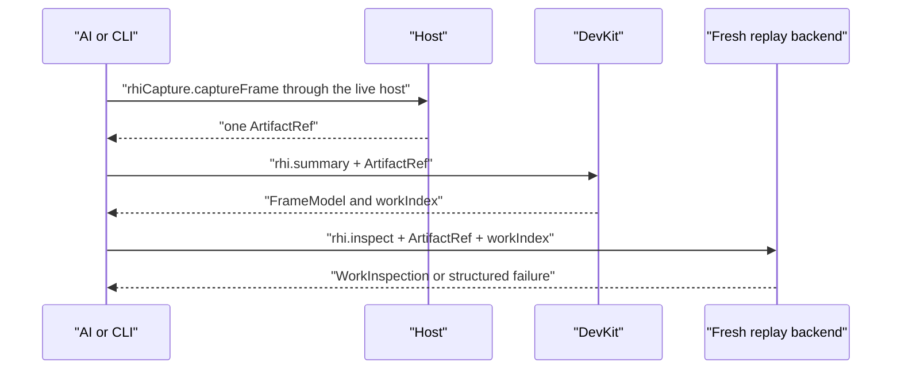
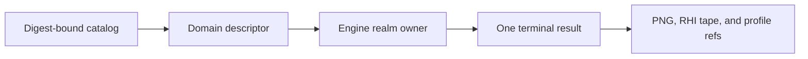
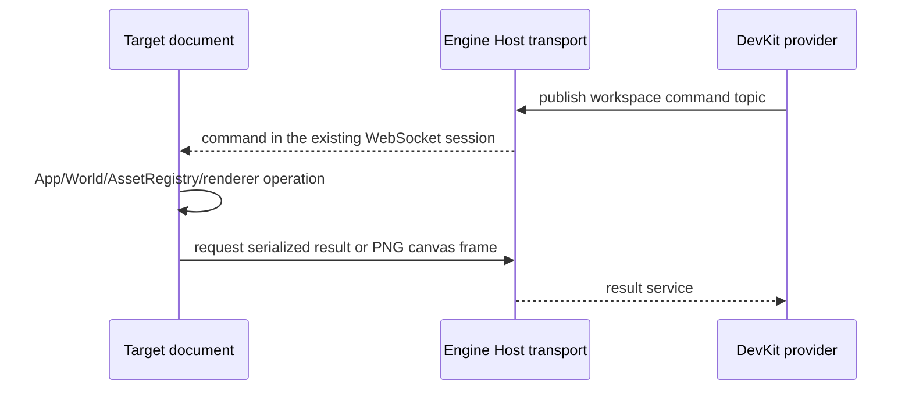

# @forgeax/engine-devkit

## Pack authoring sessions

`forgeax asset inspect <source.pack.ts> --parameters-only --json` is the quick
authoring check. It reads and validates only that source, reports parameter
modes, bindings and default locations, and bypasses project inventory, old
output, module execution and generation. Use the Engine installation serving
the selected View and the same project root. This confirms editable declarations;
actual target validity and application require the owning preview.

`engine.asset.source.draft` accepts an explicit `projectId`, owning `targetId`,
optional `previewTargetId`, and a `request` (`open`, `get`, `edit`, `generate`,
`save`, `refresh`, `undo`, `redo`, `discard`, `close`). Open addresses `sourcePath`;
subsequent operations address the returned `draftId`. Pack owns editing semantics;
DevKit owns source access, captured Worker inputs and the exact preview binding.
No browser is required to edit, save or generate a draft. Preview attachment
replays only its current author fields.

Live requests use `engine.workspace.pack-draft.changed` field deltas instead of
workspace/Catalog publication. They do not parse source, compile, cook, enumerate
assets or query entities. Generation fixes dependency publication bytes, prepares
normal runtime content privately, then adopts current live values through App.
Draft generations never publish into the saved-source Catalog. Source events use
reverse dependency edges; only the explicitly bound author session suppresses
its generic restart. Ordinary builds, CLI and unrelated sessions retain their
existing hot-reload behavior. Closing the project cancels Workers and releases
documents and preview preparations.

Save waits for the serving producer's publication before replying. Saved source
events still rebuild the serving Catalog in place, including when
an attached draft consumes the preview update. Suppressing a document restart
must not suppress saved publication: subsequent scene opens and fresh browser
realms consume the saved defaults, while live draft edits remain private.

If a bound preview's first draft open rejects a legacy TS declaration, its next
source event retries declaration parsing. A repaired literal declaration opens
the draft and publishes its fields to the existing preview without generation
or page replacement. Still-unsupported source retains ordinary hot reload.

## CLI producer lifetime

Doctor follows the pnpm installation that selected a verified `workspace:`
link. A linked checkout's nested workspace configuration does not replace that
installation's importer, installed project identity or terminal source proof.
Missing importers and mismatched installed identities still reject the closure.

Editor and asset-preview serving admit healthy Pack declarations even when a
sibling JSON/schema or ScriptablePack load fails. The Pack scanner reports the
original per-source failure; DevKit excludes only those failed declarations from
the same serving publication. View's source inventory retains their file cards
and diagnostics. Ordinary game serving and builds remain strict, as do global
identity conflicts and dependency failures.

The published `forgeax` CLI preserves operation-owned imports. Help and live
control queries do not activate Vite, Playwright or build cookers. Source-only
project tool discovery starts Vite only when a declared tool contract needs module
loading. Browser execution and build operations retain their existing owners;
Pack authoring activates one gateway per client and preserves request-id
deduplication. The package ships the CLI's dynamic chunks under `dist` together
with the public entry, so SDK/archive consumers follow the same path. Generated Node program tables load the shipped internal `pack-program-host.mjs` artifact directly; restoring their module closure does not import the DevKit facade or activate Vite/Playwright.

## Create behavior assets

```sh
forgeax asset plugin create --path assets/movement/movement.pack.ts --json
forgeax asset plugin create --path assets/physics.pack.json --module @forgeax/engine/physics/rapier3d --json
```

A `.pack.ts` path creates a native Cordis implementation and its asset definition in one file
unless `--module` selects an existing implementation. A `.pack.json` requires `--module`.
Use `--input` for structured configuration, `--export` for a named runtime export, and `--dry-run`
to inspect the returned `source` without writing. Creation never overwrites a source. Set the
returned GUID with `forgeax project root set` only when the asset is a project root; feature
assets can instead be referenced by another Pack.

Organize Packs by feature. Small behaviors belong in same-file named exports; complex implementations
may use ordinary TypeScript modules. Neither `plugin.ts` nor `.plugin.ts` is a special entrypoint.

DevKit is the Node-only external-project seam for ForgeaX. It derives project
commands, authoring-preview contributions, and one AI-facing RHI-debug path from
the existing project authorities. It owns orchestration and file access; Engine
owns rendering, RHI events, replay backends, and preview execution.

> [!IMPORTANT]
> Keep one artifact reference across the RHI-debug flow. `rhi.summary` and
> `rhi.inspect` never rediscover a tape, infer a file pair, or parse error text.

The generated development-server owner invalidates compiled module payloads
after server close, including the retired environment of a Vite restart.
Serving plugins release their own caches through Vite lifecycle hooks; this
cleanup does not change project, run, or browser ownership. The accepted compiler
input scope excludes that Host-owned generated directory. Retiring a failed Host
therefore preserves its original startup failure instead of triggering another
reload; edits to authored files and observed external dependencies still invalidate
the session.

## Independent backend startup

```sh
forgeax backend start --root /path/to/workspace --json
forgeax backend start --root /path/to/workspace --host-pack /path/to/view/host.pack.json --json
forgeax backend status --root /path/to/workspace --json
forgeax backend stop --root /path/to/workspace --json
```

`start` provides one resident BackendHost with Engine workspace tools and the
selected host PluginAsset. `--host-pack` selects one installed package's Pack
without copying it into the game or changing the game's `forge.json`. Omit it
to use the project's declared host root. A running backend rejects a different
explicit host Pack; stop it before changing the selection. The selected path is
reported by `backend status`. It does not launch a browser, create a project
session, initialize graphics or execute game Entries. A directory without
`forge.json` can host the Engine APIs with no project plugins. The returned
status exposes no transport credentials. Stop detaches its authenticated connections
and releases their native sockets without waiting for a browser close handshake;
independent runs keep their own `engine run stop` lifecycle.

The CLI waits up to 120 seconds for the backend to become ready by default.
`package.json#forgeax.frameTimeoutMs` configures subsequent Worker frame admissions
independently: omit for the Engine default of 2 seconds, use a positive timer-safe
integer for a bounded wait, or `null` to wait for completion or explicit disposal.
A project with its own progress/cancellation policy can avoid terminating a slow
loading frame. Actual execution faults remain terminal. Both development and
production Hosts use this policy. This does not change startup or GPU recovery deadlines.

`package.json#forgeax.startupTimeoutMs` overrides that wait for a project; set
it to `null` to wait until startup completes or the backend process exits.

Live dev waits for source preparation within the same 30-minute default as its
server Host, then uses the generated development App's 120-second first-frame
budget. The project startup override also reaches these waits; `null` disables
them. A visible Engine fatal ends first-frame waiting immediately and reports
failure even when page/console error lists are empty. It is never a waiting bridge.

Generated browser realms derive one startup budget from the project setting or
the existing environment default (120 seconds in development, 30 in production).
Frontend preparation, the frontend Host, App, GameHost and Engine root activation
consume that same value; an omitted option must not select another library deadline.

Native host plugins inject `devkitBackend`, `engineWorkspace` and `toolApi`.
`devkitBackend` exposes the exact Host, workspace root and optional
`hostPackageRoot`. A presentation plugin may
provide an optional `devkitWorkspaceFrontend { assembly, module }` through its Fiber; it is
sampled when a caller explicitly opens a workspace. Connection projections use
Host's existing `bindProjection` and `DevKitHostBinding.frontendAssembly` with an explicit immutable `frontendModule`, and their lifetime belongs to the connection
or owning plugin. Do not update the parent Loader during plugin disposal.
Generated serving files remain outside project hot updates. DevKit resolves
Vite's normalized file IDs before checking the serving directory, including on
Windows; sibling directories and external frontend source changes still reject
immutable frontend bindings.
An Editor-created Play target retains the sampled frontend module's optional
`prepare` plugin so realm capabilities remain available before game startup. It
does not inherit the Editor assembly or root: the project's game frontend remains
authoritative, and its lifecycle disposes the prepared platform with the target.
`callDevKitBackend(root, operation, args)` calls one active ToolApi provider over
the authenticated local transport; absent or ambiguous capabilities fail.

For example, an installed View host Pack contributes separate `view start`,
`view status` and `view stop` commands. `view start` requires this backend and
returns a UI URL; the user opens a browser and explicitly chooses a project or
observation target. Its optional Shell mounts before rendering, so a renderer
failure does not remove the interface. The embedding `devKitWorkspacePlugin`
contract remains available for applications that already own a Host.

A healthy browser refresh retains the project, session, target, Vite server and
accepted Catalog. The workspace reports `starting` while the old browser's
resource previews and presented Play retire through their existing owners. The
replacement becomes `running` only after actual cleanup and its authenticated
ready handshake; `browserGeneration` advances once per accepted browser realm.
Commands already sent to the old realm fail and are never replayed. New commands
and cancellation use the exact authenticated browser connection, so an old
connection cannot execute a replacement's writes.

A known terminal failure remains terminal. Presentation clients may request a
guarded replacement through Engine's
`project.open({ root, expectedTargetId, expectedTargetState: 'lost' })` contract.
The session projects its existing failure; no asset query or parallel health
monitor decides whether replacement is allowed. Cleanup failure retains the
original structured error and presented Play owner instead of admitting a new
browser or reporting successful native cleanup. Picking uses the existing `target.pick` request/result path, including
its authentication and exact target/preview-owner checks. The provider neither
interprets clicks nor forwards a dedicated selection or pick-error topic;
presentation clients decide how query results affect their selection.

## Navigation

- [CLI and catalog](#cli-and-catalog)
- [Browser compositor capture](#browser-compositor-capture)
- [Engine source binding](#engine-source-binding)
- [Platform SDK adaptation](#platform-sdk-adaptation)
- [Startup diagnostics](#startup-diagnostics)
- [Borrowed display carrier](#borrowed-display-carrier)
- [Engine workspace provider](#engine-workspace-provider)
- [RHI-debug operations](#rhi-debug-operations)
- [Authoring preview](#authoring-preview)
- [Project authority](#project-authority)
- [Migration and carrier](#migration-and-carrier)

## CLI and catalog

`ToolCatalogEntry` derives its identity and evidence fields from `ToolDescriptor`.
The catalog requires a normalized command path and keeps schemas as serialized
strings; descriptor parser objects remain with the runtime contribution.

`project check --json` includes `value.uiAuthoringProfile`, the current HTML/CSS
support table used by UI validation. Read `css.nativeProperties` before authoring
portable styles; browser-only UI can declare its existing `browserExtensions`.

The normal project commands remain available through the `forgeax` CLI:

```text
forgeax project new [directory] --template empty|game-3d
forgeax project init
forgeax project check --json
forgeax project skill install
forgeax project skill verify
forgeax project test
forgeax dev start
forgeax project build
forgeax project capture --backend auto --require-ui --output artifacts/capture/game-ui.png --json
forgeax project preview
forgeax project package [--format web-zip|single-html] [--output release/game-web.zip]
forgeax help --tree --json
forgeax rhi summary --artifact .forgeax-debug/{runId}/frame.rhitape --json
forgeax rhi inspect --artifact .forgeax-debug/{runId}/frame.rhitape --work-index {workIndex} --json
forgeax rhi read --artifact .forgeax-debug/{runId}/frame.rhitape --reads '[{"resourceId":"buffer:7","workIndex":{workIndex}}]' --json
forgeax rhi timing --artifact .forgeax-debug/{runId}/frame.rhitape --json

# Pack authoring identity and recovery
forgeax asset resolve --package-id {packageId} --source-key {sourceKey} --require identity --json
forgeax asset resolve {assetGuid} --require ready --json
```

> [!IMPORTANT]
> `forgeax dev start` is a source-development server and `forgeax project preview` is a
> verified static `dist/` server. Their `--json` startup envelopes expose
> `mode`, `serves`, and the current `rhi.capture` capability. Neither command
> silently invents a live capture attachment.

Static preview prepares gzip level-1 representations of BIN files from the
verified dist manifest before listening. It rechecks those original bytes while
preparing, leaves dist files and SHA-256 unchanged, and uses the same Node HTTP
artifact owner as dev. Vite retains its static HEAD, Range, and conditional-request
handling and its existing text compression. The server owns these prepared
representations until close; an external HTTPS deployment controls its own HTTP
compression policy.

`project build` is a one-shot command: it awaits Vite, the isolated build-root
producers and the complete dist manifest before returning. Cooking is not a
backend startup plugin and does not consume a Host service-readiness deadline.
Producer startup, source-closure checks and cleanup retain their own contracts;
build and cleanup failures remain command failures. Dev and preview keep their
persistent Host startup and disposal owners.
For matched BIN URLs, HEAD, Range, and conditional requests require acceptable
identity bytes; an explicit rejection of identity returns 406 before delegation.

### Persistent live control

Run commands from a game project root, or pass `--root`. The live owner keeps
one actual game running between CLI calls. Use `help dev` for discovery.

The detached owner keeps its control endpoint in `.forgeax/dev-session.json`;
its project Vite child uses an OS-assigned loopback port rather than the
default strict `5173`. The ready result and `dev status` expose the actual
project URL, so another process may already own `5173` without changing the
owner PID, control endpoint, or revision contract.

When the App bridge is connected, `dev status.execution` forwards its last sampled
Host-owned `ExecutionReport`, including Engine health, frame credits and Render
Worker completion. It samples the existing report without scheduling an eval in
the Engine Worker, so stalled frame progress remains directly diagnosable.

```bash
forgeax dev start --headless false --json
forgeax dev find --name Player --json
forgeax dev focus --name Player --distance 6 --json
forgeax dev camera set --position '[8,6,8]' --target '[0,1,0]' --json
forgeax dev camera set --lens '{"projection":"perspective","fov":1.0472,"near":0.1,"far":1000}' --json
forgeax dev capture --json
forgeax dev camera release --json
forgeax dev stop --json
```

Observation commands default to the current runtime. Every successful
observation returns its `revision`; pass `--revision` to require that exact
runtime on the next command. Reload or World replacement invalidates old
revisions and entity refs. `find` returns refs usable with `focus --ref` when
names are ambiguous. `focus --name` uses an exact name and never chooses the
first duplicate. `find --limit` defaults to 20 (maximum 100).

`dev eval --revision <revision> --code 'return simulation.execution.report()'`
requires a revision because arbitrary code can contain old entity handles.
Canceling its wait does not stop already-running code; reload/stop destroys
its execution environment. Camera control is temporary: set/focus acquires
an observation camera, get reports `control`, and release returns control to
the game. These operations do not save scene edits.

`dev capture` returns PNG and JSON report references with absolute paths and
digests. Default artifacts live in the user's data directory and survive
stop or temporary-project deletion. `--output` selects an explicit PNG path;
relative paths resolve against the project. `--checkpoint` waits for an exact
game-provided ready marker; it is not an image label and is unnecessary for
ordinary screenshots. The frame number confirms a submission before capture,
not the exact frame represented by the PNG.

`dev camera set` accepts `--lens` and `--exposure` as JSON objects. These are
temporary observation values; `camera release` restores the authored game
camera. The same values can be passed through `--input` from a script when a
single request needs both fields.

## Persistent operation history

Engine CLI and SDK `ToolClient.run/runPath` calls automatically retain one
receipt per invocation, even when View is absent. It contains the operation ID,
bounded arguments/result or failure, timestamps, duration and producer artifact
references. A started receipt without completion does not establish that a
process is still alive. Help and history reads do not add records; rejected CLI
syntax before invocation is not a domain operation.

```sh
forgeax engine history list --root ./game --limit 50 --json
forgeax engine history get --root ./game --id ID --json
forgeax engine history artifact read --root ./game --id ID --index 0 --json
```

`list` returns summaries and `nextCursor`; pass that cursor as `--before` to
browse older records. `get` returns one receipt. `artifact read` returns a PNG
as base64 with its digest, without executing the original command. PNGs are
checked against producer digests and retained, so overwriting/deleting an
exported image does not change history. Missing or oversized images carry
explicit unavailable reasons. Diagnostic text is bounded, credentials are
redacted and image bytes are read separately from summaries.

Records live outside project source under `~/.local/share/ForgeaX/operations`,
partitioned by canonical project root. `FORGEAX_HISTORY_DIR` overrides the
storage root. Initial records and terminal updates publish atomically without
a second index or background game. The resident Engine workspace publishes the
same read operations; frontend callers can read only their admitted project.
Optional View history consumes these facts and never replays commands.

## Bounded asset discovery

The unified asset list always returns a bounded page envelope. The default
`--limit` is 100 (maximum 256); add `--type` and an opaque numeric `--cursor`
to continue a filtered query:

```bash
forgeax asset list --type mesh --limit 20 --root ./game --json
forgeax asset list --type mesh --limit 20 --cursor 20 --root ./game --json
```

The envelope contains `items` and `page` for imported assets, or `assets`,
`sources`, and `page` for Pack authoring sources. Pack uses one cursor for both
projections; `page.total` is the longer of the filtered output and source
collections, so a source-only `pack.ts` project remains fully discoverable.
`page.nextCursor` is omitted when both projections are complete.

When a project has a generated `dist/pack-index.json`, its current Pack rows
are included as materialized outputs. Their GUID, `packageId`, `sourceKey`,
kind, source path, readiness, and producer publication are therefore visible
to the same list, inspect, and verify commands; a malformed index fails closed
instead of silently hiding outputs. Inspecting a published output GUID resolves
that output identity, while inspecting a Pack source path still returns source
metadata.

`asset verify` returns one `asset-verification-v1` report. It separates the
author source (`meta.json`, `pack.json`, or `pack.ts`) from output status and
producer state; `unproduced` and `unknown` are explicit results. The report is
bounded to 256 assets and includes its scanned source scope, so a large result
cannot silently masquerade as an empty catalog.

The default `--backend auto` prefers hardware and allows software fallback;
status reports the requested policy, actual backend, and fallback reason.
Explicit `hardware` or `software` must match the selected adapter. Stop an
existing owner before changing its browser options. Headed live windows use
the native display density; fixed-size capture keeps its declared resolution.

Use `--headless true` for unattended operation and `--workers '{}'` for automatic
Engine + Render + eligible Kernel Workers. Each worker accepts `auto`, `true`
(require), or `false` (disable), for example `--workers '{"kernels":false}'`.
The status exposes actual `workers` decisions. An omitted `--workers` uses the
project default: automatic Engine, Render and eligible Kernel Workers.

Projects that combine animation with skeletal motion select the existing App
policy with `forgeax dev start --animation '{"cadence":"fixed"}'`. The public
`startLiveDev(root, { animation: { cadence: 'fixed' } })` option follows the same
path for detached and embedded owners. DevKit forwards it to the one App-owned
animation plugin in both main and Worker placements; authored engine plugins
consume that owner rather than installing another `animationPlugin`. The
default remains Update. Production builds select the same policy with
`forgeax project build --animation '{"cadence":"fixed"}'` or
`buildCommand({ animation: { cadence: 'fixed' } })`. Build identity includes
this choice; changing it requires a new runtime, preserving the old run.

`dev reload` rereads project inputs;
Live checks author file metadata in the background and before/after operations
and reloads; it does not depend on filesystem event delivery. Changes reject
observations until the new runtime is ready. Unreadable inputs report failure
and are retried; edits during reload trigger another reload. `revision` identifies
a runtime, not an atomic disk snapshot or content digest. The scan reads author
source bodies only to discover literal documentation dependencies; unrelated
prose remains metadata-only. The interval adapts to scan cost (at least one
second), while explicit operations check immediately. Checks include path, inode, size, mtime, ctime and mode, and
follow author symlinks. Installed dependencies, `.git`, `.forgeax`,
Use explicit reload after changing installed dependencies or Engine builds.
The contract assumes ordinary local filesystem metadata; it does not guarantee
network-filesystem consistency or atomic multi-file writes. The owner PID and
endpoint remain stable; internal project/browser/bridge instances are recreated.
`dev status`
reports stopped when no owner is registered, and unreachable when an existing
owner cannot be contacted; it never silently replaces that owner.

Static deployment is an Engine-owned build product. A publishing host supplies
the project root, public URL base, and dedicated output directory; DevKit owns
the generated host, asset cooking, shader compilation, Pack index, and
`forgeax-dist.json` closure.

`forgeax project build --target wechat --appid wx…` selects the native WeChat
Host while retaining the same `forge.json` engine/frontend roots, producer
inventory, cooked assets and shader variants. The output opens directly as a
mini-game project in WeChat Developer Tools. Its main package loads one `payload`
subpackage; that package owns all CommonJS chunks and losslessly Brotli-compressed
resources. The Host uses `WXWebAssembly` and package filesystem decompression, and
the build rejects an actual deployment larger than 4 MiB main / 20 MiB total.
The total budget follows the official preview service's observed 20 MB limit;
the broader code-package documentation does not establish preview admission.
It requires the platform's `readCompressedFile` support.
The WeChat bundle uses Vite's `chrome70` syntax capabilities, preserving native
BigInt while lowering optional chains, nullish coalescing, logical assignment and
class fields. This setting makes no claim about the device's browser version.
The generated common project config disables `es6`, `enhance` and `minified`:
Vite owns syntax lowering and minification, including native glue. Official
compilation and real native startup remain separate admission checks.
The same Vite package resolution selects native glue, WASM and provenance, so
`project engine use-local` keeps each native publication together even when the
consumer still has an older SDK installed.
`forgeax-dist.json` declares `target: "wechat"` and the physical compressed
Pack/shader artifact URLs, so ordinary `verifyDist` checks the native entry,
configuration and complete published bytes. HTTP preview accepts browser output;
WeChat output opens in the official Developer Tools.
The generated Host installs App's shared canvas-aspect policy. Native display
changes update the drawing buffer, and the next World `Update` synchronizes
ordinary perspective cameras whose `autoAspect` is enabled before rendering.

This target currently assembles the main game realm. It does not emit WeChat
Worker/Worker V2 or open-data-domain entries, native audio/network adapters, or a
remote download/persistent-cache service. See the [platform execution scope](../platform-wechat/README.md#execution-scope).
Ordinary simulator acceptance and Android/iOS device acceptance remain separate.

Standalone browser entries assemble the ordinary FrontendPlatform without
whole-document navigation. Development workspaces select their own document
navigation when opening or recovering an Editor target; Play still loads its
Engine-created URL through the host-owned iframe. These are host assembly
choices, not game PluginAsset configuration or View-specific game code. The SDK
Project consumer checks emitted JavaScript for both the empty and game-3d
production builds, including the custom deployment-base build, so unused host
navigation cannot silently re-enter ordinary game output.

The shared startup document and game UI render through Blitz into the existing
Renderer submission. App starts before asynchronous scene activation; activation
errors keep the startup UI and its first failure. After entry, the shared startup
surface accepts only an App execution report with a terminal `fault`; recoverable
App errors leave the game running. The first terminal cause survives cleanup,
input is disabled, and Reload retires the current startup lifecycle once.
Native input transport failures, including a rejected keyboard request, keep the
scene and field value available for retry and log their structured cause.
Earlier initialization failures
retire partial resources and show a native modal with the most specific available
cause message, bounded to 160 characters, followed by Reload/reopen guidance.
Complete structured causes and cleanup failures remain JSON-safe in the current
`__forgeaxGameInspection.error`; the original error is also logged. Both Reload
controls use the same serialized Host replacement, retaining the first display
Canvas and immutable UI/wgpu WASM host leases. UI initialization remains
cancelable; a live document retires after its startup/game/input consumers, and
late canceled initialization cannot reactivate the Host. Native WASM finalization
failures remain terminal in that realm and require closing and reopening the game;
Reload preserves their original cause instead of replacing it with a lease error.

The same ordinary inspection entry offers `__forgeaxGameInspection.ui(request)`
through the [UI-owned live inspection contract](../ui/README.md). It reads the
actual browser DOM or current Blitz document, including open shadows, passive
form values/validity, computed styles, rectangles, scroll, focus and point hits.
Mounted assets retain their GUID and author-relative source path in the result.
Requests and output are bounded with explicit truncation; a pending, retired or
replaced native document returns `inspection-failed`. No new tool transport or
UI registry is created. These observations complement real screenshots and do
not stand in for Renderer submission or completed frames.

The native program
table admits packaged `.program.mjs` source with runtime parameters against the
normal RuntimePack identities. It does not compile new JavaScript in the player.

`forgeax project build --target tauri` embeds the ordinary browser distribution
under `web/` and generates the desktop project under `src-tauri/`. It keeps the
browser platform and WebView GPU backend. The native window waits for the existing
frontend Host to dispose before closing; its smoke reads App's actual completed
frame count. The distribution manifest verifies the WebView entry, native
configuration and the complete resource closure.

Run `pnpm install && pnpm build` in that generated output on the target desktop.
`pnpm smoke` launches the packaged macOS `.app`; other operating systems require
the actual installed executable in `FORGEAX_TAURI_EXECUTABLE` and separate
qualification. The smoke waits for the startup overlay to leave, then observes
60 additional completed frames, records command-permission rejection, and waits
for Host disposal before exit. A locked or hidden desktop is not a visual pass.
The native bridge is scoped to the local `main` WebView and has only three
application commands for close and opt-in evidence. No filesystem or shell
plugin is enabled. Runtime UiAsset styles use the declared inline-style policy;
only Tauri's automatic `style-src` nonce injection is disabled, so a nonce on the
static startup document cannot reject dynamically mounted component CSS. Fetch
also admits local `data:` resources, including bundled wgpu provenance metadata;
script, font, IPC and network-origin restrictions retain their declared policy.
Declared runtime `*.program.mjs` sources enter the same static module publication
used by WeChat. Both Host and Engine Worker load their packaged module graph with
the recorded source and import identities; Tauri does not require an HTTP
ServiceWorker to execute the ordinary vase generator. Unpublished source remains
an explicit program-admission failure.
This target does not assemble a native JavaScript runtime with
the TypeScript World/Renderer and a Rust presentation Surface. The contributor-only
[Tauri native host fixture](scripts/fixtures/tauri-native-host/README.md) validates
that composition separately on Linux: Node's ordinary TypeScript World/Renderer,
the existing native RHI Surface, Tauri's event loop and an HTML/CSS WebView in one
top-level window. It is not the generated `--target tauri` distribution.

## Generated asset host

DevKit derives one producer composition for `dev` and `build`. The generated
host uses `pluginPack` with the project's asset roots and producer registrations;
serve mode fixes each catalog with `watch: false`. DevKit compiles and validates
a candidate session before replacing the server and reloading the page. Failed
candidates leave the running session intact; old lazy module requests refuse
changed source bytes. `runtimeBinding` identifies the asset scope, while plugin
`sessionGeneration` identifies the whole executable session.

Bootstrap scans retain metadata and captured source bytes; a bounded pool
acquires each source or instance only while it builds its plugin definitions.
Blocked cooked reads remain deferred to ordinary production. See [Pack worker
ownership](../pack/README.md) for source evidence and lease cleanup.

| Fact | DevKit rule |
|:--|:--|
| `producerReadiness` | Keep producer capability explicit; a missing importer or cooker is a structured failure. |
| `sourceKey` | Preserve producer semantic output identity; never replace it with source position or a cache path. |
| Catalog | Read the projection and its lifecycle/diagnostics; do not write Pack, Meta, or DDC from the generated host. |
| LKG | Treat `lastKnownGood` as read-only evidence while repairing the producer, then retry the same GUID. |

The authority map and executable audit are [`schemas/asset-authority.schema.json`](../../schemas/asset-authority.schema.json) and [`check-asset-authority-audit.mjs`](../../scripts/forgeax/check-asset-authority-audit.mjs). A failed command should expose its structured `code`, `expected`, `hint`, and `detail` so the named producer can be repaired without guessing from messages.

Procedural plugin Packs declare `plugins: true`; ordinary resource Packs omit it and are not executed during plugin discovery. Direct JSON plugin definitions keep their existing representation.

Plugin definitions are Pack outputs with `kind: 'plugin'`, a module/export locator, and serializable configuration. `forge.json.roots` selects one asset per realm: Node `host`, browser `frontend`, World `engine`, and isolated `build`. DevKit compiles literal program tables and `plugin-program-inventory.json`; it never discovers runtime modules by scanning installed packages.

Custom Vite hosts use `executionWorkerEntries()` once per host alongside
`pluginRuntimeProjection()` and their `pluginProgramsBuild(...)` contributions,
all from `@forgeax/engine/devkit/plugin-build`. The Vite root owns Engine module
identity and program imports; each contribution's `projectRoot` owns its content
sources and inventory. A host may serve several content projects without adding
an Engine umbrella dependency to every content package.

A standalone host with a reloadable Vite config file prepares fresh plugin
instances before retiring its accepted executable session when an authored
source changes. A failed candidate keeps that session and its frozen bytes.
Inline configurations retain their frozen session; their caller owns replacement
with a freshly prepared configuration. Generated DevKit hosts use the project
session owner above rather than a second automatic restart path. Failed candidate preparation
closes its native Vite server before returning the original failure, while the
accepted server and its frozen executable bytes remain available.

`executionWorkerEntries()` keeps emitted Workers in that shared graph and disables
module preloading for build output. In a DOM realm, Vite still owns lazy CSS loading,
relative URLs, CSP nonces and preload-error events. Without a document, lazy imports
retain native results and original rejections without entering that Window handler;
custom hosts need no separate preload override. Declared Runtime Pack imports admit
the complete delivered Engine code identity during Vite startup, before its HTTP
listener accepts page requests. A Worker-only host declares
`executionWorkerEntries([])` and prepares that identity only if it requests the
Runtime Pack import table.

`preparePackProgramSource` and `prepareRuntimePackProgram` also belong to
`@forgeax/engine/devkit/plugin-build`. The latter preserves authored TypeScript
beside its executable program closure. Import this focused build entry when
preparing programs; the DevKit root assembles CLI and workspace services and
does not export these preparation functions.

Emitted JavaScript uses a module lexer for literal import/re-export edges;
large generated shader payloads do not require a full TypeScript syntax tree.
No-substitution template imports retain their decoded literal semantics.
Program relocation and Engine dependency isolation inspect the same edges,
while authoring-source validation remains a separate TypeScript operation.

A build root is a native Plugin installed in an isolated Node process. It registers `ctx.nativeCookers` and `ctx.importers` through effects. Original producer functions remain in that process; typed IPC carries requests and bytes. Import `@forgeax/engine/devkit/plugin-build` for the build Context type augmentation. Duplicate keys, blocked bootstrap content reads, startup failures and cleanup residuals reject preparation.

Build roots may also provide `ctx.devkitAppOptions`, a `DevKitAppOptions` data
object projected into generated dev/build hosts before `createApp`. It accepts
the public `dynamicGeometryMeshBudgetBytes` and `standardProfile` options. DevKit rejects
unknown fields, accessors and non-data values; Render's shared validators
reject invalid byte counts and profiles before host preparation. Missing configuration keeps
App's 64 MiB default. An explicit `forgeax-dynamic-mesh-budget-bytes` URL value
still takes precedence. The same accepted value reaches main-thread and Worker
App placements and participates in the existing generated build identity.
Configuration stays in the build plugin's Pack payload, with `roots.build`
selecting that plugin; `forge.json` gains no configuration namespace.
`standardProfile` initializes the actual Renderer through the generated
`PreparedExecutionBootstrap.configureRenderer` hook when execution uses Workers,
including Render Worker recovery. Local and WeChat hosts pass the same profile
through their existing Renderer options. Source plugins do not need a local
`ctx.renderer` service to configure rendering.

```ts
import type { DevKitAppOptions } from '@forgeax/engine/devkit/plugin-build';
import type { Plugin } from '@forgeax/engine/plugin';
export default {
  provide: ['devkitAppOptions'],
  apply(ctx, config) { ctx.provide('devkitAppOptions', config); },
} satisfies Plugin.Object<DevKitAppOptions>;
// Pack payload.config: { dynamicGeometryMeshBudgetBytes: 256 * 1024 * 1024 }
```

Native external program identity hashes every package file and its declared
runtime dependency and peer graph. Its ordered byte traversal uses synchronous
Node filesystem reads during preparation, avoiding one asynchronous filesystem
round trip per file. No persistent identity cache or file exclusion replaces
fresh byte verification; nested resources and type-only ESM directories remain
part of the owning package identity.

Source-only plugin discovery evaluates at most four Pack declarations at once,
each through its own single-task Worker and the captured source snapshot. A batch
settles every started task before validating and committing outputs in original
source order, so completion order cannot change duplicate GUID or failure ownership.
Caller-retained definitions and parameterized instances remain serial. This changes
neither tool-extension discovery nor source fences, runtime readiness or startup bounds.

```ts
import type {} from '@forgeax/engine/devkit/plugin-build';
import type { Plugin } from '@forgeax/engine/plugin';
import { volumeCooker } from 'project-volume-tools';
export default {
  inject: ['nativeCookers'],
  apply(ctx) { ctx.effect(() => ctx.nativeCookers!.register(volumeCooker)); },
} satisfies Plugin;
```

> [!IMPORTANT]
> DevKit also closes the Engine builtin-mesh dependency boundary. During a
> standalone build it adds a generated Pack descriptor only for builtin mesh
> GUIDs absent from the project; the Geometry decoder turns those descriptors
> into validated primitive meshes. Project-authored descriptors remain the
> single declaration, so the generated Pack never creates a GUID collision.

```bash
forgeax project build --root ./games/my-game \
  --base /games/my-game/ \
  --out-dir ./website-staging/games/my-game \
  --json
```

`--out-dir` resolves relative to the game project root unless it is absolute.
The selected directory is a derived build root and is emptied before writing.
`forgeax project preview` continues to verify and serve the default `dist/` directory.

Add `--sourcemap hidden` to emit source maps for the same production page, Engine
and Render Worker bundles. Maps are included in the ordinary distribution manifest;
the JavaScript contains no source-map request comment. Retain that distribution and
its bound Engine build when attributing a CPU profile to source locations.

### Runtime Pack capability

`preparePackProgramSource()` and `prepareRuntimePackProgram()` are build-only
preparation APIs from `@forgeax/engine/devkit/plugin-build`. Custom hosts use this
focused entry to prepare JS or TS program sources before admitting their runtime
projection. The DevKit root owns backend and CLI orchestration.

Generated main, frontend and Engine Worker providers expose their own
`runtimePacks` Cordis service. Game code injects it and calls its producer to
admit content, generate parameter instances, save snapshots or restore them.
Frontend's five-action reader consumes that provider's combined Catalog and
fetcher. The frontend and Engine producers remain independent.

An embedded frontend may lend `FrontendPlatform.createPackProgramHost`, typed by
DevKit's `PackProgramHostFactory` augmentation. Generated document providers use
that native host before browser ServiceWorker delivery and pass lazy imports from
the same Engine module graph. The frontend owns its namespace and module leases;
Pack still verifies source and import identity. Host itself has no Pack dependency.
This document capability is not an Engine Worker transport or permission to
weaken iframe isolation.

`producer.inspect().imports` is the discoverable module identity contract;
DevKit combines the default roster in `src/build/pack-program-imports.ts` with
Engine capabilities discovered in the actual build graph. A delivered module
does not imply that its Cordis services are installed.

Plugin delivery retains pure tool contracts and lowers their executor references
into the same program table as plugin exports. Plugin and tool exports from
`*.pack.ts` share the existing runtime projection; the authoring expression is
removed once. Each selected plugin has a target-filtered contract, including an
explicit empty contract when it declares no tools. Native `registerAssetTools`
owns activation and lazy execution; program-table construction evaluates neither
plugin implementations nor tool executors.

The generated bootstrap exposes exact public Engine module locators, including
production facade chunks, without eagerly importing them. Retained-program
offline evidence requires the executing realm's Engine modules to be already
loaded or otherwise available offline; the binding table alone does not provide
their bytes. It does not load new Pack implementations or install their plugins.
In development, the selected native module files are explicitly admitted to
Vite's file serving boundary, including installed packages outside the project.
Their module URLs use file URL pathnames so Windows drive letters and encoded
path characters retain the same native file identity. Vite session queries stay
in the URL query rather than becoming part of the native filename.
This does not grant access to their unreferenced sibling files or directories.

| Environment | New native JS module delivery |
|:--|:--|
| Main/frontend over HTTP(S) | Prepare the application Service Worker on first explicit program load; publish native ESM through CacheStorage. |
| Engine Worker | First new-program load requests bounded preparation from its page over a DevKit-owned BroadcastChannel for that App. Existing native graphs need no request. Worker publishes its own modules. |
| `file://`, missing browser capability or failed preparation | Ordinary assets and delivered programs retain their existing routes. New native runtime programs report a structured loading failure. |

The delivery worker only intercepts its program URL namespace. An existing
application Service Worker requires Host integration; it is never silently
replaced. Program data URLs are not a fallback for failed browser delivery.
DevKit-owned live and capture browsers permit Service Workers in their fresh
contexts, so HTTP projects use this same native delivery route. Closing the
browser releases its context and derived caches; launch profiles do not change
the project's module delivery capabilities.
The private delivery channel leaves the game's borrowed MessagePort queue untouched.
Its name travels through existing bootstrap data; each World owns its pending
request, rejects stale replies, and releases its listener on disposal. Missing
channel support or preparation failure affects new-program loading, not static startup.
Saved source snapshots remain the persistence authority; CacheStorage contains
reconstructible module files. Execution after a content-channel disconnect does
not prove that the entire application can cold-start offline. Single-HTML export
keeps its existing zero-external-request contract.

Workspace publishes the same project-level `engine.runtime-pack.*` tools through
its existing Host ToolApi, authorization hook and command/result transport.
`prepare` invokes the Node program producer (including real TS conversion);
the remaining operations execute on the actual project App even before its first
preview frame. `engine.run.eval` remains unavailable to frontend callers.
See [App's runtime Pack contract](../app/README.md#runtime-pack-assembly) for
target identity, connection-owned native installations and cancellation evidence.
Snapshots return portable source data; the caller chooses a persistence medium.
Independent resource previews read the project App's combined Catalog through
its existing package transport. Preview disposal preserves the parent producer,
and its Registry can observe newly generated versions without owning production.

Borrowed Host project closure waits for the old page's Workspace-scope cleanup
response before unregistering its result service. A surviving old page retains
its game App and Pack definitions, while its closed Workspace refuses new content
operations. Known cleanup failures remain failures of project closure. A lost
connection retires with explicit `cleanup: 'unconfirmed'` evidence on the old
handle and tool result, retaining the existing exact lost-target recovery path.
An execution failure while the browser remains connected still uses the cleanup
command; failed World readiness does not suppress native disposal.

### Production Worker selection

DevKit forwards `FORGEAX_EXECUTION_WORKERS` to App's composable worker policy.
An empty object enables all supported workers; individual fields override it.
Omitting the variable selects `auto` for Engine, Render and Kernel Workers, including ordinary projects created from either template. Use `{"engine":false}` for local execution through the same bootstrap.

The generated page resolves the bundler's shader manifest URL against
`document.baseURI` before Worker transfer. Root, relative, deployment-prefix and
absolute CDN bases retain the same resource identity in Engine and Render Workers.
Pack indexes already use that page base; bootstrap modules use the generated
module's `import.meta.url`. Host-only import transports stay on the page.

```bash
FORGEAX_EXECUTION_WORKERS='{}' \
  forgeax project build --root ./games/my-game --json

FORGEAX_EXECUTION_WORKERS='{"kernels":false}' \
  forgeax project package --root ./games/my-game \
  --format web-zip --output release/my-game-web.zip --json

FORGEAX_EXECUTION_WORKERS='{"render":false}' \
  forgeax project package --root ./games/my-game \
  --format single-html --output release/my-game-offline.html --json
```

Source gameplay plugins can inject `world`, `assets` and `executionBootstrapHost`.
Ordinary generated games include the native VFX feature in each execution realm.
Its source plugin attaches and detaches the existing VFX runtime with the World;
the declared child feature consumes the same ordered publications. Its explicit
simulation camera is the first selected display view already extracted by Render,
so camera selection and matrices retain their renderer owner. Empty effects emit
no GPU work and do not require compute capabilities. Authors load cooked effect
GUIDs and spawn `ParticleEffectPlayer` without editing generated bootstrap files.
Generated page and Worker entries share an SSR generation identity derived from
the existing plugin source-input fence, including authored WGSL. `sourceHead`
is the `project:<id>` namespace, not a Git HEAD. `sourceTree` hashes sorted
relative paths and captured content revisions. `lockSha256` hashes the fenced
root package manifest and available pnpm/Bun/npm locks; `buildSha256` hashes those
inputs plus roots, command, base, bootstrap kind and session generation. These
are generation input bindings, not a final bundle digest or certification of
the entire installed Engine source/runtime. Normal compilation retains the
same fence and rejects changed or newly added inputs before publication.
Independent rendering places `renderer` in the child realm; a source plugin that
requires it must be migrated to the bootstrap's renderer configuration/feature
boundary, or explicitly co-located with `render: false`. DOM UI remains Host-owned.
Select browser UI through `roots.frontend`, World logic through `roots.engine`,
and resident Node services through `roots.host`; definitions themselves carry no realm.
Browser and Engine contexts receive their own `gameHost` and asset reader. Browser
plugins receive App controls, the live canvas and `uiRoot`; Engine plugins receive
World/assets and explicit scene-owner bindings. UI loads its UiAsset without creating
another World. Resource preview and bound workspaces retain their explicit assembly.
Both generated game realms can read `gameHost.drawingBufferSize()` for gameplay
input coordinates. App supplies the Engine extent from its accepted frame, so
touch controls work when a separate Render Worker owns the canvas.
The presentation Host's `controlMode` starts from the browser's coarse-pointer
fact, follows actual touch/mouse/pen input across the game and UI, and gives
pointer lock priority. Its observers share the Host lifecycle. The `game-3d`
template uses this observation to switch its authored mobile controls without
changing the Engine input acquisition or simulation owners.
Ordinary generated games also receive an instance-local `gameHost.port` in both
frontend and Engine plugins. DevKit supplies the Engine end through App's existing
`execution.bootstrapPort`; each realm borrows its own end of the same channel.
Use `addEventListener('message', listener)` and `port.start()`, and remove the listener
through `ctx.effect()`. The game owns message schemas, request/state handling and
reconnection after a World rebuild. DevKit closes the frontend end; App closes
the Engine end on disposal. DevKit also closes its original Engine handle if
startup fails before App accepts it. Plugins must not close borrowed ports.
The channel works with local execution and Engine Workers, in development and
shipped builds. Resource/editor hosts may omit the port.

The DevKit development and dist-preview servers provide COOP/COEP isolation and
`Cross-Origin-Resource-Policy: cross-origin` so another isolated Engine document
can embed their output across ports. An embedding owner that needs isolation
inside its iframe also grants `allow="cross-origin-isolated"`. Production hosting
must supply the corresponding headers; without isolation, auto preserves Render
Worker and executes numeric kernels inline.

The generated host writes the internal
`.forgeax/generated/execution-bootstrap.ts`; authors do not edit or maintain
that file or its emitted name. Production builds emit the App Worker runtimes
and bootstrap in one shared module graph, preserving component identity and
module state when a Worker loads project plugins. Dynamic imports omit the
DOM-only module preloader. Development serving excludes the umbrella and its
Engine dependencies from Vite prebundling, deriving that roster from the installed
umbrella manifest so native Worker imports and project imports retain the same
component tokens and Scene state. The App package dependency closure supplies
native scan entries, allowing Vite to discover nested third-party dependencies
before target activation instead of later reloading the live page. Independent
runs may snapshot dependencies
outside the project. The snapshot copies the complete resolved published payload,
including dirty inputs, before admitting a run. Declared npm bundle payloads retain
their published `node_modules` layout, so internal modules can resolve native leaves
provided by their package root. Bundled packages still traverse external dependency
and peer edges; source-project `node_modules` remains excluded from the author tree.
Two closure scans and per-file
metadata checks reject concurrent input changes. Small files use bounded 64 KiB
buffers and larger payloads stream without changing content versions, readonly
permissions, dependency links or cancellation cleanup. Serving admits the resolved App output directory for its
Worker constructor URLs while preserving the surrounding filesystem boundary.
The bootstrap entry is
`dist/assets/execution-bootstrap.js`, and the generated `index.html`
and its main module reference the same closure. `web-zip` includes that module
and all of its discovered dependencies in the verified archive. `single-html`
embeds the same generated page, module, Worker, WASM, Pack, shader, media, and
font closure in the candidate HTML. Follow the normal `forgeax project preview`
path for a built directory, upload a Web ZIP to an HTTPS static host, or open
the exact single-HTML candidate through the release browser profile.

`forgeax project new` accepts an absent or empty target only when that target is outside the unpacked SDK
root. An SDK-owned target fails before template copying with `project-target-inside-sdk`; use a
sibling directory or an absolute path outside the SDK.

`forgeax project new` requires an explicit template: choose `game-3d` for every 3D game, including custom
3D genres, and choose `empty` otherwise. Omitting `--template` fails with `sdk-template-required`.

SDK initialization and project creation return two required `onboarding.read` paths:
the selected root's `AGENTS.md` and SDK skill. The skill links the capability catalog
on demand. The generated game guide selects local playable delivery by default;
publication and Engine/SDK production have their own explicit routes.

The installed `@forgeax/engine` CLI does not carry SDK templates. If it reports
`sdk-context-missing`, install the matching SDK in a sibling directory, initialize
it, and use that SDK's entry to create the new project:

```bash
pnpm exec forgeax sdk install --root ../forgeax-sdk
node ../forgeax-sdk/bin/forgeax.mjs project init --root ../forgeax-sdk
node ../forgeax-sdk/bin/forgeax.mjs project new ../my-game --template game-3d
```

`sdk install` defaults to the invoking Engine's version. If that SDK is already
installed, use its `bin/forgeax.mjs` entry or set `FORGEAX_SDK_ROOT` to its root.

> [!IMPORTANT]
> `game-3d` is a runnable, contentful third-person reference, not an empty 3D scene. It copies
> authored scene content, visible objects and static collision examples, character/material/animation packs,
> and UI into the new project; those choices affect the initial picture, movement space, and asset
> closure. Read the generated project's `README.md` before pruning anything, then keep, adjust, or
> replace the starter content for the game's goal and update scene, runtime, and pack references
> together when removing it.

`forgeax project package` rebuilds with relative URLs, verifies the complete `forgeax-dist.json` closure,
and emits a deterministic Web ZIP plus an adjacent SHA-256 file. The archive contains the bundled
Engine JavaScript/WASM runtime and game assets at its root for HTTPS static or HTML-game hosting;
it also attaches the project documents `README.md` and `docs/feedback.md` unchanged at those same
ZIP paths. Both documents are required, so an incomplete game archive fails before the build starts.
It does not contain other author source, `node_modules`, or a local development server. Use
`forgeax project preview` for local HTTP acceptance. Opening the archived `index.html` through `file://` is
unsupported.

| Web ZIP path | Owner | Purpose |
|:--|:--|:--|
| `README.md` | Game project | Human-facing game overview and run instructions |
| `docs/feedback.md` | Game project | Development issues and Engine/SDK feedback carried with the release |
| `index.html`, `forgeax-dist.json`, and declared dist artifacts | DevKit build | Browser runtime and cooked game closure |

`single-html` remains a separate self-contained-file format; the document attachment contract applies
to the Web ZIP only.

`forgeax project package --format single-html --output release/game-offline.html` emits a self-contained
single-HTML candidate and adjacent SHA-256. DevKit derives it from the same verified dist manifest,
embeds the generated module/worker/WASM/resource closure, and reports the candidate path, digest,
dist-manifest digest, and embedded asset count. The candidate is the acceptance object: open that
exact file through `file://` in the release browser profile and require zero remote requests, failed
requests, console/page errors, and resource misses before promotion. This format does not make
arbitrary dist `index.html` files or network-dependent services offline.
The second bundle resolves emitted local chunks. Preload dependency rewrites follow
the imported binding; same-named nested functions, parameters, and block bindings
retain their arguments. Residual optional bare imports
and computed imports use the packaged-resource lookup: an unavailable request
rejects and appears in the witness, including a Node-only service requested from
the browser.

`discoverRhiDebugOperations()` returns the same descriptors used by help and
schema output. The operation manifest is the single discovery and recovery
surface for RHI-debug.

### Pack authoring operations

The default Tool Catalog projects the Pack-owned descriptors
`asset.list`, `asset.inspect`, `asset.resolve`, `asset.verify`,
`asset.source.create`, `asset.source.clone`, `asset.source.import`, `asset.source.instance.create`,
`asset.source.values.apply`, `asset.source.rebuild`, and
`asset.source.cold-cook`. `forgeax asset resolve` is the CLI convenience
adapter for the same `asset.resolve` executor; it accepts a GUID, a
`packageId + sourceKey` pair, or a source locator. `--require identity` proves
only deterministic derivation, `present` proves current topology, and `ready`
requires current producer evidence and loadable artifacts. Query operations do
not build or write; mutations use the shared request-id and source-revision CAS
contract owned by `@forgeax/engine-pack`.

Operation receipts use `FORGEAX_HISTORY_DIR`, otherwise
`$XDG_DATA_HOME/ForgeaX/operations` (default `~/.local/share/ForgeaX/operations`),
with one canonical-project hash directory. A failed initial receipt write returns
`operation-history-write-failed` before command execution; make that data root
writable and retry. It is a storage failure, not a command syntax error.

## Browser compositor capture

On Windows, launch captures from the signed-in user's desktop session. Session 0
services cannot create the DXGI display swapchain and can produce a black page
screenshot even when WebGPU offscreen readback succeeds. Windows software capture
selects SwiftShader for WebGPU without forcing ANGLE Vulkan or disabling the
compositor; Linux retains its software Vulkan launch path. No graphics SDK or
native compiler is needed for this Browser capture route.

> [!IMPORTANT]
> forgeax project capture is a development visual-evidence path. It uses the host browser adapter when
> available and can explicitly use a software lane on machines with no physical GPU or display. It
> is not a player or release-acceptance gate.

The command starts the source-development host on an ephemeral loopback port, creates an Xvfb display
for a headed capture when `$DISPLAY` is absent on Linux, launches a real Chromium browser, waits for an engine frame signal
and non-flat **canvas** pixels, then takes a Playwright **page screenshot**.
Explicit `--headless true` bypasses Xvfb/X11 entirely. See [Linux unattended validation](../../skills/forgeax-engine-cli/references/linux-unattended.md) for Ubuntu/TencentOS image dependencies, writable XDG state and non-root sandbox requirements. A page screenshot
composites the WebGPU canvas with normal DOM and open ShadowRoot UI;
`canvas.toDataURL()` cannot provide that proof. `--wait-ms` is an additional settle interval after the
first non-flat canvas frame, not a guess for CPU startup time.

```bash
forgeax project capture --backend software --require-ui \
  --output artifacts/capture/game-ui.png \
  --width 1280 --height 720 --wait-ms 4000 --json
```

The adjacent `game-ui.json` is the schema-v2 run manifest. Its run-level fields record the browser,
viewport, X display, lavapipe ICD discovery, and browser errors; its ordered `captures[]` rows record
each PNG digest, checkpoint, actual `GPUAdapterInfo`, canvas/UI witnesses, and canvas-only sampled luma
range. `backend auto` (the default) tries the normal browser adapter and uses the configured software
lane when it cannot obtain hardware. `backend hardware` requires a non-software adapter;
`backend software` requires the software lane. The report records the requested policy, observed
backend, and fallback reason.

The witness screenshot temporarily hides every non-canvas element, so a visible HUD cannot
disguise a black 3D frame. Readiness and settling sample only that Canvas witness;
the final capture composes the complete page once, then refreshes runtime diagnostics.
Readiness polls observe the frame, UI and fatal state without repeatedly requesting a GPU adapter;
the completed capture still probes its actual adapter before backend validation.
Successful captures, observations and visible fatal diagnostics retain the full page and UI.
Until final composition completes, deadline failures preserve the initial Canvas witness
rather than requesting another full-page image from the exhausted budget.
It samples the visible canvas rectangle from the owner-page compositor, including iframe offsets,
without scrolling the element, resizing the viewport, or waiting for layout to stop moving.
Offscreen canvas pixels cannot make a flat visible frame pass.
`--require-ui` requires at least one mounted child under the generated host's `#game-ui` root; unrelated
Engine or browser ShadowRoots are only diagnostics and cannot satisfy the gate. A uniform black frame
also fails even when canvas and adapter structure exist. Browser discovery includes the installed
Playwright Chromium; `--browser` explicitly selects another executable. Resource
preview and replay reuse this discovery across Linux, macOS, and Windows, including `FORGEAX_BROWSER_EXECUTABLE`;
an explicit `FORGEAX_CHROME_CHANNEL` selects the Playwright channel instead.

One-shot resource preview and fresh replay retain each private Chromium process through
Playwright's native BrowserServer owner, independently of its client connection. Cleanup retires
that process even after the browser connection disconnects; a closed protocol connection is not
proof of process termination. A borrowed display page retains its existing presentation lease
and is never terminated as a private browser process. Generated Host startup failures end the
readiness wait immediately, and automatic software retry is limited to structured adapter
unavailability before any capture artifact exists.

Project capture fixes the viewport and screen size, DPR 1, sRGB colour profile, light colour
scheme, `en-US` locale and UTC timezone. Native Playwright screenshots wait for
`document.fonts.ready` and synchronize composition; capture does not request future
game-realm animation callbacks after the submitted-frame handshake. An unsized headed development
session uses the native window and display density. Projects must ship the same
Web font files on every machine; a system-font fallback is not a colour or layout parity contract.

For local/remote pixel or colour comparison, add `--deterministic`. The command navigates with
`?forgeaxCapture=1`. The Engine App publishes
`document.documentElement.dataset.forgeaxFrameSubmitted` (the monotonic frame id) after the Renderer
crosses its real queue-submit boundary and dispatches `forgeax:frame-submitted` on the canvas. DevKit
waits for that engine signal and a non-flat canvas crop before consuming the game's
`document.documentElement.dataset.forgeaxCaptureReady` checkpoint; it never guesses startup time. The
game remains the time authority: in capture mode it must pin its random seed, viewport-independent
state, local web fonts, and logical time/frame, render that state, then publish the ready marker. A
wall-clock delay is useful only as extra settle and is not parity evidence.

```bash
forgeax project capture --backend software --require-ui --deterministic \
  --width 1280 --height 720 --output artifacts/capture/parity.png --json
```

### Persistent playthrough capture

`capture` is the one-shot adapter over the same browser owner. For one game boot followed by input,
assertions, and multiple compositor captures, compose the persistent session through `createBrowserCapture(root)`:

```js
import { createBrowserCapture } from '@forgeax/engine/devkit';
const browser = createBrowserCapture(process.cwd());
async function playthrough() {
  const session = await browser.open({
    backend: 'auto',
    deterministic: true,
    requireUi: true,
    outputDir: 'artifacts/playthrough/boss-flow',
  });
  try {
    const { page } = session;
    await page.getByRole('button', { name: 'Start' }).click();
    const spawn = await session.capture('spawn');
    await page.keyboard.press('KeyW');
    const arena = await session.capture('arena');
    await page.getByRole('button', { name: 'Cast' }).click();
    const bossHit = await session.capture('boss-hit');
    return { report: session.reportPath, captures: [spawn, arena, bossHit] };
  } finally {
    await session.close();
    await browser.close();
  }
}
console.log(JSON.stringify(await playthrough()));
```

```bash
node tests/boss-playthrough.mjs
```

The Engine App frame signal and the game checkpoint are separate composable authorities:
`session.capture('boss-hit')` waits for the engine frame signal, then the exact
`document.documentElement.dataset.forgeaxCaptureReady` value and non-flat pixels. Playwright remains
the input/assertion owner through the unwrapped `session.page`.
DevKit owns Xvfb/Chrome/Vite lifecycle, compositor stabilization, PNG validation, numbering, digests,
and one `run.json`. A live `Page` or session belongs to the ordinary Node or Bun module that created
it; the unified CLI does not provide a script execution command.

| Browser backend | Owner | What it proves |
|:--|:--|:--|
| Mesa lavapipe | Dawn/Node smoke and explicit GPUTexture readback | Offscreen render pixels without a display; no HTML UI |
| Chrome hardware adapter | forgeax project capture --backend hardware | Browser compositor pixels on the selected adapter plus HTML/Shadow DOM |
| Chrome SwiftShader under Xvfb | forgeax project capture --backend software or a Node or Bun script using the SDK command client browser session | Browser WebGPU canvas plus HTML/Shadow DOM in ordered viewport PNGs |

> [!CAUTION]
> Software pixels are iteration evidence. They do not prove physical-GPU performance, vendor-driver
> behavior, HDR-display output, or release visual acceptance.

## Engine source binding

Built-package games normally resolve @forgeax/engine from the registry. A source-development game
can bind the same dependency name to a checked-out Engine workspace without editing its manifest:

```bash
forgeax project engine status --json
forgeax project engine use-local ../forgeax-engine --json
forgeax project engine check --json
forgeax project engine unlink --json
```

The binding is stored only in .forgeax/engine-binding.json; file absence is the single normal
registry/SDK state. The project manifest remains the dependency authority. `forgeax project engine check` fails
closed for a pnpm workspace dependency that npm cannot consume, for an unbuilt local workspace, or
for a missing SDK package. Status derives its workspace digest from the actual built entry bytes and
reports their newest modification time. engine unlink removes the sole override and returns to the
normal registry/SDK resolution path.

The selected Engine also supplies imports in Vite-built Workers, including nested
game Workers. Each Worker receives its own resolver instance and export conditions;
an installed npm Engine cannot replace a healthy explicit source binding there.

`forgeax project doctor` accepts third-party workspace and `file:` directory dependencies in
registry/SDK games as well as games with a healthy local Engine binding. It checks the project and
installed package identities against the active pnpm workspace state, importer, lock locators, and
actual package links. Copied `file:` directory payloads must match the declared source; archive
inputs and unproven copies remain unsupported. Local `@forgeax/engine` and `@forgeax/engine-*`
packages still require an explicit healthy Engine binding. Registry Engine packages retain their
locked version and public-export checks when inspecting a local dependency closure.

An installing workspace may use an unconditional package-name `overrides` rule to unify a
dependency version. Doctor compares that root rule with both the project and installed
virtual-store lockfiles before using the effective specifier; a nested workspace checkout is
not a second installation authority. Registry locator/version, public exports, selected Engine
runtime, and terminal metadata proofs remain required. Conflicting version/parent selectors,
removal, and catalog rules remain unsupported rather than guessing pnpm selector precedence.

A packaged desktop DevKit can also host an external project with no Engine install.
Its physical `node_modules/@forgeax` distribution directory supplies the existing
Vite resolver fallback, using each package's declared exports. Project-installed
packages keep priority; an explicit source binding continues to select that source
workspace. This fallback does not install packages or write a project binding.

Physical realm consumers use `createRealmDispatch`. Each descriptor is routed to
one owner for its declared realm (the `ToolRealm` contract). A missing owner
returns `tool-capability-unavailable` with the realm in `detail`; it never falls
through to another realm.

## Platform SDK adaptation

Keep platform rules in a game-owned browser/frontend plugin. Install the platform's
SDK through its official tooling into the game, not into Engine. A single-package
game can use a `file:vendor/...` package; a workspace package must actually belong
to the declared workspace. Commit the resulting manifest and lockfile. Project
check verifies those local packages without requiring a source Engine binding.

### Minimal Zaohua lifecycle example

This optional recipe uses the game's installed `zaohua-platform-sdk`. It adds no
Engine runtime interface and is not installed into either template. Invoke the
async generator through the frontend plugin's native `ctx.effect`, passing its
`GameHost` and a game-owned `makePlayable` function. That function performs real
loading and resolves only when the scene and player interaction are ready; it is
not a timeout or a canvas-exists check. Declare `gameHost` in the plugin's `inject`.

```ts
import type { GameHost } from '@forgeax/engine/app';
import { game, initialize, lifecycle } from 'zaohua-platform-sdk';

export async function* bindZaohua(
  host: GameHost,
  makePlayable: () => Promise<void>,
) {
  const app = host.app;
  if (!('pause' in app) || !('resume' in app)) {
    throw new Error('Platform lifecycle requires the presentation App');
  }
  await initialize({ capabilities: ['game.loading', 'game.lifecycle'] });
  game.loading();
  let paused = false;
  yield lifecycle.register({
    pause() {
      if (paused) return;
      app.pause().unwrap();
      paused = true;
    },
    resume() {
      if (!paused) return;
      app.resume().unwrap();
      paused = false;
    },
    getState: () => ({ paused }),
  });
  await makePlayable();
  game.loaded();
}
```

Use `await ctx.effect(() => bindZaohua(ctx.gameHost!, makePlayable))` inside that
frontend plugin. Native effect disposal unregisters the adapter, including when
loading fails after registration. Initialize once per page; coordinate consumers
through their existing plugin service dependencies rather than initializing the
SDK independently in several plugins. Do not execute browser SDKs in Engine
Workers, Pack `build()`, or module evaluation.

| Concern | Minimum game responsibility |
|:--|:--|
| Loading | Report `loading()` before the integration's loading work and `loaded()` at its real playable boundary; a failed load must not report loaded |
| Pause/resume | Handle App Results and report only the applied state; Zaohua's offline lifecycle response budget is three seconds |
| Input | Clear game-owned held actions or touch state when needed, using its existing UI/Engine message protocol; never wait for a new World tick after pausing it |
| Audio | Separately handle ongoing game music, voices or native media through their existing owners; stopping App frame scheduling alone does not suspend independent playback |
| Navigation | Keep game screens in the current document; do not call a document-navigation API for a menu or level transition |

This is a minimal lifecycle bridge, not a complete game's pause policy. The game
still decides pause UI, pointer-lock release/reacquisition and input/audio behavior.
A platform `paused` ACK does not prove that gameplay and audio actually stopped;
verify the game's own observable behavior in its real platform host.

### PC viewport baseline

Use the generated Host's existing canvas/container sizing. Put game HUD rules in
its authored UI CSS, for example:

```css
:host { display: block; width: 100%; height: 100%; min-width: 0; min-height: 0; }
.hud { box-sizing: border-box; max-width: 100%; max-height: 100%; overflow: auto; }
```

Adapt these selectors to the game's real UI; do not add a second canvas resize
loop. For the investigated Zaohua plugin 1.1.66, PC validation uses 1280x720 and
1024x768. Require no unintended document overflow at both sizes, and inspect
important controls and camera composition separately: scroll metrics alone do
not establish usable layout. The source-selected platform and its current
validator remain authoritative for other versions.

PC publishing also requires SDK initialization, loading, lifecycle, single-page
runtime and successful automatic validation. Mobile/both additionally requires
its platform Landing page. Cloud save, multiplayer and player/runtime data remain
separate gameplay or publishing choices. A static scanner matching an unused
navigation helper does not establish actual navigation; preserve its failure and
repair the validator rather than obfuscating Engine code or bypassing publishing.

## Startup diagnostics

Ordinary game pages show a compact FPS badge after their first scene-ready
Renderer completion. Browser and WeChat hosts count the same successful scene
receipts over one-second monotonic-clock windows; rAF, loading-only completions
and duplicate/retired receipts do not count. The badge updates text only when its
value changes, takes no input and requests no extra render frames. Visibility,
Surface/device and session changes reset the sample; failure or disposal removes
its timer and listeners. Workspace and tool pages omit it.

Generated Worker game Hosts project their one current Host audio consumer as
`GameHost.audio`. A frontend plugin may configure that borrowed engine before
installing play UI and provide native `executionHostAudioFactory` for subsequent
rebuilds. DevKit resolves this synchronous factory on every generation through
the existing Host Context; App creates, replaces and disposes consumers. The
factory must return a fresh, fully configured consumer. Native audio objects stay
on the Host. Await the factory provider's native activation before installing
play UI; a pending provider is not yet visible to rebuild. App still starts before awaited frontend activation so asset work
can advance; arbitrary Engine startup audio is not held for frontend configuration.

Generated hosts keep their normal startup deadlines unless the project sets
`package.json#forgeax.startupTimeoutMs`. A positive integer overrides the App,
Worker, Host, root-plugin, and CLI backend-startup deadlines. Set it to `null`
to disable those deadlines; explicit cancellation and disposal remain
available. The game can also read this value through `GameHost.startupTimeoutMs`
for its own loading barriers. Omission preserves each Engine surface's normal
behavior, and per-frame deadlines are unchanged.

The generated game host renders structured startup failures recursively instead
of coercing thrown objects to `[object Object]`. It preserves `name`, `message`,
`code`, `expected`, `hint`, `reason`, and bounded nested
`cause/detail/webgpuError/wgpuError/error` fields. Generic objects use bounded
JSON serialization and circular objects receive an explicit diagnostic. Traversal
admits up to 64 distinct objects, preserving deep plugin/asset cause chains and
reporting a diagnostic node limit when exhausted. Startup input capture also
accepts events targeting `window`; only DOM Nodes are tested for overlay ownership.
The terminal panel retains the first failure of its startup generation; secondary
renderer or cleanup errors do not replace the cause that made startup fail.

When the resulting evidence mentions WebGPU, adapter absence, or no usable
backend, the host also states that ForgeaX supports browser WebGPU and a
wgpu/WebGL2 fallback. This note is intentionally not a fallback decision: the
structured cause remains the authority. A publishing Agent must not infer
unsupported hardware, swallow the entry error, or inject a replacement Canvas
game merely to remove an uncaught exception.

### Generated game startup lifecycle

> [!NOTE]
> The generated HTML owns this small lifecycle; game code does not call a
> loading API. Editor workspace, resource, and tool pages omit the normal game
> overlay; Editor Play is a game page and retains it until a completed ready frame.
> Entry/App failures still use the fatal diagnostic surface.

| Phase | Host-owned contract | Cleanup boundary |
|:--|:--|:--|
| HTML → module | Static title, status, CSS spinner, and `noscript` text are present before the entry module is imported. | No App, GPU, WASM, or asset request is required to paint the first loading surface. |
| Prepare | `prepare()` runs before `app.start()` and changes the status to `Preparing scene…`. Input is sampled through a closed gate and cleared. | Foreground-only slow-load accounting may show a wait/reload hint after 15 seconds; it never fails the game. |
| Enter candidate | A matching submitted/completed frame identity, current canvas owner, World/session identity, device generation, `presentation: 'ready'`, and successful receipt `Result` are required. A submit or ACK alone is insufficient. | A 150 ms fade keeps hit-testing over the canvas; reduced motion removes the transition. |
| Entered | The fade completes before gameplay input and pointer-lock policy reopen. | Startup frame, visibility, input-capture, and timer listeners are removed. |
| Failed | Entry errors, `app.onError`, resource errors, and rejected receipts render structured fatal diagnostics with `Reload`; arbitrary nested detail remains inspectable. | Loading/fade work and gameplay input are cleared; the fatal Reload listener is retained for the terminal page. |
| Hidden/destroyed | Background tabs do not spend the slow-load budget or invent a completed frame. | `pagehide`, entered, and failed paths cancel pending timers and startup listeners. |

Startup observes nonbubbling App receipts through the stable page capture path. Render Worker recovery can replace the transferred canvas; receipts from a retired or unrelated canvas cannot enter the game or reuse an old submission. Replacement during the fade restores preparation and waits for the new canvas before enabling input.

The same startup input state projects `#game-ui.inert` in browser and native
documents. Background guide controls stay outside focus and input navigation
through loading, preparation, fade and failure. Tab retains its normal default
navigation into visible startup controls, including the slow-load Reload button,
while its event is stopped before reaching gameplay. Successful entry removes
`inert` from the existing guide; it does not rebuild that UI.

Loading and fatal overlays scroll when their content exceeds the viewport. On
short screens, the slow-load hint and expanded Diagnostics keep `Reload`
reachable; the bounded Diagnostics region retains its own independent scrolling.

## RHI-debug operations

For difficult or unexplained rendering failures, start with
[`forgeax-engine-rhi-debug`](../../skills/forgeax-engine-rhi-debug/SKILL.md).
Start the live owner with `forgeax dev start --rhi-capture true`, reproduce the
failing state, then run `forgeax rhi capture --json`. The CLI routes capture
to that live owner, invokes its recorder, and persists one `.rhitape`; retain the
returned `path` and `digest`. Capture requires a ready recorder-enabled App and
does not start one automatically. Stop an existing owner before changing its
capture options.

The lower-level `createCliRhiDebugOperationContext()` is offline-only and returns
`capture-unavailable` for capture; it is not the unified CLI's live capture route.
File paths are sufficient for both commands. Optional `--digest sha256:...`
verifies the expected artifact bytes; a mismatch returns
`artifact-digest-mismatch` before a replay device is created. `rhi.summary`
returns `summary.works[]` with work/event/pass coordinates, pipeline entry
points and attachments. `summary.unseededResources` identifies retained
resources whose initial bytes are absent; inspect their producing work before
using replay pixels as evidence. Full shader and binding details remain in
`rhi.inspect --fields '["pipeline","bindings"]'`.

`rhi.summary` and `rhi.inspect` use this offline context to consume the persisted
artifact and create a fresh replay backend.



| Operation | Input | Output | Owner |
|:--|:--|:--|:--|
| `rhi.capture` | Optional abort signal | One `ArtifactRef` plus capture bytes | Host and recorder attachment |
| `rhi.summary` | One `ArtifactRef` | Strict v7 decode and compact work/initial-content summary | Protocol decoder and frame model |
| `rhi.inspect` | One `ArtifactRef`, one `workIndex`, optional fields | Fresh-backend `WorkInspection` | Replay session and readback matrix |
| `rhi.read` | One `ArtifactRef`, 1-64 reads by resource or work binding | Per-read bytes digest, records, image stats and optional PNG | Replay session batch readback and image decode |
| `rhi.timing` | One `ArtifactRef` | Replay GPU nanoseconds per render/compute pass and frame total | Replay session timestamp-query replay |

### ArtifactRef

`ArtifactRef` is the handoff SSOT:

| Field | Type | Meaning |
|:--|:--|:--|
| `kind` | `'rhi-tape'` | The only RHI-debug artifact kind. |
| `digest` | `string` | Digest of the canonical v7 tape payload. |
| `source` | `string` | Host or operation that produced the artifact. |
| `path` | `string` | Optional Node-side path owned by the host. |
| `bytes` | `Uint8Array` | Capture payload supplied at the host boundary. |

Consumers switch on `RhiDebugError.code`, then narrow `.detail`. `.expected`
and `.hint` provide the next action without message parsing. Unknown operation
names, fields, artifact kinds, and tape versions fail at the boundary.

## Authoring preview

Preview defaults to four explicit Engine-owned domain descriptors:
`asset.material.preview`, `asset.mesh.preview`, `asset.vfx.preview`, and `asset.texture.preview`.
Each follows the same command declaration and terminal path and binds its
report and evidence to the requested subject and snapshot.



The generic `asset.preview` and `preview.run` shapes are not discoverable. A
private legacy proof helper may remain for migration tests, but it cannot appear
in the default catalog or act as a second domain owner. Browser and Dawn
consumers must verify subject pixels and structured evidence; DOM liveness and
RhiNull readiness are not visual proof.

## Project authority

`forge.json.roots`, package manifests/locks, and authored Pack/Meta/code are persistent authority. `package.json#forgeax.startupTimeoutMs` is the project startup policy: positive milliseconds set a shared startup deadline, `null` disables it, and omission retains Engine defaults. Program tables, Catalog and runtime assembly are derived. Definitions use deferred reference consumption; loading a plugin asset does not install it.

Node plugin delivery exports portable artifacts through the existing program entries'
asynchronous `exportSource()`
for the selected root's reference closure, including referenced but unmounted
siblings and their tool executors. Pack co-location does not assign a target;
other targets require their own producer projection before complete capture.
All selected exports share one complete module graph. The provider carries pure
tool contracts plus live Host bindings; archives preserve only artifacts and
contracts. `createNodePackProgramImports` rebinds recorded imports in a fresh Host.
Generic npm imports retain a project package authority, dependency route and selected
entry, preserving distinct installed instances even when their bytes match. Content
identities include runtime peers; Node builtins and Cordis use their actual identities.
嵌套作者包的 locator 使用 slash 分隔的项目相对 anchor（如 `plugins/local`），
恢复时仍逐边检查声明权限并核验原生真实路径。分隔符统一不折叠 `..`、盘符或包身份；
反斜杠、相对盘符、目录逃逸和未声明依赖均拒绝，源码快照仍校验原始字节。
Declared npm dependencies retain their installed package authority even when their
names also identify Node builtins, such as the `punycode` package.
Missing dependencies or changed bytes cannot satisfy the archived import contract.

Browser static plugins use the existing Vite module graph in both the page and
Worker; their normal installation does not require Service Worker support. A
Pack may also contain backend definitions without putting their implementations
in that browser graph. The player boundary admits the browser-safe Import entry
and rejects Node imports (including Vite browser stubs) and compiler packages.

Build and development delivery expose lazy program export without evaluating plugins or
tool executors. It archives the player's final JavaScript graph, preserving shared
project modules and replacing Engine facade locators with exact Host capability
requirements. Every selection retains the complete graph. Archive JSON sits beside
the emitted program-table chunk; it is not embedded in its own executable graph.
The provider chunk hash includes all archived targets and the Engine identity, so
either kind of version change also changes the archive URL.
An unrecorded image, CSS, public-file, WASM or independent Worker dependency makes
export fail explicitly. Ordinary static installation remains available.

Development initializes Vite's optimizer before freezing the final transformed
closure of all browser selections, including literal lazy imports. Source-input
validation completes before the page can consume this accepted graph. HTTP delivery
and export then read the same frozen bytes through failed source candidates.
Every frozen module carries the current Host's generated-root identity in its
native URL; a replacement Host rejects old-session requests, including archive
requests. JSON and third-party virtual modules retain their original Vite producer
IDs during conversion; the final response supplies session-bound import URLs.
HTTP, transform queries and warmup consume the same frozen bytes, released when
the Host closes. This transport identity stays outside the portable program schema.
Vite query semantics such as `?raw`, `?worker` and optimizer versions are preserved.
Resource evidence comes from the actual Vite 8 producers; pure raw text and ordinary
strings are not rejected based on their filename. Sharing an undeclared transitive
Engine dependency makes export fail rather than duplicate that dependency on restore.
Asset-only startup retains its on-demand Pack preparation.

The source fence follows the inputs used by the selected program, rather than
classifying every project JSON or TypeScript file as authored authority.

| Input | Evidence owner |
|---|---|
| Pack declarations and instances | Scanner declaration membership and source snapshot |
| WGSL modules discovered by material production | Material producer file membership and snapshot bytes |
| Plugin, tool-contract and executor closures, including declared `dist` modules | The actual compiler/loader resolver and the shared snapshot |
| Project manifests, dependency locks and inherited compiler configuration | File content plus positive and negative existence observations |
| Unbounded authored native filesystem readers | A conservative project source fence; undeclared reads cannot safely use the narrow closure |

New paths extend the same snapshot before consumption. Publication checks actual
compiler graph membership, declaration membership, file bytes, aliases and resolution
probes afresh. An uncaptured physical dependency in a selected program rejects the
candidate. Unselected page modules remain with Vite; an explicit plugin metadata
query still requires an admitted snapshot. Host state outside the declared input
closure has no Engine-specific directory exemption.

Live project readiness transports the compiler's observed paths through the existing
internal ready response. Stable checks inspect those paths and asset membership without
rereading all project source text. Initial startup and native readers with an unbounded
filesystem scope retain conservative observation. Watchers are change hints; content
and resolution checks remain the publication authority.
An absent asset root is empty; an unreadable member of an existing asset root
fails live input reconciliation and must be repaired before observations resume.

The [input-boundary measurement report](docs/plugin-input-boundary-performance.md)
includes fixed-workload before/after samples, correctness gates and remaining
browser and memory qualification limits.

Browser delivery groups project modules only when their static entry reachability is identical. Portable plugin entries retain strict export signatures; internal page/bootstrap entries allow additional exports. Grouping preserves native identity and lazy boundaries.

The provider's `programHost` reuses the delivered native URLs only when the
complete archived graph and actual Host binding URLs match. Changing the selected
entry or export preserves module identity; changing bytes, graph membership or
bindings uses new-module delivery. The known selection entries let unrelated new
programs bypass archive I/O. A possibly matching graph with an unavailable archive
fails explicitly, preserving component identity instead of silently duplicating it.
Engine capability bindings are lazy locators, not an instruction to import every
capability at startup. Main, Worker and frontend assembly share the same provider
host with their runtime Pack producer.
When composing a native package host, its module loader follows the URLs it
publishes; the provider imports only its own published URLs directly. This keeps
static package locators from becoming unintended network requests.

Browser tests capture a complete mixed-target Pack and restore its JSON snapshot
into a fresh World in both page and DedicatedWorker realms, with Service Workers
blocked. They preserve project and Engine component identity, native plugin/tool
state and the unexecuted backend attachment in build and development modes.
Development tests also cover a broken candidate before the first tool execution,
and old-page lazy imports across successful Host replacement. Build tests then
delete the author checkout and Node producer output, retain only a copied `dist`
and saved Pack, and restore in a new Chromium process at a new origin, in both
the page and a fresh DedicatedWorker with Service Workers blocked. Existing
component identities survive; plugin/tool evaluation stays lazy and gameplay
counters start fresh.
New-program tests separately start a fresh browser with empty CacheStorage,
prepare only the Host's Service Worker transport, then disconnect the network
before the first restore. Saved JS and plugin/tool programs rebuild the empty
derived module cache and execute. The consumer must first receive its own Engine
and App modules; this proves offline asset restoration after consumer startup,
not offline startup of an entire website. Static native modules and their archive
remain the consumer Host's delivery responsibility.
DedicatedWorker tests also verify first-use delivery preparation after Worker
startup. Separate build/dev by JS/TS tests use actual `createApp` with the null
RHI: generate Mesh, Scene and PluginAsset together, instantiate the Scene,
execute an inline tool, replace parameters and dispose through native Fibers.
They restore and regenerate from saved JSON in a fresh browser after consumer
capabilities and SW transport are ready, with empty program caches and the
network disabled. JS preparation stays in the browser; TS conversion uses the
real DevKit producer before admission. These are structural App checks.

The separate `pnpm --dir packages/devkit test:runtime-browser` graphics gate uses
actual App EngineWorker execution with browser WebGPU, in build/dev by JS/TS.
It starts from an empty delivered Catalog, then submits new generator/plugin
source after startup. Native PluginAsset installation adds an ECS Update system
and an inline tool; withdrawal preserves the installed Fiber, and disposal stops
its system while unrelated gameplay continues in the same World. Failed
candidates leave the snapshot, Catalog, program table and current Scene intact.
The gate requires 60 additional ready, completed GPU receipts after generated
content enters the Scene, checks mesh width changes in compositor screenshots,
and closes the owned Worker through App disposal. Build JS/TS cases also close
Chromium, create a fresh browser and EngineWorker with empty program caches,
prepare only consumer Engine capabilities, the empty Catalog and Host SW, then
disconnect before the first saved-Pack restore. Restored plugins execute and
new parameter values render for another 60 completed frames without a compiler
or producer request. This proves offline restoration after consumer startup;
the test retains the original static server and does not establish whole-site
offline startup. It does not replace View, SDK delivery or the complete Engine
smoke gates.

On a Linux host with software WebGPU, run under a task-owned display:

```bash
FORGEAX_BROWSER_EXECUTABLE=/opt/google/chrome-beta/chrome \
FORGEAX_RUNTIME_PACK_EVIDENCE=/tmp/runtime-pack-worker-evidence \
xvfb-run -a pnpm --dir packages/devkit test:runtime-browser
```

The optional executable override otherwise uses Playwright's Chromium. This
gate explicitly selects SwiftShader: results establish browser/GPU behavior,
not hardware performance. Evidence includes snapshots, parameter-state images,
frame and plugin counters, publication checks and disposal results.

| Action | Command / source |
|:--|:--|
| Create a plugin asset | `forgeax asset plugin create` |
| Inspect definitions and source evidence | `forgeax asset plugin inspect` |
| Select/remove a realm root | `forgeax project root set` |
| Migrate a schema 2.0 project | `forgeax project migrate` |
| Import a portable author closure | `forgeax asset source import` |
| Clone source with independent identities | `forgeax asset source clone` |

Use `help <path> --json` for the authoritative request schema. For example, `forgeax project root set --realm engine --guid <guid>` selects a root; `--guid null` removes it. Source transfer uses a new destination directory beneath a configured `forge.json#assetRoots` directory, preserves source-relative layout, checks exact pnpm dependency-lock evidence, compiles the candidate and fences source/target revisions before commit. Cloning rewrites known GUID/namespace references and project WGSL module identities together with their material/import references. The candidate must retain its source closure inside the new clone directory; computed references that escape it fail before publication. Generated outputs are rebuilt in the target. Sources requiring cooked reads during closure discovery report an explicit unsupported transfer instead of copying an incomplete closure.

Changes to project roots, code, configuration, dependencies, or asset sources compile a candidate before replacing the running session. A standalone Vite Host using `pluginProgramsBuild` restarts through Vite when its frozen executable inputs change, captures a new program/publication pair, and rejects URLs from the retired session. A new page or Worker receives one sessionGeneration; the accepted asset catalog stays frozen until replacement. Failed compilation preserves the old runtime; failure after replacement requires a new session and does not recover game progress. When the source fence detects a save during candidate compilation, the Host rejects that snapshot and prepares once from current source. This bounded retry handles a coalesced final save without another watcher event. A second source change or an ordinary compilation error still fails before replacement.

On macOS, DevKit's Vite watcher uses `fs.watch` rather than native FSEvents.
File change notifications and session replacement remain active; native
`FSEventStreamStop` must not block the backend event loop during disposal.

SDK-created games keep all Engine usage skills as ordinary, committable files
under root `skills/`. `skill install` idempotently projects those files into the
supported Agent discovery roots with relative symlinks and narrow managed
`.gitignore` blocks. `skill verify` checks the source inventory, local manifest,
links, and ignore rules; foreign content at a managed destination fails closed.
`project test` appends only the installed skill source directories and their
matching discovery links to Vitest's exclusions. It retains the project's own
test configuration and adjacent game tests, including tests under `skills/` or
Agent directories outside those installed skills.
SDK-backed `project new` and `project init` persist the selected offline store
as `storeDir` in the project's `pnpm-workspace.yaml`. Ordinary later pnpm
commands use that same store. Select a custom npm identity with
`project new --package-name @studio/my-game` before the SDK installs the project.
Editing `package.json` after installation changes pnpm's workspace state even
when dependency versions are unchanged; reconcile it with
`pnpm install --frozen-lockfile` before expecting warning-free commands. The SDK
keeps `verifyDepsBeforeRun: warn` so genuine dependency drift remains visible.
Project creation installs with `--ignore-scripts` and can consume the bundled
side-effects cache. Archive acceptance checks that package payloads in the offline
store remain unchanged; pnpm's SQLite runtime index is the sole digest exception.

## Borrowed display carrier

`BrowserCaptureOpenOptions` projects the capture fields that opening actually
accepts from `BrowserCaptureOptions`. `BrowserHostOptions` selects its backend,
visibility and carrier fields from that opening contract; publishing remains
preview-owned. Server/Host/launch options and checkpoint budgets retain their
separate lifetimes. A requested backend is not an observed GPU classification.

`BrowserCarrierRequest` selects run, generation, dimensions and GPU field types
from `BrowserCarrierTarget`. Requests retain their own `headless` and `url`;
lease, target and surface identities belong only to the returned target. Shared
field types do not require requested and observed dimensions to be equal.

### Product activation belongs to plugins

External products expose pure `toolContract` declarations through PluginAssets.
Help reads those contracts without evaluating runtime plugins or executors. A declared
command stays discoverable when its provider is inactive; invocation requires the
matching active provider. One-shot build tools activate `roots.build`; resident tools
belong to the mounted host root. The CLI forwards a discovered host command to
the resident backend ToolApi and returns its terminal result; a stopped or
missing backend cannot satisfy the command. Executors load only when invoked. Products contribute
their own command paths without adding product flags to `forgeax dev start`.
Host source validation resolves a symlinked project root before comparing its
authored inputs with the bootstrap inventory.
An inline `toolContract` requires no declaration module or discovery loader.
Its executor paths resolve from the Pack source; referenced declaration modules
retain their own relative-path base. Both forms use the same pure lowering and
native tool registration.

A command declaring a `root` input receives the CLI-selected project root for named
flags; `--input` remains an explicit validated object. Use Pack authoring and root
selection operations; no Entry install tree or command-specific registry remains.

| Concern | Owner and existing seam |
|:--|:--|
| Product commands, Shell, connection credentials and discovery | Product plugin and its command executor; no product module loader or credentials in Engine live status |
| Backend/frontend plugin assembly and cleanup | Native root plugins, explicit frontend module projection and Cordis Fiber; the product owns its Host |
| Project server on an existing Host | `createDevKitWorkspaceProvider({ hostBinding: { backend } })` or `createBrowserCapture().open({ host: { backend } })` |
| Browser navigation, observation and capture | `BrowserCarrierAdapter` lends an exact Page/Frame; Engine releases the lease without closing its owner |
| Embedded persistent live control | `runLiveDevDaemon(..., { carrier, carrierRun })`; the embedding process owns adapter startup and disposal |

> [!IMPORTANT]
> A carrier lends a browser target, not a BackendHost. The detached live daemon
> still runs its project server in a child process and cannot borrow an
> in-memory Host through this seam. A product requiring one shared Host must
> use the process-local host-binding path. Do not claim that adding a carrier
> establishes shared Host ownership. Add an Engine interface only when an
> executable consumer demonstrates a missing product-independent capability.

DevKit exposes `BrowserCarrierAdapter` from the public package root for an
already-open display host. The adapter returns a
generation-bound `BrowserCarrierTarget` with the exact `surfaceId`; DevKit
never chooses a page by URL or array position. A successful `attach()` returns
the stable owner `Page` plus an explicit `BrowserExecutionTarget`. For a borrowed
lease, the execution target is the exact child `Frame` and its `surfaceSelector`;
navigation, App/World observation, and runtime witnesses stay in that Frame,
while PNG capture uses the owner Page only for a temporary compositor envelope
around the exact iframe. `close()` releases only that lease and never closes
the display host. The caller supplies an already-open browser/page; the
borrowed path never launches another browser or window. The carrier owner is
responsible for authenticating any cross-process access. Electron, CDP,
discovery files, and product-specific transports are not part of this contract.

Pass `carrier`, `carrierRun`, and `carrierGeneration` to
`createBrowserCapture().open()` with `headless: false`. Headless sessions do
not call the adapter. If the adapter returns a private-browser fallback, the
existing private browser path remains the fallback; an attached owner page is
never silently migrated to a second page. The report records `carrier`, an
explicit `carrierFallbackReason` when applicable, and the exact `carrierTarget`
for identity correlation.

The persistent `live-dev` owner uses the same seam when it is embedded in a
process that owns the adapter: call `runLiveDevDaemon(root, port, sessionFile,
{ carrier, carrierRun })`. The daemon creates one service/run identity when the
caller does not provide one, passes the current generation to each browser
session, and publishes the selected carrier and exact target in live status.
Stopping closes the daemon's own resources and resolves its promise, including
when stop arrives during browser startup. Only the detached CLI entrypoint exits
its process; the embedded service never exits the product owner.
Daemon and project children always launch the package's own CLI artifact,
including when a plugin or library caller has a different process entrypoint.
The CLI preserves deferred command imports in its emitted chunks. A daemon opens
its browser capture only after the actual project child reports readiness, so a
failed project retains its native diagnostic and control endpoint without first
loading the browser/renderer closure. Stop fences capture adoption while its
module is loading.
`startLiveDev()` remains the detached CLI boundary; functions cannot be
serialized through its child-process environment, so it stays on the existing
private browser path until a caller supplies an in-process adapter bootstrap.

The one-shot `runBrowserPreviewHost()` and
`runBrowserResourcePreviewHost()` functions accept the same `carrier`,
`carrierRun`, and `carrierGeneration` in `BrowserHostOptions` for visible
recipes. The borrowed page is observed before navigation and kept for the
visible capture; replay remains the existing private headless page. Closing
the operation releases only the borrowed target. Hidden recipes never query a
display carrier. Both owners therefore share `acquireBrowserCarrierPage()`;
the older Tool carrier route remains the higher-level lease/consumer protocol,
not a second page-selection implementation.

These Browser Host functions are exported from the DevKit package root. The
higher-level `PreviewHostRequest` remains a serializable Tool request and the
current `runPreviewHost` route is retired/consumer-routed, so it deliberately
does not carry a function-valued adapter through a POD command payload. An
embedding owner that runs the one-shot Browser Host in-process passes the
adapter through `BrowserHostOptions`; the normal CLI boundary continues its
existing private fallback until it has an explicit process-local adapter
bootstrap.

Consumer integration probes belong to the embedding application. They must
correlate an externally owned Page, the exact lease/target, and decoded capture
pixels, and verify that release preserves the borrowed browser. DevKit's unit
contracts do not replace real browser integration evidence.

### Borrowed Host composition

`createBrowserCapture(root).open({ host: { backend }, ... })` can also
borrow an existing native BackendHost for its own main-thread project server.
`DevKitHostBinding` is exported from the public DevKit root. Backend services stay
in that existing Host. Optional `frontendAssembly` supplies a connection projection;
`frontendModule { specifier, export?, prepare? }` supplies its immutable executable module. An optional native `prepare` export starts in the frontend Context before its Host connection; its owning generated lifecycle awaits platform retirement after closing the connection. Browser default startup retains the existing path.
Program identity is not a module path. Select one root source: a project frontend
root and an external frontend root cannot silently override one another.

Closing the capture releases its own sockets, projection and native contributions.
It preserves the backend, transport and peer sessions. A default project binding
is exclusive; explicit per-connection projections support independent workspaces
and Play targets. Reports must match the currently admitted revision and generation.

## Engine workspace provider

`devKitWorkspacePlugin` installs Engine project/preview and live-run tools on an
existing BackendHost's ToolApi. Activate it before optional presentation plugins:

```ts
import { devKitWorkspacePlugin } from '@forgeax/engine/devkit';

const fiber = await backend.context.plugin(devKitWorkspacePlugin, {
  hostBinding: { backend },
  carrier: () => ownerCarrier,
});
await fiber.await();
```

The plugin exposes `engine.workspace.capabilities` (serializable descriptions)
and `engine.workspace.call` (`{ operation, args }`) through the Host's admitted
transport. Both browser and CLI clients reach the same Engine handlers. The
embedding transport must authenticate remote callers; the plugin uses its
trusted caller identity, never a client-supplied connection ID. The optional
`authorize({ operation, args, caller, signal })` policy wraps the registered
handlers, so direct ToolApi and transport calls enforce the same target policy. Unloading a UI
Fiber does not revoke domain tools. Disposing this plugin revokes its tools,
closes its workspace while independent runs continue and its borrowed Host
remains usable.

The Host's `engineWorkspaceForCaller` capability resolves an admitted frontend to
one ordinary Engine runtime. Each `view-frontend` connection opens an independent
session; its headed `forgeax-workspace:<sessionId>:<targetId>` connection resolves
back to that same owner. Explicit target queries resolve the owning runtime,
while a frontend cannot redirect a project operation into another session.
The CLI's workspace remains independent. Each runtime retains one current
project and one Play. Refresh replaces only that session's browser generation;
frontend disconnect releases its connection contributions without closing its
project or any independent run. The Host plugin disposes all sessions together
at teardown. Admission is bounded to sixteen session owners.

`engine.asset.inspect` inspects the active workspace catalog, including published
Scriptable Pack outputs without a disk Pack index. It returns that publication's
asset and source path without re-evaluating authored code. The project App reads
its current Registry payload; Mesh metadata includes geometry counts, bounds and
material slots without transferring vertex/index buffers. For a direct
`.pack.json` source with the producer's explicit `packageId + sourceKey` identity, DevKit adds only the inspected GUID's authored payload or
instance `effectiveValues` as
`meta.properties`, retaining current Registry facts in `meta`. It requires the
Pack output GUID to match the Catalog GUID and reports a structured source
failure rather than showing empty properties. Internal delivery containers, including
Engine-generated builtin meshes, retain their live Registry inspection without
inventing an authored output key or source revision from the filename. Direct provider calls without a
session handle retain offline Pack inspection, including source identity and
revision. ScriptablePack inspection does not re-evaluate `build`. Rebuild tools
are advertised only when the provider supplies a build owner.

`engine.run.start/status/observe/reload/stop/capture/eval/find/focus` and
`engine.run.camera.*` reuse the live-dev lifecycle with independent resources.
They are available through the same ToolApi and `forgeax engine run ...` CLI.

| Boundary | Contract |
|:--|:--|
| Execution | Detached Engine process and private browser, headless by default; no presentation carrier injection. CLI exit and workspace disposal do not stop it. |
| Inputs | Copy dirty project files and the resolved installed dependency graph, including a selected local Engine binding; dependency files follow each package's npm publish payload (`files` / ignore rules), not its whole checkout. Recheck consistency before starting. No mutable source links remain. |
| Identity | One active run per physical project directory. Run storage canonicalizes existing directory aliases, so CLI paths and accepted workspace paths discover the same owner. `runId` identifies the run and `inputVersion` hashes the snapshot. Repeated start reuses compatible execution; stop/start selects new inputs. Reload resets runtime against the same snapshot. |
| Observation | `observe` reads cached status, latest timestamped PNG and at most 100 log entries of 4096 characters. Sequence bounds and `droppedLogs` expose gaps. One producer per run samples at most once every five seconds, with a 4 MiB PNG limit. |
| Authorization | Private control token stays in the mode-0600 session file. `runAccess: 'observe'` rejects every run operation except observe through both ToolApi and transport, regardless of caller-supplied arguments. Frontend callers are also observe-only. |
| Cleanup | Stop closes execution and deletes its input snapshot; capture artifacts remain in the existing artifact directory. Failed startup is inspectable and explicitly stoppable. Concurrent daemons cannot claim the same run. |

Runtime state lives under `FORGEAX_RUNS_DIR` or `~/.local/share/ForgeaX/runs`,
outside the authored project. Snapshot inputs omit Git metadata, `node_modules`
(rebuilt as a copied dependency graph), `.forgeax` state (local Engine binding is
resolved into that graph), harness/worktrees, agent tooling mounts (`.agents`,
`.claude`, `.codex`), TypeScript `.tsbuildinfo` compiler caches (including dependency
payloads) and generated artifact/coverage folders. These reserved
folders must not contain authored runtime inputs. File copying and hashing stream
through bounded buffers; cancellation stops preparation and removes partial output.
Snapshots are read-only input files, not a security sandbox or a guarantee of
network/time determinism. Capture results carry the run and input version.

Ordinary `forgeax dev` retains workspace-following development behavior.
Its explicit `startLiveDev(root, { inProcess: { signal, carrier, onStart } })`
seam remains available to embedding consumers, separately from independent runs.

BackendHost is a Node plugin container inside the resident process; FrontendHost
runs in each actual browser realm. Page loss fails that page's workspace session,
without disposing the backend or replaying the page. The generated workspace
subscribes to backend assembly changes and applies them to the same frontend
Host; workspace projections exclude game roots.
Browser creation and final
closure belong to the explicit embedding owner.

`createDevKitWorkspaceProvider()` is the production project bridge for a
resident workspace client. It starts the project Vite server with the existing
`devKitHostBridge`, then returns a serializable project handle and a provisional
headed target URL. A consumer may navigate its Page or iframe to that URL.

To measure target startup, set `FORGEAX_WORKSPACE_TIMING=1` before `backend start`.
The backend writes one structured `[forgeax.workspace.timing]` log line at each
stage, including elapsed and previous-stage milliseconds for the exact target.
With the same flag, `[forgeax.vite-config.timing]` breaks down configuration
and Vite's server hooks; `[forgeax.pack-startup.timing]` and
`[forgeax.catalog-build.timing]` separate Pack startup, source scanning, and
Catalog projection. These lines help identify repeated work before changing
startup behavior.
After opening a project or refreshing its lost page, run
`node scripts/workspace-timing-report.mjs /absolute/backend/root` from the
Engine checkout. The report groups completed targets and shows median and range
for project facts, Vite configuration, Vite server creation/listening, Catalog
readiness, and browser readiness. A healthy refresh keeps its target and emits
a new browser-ready event; a guarded terminal recovery creates a new target.
Compare those lifecycle events instead of equating navigation with Engine startup.
The timer begins when Engine opens the target and ends at its browser-ready
event; time spent reaching View's resident entry is outside this timer.

Frontend plugins in the generated document consume `engineWorkspacePresentation`
to obtain the exact canvas and game UI container. The consumer owns placement,
visibility and restoration; it must not navigate another surface to the same
target. The generated page hosts App/World/AssetRegistry/renderer capabilities
and reports readiness through the same Host transport before `assets.list`,
`asset.open`, camera, capture, or close commands are published.

```ts
import { createDevKitWorkspaceProvider } from '@forgeax/engine/devkit';

const workspaceEngine = createDevKitWorkspaceProvider({
  width: 1280,
  height: 720,
});
// Provide workspaceEngine through the embedding application's native plugin.
```



The provider never launches Chromium, Electron, CDP, Puppeteer, or a second
renderer. App/World objects and scene instances stay in the browser realm;
only project metadata, target identity, operation results, and the canvas PNG
cross the Host boundary. Abort signals publish a cancellation command and the
page drops late results. The existing open-command ID fences browser preview
operations and cleanup, so a queued old close cannot destroy a replacement.
Browser disconnect rejects in-flight commands; a healthy refresh may admit a
new browser generation after retirement. A known terminal failure still requires
guarded recovery. Neither path replays writes.

Concurrent previews have separate Engine target identities and Apps inside the
same browser Host. The provider retains handles and pending results; actual
entities and component data stay in each World. The browser plugin returns
bounded live queries, never an authored SceneAsset mirror or panel filter rules.
A preview execution failure rejects that target's operations; a document loss
retires all resource previews in that document before replacement readiness.
A preview failure requires explicit cleanup; neither path replays operations.

Resource Mesh previews whose slots all use Engine's neutral default material
use a contrasting opaque camera background while retaining canonical environment
lighting. Authored material slots retain the environment backdrop. Explicit
transparent output takes precedence. This presentation belongs to the resource
preview owner and does not change Scene or game rendering.

Editor Play starts a distinct game session from the current project root on the
same BackendHost. Its authenticated connection receives a game projection
without the parent workspace frontend root. The original editing World remains
intact. Stop releases the game session; a new Play reads the current project
files. Independent CLI runs retain their separate fixed-input snapshots.
The workspace retains the presented Play owner until its cleanup acknowledgment
succeeds. A failed close retains the same identity, and public stop shares the
existing mutation queue with start and project replacement. A real disconnect
rejects pending close waits even after an earlier target failure; the retired
session reports unconfirmed cleanup instead of completed native cleanup.
The initiating request's AbortSignal cancels preparation before a Play target exists.
Once published, a starting Play retains its server and presentation through the
initial readiness wait before Stop requests native cleanup. Missing readiness is
not proof that the browser has no resources: it may still be importing modules.
The generated document imports its entry independently of animation callbacks,
so a Play hidden during preparation can still initialize and acknowledge cleanup.
A readiness failure remains a failed Stop with the same target retained.
Play forwards the session's browser generation; a previously connected game can
retire after document loss without waiting for a replacement handshake.
Parent refresh retires its still-starting Play without waiting for the discarded
child document's first handshake.
Workspace and Play servers materialize an OS-assigned loopback port when no
port is specified (or `0` is requested), then bind it strictly. Vite's default
port fallback must not silently reuse another target's address.
Default readiness waits up
to 120 seconds for renderer initialization; ordinary commands retain 30 seconds.

### Progressive asset thumbnails

`engine.assets.thumbnails({ projectId, guids })` reads at most 32 unique assets
without waiting for rendering. Rows are `queued`, `cooking`, `ready`, `failed`, or
`unsupported`; ready rows include a 128x128 PNG data URL. `thumbnailEpoch` on the
existing workspace state topic announces progressive changes. View consumes this
ordinary Engine capability and owns only its grid presentation.

One project queue checks DDC entries with eight concurrent disk reads, then uses
one lazy, sandboxed browser page and retained App/Renderer/AssetRegistry for the
misses. It serves through the existing project Vite server, shares the normal
resource presentation and SceneAsset preview owners, and releases each subject
lease after a completed, ready FrameReceipt and renderer-owned pixel readback.
It does not rebuild or navigate per image. Static assets need one ready frame;
VFX samples 30 deterministic frames. The browser retires after 30 idle seconds,
on project replacement, failure, or cancellation; each capture has a 90-second
process deadline. Unrelated failures do not stop healthy assets.

Verified immutable PNG entries live in `.forgeax/ddc/v2/thumbnails`. Their key
contains the Preview preset, actual Engine producer byte identity, and only the
subject's recursive current publication closure. A cache hit needs no browser.
Corruption regenerates the exact entry under the DDC lock. Catalog refresh clears
visible readiness before asynchronous key comparison, preserves unchanged ready
entries, and fences late captures from superseded subjects or projects. The DDC
remains disposable; source files and Catalog publications retain authority.
Asset-only Pack edits publish through the existing Catalog update path even
when View uses an immutable external frontend. Plugin/program edits retain
the frontend replacement contract; restoring an asset source also republishes
its original content instead of being mistaken for an unchanged startup input.

The browser regression in `__tests__/workspace-thumbnails.test.ts` runs in the
DevKit runtime-browser gate (`pnpm test:browser`). It checks real transparent
pixels, progressive completion, one reused carrier and reopening without a
carrier. `FORGEAX_THUMBNAIL_EXTRA=42` adds 42 distinct material publications for
bulk measurements; the JSON and PNG evidence is written to
`artifacts/preview-thumbnails`. Project startup/cook, image generation and hot
reopening are reported separately. `FORGEAX_THUMBNAIL_BACKEND=software` selects
the existing software browser launch profile for headless validation.

Workspace capture is injected into `createEngineWorkspaceAppPreview`, so an
active Engine camera draft rejects capture before the canvas hook runs. The
requested target extent sets high-DPI CSS sizing. Native browser resize delivery
and `preview.resize` both use App's shared drawing-buffer policy, preserving its
device limit, host budget and hidden size retention. Capture waits
for a frame newer than the last resize, scene
or camera mutation. The generated page projects the existing Engine-owned
SceneAsset and resource preview owners for supported asset kinds; unsupported
kinds return an explicit `engine-workspace-preview-capability-unavailable`
error instead of being advertised as supported.

This is a public production seam, not a claim of full joint acceptance. The
repository unit tests cover provisional URL publication, readiness admission,
identity fencing, cancellation, page-loss cleanup, camera/preview routing,
and canvas-PNG serialization. A real project iframe, physical GPU adapter,
background CLI connection, and cross-repository App/World/Cordis assembly
still require consumer integration runs and matching frame evidence.

This process-local option currently requires a capture-owned project server.
An external `serverUrl`, prebuilt HTML, resource bootstrap, build output, and
Worker execution cannot accept it. In particular, detached live-dev still owns
its project server in another process; passing a carrier does not transfer a
BackendHost or a Catalog across that boundary. Ordinary calls without `host`
retain their existing behavior.

## Migration and carrier

Only operations with committed, owner-attributed ArtifactRef proofs are admitted
to the migration roster. Operations without a verifiable digest remain absent:

| Operation | Owner | Evidence | Fallback |
|:--|:--|:--|:--|
| `preview.run` | Preview host | RHI, ProfileCapture, and PNG refs | Private executor |
| `preview.analyze` | RHI-debug consumer | RHI and ProfileCapture refs | Private executor |

`resolveMigration` rechecks target realm, catalog digest, RHI backend, and
evidence before selecting a service. Service admission is optional; absent or
invalid admission selects the private executor.
Executor options derive their workload identity from ToolRuntime's
`ServiceAdmissionExpectation`; the contribution supplies the tool ID and the
service adapter supplies the backend.

`createCarrierProviderService` owns an authenticated, ephemeral provider
process. It exposes only POD carrier routes and keeps no provider registry after
`close()`. Consumers validate descriptor and recipe digests before execution.
A provider exit after `started` returns a structured terminal failure and never
migrates the run to a private executor.

<details>
<summary>Ownership boundary</summary>

DevKit does not own World, Renderer, Canvas, Context, Fiber, RHI events, a
second operation registry, or a replay backend. The host supplies capture and
backend factories; Engine supplies the actual rendering and replay behavior.

</details>

### Opt-in GPU timing in a generated host

For an explicit capacity experiment, `?forgeax-dynamic-mesh-budget-bytes=536870912` forwards 512 MiB to App in either execution placement. Omission retains the Renderer default of 64 MiB; Render rejects invalid values rather than clamping. This changes capacity, not rendering quality or admission/retirement behavior.

Use `?forgeax-gpu-pass-timing=1` to pass `gpuPassTiming: {}` into `createApp`.
Absent or other values leave timing disabled. App retains worker-capability
admission; this does not add worker timing support. A runtime plugin can
subscribe to Renderer `frame-submitted` events and observe their original
receipts. Preserve partial, unavailable, and failed statuses when reporting
measurements; pass durations are not end-to-end frame latency.

For a generated project player using App execution, add
`?forgeax-geometry-lane=direct` to pass `execution.diagnostics.geometryLane: 'direct'`.
Removing it, or using `automatic`, retains ordinary lane selection. This switches
the diagnostic geometry lane in the same build; it does not change the selected
Engine/Render Workers, project configuration, or rendering quality settings.
App forwards the diagnostic to the selected rendering realm, including execution
with both Workers disabled. Resource previews and bound workspace hosts that use
the local App entry without `execution` do not consume this parameter.

For bounded CPU capture in the main realm, add `forgeax-cpu-profile=1`. The
generated host creates one Profiler, provides it as the optional Cordis
`profiler` service, and passes the same instance to App. Plugins may inject
that service and start/finish a bounded capture through its public API. No
Profiler is allocated when the parameter is absent or different; requesting
it with worker execution fails explicitly. CPU capture frame IDs are local
to that capture and are not Renderer receipt frame IDs.

With CPU capture enabled, production hosts also expose the read-only
`globalThis.__forgeaxGameInspection.renderer()` observation already available
in development. Its `execution` field forwards `app.execution.report()`,
including the App-owned submitted/completed frame counts, in-flight depth,
high-water mark, and throttled tick count. Use these counters to distinguish
frame-credit throttling from callback or submission cadence. They do not
measure presentation latency or create another frame loop. Ordinary production
hosts without CPU capture do not install this observation surface.
### Capture policy regression

Run `pnpm -F @forgeax/engine-devkit smoke:capture` after building DevKit.
It uses a real browser compositor with a flat-canvas fixture: observation preserves
black pixels and runtime diagnostics, validation still fails, and an absent
checkpoint cannot become a successful observation. `dev capture` selects observation;
project/Preview capture keeps validation by default.
The same real WebGPU fixture submits one frame and suspends its page animation callbacks:
capture must still return non-flat compositor pixels, without asking the game to tick again.

A visible Engine fatal diagnostic always fails both capture modes, even if an older
submitted frame and non-flat canvas remain and no browser error was emitted. Capture
preserves its PNG and the diagnostic in `runtime.fatalError`, with `ok: false` in the
run report. A terminal failure ends readiness/checkpoint waiting so startup failures
do not disappear behind a missing-frame timeout. The native-startup browser regression
in `src/__tests__/capture-startup-failure.e2e.test.ts` covers both sides of the first frame.

During initial capture readiness, a Vite dependency reload may invalidate the
document while adapter inspection is pending. Capture rechecks the replacement
document within the existing startup deadline; other browser failures stay terminal.

For a repository app using the canonical `vite build` entry, `readProjectFacts(root)` and `createViteConfig(facts, command)` expose the same project assembly used by the CLI. Keep the Vite config as an adapter; do not duplicate the plugin Catalog or bootstrap. `apps/showcase/palace/vite.config.ts` exercises this route.

Before project build or development startup, DevKit verifies the packaged
canonical environment's source and Meta SHA-256 digests against its generated
cook receipt. `preview-kit-source-mismatch` identifies the file and expected and
actual digests. Regenerate and publish the complete Preview kit; an old receipt
must never identify a replacement HDR or metadata file. A public SDK fallback
with a receipt for its own bytes remains valid.

External frontend modules are trusted immutable product artifacts. Their `program`
is opaque; `frontendModule.specifier/export` is the compile input, and the supplier
owns the closure's asserted `codeRevision`. Changing that code requires a new
binding and page. While an external frontend module is bound, client HMR rejects
changes to project program inputs or modules in the active Vite graph; rebind and
replace the page to apply them. Unrelated watcher events, including dependency
compiler caches, do not invalidate the frontend. Actual delivered-byte
integrity belongs to the normal build inventory. A selected project frontend root
and an external frontend root are rejected together. Resident host source changes
require backend restart before dependent browser candidates can replace sessions.

The existing `rhi inspect` command accepts `--buffer` JSON with a resource ID, record layout, first record and count. It returns typed post-work `bufferRecords` with replay provenance through the same `rhi.inspect` operation; see [RHI Debug buffer inspection](../rhi-debug/README.md#structured-compute-and-ray-query-buffers).

`rhi read` (`rhi.read`) takes `--reads`, a JSON array of 1 to 64 reads, and replays them together. Each read names `resourceId` or `binding` plus `workIndex`, and optionally `subresource`, `records` (layout, first, count) and `image` (format/extent/offset/bytesPerRow, atlas `tile`, display `exposure`/`range`/`tonemap`, and a `png` output path). Each result is a per-read `CommandResult` with provenance, byte length, digest, records and image statistics; a failed read stays in its slot. See [RHI Debug images and atlases](../rhi-debug/README.md#images-atlases-and-hdr-texels).

`rhi timing` (`rhi.timing`) replays the artifact once with replay-owned pass timestamps and returns `timing.passes` (pass index, kind, label, work indices, `gpuNanoseconds`) plus `totalGpuNanoseconds`. It needs a replay device with `timestamp-query` and otherwise fails with `replay-capability-mismatch`; times rank passes on the replay device. See [RHI Debug per-pass timing](../rhi-debug/README.md#per-pass-gpu-timing).

## Selected tool sources and SDK runtime

A package-owned Host frontend that declares `@forgeax/engine` is admitted against the Host's Engine graph. Generic presentation packages need not depend on Engine. Frontend aliases
select that graph across all physical Engine packages. An explicitly bound game graph
must resolve to the same package roots or equal runtime bytes; equal version labels alone
do not admit conflicting code. The failure is `host-assembly-invalid` before target boot.

SDK manifest 1.9.0 distinguishes runtime/tool packages and records `viewCommit`. The existing
launcher and `project init` use `.forgeax/cli-runtime`, with dedicated `toolchain/cli-runtime`
inputs. Readiness requires matching input bytes plus the Engine CLI and exported View Host
Pack. Game template manifests do not install View. SDK init receipt 2.0.0 includes the
tool input digest; old or partial installations require initialization again.

The bundled View tool's publication inventory in `scripts/forgeax/sdk-view.mjs`
also owns its public Node probes and their local dependencies. Staging and test
fixtures consume that same inventory. Installed probes retain their failure
evidence helper; npm-pack tests load those helpers after removing the source
fixture, so a checkout cannot hide a missing published file.

`sdk install` downloads the exact npm carrier into a private sibling of its
target, checks the carrier version, then moves its extracted entries through
private staging. This avoids a second complete SDK copy and preserves hard
links and relative symbolic links. The target must be absent or empty; temporary
download and staging directories are removed after success or failure.

A headed target samples the native `devkitWorkspaceFrontend` lease when the
project opens. Retirement of that service marks its frontend target lost; the
existing guarded recovery replaces the exact identity without replaying writes.
Independent game sessions do not borrow that presentation lease.

The existing development `__forgeaxGameInspection.renderer()` projection includes the
App-owned `lastError` alongside renderer state and execution receipts. A healthy World
and an alive renderer do not imply that the latest draw succeeded; this structured
failure identifies the actual owner when an ordinary frame cannot submit.

The initial live owner publishes its control session before admitting project work. Status queries during that publication report `starting`; they do not start a replacement without an accepted input baseline. Subsequent input reconciliation and explicit reload retain their existing owner and revision fences. The real startup-status regression delays only the first filesystem publication and exercises the public HTTP endpoint and project child under the original bounds.

Backend stop retains its 15-second process-retirement bound. A timed-out stop
names the existing backend log; daemon diagnostics trace native disposal, and
the SDK View consumer preserves that log and observed status. A surviving
claim is a failed stop even if an independent game remains healthy.
On Windows, package operations reuse the owning pnpm entry and native executables run directly, preserving argument bytes without requiring another PATH shim. Vite capability identities canonicalize physical module paths before comparison; portable program chunk names exclude filesystem path text, and their imports stay relative within the archive. Native concurrent publication accepts an existing identical program only after validating its complete module contents.

## Operation naming and live discovery

Public names follow the [ToolRuntime naming contract](../tool-runtime/README.md#public-operation-names).
Pack source operations use `asset.source.*`, instance creation uses
`asset.source.instance.create`, and value application uses `asset.source.values.apply`.
Native preview IDs are `asset.material.preview`, `asset.mesh.preview`,
`asset.texture.preview` and `asset.vfx.preview`. RHI and Profiler commands retain
their API roots: `forgeax rhi ...` and `forgeax profile ...`; offline Preview
analysis is `preview.analyze` / `forgeax preview analyze`.

With a running backend, `forgeax help engine scene tree get --root <root> --json`
and `forgeax engine scene tree get --root <root> --input '{"targetId":"...","targetGeneration":1}' --json`
use the backend's current public owner. View operations similarly appear as
`forgeax view workspace pack reveal` and `forgeax view workspace summary get`.
Use `--input` for the operation argument object. Stopped or unreachable backends
leave offline built-ins discoverable; reading help never starts a backend.

## Collect and prepare gameplay pipelines

Run the real gameplay/settings routes through a live dev instance, read its current
revision with `forgeax dev status --json`, then export the observed device library:

```sh
forgeax dev pipelines export --revision <revision> --output assets/pipeline-library.json --json
```

The command uses the existing revision-fenced live inspection channel and writes JSON
recipes plus an adjacent `.receipt.json` containing source revision, digest, size, frame
and compilation counters. Missing coverage and failed exports are explicit. Export
outside a performance timing window because shader text serialization is diagnostic work.

Read that JSON in the project's build-root plugin and provide it as
`devkitAppOptions.pipelineLibrary`. The generated host emits a separate URL asset, loads
it before `createApp`, and carries it through either execution placement. Renderer
readiness awaits native asynchronous preparation. Inspect `pipelineLibrary` after loading
and gameplay to compare prepared work with newly encountered pipelines. See the
[WebGPU library contract](../rhi-webgpu/README.md#device-pipeline-library) for invalidation,
device compatibility, memory limits and driver-cache constraints.

The carrier provider consumes Tool Runtime’s `CarrierExecutionRequest` and
`CarrierStateMachine` directly. `createCarrierProviderService` adds the actual
authenticated HTTP boundary; there is no second local provider state facade.

Browser capture uses `BrowserCaptureOptions.backend` (`auto`, `software`, or
`hardware`) throughout commands, sessions and reports. `backendRequested` records
that choice while `backend` reports the observed adapter. Software rendering uses
the same `browserCaptureCommand` / `createBrowserCapture` APIs and
`browser-capture-*` failures; there is no separate software option or facade.

The tool-service benchmark harness and admission report share their ordered mode
and phase vocabulary and default thresholds. Completeness requires the configured
sample count for each mode in each phase; balanced totals cannot substitute for
missing cold or warm measurements. Timing thresholds and alternation remain
independent admission checks.

Direct JSON discovery uses Scene schemas for common transform, name, camera,
light and mesh components. Scalar and short-vector fields can preview directly;
asset references and unknown component fields remain generation inputs.
Explicit TS bindings are checked against the preview World's actual vocabulary.
