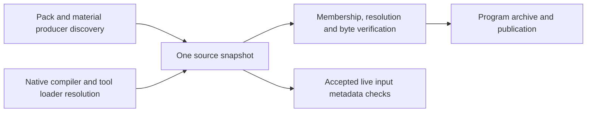

# Plugin source input boundary and measurements

2026-10-14. Baseline: `df4c86bf12bf117ed229e2721e98d60ad1b0d7a0`.
Measured candidate implementation: `16fb2c69f9d1dd1578beae6dd670f31dbd3d27ec`,
before main integration. This replaces the directory-name
exception proposed in [PR #3892](https://github.com/ForgeaX-Games/forgeax-engine/pull/3892).

> [!IMPORTANT]
> The table below records implementation-stage acceptance before main integration.
> Source and compiler regression gates passed; delivery acceptance was incomplete:
> the representative browser group is 31/32, the complete DevKit run is red, and
> the complete Browser, Dawn and 60-frame smoke gates have not been qualified.
> These numbers measure compiler inputs and program delivery, not game FPS or
> complete Play cold startup. Final-head CI and merge status are recorded on the PR.

## Ownership and behavior

The old fence reread every matching source/configuration file under the project,
including external host heartbeat JSON. A changing heartbeat rejected otherwise
unchanged plugin compilation. Excluding `.game-builder/state` would couple the
Engine to one consuming host and would still read other unrelated files.

One Pack source snapshot now owns discovery membership, frozen bytes, aliases,
resolution probes and borrowed compiler resolution. DevKit consumes its digest
projection rather than maintaining a second file catalogue.

| Input | Evidence owner | Required behavior |
|:--|:--|:--|
| Pack declarations and instances | Pack scanner enumeration | Addition, removal and edits reject the old candidate |
| Selected local plugin, tool and executor closure | Native compiler/loader resolver | Preserve exact bytes, symlink aliases and actual imported graph |
| Package/configuration/lock candidates | Snapshot file probes | Observe absent files and TypeScript `extends` chains |
| WGSL discovered without an import | Material producer enumeration | Retain module discovery and byte identity |
| Authored native filesystem readers | Conservative project source fence | Preserve the broader scope when the static program closure cannot bound reads |
| Unreferenced external host state | Outside the selected inputs | Heartbeat writes do not reject compilation |



Membership is checked before retained byte rereads. Verification uses bounded
filesystem concurrency and content SHA-256, so a same-size edit with restored
mtime still rejects. Negative extension candidates catch a newly added preferred
`.ts` even when a compiler resolver caches `.js`. Symlink rebinding and compiler
resolution changes reject. Compiler callbacks are borrowed: their owner verifies
while alive and retires them before closing; later checks retain byte, alias and
negative-file evidence without invoking a dead Vite resolver.

The actual compiled graph rejects selected local dependencies missing from the
captured closure. Explicit imports from `.game-builder`, `dist` and `artifacts`
remain inputs. Ordinary page modules outside the selected plugin graph stay with
Vite. Live sessions reuse observed paths, including negative candidates, and asset
membership without decoding source every polling pass. Before a scope is accepted,
and for detected native filesystem readers, live observation stays conservative.
No public ignore setting or external host name is added.

## Fixed-workload performance

The reusable [benchmark](../../../scripts/bench/plugin-input-boundary.mjs) creates
the same 31 TypeScript files and one direct Pack for both arms. It varies only
unreferenced `.other-host/state/status-N.json` files. Both fixture projects use
the same built runtime dependency closure. Each iteration discovers inputs,
verifies a fresh source fence, reads accepted live inputs, and runs real Vite
plugin compilation through delivery of a checked program archive.

Each case retains one warmup and seven measured rounds per arm. Arm order alternates;
all 48 samples, including slow outliers, are retained under the ignored root
`artifacts/plugin-input-boundary-20261014/` evidence directory.
The authored entry SHA is identical in every sample:
`sha256:3731a703138921f343acbdac4c41bbb8beecef7251747d170500af7df8c54c49`.
Host: macOS arm64; Node 26.4.0. Other host workloads were active, so wall times
are local measurements rather than a universal latency promise. With seven samples,
the nearest-rank P95 is the maximum measured sample.

| Unrelated JSON files | Total P50 before → after | Reduction | Total P95 before → after | CPU P50 before → after |
|--:|--:|--:|--:|--:|
| 0 | 779.6 → 724.0 ms | 7.1% | 3223.2 → 1064.2 ms | 821.2 → 791.3 ms |
| 1,000 | 945.7 → 533.2 ms | 43.6% | 1046.1 → 619.0 ms | 1233.5 → 627.9 ms |
| 5,000 | 5184.3 → 851.8 ms | 83.6% | 9701.2 → 2947.0 ms | 4460.9 → 804.6 ms |

Input discovery plus first byte verification has a separate P50 computed from
each sample's combined duration, not the sum of independent medians:

| Unrelated JSON files | Capture + fence before → after | Accepted live check before → after |
|--:|--:|--:|
| 0 | 14.59 → 10.62 ms | 1.75 → 0.58 ms |
| 1,000 | 258.59 → 7.47 ms | 35.51 → 0.50 ms |
| 5,000 | 2496.61 → 12.74 ms | 227.73 → 0.62 ms |

At 5,000 unrelated files, captured inputs fall from 5,034 to 34. Fixture-root
promise-based reads during capture and the first fence fall from 10,070 to 69;
bytes read fall from 156,660 to 5,173. Accepted live source reads fall from 5,034
to zero. These counters cover that phase and API only, not every filesystem call
made by Vite or the OS. Producer membership still enumerates its declared roots;
the optimization removes unrelated byte reads rather than trusting watcher hints.

### Memory qualification

Independent one-arm processes, each with one warmup and three measured rounds at
5,000 files, expose a memory tradeoff. The paired process's RSS is not an arm
comparison. The same ignored evidence directory retains separate raw memory data, the
negative result and diagnostic GC measurements.

| Measure | Before | After |
|:--|--:|--:|
| OS maximum resident set, default Node heap | 620.6 MiB | 904.1 MiB |
| OS maximum resident set, equal 384 MiB old-space ceiling | 582.2 MiB | 733.7 MiB |
| Retained JS heap after cleanup and explicit diagnostic GC | 90.1 MiB | 91.6 MiB |

Default peak RSS increased about 46%. Retained JS heap is close after GC, but this
does not establish the cause of the RSS difference or a memory improvement.
Production code does not force GC. Speed and IO savings are demonstrated;
whole-process allocation/RSS needs follow-up before memory optimization is claimed.

## Correctness and acceptance evidence

An explicit heartbeat reproducer captures an unreferenced JSON, changes it, and
then verifies the same candidate. Baseline rejects with `plugin-bootstrap-failed`;
the candidate accepts. Positive tests retain explicitly imported host data and
reject changed genuine dependencies.

| Gate | Final observed result |
|:--|:--|
| Focused DevKit owners: host, backend, source fence, boundary, programs, live inputs | 107/107 pass |
| Complete Pack package | 565/565 pass; 78 files |
| Pack, ShaderCompiler and DevKit TypeScript project builds | Pass |
| Maintained `pnpm build:engine` | Pass; rebuilt source and generated shader inputs |
| Biome changed TypeScript and benchmark files | Pass; 24 files |
| Test layout and whitespace | Pass; 3,877 valid test files |
| Real Chrome representative runtime group | 31/32 pass; dev TypeScript navigation times out |
| Isolated unchanged dev TypeScript runtime test | Still red; test timeout at the original 120-second bound |
| Complete DevKit attempt before final regression repairs | 704 pass / 53 fail; no final complete green run |
| Complete Browser, Dawn, 60-frame core smokes, remote final-head CI | Unqualified |

The browser positives include native JS/JSON/virtual/external/raw lazy imports,
main/Worker static identity and three actual App provider paths. Chromium sandbox
settings remain enabled. Failures include missing Playwright browser payloads,
shared GPU lease waits, fixture preparation, and timeouts. A baseline-browser
attempt had an incomplete fixture carrier and cannot establish that these are
baseline failures. No blanket regression-free claim is made.

Two actual defects exposed during validation were repaired: invoking a retired
Vite resolver, and omitting unimported WGSL from SSR input identity. Their original
positive tests pass in the focused final group. No test is skipped or weakened to
make either invariant pass. Deferred full-delivery failures remain visible.

<details>
<summary>Reproduce the measurements</summary>

Prepare independent baseline and candidate checkouts and build the required
package outputs in both. Preserve identical lockfiles and the Node version.
Run from the candidate, pointing both temporary authored projects at the same
candidate runtime package closure:

```sh
node scripts/bench/plugin-input-boundary.mjs \
  --baseline /path/to/baseline \
  --candidate /path/to/candidate \
  --runtime-packages /path/to/candidate/packages \
  --rounds 7 --output artifacts/plugin-input-boundary/comparison.json
```

For independent RSS, run one arm per process under `/usr/bin/time -l`, with
`--arm baseline` or `--arm candidate`, `--noise 5000`, and `--rounds 3`.
Do not compare the paired process's RSS by arm. Repeat with
`node --max-old-space-size=384` to apply the same heap ceiling.

Local failed gate logs, heartbeat JSON, memory logs and raw samples are preserved
in the task's evidence directory. Earlier mixed-runtime and during-refinement
benchmark captures are diagnostics and excluded from the reported comparison.
The first `-e` GC diagnostic had incorrectly shifted CLI arguments; only the
`memory-gc-valid-*` diagnostic files supply retained-heap figures.

</details>
