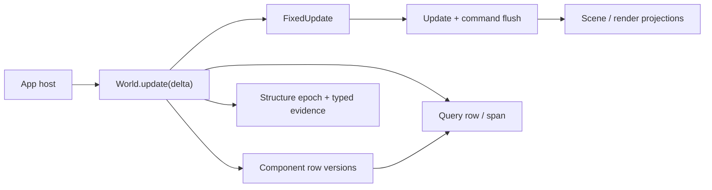
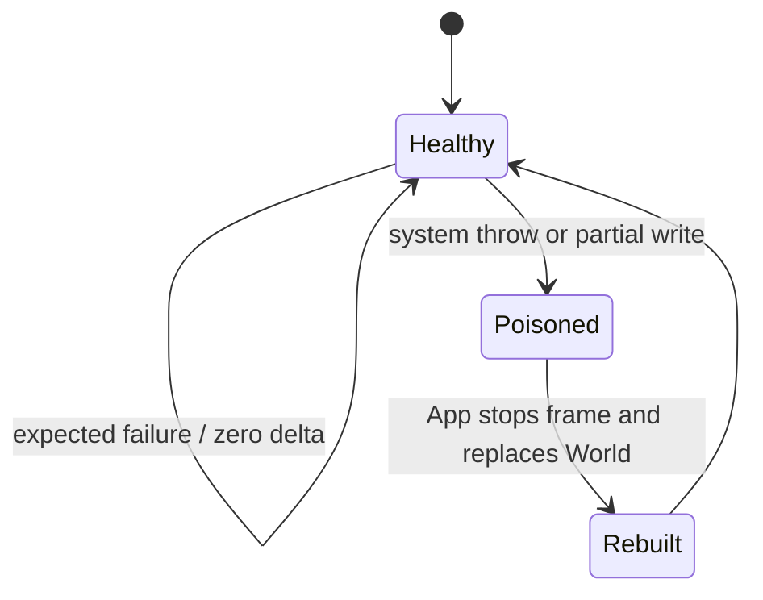

# `@forgeax/engine-ecs`

Archetype ECS for ForgeaX. The package owns the hot path shared by every
domain: entity identity, component storage, relationships, queries, structural
mutation, schedules, resources, time, and optional shared numeric kernels.

> [!IMPORTANT]
> A `World` is the state authority of its realm. Scene instances, physics
> backends, asset ownership, input collection, and application lifecycle stay
> in their owning packages. A domain that needs its own entity store (the
> renderer's Render World) instantiates another `World` with domain schedules;
> it never wraps the World in a second ECS facade.

`World` directly owns its graph, entity records, managed stores, relationship
indexes, row/block revisions, and execution health. Query, command, and
lifecycle helpers receive only the typed package-internal capabilities they
actually consume; there is no `WorldCore`, `WorldData`, or second state bag.



Scalar storage derives byte widths, column views and array element access from the
native constructor table in `component.ts`. Managed families keep their own
lifecycle flags while storing unsigned handles; fixed arrays and shared-memory
columns retain the same numeric conversion and transient-view rules.

## The smallest useful journey

```ts
import type { Result } from '@forgeax/engine-types';
import {
  type EcsError,
  FixedTime,
  Update,
  World,
  defineComponent,
  defineSystem,
} from '@forgeax/engine-ecs';

const Position = defineComponent('Position', {
  x: { type: 'f32', default: 0 },
  y: { type: 'f32', default: 0 },
});

const Move = defineSystem({
  name: 'move',
  queries: [{ write: [Position] }],
  fn: (_world, [positions]) => {
    for (const row of positions) {
      const position = row.mut(Position);
      position.x += 1;
    }
  },
});

const world = new World();
const spawned = world.spawn({ component: Position, data: { x: 0, y: 0 } });
if (!spawned.ok) throw spawned.error;
const registered = world.addSystem(Update, Move);
if (!registered.ok) throw registered.error;
const stepped: Result<void, EcsError> = world.update(1 / 60);
if (!stepped.ok) console.error(stepped.error.code, stepped.error.hint);
```

The normal data path is `world.query(descriptor)` with a row iterator or a
packed `QuerySpan`. Row traversal reuses a borrowed facade; `row.get` constructs
a component object and selected array views. Numeric columns avoid that
materialization. Expected boundary failures use the shared `Result` carrier
from `@forgeax/engine-types`.

## Components and schema

`defineComponent` accepts one closed storage vocabulary. The token exposes only
the schema facts needed by a consumer: `name`, frozen `fields`, and `storage`.
Authoring metadata, lifecycle callbacks, render policy, simulation policy, and
open-ended metadata do not belong on a component token.

| Shape | Use | Example |
|:--|:--|:--|
| scalar | numeric, boolean, or enum data | `{ type: 'f32', default: 0 }` |
| `string` | managed text value | `{ type: 'string', default: '' }` |
| `entity` | raw entity reference | `{ type: 'entity' }` |
| `asset<kind>` | reference retained by the World's asset owner | `{ type: 'asset<mesh>' }` |
| `shared<Tag>` | World-owned non-asset shared payload | `{ type: 'shared<RenderTarget>' }` |
| `array<T>` | variable array replaced as one value or written in place by range | `{ type: 'array<f32>' }` |
| `array<T,N>` | fixed-size inline array | `{ type: 'array<f32, 4>' }` |
| tag | presence-only marker; `{ storage: 'sparse' }` flips without moving the row | `defineComponent('Residual', {}, { storage: 'sparse' })` |

`world.sharedRefs.acquire(target, payload)` returns one caller-owned reference
while preserving the interned handle for the same target and payload object.
Release once per acquisition, including repeated acquisitions of the same
handle. Component columns retain their own references through the normal write
barrier. `world.internSharedRef` remains an idempotent producer lookup and does
not retain on repeated discovery; `world.allocSharedRef` creates an independent
handle. Asset content belongs to `AssetRegistry`; obtain its handles with
`assets.create` or `assets.load` and place them in `asset<kind>` fields.

`world.allocUniqueRef(tag, payload, onRelease?)` stores the actual owned
payload. `world.resolveUniqueRef<T>(handle)` reads that same payload and returns
`unique-ref-released` or `unique-ref-stale` for invalid generations. Component
replacement, removal and despawn own release; the read API grants no independent
release or mutation of the store.

The `fields` object is deeply frozen at definition time. A value replacement
uses the ordinary mutation path:

```ts
const Trail = defineComponent('Trail', { points: { type: 'array<f32>' } });
const entity = world.spawn({ component: Trail, data: { points: new Float32Array([0, 1]) } }).unwrap();
const current = world.get(entity, Trail).unwrap();
world.set(entity, Trail, { points: new Float32Array([...current.points, 2]) });
```

`world.setArrayRange(entity, component, field, offset, values)` overwrites
`values.length` elements of an array field in place, starting at element
`offset`; the array length never changes. It publishes the component through
the same changed-epoch barrier as `set`, and additionally records the element
range so projection consumers can refresh only what changed:

```ts
// Move instance row 42 (16 floats per mat4) without republishing the column.
world.setArrayRange(entity, Instances, 'transforms', 42 * 16, matrix).unwrap();
```

A window outside the array, or a field that is not an array, returns
`array-range-out-of-bounds` (`detail: { component, field, offset, length, size }`,
`size: -1` for a non-array field) and leaves the World unchanged. Use `set`
to resize.

`readArrayRangesChangedSince(world, entity, component, field, since)` from
`@forgeax/engine-ecs/projection` answers the merged element ranges written
after the mutation epoch `since` (read with `readMutationEpoch(world)`), or
`'whole'` when any other write replaced the field, the entity was despawned,
or the bounded per-field history (1024 writes) no longer covers `since`.
`'whole'` is always a safe answer; consumers then reproject the full array.
A range write covering the whole field (a per-frame pose) keeps no history:
`'whole'` is then the exact answer, so retained memory stays independent of
write count.

The Scene package may define a single-field `Name { value: 'string' }` token
for authoring. ECS stores the value through the same closed `string` schema
vocabulary, but does not own the Scene component or its authoring policy.

Scene and Render own their domain schemas, for example `Instances { transforms`
is a Render-owned projection whose array payload follows ECS replacement and
range-write semantics.

### Required components are resolved at structural boundaries

Use `requires` when a component is only valid with one or more other component
tokens. The ECS expands this declaration transitively during `spawn`,
`addComponent`, and deferred `Commands` materialization; it does not scan or
repair entities during a frame.

```ts
const GlobalTransform = defineComponent('GlobalTransform', { world: 'array<f32, 16>' });
const Transform = defineComponent(
  'Transform',
  { x: 'f32' },
  { requires: [GlobalTransform] },
);

// The archetype contains both columns. No scene-specific helper is required.
const entity = world.spawn({ component: Transform, data: { x: 0 } }).unwrap();
```

The declaration is generic: explicit data for a required component wins, and
missing requirements are appended once in dependency order. Removing a
required component is intentionally not a cascade; it is an explicit escape
hatch that lets an owner surface a structured invariant error instead of doing
hidden structural work.

There is no public `push`, `pop`, `capacity`, `reserveArrayCapacity`, view
class, or user-managed target-array mutation API. A replacement is one bounded
mutation, so an invalid value leaves the previous column and reference counts
unchanged.

Object-shaped numeric writes reject `NaN` before touching the column. The
returned `component-numeric-value-invalid` error carries the component, field,
entity, received value, and optional array index in `detail`; `Infinity` remains
valid when the schema accepts it. Branch on `error.code` and use `error.hint` to
choose the correction instead of parsing a message.

## Relationships: one source, one materialized index

Relationships preserve the reverse index because lookup complexity is part of
the contract. Reading a parent's children is $O(1 + k)$ for $k$ direct children,
not an $O(N)$ scan of every entity. The source is the only writable fact; the
target is an engine-maintained, read-only materialized vector with a
source-to-slot backpointer for amortized $O(1)$ attach, detach, and reparent.

```ts
import { defineComponent, defineRelationship } from '@forgeax/engine-ecs';

const Spatial = defineComponent('Spatial', {});

const { source: ChildOf, target: Children } = defineRelationship({
  sourceName: 'ChildOf',
  sourceField: 'parent',
  targetName: 'Children',
  targetField: 'entities',
  sourceRequires: [Spatial],
  exclusive: true,
  linkedSpawn: true,
});

const parent = world.spawn().unwrap();
const child = world.spawn({ component: ChildOf, data: { parent } }).unwrap();
const children = world.get(parent, Children).unwrap().entities;
```

`sourceRequires` applies the same structural-boundary rule to the writable
relationship source: adding `ChildOf` also materializes its required
components. The reverse `Children` projection does not gain a second write
path, and no frame system scans the world to repair the dependency.

`Children` and `AnimationTargets` are read projections, not a second write
authority. `Children { entities` is a materialized target owned by ECS; the
Scene package owns the `ChildOf` vocabulary and chooses where to use it. The
same rule applies to `AnimationTargets`. Direct target writes are rejected by
`World` at both the type and runtime boundaries.

Relationship policy shares the component token's realm-wide owner registry.
A World loaded through a separate bundle or development program session still
maintains mirrors, enforces target write protection, and follows linked despawn
for components declared by the canonical ECS entry.

## Queries and projections

The physical-row batch contract
includes the implemented read-only slice, examples and admission evidence.

Queries are the only public data-plane API. A row is the flexible path; a span
is the packed numeric path and includes entity handles for owner-side identity.
Engine owners select spans for numeric batches and identity-only scans, resolving
columns and entity windows outside the inner loop. Use the existing `world-read`
capability for a numeric field or fixed-array element. Managed strings and
complete authoring declarations retain semantic reads when the owner needs them. Sparse/optional read-only
queries can use physical batches; they cannot use spans.
`pnpm check:ecs-iteration` rejects component snapshot traversal and facade
escape in Engine implementation; comments and owner allowlists cannot waive it. Identity-only
`row.entity`/`row.has` loops are admitted, including sparse membership filtering;
they reuse one facade per traversal. Apps and templates keep the
ordinary gameplay API. See the [CI policy](../../scripts/ci/README.md#engine-ecs-iteration-gate).

### Physical numeric batches

`query.batches()` prepares a cached `Result<Iterable<QueryBatch>, QueryBatchUnavailableError>`.
This first slice accepts read-only, non-temporal descriptors, including sparse
`with`/`without` predicates and optional data. Write, changed and added descriptors
return explicit `write-access` / `temporal-filter` reasons; their existing rows,
spans and projection APIs retain their semantics.

```ts
const active = world.query({ read: [Position], optional: [Tint], with: [Active] }).unwrap();
const batches = active.batches().unwrap();
for (const batch of batches) {
  const x = batch.read(Position, 'x');
  if (batch.kind === 'indexed') {
    const { rows, count } = batch;
    for (let i = 0; i < count; i++) consume(x[rows[i] as number] as number);
  } else {
    for (let row = batch.start; row < batch.end; row++) consume(x[row] as number);
  }
}
```

| Fact | Access |
| --- | --- |
| Dense table range | Physical rows in `[start, end)` |
| Sparse selection | Physical `rows[0..count)`; trailing capacity is not selected |
| Required numeric field | `batch.read(Position, 'x')`, original column with no copy/subarray |
| Optional numeric field | `batch.read(Tint, 'alpha')`, column or `undefined` per batch; zero is present |
| Entity identity | `batch.entities[physicalRow]` |
| Fixed array element | `column[physicalRow * batch.stride(Component, field) + element]` |

Resolve columns, identities and row indices outside the entity loop. Inline
numeric scalars, booleans/enums as raw codes, entity references, fixed numeric
arrays and fixed buffers are eligible. Managed payload fields are rejected;
read columns and index arrays expose no mutation methods or backing buffer.

Batches borrow live storage until advance/close/structure change. Column access
rejects expired batches and structural invalidation; iteration fences poisoned
Worlds and active derived writes. A raw array access cannot run a per-entity
structure check: defer structural changes while a batch is borrowed. Nested
iteration on the same Query is rejected. Repeated close calls cannot invalidate
a later row, span or batch iterator.

The Query retains one reusable validation lease; iteration and batch objects
still have overhead proportional to traversal and batch count. This is low allocation, not a zero-allocation
promise. Dense spans or known-entity numeric probes may remain better for their
workload; benchmark the best eligible API instead of migrating every loop.
Run [`bench/query-batches.mjs`](bench/query-batches.mjs) after the ECS build to
compare actual API CPU, sampled allocation and signed retained-heap deltas.

### Query storage and observation

Raw `Table`, `Archetype`, `Column`, and `FieldView` values are package-private.
Variable-array columns retain their count-column key from table creation and
carry it through growth. Semantic reads, writes and release still observe the
live sidecar column; they do not rebuild its string key for each element or
retain a count, entity row or buffer view across structural changes.
World repairs both entity and archetype row indexes after storage swap removal.
Dense migration, sparse-tag changes and despawn share those repair operations;
managed payload release remains with the originating mutation.

Each Query keeps its own iteration and observation state. Descriptor compilation borrows the component definition's field roster and
allocates diagnostic role lists only on conflicts; temporal sets are built only
for requested changed/added predicates. Dense queries match
only tables; queries with sparse predicates match only archetypes. A World's
storage rosters append without replacing their owners, so a retained Query
checks only newly appended owners and keeps empty matches for later repopulation.
Rows, spans and derived writers borrow the same matched table objects. Derived
bindings keep their identity across unrelated structure changes and refresh only
the accessed table's grown columns; row counts come directly from that table.
Structural mutation still invalidates active iterators; `changed` and `added` observations
remain independent between Query instances.

The storage matching allocation comparison
records a source-qualified environment extraction fixture and its raw profiles.

The row iterator reuses its borrowed row facade. Read each entity/value during
iteration; for an entity snapshot use `Array.from(query, row => row.entity)`.
Spreading row facades and reading them after iteration retains the same final
row rather than distinct entity snapshots.

```ts
const query = world.query({ read: [Position] }).unwrap();
for (const row of query) console.log(row.entity, row.get(Position).x);
const writable = world.query({ write: [Position] }).unwrap();
for (const span of writable.spans().unwrap()) {
  const positions = span.mut(Position);
  for (let i = 0; i < span.length; i += 1) positions.x[i] += 1;
}
```

Incremental owners keep their own `changed` Query. Component row versions are
the value-change authority; `World.getStructureEpoch()` invalidates caches when
entity/component membership changes. There is no parallel value-event journal
or projection-change object vocabulary. A changed query uses the existing
component mutation epochs to skip row scans when any required changed input
has no unobserved write; row versions still select the exact result otherwise.

```ts
const structureEpoch = world.getStructureEpoch();
const changed = world.query({ changed: [Position] }).unwrap();
for (const span of changed.spans().unwrap()) {
  for (const entity of span.entities) console.log(entity);
}
// If world.getStructureEpoch() !== structureEpoch, reconcile membership from
// the owner's ordinary Query and then drain the changed Query once.
```

`added` is the matching first-observation filter for component membership. It
uses the same row-version cursor as `changed`, so each consumer drains its own
query independently:

```ts
const added = world.query({ read: [Position], added: [Position] }).unwrap();
for (const row of added) initializeProjection(row.entity, row.get(Position));
```

`World.set` advances change evidence only when a scalar's stored value changes,
including the actual f32/integer column conversion. Equal enum, boolean and
numeric writes leave projections current. Array, buffer and managed-field writes
remain explicit publications: a fixed-array view may already have been edited
through an alias before `set` is called.

State consumers use `createStateProjection` from the projection subpath. Its current candidate exposes `hasStructuralChange(index)` over the existing per-index evidence, so consumers can refresh that identity after component removal without treating a global structural change as a change to every row. Read this predicate before accepting or superseding the candidate; those actions expire it. World
publishes writes into mutable max-epoch radix indices over stable entity slots.
A consumer reads only changed index paths and retains its accepted membership
and cursor. Component indices own the only changed epoch for each live component identity;
row and sparse storage retain only the distinct added epoch. Migration and
swap-removal move added evidence but never duplicate or move changed evidence.
Known-identity queries read the same index directly. Removal releases empty
paths (a bounded spare list reuses their nodes) and rescans a node only when it
held the removed maximum. Repeated writes mutate existing paths; unexpected allocation failure
after a mutation poisons the World through its existing partial-write policy.
Structural facts coalesce by World slot, retaining deletion and generation
replacement for independent slow consumers without an append history.

Changed row and span queries use the same write evidence. They resolve current
physical rows directly, restore physical ordering with fixed-width radix passes
(and bounded insertion for small cohorts), and commit their observation
cursor only on complete iteration. Each temporal iterator checks World health,
derived-write activity and structural validity before reading or committing.
If the source epoch still equals its captured upper bound, already validated
candidates need no repeated predicate lookup; a later value write restores the
original upper-bound checks, including Added-only semantics. Known-slot epoch
lookups reuse one current leaf reference inside the index; every set/delete
clears it before mutation, so no old leaf backing survives through that shortcut.
No clean table directory or block summary is
scanned to discover local changes. Declared range writes publish their actual
range; arbitrary writes through a borrowed mutable column remain conservative
at capability acquisition, not automatically observed property writes.

```ts
import { createStateProjection } from '@forgeax/engine-ecs/projection';

const projection = createStateProjection(world, [Position]);
const candidate = projection.read();
for (const index of candidate.indices) {
  reconcileCurrentEntity(index, projection.entity(index));
}
candidate.accept(); // Only after the consumer successfully applies its changes.
```

| Boundary | Contract |
|:--|:--|
| Discovery | Prunes unchanged max-epoch index paths; resolves only emitted stable identities. Explicit invalidation may rebuild the consumer baseline. |
| Acceptance | Synchronous, consumer-local; a new read, invalidation, observed/candidate component write or any structural mutation expires an outstanding candidate. Writes to other components and resources do not expire it. |
| Failure | Leave the batch unaccepted and read again; poisoned Worlds reject projection. |
| Scratch | `indices` is borrowed until the next `read`; do not retain it as a snapshot. |
| Invalidation | Preserves prior identities so deleted sources can still leave the consumer. |
| Fast check | `isCurrent()` checks the same component/structure fence without allocating a batch; unrelated component and resource writes leave it current. |
| Root facts | `membershipChanged` and `changedComponents` conservatively identify work domains; `changed(entity, component)` checks a surviving value against acceptance. Removed components require current-membership reconciliation. |

The observation declaration is the acceptance fence. A producer may read input
components, write separate derived output components in the same World, then
accept its inputs. Include every component whose value or membership the
consumer relies on; resource reads are outside this component projection's
fence. Structural edits remain conservative and must precede the read or follow
acceptance. The borrowed batch never becomes an asynchronous frame snapshot.

Derived numeric producers execute under one World-owned synchronous write
fence. The internal `writeRows` operation covers the producer's numeric writes,
its distinct `(bindingIndex, row)` staging and publication; no full changed-mask
scan is needed. Complete changed tables coalesce directly from the known row
count. Source projections and temporal Query cursors cannot observe or accept
pending evidence (`derived-write-active`); plain input/parent reads remain valid.
Nested writers reject before execution. Unexpected producer failures poison the
World; ordinary callback mutations/thenables are invalid numeric producers.

The optional third argument selects candidate component membership (any listed
component); it defaults to the observed components. Sparse candidates conservatively
include current tables. Consumers still inspect final component membership and
values: the work set is conservative, never an event stream.

The `@forgeax/engine-ecs/world-read` seam is a read-only owner capability for
hot semantic scalar/array probes. `hasRelationshipEdge` validates one known
source, its existing backpointer and one current mirror element in constant time;
it does not enumerate the target's children. `World.getStructureEpoch()` remains the
public cache-invalidation primitive; the seam never returns tables, archetypes,
columns, or mutable views. Ordinary gameplay code should continue to use
`World.get` and queries.

The internal array-view reader reuses fixed inline row windows while their
column storage stays live. Growth replaces the storage; every access resolves
the entity's current row, including after migration or swap removal. Public
component reads keep fresh wrappers, and variable arrays resolve their current
pool slot and logical length. Borrowed windows remain transient.

When an owner needs one scalar or one array element without materializing a row,
import the capability explicitly and keep the probe read-only. Entity fields
are returned as their stored u32, so narrow a non-null value to the existing
`EntityHandle` before passing it to another entity-typed probe:

```ts
import { ENTITY_NULL_RAW, type EntityHandle } from '@forgeax/engine-ecs';
import { ChildOf, Children } from '@forgeax/engine-scene';
import { worldRead } from '@forgeax/engine-ecs/world-read';

const parentRaw = world[worldRead].getFieldValue(child, ChildOf, 'parent');
const parent: EntityHandle | undefined =
  parentRaw === undefined || parentRaw === ENTITY_NULL_RAW
    ? undefined
    : (parentRaw as EntityHandle);
const count =
  parent === undefined ? undefined : world[worldRead].getArrayLength(parent, Children, 'entities');
const firstChild =
  parent === undefined
    ? undefined
    : world[worldRead].getArrayElement(parent, Children, 'entities', 0);
```

`undefined` means the entity, component, field, or element is unavailable; the
capability never hands out a storage view and cannot mutate the World.

Queries never expose table ids, rows, columns, or a duplicate snapshot data
plane.

### Steady-state cost at scale

Steady per-frame work allocates in proportion to changes, not entity count
([steady-state bench](bench/steady-state.mjs)):

| Operation | Steady allocation |
|:--|:--|
| `set` on a numeric/bool/entity component, `setArrayRange`, `ok(undefined)` | none |
| `set` with an array payload | none beyond the caller's payload object |
| sparse tag add/remove | none (no row move); table tags copy the row |
| changed row iteration | none per row; `row.get` builds one snapshot object (and views) |
| spawn / despawn | payload validation records only; archetype rosters are memoized |

Small variable arrays (up to 256 bytes) share chunk cells instead of owning
an ArrayBuffer each; a fixed `array<T,N>` stays cheaper still.

## Schedules, time, and resources

`Update` and `FixedUpdate` are the simulation schedules driven by
`world.update(dt)`. A domain declares its own phases with `defineSchedule(name)`
and executes them explicitly with `world.run(token)`; a domain run never
advances World time and cannot order against another schedule; running a token the World has
never registered, or ordering across schedules, returns `schedule-scope-mismatch`. Registration is
token-first; there is no frame-end schedule, system-parameter DSL, terminal
render hook, or severity/error-handler registry.

```ts
world.addSystem(Update, Move).unwrap();
world.addSystem(FixedUpdate, {
  name: 'fixed-step',
  queries: [],
  fn: (fixedWorld) => {
    const fixed = fixedWorld.getResource(FixedTime);
    void fixed.tick;
  },
}).unwrap();
```

`world.update(deltaSeconds)` advances the clock, runs zero or more fixed steps,
runs one update step, and flushes each system's command buffer. Clock readers
receive a stable read view; the scheduler owns writes.
Reverse system-set membership is rebuilt with the schedule graph after
registration, removal or replacement. Set conditions are still evaluated once
per execution segment and never cached across frames.
Catch-up step counts derive from the initial accumulated delta, so intermediate
remainder rounding does not discard an exact final step (including `3 / 60`).
An `Update` system ordered `after: [FixedUpdate]` observes the final
`FixedTime.overstep` and dropped-time counters for this update, including zero
fixed ticks, an empty fixed schedule, and capped catch-up. The remainder does
not wait until `world.update(deltaSeconds)` returns to become visible.
Referencing the registration token itself in `before` or `after` brackets every
execution of that schedule. For example, a FixedUpdate system with
`before: [FixedUpdate]` runs before every fixed tick, while `after: [FixedUpdate]`
runs after its ordinary systems and command flushes. Registration order does
not weaken these boundaries; contradictory ordering uses the ordinary cycle
failure. Update boundaries also enclose its intrinsic fixed block.

Resources are non-owning values: Cordis/plugin owners dispose external payloads, not `World`.
Final shared-reference `release()` returns the payload to its caller.
The store retains no release journal or content-change versions. Runtime content
uses managed ECS components owned by `assets-runtime`; final release does not
retain the external payload.

## Failure and recovery

Branch on `error.code`, never on a message string. The closed ECS error union
preserves `code`, `expected`, `hint`, `detail`, and `cause` where applicable.

```ts
const result = world.update(1 / 60);
if (!result.ok) {
  switch (result.error.code) {
    case 'world-poisoned':
      // Stop the frame and ask the App execution owner to rebuild.
      break;
    default:
      console.error(result.error.code, result.error.hint);
  }
}
```

Recovery means constructing a fresh World and replaying the authoritative
game state; a poisoned identity is never reused. World identities include a
realm namespace so a replacement Worker cannot admit old World-scoped references
when its local counter restarts. Callers treat this identity as opaque:

```ts
function createWorld(): World {
  const next = new World();
  next.addSystem(Update, Move).unwrap();
  return next;
}

let liveWorld = createWorld();
const step = liveWorld.update(1 / 60);
if (!step.ok && liveWorld.execution.health === 'poisoned') {
  // The first failed frame can be `system-failed`; a later call is
  // `world-poisoned`. Health is the stable recovery boundary for both.
  liveWorld = createWorld();
  for (const saved of savedPositions) {
    liveWorld.spawn({ component: Position, data: saved }).unwrap();
  }
}
```

Expected command failures are reported before structural commit and leave the
World unchanged. A system throw or an unknown post-write failure cannot prove
that no row was mutated: the World becomes poisoned and must be rebuilt by the
App execution owner. Shared-kernel partial writes follow the same fail-closed
rule.

Empty command queues check any recorded staging error before returning from
preflight. They do not create a speculative structural shadow; the ordinary
flush still owns commit and abort status.



## Inspection

`world.inspect()` is an explicit, detached, deeply frozen POD snapshot for
diagnostics. It is not a live registry and is not a storage escape hatch.
Consumers should use entity counts, active component names, schedule summaries,
and resource keys; gameplay code should use queries.

`world.componentsOf(entity)` returns a detached array of the live entity's
component tokens, including sparse tags, or the normal stale-entity error.
Unlike `world.components.entries()`, it reflects actual archetype membership
without requiring a plugin catalog lease. Inspection plugins combine it with
public component reflection and `world.get`; it adds no inspection state or
per-frame work to the World.

## Public surface and subpaths

The root barrel is intentionally small. Advanced capabilities are named by
their owner instead of being forwarded through the root.

| Entry | Purpose |
|:--|:--|
| `@forgeax/engine-ecs` | World, components, relationships, queries, schedules, resources, errors |
| `@forgeax/engine-ecs/projection` | Write-indexed current-state projection, render read versions, numeric spans, and array range-change evidence |
| `@forgeax/engine-ecs/shared` | Shared numeric kernel contracts |
| `@forgeax/engine-ecs/world-read` | Safe semantic scalar/array reads for owner-package hot paths |
| `@forgeax/engine-ecs/externalization` | Generic component projection and entity remap |

`Result`, `ok`, `err`, and `Handle` come from `@forgeax/engine-types`; ECS does
not forward them. There is no ECS remote bin, simulation record/restore
protocol, scene-instance resolver, or compatibility alias for removed APIs.

<details>
<summary>Removed concepts</summary>

The one-cut surface deliberately removes `FrameEnd`, `setErrorHandler`,
`defineSystemParam`, `ParamValidation`, simulation record/restore/trace APIs,
scene lifecycle methods, raw storage exports, relationship metadata lookup,
root `Result`/`Handle` forwarding, and array convenience commands. When a
consumer needs one of those concerns, move the owner to App, Scene, Render,
Physics, or the explicitly named ECS subpath.
</details>

## Contract invariants

The following are package-contract statements, not a claim that every
repository-wide browser, Dawn, or consumer gate is green. Gate results for a
specific change belong to its closed-loop verification report.

- [x] Entity and component mutation use one World authority.
- [x] Relationship targets remain materialized for $O(1 + k)$ reads.
- [x] Query row/span are the only public data plane.
- [x] `Update`/`FixedUpdate` drive simulation; domain schedules run only explicitly.
- [x] Expected failures are structured; unknown partial writes poison the World.
- [x] Advanced projection/shared/externalization APIs are named subpaths.

For the full migration rationale and acceptance matrix, see the canonical
ECS World ownership simplification design.

### Large managed arrays

The eight BufferPool size classes bound pooling, not field capacity. Larger
arrays use dedicated allocations; release drops their storage instead of
retaining a large free bucket. Growth preserves bytes and slot identity, and
allocation failure returns the existing structured managed-buffer error. Small
fields keep their existing allocation and reuse behavior. Game data, including
instance transforms, remains World-owned regardless of its size.

Managed buffer slots are typed columns (size class, chunk, offset, logical length); the pool retains no view per slot and materializes a transient byte view only on request, so a small per-entity array costs no live object. Entity records (generation, archetype, row) are likewise typed columns rather than one object per entity. Released slots cannot grow or change length; invalid logical lengths fail before mutation. Capacity classes and live-slot ownership remain separate allocator facts.

Array element admission shares the scalar/reference vocabulary, including the same tag validation for `shared<Tag>` and `asset<Kind>`. Write types derive from the read value contract; only buffer sources and numeric-array inputs widen.

Package history is maintained in the Harness changelog.
