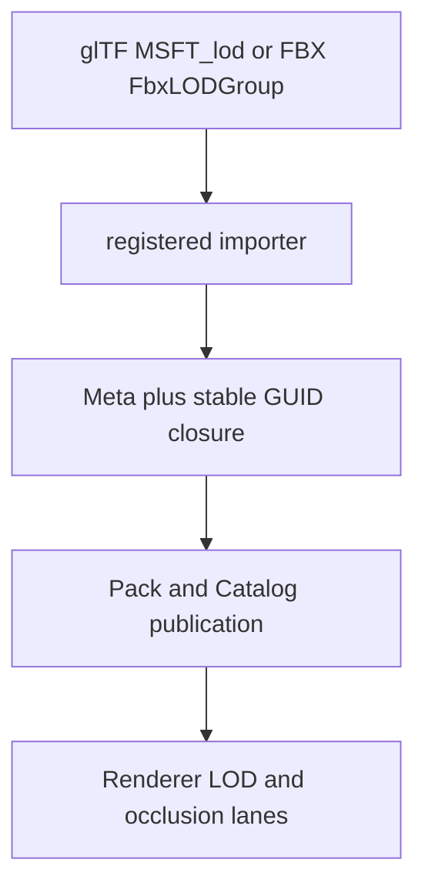

# @forgeax/engine

`@forgeax/engine` is the one package a game author installs. Its root is the
runtime entry, its focused subpaths expose every Engine capability, and its
`forgeax` binary owns project creation, validation, development, build, and preview.

```bash
pnpm add @forgeax/engine
pnpm exec forgeax project check
```

pnpm projects that use Vite should keep
`public-hoist-pattern[]=@forgeax/engine-*` in `.npmrc`. Generated ForgeAX games
already include it; the focused hoist lets package-owned dynamic imports resolve
from Vite's project-level optimization cache without exposing extra declared
dependencies.

```ts
import { createRenderer } from '@forgeax/engine';
import { World } from '@forgeax/engine/ecs';
import { Transform } from '@forgeax/engine/scene';
```

## Open View

The Engine authoring archive includes View. From the game root, run:

```sh
forgeax project view --json
```

Open the returned URL and verify the selected project and renderer readiness.
Use `forgeax backend stop` from the game root to stop the local service.

## Game authoring workflow

For every new or resumed game task, read the game project's `AGENTS.md` before editing.
Its **Run, test, build, and release** section selects the requested delivery scope
and stop condition, defaulting to a local playable handoff.
Continue through project-local `skills/forgeax-engine-authoring/SKILL.md` for capability
selection and `skills/forgeax-engine-cli/SKILL.md` for commands. These installed
documents remain the entrypoints after bootstrap.

Follow the installation below for a new project. `project new` installs the game
guide and local skills and reports their paths in `value.onboarding.read`.

## Import model

| Import | Meaning |
|:--|:--|
| `@forgeax/engine` | Runtime renderer assembly and the usual game entry |
| `@forgeax/engine/app` | App and frame-loop assembly |
| `@forgeax/engine/three/tsl` | Original CPU TSL functions sharing the Three facade constructor family; bounded native inputs follow the Three package contract |
| `@forgeax/engine/ecs` | ECS world, components, queries, and systems |
| `@forgeax/engine/<package-directory>` | The matching focused Engine package |

The focused `@forgeax/engine-*` packages remain physical ownership units.
The official npm tarball includes their complete locked runtime dependency graph
through standard `bundledDependencies`, with unpatched, single-version third-party
platform leaves pinned as optional registry dependencies. Installation never needs separately
published focused-package versions. Generated ESM facades retain focused imports;
shipping one tarball does not eagerly import every capability into a game.

Install the stable channel with `pnpm add --save-exact @forgeax/engine`.
Test builds require `pnpm add --save-exact @forgeax/engine@rc`; development builds
require `pnpm add --save-exact @forgeax/engine@next`.
Release producers and hotfix maintainers follow this repository's [release contract](./RELEASING.md), including the local Linux development release route. The broader shared policy is documented in ForgeaX Engine release guidance.
The single-package release report
records the 0.4.0 source, publication and consumer evidence.

The facade build stages the complete forwarding inventory before publishing each
changed file by atomic rename. Existing imports remain readable during a rebuild;
obsolete paths retire afterward. This is a per-file publication guarantee, not an
atomic rebuild of the physical Engine packages behind those forwarding modules.

## Create a project

With Node.js and pnpm available, install Engine from the development channel,
which includes the authoring resources.

```bash
npm install -g @forgeax/engine@next
forgeax project new ~/Games/my-game --template game-3d
cd ~/Games/my-game
forgeax project build
```

The Engine archive supplies game templates, authoring skills, View, and a shared
build cache. The generated game records its exact Engine version and resolves
dependencies through the configured registry.

From a contributor checkout, `pnpm engine:pack --output <directory>` writes one
Engine npm archive and its checksum receipt. Register a local development archive
with your configured npm registry when testing project creation by version. See
the [release procedure](RELEASING.md) for publication status.

## Asset-backed LOD recipe

Import a glTF or FBX through the project importer, keep the format relation and
author overrides in the producer sidecar, and publish all lower-detail meshes
in one Pack closure. The runtime consumes the normalized `MeshAsset.lods`
contract; it does not inspect FBX or glTF extension details.



For a first import with `n` lower levels, use the shared default sequence
`round6(0.5 * 0.4^(i-1))`: two total levels become `0.5`, three become
`0.5, 0.2`, and four become `0.5, 0.2, 0.08`. Existing sidecar coverage is
preserved by `sourceKey`; only an appended suffix receives defaults. Every
lower mesh GUID must be in the root mesh `refs[]`, otherwise publication stops
before DDC or Catalog mutation.

> [!WARNING]
> `smoke` proves the real asset/import route and `RhiNull` proves structural
> fallback. A release-quality silhouette or timing claim additionally needs
> same-device Browser/Dawn readback with matching source, view, slot, and
> generation identity.
