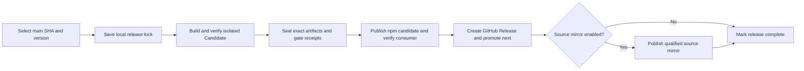

# Engine and SDK releases

This repository owns the release scripts and channel policy for the official Engine SDK. A release binds one version to one full Engine source SHA. Later commits on the source branch do not move that release; recovery resumes the saved Candidate for the same version and SHA.

## Channels

| Source line | Version | npm tag | Release route |
|:--|:--|:--|:--|
| `main` | `x.y.z-dev.n.<sha12>` | `next` | Local Linux flow or SDK Release Candidate and Promotion workflows |
| `rc` | `x.y.z-rc.n` | `rc` | SDK Release Candidate and Promotion workflows |
| `stable` | `x.y.z` | `latest` | Explicit stable Candidate and Promotion |

The local route currently publishes development releases only. It does not modify the `rc` or `latest` tags.

## Local development release

Run the complete development Candidate and Promotion on a Linux x64 machine:

```bash
NPM_TOKEN_FILE=/secure/path/npm-token node scripts/forgeax/local-sdk-release.mjs --stage all
```

The first run selects the current `main` tip, derives the next development version from the public `latest` and `next` tags, and writes a local release lock before building. The lock binds the version, source SHA, controller identity, witness SHA and local run ID. A later default invocation resumes that lock; it does not read a newer `main` to change the selected release. `--version` plus `--source-sha` selects a specific already chosen release.

```bash
node scripts/forgeax/local-sdk-release.mjs --stage candidate
NPM_TOKEN_FILE=/secure/path/npm-token node scripts/forgeax/local-sdk-release.mjs --stage preflight --version <locked-version>
NPM_TOKEN_FILE=/secure/path/npm-token node scripts/forgeax/local-sdk-release.mjs --stage promote --version <locked-version>
```

`preflight` verifies the npm login and source-mirror promotion prerequisites without publishing.

The package alias `pnpm sdk:release:local -- --stage all` is also available in an installed workspace. The direct Node command lets the runner materialize its pinned View and Modeling sources before pnpm checks workspace dependencies.

The candidate and receipts live under `artifacts/sdk-local/<version>/`. Failed gates keep their worktrees and logs so the same run can resume. A successful release keeps its sealed Candidate and proofs, then removes the temporary worktrees.

The local route uses isolated worktrees at the locked source SHA, the repository's pinned Node/npm/pnpm toolchains and the shared `forgeax-task-gate` for builds and browser consumers. Build, reproducibility and collision worktrees use separate checkouts backed by the same exact-pinned Git submodule object stores, avoiding repeated multi-gigabyte object downloads while keeping every SDK source tree clean. For `all`, `preflight` and `promote`, it checks npm authentication. It runs the same release evidence: exact SDK build, native WASM verification, npm diagnostics and JavaScript consumers, SDK archive project and source browser consumers, reproducibility, game-3d collision acceptance, version collision checks and a sealed Candidate. Promotion preflights the public source mirror, publishes the sealed npm bytes under `candidate`, waits for public visibility and a fresh npm consumer, creates the GitHub Release with verified assets, advances `next`, and publishes the source mirror when enabled.

`NPM_TOKEN_FILE` points to a mode-`0600` private file containing the token. The runner reads it into process environment variables and passes those variables only to npm publication/authentication subprocesses; the temporary npm config contains a variable reference, not the token. It removes the temporary config on exit and does not write token bytes into the Candidate, state file or release logs. GitHub operations use the existing `gh auth` login.

When the source mirror is enabled, the GitHub identity must also be an administrator of the public mirror repository. If the local `gh auth` identity is read-only there, set `FORGEAX_GAMES_GITHUB_TOKEN_FILE` to a separate mode-`0600` token file with the mirror publisher permission; the runner reads it only into the source-mirror child process.

On first use, the runner downloads the exact `.nvmrc` Node runtime from nodejs.org, verifies it against `SHASUMS256.txt`, and caches it under `~/.cache/forgeax-sdk-local/`. The machine also needs `zip`, Xvfb, Chrome Beta, Mesa lavapipe, Git/LFS, Rust tools when a pinned native artifact must be rebuilt, and network access to GitHub and npm. The runner checks browser and software-GPU availability before starting Candidate work.



## GitHub Actions route

The existing `sdk-release-candidate.yml` and `sdk-release-promote.yml` workflows remain available for all channels and as a development fallback. They accept only Candidates produced by GitHub Actions. A local Candidate has `origin: local` and is rejected by GitHub Promotion; use `pnpm sdk:release:local -- --stage promote` to resume it.

The two routes share the Candidate schema, immutable artifact checks, npm publisher, release finalizer and source-exporter. Candidate schema `3.0.0` remains readable for existing workflow artifacts; new workflow and local Candidates use `4.0.0` with explicit origin metadata.

## Repairing publication after immutable bytes exist

Keep the original successful Candidate, SDK version, source SHA, ZIP and npm
integrities. Never rebuild that version to repair a publication controller:
its npm identities and GitHub assets may already be immutable. Registry-only
failures use the existing Promotion's failed-job retry after it finishes.

A reviewed publication-controller repair may instead start a new Promotion of
the **same sealed Candidate**, with an explicit `publication_controller_sha`.
That full SHA must be an ancestor of private Main; unmerged refs and abbreviated
SHAs are rejected. The default remains the original Candidate controller.
The override selects publication code only: source identity and every payload
still come from the original seal, and all publication gates run again.

```bash
gh workflow run sdk-release-promote.yml --ref main \
  -f candidate_run_id=<original-successful-candidate> \
  -f publication_controller_sha=<reviewed-main-controller-sha> \
  -f public_preflight_runner=engine-sdk-fullscene
```

The optional qualified carrier runs only the CPU source preflight through the
shared task gate. Register and qualify it first. Mirroring stays on heavy and
holds no shared-host CPU lease while waiting for remote CI. Public source has
one complete PR build per snapshot, a sixty-minute cold-build ceiling, and the
same frozen install, Engine build and setup dry-run. The publisher waits up to
seventy minutes including queueing; these ceilings are not execution targets.
Projection branches include the admitted Git tree so a repaired CI projection
never rewrites a previous branch for the same sealed release.
