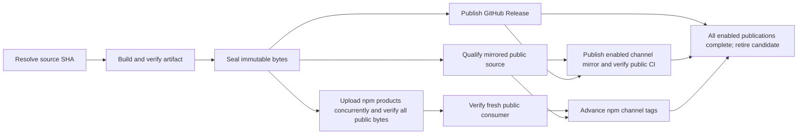

# Engine delivery and release channels

> [!IMPORTANT]
> A release is the verified immutable artifact plus its consumer proof. Successful
> upload is not proof that a version is publicly installable.

## Delivery boundary

| Surface | Artifact | Consumer contract |
|:--|:--|:--|
| Engine | One `@forgeax/engine` npm tarball | Runtime, CLI, independent ESM facades, declarations, WASM, Workers and source maps; exact-version registry dependencies |
| View | Independent `@forgeax/view` tool tarball | Exact-version Engine dependency; separate tool ownership |
| SDK | `@forgeax/engine-sdk` carrier and full ZIP | Same Engine artifact; templates and skills. The ZIP alone adds the offline package store, bare packages and source snapshot (`SDK_ZIP_ONLY_PATHS`) |

`scripts/forgeax/engine-bundle.mjs` turns the installed lockfile graph into one
standard npm package. It bundles only what a registry cannot supply again: every
`@forgeax/engine-*` owner (bytes from its normalized archive), patched packages and
packages whose resolution depends on a patch (for example peers of patched Cordis),
and linked non-registry packages. Every other package that a bundled package reaches
becomes one exact-version root `dependencies` entry under its import spelling, so
npm aliases keep their name. When bundled packages reach different versions under
one name, the most-referenced version takes the root dependency and the others stay
bundled at ordinary nested placement. A registry package reached only through
optional edges becomes an exact root `optionalDependencies` entry, and the optional
edge is removed from its bundled parents: npm's nested installer otherwise treats
the absent leaf as bundled and skips downloading it. Optional registry peers stay
the consumer's opt-in and are neither bundled nor declared. Required missing
dependencies stop production.

Registry dependencies resolve deeper transitive versions at install time; SDK games
retain exact reproducibility through the SDK template lockfiles and the ZIP's
offline store. Each release therefore uploads only Engine-owned bytes, and package
managers reuse cached third-party packages across versions. A 128 MiB product
tarball budget fails locally before publication; it is not a registry-limit claim.
Package LICENSE files travel with their bytes. Source and SDK package inventory
remain modular; focused packages are excluded from the official npm roster.

One Engine publication cannot expose half of its internal dependencies. Npm can
still hold the whole artifact in validation. Independent Engine, View and SDK
products are separate npm publications; their tags are not a registry transaction.

## Channel policy

| Channel | Source branch | Version | Npm tag | Public mirror branch | Trigger |
|:--|:--|:--|:--|:--|:--|
| Stable | `stable` | `x.y.z` | `latest` | `stable` | Candidate prepared by each rc Promotion (or explicit); explicit Promotion |
| Test (rc) | `rc` | `x.y.z-rc.n` | `rc` | none | Explicit Candidate; Promotion follows automatically |
| Development | `main` | `x.y.z-dev.sequence.sha12` | `next` | `main` | Explicit `engine-development-release.yml` dispatch for one main commit |

Three long-lived branches carry three questions: `main` is what is being
developed, `rc` is what is being tested, and `stable` is what users run. Every
published version, including each rc and development version, ships the complete
npm products and a GitHub Release. Development and stable versions also advance
their own branch of the public source repository; the rc line is internal.

`scripts/forgeax/release-policy.mjs` owns executable version, source and channel
validation. Candidate dispatch uses the current `main` controller, resolves the
selected source branch once, and uses the resulting full SHA in every lane.
An explicit source must be an ancestor of that branch. Development SHA suffixes
must equal the source SHA prefix. Release sources are not gated on their push
CI: the Candidate's own seed, consumer, reproducibility and collision gates are
the release proof, so a release never waits for branch CI.

Development releases are never automatic. An operator dispatches
`gh workflow run engine-development-release.yml` (optionally `-f source_sha=<main-sha>`;
the default is the current main tip). Its version uses the next minor after the
public stable version and continues the published `next` sequence (restarting at
1 when that minor changes). Minor increases are a team
milestone decision; the weekly test cut advances the patch.
Development uses the same Candidate gates, but promises no gameplay or API
stability. Every published channel must remain installable and complete.

```bash
pnpm add --save-exact @forgeax/engine
pnpm add --save-exact @forgeax/engine@rc
pnpm add --save-exact @forgeax/engine@next
```

The default install selects `latest`; test and development require explicit opt-in.
Projects pin exact versions and lockfiles. A tag rollback does not repair an
already pinned bad version or prevent explicit/range selection of public versions.

## Release procedure



```bash
gh workflow run sdk-release-candidate.yml --ref main -f version=0.4.0
gh workflow run sdk-release-promote.yml --ref main -f candidate_run_id=123456789
```

The initial single-package stable baseline is the reviewed `main` commit that
lands this delivery migration. If the old stable tip is an ancestor, fast-forward
it. Otherwise create a stable merge with both old stable and selected main as
parents and the selected main source tree; retain both histories and verify tree
equality. Never force-reset branch history. This source-baseline
selection is not a published or qualified stable version. Obtain Candidate
consumer proof before the first stable publication.

Candidate builds once, runs its complete npm and archive/browser consumers, and
compares independent reproducibility and collision evidence before sealing.
Promotion starts three independent stages from the same sealed candidate: npm
publication (upload under `candidate`, public byte visibility and a fresh consumer),
the GitHub Release, and public-source qualification of mirrored channels (stable
and development). Only the channel tag move waits for qualification, so npm's
size-bound visibility time (minutes for the ~500 MiB Engine and SDK tarballs)
overlaps qualification instead of following it. The enabled mirror follows GitHub publication to
validate its formal Release/tag identity, retaining public CI and remote-tree
verification; each channel advances only its own public branch and checks version
order there. Npm does not wait for GitHub transport or mirror completion. The rc
line skips source qualification and mirroring; paused mirroring still requires
source qualification.
The three npm products upload concurrently under `candidate`, then jointly verify
exact public metadata and downloaded SHA-512 bytes. Before `latest`, `rc` or `next`
moves, a fresh registry consumer installs the SDK, initializes it and exercises
both templates through typecheck, tests, build, package and dev HTTP lifecycle.
The publisher rejects focused-package publication and channel regression.
Development and rc GitHub Releases are prereleases and never become the latest Release.
Any publication can complete while another is pending or fails. Complete delivery
and cleanup wait for all
enabled stages, so retrying the same sealed Candidate can finish partial delivery.

> [!WARNING]
> The public `candidate` tag is not a privacy boundary. Stable version numbers
> can be selected explicitly or by ranges before `latest` moves. Consumer projects
> must remain pinned; a single complete artifact removes partial Engine closure,
> while testing determines whether its behavior is acceptable.

## Test cycle

An rc tests the next stable patch: its version core is one patch above the
current `latest` and stays fixed for the whole cycle; only `-rc.n` increases.
`release-policy.mjs` requires the current `stable` tip to be an ancestor of every
rc source, so promotion is always a fast-forward that cannot drop a hotfix, and
the publisher rejects an rc whose core is not above `latest`.

| Operation | Branch action | Version |
|:--|:--|:--|
| Weekly cut | Commit on `rc` with parents `rc` and `main` and the tree of `main` | `0.4.18-rc.1` |
| Fix found in test | Fix on `main` first, cherry-pick onto `rc` | `0.4.18-rc.2` |
| Prepare | Automatic with each rc Promotion: stable Candidate from the same rc SHA | `0.4.18` sealed, unpublished |
| Promote | Promotion of the last prepared stable Candidate fast-forwards `stable` | `0.4.18` |
| Urgent hotfix during a cycle | Fix on `stable`, publish, then merge `stable` into `rc` and port to `main` | Hotfix `0.4.18`; the rc line continues as `0.4.19-rc.3` |

A hotfix that takes the rc's number is the only renumbering. It is unavoidable
with two concurrent patch lines and occurs only when such a hotfix ships; the rc
sequence keeps increasing. Ordering stays linear across channels:
`0.4.17 < 0.4.18 < 0.4.19-rc.3 < 0.4.19 < 0.5.0-dev.*`.

`stable` only moves by fast-forward to `rc` or by a hotfix that is then merged
into `rc`, so `rc` already contains `stable` when a cut starts. The cut keeps that
ancestry and takes exactly the tree of `main`; a hotfix therefore reaches the next
cut only after it is ported to `main`.

```bash
# Weekly cut. The first cut creates rc from stable: git push origin origin/stable:refs/heads/rc
git fetch origin main rc
cut=$(git commit-tree "origin/main^{tree}" -p origin/rc -p origin/main \
  -m "chore(release): cut rc from main")
git push origin "${cut}:refs/heads/rc"  # braces: zsh reads "$cut:r" as a modifier
gh workflow run sdk-release-candidate.yml --ref main -f version=0.4.18-rc.1

# Promotion: publish the stable Candidate prepared by the last rc's Promotion.
gh run list --workflow sdk-release-candidate.yml --json databaseId,displayTitle,conclusion
gh workflow run sdk-release-promote.yml --ref main -f candidate_run_id=<stable-candidate-run-id>
```

The stable Candidate rebuilds the tested source because the version is part of
the published bytes; its gates run again on the same commit. To keep that rebuild
off the promotion path, each rc Promotion dispatches the stable Candidate of its
source beside rc publication; neither run waits for or gates the other. Until
`stable` moves, policy admits a stable source only when it is the exact `rc` tip
and contains `stable`, so a superseded rc's prepared Candidate cannot be promoted.
Its explicit Promotion fast-forwards `stable` to that source before publishing; a
non-fast-forward push fails without a write. If no prepared Candidate exists
(expired after 14 days, or a dispatch failure), dispatch
`sdk-release-candidate.yml -f version=<core> -f source_sha=<rc-sha>` manually.

## Stable maintenance and recovery

Fix a stable regression on a worktree based on `stable`. Keep patch changes
compatible with that stable line and ship the smallest regression reproducer.
Run the same relevant gates and complete CI; publish the next patch. Merge
`stable` into `rc` when a test cycle is open, and apply the fix to `main` through
a reviewed merge or cherry-pick. Breaking changes and new
capability work remain on `main` until a deliberate next stable baseline is
selected, verified and merged. Ordinary source development retains the optimal
API stance; published stable patch maintenance retains its public contract.

| Failure | Recovery |
|:--|:--|
| Npm validating, metadata/tarball unavailable | Retain sealed Candidate; rerun the failed Promotion jobs after the original run completes |
| Previously staged conflict | Continue visibility/integrity verification; never mint a replacement version for transport recovery |
| Integrity conflict | Stop; never overwrite or retag conflicting bytes |
| Fresh public consumer fails | Preserve channel tags; fix source, create a new version and Candidate |
| Partial tag update or GitHub Release transport failure | Retry the same sealed Candidate to complete individual writes |
| Public bad version | Revalidate the prior complete version, restore its channel tag, deprecate the bad version with a concrete migration message |

Candidate artifact expiry limits retry availability. Preserve the exact sealed
artifact before expiry when npm validation remains pending. Published versions
are immutable; no rebuild may replace different bytes under that identity.

Recover a transport/visibility failure in the existing completed Promotion run:

```bash
gh run rerun <promotion-run-id> --failed
```

This retains the original controller SHA, sealed Candidate and successful
public-source/GitHub/mirror jobs. Inspect its retained artifacts first. Do not
dispatch an entirely new Promotion merely to retry npm: that repeats source
qualification and successful publication work. An incomplete or expired Candidate
requires the recovery described in the SDK production guide.
