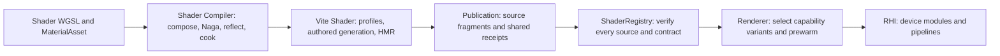

# Shader construction, delivery and admission audit

> [!IMPORTANT]
> The large manifest is a real runtime memory problem, but it is not the main
> cause of npm HTTP 413. Measure raw JSON, compressed bytes, retained CPU memory
> and GPU preparation separately. All legal variants and their exact WGSL/ABI
> facts remain part of the Engine contract.

## Ownership and complete path

| Boundary | Findings and preserved invariant |
|:--|:--|
| WGSL / MaterialAsset | One source/parameter contract drives binding and uniform layout. View ABI is 1280 bytes; a Vite README still said 1136 and is corrected. No shader algorithms, lighting equations or resource slots change. |
| Shader Compiler / Naga | Composition, validation, reflection and material lowering remain build-time. Existing bounded worker admission, compiler lifetime and failure cleanup are retained. Runtime imports no compiler or WASM compiler substrate. |
| Variant production | Base profile declares 26 materials, 3449 variants and 3433 unique source identities. Standard PBR declares 2176 variants after capability constraints, from 13 boolean axes. Preserve all legal keys; source-byte deduplication is safe, deleting axes without real feature evidence is not. |
| Vite lifecycle / authored cook | Authored source and dependent material generations keep atomic last-known-good replacement. Normalized source identity and HMR dependency routing stay with the plugin. Existing cold-cook and HMR regression suites exercise this boundary. |
| Profile reuse | Prepared-input reuse hashes compiler/source/profile identity and actual output bytes. Obsolete compact transport now falls back to source for packaged inputs, and fails explicitly for transferred shared inputs. A matching WGSL digest alone cannot admit an obsolete transport. |
| Standalone builder cache | Reproduced stale output after replacement at the same path. Prepared projection reuse now follows the loader's admitted immutable row identity. Source/shared builds coalesce only while running, so subsequent edits are observed; completed authored generations do not become an unbounded process cache. |
| Publication | WGSL fragments were already deduplicated. Receipts were repeated at almost every variant: only four distinct ABI receipts in the complete base profile. Schema 3.0.0 pools those receipts while retaining row and source identity. |
| Runtime admission | The old decoder expanded and retained the full fleet before device selection. The new decoder verifies every digest in bounded batches, keeps fragments, and joins/caches a composed string only when consumed. Validation never reads the deferred source getters. Atomic failure/retry and weak sharing across registry hosts remain. |
| Renderer preparation / recovery | Boot selects device-reachable modules; recovery selects the generation's used labels. Existing bounded GPU batches, exact variant labels and first-draw readiness remain. Deferred CPU admission does not promise that later GPU prewarm is free. No prewarm or recovery deadline is relaxed. |
| npm / SDK | Platform tool binaries and one WebGPU alias duplicate dominated compressed bytes. All Engine owner packages stay in one tarball; eligible unpatched external platform leaves use exact optional dependencies. The full SDK still retains its offline store. |

## Measurements

The before artifact came from stable source `329e5b9913179c6bdaad793e2d26c42070985841`.
The comparison uses its actual complete base profile, not a small mock fleet.
Initial after measurements republish those same admitted facts through the new
transport; final source production and consumer checks are recorded below.

| Quantity | Before | New transport / admission | Meaning |
|:--|--:|--:|:--|
| Base manifest JSON | 45,224,707 B (43.13 MiB) | 18,676,312 B (17.81 MiB) | About 59% fewer uncompressed bytes; no omitted variant |
| Material receipt metadata | Repeated in 3449 variants and primary rows | Four shared receipts | One ABI fact rather than thousands of copies |
| Retained JS heap after real Registry admission and GC | 563,860,680 B (537.74 MiB) | 29,954,048 B (28.57 MiB) | About 95% lower admission heap |
| Process RSS in that CPU probe | 1,166,163,968 B | 331,825,152 B | Process-specific diagnostic, not a GPU or whole-app budget |
| Admission elapsed time | 514 ms | 281 ms | One local run, not a statistically qualified benchmark |
| Fresh Node process with 512 MiB JS heap | OOM / exit 134 | Pass | Reproducer exercises JSON/fetch plus actual ShaderRegistry |
| Engine npm tarball | 267.24 MiB / HTTP 413 | 117,415,600 B (111.98 MiB) | About 58% smaller; under the 128 MiB product budget |
| Shader package contribution to compressed npm bytes | About 7.10 MiB | 6,204,216 B (5.92 MiB) | Independent gzip estimate; raw manifest size does not equal npm transfer size |
| Multi-platform external native contributions | About 122.85 MiB, estimated independent gzip | Selected by package manager | 306 dependency graph nodes stay bundled; 31 exact platform leaves are external |

Independent gzip attribution is diagnostic: gzip streams are not additive. RSS
includes JSON buffers, allocator behavior and other process memory. The 512 MiB
probe validates admission only; rendering can demand and retain additional WGSL.

## Changes and regression boundaries

| Change | Gate |
|:--|:--|
| Receipt pool | Exact expanded row equality; distinct ABI receipts never merge; invalid, fractional, missing and unused references fail |
| Deferred source retention | All digests, including corruption after the first batch, are verified; only the requested source is retained once; failure leaves Registry empty/unchanged |
| Real-fleet memory budget | SDK producer launches each complete profile in a fresh 512 MiB process; actual Registry admission must retain less than 128 MiB JS heap |
| Builder cache replacement | Red test returned `before` after loader replacement; repaired test must return `after` while retaining the previous result |
| Obsolete transmission projection | Removed a no-op roster copy and quadratic self-alias search; the producer directly publishes its original complete variants and source map |
| Native dependency boundary | Both npm and pnpm install a synthetic registry-backed exact platform dependency and execute the bundled Engine import chain; offline all-bundled and duplicate-version cases still pass |
| npm alias placement | Alias import resolves its original package bytes once, without an unused canonical copy |
| Product byte budget | Engine tarball must be at most 128 MiB before upload; this is a product policy with transport margin, not a claim about npm's undocumented effective limit |

## Verification record

- Publication, lazy admission, sharing and cache regression gates: 27 tests pass.
- Real cold Material cook: four source-backed contracts pass, including Standard,
  skinned and VFX Surface receipts.
- Package graph tests: npm/pnpm offline closure, duplicate versions, alias import,
  platform dependency and missing-required failure pass.
- Shader and Vite Shader TypeScript declaration graph passes.
- Full Shader / Compiler / Vite suites: 144 files, 976 tests pass; no type errors.
- Fresh base and point profiles preserve every exact WGSL byte, source digest,
  variant key and ABI receipt from the before artifact. Both complete profiles
  pass the new 512 MiB process / 128 MiB retained-admission-heap gate.
- Real Dawn triangle and custom material: 60 completed frames and pixel checks
  pass. Custom material also passes actual browser fetch/JSON/WebGPU/readback
  at 60 completed frames. Its previous two-frame browser startup criterion is
  strengthened to the existing canonical smoke budget; no oracle is removed.
- SDK publication contracts: 15 Node tests and 44 Vitest tests pass.
- The production Engine archive is 117,415,600 bytes (111.98 MiB). All three
  exact public versions and downloaded SHA-512 archives were verified before
  promotion. Fresh anonymous public-registry consumers passed both templates
  through installation, initialization, checks, tests, typechecks, builds,
  packaging and dev HTTP start/stop. All three `latest` tags now select 0.4.0.
- Remote CI is explicitly waived by the user; complete Browser/Dawn/fleet and
  sealed Candidate qualification are not claimed by these focused GPU checks.

> [!NOTE]
> An initial unrestricted multi-worker suite hit compiler fixture timeouts under
> concurrent machine load. Its failures were preserved. The same real cold cook
> passed with one worker; the complete suites are rerun with bounded concurrency,
> retaining their original tests and deadlines.

The complete source producer measured 200.382 s for base and 261.507 s for point
under concurrent local load with two shader workers. Prepared consumer app builds
then took 4.66 s (triangle) and 5.14 s (custom material). These are diagnostic
observations with different work, not a before/after compiler speed claim.

## Remaining costs to measure before another mechanism change

The complete Engine fleet intentionally includes many scene/capability states.
Splitting a runtime manifest, pruning variants, changing prewarm policy or moving
compilation to the player would change ownership and first-frame/recovery behavior.
Those changes require ordinary real-browser/device measurements and exact feature
coverage first. The current fixes remove duplicated facts and unconditional
retention; they do not hide the existing source compile cost or GPU startup cost.

The plugin still owns built-in inventory, authored cook and publication alongside
Vite hooks; its historical "thin shell" description understates that assembly
responsibility. Compilation itself remains in Shader Compiler. Future extraction
should remove a reader question or duplicated authority, not merely create more
wrapper packages.

## Production publication receipt

| Product | Exact public version | Archive bytes | Channel |
|:--|:--|--:|:--|
| [Engine](https://registry.npmjs.org/@forgeax/engine/0.4.0) | 0.4.0 | 117,415,600 | `latest` |
| [View](https://registry.npmjs.org/@forgeax/view/0.4.0) | 0.4.0 | 7,166,350 | `latest` |
| [SDK carrier](https://registry.npmjs.org/@forgeax/engine-sdk/0.4.0) | 0.4.0 | 91,008,933 | `latest` |

The clean committed producer source is stable
`13dbf4a4c96ae848885bf4e68dd42ce6a12d62d1`, with the exact tree of merged main
`e12493e58215d303b58d7b7140ffa4a5dac91e24`. Both previous stable history and
selected main history are retained. View source is
`44e8d81aee23f75d94e95ed813349d1b6483d573`.

The complete offline ZIP is 751,762,302 bytes. Its SHA-256 is
`49bcd4609e5e7beb42943aae0b33d245aa5815d0217cf8f1f22b360eec7affb7`.
The npm carrier omits the offline store. The ZIP remains a retained local build;
this direct npm publication does not claim a sealed Candidate or a published
GitHub SDK Release.

The first 267 MiB upload failed with HTTP 413 and never occupied 0.4.0. The smaller
production Engine upload returned HTTP 202 and entered `validating`; that same
identity subsequently became public. No transport-retry version was minted.
Public metadata and downloaded bytes, rather than upload exit status, authorized
channel advancement.

The old `next` still points to `0.0.0-dev.8d955ade1c79` for Engine and SDK, without
a matching View tag. npm rejected deletion with HTTP 403 using the administrator
publishing token. The AI download guide
requires a matching three-product channel and fails closed on this legacy state.
A complete development promotion replaces these pointers; this release publishes
only the new stable channel.

Detailed source, memory, equality, smoke, build, public-integrity and consumer
receipts are retained under `/private/tmp/forgeax-npm-0.4.0-evidence/`; production
archives remain under `/private/tmp/forgeax-sdk-0.4.0-optimized/`.
