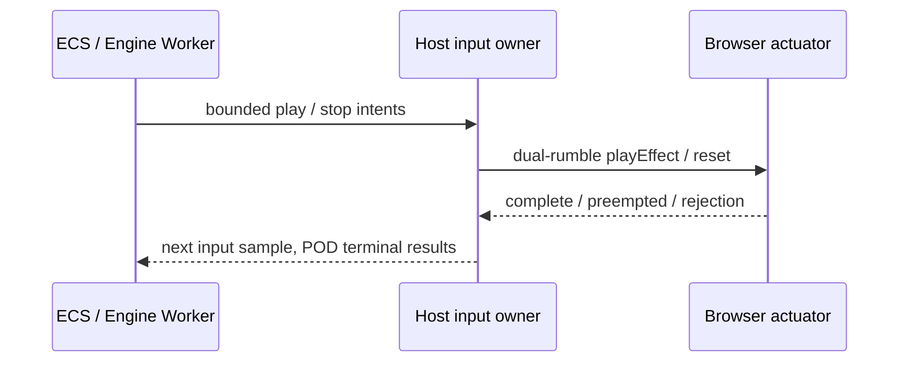

<!-- LANG-SWITCH -->
**Language**: **English** · [简体中文](README.zh-CN.md)

# @forgeax/engine-input

> **Frame-start scanned, frozen `InputSnapshot` Resource for forgeax-engine.** Multi-device surface frozen before user systems run each frame: keyboard (logical key + physical code held/press/release edges) + mouse (position / movementDelta / button held/press/release edges / wheelDelta) + gamepad (7 readpoints: button / buttonValue / justPressed / justReleased / axis / standardMapping / connected) + pointer (per-pointerId position / pressure / delta / phase event queue) + virtualAxis (named joystick readpoint). Higher-level abstractions: **action indirection** (declare once, forget device — `snap.action(name)` / `snap.getAxis` / `snap.getVector`) + **gesture recognizer** (pinch / rotate / swipe / long-press / double-tap — `snap.gesture` + `snap.gestureEvents`). Capability probe (`snap.capabilities`) available at attach time.

`inputBackendPlugin(backend)` provides a host-owned backend without taking its
lifetime. `ownedInputBackendPlugin(backend, dispose)` is the canvas-App form:
DOM listener release is an effect of the same provider Fiber. World snapshot
resources and scan systems remain a separate consumer capability.

`InputSnapshot.focused` publishes the acquired Host focus for this frame;
`focusReset` reports an acquisition reset since the previous scan, including
blur/hidden transitions or consumer ownership transfer. A reset remains visible
even when focus returns before sampling. Cancel held gestures on reset or lost
focus; do not interpret either as a player release command. Both facts belong to
the frozen snapshot, so consumers never call `backend.sample()` a second time or
install gameplay DOM listeners. The neutral snapshot starts unfocused.

`attachBrowserInputBackend(canvas, { uiRoot })` excludes composed UI events
from gameplay and clears acquired input when an event enters that root. Node
identity is checked in the root document’s realm, including same-origin iframe
documents supplied through the browser backend’s document/window options.

`createCanvasInputBoundary(source)` routes one acquired input producer through
`preview` and `game` backends. `owner()` returns the same closed pair;
`grantGame()` and `revokeGame()` transfer ownership and clear stale samples.
Each consumer retains its own input gate when ownership changes.

Empty device/action indexes are allocated only when their first entry arrives
in the current snapshot. Immutable disconnected-gamepad and missing-action
readers share neutral values; populated readers and backend data remain detached,
and each frame still publishes a fresh frozen snapshot.

## Four-Step Recipe

```ts
import { defineSystem, Update, World } from '@forgeax/engine-ecs';
import {
  attachBrowserInputBackend,
  INPUT_BACKEND_KEY,
  INPUT_MAP_KEY,
  InputFrameStartScan,
  type InputSnapshot,
} from '@forgeax/engine-input';

// 1. attach browser backend (PointerLock + keyboard/mouse listeners) to a canvas
const detach = attachBrowserInputBackend(canvas);

// 2. insert the backend as a Resource + add the frame-start scan system token;
//    it freezes the snapshot into the 'InputSnapshot' Resource before any user
//    system runs (charter P5 split: backend = producer, scan-system + Resource
//    = consumer). Insert the backend BEFORE the system so its ParamValidation
//    finds the resource on the first tick.
const world = new World();
world.insertResource(INPUT_BACKEND_KEY, detach.backend);

// 2b. (optional) declare an InputMap to enable action readpoints.
//     Duplicate action names → last-wins. Per-action deadzone default: 0.2.
world.insertResource(INPUT_MAP_KEY, [
  { action: 'jump', bindings: [{ type: 'key', key: ' ' }, { type: 'gamepadButton', button: 0 }] },
  { action: 'moveLeft',  bindings: [{ type: 'key', key: 'a' }, { type: 'gamepadAxis', axis: 0, sign: -1 }] },
  { action: 'moveRight', bindings: [{ type: 'key', key: 'd' }, { type: 'gamepadAxis', axis: 0, sign: 1 }] },
  { action: 'moveUp',    bindings: [{ type: 'key', key: 'w' }, { type: 'gamepadAxis', axis: 1, sign: -1 }] },
  { action: 'moveDown',  bindings: [{ type: 'key', key: 's' }, { type: 'gamepadAxis', axis: 1, sign: 1 }] },
]);

world.addSystem(Update, InputFrameStartScan);

// 3. user system reads the frozen snapshot via the standard Resource API;
//    multi-device surface: keyboard + mouse + gamepad + pointer + virtualAxis
//    + action + gesture
world.addSystem(Update, defineSystem({
  name: 'first-person-camera',
  after: [InputFrameStartScan],
  queries: [],
  fn: (w) => {
    const snap = w.getResource(INPUT_SNAPSHOT_RESOURCE_KEY);
    // action: declare once, forget device — same isPressed() for keyboard AND gamepad
    if (snap.action('jump').justPressed()) {/* jump (space or gamepad A) */}
    const move = snap.getVector('moveLeft', 'moveRight', 'moveUp', 'moveDown');
    // move.x / move.y: circular deadzone [−1,1], WASD diagonal magnitude 1
    if (snap.keyboard.down('w')) {/* move forward */}
    const { x, y } = snap.mouse.movementDelta;
    if (snap.mouse.button(0)) {/* primary down */}
    // gamepad: button / buttonValue / justPressed / justReleased / axis
    if (snap.gamepad(0).button(0)) {/* gamepad A pressed */}
    const lx = snap.gamepad(0).axis(0); // left stick X
    // pointer: per-pointerId position + pressure + delta
    const touch = snap.pointer(0);
    if (touch.active) {/* use touch.x, touch.y, touch.pressure */}
    // virtualAxis: named joystick readpoint (zero-vector for unbound)
    const joy = snap.virtualAxis('move');
    // gesture: pinch/rotate continuous values + one-frame lifecycle events
    const gs = snap.gesture.pinchScale;
    const ga = snap.gesture.rotationAngle;
    const gevs = snap.gestureEvents; // GestureEvent[] one-frame lifecycle
    // capability probe (frozen at attach time)
    const hasGamepad = snap.capabilities.gamepad;
  },
}));

// 4. on shutdown: detach the listeners so multiple Engine instances do not
//    leak handlers (charter P3 explicit failure: detach is part of the contract)
detach();
```

## Multiple Devices (Charter F2 Minimal Surface)

### keyboard (6 read points)

| Call | Returns | Semantics |
|:--|:--|:--|
| `snap.keyboard.down(key)` | `boolean` | Held at this frame's start; loss of `document.hasFocus()` retains the preceding frame's state. |
| `snap.keyboard.justPressed(key)` | `boolean` | Previously released, now pressed; lasts one frame. Initially held keys count as newly pressed. |
| `snap.keyboard.up(key)` | `boolean` | Previously held, now released; true for one frame only. |
| `snap.keyboard.downCode(code)` | `boolean` | Physical `KeyboardEvent.code` held this frame; `KeyA` is independent of keyboard layout. |
| `snap.keyboard.justPressedCode(code)` | `boolean` | Physical code changed from released to pressed; lasts one frame. |
| `snap.keyboard.upCode(code)` | `boolean` | Physical code changed from held to released; lasts one frame. |

Keyboard and mouse press/release edges are recorded by the backend as events
arrive, rather than inferred from held state during scanning. A `keydown → keyup`
or `pointerdown → pointerup` between two frame-start scans therefore leaves
both press and release in the next `InputSnapshot`. Edges last one scan only.
`InputFrameStartScan` invokes `sample()` once per frame, so user systems never
observe partially updated input and should not read DOM events themselves.

### mouse (Six Read Points)

Mouse chords use the `PointerEvent.buttons` mask on intermediate `pointermove`
events. Held state and both press/release edges survive until the next scan,
including a press and release that occur between two scans.

| Call | Returns | Semantics |
|:--|:--|:--|
| `snap.mouse.position` | `{ x: number; y: number } \| undefined` | Latest canvas-pixel mouse coordinates, updated on hover without a button or pointer capture; `undefined` before the first mouse event. |
| `snap.mouse.movementDelta` | `{ x: number; y: number }` | Accumulated PointerLock `movementX/Y` since the last scan; the backend resets it after scanning. |
| `snap.mouse.pointerLocked` | `boolean` | Required combined lock state: W3C `pointerlockchange` (`pointerLockElement === canvas`) OR host `lockProvider.requestLock()`. Consumers use `if (snap.mouse.pointerLocked)` to consume look deltas only while locked. Co-located with `movementDelta` for single-path discovery (charter F1). |
| `snap.mouse.button(i)` | `boolean` (`i: 0 \| 1 \| 2`) | W3C MouseEvent.button: 0 primary / 1 auxiliary / 2 secondary. Literal `i: 3` is a TypeScript error. |
| `snap.mouse.justPressed(i)` / `justReleased(i)` | `boolean` | Per-frame button edges; initially held buttons count as newly pressed. |
| `snap.mouse.wheelDelta` | `number` | Per-frame sum of sign-discrete wheel notches (`WheelEvent.deltaY`: positive down / negative up), reset after frame-start freezing. OOS-7 excludes high-resolution trackpad scrolling; sub-notch magnitude is reserved for a future `ScrollSnapshot`. |

### gamepad (Seven Read Points)

| Call | Returns | Semantics |
|:--|:--|:--|
| `snap.gamepad(i).connected` | `boolean` | Index-based slot `i` is connected; null padding is skipped automatically. Out-of-range/disconnected slots return `false`. |
| `snap.gamepad(i).standardMapping` | `boolean` | Standard layout available: **true** when browser reports `mapping==='standard'` **or** the SDL controller DB has normalized a non-standard layout (D-1 redline). `false` = not standard AND DB miss/unavailable — explicitly detectable (AC-10/E-2). When false, all readpoints return empty signals. |
| `snap.gamepad(i).button(b)` | `boolean` (`b: 0\|1\|...\|16`) | Button `b` is held; out-of-range literals fail TypeScript compilation. |
| `snap.gamepad(i).buttonValue(b)` | `number` | Analog button value (0..1), e.g. 0.5 for a half-pressed trigger. OOS-4 applies no gamepad deadzone. |
| `snap.gamepad(i).justPressed(b)` | `boolean` (`b: 0\|1\|...\|16`) | Released last frame, pressed now; lasts one frame. |
| `snap.gamepad(i).justReleased(b)` | `boolean` (`b: 0\|1\|...\|16`) | Held last frame, released now; lasts one frame. |
| `snap.gamepad(i).axis(a)` | `number` (`a: 0\|1\|2\|3`) | Raw axis value (-1..1); out-of-range literals fail compilation. OOS-4 applies no deadzone. |

### pointer（per-pointerId reader）

| Call | Returns | Semantics |
|:--|:--|:--|
| `snap.pointer(id).active` | `boolean` | `pointerId` is active in pointerMap. Missing IDs return `false` and empty signals for every field. |
| `snap.pointer(id).x` / `.y` | `number` | Canvas-pixel coordinates from the latest pointermove at the end of the sampled frame: `(clientX-rect.left)*(canvas.width/rect.width)` accounts for DPR. Without getBoundingClientRect, store `clientX/Y` directly. |
| `snap.pointer(id).pressure` | `number` | W3C `PointerEvent.pressure` (0..1); devices without pressure use 0.5 or 0. |
| `snap.pointer(id).pointerType` | `string` | `'mouse'` / `'pen'` / `'touch'`——W3C `PointerEvent.pointerType` |
| `snap.pointer(id).delta` | `{ x: number; y: number }` | Frozen current position minus frozen preceding-frame position. Multiple pointermove events use the final endpoint, preserving nonzero motion (AC-09; Bevy #12442 counterexample). |
| `snap.pointerEvents` | `readonly PointerPhaseEvent[]` | This frame's down / move / up / cancel queue; drained at the end of sample(), lasting one frame. |

### virtualAxis (Separate Namespace)

| Call | Returns | Semantics |
|:--|:--|:--|
| `snap.virtualAxis(name)` | `{ x: number; y: number }` | Named virtual-stick vector: magnitude below deadzone gives (0,0); above radius clamps to 1.0; between them uses `clamp(cur-origin, radius)/radius`. Missing names yield (0,0). Fixed mode uses the anchor as origin; floating mode uses the touch-down point. |

### capabilities (One-Time Probe)

| Call | Returns | Semantics |
|:--|:--|:--|
| `snap.capabilities` | `{ gamepad: boolean; pointer: boolean }` | Environment probes frozen when the backend attaches (`typeof navigator.getGamepads === 'function'` / `typeof PointerEvent !== 'undefined'`); no per-frame reprobe. |

### action (Declarative Device-Independent Semantics)

4-member `ActionBinding` discriminant union: `'key'` | `'mouseButton'` | `'gamepadButton'` | `'gamepadAxis'`. Declared via `INPUT_MAP_KEY` Resource (`ActionConfig[]`). Per-action deadzone default: **0.2** (Godot prior-art). Aggregation: OR for pressed, MAX for strength/raw. Duplicate action names: last-wins (D-8).

| Call | Returns | Semantics |
|:--|:--|:--|
| `snap.action(name).isPressed()` | `boolean` | Any bound source is active (OR aggregation); unregistered actions return `false`. |
| `snap.action(name).justPressed()` | `boolean` | Previously released, now pressed; one frame. With no preceding frame, justPressed equals pressed. |
| `snap.action(name).justReleased()` | `boolean` | Previously pressed, now released; one frame. |
| `snap.action(name).strength` | `number` | Analog strength remapped through deadzone into [0,1]: `\|raw\|<deadzone` gives 0; otherwise `inverse_lerp(deadzone, 1, \|raw\|)`. Digital bindings yield 1.0. |
| `snap.getAxis(neg, pos)` | `number` | `strength(pos) - strength(neg)` in [-1,1]. Unregistered sides contribute 0; the same action on both sides always yields 0 (E-12). |
| `snap.getVector(nX, pX, nY, pY, opts?)` | `{x: number, y: number}` | Four actions form a 2D vector with one radial deadzone (Godot input.cpp F2): `length<=deadzone` gives (0,0); `length>1` clamps to the unit circle; otherwise `vec*inverse_lerp(deadzone, 1, length)/length`. Default deadzone averages the four per-action values; `opts.deadzone` overrides it. Reads action `raw`, not `strength`, to avoid a square deadzone from separate axis remapping. |

WASD: bind a/d/w/s through `getVector('moveLeft','moveRight','moveUp','moveDown')`; diagonal magnitude is 1 rather than sqrt(2) (AC-06).

### gesture (Five Touch Recognizers)

Five gesture recognizers running in the backend closure (C-3 single legal cross-frame state). All timers advance off injected `now()` (D-3), decoupled from pointer-event frequency. Two output channels (D-4): continuous values via `snap.gesture`, one-frame lifecycle events via `snap.gestureEvents`. No active gesture → identity empty signal (pinchScale=1.0, rotationAngle=0; AC-12).

| Call | Returns | Semantics |
|:--|:--|:--|
| `snap.gesture.pinchScale` | `number` | Accumulated two-finger scale ratio; identity 1.0 without a gesture. Begin resets it to 1.0; lifting from two fingers to one ends/freezes it; a new two-finger begin resets it again (D-11). |
| `snap.gesture.rotationAngle` | `number` | Accumulated two-finger angle in radians; identity 0 without a gesture. Shares the pinch tracker with paired begin/end events in the same frame. |
| `snap.gestureEvents` | `readonly GestureEvent[]` | One-frame lifecycle queue aligned with pointerEvents. Closed `GestureEvent` union: `pinch-begin/end/cancel`, `rotate-begin/end/cancel`, `swipe` (including direction), `long-press`, `double-tap`. Each event includes `pointerType` (`'mouse' \| 'pen' \| 'touch'`, AC-19). |

### Default Gesture Thresholds

| Constant | Value | Source |
|:--|:--|:--|
| Default per-action deadzone | `0.2` | Godot prior art (F2) |
| `LONG_PRESS_DURATION_MS` | `500` | LayaAir prior-art |
| `LONG_PRESS_SLOP` | `10`（canvas px） | LayaAir prior-art |
| `DOUBLE_TAP_INTERVAL_MS` | `350` | LayaAir prior-art |
| `DOUBLE_TAP_DISTANCE` | `10`（canvas px） | LayaAir prior-art |
| `SWIPE_VELOCITY_THRESHOLD` | `0.5` (px/ms) | Velocity from the 100 ms movement window before pointer-up |
| `SWIPE_WINDOW_MS` | `100` | Sliding velocity window (D-10) |

Calls before `engine.run()` return an empty snapshot without throwing. This charter P3 exception explicitly represents no signal during construction, before any event source exists.

## Invariants

- **One Resource entry** -- User glue consumes `world.getResource(INPUT_SNAPSHOT_RESOURCE_KEY)`; no parallel `world.input` API (charter P4).
- **Encapsulated PointerLock** -- `browser-backend.ts` owns user activation for `requestPointerLock`, `pointerlockchange`, `movementX/Y` units and the `firstMouse` flag. `InputSnapshot` exposes only combined boolean `snap.mouse.pointerLocked` and accumulated `snap.mouse.movementDelta`, not W3C DOM details (plan-strategy OOS-1).
- **Freeze after frame-start scanning** -- The top-level `defineSystem` token `InputFrameStartScan` runs before user systems via `before`, reads the backend from resource `INPUT_BACKEND_KEY`, scans accumulators and inserts a frozen snapshot with `world.insertResource`. Every `snap.*` read in that frame sees identical values (architecture principle 2: derive). Inject the backend through `world.insertResource(INPUT_BACKEND_KEY, backend)`; descriptor `resources:[INPUT_BACKEND_KEY]` uses structured ParamValidation, returning invalid for a missing dependency rather than throwing.
- **OOS-1 exclusions** -- PointerLock enter/exit events, `unadjustedMovement` and hot reload are outside this MVP and remain separate future features.

## Error Model (Charter P3 Explicit Failures)

| Behavior | Result |
|:--|:--|
| `snap.*` before `engine.run()` | Empty snapshot (`down/up=false`, `movementDelta={x:0,y:0}`, `button=false`), without throwing. |
| `keyboard.down(unknownKey)` | `false`, without throwing; not held means down=false. |
| `mouse.button(3)` | TypeScript error from literal union `0 \| 1 \| 2`; unavailable on the runtime surface. |
| Out-of-range/disconnected `snap.gamepad(i)` | `connected=false`; every read point returns `false`/`0`, without throwing. |
| Nonstandard `snap.gamepad(i)` layout | `connected=true`, `standardMapping=false` and empty signals; explicitly distinguishable from disconnection. |
| `snap.gamepad(i).standardMapping` | **true** when browser reports `mapping==='standard'` **or** SDL controller DB has normalized a nonstandard layout (D-1). `false` means nonstandard AND DB miss/unavailable; degradation remains detectable (AC-10/E-2). |
| Unregistered `snap.action(name)` | Empty signals: `isPressed()=false`, `strength=0`, `justPressed()=false`, `justReleased()=false`, without throwing (AC-01/09). |
| `snap.gesture` without an active gesture | Identity signals `pinchScale=1.0` / `rotationAngle=0`, without throwing (AC-12). |
| `snap.gestureEvents` without lifecycle events | Empty array `[]`, without throwing. |
| `snap.gamepad(i).button(17)` / `.axis(4)` | TypeScript error from literal unions `0\|1\|...\|16` / `0\|1\|2\|3`. |
| `typeof navigator.getGamepads !== 'function'` | `snap.capabilities.gamepad=false`; all `snap.gamepad(0..N)` reads return empty signals, without throwing. |
| Missing `snap.pointer(id)` | `active=false` and empty signals for all fields, without throwing. |
| Missing `snap.virtualAxis(name)` | Zero vector `{ x: 0, y: 0 }`, without throwing. |
| Pointer outside canvas | Preserve coordinates without clamping; `x`/`y` can be negative or exceed canvas dimensions (documented charter P3 behavior). |

## Boundary Behavior

| Scenario | Behavior |
|:--|:--|
| Out-of-bounds coordinates | Preserve pointer `x`/`y` without clamping, including negative/oversized values; charter P3 requires explicit documentation. |
| `touch-action` | Browser backend `attach` sets `canvas.style.touchAction='none'` when `.style` exists, silently skipping fake canvases without it; detach restores the original. AI users need no manual CSS. |
| Blur / visibilitychange to `hidden` | Clear pointerMap and queue cancel events for active pointers; immediately release W3C/provider pointer lock; reset gamepad edges. A focus-reset sample boundary suppresses mouse/action releases from old snapshots, avoiding stale edges next frame. The next focused `sample()` resumes naturally. |
| assemble form — action surface | Assemble-form hosts must manually `world.insertResource(INPUT_MAP_KEY, map)` to enable action readpoints (D-7). Canvas-form `createApp` does this automatically. |
| Lazy controller-db subexport | Dynamically import `@forgeax/engine-input/controller-db` only for the first connected nonstandard gamepad (D-2). Until then or on DB miss, nonstandard slots retain empty signals with `standardMapping=false`. Standard gamepads never trigger loading (C-5). |
| Gesture cancellation on blur | `onBlur` cancels each active recognizer, resets continuous values to identity and clears timers (AC-18), preventing stale gestures after refocus. |
| pointer-lock gate = game gate AND host predicate | `onCanvasClick` evaluates `gameGate && (predicate?.() ?? true)`. `gameGate` defaults to `true` and is set via `InputBackend.setPointerLockAllowed()`. `predicate` is `BrowserInputBackendOptions.pointerLockAllowed` (frozen at attach). Both must be true for a click to request lock. |
| `setPointerLockAllowed(false)` immediate release | When `gameGate` transitions from `true` to `false` and a lock is active, the backend immediately releases: W3C path calls `exitPointerLock()`, provider path calls `exitLock()` + clears `providerLocked`. This solves the "mode switches to top-down while locked" boundary. |
| click while this canvas holds the W3C lock | `onCanvasClick` returns without calling `requestPointerLock()` when `pointerLockElement === canvas`. Fire clicks in a locked FPS keep the current lock; a re-request could re-enter or be refused, and a refusal would surface as `app-pointer-lock-failed` mid-game. |
| lockProvider error → onLockError | W3C `requestPointerLock` promise rejection and provider `requestLock` throw/reject both route through `onLockError({ path, cause })`. Provider failure also rolls back `providerLocked = false`. The callback is wired by `attachInputAuto` into `AppError({ code: 'app-pointer-lock-failed' })` on the app's `onError` fan-out. |

Pointer Lock is attempted from a mouse or keyboard/assistive canvas click when the two explicit
game/host gates allow it. Touch and pen clicks, including touch compatibility mouse events,
do not request either W3C or provider lock. `document.hasFocus()` is not a third gate because a
browser may report a transient false value during the same activation. Both a
rejected W3C request and the browser `pointerlockerror` event are converted to
the same `onLockError` diagnostic and are caught before they can become an
unhandled Promise rejection. Lock state remains a boolean readpoint in the
snapshot; DOM error events never cross the consumer boundary.

## Pointer-lock contract: PointerLockProvider / lockProvider / setPointerLockAllowed / pointerLocked

Four anchors cover the full pointer-lock surface across the input-backend boundary.

### PointerLockProvider (type SSOT)

```ts
// @forgeax/engine-input — exported from barrel
interface PointerLockProvider {
  requestLock(): void | Promise<void>;  // request pointer capture (W3C replacement)
  exitLock(): void;                      // release pointer capture
}
```

A single object (not two flat callbacks) — structural typing requires both halves, preventing "requestLock-only" half-injected states. The engine never learns *why* locking is (dis)allowed; it delegates to the abstract callback.

### BrowserInputBackendOptions.lockProvider (injection point)

```ts
// BrowserInputBackendOptions — optional field, parallel to pointerLockAllowed
interface BrowserInputBackendOptions {
  pointerLockAllowed?: () => boolean;
  lockProvider?: PointerLockProvider;      // absent => fall back to W3C requestPointerLock()
  // ... other options
}
```

When `lockProvider` is present, `onCanvasClick` calls `requestLock()` instead of `requestPointerLock()`. The provider's `exitLock()` replaces `exitPointerLock()` in release paths (ESC provider branch, blur, detach, `setPointerLockAllowed(false)` immediate release).

### InputBackend.setPointerLockAllowed (command gate)

```ts
// InputBackend protocol — optional method
interface InputBackend {
  sample(): InputBackendSample;
  setPointerLockAllowed?(allowed: boolean): void;  // game-side gate
  detach(): void;
}
```

- `setPointerLockAllowed(true)` — allow pointer-lock on next trusted click
- `setPointerLockAllowed(false)` — block pointer-lock AND immediately release any active lock (W3C path: `exitPointerLock`; provider path: `exitLock()` + clears `providerLocked`)
- Default state: `true` (allow lock)
- Optional — backends without pointer-lock support omit this method

This works together with the pre-existing host predicate `pointerLockAllowed?: () => boolean` (evaluated fresh on each click, e.g. "is input focus in the game quadrant?"). Two gates AND-combine: both must be true for lock; neither duplicates the other's information.

### InputBackendSample.pointerLocked (readpoint)

```ts
// InputBackendSample — required field (not optional)
interface InputBackendSample {
  // ... movementX/Y, buttons, downKeys, upKeys, etc.
  readonly pointerLocked: boolean;  // W3C pointerlockchange OR provider requestLock engage
}
```

Acquiring the first W3C or provider lock discards movement accumulated before that boundary. Repeated notifications or clicks while already locked preserve subsequent movement until the next scan.

Frozen into `snap.mouse.pointerLocked` at frame-start. Consumers read `if (snap.mouse.pointerLocked)` to gate look/camera rotation — both facts (`movementDelta` + `pointerLocked`) sit at the same attribute path for single-point indexing (charter F1).

## Related Packages

- [`@forgeax/engine-ecs`](../ecs) provides `World`, Resource storage and Schedule (consumer contract: `world.insertResource('InputSnapshot', frozenSnapshot)`).
- [`@forgeax/engine-runtime`](../runtime) assembles `attachBrowserInputBackend(canvas)`, `world.insertResource(INPUT_BACKEND_KEY, backend)` and `world.addSystem(Update, InputFrameStartScan)` within `Engine.create({ canvas })`, hiding assembly details from AI users.

## Simulation input boundary

Use `InputSnapshot` as the frame-start boundary for simulation input. A
simulation trace stores the normalized value consumed by a fixed tick; it does
not store DOM events, browser objects, or a render frame.

```ts
const snapshot = inputBackend.snapshot();
const sample = { tick: fixedTick + 1, input: snapshot.action('moveForward').isPressed() };
```

The input package freezes the snapshot. ECS owns `record`, `restore`, `trace`,
participant registration, comparison tolerance, and closed simulation errors.
The current snapshot does not retain previous snapshots after edge derivation;
holding one reader must not retain an unbounded frame history.
Use the same snapshot source for source and fresh target Worlds. Do not add a
second input recorder, a replay action, or a browser event queue to Remote.

The simulation connector accepts package-produced snapshots from the public
`snapshotFromSample` / `createInputSnapshot` path. If an `InputSnapshot`
Resource is replaced by a structurally similar value without package-owned
provenance, the World update does not throw or publish a partial sample;
`finish()` returns the existing `simulation-trace-invalid` error with
`detail.path === 'InputSnapshot.provenance'`. Consumers do not author or copy
private provenance fields. Dispose the failed controller, provide a corrected
snapshot source, and install the connector on a fresh target World.

If a trace fails, inspect `code`, `expected`, `hint`, and `detail`, repair the
named input boundary, then create a fresh target. RHI tape replay and game
replay have different owners and are not input snapshot formats.

## Gamepad feedback

`GamepadFeedback` is an optional World resource under `GAMEPAD_FEEDBACK_KEY`.
App installs it with the input provider. The frozen scan supplies
`input.gamepad(index).feedbackTarget` and `dualRumble` independently of
`connected` and `standardMapping`. A connected unsupported controller still
works for ordinary input. Capability presence is API evidence; physical
vibration requires a real-device check.

```ts
import { defineSystem, Update } from '@forgeax/engine/ecs';
import {
  GAMEPAD_FEEDBACK_KEY, INPUT_SNAPSHOT_RESOURCE_KEY,
  type GamepadFeedback, type InputSnapshot,
} from '@forgeax/engine/input';

app.world.addSystem(Update, defineSystem({
  name: 'fire-feedback', queries: [], after: [InputFrameStartScan],
  fn(world) {
    const input = world.getResource(INPUT_SNAPSHOT_RESOURCE_KEY);
    const feedback = world.getResource(GAMEPAD_FEEDBACK_KEY);
    const pad = input.gamepad(0);
    if (pad.feedbackTarget && pad.dualRumble && input.keyboard.justPressed(' ')) {
      const admitted = feedback.play(pad.feedbackTarget, {
        durationMs: 120, strongMagnitude: 0.8, weakMagnitude: 0.2,
      });
      if (!admitted.ok) console.log(admitted.reason);
    }
    for (const result of feedback.readResults()) console.log(result);
  },
})).unwrap();
```

`play` and `stop` enqueue ordered POD intents; an accepted command gets a
monotonic `id`. Admission returns `invalid`, `capacity` or `disposed` without
throwing. Parameters are finite, magnitudes are in `[0, 1]`, duration is in
milliseconds `(0, 10000]`, and native start delay is always zero. A zero-amplitude
play is a valid silent control. Game code owns shooting, damage and UI patterns.



| Contract | Bound / policy |
|:--|:--|
| Producer capacity | 32 accepted commands including pending and unpolled results. Poll `readResults()` to release terminal capacity. Invalid/capacity admissions do not consume an id. |
| Native capacity | 32 unsettled calls per document, at most 8 per connection. Plays reserve a reset slot for every active connection; a connection admits at most 7 pending plays. Busy is explicit. |
| Native timeout | Duration + 1000 ms for play, 1000 ms for reset. Timed-out native calls retain capacity until they actually settle; unresolved reset blocks further plays on that connection. |
| Result retention | Host retains 64 results in arrival order, reports evictions through `feedbackLostResults`; producer closes affected pending requests as `result-overflow`. Producer reserves up to 64 total pending/result slots for lifecycle diagnostics while authored admission stays at 32. Diagnostic overflow evicts only a diagnostic and preserves the latest failure plus a loss count; authored terminals survive. No unbounded queue. |
| Dispatch | Local ECS output dispatches at the next Host input scan. Worker output dispatches on accepted frame/simulation completion; results return in the next admitted input sample. No extra gamepad polling or frame Promise when idle. |
| Replacement | Latest valid play wins across Apps in the same document. Old commands become `preempted`; late native settlement cannot clear a newer effect. A stop from another owner returns `busy`. |
| Identity | Target includes attachment, slot index and connection generation. Disconnect events and scan absence invalidate the connection. Control clear, hidden and detach revoke the attachment. Same-string same-slot reconnect cannot reuse an observed generation. |
| Lifecycle | Hidden, input clear/blur, gate closure, Worker rebuild and owner disposal release only the current owner's effect. Visibility restoration never replays commands. Native hidden-page reset rejection remains observable. |
| Observation | Closed status SSOT: [gamepad-feedback.ts](src/gamepad-feedback.ts). Command id `0` denotes a bounded lifecycle reset diagnostic; it has no authored command. Native failures retain a bounded name/message string. `preempted` is logical supersession, not proof of physical cessation. |
| Supported path | Normal browser `vibrationActuator` advertising `dual-rumble` via `effects`, or older `type`. No mapping-based capability inference, XR pulse, trigger rumble, native OS output or motion sensors. |

> [!IMPORTANT]
> A browser that misses both disconnect events and a sampled absence for an
> identical replacement device provides no observable identity change. The engine
> cannot infer that physical swap from `id`. Record this platform limitation in
> real-device acceptance rather than treating the description as a persistent id.

A custom input provider may expose `feedback` plus `dispatchFeedback` and POD
sample results. `createGamepadFeedback()` supplies the realm-neutral bounded
producer: transport drains `drainIntents()` and returns `acceptResults()`.
Browser native objects and Promises stay in the Host implementation.

Action deadzones are resolved by `deriveActionStates` at frame sampling. `getAxis` and `getVector` consume only those states, and `snapshotFromSample(sample, states, previousSnapshot?)` retains no input configuration. Author configuration changes take effect on the next sample.

Gesture recognition keeps one per-pointer record for its long-press timer and
swipe history. Every frame copies that record before processing events; release
and cancel retire it together. The browser backend reads continuous gesture
values from the returned recognizer state and forwards the separate frame events.

Snapshot construction owns copies of gamepad collections, pointer and gesture
events, virtual axes, and action values. Later producer writes cannot alter any
reader in an accepted frame. Action edge derivation reads the previous snapshot
through its action readpoint; snapshots carry no hidden action-state payload.

A long press consumes the pointer’s arming state. Movement outside the slop and
a delivered long press both disarm it; only a new down rearms it.
