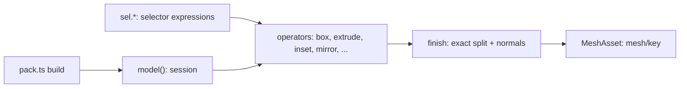

# `@forgeax/engine/modeling`

> [!IMPORTANT]
> Modeling owns editable polygon topology, selectors, topology operators and the
> exact export to an ordinary `MeshAsset`. It owns no asset format, renderer,
> World state or Editor mode. Pack builds call it as ordinary functions; the
> exported mesh travels through the existing Pack, Catalog and Renderer owners.

This package is the `forgeax-modeling` repository mounted as a required source
submodule at `packages/modeling` of `forgeax-engine`. The Engine gitlink is the only
version fact; the package is built, tested and published inside an Engine checkout.



## Smallest useful example

```ts
import { definePack, definePackageId } from '@forgeax/engine/pack/source';
import { model, sel } from '@forgeax/engine/modeling';

export default definePack({
  schemaVersion: '2.0.0',
  packageId: definePackageId('01900000-0000-7000-8000-00000000a0de'),
  parameters: [{ name: 'depth', type: 'f32', default: 0.03, minimum: 0.005, maximum: 0.1 }],
  build: ({ values: p }) => {
    const m = model();
    m.box({ size: [0.42, 0.3, 0.36], tag: 'shell' });
    m.inset(sel.tag('shell').and(sel.facing('+z', 10)).largest().one(), {
      thickness: 0.02, region: 'merged', label: 'visor',
    });
    m.extrude(sel.createdBy('visor', 'inner'), { distance: -p.depth, region: 'merged', label: 'visor-depth' });
    m.markSharp(sel.edges.dihedral('>', 40));
    m.uv.project({ mode: 'box', scale: 0.5 });
    m.assign(sel.createdBy('visor-depth', 'top'), 'glow');
    return m.finish({ key: 'helmet', normals: { mode: 'weighted' } });
  },
});
```

## Data model

| Element | Storage | Notes |
|:--|:--|:--|
| Vertex | `pos` (f64 x3), generation | Author coordinates stay f64; export converts to f32 and rejects collapsed or inverted triangles |
| Half-edge | `hVert`, `hNext`, `hPrev`, `hFace` | Allocated in pairs: `twin = h ^ 1`, `edge = h >> 1`; a corner is a face half-edge |
| Edge | `eFlags` | Author intent only: `EDGE_SHARP`, `EDGE_SEAM`; derivation never writes it |
| Face | n-gon loop, material, label/role, flags, tag bitset | Manifold only: each directed edge has at most one face. Flags: `FACE_MIRRORED` (`mirror` copies), `FACE_EDGE_ROUND` (edge treatment: faces a bevel or chamfer creates, labeled or not, shell rounds included, and `m.surface` blend bands); ops copying a face keep its flags, and `compact()` / FXEM keep them byte for byte |
| Corner channel | `uv0..uv7`, `color` per corner | Values per corner; render vertices split on exact (vertex, normal group, value bits) and on the face's uv0 handedness, so a welded mirror seam keeps one tangent frame per side |

`compact()` produces the canonical form: content-defined face order, vertices by
first use, unused names pruned. `encodeSnapshot()` writes that form as FXEM v1 (64-byte
header, explicitly numbered sections, 16-byte alignment); equal meshes encode to equal
bytes regardless of edit history.

Projected knife cuts share immutable scope positions across their curtains and
preserve the original projection arithmetic and exact FXEM bytes. Surface queries
build angle-weighted normals only when a point result needs them; occlusion alone
uses the captured triangle hierarchy. Both positions and later-derived normals
remain tied to the captured surface after source mesh edits.

## Identity and selection

| Source | Defined by | Selector |
|:--|:--|:--|
| Tag | author (`tag` option or `m.tag`) | `sel.tag('shell')`; new faces inherit their source face's tags |
| Role | an operation with an explicit `label` | `sel.createdBy('visor', 'inner')`; faces an unlabeled operation creates (walls, rims, caps, strips) have no role |
| Geometry | evaluated on every call | `facing`, `extreme`, `inBox`, `side`, `near`, `largest`, `smallest`, `thin` |
| Topology | evaluated on every call | faces: `grow`, `shrink`, `connected`, `boundary`, `toEdges(include)`, `toVerts(include)`; edges: `loop`, `ring`, `toFaces` |
| Edges | evaluated on every call | `sel.edges.parallel`, `perpendicular`, `dihedral`, `concave`, `sharp`, `seam`, `meshBoundary`, `all` |

A labeled call overwrites the role of every face it produces or moves; an unlabeled
call never adds role identity. Faces keep their role when they are only moved, cut into
pieces (`loopCut`, `bisect`, `split`, `triangulate`, the target side of a boolean) or
copied (`mirror`, `duplicate` without `label`, `append`), so `createdBy` keeps pointing at
the same surface.

Selectors are expressions re-evaluated at each operation, never stored ids. Tag
queries scan the current face tag words directly, without constructing a list
of every live face for each part; deleted and reused slots still resolve afresh.
Parameters are checked: a non-integer or non-positive `count`/`steps` or a non-finite or
non-positive `maxWidth` makes any expression containing it fail with
`model-invalid-argument` (and match nothing in `count`). An empty
selection is `model-selection-empty`; it never means "everything" (use `sel.all()`).
The engine is **Y-up**: `facing('+z')` means forward. Empty `+z`/`-z` selections report a
Y-up hint when the `y` axis would match. Edge selectors count undirected edges.

## Reference map

Load only the file a task needs; each holds the full contract of its capability.

| Capability | Reference | Smallest example |
|:--|:--|:--|
| Operation table, primitives, region operators, shell, cutting, cleanup, `lift` | [operations](reference/operations.md) | [crate](examples/crate/) |
| Booleans and mesh repair | [booleans](reference/booleans.md) | [panel](examples/panel/) |
| Sweep, loft, array, `pipeNetwork`, subdivision, creases, deformers, ARAP | [sweep-deform](reference/sweep-deform.md) | [limit-cage](examples/limit-cage/), [pipe-bend](examples/pipe-bend/), [forearm](examples/forearm/) |
| NURBS curves and surfaces, 2D regions, patch networks, surface quality, edge flow | [surfaces](reference/surfaces.md) | [patch-network](examples/patch-network/) |
| Bevel, fillets and blends, support loops, panel lines, shut lines, mechanical recipes | [detail](reference/detail.md) | [bracket](examples/bracket/), [blend-corner](examples/blend-corner/) |
| Shrinkwrap, layers, strands (hair cards), spherize, soft selection, knife | [artist-editing](reference/artist-editing.md) | [tunic](examples/tunic/) |
| Voxels, simplification, low poly, remeshing | [voxels-remesh](reference/voxels-remesh.md) | [joint-boot](examples/joint-boot/) |
| UV projection, unwrap, pack, automatic UVs, trim sheets, baking, bake checks and thin-hole (grille) cutouts | [uv-bake](reference/uv-bake.md) | [wheel-uv](examples/wheel-uv/), [armor-bake](examples/armor-bake/), [thin-vent](examples/thin-vent/) |
| Procedural materials, textures, text, delivery mips | [materials](reference/materials.md) | [body-panels](examples/body-panels/) |
| Rigs, joints, limits, mimic, poses, paths, interference, skin weights | [rig](reference/rig.md) | [limb-choreography](examples/limb-choreography/), [transforming-limb](examples/transforming-limb/) |
| Design drawings, contours, three-view blockouts, hidden lines, sheets, exploded views | [drawings](reference/drawings.md) | [body-blockout](examples/body-blockout/) |
| Validation, effect assertions, determinism, journal and regeneration checks, gate evidence | [validation](reference/validation.md) | [feature-bracket](examples/feature-bracket/) |
| Export normals, `finish`, performance tiers, `MeshJob` cooking, reuse across Packs | [export](reference/export.md) | [joint-boot](examples/joint-boot/), [actuator](examples/actuator/) |
| `forgeax model *` commands, inspection, overlays, budgets | [tools](reference/tools.md) | [crate](examples/crate/) |

## Knowledge map

`knowledge/` carries modeling know-how written for this kernel: what to look at, the trade-offs, the thresholds
the tools enforce and how to recover from their failure codes. Open the topic a task needs.

| Topic | File |
|:--|:--|
| Choosing an approach and a build order | [design-methodology](knowledge/design-methodology.md) |
| Design drawings, outlines, blockouts, sheets | [design-drawings](knowledge/design-drawings.md) |
| Vehicles and hard-surface bodies | [vehicle-design](knowledge/vehicle-design.md) |
| Smooth surfaces and curvature quality | [surface-quality](knowledge/surface-quality.md) |
| Patch networks and N-sided fills | [nsided-patches](knowledge/nsided-patches.md) |
| Stylized characters, faces, hair, clothing | [stylized-character](knowledge/stylized-character.md) |
| Mechanisms, joints, mobility | [mechanism-design](knowledge/mechanism-design.md) |
| Detail catalog | [detail-catalog](knowledge/detail-catalog.md) |
| Animation presentation | [animation-presentation](knowledge/animation-presentation.md) |
| UV cuts and low poly | [uv-cuts-lowpoly](knowledge/uv-cuts-lowpoly.md) |
| Baking and UV layout | [baking-uv](knowledge/baking-uv.md) |
| Watertight meshes and tolerances | [watertight-tolerance](knowledge/watertight-tolerance.md) |

Exact option types and defaults are the TSDoc on each options interface in `src/` (built
into `dist/*.d.ts`); exact command flags are `forgeax help model <command>`. Examples,
smallest first, with what each teaches: [examples/README.md](examples/README.md).

## Session contract and errors

- Every operation returns an `OpReport` (`status`, per-role face counts, optional
  `diagnostics` warnings) and is recorded in the journal with its topology stamps.
- The first failure poisons the session: later operations report `skipped` and
  `finish()` returns that first cause with `detail.site = { op, opIndex, label? }`.
- `m.try(body)` copies the mesh once and rolls back when `body` fails. Cancellation and
  an exceeded budget are not rolled back: they end the build (design 7.2).
- `m.count(selector)` and `m.bounds(selector)` are the read-only places a selection
  is evaluated. Once poisoned, `count` is 0 and `bounds` returns the first failure
  instead of stale numbers.
- `model({ signal, budget: { faces } })`: an aborted signal fails the next operation
  with `model-cancelled`; an operation that leaves more faces than the budget fails
  with `model-work-budget`. Both poison the session without rollback, also inside
  `m.try`. Cancellation is checked at operation boundaries; compute jobs (booleans)
  also poll it inside their loops, and `budget: { work }` bounds each job.
- Topology edits leave new faces without UVs; `finish()` requires complete `uv0`
  and its hint names `m.uv.project`.

`ModelingErrorCode` (`src/errors.ts`) is the closed failure union:
`model-selection-empty`, `model-selection-cardinality`, `model-invalid-argument`,
`model-precondition`, `model-degenerate`, `model-op-no-effect`, `model-solver-diverged`,
`model-work-budget`, `model-capability-unavailable`, `model-partial`, `model-cancelled`.

## Not in this version

ABF/ARAP UV parameterization, native compute backends (`compute: 'native'` returns
`model-capability-unavailable`) and MCP exposure of `model.*`. Do not emulate them with raw
triangle buffers inside a session; build what the kernel supports and report the missing
capability.

### Capture heap ownership

Node-only capture runs its existing Worker inside a dedicated budgeted Node host.
The host owns its Node launch flags and starts with empty `NODE_OPTIONS`, so
fixed-size and percentage heap flags cannot replace a call's `heapMb`. Both
normal results and structured heap exhaustion travel over
advanced IPC. The host exits with its caller, and the call's original timeout
owns cancellation. The default heap uses the lower of physical and cgroup memory,
then keeps the existing quarter-memory and 1-8 GiB bounds.
