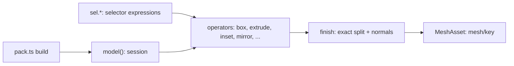

# `@forgeax/engine/modeling`

> [!IMPORTANT]
> Modeling owns editable polygon topology, selectors, topology operators and the
> exact export to an ordinary `MeshAsset`. It owns no asset format, renderer,
> World state or Editor mode. Pack builds call it as ordinary functions; the
> exported mesh travels through the existing Pack, Catalog and Renderer owners.

This package is the `forgeax-modeling` repository mounted as a required source
submodule at `packages/modeling` of `forgeax-engine`. The Engine gitlink is the only
version fact; the package is built, tested and published inside an Engine checkout.



## Entry points

| Import | Purpose | Maturity | Reference |
|:--|:--|:--|:--|
| `@forgeax/engine/modeling` (`.`) | Editable polygon sessions: `model()`, selectors, operators, `finish` to a `MeshAsset`. Start here for game assets. | Default surface; the operator set is the one in the reference map | [operations](reference/operations.md), [exact](reference/exact.md) for the B-rep layer |
| `@forgeax/engine/modeling/brep` (`./brep`) | Exact B-rep `Shape` values: primitives, `booleanSolids`, closed-form fillets, `tessellate`, `validate`. Used via `model({ exact })`. | Bounded: plane and cylinder solid families, scope in [exact](reference/exact.md) | [exact](reference/exact.md) |
| `@forgeax/engine/modeling/quad` (`./quad`) | Constrained cross fields and quad remeshing of triangle `EditMesh` input. | Opt-in; exported from its own subpath and not wired into the default `.` surface | [knowledge/notes/design-L3-quad-remesh.md](knowledge/notes/design-L3-quad-remesh.md), [knowledge/notes/design-qf7-guide-curves.md](knowledge/notes/design-qf7-guide-curves.md) |

Import B-rep operations from `./brep`; deep paths into `src/brep/` are not a public contract.

## Smallest useful example

```ts
import { definePack, definePackageId } from '@forgeax/engine/pack/source';
import { model, sel } from '@forgeax/engine/modeling';

export default definePack({
  schemaVersion: '2.0.0',
  packageId: definePackageId('01900000-0000-7000-8000-00000000a0de'),
  parameters: [{ name: 'depth', type: 'f32', default: 0.03, minimum: 0.005, maximum: 0.1 }],
  build: ({ values: p }) => {
    const m = model();
    m.box({ size: [0.42, 0.3, 0.36], tag: 'shell' });
    m.inset(sel.tag('shell').and(sel.facing('+z', 10)).largest().one(), {
      thickness: 0.02, region: 'merged', label: 'visor',
    });
    m.extrude(sel.createdBy('visor', 'inner'), { distance: -p.depth, region: 'merged', label: 'visor-depth' });
    m.markSharp(sel.edges.dihedral('>', 40));
    m.uv.project({ mode: 'box', scale: 0.5 });
    m.assign(sel.createdBy('visor-depth', 'top'), 'glow');
    return m.finish({ key: 'helmet', normals: { mode: 'weighted' } });
  },
});
```

## Build-time texture baking

`bakeMaps` is the portable CPU path. Build hosts can pass an owned WebGPU device
to `bakeMapsWithGpu` for chart filtering and group-local ambient occlusion on
supported atlas inputs. Both APIs export ordinary texture assets and retain the
CPU correspondence and diagnostics. GPU rounding can change individual texel
values. Use the CPU path when a build requires the same bytes on every host.

## Data model

| Element | Storage | Notes |
|:--|:--|:--|
| Vertex | `pos` (f64 x3), generation | Author coordinates stay f64; export converts to f32 and rejects collapsed or inverted triangles |
| Half-edge | `hVert`, `hNext`, `hPrev`, `hFace` | Allocated in pairs: `twin = h ^ 1`, `edge = h >> 1`; a corner is a face half-edge |
| Edge | `eFlags` | Author intent only: `EDGE_SHARP`, `EDGE_SEAM`; derivation never writes it |
| Face | n-gon loop, material, label/role, flags, tag bitset | Manifold only: each directed edge has at most one face. Flags: `FACE_MIRRORED` (`mirror` copies), `FACE_EDGE_ROUND` (edge treatment: faces a bevel or chamfer creates, labeled or not, shell rounds included, and `m.surface` blend bands); ops copying a face keep its flags, and `compact()` / FXEM keep them byte for byte |
| Corner channel | `uv0..uv7`, `color` per corner | Values per corner; render vertices split on exact (vertex, normal group, value bits) and on the face's uv0 handedness, so a welded mirror seam keeps one tangent frame per side |

`compact()` produces the canonical form: content-defined face order, vertices by
first use, unused names pruned. `encodeSnapshot()` writes that form as FXEM v1 (64-byte
header, explicitly numbered sections, 16-byte alignment); equal meshes encode to equal
bytes regardless of edit history.

Face insertion commits its already-validated half-edges without querying them
again. Subdivision publishes canonical FXEM bytes and provenance remaps from one
compaction; manifold checks, face order and encoded output remain unchanged.

The existing four CI partitions also run the kernel and package-boundary contracts.
Structured CI provenance retains its original execution URLs.

Projected knife cuts share immutable scope positions across their curtains and
sort only the vertices that can meet each curtain. Corner face queries do not
sort the full scope. Projection arithmetic, event order and exact FXEM bytes stay
unchanged. Surface queries
build angle-weighted normals only when a point result needs them; occlusion alone
uses the captured triangle hierarchy. Both positions and later-derived normals
remain tied to the captured surface after source mesh edits.

## Identity and selection

| Source | Defined by | Selector |
|:--|:--|:--|
| Tag | author (`tag` option or `m.tag`) | `sel.tag('shell')`; new faces inherit their source face's tags |
| Role | an operation with an explicit `label` | `sel.createdBy('visor', 'inner')`; faces an unlabeled operation creates (walls, rims, caps, strips) have no role |
| Geometry | evaluated on every call | `facing`, `extreme`, `inBox`, `side`, `near`, `largest`, `smallest`, `thin` |
| Topology | evaluated on every call | faces: `grow`, `shrink`, `connected`, `boundary`, `toEdges(include)`, `toVerts(include)`; edges: `loop`, `ring`, `toFaces` |
| Edges | evaluated on every call | `sel.edges.parallel`, `perpendicular`, `dihedral`, `concave`, `sharp`, `seam`, `meshBoundary`, `all` |

A labeled call overwrites the role of every face it produces or moves; an unlabeled
call never adds role identity. Faces keep their role when they are only moved, cut into
pieces (`loopCut`, `bisect`, `split`, `triangulate`, the target side of a boolean) or
copied (`mirror`, `duplicate` without `label`, `append`), so `createdBy` keeps pointing at
the same surface.

Selectors are expressions re-evaluated at each operation, never stored ids. Tag
queries scan the current face tag words directly, without constructing a list
of every live face for each part; deleted and reused slots still resolve afresh.
Parameters are checked: a non-integer or non-positive `count`/`steps` or a non-finite or
non-positive `maxWidth` makes any expression containing it fail with
`model-invalid-argument` (and match nothing in `count`). An empty
selection is `model-selection-empty`; it never means "everything" (use `sel.all()`).
The engine is **Y-up**: `facing('+z')` means forward. Empty `+z`/`-z` selections report a
Y-up hint when the `y` axis would match. Edge selectors count undirected edges.

## Reference map

Load only the file a task needs; each holds the full contract of its capability.

| Capability | Reference | Smallest example |
|:--|:--|:--|
| Operation table, primitives, region operators, shell, cutting, cleanup, `lift`, `applyDraft` | [operations](reference/operations.md) | [crate](examples/crate/), [shaping](examples/shaping/) |
| Booleans and mesh repair | [booleans](reference/booleans.md) | [panel](examples/panel/) |
| Sweep, loft, array, `pipeNetwork`, subdivision, creases, deformers, ARAP | [sweep-deform](reference/sweep-deform.md) | [limit-cage](examples/limit-cage/), [pipe-bend](examples/pipe-bend/), [forearm](examples/forearm/) |
| NURBS curves and surfaces, rail and two-rail sweeps, offsets, 2D regions, patch networks, fairing, surface deviation and quality, section highlights, edge flow | [surfaces](reference/surfaces.md) | [patch-network](examples/patch-network/) |
| Constraint sketches: `sketch.solve` with `coincident`, `horizontal`, `vertical`, `parallel`, `perpendicular`, `angle`, `distance`, `radius`, `tangent`, `equal`, `fix`; `dof` report | [sketch](reference/sketch.md) | [sketch-bracket](examples/sketch-bracket/) |
| Bevel (per-edge width lists), fillets and blends, support loops, panel lines, shut lines, mechanical recipes including body fasteners, wheels, tyres and cables | [detail](reference/detail.md) | [bracket](examples/bracket/), [blend-corner](examples/blend-corner/) |
| Shrinkwrap, layers, strands (hair cards), spherize, soft selection, knife | [artist-editing](reference/artist-editing.md) | [tunic](examples/tunic/) |
| Voxels, simplification, low poly, remeshing | [voxels-remesh](reference/voxels-remesh.md) | [joint-boot](examples/joint-boot/) |
| UV projection, unwrap, pack, automatic UVs, trim sheets, baking, bake checks and thin-hole (grille) cutouts | [uv-bake](reference/uv-bake.md) | [wheel-uv](examples/wheel-uv/), [armor-bake](examples/armor-bake/), [thin-vent](examples/thin-vent/) |
| Procedural materials, textures, text, delivery mips | [materials](reference/materials.md) | [body-panels](examples/body-panels/) |
| Rigs, joints, limits, mimic, poses, paths, interference, skin weights | [rig](reference/rig.md) | [limb-choreography](examples/limb-choreography/), [transforming-limb](examples/transforming-limb/) |
| Design drawings, contours, three-view blockouts, hidden lines, sheets, exploded views | [drawings](reference/drawings.md) | [body-blockout](examples/body-blockout/), [sheet-bracket](examples/sheet-bracket/) |
| Exact B-rep shapes: `model({ exact })`, `brep.*` ops, `fromShape`, face selectors, `shapeSurfaces`, `validate`/`measure`/`tessellate` | [exact](reference/exact.md) | none yet |
| Validation, effect assertions, determinism, journal and regeneration checks, surface deviation, sheet-forming and BOM reports, gate evidence | [validation](reference/validation.md) | [feature-bracket](examples/feature-bracket/) |
| Export normals, `finish`, performance tiers, `MeshJob` cooking, reuse across Packs | [export](reference/export.md) | [joint-boot](examples/joint-boot/), [actuator](examples/actuator/) |
| Delivery: `deliverAsset` from an exact source to a budgeted quad output (LODs, bake, atlas, byte budget) | [export](reference/export.md) and [game-asset-pipeline](knowledge/game-asset-pipeline.md) | [hero-asset](examples/hero-asset/) |
| The whole tool set at a glance: 122 tools with state (done or not), API, a drawing and a real render each | [tool-library](reference/tool-library.md) | [crate](examples/crate/) |
| `forgeax model *` commands, inspection, overlays, budgets | [tools](reference/tools.md) | [crate](examples/crate/) |
| Holding a render to a reference image: compare, feature microscope, turntable gate, correction-loop stop rule, level-by-part acceptance table | [tools](reference/tools.md) and [validation](reference/validation.md#visual-feedback-against-a-reference-image) | [crate](examples/crate/) |

## Knowledge map

`knowledge/` carries modeling know-how written for this kernel: what to look at, the trade-offs, the thresholds
the tools enforce and how to recover from their failure codes. Open the topic a task needs.

| Read this when | File |
|:--|:--|
| Choosing an approach and a build order | [design-methodology](knowledge/design-methodology.md) |
| Drawing from design sheets, outlines or blockouts | [design-drawings](knowledge/design-drawings.md) |
| Building a vehicle or hard-surface body | [vehicle-design](knowledge/vehicle-design.md) |
| Reading a mech or armored machine from a concept image: parts, plates, edges, evidence | [hard-surface-mech](knowledge/hard-surface-mech.md) |
| Judging smooth surfaces and curvature quality | [surface-quality](knowledge/surface-quality.md) |
| Filling an N-sided hole or patch network | [nsided-patches](knowledge/nsided-patches.md) |
| Modeling a stylized character, face, hair or clothing | [stylized-character](knowledge/stylized-character.md) |
| Designing a mechanism, joint or range of motion | [mechanism-design](knowledge/mechanism-design.md) |
| Producing a game-grade asset from form to bake | [game-asset-pipeline](knowledge/game-asset-pipeline.md) |
| Picking detail features from the catalog | [detail-catalog](knowledge/detail-catalog.md) |
| Presenting an animated asset | [animation-presentation](knowledge/animation-presentation.md) |
| Placing UV cuts on a low-poly mesh | [uv-cuts-lowpoly](knowledge/uv-cuts-lowpoly.md) |
| Baking maps and laying out UVs | [baking-uv](knowledge/baking-uv.md) |
| Meeting watertight and tolerance requirements | [watertight-tolerance](knowledge/watertight-tolerance.md) |
| Building Chinese timber structures: fen units, brackets, joints, roofs | [timber-construction](knowledge/timber-construction.md) |
| Using the `dougong` and `timberJoint` recipes | [timber-members](knowledge/timber-members.md) |

`knowledge/notes/` holds process records and design notes for specific lanes: the decisions, measured
evidence and status of work that is merged or paused. Read them for the history of a feature, not as the
current contract; the reference files and the code are authoritative.

| Read this when | File |
|:--|:--|
| Tracing the L3 quad-remesh lane and its gate results | [STATUS-L3](knowledge/notes/STATUS-L3.md) |
| Reviewing the L3 quad-remesh design | [design-L3-quad-remesh](knowledge/notes/design-L3-quad-remesh.md) |
| Reviewing the quad feature constraint research | [research-quad-feature-constraints](knowledge/notes/research-quad-feature-constraints.md) |
| Reviewing the M-QF6 thin-G1 scope | [design-qf6-thin-g1-scope](knowledge/notes/design-qf6-thin-g1-scope.md) |
| Reviewing the M-QF7 guide curves as constraints | [design-qf7-guide-curves](knowledge/notes/design-qf7-guide-curves.md) |
| Reviewing the trimmed-face split-3 blossom fallback | [design-qf-split3-fallback](knowledge/notes/design-qf-split3-fallback.md) |
| Wiring NURBS SSI branches into the boolean | [nurbs-boolean-wiring](knowledge/notes/nurbs-boolean-wiring.md) |
| Handling approximate NURBS boundary coincidence | [brep-nurbs-boundary-coincidence](knowledge/notes/brep-nurbs-boundary-coincidence.md) |

Exact option types and defaults are the TSDoc on each options interface in `src/` (built
into `dist/*.d.ts`); exact command flags are `forgeax help model <command>`. Examples,
smallest first, with what each teaches: [examples/README.md](examples/README.md).

## Session contract and errors

- Every operation returns an `OpReport` (`status`, per-role face counts, optional
  `diagnostics` warnings) and is recorded in the journal with its topology stamps.
- The first failure poisons the session: later operations report `skipped` and
  `finish()` returns that first cause with `detail.site = { op, opIndex, label? }`.
- `m.try(body)` copies the mesh once and rolls back when `body` fails. Cancellation and
  an exceeded budget are not rolled back: they end the build (design 7.2).
- `m.count(selector)` and `m.bounds(selector)` are the read-only places a selection
  is evaluated. Once poisoned, `count` is 0, `bounds`, `meshQuality`, `limit`,
  `auditVisibility`, `seamVisibility` and `shutLines` return the first failure instead of
  stale numbers, and `validate()` reports one `session-poisoned` error (detail `cause`,
  and `opIndex` when recorded) with the partial mesh's counts, runs no other check and
  records each code as left out with reason `session-poisoned`.
- `model({ signal, budget: { faces } })`: an aborted signal fails the next operation
  with `model-cancelled`; an operation that leaves more faces than the budget fails
  with `model-work-budget`. Both poison the session without rollback, also inside
  `m.try`. Cancellation is checked at operation boundaries; compute jobs (booleans)
  also poll it inside their loops, and `budget: { work }` bounds each job.
- Topology edits leave new faces without UVs; `finish()` requires complete `uv0`
  and its hint names `m.uv.project`.

`ModelingErrorCode` (`src/errors.ts`) is the closed failure union:
`model-selection-empty`, `model-selection-cardinality`, `model-invalid-argument`,
`model-precondition`, `model-degenerate`, `model-op-no-effect`, `model-solver-diverged`,
`model-work-budget`, `model-capability-unavailable`, `model-partial`, `model-cancelled`.

## Package scripts and measured runtimes

| Script | Runs | Measured (lane, 2 workers) |
|:--|:--|:--|
| `pnpm test` | Vitest suite | not re-measured here |
| `pnpm check:falsifiers` | Falsifier registry: every judging check has a row or a named pending entry, each row must go green on its pass input and red on its fail input | suite 38 tests, a few seconds |
| `pnpm quad-eval` | Quad-mesh evaluation over all cases | about 5 s (all cases) |
| `pnpm mutation <set>` | Mutation run over `scripts/mutation/sets/<set>.json`; with no argument it prints the 22 set names | `e1-corpus-a9` 2 m 18 s; `l1-nurbs-trim` skipped at once; the full 402-mutation run is not measured |

Mutation anchors drift: some sets no longer match their source text exactly once. The
measured drift and the one surviving mutation are recorded in `knowledge/notes/`; a
`SKIPPED` status means the anchor did not match, not that the mutant was killed.

### Paired Engine CI

Modeling PRs normally validate against Engine `main`. A change that needs a
matching Engine candidate may declare `Engine-Revision: <full commit SHA>` in
the PR body. CI checks out that exact revision from a branch of the Engine
repository and installs its workspace with the frozen lockfile. Omit the
declaration when Engine `main` contains the paired inputs.

## Not in this version

ABF/ARAP UV parameterization, native compute backends (`compute: 'native'` returns
`model-capability-unavailable`) and MCP exposure of `model.*`. Do not emulate them with raw
triangle buffers inside a session; build what the kernel supports and report the missing
capability.

### Capture heap ownership

Node-only capture runs its existing Worker inside a dedicated budgeted Node host.
The host owns its Node launch flags and starts with empty `NODE_OPTIONS`, so
fixed-size and percentage heap flags cannot replace a call's `heapMb`. Both
normal results and structured heap exhaustion travel over
advanced IPC. The host exits with its caller, and the call's original timeout
owns cancellation. The default heap uses the lower of physical and cgroup memory,
then keeps the existing quarter-memory and 1-8 GiB bounds.

### Parallel source cooking

`createBakeCooker({ executor })` admits the same row executor as `bakeMapsParallel`.
The optional executor makes cold source cooking asynchronous, preserves serial
texture bytes and fingerprints, and samples all maps once per cooker input. The
serial route retains its job ByteCache; both routes retain the map memo. Node
hosts can pass `bakeWorkers({ workers: 4 })` from the tools entry. Finished-product
caches remain producer-owned and require the same identity and content validation.
