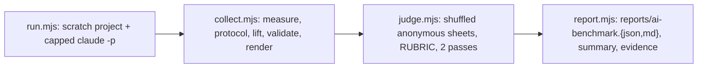

# M5 AI benchmark

> [!IMPORTANT]
> The M5 milestone ("preferred", native modeling design §2.3 and §15) asks whether an AI
> agent given the modeling tools does **not worse** than the same agent writing triangles by
> hand with `createMeshBuilder`. These scripts are the fixed procedure. They are plain Node
> scripts, not tests, and they spend real model budget: run them on purpose, never in CI.

## Fixed inputs

| File | Fixes |
|:--|:--|
| `briefs.json` (`m5-briefs/1`) | Four hard-surface props sized as C-100 parts (bolted bracket, vented housing, five-spoke wheel, panel hinge), each with measurable checks: bounding-box size, part count, genus (through-holes), hollowness, triangle budget |
| `protocol.json` (`m5-protocol/1`) | Model, effort, caps (40 turns, 20 min, USD 10 per run), tool set, the shared prompt, each condition's instructions, the completion rule, the review procedure, the RUBRIC rendering and the verdict rule |

A brief or prompt changes only with a new version string, and a new version reruns **both**
conditions. Never edit them after seeing results.

## Conditions

| | Tools | Control |
|:--|:--|:--|
| Builds with | `model()` / `sel` from `@forgeax/engine/modeling` | `createMeshBuilder` from `@forgeax/engine/geometry`, triangles computed by hand |
| Sees | the `forgeax-engine-modeling` skill, the modeling README, the example Packs, `forgeax model *` (render included) | the geometry README and `mesh-builder.ts` |
| Both | the brief, its checks, `node check.mjs` (the bench's own measurement), the same starter Pack shape, caps and tools (Bash, Read, Write, Edit) | |

The control is checked for protocol violations (modeling imports or `forgeax model` commands
in its sources or Bash transcript); a tools run that never calls `model()` is also a violation.

## Pipeline



1. `run.mjs` creates `<root>/<brief>--<condition>--r<n>/`: `node_modules/@forgeax/engine`
   linked to this Engine checkout, a starter `assets/prop.pack.ts`, `check.mjs`, the
   condition's references, and for tools a `bin/forgeax` and the skill under
   `.claude/skills/`. It runs `claude -p` with the fixed prompt (`--max-turns`,
   `--max-budget-usd`, `--tools`, `--output-format stream-json`) under a wall-clock kill,
   and writes `run.json` (turns, time, tokens, cost, end reason, Bash commands) and the raw
   transcript under `.bench/`. Existing `run.json` files are skipped, so an interrupted
   batch resumes.
2. `collect.mjs` measures `mesh/prop` with `measure.mjs` (exact float32 weld; closed,
   manifold, oriented, components, genus, signed volume, size; no modeling kernel, so both
   conditions are measured alike), then writes `.bench/eval.pack.ts`, which lifts the mesh
   into one neutral session (one material slot, box UVs), and runs `forgeax model validate`
   and `forgeax model render --annotate false` on it with the real Dawn renderer.
   **Completed** means: build ok, closed/manifold/oriented with every part's volume > 0,
   every brief check passes, the lifted validate status is not `fail`, and no violation.
   The artifact left when the run ends counts, whether or not a cap was hit.
3. `judge.mjs` copies each render sheet under an anonymous id in a seeded shuffle and asks a
   separate `claude -p` (Read only, structured output) to score all eight RUBRIC items plus a
   supplementary brief fidelity. Two passes with different seeds measure judge
   self-consistency. A run without a render scores 1 on every item.
4. `report.mjs` writes `reports/ai-benchmark.json` (`forgeax.ai-benchmark.report/1`),
   `reports/ai-benchmark.md`, a summary JSON and optional side-by-side evidence sheets.

> [!WARNING]
> The judge is an LLM, a **proxy** for the human blind review §15 calls for, and it may
> share the agents' biases. The RUBRIC (Tiangong `docs/reviews/RUBRIC.md`) was written for
> game shots: camera, lights and material are fixed by the harness here, so the report also
> gives the geometry subset (readability, richness, craft). Below 20 runs per condition the
> verdict is `inconclusive` and only the direction is reported.

## Running

From the Engine root after `pnpm build:engine` (the modeling `dist` must be current), with
a Dawn device and the Claude Code CLI on `PATH`:

```sh
export FORGEAX_SHARED_APP_INPUTS_MANIFEST=$PWD/shared-build-inputs/manifest.json
cd packages/modeling/bench/ai
node run.mjs --root /tmp/m5-runs --concurrency 4 [--briefs a,b] [--conditions tools,control] [--repeat n]
node collect.mjs --root /tmp/m5-runs
node judge.mjs --root /tmp/m5-runs
node report.mjs --root /tmp/m5-runs --evidence <dir> --engineCommit <sha> --modelingCommit <sha>
```

`run.mjs --setup-only` creates the scratch projects without calling the model. The runner
passes its environment to the agent (Dawn variables included) and never prints it; scratch
transcripts stay outside the repository. Only the report is committed.
