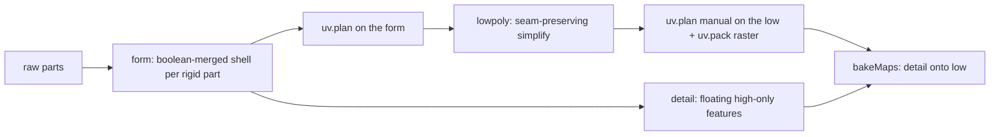

# Game-grade asset pipeline: form, seams, low, bake

A game asset made with this kernel goes through one fixed chain. The chain exists to stop
the older result: a low mesh built from many appended instances, cut into thousands of small
UV islands (the turret example had 2229) with strips a few texels wide. Each stage below
removes one cause of that result. The API owners are [`reference/uv-bake.md`](../reference/uv-bake.md)
(`uv.plan`, `uv.pack`, `bakeMaps`), [`reference/voxels-remesh.md`](../reference/voxels-remesh.md)
(`lowpoly`) and [`reference/export.md`](../reference/export.md). The decisions behind seams and
bakes are in [uv-cuts-lowpoly.md](uv-cuts-lowpoly.md) and [baking-uv.md](baking-uv.md).

`deliverAsset(source, profile, options)` (`src/deliver.ts`) runs the whole chain for an exact B-rep
source in one call and returns `Result<DeliveredAsset, DeliveryError>`. `profile` is an
`AssetOutputProfileId` (`mobile-hero`, `mobile-prop`, `mobile-scenery`, `desktop-hero`) or a custom
`AssetOutputProfile`; the limits live in `ASSET_OUTPUT_PROFILES` (`src/asset-budget.ts`).

Options (`DeliverOptions`):

| Option | Meaning |
|:--|:--|
| `exact` | the injected exact stage (`brep/index.ts`) |
| `sizes` | quad sizes tried in order; the first that passes the profile is kept |
| `merge` | output slot renames, for example `{ BodyMetal: 'Atlas' }` |
| `detailSize` | quad size of the detail for the bake (default `min(sizes) / 2.5`) |
| `bake` | `{ resolution, maps: ('normal' \| 'ao')[] }`: detail baked onto the delivered base |
| `lods` | coarser LOD sizes; each must be larger than LOD0 |
| `albedo` | `{ size, colors }`: base-colour atlas, one colour per source slot |

`DeliveredAsset` holds `mesh`, `model` (the base-level session, read-only for inspection; editing
it does not change `mesh`), `lods`, `textures` (`normal`, `ao`, `albedo` when requested) and
`report: DeliveryReport` (attempts, stats, budget verdict, UV facts, step trail, bake report).

Refusals:

- `delivery-invalid-argument`: a bad option, or an albedo slot without a finite colour. Checked before
  any size is tried; a missing colour is never a default fill.
- `delivery-part-refused`: a part no mesher can quad.
- `delivery-no-size-fits`: no size in `sizes` passes the profile.
- `delivery-kernel-failed`: a step failed; `detail.step` names the step; a LOD
  whose topology check fails reports step `lod` with code `lod-topology-missing` in its detail.

A refused or failing bake is data, not an error: `report.bake.refusal` or `pass: false` carries the reason.

Byte budget (`textureBytes(w, h, mips)`): 128 by 128 without mips is 65536 bytes; 1024 with mips is 5.33 MiB; a
normal and AO bake at 1024 without mips is 8 MiB, and with mips 10.67 MiB. The profile limits are 12 MiB (mobile) and 32 MiB (desktop). The
verdict counts the bake maps at the bake resolution without mips. The albedo atlas is not in that verdict yet.

Atlas: one colour per source slot, taken from each face's part tag before `merge`. It does not sample
source textures; a source image or decal is not part of the atlas.

Measured on the blaster (`examples/hero-asset`): `mobile-hero` at 0.9 reaches 11170 triangles, 7384
vertices and 1 material after the Atlas merge. The 1024 normal bake takes about 53 s for the full
`deliverAsset` call, of which about 10 s is the base delivery. Breakdown and open items are in
[design-asset-delivery.md](notes/design-asset-delivery.md).

## Where a detail lives

Decide per detail what it changes. A detail that changes the silhouette or a shadow edge
stays geometry on the `form`. Surface relief (rivets, embossing, grilles too fine to
model) is `detail` for the bake, or a `thinHole` recipe. What moves, glows or swaps
becomes its own part and material slot, handled at run time. Fasteners are cheapest as
baked detail: a bolt is dozens of triangles and a bake sample is none. Parts that carry
text must not be mirrored (the text reverses): build them on the side they belong to and
mirror only anonymous parts. See [hard-surface-mech](hard-surface-mech.md#detail-where-it-goes-and-what-it-costs).

## The constraints

These are rules of the chain, not options. Each has a measured reason.

1. **One shell per rigid part.** Boolean-merge the raw parts of a rigid part into one `form`
   (`lowpoly` unions with the exact boolean). Appended overlapping instances bake buried faces
   into the maps and give every instance its own islands.
2. **Three roles per feature.** A feature is `form` (part of the shell: it is in the low and
   in the high), `detail` (floats over the form: bolts, rivets, vents; it exists only in the high
   and is baked) or `tool` (cuts the form, e.g. a bore). A recipe takes `details: 'weld' | 'float' | 'omit'`:
   the high uses `float`, the low source uses `omit`. Detail never enters the low and never
   decides a seam.
3. **Seams are planned on the form, not on the low.** `uv.plan` runs on the form before
   `lowpoly`. The low has too few faces to show the real corners, and ring lines or generatrices
   of a revolve are construction artifacts, not shape. The plan uses hard edges (`hardAngle`
   75), material and tag borders, then measurement.
4. **Few key lines.** `smallGroup` (8) gives up angle seams around tiny face groups, `minWidth`
   (default 1.5 % of the bounding-box diagonal) merges thin or elongated islands into a
   neighbor, and an arm of a compact island is cut off as its own chart. A merge never trades
   stretch for fewer seams (`MERGE_SLACK` 1.0): a merged island must still unwrap within
   `maxStretch` without flips or overlap. A thin island tries up to three neighbors, longest
   shared border first, before it stays; the `thin` count in the plan info lists the islands
   still under `minWidth`.
5. **Simplify keeps the seams.** `lowpoly` keeps marked seam edges; the planned seam length on
   a bevelled box was 28.65 m before and 28.56 m after (a test gates +-5 %). Use `slivers` (meters) to
   remove chamfer ribbons that would only unwrap to strips a few texels wide.
6. **Re-plan the final low in `manual` mode.** `uv.plan({ manual: true, mergeMarked: true })`
   takes only the seams already marked and adds a cut only where stretch or overlap is measured.
   A low that is planned from scratch gets a different, noisier seam set.
7. **Regular, high-utilisation atlas.** `uv.pack({ method: 'raster', resolution: 1024, padding: 4,
   snap: true, groups: <part tags> })`: islands take straight, axis-aligned orientations when
   they are mostly straight, each rigid part fills one atlas block, and island rectangles sit on
   whole texels. `resolveOverlaps: 3` repairs float32 touching overlaps after packing.
8. **One cage per bake group.** Tag low and high faces `bake:<part>`, then give each group
   `cage: { offset: 'auto', maxRay: 'auto' }` (the kernel measures the reach of the detail)
   and a swept fixed cage only for a group where auto clips more (the turret house).

## Measured on the turret asset

| Quantity | Old chain | This chain |
|:--|--:|--:|
| UV islands | 2229 | 66 |
| Max island L-infinity stretch | not bounded | 1.59 (bound 1.6) |
| Flipped UV triangles | - | 0 |
| Atlas | - | 1024, rectangle utilization 0.729, 12.83 texels per meter |
| Islands of at most 2 faces | - | 11 |
| Thin islands (side under 6 px or aspect 6+) | many strips | 2 (a recess wall and a 0.09 m lip) |
| Clipped bake samples at 1024 (auto vs swept cage) | - | barrels 187 vs 607, mantlet 609 vs 696, roof trim 167 vs 776 |

## Known limits

- The two remaining thin islands are narrow in the geometry; merging them would exceed `maxStretch`.
- A barrel with brake ports cut through reports about 1.3 % ray misses whatever the cage: rays
  aimed at a port leave through the far opening. Read the ray-miss report as a property of the part, not of the cage.
- A house-like group with many shallow recesses clips about 0.5 % of its samples with a swept
  cage; `auto` clipped more there (4808 vs 2980), so the swept cage stays.
- Identical parts (a mirrored barrel) are still unwrapped and packed separately; sharing one
  island set (`uv.pack({ stack: true })`) is not part of this chain yet.

## Checklist before a bake

- `uv.plan` info: `unresolved` is 0, `islands` is in the tens, not hundreds.
- `measureUv`: `flipped` 0, `zeroArea` 0, no island above `maxStretch`.
- `validate({ uniqueUv: true })` finds no overlap; repeat the cut-and-replan loop on the faces it names.
- `bakeMaps` provenance: `rayHits` per group, `clipped` per group, no `stray-detail`.
