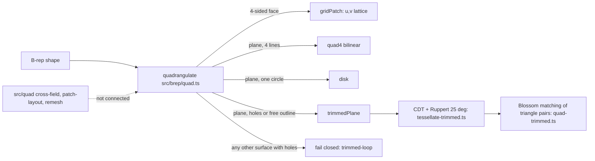
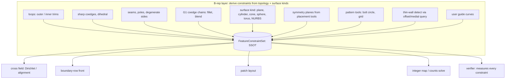

# R-QF: geometric-feature-aware quad meshing of B-rep

> [!NOTE]
> Research topic opened 2026-11-09 from a user observation: quad lines run straight across trimmed-face gaps
> (holes, cut-outs, boolean boundaries) instead of respecting the new boundary. Scope: every geometric feature, not
> only trim loops. Status: first draft, **merged without independent audit**. Sources are marked
> **[V]** (the claim was read in a fetched/searched source this session) or **[R]** (recalled, not re-verified here).

## 1. Answer in one page

| Question | Answer |
|:--|:--|
| Do we handle quad flow near trim loops professionally? | **No.** The trimmed-face path (CDT + Blossom matching) has no direction field, no boundary-orthogonality term and no boundary-row construction. Measured: 0-21 % of boundary quads are orthogonal to the trim loop within 10 degrees (section 3). |
| Is it important? | Yes for any consumer that uses quads as a parametric/edge-flow structure (subdivision, FE, UV, deformation, AI-readable networks). It is cosmetic for triangle-only consumers. |
| Which module owns this in professional stacks? | Three different owners: (a) CAD/FE meshers own it in the **boundary-front / mapped-region** stage (paving, Q-Morph, submapping, boundary-layer rows); (b) field-based remeshers own it as a **cross-field Dirichlet constraint** plus integer-grid alignment; (c) all of them take **user/derived feature curves** as one constraint list. |
| What should we build? | One **feature-constraint model** (SSOT) produced from B-rep topology and surface kinds, consumed by (1) a boundary-row front for trimmed faces, (2) the cross field, (3) patch layout, (4) the integer map. First visible slice: M-QF1, boundary-aligned rows along trim loops. |

## 2. Code audit: what reaches the layout today

Read from `integration/v2` at b04c2647 (worktree `_scratch/research-qf`).



| Concern | Where | What happens today |
|:--|:--|:--|
| Entry, mode switch | `src/brep/quad.ts:185-205` (`layoutSteps`) | Holes on a non-plane surface return `err('trimmed-loop')` (`:191`); trimmed planes go to `trimmedPlane` (`:506`). |
| Edge sample counts | `src/brep/quad.ts:236-263` (`edgeCounts`, `edgeCount`) | Count comes from the edge alone: lines by length/size, full circles multiples of 4; partial arcs fail `partial-arc` (`:250`), other curves `curve-kind` (`:249`). No face context (flow, neighbour size). |
| Parity | `src/brep/quad.ts:263` | `evenEdges` bumps counts of holed-face edges to even; odd ring totals fail `odd-ring-count` (`quad-trimmed.ts:209`). |
| Opposite-side equalisation | `src/brep/quad-counts.ts:23` (`solveSideCounts`), `:43` (`opposingEdgePairs`) | Union-find over opposite sides of grid faces. Only 4-sided faces participate. |
| Trim triangulation | `src/brep/quad.ts:464-527`, `tessellate-trimmed.ts:46` (`MIN_ANGLE` 25 deg) | Ruppert-style refinement in a per-face constant metric. Edge directions are whatever the Delaunay refinement produces. |
| Pairing | `src/brep/quad-trimmed.ts:56-66,265` | Cost = corner-angle deviation from 90 deg (+ `FOLD_PENALTY` 1000 for non-convex). `quad-dominant` adds `SINGLE_COST` 2 per leftover triangle. **No term involves the trim loop direction.** Failure: `no-perfect-matching` (`:274`). |
| Mesh-level cross field | `src/quad/cross-field.ts:455-495` | Knoeppel-style smoothest 4-RoSy; feature triangles are pinned to edge direction^4 (`:489-495`), curvature alignment optional (`:502`). Boundary half-edges (`twin === -1`) are features by `featureEdges` (`src/quad/trimesh.ts:314`). **Not called from the B-rep path.** |
| Feature detection | `src/quad/trimesh.ts:314` (`featureEdges`), `src/quad/features.ts` | Detected **from the triangle mesh**: boundary + dihedral > 30 deg + author pairs. B-rep topology (loops, surface kinds, G1 coedges) is never consulted. |
| Patch layout | `src/quad/patch-layout.ts:24`, `patch-grid.ts:87` | Feature-only patch merge on a triangle mesh, Coons grids, shared side classes. Mesh-level, not B-rep-level. |
| Flow / integer map | `src/quad/flow-extract.ts:476`, `integer-flow.ts`, `instant-meshes.ts` | Mesh-level; M5 partial. |
| Verifier | `src/quad/features.ts:161` (`featureDeviation`) | Bounded-range float deviation of output edges from declared feature polylines; exists for the mesh path only. |

### 2.1 Feature class by class: what constraint reaches the layout today

| Feature class | Constraint reaching quad layout today | Gap |
|:--|:--|:--|
| Outer trim loop | Vertices shared by edge id; counts by length. Direction of interior rows: none. | rows are not perpendicular/parallel to the loop |
| Inner loop (hole) | Same; even count forced; plane only | non-plane holed faces fail closed |
| Sharp edge (dihedral) | Coedge between faces = shared boundary vertices; `flagCreases` marks EDGE_SHARP (`quad.ts:165`) | no field alignment inside adjacent trimmed faces |
| Seam / pole of periodic surfaces | `gridPatch` handles degenerate sides; trimmed periodic faces unsupported | cylinder/cone/sphere faces with holes fail |
| G1 chain (fillet, blend) | none | rows should continue across the tangent edge |
| Principal curvature | none on B-rep; optional `curvatureAlignment` on mesh path | cylinders/cones/tori should get rows along axis/circumference analytically |
| Symmetry plane | none | no mirror-consistent layout |
| Thin feature / rib | none (size/9 uniform) | min row count across thickness not enforced |
| Coaxial hole pattern | none | sample counts per hole independent; bolt circle not recognised |
| T-junction / conformity | shared vertex ids and `solveSideCounts` for 4-sided faces; `odd-ring-count` fail-closed | trimmed faces cannot request a side count |
| Small hole | disk or ring of triangles/matching | no collapse-vs-ring policy |
| Large hole | matching decides valences freely | no ring rows; valence 3/5 placement random |
| Boolean intersection curve | edges only; partial arc / NURBS edges fail | most real booleans fail closed |
| User guide curve | none on B-rep path | no API |

## 3. Measurement on existing complex examples

Script: `examples/quad-feature-baseline/run.ts` (this PR). It quadrangulates five parts, takes each planar cap (all faces at the
extreme z), reads the loop of boundary vertices of the cap group and computes, for the loop **corner** (angle between the loop
tangent and the nearest interior quad edge) and for every **boundary quad** (two side edges within 10 degrees of
perpendicular to the boundary edge; opposite edge within 10 degrees of parallel). Run:
`node --import ../qf-tools/register.mjs --experimental-strip-types examples/quad-feature-baseline/run.ts` (~110 s).
Images: `qf-baseline/*.png` under the selected output directory; numbers: `summary.json` there.

Sizes: flange/plate size 5 (coarse relative to bore radius 2.5-4), box/housing size 0.25.

| Case (cap) | mode | quads / tris | boundary quads | median corner deviation | corners within 10 deg | quads orthogonal | rows parallel |
|:--|:--|--:|--:|--:|--:|--:|--:|
| plate 3x4 holes (top) | quad-dominant | 62 / 28 | 84 | 34.2 deg | 9 % | 0 % | 26 % |
| plate 3x4 holes (bottom) | quad-dominant | 63 / 28 | 84 | 32.6 deg | 10 % | 0 % | 29 % |
| box minus cylinder (top) | quad-dominant | 19 / 10 | 27 | 18.6 deg | 35 % | 19 % | 19 % |
| box minus cylinder (bottom) | quad-dominant | 20 / 8 | 28 | 17.7 deg | 44 % | 21 % | 21 % |
| flange, 6 bores (top) | blossom | 60 / 0 | 76 | 18.1 deg | 26 % | 9 % | 12 % |
| flange, 6 bores (bottom) | blossom | 56 / 0 | 76 | 13.1 deg | 35 % | 3 % | 16 % |
| flange, 12 bores (top) | blossom | 74 / 0 | 100 | 20.6 deg | 22 % | 8 % | 10 % |
| housing (top) | quad-dominant | 6 / 0 | 12 | 28.7 deg | 40 % | 0 % | 33 % |
| housing (bottom) | quad-dominant | 14 / 10 | 19 | 12.3 deg | 26 % | 0 % | 21 % |

Fail-closed in the default `blossom` mode on three of five cases (`no-perfect-matching`, face 4 plane): plate 3x4, box minus
cylinder, housing. Whole-part quality (not boundary-specific): plate 357 quads + 56 triangles, min scaled Jacobian 0.337, 116
singular vertices; box minus cylinder 183 + 18, min SJ 0.434, 28 singular; flange bolt6 268 quads, min SJ 0.121, 96 singular.

**What the images show** (looked at: flange bolt6/bolt12 top, plate top, box-minus-cylinder top and iso):
- Rows around every hole follow nothing: the first ring of faces is a random fan of quads, many with a vertex of valence 5-7 on
  the loop itself (red/magenta dots touching the hole boundary in the flange and plate images).
- The plate's hole rings are the most striking case: 12 holes, no row circles them; the quads between holes are skewed
  parallelograms of one global slant, a CDT-pairing artefact.
- Box minus cylinder: the cap is a fan of long thin quads radiating from the bore octagon (side walls are regular grids, so
  the cap rows do not even continue the wall rows across the sharp edge).
- Bores are 4-gons or octagons because size is coarse compared to the radius; the baseline statistic on those is dominated by
  coarse hole discretisation. This is itself a defect (small-hole policy, section 4).

**Honest limitations of this measurement.** (1) The cap is identified geometrically (extreme z), which is right for these
prismatic parts but not general. (2) "Nearest interior edge" is taken per loop vertex incident to an interior quad edge;
vertices with only triangle neighbours are skipped (`quad-dominant` leftover triangles are not counted as boundary quads).
(3) A perfect ring of boundary quads at a coarse hole still scores orthogonal, so the numbers are a lower bound on how bad
the flow is for refined holes. (4) No pre-existing metric of this kind existed, so there is no regression history.

## 4. Feature classes and the constraint each needs



| # | Feature class | Constraint kind | What the professional result looks like |
|:-:|:--|:--|:--|
| 1 | Trim loops (outer, inner) | `align-tangent` (rows parallel to loop) + `align-normal` (cross-rows perpendicular) + `keep-row-count` (first ring complete) | A complete ring of quads adjacent to the loop, then a transition |
| 2 | Sharp edges | `align-tangent` on both adjacent faces, shared counts | Row ends exactly on the crease; no quad straddles it |
| 3 | Seam, pole, degenerate | `pole` (valence = polar count, allowed singularity) and `align-tangent` along seams | Pole fans with n triangles/quads, never random valence |
| 4 | G1 chains | `orient-iso` continuity across the tangent coedge | Rows run through fillets into the neighbouring faces |
| 5 | Curvature principal dirs | `orient-iso` (analytic: cylinder axis/circle; torus meridian/parallel; cone ruling) | Cylinders: rows along axis and circumference |
| 6 | Symmetry planes | `symmetric` (mirror-consistent counts and layout) | Left/right identical networks |
| 7 | Thin features, ribs | `keep-row-count` (min rows across thickness, even) | At least 2 rows across a rib, no triangles across a thin wall |
| 8 | Coaxial hole patterns | `symmetric` rotational + equal counts | Equal rings on every bolt hole |
| 9 | T-junctions / conformity | shared counts, shared ring ids | No hanging vertex across faces |
| 10 | Small holes | policy: collapse to a vertex, or single ring | Hole below 1.5 element sizes handled deliberately |
| 11 | Large holes | `no-singularity-zone` around ring + ring rows | Valence 3/5 pair placed away from the loop |
| 12 | Boolean intersection curves | same as trim loops, plus edge counts from curve (NURBS/partial arc) | Rows follow the curve; counts from arc length |
| 13 | Guide curves | `align-tangent` (loop) or `align-normal` (ring), strength weight | AI-declared edge flow |

## 5. Professional practice survey

**[V]** = confirmed in a source fetched this session; **[R]** = recalled, unverified.

### 5.1 Who owns which concern

| Tool / kernel | Concern it owns for boundaries and features | Mechanism | Source |
|:--|:--|:--|:--|
| **Paving** (Blacker & Stephenson 1991) | boundary-following rows | Advancing front of whole rows from the boundary inwards; "mesh contours tend to follow the geometric contours of the boundary" **[V]** | [Wiley, IJNME 32(4):811-847](https://onlinelibrary.wiley.com/doi/abs/10.1002/nme.1620320410) |
| **Q-Morph** (Owen, Staten, Canann, Saigal 1998/1999) | boundary alignment with few irregular nodes | Triangulate first, then advance a front of triangle-to-quad transformations; "depends heavily on the initial front" **[V]** | IMR 1998 pp. 409-428 (listed on [dblp](https://dblp.org/db/conf/imr/imr1998.html)); IJNME 44(9):1317-1340, 1999 **[V]** |
| **Gmsh** | recombination, transfinite, size fields | `Mesh.Algorithm` 8 = Frontal-Delaunay for Quads (right-angle triangles for recombination); `Recombine` with Blossom (default `RecombinationAlgorithm` 1); `Transfinite` for 4-corner faces; boundary-layer field with `Quads` **[V]**. Quasi-structured pipeline: cross field + size map -> frontal point insertion -> recombine -> topology cleanup **[V]** | [Gmsh manual](https://gmsh.info/doc/texinfo/gmsh.html); [Reberol, Georgiadis, Remacle 2021, arXiv:2103.04652](https://arxiv.org/abs/2103.04652) |
| **Abaqus/CAE** | mapped vs free, medial axis vs advancing front | Medial axis decomposes into simple regions then structured fill; advancing front matches seeds exactly, handles virtual topology **[V]** | [Abaqus User's Guide 17.7.6](https://classes.engineering.wustl.edu/2009/spring/mase5513/abaqus/docs/v6.6/books/usi/pt03ch17s07s06.html), [17.10.2](https://abaqus-docs.mit.edu/2017/English/SIMACAECAERefMap/simacae-c-mgnconcmeshingfreequad.htm) |
| **ANSYS ICEM/Meshing, HyperMesh, Patran, Pointwise, NX/Simcenter, CATIA** | mapped/submapped regions, edge seeds, associativity to CAD edges | Face is split into mappable (4-sided) blocks by the user or "automatic"; seeds on edges propagate to opposite sides **[R]** (not fetched) | vendor manuals, not verified here |
| **Rhino QuadRemesh** (Exoside engine) | guide curves, hard edges | Options: Detect Hard Edges (30 deg break angle), Guide Curves with influence default / Create Edge Ring (perpendicular crossing edges) / Create Edge Loop (strongest), Use Surface Edges (off/smart/strict), Adaptive Size 0-100 **[V]** | [RhinoArtisan docs](https://docs.rhinoartisan.com/commands/subd/edition/quadremesh), [RhinoCommon QuadRemeshParameters](https://developer.rhino3d.com/api/rhinocommon/type/rhino.geometry.quadremeshparameters/) |
| **Quad Remesher** (Exoside) | hard edges, materials, normal splits as guides | "Detect Hard Edge by angles", Use Materials, Use Normals Splitting, Smoothing Groups as edge-loop guides **[V]** | [User doc 1.0 PDF](https://www.exoside.com/quadremesherdata/QuadRemesher_1.0_UserDoc.pdf) |
| **ZRemesher** | guide curves, polygroup borders | Curves Strength, Keep Groups, Detect Edges **[V, via secondary tutorials only]** | community write-ups; official ZBrush docs not fetched |
| **Instant Meshes** (Jakob et al. 2015) | feature snapping | Unified orientation/position local smoothing; edges snap to sharp features **[V]** | [Jakob, Tarini, Panozzo, Sorkine-Hornung, TOG 34(6) 189, 2015](https://github.com/wjakob/instant-meshes) |
| **QuadriFlow** (Huang, Zhou, Niessner, Shewchuk, Guibas 2018) | singularity count | Instant-Meshes objective + min-cost network flow + local SAT; ~4x fewer singularities **[V]** | [CGF 2018, DOI 10.1111/cgf.13498](https://onlinelibrary.wiley.com/doi/10.1111/cgf.13498) |
| **QuadWild** (Pietroni, Nuvoli, Alderighi, Cignoni, Tarini 2021) | strict feature alignment | "Perfectly feature-aligned cross-field" and coarse patch layout; all feature lines strictly enforced as patch boundaries **[V]** | [TOG 40(4), art. 155](https://dl.acm.org/doi/abs/10.1145/3450626.3459941), [project](http://vcg.isti.cnr.it/publication/2021/PNACT21/) |
| **Mixed-Integer Quadrangulation** (Bommes, Zimmer, Kobbelt 2009) | sparse directional constraints | Smooth cross field with constraints, then seamless parametrization; singularities placed automatically **[V]** | [TOG 28(3) art. 77, DOI 10.1145/1576246.1531383](https://dl.acm.org/doi/10.1145/1576246.1531383) |
| **Integer-grid maps** (Bommes, Campen, Ebke, Alliez, Kobbelt 2013) | robust feature-aligned quad extraction | **[V]** exists; algorithm details **[R]** | [TOG 32(4)](https://dl.acm.org/doi/10.1145/2461912.2462014) |
| **Globally Optimal Direction Fields** (Knoeppel, Crane, Pinkall, Schroeder 2013) | smoothest field, boundary + principal-curvature alignment | Sparse eigenproblem; one linear solve with a guidance field **[V]**; reference code supports alignment with the boundary **[V]** | [TOG 32(4) art. 59](https://history.siggraph.org/learning/globally-optimal-direction-fields-by-knoppel-crane-pinkall-and-schroder/), [fieldgen](https://github.com/GeometryCollective/fieldgen) |
| **Motorcycle graphs** (Eppstein, Goodrich, Kim, Tamstorf 2008) | canonical partition of a quad mesh into structured submeshes | Partition within a constant factor of the minimum; NP-hard to minimise **[V]** | [CGF 27(5):1477-1486](https://onlinelibrary.wiley.com/doi/abs/10.1111/j.1467-8659.2008.01288.x) |
| **Survey** (Bommes, Levy, Pietroni, Puppo, Silva, Tarini, Zorin 2013) | taxonomy incl. alignment with features | **[V]** covers surface analysis, alignment with features, parametrization, remeshing | [CGF 32(6):51-76, DOI 10.1111/cgf.12014](https://diglib.eg.org/items/b9cecade-5ae4-4a81-9fb9-ba019dd9af45) |
| **OpenCascade BRepMesh** | triangles only; per-face parametric (u,v) Delaunay with edge discretisation shared across faces | **[R]** | OCCT docs, not fetched |
| **Maya Quad Draw**, **Blender Quadriflow**, **Fusion/Onshape** | manual / wrapper of QuadriFlow | **[R]** | not fetched |
| **Medial axis decomposition, submapping, Blacker/Owen hole handling** | decompose into mappable regions; rings around holes | **[R]** from textbook knowledge, only Abaqus's use of medial axis is **[V]** | |

### 5.2 What the survey tells us

1. CAD meshers and field-based remeshers solve the **same problem with two different primitives**: front-advancing rows from the
   boundary (paving, Q-Morph, boundary-layer fields) versus a smooth cross field whose boundary condition is "tangent or normal
   to the boundary". Both consume the same input: a list of boundary/feature curves with an alignment type.
2. The consumer-facing vocabulary is converging on three alignments, visible in Rhino's guide options: *default weak influence*,
   *edge ring* (rows cross the curve perpendicularly), *edge loop* (a row runs along the curve). That is our `align-normal` /
   `align-tangent` with strength.
3. Hard edges are detected from the mesh by a dihedral threshold in every retopology tool (30 deg in Rhino and Quad Remesher
   docs **[V]**), because they receive meshes. **We have the B-rep: features come from topology, which is exact and needs no
   threshold.** That is our structural advantage and the reason the constraint set must be produced by the B-rep layer.
4. Strict alignment (QuadWild) is only reliable when the cross field is solved *with* the constraint and the layout is traced from
   it. A post-hoc matching (our current Blossom step) cannot create alignment that the triangulation did not already have.

### 5.3 What replicating each takes in pure TypeScript

| Technique | Pure-TS cost | Reuses | Verdict |
|:--|:--|:--|:--|
| Boundary-row front (paving-lite): offset each trim loop inward by one row of the target size, mesh the ring as quads, triangulate+match the rest | Small-medium (planar: polygon offset with arc handling; non-planar: in (u,v) with the face metric) | `ringOf`, `faceMetric`, CDT, Blossom | **M-QF1**; planar first |
| Boundary-aligned cross field on a face (Dirichlet) | Small: `crossField` already pins feature triangles; needs a per-face triangle mesh fed with the constraint list | `src/quad/cross-field.ts` | M-QF2 |
| Analytic fields for quadric faces (cylinder, cone, torus, sphere pole) | Small per surface kind, zero solver | `surfaces.ts` | M-QF3 |
| Integer-grid map with alignment per face | Large; partial parts exist | `integer-flow.ts`, `position-solve.ts` | M-QF6 |
| Motorcycle graph / T-mesh layout | Medium-large | `patch-layout.ts` | defer |
| Q-Morph proper | Medium-large; needs front data structure | CDT | alternative to M-QF1, not needed if rows come from offset |

## 6. Architecture: one feature-constraint model

### 6.1 Types (proposal; no code in this slice)

```ts
// src/brep/feature-constraints.ts (new; produced by the B-rep layer, read by every quad stage)
type ConstraintKind =
  | 'align-tangent'    // quad rows run along the curve (edge loop)
  | 'align-normal'     // quad edges cross the curve perpendicularly (edge ring)
  | 'orient-iso'       // follow a surface iso direction (axis, circumference, ruling)
  | 'symmetric'        // layout and counts mirror/rotate under a stated transform
  | 'keep-row-count'   // at least n rows across / along, with parity
  | 'pole'             // allowed singularity with stated valence
  | 'no-singularity-zone'; // irregular vertices excluded within a distance

interface FeatureConstraint {
  readonly id: string;               // stable, derived from topology ids, e.g. 'loop:f4:l1'
  readonly kind: ConstraintKind;
  readonly origin: 'trim-loop' | 'sharp-edge' | 'seam' | 'g1-chain' | 'surface-kind'
                 | 'symmetry' | 'pattern' | 'thin' | 'guide';
  readonly curve: readonly number[]; // coedge indices (B-rep owner), not mesh vertices
  readonly face?: number;
  readonly strength: 'hard' | number; // hard = fail closed if unmet
  readonly count?: number;            // keep-row-count, pole valence
}
interface FeatureConstraintSet {
  readonly constraints: readonly FeatureConstraint[];
  readonly sizeField?: { readonly base: number; readonly byFace?: ReadonlyMap<number, number> };
}
```

### 6.2 Rules

- **SSOT, derive never copy:** constraints reference coedge/face ids. Mesh stages resolve them through the shared vertex ids that
  `cx.samples` already provides (`quad.ts`); no stage re-detects features from triangles (mesh-level `featureEdges` stays
  for pure-mesh inputs).
- **Producer:** `deriveFeatureConstraints(shape, options)` walks loops, coedge dihedrals, `Surface.kind`, G1 chains from
  `continuity.ts`, pattern/placement metadata (symmetry, bolt circle) and `guides` supplied by the caller.
- **Consumers** never switch on origin; they read `kind`, `strength`, `curve`:

| Consumer | Reads |
|:--|:--|
| boundary-row front (`src/brep/quad-rows.ts`, M-QF1) | `align-tangent`, `keep-row-count` on loops |
| cross field (`src/quad/cross-field.ts`) | `align-tangent`/`align-normal`/`orient-iso` as Dirichlet triangles; `pole` as allowed index |
| count solve (`quad-counts.ts`) | `symmetric`, `keep-row-count` (parity, minimum), shared rings |
| patch layout / integer map | `align-*` as patch boundaries, `no-singularity-zone` |
| verifier (`src/quad/features.ts`) | every constraint becomes a measurable metric |

- **Conformity:** a ring of the row front is a list of mesh vertices published into `cx.samples` under the loop edge ids,
  exactly as boundary vertices are today; neighbouring faces see the same ids. Parity and minimum counts are solved once by
  `solveSideCounts` extended to rings (even-count solve).
- **Fail closed:** a `hard` constraint that cannot be met returns `model-partial` with
  `detail.reason` in {`row-front-collision`, `ring-count-parity`, `constraint-unsatisfiable`, `thin-feature-rows`} and
  the constraint id; never a silent fallback to the unaligned mesh unless the caller asks for `strength < hard`.
- **AI-facing API:** `quadrangulate(shape, { constraints: 'auto' | FeatureConstraintSet | 'off', guides?: GuideCurve[] })`;
  `inspectConstraints(shape)` returns the derived set as JSON (id, kind, origin, coedges, satisfied?), and the result report
  adds `featureReport: { id, kind, deviationDeg, rowCount, satisfied }[]`. Recipes in `examples/` show: plate with holes,
  fillet chain, symmetric bracket, user guide.

## 7. Metrics and tests that can fail

| Feature class | Metric | Cheap computation | Test (must be red on today's code) |
|:--|:--|:--|:--|
| Trim loop | boundary orthogonality ratio = fraction of boundary quads with both side edges within 10 deg of perpendicular | per boundary quad, two dot products (as in the baseline script) | plate/flange/box-minus-cylinder >= 0.9 (today 0-21 %) |
| Trim loop | first-ring completeness = boundary edges with an adjacent quad / boundary edges | edge-face adjacency | 1.0 (no triangles on the loop) |
| Sharp edge | feature deviation (existing `featureDeviation`) | already implemented | <= tolerance and no quad straddles |
| G1 chain | row continuity = fraction of coedge-adjacent quad pairs with collinear iso edges within 10 deg | per tangent coedge | >= 0.9 across fillet |
| Curvature | iso alignment error to analytic axis/circumference | per quad vs surface frame | median <= 5 deg on cylinders |
| Singularities | count, valence histogram, distance to nearest loop | vertex valences | no valence != 4 within 1 element of a loop except declared poles |
| Quality | min scaled Jacobian (existing) | existing | >= 0.3 (today 0.12 flange) |
| Thin feature | rows across thickness | graph distance across opposite faces | >= 2 and even |
| Symmetry | mirror error | map vertices through the transform, nearest neighbour | <= 1e-9 * size |
| Conformity | hanging/duplicate boundary vertices, count mismatch | edge use count (existing `openEdges`, `nonManifoldEdges`) | 0 |

Each becomes a vitest on the example parts plus a deliberate-break run (disable the constraint, expect red).

## 8. Ranked plan

Sizes are agent hours. Parallelism column states what can run beside it.

| Rank | Milestone | Size | Depends on | Parallel with | Complex example (before/after render) | Risk |
|:-:|:--|--:|:--|:--|:--|:--|
| 1 | **M-QF1 boundary-row front for planar trims**: offset ring of quads around every inner/outer loop, interior by CDT+matching; `featureReport` for loops; metric tests | 2-3 | trimface (CDT, rings), e1 booleans (inputs) | M-QF3, M-QF4 | plate 3x4, flange bolt6/12, box-minus-cylinder top: the baseline images in section 3 versus rings of aligned rows | offset of concave/close loops (plate pitch 20, r4 is fine; tight pitches collide) -> `row-front-collision` fail closed |
| 2 | **M-QF2 constraint model + deriver**: `FeatureConstraintSet`, `deriveFeatureConstraints`, `inspectConstraints`, B-rep to mesh id resolution; M-QF1 re-pointed at it | 3 | M-QF1 | M-QF3 | same parts, JSON inspection dump + overlay of constraints on the feature-line render | API churn; keep types additive |
| 3 | **M-QF3 analytic iso fields for quadrics** (cylinder, cone, torus, sphere pole) incl. holed non-plane faces via (u,v) rows | 4 | trimface (periodic trims), M-QF2 | M-QF4 | cylinder with radial hole, pipe tee: rows along axis/circumference around the hole | seam crossing and pole handling |
| 4 | **M-QF4 count solve v2**: rings, parity, minimum rows, partial arcs and NURBS edge counts, symmetric/bolt-circle equal counts | 3 | ssi (boolean curves), M-QF2 | M-QF3 | flange with bolt circle + chained booleans (today `partial-arc`, `mesh-rejected`) | interacts with `quad-counts.ts`; digest unaffected |
| 5 | **M-QF5 cross-field Dirichlet from constraints on a B-rep face mesh** (non-plane, free-form) and singularity placement away from loops (`no-singularity-zone`) | 5 | qfield (Field interface), M-QF2 | M-QF4 | NURBS face with holes, fillet blends | solver stability near thin features |
| 6 | **M-QF6 G1 chains and thin features**: fillet continuity rows, min-2 even rows across ribs, symmetry | 4 | offset (thickness), M-QF2, M-QF4 | M-QF5 | filleted bracket with rib, symmetric | detecting thin regions robustly |
| 7 | **M-QF7 guide curves + AI recipes**: user guides in API, `examples/` recipes, docs | 2 | M-QF2 | any | plate with a guide curve forcing a row | low |
| 8 | **M-QF8 integer-grid alignment per face** (field + counts to quads without matching) | 8+ | qfield, M-QF5 | - | large complex part | high; defer until 1-7 are measured |

First visible result: M-QF1 in about 2 hours of agent time on planar parts, with before images already rendered in
`_scratch/viz-out/qf-baseline/`; after images are produced by the same script once `trimmed: 'rows'` exists.

## 9. Not covered / uncertain

- ANSYS, HyperMesh, Patran, Pointwise, NX, CATIA, OCCT BRepMesh, Maya, Blender wrappers, medial-axis decomposition and
  Blacker/Owen hole handling are **[R]**, not verified against manuals in this slice.
- The baseline script measures planar caps only; seam, pole and curved-face behaviour is audited by code reading and by the
  prior fail-closed examples, not by statistics.
- The ZRemesher parameter names are from community tutorials, not official documentation.
- Quantitative targets (0.9 orthogonality, 0.3 scaled Jacobian) are proposals to be tuned when M-QF1 lands.
