# Tool library

The complete list of kernel tools, each with its state, API, a line drawing of what it does and, where one exists, a real render produced by the kernel.

**122 tools**: 119 done, 2 deferred to v2.x, 1 in phase 2.

## How to read this page

- **State** is explicit on every row. `Done` means the tool is on `main`, tested, and reachable through the API in the next column. `Not done: deferred to v2.x` and `Not done: phase 2` mean the tool does not exist yet; its API cell says so and the reason follows the table.
- **Drawing** is an isometric line drawing of the tool's effect (one distinct drawing per tool). It is a schematic, not a render.
- **Render** links a real image produced by running the tool in the kernel and drawing the result with the Renderer. Tools whose output is a report or a number have a drawing only.
- The operations of the editable model itself are specified in [tools.md](tools.md); this page is the index over the whole tool set, including analysis, drawing, UV, baking and rig tools.

## Primitives

| Drawing | Tool | State | API | Purpose | Render |
|:--|:--|:--|:--|:--|:--|
| 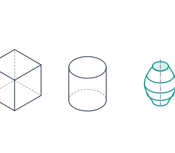 | **Primitive and Profile Solids** (`T-primitives`) | Done | `m.box / plane / polygon / cylinder / cone / sphere / torus(opts); m.revolve({ profile, angle }); m.extrudePolygon({ polygon, depth })` | Adds box, plane, polygon, cylinder, cone, sphere and torus primitives, revolved profiles and polygon extrusions to the model, returning a structured result. | [render](images/tool-library/render/T-primitives.png) |
| 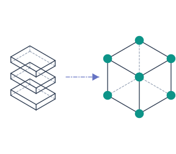 | **Lift Mesh to Editable** (`T-lift`) | Done | `lift(meshAsset)` | Converts an existing mesh asset into an editable model; re-exporting it unchanged yields the same triangles. | [render](images/tool-library/render/T-lift.png) |
| 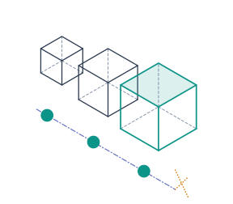 | **Session Checkpoints and Failure Capture** (`T-session`) | Done | `model({ tolerance }); m.checkpoint(name); m.try(body); m.inspect(); m.snapshot(); m.toMesh(opts); m.count(sel); m.bounds(sel)` | Creates a modeling session with a tolerance, supporting named checkpoints, captured failures, inspection, snapshots, mesh export and count and bounds queries. | [render](images/tool-library/render/T-session.png) |
| 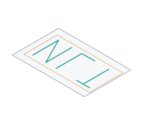 | **Single Stroke Text Region** (`T-text`) | Done | `textRegion(text, { height }); textStrokes; region2d.stroke` | Builds a single-stroke text region from a string at a given height and returns it with its stroke lines for 2D region operations. | [render](images/tool-library/render/T-text.png) |
| 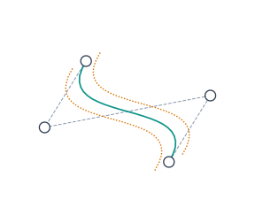 | **Contour Curves and 2D Strokes** (`T-curve2d`) | Done | `path.*` | Defines 2D outline curves from polylines, Catmull-Rom splines or fitted points, and extrudes a named contour to a depth in the model. | [render](images/tool-library/render/T-curve2d.png) |
| 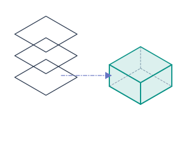 | **FXEM Snapshot Encoding** (`T-fxem`) | Done | `encodeSnapshot; decodeSnapshot; compact(); FXEM_VERSION` | Encodes and decodes model snapshots in the FXEM binary format, reports its version, and compacts the model. Returns the encoded bytes or decoded model. | [render](images/tool-library/render/T-fxem.png) |

## Polygon editing

| Drawing | Tool | State | API | Purpose | Render |
|:--|:--|:--|:--|:--|:--|
| 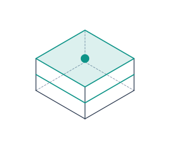 | **Element Selectors** (`T-select`) | Done | `sel.tag('visor'); sel.facing('+z', deg); sel.extreme; sel.edges.sharp; sel.edges.dihedral('>', deg); .loop() .ring() .grow()` | Selects faces and edges by tag, facing direction, extreme position, sharpness or dihedral angle, with loop, ring and grow expansion. Returns the selection. | [render](images/tool-library/render/T-select.png) |
| 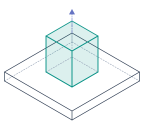 | **Extrude Faces** (`T-extrude`) | Done | `m.extrude(faces, { distance, region, label }); m.extrude(faces, { path, scale, twist })` | Extrudes selected faces by a distance, or along a path with scale and twist, with optional region and label. Returns a structured result. | [render](images/tool-library/render/T-extrude.png) |
| 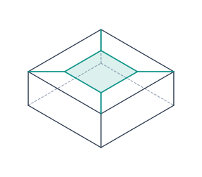 | **Inset Faces** (`T-inset`) | Done | `m.inset(faces, { thickness, region?, label? })` | Insets selected faces by a thickness to create a border region, with optional region and label. Depth comes from a following extrude. Returns a structured result. | [render](images/tool-library/render/T-inset.png) |
| 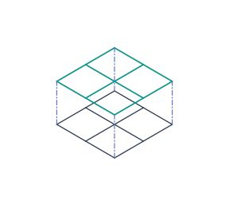 | **Region Offset Duplicate Disconnect Append** (`T-region`) | Done | `m.offset(faces, { distance }); m.duplicate(faces); m.disconnect(faces); m.append(other, opts)` | Offsets selected faces by a distance (per island where set), duplicates or disconnects them, and appends another model. Returns a structured result. | [render](images/tool-library/render/T-region.png) |
| 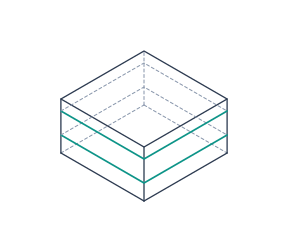 | **Loop Cut and Support Loops** (`T-loopcut`) | Done | `m.loopCut(edges, { cuts }); m.supportLoops(edges, { offset })` | Cuts edge loops into a set number of cuts, crossing even-sided faces through opposite edges and stopping at odd-sided faces. Returns a structured result. | [render](images/tool-library/render/T-loopcut.png) |
| 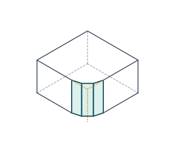 | **Bevel Edges** (`T-bevel`) | Done | `m.bevel(edges, { width, segments, material })` | Bevels selected edges with a width and segment count; one segment gives a chamfer and more segments give a rounded edge. Returns a structured result. | [render](images/tool-library/render/T-bevel.png) |
| 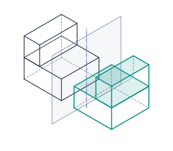 | **Mirror with Weld** (`T-mirror`) | Done | `m.mirror({ axis, weldDistance })` | Mirrors the model across an axis and welds vertices within a weld distance so the seam closes. Returns a structured result. | [render](images/tool-library/render/T-mirror.png) |
| 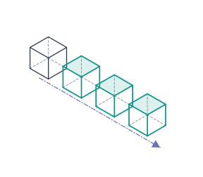 | **Linear Radial and Curve Array** (`T-array`) | Done | `m.array(target, { linear: { count, offset } } \| { radial: { count, axis, angle?, center? } } \| { onCurve: { count, path, align? } })` | Repeats a source linearly, radially or along a curve with a set count; the source may be a face selection, a model or FXEM bytes. Returns a structured result. | [render](images/tool-library/render/T-array.png) |
| 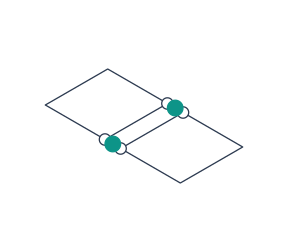 | **Weld and Merge Vertices** (`T-weld`) | Done | `m.weld({ distance }); m.resolveTJunctions({ distance }); m.weldEdgeSequence(edges, { maxDistance })` | Merges vertices within a distance, resolves T-junction cracks, and welds edge sequences within a maximum distance. Returns a structured result. | [render](images/tool-library/render/T-weld.png) |
| 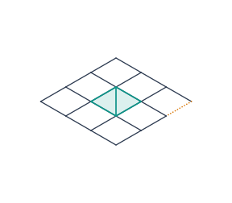 | **Topology Cleanup** (`T-cleanup`) | Done | `m.dissolve(edges); m.split(edges); m.orient(faces); m.triangulate(faces); m.fillHoles(opts); m.flip(faces); m.delete(faces)` | Dissolves, splits, orients, triangulates, flips or deletes selected edges and faces, and fills holes; triangulation matches the exported triangles. | [render](images/tool-library/render/T-cleanup.png) |
| 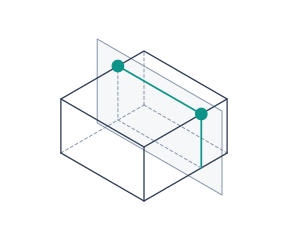 | **Knife and Plane Cut** (`T-knife`) | Done | `m.bisect(plane); m.planeCut(plane, opts); m.knife({ points, direction?, closed?, through?, snap?, sharp?, seam?, faces? })` | Cuts the model with a plane, or with a polyline knife projected along the view or onto the surface, with snapping and closed-path options. Returns a structured result. | [render](images/tool-library/render/T-knife.png) |
| 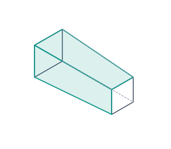 | **Bridge Edge Loops** (`T-bridge`) | Done | `m.bridge(edges, { segments })` | Bridges two equal-length closed edge boundary loops with a set number of segments, including hole boundaries. Returns a structured result. | [render](images/tool-library/render/T-bridge.png) |
| 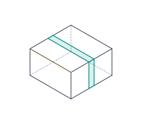 | **Panel Line Grooves** (`T-panel`) | Done | `m.panelLine(edges, { profile: "square" \| "v" \| "u", width, depth })` | Cuts panel-line grooves along selected edges with square, V or U profiles of a given width and depth. Returns a structured result. | [render](images/tool-library/render/T-panel.png) |
| 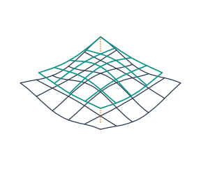 | **Offset Shell Layer** (`T-layer`) | Done | `m.layer(faces, { offset, thickness, rim, conform })` | Creates an offset layer over selected faces with offset, thickness, rim and conform options, leaving the body faces unchanged. Returns a structured result. | [render](images/tool-library/render/T-layer.png) |
| 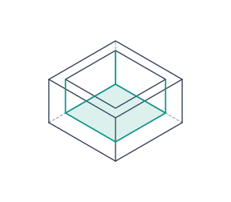 | **Shell and Thicken** (`T-shell`) | Done | `m.shell(faces, { thickness, direction?, clamp?, flange?, taper?, open? })` | Thickens selected faces into a shell with direction, clamp, flange, taper and open-rim options, and reports self-intersections. Returns a structured result. | [render](images/tool-library/render/T-shell.png) |
| 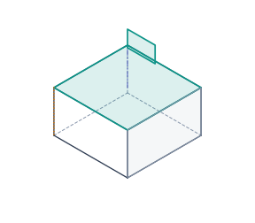 | **Tags, Material Slots, Edge Marks** (`T-tagging`) | Done | `m.tag(faces, name); m.assign(faces, slot); m.markSharp(edges, on); m.markSeam(edges, on)` | Tags faces with names, assigns faces to material slots, and marks edges as sharp or seam. Returns a structured result. | [render](images/tool-library/render/T-tagging.png) |
| 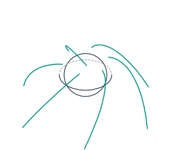 | **Hair Strand Generation** (`T-strands`) | Done | `m.strands(faces, { ...StrandsOptions, label })` | Generates strand geometry over selected faces from strand options and a label. Returns a structured result. | [render](images/tool-library/render/T-strands.png) |
| 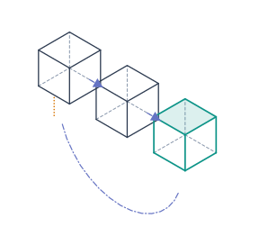 | **Journal Selector Regeneration** (`T-regen`) | Done | `regen; journal selector signatures` | Replays the model journal, matching selectors by their stored signatures so edits regenerate deterministically. Returns the regenerated model. | [render](images/tool-library/render/T-regen.png) |

## Surfaces

| Drawing | Tool | State | API | Purpose | Render |
|:--|:--|:--|:--|:--|:--|
| 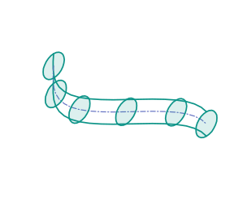 | **Section Sweep and Loft** (`T-sweep`) | Done | `m.sweep({ profile, path, frame?, twist?, scale?, closed?, caps? }); m.loft({ profiles, closed?, caps?, match? })` | Sweeps a closed profile along a path with frame, twist, scale, closure and cap options, or lofts between several profiles with optional matching. Returns a structured result. | [render](images/tool-library/render/T-sweep.png) |
| 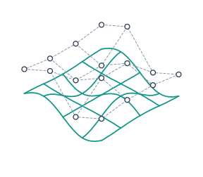 | **NURBS Surface to Mesh** (`T-nurbs`) | Done | `nurbs.interpolate / approximate / loft / grid / network; m.surface({ patches, chord, angle })` | Interpolates, approximates, lofts, grids or networks NURBS surfaces, then tessellates them into a mesh within chord and angle tolerances. | [render](images/tool-library/render/T-nurbs.png) |
| 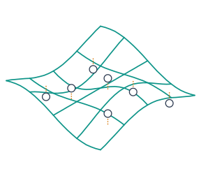 | **Least Squares Surface Fit** (`T-nurbs-fit`) | Done | `nurbs.fitSurface(points, opts); nurbs.match(a, b, { level }); measureEdge` | Fits a NURBS surface to points by least squares, and matches two boundary edges at a chosen continuity level with edge measurement. | [render](images/tool-library/render/T-nurbs-fit.png) |
| 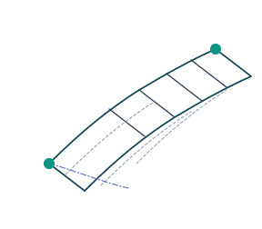 | **NURBS Rail and Birail Sweeps** (`T-v2-rail-sweep`) | Done | `nurbs.sweep(rail, sections, options?); nurbs.birail(railA, railB, sections, options?)` | Sweeps NURBS sections along one rail or spans two rails; the result reports station count, measured between-station deviation and convergence. Birail `railGap` is a sampled estimate, not a bound. | - |
| 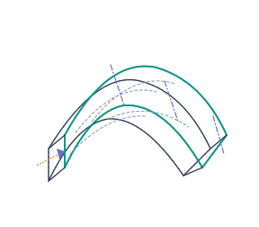 | **NURBS Surface Offset** (`T-v2-surface-offset`) | Done | `nurbs.offset(surface, distance, options?)` | Fits a constant normal offset with measured `max`, `rms` and `converged` evidence. A distance at or beyond the focal radius on the concave side is rejected; fold detection is sampled. | - |
| 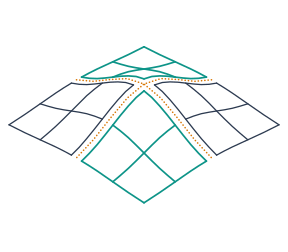 | **Patch Surface with Seams** (`T-surface-op`) | Done | `m.surface({ patches, chord, angle, blends, transitions }); nurbs.surface.fillN` | Builds a surface from patches with chord and angle tolerances, blends and transitions, fills N-sided gaps, and produces an edge-first seam table. | [render](images/tool-library/render/T-surface-op.png) |
| 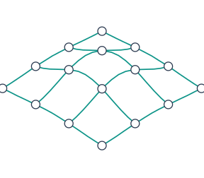 | **Patch Layout Declaration** (`T-layout`) | Done | `m.patchLayout(spec); checkLayout; resolveLayout` | Declares a surface patch layout from a spec, with checkLayout and resolveLayout to verify and resolve it. | [render](images/tool-library/render/T-layout.png) |
| 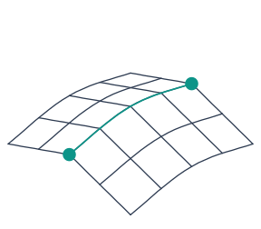 | **Feature Lines** (`T-featureline`) | Done | `m.featureLine(line)` | Adds a feature line to a surface with continuity and inflection ranges; G0 marks a deliberate break in the design. Returns a structured result. | [render](images/tool-library/render/T-featureline.png) |
|  | **2D Region Boolean and Stroke** (`T-region2d`) | Done | `region2d.union / difference / intersection / xor; offset(r, d, { join }); stroke(lines, w, { cap }); transform` | Computes 2D region union, difference, intersection and xor, plus offset, stroke and transform, with per-edge source tracking. Native mode reports the capability as unavailable. | [render](images/tool-library/render/T-region2d.png) |
| 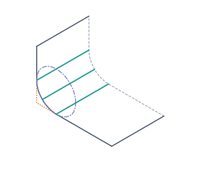 | **Surface Blend Fillet** (`T-blend`) | Done | `blendSurfaces(a, b, { radius, continuity }); m.surface({ blends: [{ between, radius, continuity }] })` | Creates rolling-ball blends between two surfaces with a radius and G1 or G2 continuity, directly or through surface blend specs. Returns a structured result. | [render](images/tool-library/render/T-blend.png) |
| 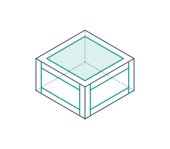 | **Support Loops for Hard Edges** (`T-support-loops`) | Done | `m.supportLoops(edges, { offset: [0.002, 0.005] }); NURBS route: patch support: { sides, offset }` | Adds support loops at given offsets beside edges to hold crisp edges under smoothing, for mesh edges or NURBS patch sides. Returns a structured result. | [render](images/tool-library/render/T-support-loops.png) |
| 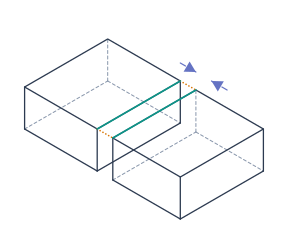 | **Shut Line Gauge and Split** (`T-shutlines`) | Done | `m.shutLines(opts); measureShutLines; splitAlong; DTS_ZONES` | Measures shut-line gaps against design zones and splits the model along a seam path, reporting the gauge results. | [render](images/tool-library/render/T-shutlines.png) |
| 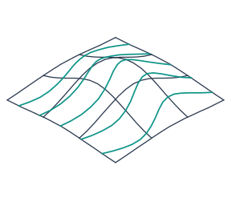 | **Highlight Lines and Surface Normals** (`T-patch-views`) | Done | `highlightLines({ field: 'reflection' \| 'isophote' \| 'section', ... }); finish({ normals: { mode: "surface" } })` | Produces reflection, isophote or plane-section highlight lines for review; section `normal`, `step` and optional `origin` define parallel planes in meters. Surface normal mode uses exact patch normals on surface faces. | [render](images/tool-library/render/T-patch-views.png) |
| 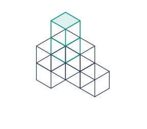 | **Voxel SDF Union and Offset** (`T-implicit-voxel`) | Done | `m.voxel.fromMesh; m.voxel.toMesh; m.voxel.union; m.voxel.offset; m.voxel.fillHoles` | Converts a mesh to a voxel signed-distance grid, then unions, offsets and hole-fills it, returning a mesh from the voxel grid. | [render](images/tool-library/render/T-implicit-voxel.png) |
| 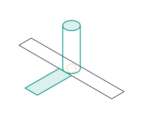 | **Pipe Network Junctions and Reducers** (`T-pipe-network`) | Done | `m.pipeNetwork({ nodeRadius, edgeRadius })` | Builds a tube network from nodes and edges, with tee, cross, five-way and reducer junctions at node and edge radii. Returns a structured result. | [render](images/tool-library/render/T-pipe-network.png) |
| 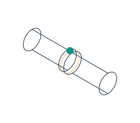 | **Welded Pipe Network** (`T-pipe-weld`) | Done | `m.pipeNetwork({ weld }); weld-cut; weld-ball; weld-strip` | Builds a welded pipe network with hard-cut or rolling-ball fillet joints, using weld options. Returns a structured result. | [render](images/tool-library/render/T-pipe-weld.png) |
| 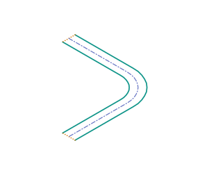 | **Pipe Bend Elbows** (`T-pipe-bend`) | Done | `m.pipeNetwork({ bend })` | Adds circular-arc elbow bends to a pipe network using the bend option. Returns a structured result. | [render](images/tool-library/render/T-pipe-bend.png) |
| 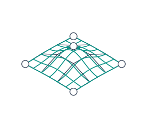 | **Subdivision Limit Surface** (`T-subd-limit`) | Done | `subdivisionLimit; m.limit; m.snapToLimit; m.markCrease` | Evaluates subdivision limit points and normals, snaps vertices to the limit, and marks half-sharp creases. Returns limit data or a structured result. | [render](images/tool-library/render/T-subd-limit.png) |

## Deformation

| Drawing | Tool | State | API | Purpose | Render |
|:--|:--|:--|:--|:--|:--|
| 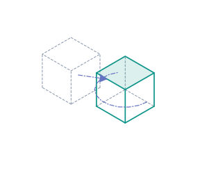 | **Translate, Rotate and Scale** (`T-translate`) | Done | `m.translate(sel, offset, { falloff, symmetry }); m.rotate(sel, ...); m.scale(sel, ...)` | Moves, rotates or scales a selection, with optional falloff and mirror symmetry for soft edits. Returns a structured result. | [render](images/tool-library/render/T-translate.png) |
| 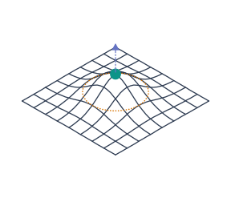 | **Soft Selection Falloff** (`T-soft`) | Done | `m.translate/rotate/scale(sel, ..., { falloff: { radius, curve, distance }, symmetry: "x" })` | Applies translate, rotate or scale with a falloff radius and curve (smooth, linear, sharp or constant), measured by Euclidean or connected edge distance, optionally mirrored across X. | [render](images/tool-library/render/T-soft.png) |
| 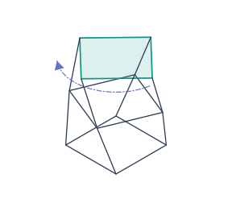 | **Shape Deformers** (`T-deform`) | Done | `m.lattice(sel, { resolution, offsets }); m.cage(sel, { cage, deformed }); m.bend(sel, { axis, angle, toward }); m.twist(sel, { axis, angle }); m.taper(sel, { axis, factor }); m.curveDeform(sel, { path, axis })` | Deforms a selection with a lattice, cage, bend, twist, taper or curve deformer, each set by its own axis, angle, factor or path option. Returns a structured result. | [render](images/tool-library/render/T-deform.png) |
| 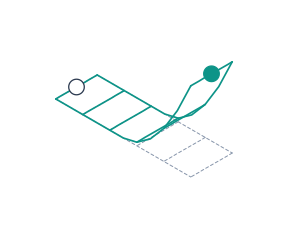 | **ARAP and Implicit Smoothing** (`T-arap`) | Done | `m.arap(sel, { ...ArapOptions }); m.implicit(sel, { ...ImplicitSmoothOptions })` | Deforms a selection with as-rigid-as-possible solving or smooths it with implicit smoothing, using the given option sets. Returns a structured result. | [render](images/tool-library/render/T-arap.png) |
| 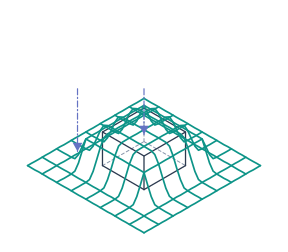 | **Shrinkwrap Selection** (`T-shrinkwrap`) | Done | `m.shrinkwrap(sel, { onto, mode, direction, offset, maxDistance, falloff })` | Projects a selection onto a target mesh by nearest point or along a direction, with offset, maximum distance and falloff; misses are reported. | [render](images/tool-library/render/T-shrinkwrap.png) |
| 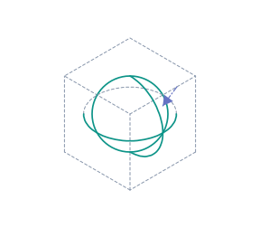 | **Spherize Selection** (`T-spherize`) | Done | `m.spherize(sel, { ...SpherizeOptions })` | Spherizes a selection, moving its vertices toward a sphere shape according to the given options. Returns a structured result. | [render](images/tool-library/render/T-spherize.png) |

## Boolean

| Drawing | Tool | State | API | Purpose | Render |
|:--|:--|:--|:--|:--|:--|
| 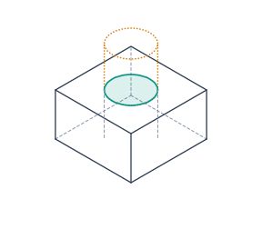 | **Boolean Union, Difference and Intersection** (`T-boolean`) | Done | `m.union(operand, opts); m.difference(operand, opts); m.intersection(operand, opts); m.splitBy(operand, opts)` | Combines the model with an operand by union, difference or intersection, and splits it by an operand. Returns a structured result. | [render](images/tool-library/render/T-boolean.png) |

## Exact stage (B-rep)

| Drawing | Tool | State | API | Purpose | Render |
|:--|:--|:--|:--|:--|:--|
| 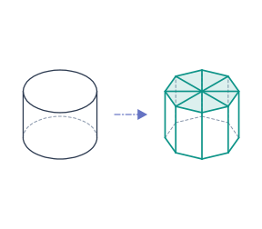 | **Tessellate Shape to Mesh** (`T-v2-tessellate`) | Done | `brep.tessellate(shape, opts); Model.fromShape(name)` | Tessellates an exact shape into a polygon mesh with watertight seams and poles, and creates a model from a named shape. Returns a polygon mesh asset. | - |
| 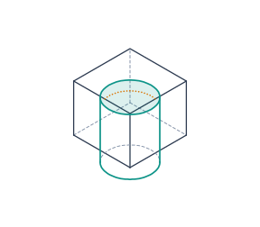 | **Exact B-rep Boolean** (`T-v2-brep-boolean`) | Done | `brep.booleanSolids(a, b, op)` | Computes exact union, difference or intersection of two solids on analytic surfaces; some layouts return a partial result. Returns the solid or a partial result. | - |
|  | **Exact B-rep Fillet and Chamfer** (`T-v2-brep-fillet`) | Done | `brep.filletBetween; brep.chamferBetween; brep.filletBox` | Adds fillets or chamfers between two faces and rounds box corners on exact solids. Vertex blends and variable radius are not included. Returns the modified solid. | - |
|  | **Exact Offset and Revolve Shell** (`T-v2-offset-shell`) | Done | `brep.offsetSurface; brep.revolveShell` | Creates an analytic offset surface or a revolved shell with a wall thickness on exact solids. Returns the offset or shell solid. | - |
|  | **Vertex Blend for Convex Corners** (`T-v2-vertex-blend`) | Not done: deferred to v2.x | `none shipped yet` | Planned blend patch where three fillets meet at one convex corner. Not part of v2.0. | - |
|  | **Exact Shape Surface Views and Checks** (`T-v2-shape-diagnostics`) | Done | `brep.shapeSurfaces(shape, options?); checkSurfaceQuality({ surfaces }, { classes: D09_CLASSES }); highlightLines; surfaceDeviation` | Converts plane, cylinder, cone, sphere and torus faces to exact rational NURBS patches for the existing surface views and checks. Full turns split into arcs; curved inner trims are sampled, while NURBS-carrier trims and non-rectangular outer boundaries are not masked. | - |
|  | **Defect Detection and Healing** (`T-v2-heal`) | Done | `brep.findDefects(shape); brep.heal(shape, opts)` | Reports duplicate vertices, gaps, free edges and slivers, and heals by merging vertices and sealing edges. Returns repairs and any unrepaired items. | - |
|  | **Collider Fit Candidates** (`T-v2-collider-fit`) | Done | `brep.colliderFit(shape, opts)` | Fits box, sphere, capsule and convex hull collider candidates to an exact shape. Returns candidates with volume ratios; deviation is a sampled estimate, not a bound. | - |
|  | **Housing Example Builder** (`T-v2-housing`) | Done | `brep.housing({ size, bossX, bossRadius, bossHeight, boreRadius })` | Builds an example housing with a base, boss and through-bore from size and dimension inputs, as an exact union and difference. Returns the solid. | - |

## Drawings and views

| Drawing | Tool | State | API | Purpose | Render |
|:--|:--|:--|:--|:--|:--|
|  | **Design Drawing Data** (`T-drawing`) | Done | `m.drawing(d); Drawing items; drawingViewFrame; resolveDrawing` | Defines design drawings as data with views and items, and resolves them into view frames. Returns the resolved drawing. | [render](images/tool-library/render/T-drawing.png) |
|  | **Drawing Validation and Silhouette IoU** (`T-drawing-check`) | Done | `validate({ drawing }); silhouetteIoU; maskIoU; drawingCurve3` | Validates a drawing and computes silhouette and mask overlap (IoU) against its curves. Returns the validation and overlap values. | [render](images/tool-library/render/T-drawing-check.png) |
|  | **Drawing Vector and CAD Export** (`T-drawing-export`) | Done | `drawingSvg; drawingDxf` | Exports a drawing as a vector drawing file or a CAD exchange file, including labels and notes. Returns the exported file content. | [render](images/tool-library/render/T-drawing-export.png) |
|  | **Three-View Reference Intersection** (`T-threeview`) | Done | `m.threeView(d, ids, opts); m.extrudeContour` | Creates reference panels from three drawing views and intersects their extruded contours to form the model. Returns a structured result. | [render](images/tool-library/render/T-threeview.png) |
|  | **Draft Angle Analysis** (`T-draft`) | Done | `draft(...)` | Analyzes draft and ejection-direction angles of the model. Returns the analysis result. | [render](images/tool-library/render/T-draft.png) |
|  | **Hidden Line Removal and Sheets** (`T-drawing-hlr`) | Done | `meshViewLines (HLR); explodeDrawing; sheet composer; drawingTable` | Computes visible view lines with hidden line removal, explodes drawings, and composes sheets and drawing tables. Returns the sheet data. | [render](images/tool-library/render/T-drawing-hlr.png) |

## Validation and analysis

| Drawing | Tool | State | API | Purpose | Render |
|:--|:--|:--|:--|:--|:--|
|  | **Validity and Effect Assertions** (`T-validate`) | Done | `m.validate({ ...ValidateOptions }); m.diagnostics(); forgeax model validate` | Validates the model against the given options and returns diagnostics; a CLI command runs the same validation. | [render](images/tool-library/render/T-validate.png) |
|  | **Model Difference Report** (`T-diff`) | Done | `diffMeshes; model.diff tool` | Compares two meshes or models and reports the differences between them. Returns the difference report. | [render](images/tool-library/render/T-diff.png) |
|  | **Surface Quality Views** (`T-surface-views`) | Done | `surfaceField(mesh, surfaces); zebraStripes; curvatureShading; curvatureComb; model render --mode zebra\|curvature-*, --combs` | Renders surface views such as zebra stripes, curvature shading and curvature combs, evaluating exact NURBS where vertices lie on patches. Returns the view fields. | [render](images/tool-library/render/T-surface-views.png) |
|  | **Surface Quality Checks** (`T-surface-check`) | Done | `checkSurfaceQuality({ surfaces, curves }, opts); curveFairness; m.featureLine; m.validate({ surfaceQuality }); model validate --surface-quality` | Checks surface continuity, control point density and curve fairness, reporting problems by face, edge, parameter and worst point. Returns a quality report. | [render](images/tool-library/render/T-surface-check.png) |
|  | **NURBS Surface Deviation Report** (`T-v2-surface-deviation`) | Done | `surfaceDeviation(surfaces, target, options?)` | Compares patches with points, a mesh or surfaces. Mesh and surface targets produce `toSurfaces` and `toTarget` sample directions; one may fail while the other passes, including when the target covers only part of the patches. | - |
|  | **Edge Flow and V-Wire Check** (`T-edge-flow`) | Done | `checkEdgeFlow(mesh, lines); m.validate({ edgeFlow }); overlay edges; model validate --edge-flow, render --overlays '["edges"]' --frame` | Checks that feature lines follow continuous edge loops and reports edge-flow coverage, aspect distribution and triangle and pole counts. Returns an edge-flow report. | [render](images/tool-library/render/T-edge-flow.png) |
|  | **Watertight Check and Coverage** (`T-watertight`) | Done | `validate({ watertight }); WatertightReport; coverage reference` | Checks the mesh for watertightness and provides a coverage reference. Returns a watertight report and coverage data. | [render](images/tool-library/render/T-watertight.png) |
|  | **Selector Synthesis and Stability** (`T-synthesize`) | Done | `synthesizeSelector; pickFaces; transferSelection; model.synthesize` | Synthesizes a stable selector from picked faces and transfers selections across model edits. Returns the selector or transferred selection. | [render](images/tool-library/render/T-synthesize.png) |
|  | **Invariant Checks and Cache Keys** (`T-invariants`) | Done | `checkInvariants; debugValidate; computeCacheKey; compute-job cache` | Checks model invariants and debug validation, and computes cache keys so repeated compute jobs can reuse cached output. Returns the check result and key. | - |
|  | **Orthographic Section and Explode Views** (`T-views`) | Done | `ORTHO_VIEWS; sectionSegments; explodeMesh; overlayMesh` | Provides orthographic view frames, section segments, exploded mesh layouts and overlay projections for inspection. Returns the view data. | [render](images/tool-library/render/T-views.png) |
|  | **LOD Topology Report** (`T-lod-topology`) | Done | `lodTopologyReport; ExportReport.topology` | Reports LOD topology for exports, including sliver removal and skinned LOD reduction. Returns the topology report. | [render](images/tool-library/render/T-lod-topology.png) |
|  | **Capture Timing and Material Report** (`T-capture-report`) | Done | `CaptureTiming / timingRuns; CaptureReport.materials; model.replay; model.render --materials` | Reports capture timing runs and per-material usage for a model render, and replays captured state. Returns the timing and material report. | - |
|  | **Sheet Forming Report** (`T-v2-sheet-forming`) | Done | `sheetForming(spec, material, options?); SHEET_MATERIALS` | Reports bend radius, springback and tooling values with flange and hole-zone checks. The flange and hole-clearance checks are simplified rules of thumb, not a forming simulation; presets are typical material values. | - |
|  | **Bill of Materials and Mass Roll-up** (`T-v2-bom`) | Done | `bom(items); bomTable(report)` | Rolls up item quantity, mass and centroid through a product tree, with material and process totals. Geometry can be a closed solid, a sheet mesh with gauge, or purchased mass. | - |
|  | **Sparse Solver and Spatial Queries** (`T-solvers`) | Done | `solveSparse; TriangleBvh; SdfGrid; growOutline; outlineDeviation; sweepOverlap` | Provides a sparse linear solver, triangle BVH, signed distance grid, outline growth and deviation, and sweep overlap queries. Returns the query results. | [render](images/tool-library/render/T-solvers.png) |
|  | **Character Visibility Audit** (`T-v2-visibility-audit`) | Done | `Model.auditVisibility(opts)` | Samples viewpoints around a model and reports detail-seen, tool-seen and form-hidden findings. Returns the audit findings. | - |
|  | **UV Overlap Pair Detection** (`T-v2-uv-overlap`) | Done | `uvOverlapPairs(mesh, channel)` | Returns pairs of faces whose UV triangles overlap in a channel, so intended overlap can be told apart from accidental overlap. | - |
|  | **UV Checker and Density Textures** (`T-v2-uv-textures`) | Done | `uvCheckerTexture(mesh, opts); uvHeatmapTexture(mesh, opts)` | Creates a checker texture for stretch and orientation and a heatmap texture for texel density, both as ordinary texture assets. Returns the textures. | - |

## UV and baking

| Drawing | Tool | State | API | Purpose | Render |
|:--|:--|:--|:--|:--|:--|
|  | **UV Project, Unwrap and Pack** (`T-uv`) | Done | `m.uv.project(opts); m.uv.unwrap({ method, seams }); m.uv.pack({ resolution, padding }); m.uv.auto({ resolution, padding, pack }); m.uv.trim; m.uv.swatch` | Projects, unwraps, packs and auto-lays out UVs at a resolution with padding, with trim and swatch helpers. Returns a structured result. | [render](images/tool-library/render/T-uv.png) |
|  | **Trim Sheet and Stamps** (`T-trim`) | Done | `trimSheet; bakeTrimSheet; stamp.boltHex; stamp.rivet; trimReport` | Builds a trim sheet with bake and report, and adds bolt-hex and rivet stamps as sheet detail. Returns a structured result. | [render](images/tool-library/render/T-trim.png) |
|  | **High to Low Bake** (`T-bake`) | Done | `bakeMaps({ high, low, maps, cage, groups }); bakeMapsParallel; model.bake tool` | Bakes map sets from high-poly to low-poly geometry through a cage and groups, with a parallel variant. Returns the bake result. | [render](images/tool-library/render/T-bake.png) |
|  | **Bake Checks and Metrics** (`T-bake-checks`) | Done | `BAKE_CHECKS; validate bake; FLIP / SSIM / CIEDE2000` | Provides bake checks, validation and image-difference metrics, reporting pass status and issues. Returns the check results. | [render](images/tool-library/render/T-bake-checks.png) |
|  | **Texture Build and Encode** (`T-texture`) | Done | `textureFrom; normalFromHeight; mipChain; encodeKtx2` | Builds textures from sources, including normal maps from height, mip chains and GPU texture container encoding. | [render](images/tool-library/render/T-texture.png) |
|  | **Text and Pattern Decals on UV** (`T-decal`) | Done | `textRegion('GT', { height })` | Creates text regions for UV decals at a given height, adds geometric surface imprints, and builds layered decal textures. | [render](images/tool-library/render/T-decal.png) |
|  | **Procedural Materials Without Images** (`T-material`) | Done | `` | Creates standard material values procedurally for car paint, carbon fiber, metal, glass, tire, emissive and decal, without image files. | [render](images/tool-library/render/T-material.png) |
|  | **UV Guide Image Round Trip** (`T-genuv`) | Not done: phase 2 | `none shipped yet` | Planned workflow to export a UV guide image, generate artwork from it and project the result back onto the mesh. Planned for a later phase. | - |
|  | **Slot Base and Emission Maps** (`T-slotmaps`) | Done | `bakeMaps slots; palette` | Bakes base color and emission maps per material slot using slot options and a palette. Returns the bake results. | [render](images/tool-library/render/T-slotmaps.png) |
|  | **UV Channel Contracts** (`T-v2-uv-channels`) | Done | `` | Creates the uv0 tiling channel and the uv1 unique unit channel with lightmap support, checking channel operations against the contract. Returns the channel data. | - |
|  | **UV Plan and Patch Unwrap** (`T-v2-uv-plan`) | Done | `uvFromPatch(intrinsic \| conformalScaled); Model.uv.plan; uv.pack; uv.straighten` | Plans UV seams with forced, forbidden and avoided rules, packs islands into tiles, and unwraps patch UVs with straightened non-quad islands. Returns the UV plan. | - |
|  | **Automatic Bake Groups** (`T-v2-bake-groups`) | Done | `idMap(tag)` | Maps part tags to bake group tags by priority and builds an ID map colored by group, with face counts per group. Returns the group tags and ID map. | - |
|  | **Seam Visibility Measure** (`T-v2-seam-visibility`) | Done | `measureSeamVisibility(mesh, opts)` | Measures how visible each seam chain and UV island is on a viewing sphere. Reports visibility values rather than guaranteeing an aesthetic result. | - |
|  | **Analytic Mesh Bake Option** (`T-v2-bake-analytic`) | Done | `Model.bake({ analytic: true \| { verify } })` | Adds an analytic bake option that is off by default and checked against ray results; a mismatch falls back to ray baking. Improves accuracy, not speed. | - |

## Rigs and mechanisms

| Drawing | Tool | State | API | Purpose | Render |
|:--|:--|:--|:--|:--|:--|
|  | **Rig Joints and Skinning Weights** (`T-rig`) | Done | `rig(m, { joints }); rig.bindRigid(part, joint); rig.bindAuto(part, opts); rig.pose(values); rig.sample(path, u); rig.finish(...)` | Defines joints, binds parts rigidly or by automatic weights, poses the rig and samples it along a path. Returns the rig. | [render](images/tool-library/render/T-rig.png) |
|  | **Interference and Path Scan** (`T-interference`) | Done | `rig.interference(pose, { tolerance, contacts }); rig.scan(path, { step, maxTravel, refine }); forgeax model interference; forgeax model pose / render --u` | Reports part interference at a pose and scans a motion path for collisions, with CLI interference and pose commands. Returns the pairs or scan results. | [render](images/tool-library/render/T-interference.png) |
|  | **Clearance Scan and Fits** (`T-clearance`) | Done | `Rig.interference / Rig.scan({ clearance }); fit contacts; recipes.pinJoint; isoFit` | Scans clearances between moving rig parts and applies pin joint and standard fit recipes with fit contacts. Returns clearance and fit results. | [render](images/tool-library/render/T-clearance.png) |
|  | **Closed Loop Solve and Mobility** (`T-loops`) | Done | `rig.solve(...); rig.mobility(...)` | Solves closed-loop linkages in a rig and reports degrees of freedom and mobility. Returns the solve and mobility results. | [render](images/tool-library/render/T-loops.png) |
|  | **Mechanical Part Recipes** (`T-recipes`) | Done | `recipes.gear / hinge / slideRail / hydraulicCylinder / ballBearing / hexBolt / hexNut / washer / coilSpring / rack / overCenterLock / lug / clevis` | Provides a library of mechanical part recipes, including gear, hinge, slide rail, hydraulic cylinder, ball bearing, bolt, nut, washer, coil spring, rack, over-center lock, lug and clevis. | [render](images/tool-library/render/T-recipes.png) |
|  | **Body Fastener Recipes** (`T-v2-body-fasteners`) | Done | `recipes.pushClip / weldNut / blindRivet / grommet` | Builds a fir-tree trim clip, projection weld nut, installed blind rivet, and grooved grommet or blanking plug. Recipe dimensions are meters except the weld-nut metric size; dependent dimensions are range-checked. | - |
|  | **Wheel and Tyre Recipes** (`T-v2-wheel-tyre`) | Done | `recipes.tyreSize / tyre / wheelRim` | Parses metric tyre sizes and builds a hollow tyre or spoke rim. The axle is +Y and tyre contact is at -Z. | - |
|  | **Mass Properties and Forces** (`T-mass`) | Done | `massProperties; rig.weigh; rig.centreOfMass; rig.actuation` | Computes mass properties, rig weight, centre of mass and actuation for a rig. Returns the computed values. | [render](images/tool-library/render/T-mass.png) |
|  | **Pose Report and Stops** (`T-pose-report`) | Done | `rig.poseReport; rig.stopReport; recipes.overCenterLock` | Reports pose state and stop checks for a rig, with over-center lock recipes for locking positions. Returns the pose and stop reports. | [render](images/tool-library/render/T-pose-report.png) |
|  | **Motion Choreography and Sweeps** (`T-choreograph`) | Done | `rig.choreograph; rig.sweep; rig.phaseClaims; rig.release; SweptVolume; motionReport` | Choreographs rig motion through phases, sweeps swept volumes, claims and releases phases, and produces a motion report. | [render](images/tool-library/render/T-choreograph.png) |
|  | **Hardware Mounting and Connectivity** (`T-mount`) | Done | `rig.mountHardware; rig.connectivity` | Mounts hardware onto rig parts and reports the connectivity of the assembly. Returns the connectivity results. | [render](images/tool-library/render/T-mount.png) |
|  | **Rig Clips, Mimic and Moves** (`T-rig-clips`) | Done | `rig.finish({ clips }); JointSpec.mimic; InterferencePair.suggestedMove` | Finishes a rig with multiple motion clips, mimic joint links and suggested movements for interfering pairs. Returns the finished rig. | [render](images/tool-library/render/T-rig-clips.png) |

## Game assets

| Drawing | Tool | State | API | Purpose | Render |
|:--|:--|:--|:--|:--|:--|
|  | **Thin Plate Hole Array** (`T-v2-thin-hole`) | Done | `thinHole({ width, height, diameter, pitch, pattern, mode, resolution })` | Creates a hole pattern in a thin plate as alpha through-holes or recess height maps. Returns normal, ambient occlusion and coverage-preserving opacity mips. | - |
|  | **Surface Contract Checks** (`T-v2-surface-contract`) | Done | `checkSurface(mesh, contract); surfaceDiagnostics` | Checks vertex color, uv0 and uv1 channel contracts on a mesh and reports violations as diagnostics wired into validation. Returns the violations. | - |
|  | **Master Surface Material Zones** (`T-v2-master-surface`) | Not done: deferred to v2.x | `none shipped yet` | Planned quadrant-based color and metallic zones with baked vertex occlusion and curvature for wear. Not part of v2.0. | - |
|  | **Cable Kit** (`T-v2-cable-kit`) | Done | `recipes.catenary(a, b, { sag } \| { length }, options?); recipes.cable(options)` | Computes a catenary or builds a cable bundle along a polyline with optional twisted strands, wrap and end fittings. Strand counts 8 to 19 use one ring and leave a central lumen; they do not add inner layers. | - |
|  | **Asset Budget Check** (`T-v2-budget-check`) | Done | `assetStats(parts, opts); checkAssetBudget(stats, profile)` | Counts triangles, material slots, draw calls and texture bytes per part, and reports items over the output profile budget. Returns the budget overruns. | - |

## Finishing and export

| Drawing | Tool | State | API | Purpose | Render |
|:--|:--|:--|:--|:--|:--|
|  | **Hard Edges and Weighted Normals** (`T-hardedge`) | Done | `m.markSharp(edges); m.finish({ normals: 'weighted' \| 'autoSmooth' })` | Marks sharp edges and finishes normals as weighted or auto-smoothed, so shading breaks cleanly at hard edges. | [render](images/tool-library/render/T-hardedge.png) |
|  | **Subdivision with Creases** (`T-subdiv`) | Done | `m.subdivide(faces, { levels, scheme?, boundary?, creaseSharpness? })` | Subdivides faces over a number of levels with a smooth or simple scheme, boundary rule and crease sharpness, keeping marked creases sharp. Returns a structured result. | [render](images/tool-library/render/T-subdiv.png) |
|  | **Simplify and LOD Reduction** (`T-simplify`) | Done | `m.simplify(faces, { targetFaces, maxError, quadric, clearance, maxAspect, maxValence, silhouette, preserve })` | Reduces faces toward a target count or maximum error while preserving tags, with clearance, aspect, valence, silhouette and preserve options. Returns a structured result. | [render](images/tool-library/render/T-simplify.png) |
|  | **Isotropic Remesh and Quad Cleanup** (`T-remesh`) | Done | `m.remesh(faces, { targetEdgeLength, preserve }); cleanup.quads; cleanup.tiling; cleanup.planar; cleanup.slivers` | Remeshes faces to a target edge length while preserving features, and cleans up quads, tiling, planar regions and slivers. Returns a structured result. | [render](images/tool-library/render/T-remesh.png) |
|  | **Low Poly Composite Operator** (`T-lowpoly`) | Done | `m.lowpoly(faces, { targetFaces, union, hardAngle, silhouette, quads, uv, tags })` | Reduces faces to a target count with union, hard-angle, silhouette, quad, UV and tag options. Overlapping parts must be unioned first. Returns a structured result. | [render](images/tool-library/render/T-lowpoly.png) |
|  | **Quad Retopology** (`T-retopo`) | Done | `quad.quadRemesh(mesh, opts)` | Generates a quad-dominant mesh from a triangle mesh and reports unpaired triangles separately from quads and n-gons. Guide curves are not supported. | - |
|  | **Finish, Normals and LODs** (`T-finish`) | Done | `m.finish({ normals, lods, ... }); m.toMesh(opts); exportMesh` | Finishes normals and LODs with the given options, then produces mesh output through toMesh or exportMesh. | [render](images/tool-library/render/T-finish.png) |
|  | **Triangulation Quality Metrics** (`T-meshquality`) | Done | `m.meshQuality(faces, limits, { flow })` | Measures triangulation quality against limits, optionally with flow metrics, and returns the measured results. | [render](images/tool-library/render/T-meshquality.png) |
|  | **Mesh Job Cooker** (`T-mesh-job-cooker`) | Done | `createMeshJobCooker; buildMeshJobSet` | Creates a mesh job cooker and builds job sets from mesh requests for cooking mesh work. Returns the cooker and job set. | - |

## Tools that are not done

- `T-genuv` UV Guide Image Round Trip: Planned for phase 2. The kernel has no UV guide image export or projection back yet.
- `T-v2-vertex-blend` Vertex Blend for Convex Corners: Deferred to v2.x. The blend patch where three fillets meet at a convex corner did not ship in v2.0.
- `T-v2-master-surface` Master Surface Material Zones: Deferred to v2.x. Quadrant color and metallic zones with baked vertex occlusion and curvature did not ship in v2.0.
