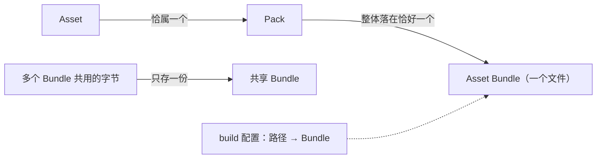

# Pack 与 Asset Bundle 交付设计

状态：已实现首版。范围：玩家包把 Pack 产物捆成 Asset Bundle，以及运行时读取。

Pack 是最小交付单元，永不拆分；Asset Bundle 是若干完整 Pack 的一捆，是一个物理文件。Pack 不知道自己属于哪个 Bundle——如同包裹不标记自己要装进哪个麻袋；装袋由项目构建配置按路径声明，玩家打包执行。

## 1. 背景

Voxel Frontline 一次完整构建（2026-10-20）的 `dist/` 有 45,374 个文件，剔除独立编译回执后仍约 2.17 万个：

| 项目 | 值 |
|:--|--:|
| Pack 文档 | 127 |
| 二进制产物（去重后） | 20,379 个，1,036 MB |
| 最大单个 Pack 的产物 | 313 MB（1,277 个资产） |
| 被多个 Pack 共用的产物 | 1,762 个；若每个 Bundle 各存一份会多出 423 MB |

文件多的根源是“每个产物一个文件”，而不是 Pack 多。

## 2. 模型



1. 每个 Pack 的全部已校验、非流式产物位于恰好一个 Bundle 内。
2. 被不同 Bundle 的 Pack 共用的字节只存一份，放入共享 Bundle；这些字节按内容寻址，本不属于某个 Pack。
3. 流式产物（`delivery: 'stream'`，宿主按 URL 消费）保持独立文件。
4. Pack 源中没有任何 Bundle 事实；构建 `dist/` 保持一个产物一个文件，Bundle 只存在于玩家包（Web ZIP 与单 HTML）。

## 3. 声明

配置位于 `roots.build` 所选 build 插件，沿用 `ctx.devkitAppOptions` 的先例：

```ts
ctx.devkitDelivery = {
  bundles: {
    lobby: ['assets/lobby/'],
    dust2: ['assets/maps/dust2/', 'assets/props/dust2/'],
  },
};
```

- 来源路径匹配任一前缀的 Pack 进入该 Bundle；依赖不会被隐式拉入。
- 一个 Pack 被两个 Bundle 匹配、或某个前缀未匹配任何 Pack 时，打包失败。
- 未匹配的 Pack 按路径摘要位稳定分桶，每桶不超过 8 MiB；单个更大的 Pack 独占一个 Bundle。

## 4. 文件格式

`FXBUNDL1`、u32 条目数、u32 条目长度表，随后依次拼接条目（`@forgeax/engine-pack/bundle`）。条目表让运行时能把一个文件拆成可分别释放的条目。

产物描述保留 GUID、`integrity` 与 `byteLength`，改写 `path` 并增加窗口：

```ts
{ path: 'bundles/<digest>.bin', contentEncoding: 'zstd', byteRange: { offset, length, bundleDigest } }
```

每个条目在压缩至少节省 10% 时以 zstd 存储；`integrity` 仍覆盖解码后的字节，`bundleDigest` 覆盖整个文件。

## 5. 运行时

`assets.load(guid, kind)` 含义不变，调用者不感知 Bundle。

1. 首次读取某个 Bundle 的任一条目时取回整个文件、校验 `bundleDigest`，然后按条目表拆成独立条目常驻。
2. 取出条目即把它移出 Bundle：每份字节要么在 Bundle 中，要么已被取出，不存在两份。
3. 同一窗口的后续读者得到经摘要校验的私有副本，不会重新下载；取出值已被修改或转移时视为失效。
4. Bundle 整包取回过一次后，再读已释放的条目只用 HTTP Range 请求该条目窗口；宿主不支持 Range 而返回整个文件时，校验后只恢复取出值已不再存活的条目。
5. 常驻 Bundle 共享 256 MiB 预算，超出时按最久未用整包淘汰；内存压力释放与失效清理会清空常驻。

## 6. 后续

不在首版：Pack 文档进入 Bundle、按依赖关系的自动分组、`preloadPack` / `preloadBundle`、首次读取即按 Range 取部分条目、边下载边拆分（避免整包下载时的瞬时双份内存）、微信与 Tauri 目标。
