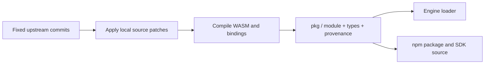

# @forgeax/engine-physics-rapier3d

Rapier 0.20 / WASM backend for the realm-neutral [Physics contract](../physics/README.md).
Install `physicsPlugin('rapier-3d')` in the World; game code consumes the optional
`PhysicsWorld` capabilities rather than retaining Rapier objects.

| Boundary | Owner behavior |
|:--|:--|
| Load | Package-local patched WASM loading and native Cordis Physics service readiness. |
| Fixed sync | Ordinary ECS Transform / RigidBody / Collider projection after fixed Scene propagation. Shapes consume resolved world scale; dynamic bodies own their pose after creation. |
| Character supports | Native KCC applies one moving-support friction contribution before shape casting, including the no-hit descending-support path; later contacts share its accumulator. Caller adds input/gravity, never a second platform translation. |
| Character pushes | Native KCC contact impulses push solid dynamic bodies; sensor filtering remains active. No game-side duplicate push is required. |
| Native step | Exactly one `FixedTime.delta` step per World fixed iteration; World owns host clock, bounded catch-up and discarded time. |
| Derived geometry | Convex point sets, heightfields and voxel regions become disabled native geometry, then use the existing atomic prepare/admit/cancel/mass/recovery transaction. The producer owns decomposition; native handles remain private. |
| Writeback | Awake/overwritten dynamic body poses enter ordinary ECS Transform; sleeping unchanged bodies avoid redundant writes. |
| Managed joint group | Fixed joints or `JointData.revoluteWithAxes` hinges with body-local anchors and separate unit axes. All inputs/endpoints validate first; staged handles retire on preparation failure. |
| Handoff | Detached body motion, explicit world pose/velocity writes and dynamic impulses use structured Results. Pose writes queue ordinary writeback; animation/visual blend stays upstream. |
| Retirement | Constraint leases are idempotent across endpoint removal and backend disposal. Partial native retirement is observable as `managed-physics-failed` with `rebuild-required`; it never reports rollback success. |

`prepareDerivedShapeCandidates` retains the complete declared roster in the same
private admission group used by native rollback. The group uses one of 32
in-flight preparation slots; its at most 4096 members share the unchanged 8 MiB
candidate budget. Prepared native colliders stay disabled, and only complete-group
admission may exceed the independent-candidate bound. Partial or mixed admission
is refused, while preparation failure or cancellation releases every member.

`prepareDerivedBodyTypeCandidates` accepts exact current publication receipts and
retains their committed native collider handles for static/dynamic/kinematic
policy changes. It uses the same group admission, paired callback, rollback,
fixed-step publication and cancellation owner as geometry replacements. Shape
revisions, constraints and body entities remain unchanged; copied, foreign or
replaced receipts are stale. A cancelled or refused policy never retires accepted
colliders. See the [physics contract](../physics/README.md#derived-shape-candidates-3d)
and [real postshot producer evidence](reports/derived-body-type-reuse-20261015.json).

`getDerivedPublication` returns the existing immutable publication, including its
frozen shape ID array. Repeated reads retain identity until a new fixed-step
publication replaces it; retained older revisions remain unchanged. Reads still
refuse during paired admission and return no publication when recovery is required.
Terrain retirement selects the admitted `terrain:` source namespace from the
existing derived-body records. Unrelated voxel and compound sources do not incur
publication reads or shape-ID scans during heightfield synchronization.

A successful geometry commit can replace ordinary ECS colliders. The backend
consumes those changes through its existing incremental projection before the
same native step, so removed source geometry cannot collide with its admitted
replacement. One batch invokes its geometry callback once; frames without a
successful callback do not perform an additional synchronization.

Derived convex pieces with exactly eight box corners use native cuboids when
their f32 center and half-extents reproduce every input corner exactly. Other
point sets retain their convex hull. This preserves compound holes, authored
origins/rotations and the ordinary mass/admission/recovery contract without a
producer option or a simplified collision mesh. Recentered cuboids retain their
offset inside the compound, including a single off-center piece; specialization
never moves the collider frame or changes a body's mass/COM during preparation.

The managed joint capability is independent of the derived geometry constraint
publication route. It exposes no raw joint handles. Supported rig policy and
bone/body offset conversion live in [Animation](../animation/README.md#managed-spring-and-physical-bone-motion),
not this backend. Two-dimensional Rapier does not implement this 3D rig capability.

`getDerivedConstraintStates` reads fresh committed constraint IDs, revisions and
endpoint entities from the existing derived-constraint owner. Each call returns
detached scalar records without reading body motion or copying shape geometry.
It observes managed constraint inputs, not arbitrary edits to raw native joints.
`captureDerivedPhysicsState` still provides the complete portable recovery input;
backends without the optional observation capability can retain that capture path.

Real solver admission/rollback/cleanup regression:

```sh
pnpm exec vitest run --config packages/physics-rapier3d/vitest.config.ts \
  packages/physics-rapier3d/src --maxWorkers=2
```

The package config is a Vitest project definition; from the repository root keep
the owner directory filter so a diagnostic invocation cannot select unrelated
browser/Dawn tests. Complete repository backend/smoke gates retain their own config.

The ECS adapter resolves movement through one Rapier character-controller solve.
Body and attached collider poses are committed together so consecutive character
computations use the new pose. Character tuning remains in `CharacterController`;
this package has no terrain-specific lift, retry or ground-state policy.

Changed physics rows are decoded once per synchronization and that same descriptor
is reconciled and retained. Pose-only edits keep primitive collision dimensions
untouched, preserving Rapier's shape and contact caches; authored scale edits still
update the native dimensions. Unchanged rows remain outside the ECS projection's
work set. Run `node packages/physics-rapier3d/bench/pose-only-sync.mjs` after building
to measure sync and real fixed-step costs separately for a moving primitive scene.

## Patched WASM delivery



| Authority | Location |
|:--|:--|
| Upstream revisions and Rust/wasm-pack selection | `scripts/source.json` |
| Rapier and Parry source fixes, including native regression tests | `patches/` |
| WASM Cargo dependency graph and binding features | `scripts/Cargo.lock`, `scripts/bindings.Cargo.toml` |
| Build, source-key and output-hash verification | `scripts/build-wasm.mjs` |
| Generated browser/native transports, bundled declarations and license | `pkg/` |

`loadRapier3D()` selects the browser or native transport through the existing
`wasm-runtime` export. Both are generated from the same patched WASM and bindings.
The default browser/Node module `pkg/rapier.mjs` embeds those bytes and needs no
network request or Rust toolchain. The native transport uses `rapier-native.mjs`
and the identical external `rapier.wasm`. There is no unpatched npm 3D backend.
SDK source includes the complete seven-file `pkg/` closure through
`SDK_SOURCE_WASM`; npm packing carries the same module, declaration, WASM,
license and provenance files.

Contributor builds use `node scripts/build-wasm.mjs --ensure`: a current payload
is checked and reused; a missing, stale or modified payload is rebuilt. Explicit
rebuild: `pnpm --filter @forgeax/engine-physics-rapier3d build:wasm`.
Install Rust 1.93.1 with `wasm32-unknown-unknown`, wasm-pack 0.14.0, Git and the
workspace's Node dependencies first. The first build also needs access to
upstream Git and ordinary Cargo registries. Source checkouts and Cargo output
are disposable `.wasm-build/` data; no maintained fork or new submodule is used.
Declaration packaging names its exact emitted entry rather than expanding a
repository glob. This keeps junction-mounted Windows checkouts out of directory
traversal; the real tsup regression runs without Rust or a WASM rebuild.

`node scripts/build-wasm.mjs --verify` validates the source/patch key and every
output hash without rebuilding. Output provenance records actual tool versions
and upstream revisions. Ordinary source builds do not promise identical bytes
across differing compiler patch releases or wasm-opt versions.

## Numerical repairs

| Library | Invariant |
|:--|:--|
| Rapier | A floor normal parallel to `up` retains the entire horizontal tangent plane, including normals rounded around unit length. |
| Rapier | Fixed CCD targets invalidate on every authored scene change, including steps with no fast body; later sweeps cannot reuse removed colliders or omit replacement targets. |
| Parry | Cuboid CCD queries visit exact occupied cuboids per voxel chunk. Query bounds select complete cuboids instead of clipping them into artificial interior collision faces; holes and current chunk edits remain authoritative. |
| Parry | Capsule/cuboid closest points minimize segment-to-box distance. The normal, signed distance and witnesses derive from that same solution. Initial casts preserve every strictly approaching direction and reject parallel/separating motion when `stop_at_penetration` is false. |
| Parry | A thin triangle's closest-point projection cannot be farther away than its edges. Ill-conditioned f32 projections use f64 intermediate coordinates. |
| Parry | EPA expands a touching CSO edge with a noncollinear support point before admitting its initial facets; a degenerate zero-normal facet cannot become a published contact. |

The patches contain no character dimensions, step heights, game names, world
coordinates or movement speeds in production code. Frozen geometry appears only
in regression tests. Arithmetic changes may change internal solver iterations;
they add no Engine shape casts or controller retries. Performance must be
measured rather than inferred from query counts.
`convex-native.unit.test.ts` and the derived candidate suite cover real Rapier
compound geometry, holes, automatic mass, replacement/cancellation and fresh-world
restore. Producer adapter tests cover source conversion and composition. CPU/native evidence does not replace browser, Dawn or the 60-frame
scene gates.

## Native WASM Hosts

A path-based Host selects the `forgeax-native` bundler condition and calls
`initializeNativeRapier3D(host)` from `@forgeax/engine-physics-rapier3d/native`
before activating `physicsPlugin('rapier-3d')`. The ordinary loader and plugin
then consume that same realm-local module. Missing initialization returns
`PhysicsError` with `code: 'wasm-load-failed'`. Concurrent initialization shares
one attempt. Failed reads, integrity checks and Host instantiations can retry;
the qualified generated finalizer only adopts exports and resets typed-array caches,
with no Rust start function.

The structural `PhysicsWasmHost` belongs to [Physics](../physics/src/wasm-host.ts).
`readWasm()` and `instantiate(imports)` must use the same immutable packaged
bytes or path. `now()` supplies monotonic, finite, nonnegative milliseconds;
it is a Host capability and does not change the World-owned fixed simulation
delta. The native binding routes web-time's Performance import through its own
generated heap ABI to that clock, without installing a global `performance`.
The native pipeline reads those timers even when its profiler is disabled.
The native binding checks byte length and SHA-256 before calling
the Host or adopting exports. WeChat uses `createWechatWasmHost` and copies
`pkg/rapier.wasm` to its package path for `WXWebAssembly.instantiate`; no global
WebAssembly replacement is required.

The source producer keeps wasm-bindgen 0.2.121's generated import map, wrappers
and finalizer, replacing only its browser loading operation. One provenance
inventory binds source patches, the initializer and all seven output files:
`rapier.mjs`, `rapier.d.mts`, `rapier-native.mjs`, `rapier-native.d.mts`,
`rapier.wasm`, `LICENSE`, and `provenance.json`. The shared
`scripts/forgeax/build-rapier-native.mjs 3d` command delegates to this producer;
it cannot overwrite 3D outputs with old npm binaries.

```sh
node scripts/build-wasm.mjs --verify
node --test ../../scripts/forgeax/__tests__/rapier-native.test.mjs
```

The native gate runs the real 2D/3D generated binaries through the ordinary
Engine backend for 60 collision steps with global WebAssembly and performance
absent, proving the native timers consume the supplied Host clock. It also
checks rejection, retry, concurrent initialization and both
bundler conditions. The captured Node Host proves the explicit boundary;
actual WeChat simulator/device startup remains part of target qualification.

Fixed-step failure retains the original native exception as `Error.cause` while
preserving the existing poisoned/rebuild-required publication boundary. A bare
`unreachable` message alone does not identify a solver instruction or establish
that the first native step failed; inspect its cause and actual Host facts.

### Current contact loads

`getCurrentContacts(entity, filterMask?)` reads bounded detached manifolds from the completed
native solver roster, including compound clusters. Selected solver-contact identities
retain world-space points and genuine current-step normal impulse. Native writeback
subtracts the incoming warm-start seed into a separate observation, preserving
internal restitution and contact-persistence state. That observation is not serialized.
Sleeping pairs retain geometry with unavailable impulse; `wakeBody(entity)` requests
continued native solving without synthetic motion or force and requires a new step
before current contacts can be queried. Callback failures propagate through native
iteration and `finally` releases temporary pointers, so query overflow never returns
a partial result.

An optional packed collision-group mask uses the same two-way membership/filter
test as raycast. It rejects partner colliders before narrow-phase manifold,
solver-point and impulse decoding, without changing simulation or contact events.
Omission preserves the complete query; static and sleeping partners obey the
same group test as moving bodies.

`current-contact.integration.test.ts` checks real impact/resting momentum across
1, 2, 4 and 8 solver iterations, transformed compound clusters, sleeping/wake,
sensors, retirement, pre-decode group selection and bounded failure.

Contact observation walks the native contact graph. Completed-step manifold queries
reuse the owner-admitted native Body instead of resolving its parent twice;
compound collision retirement inspects native adjacent pairs rather than every
collider combination. Manifold, sensor and entity/generation checks remain authoritative.
## Compact voxel inputs

Unchanged normalized shapes retain their native collider through a complete
replacement transaction. Equality includes geometry, pose, sensor and contact
policy; producer revisions alone never authorize reuse. Cancellation removes
only newly staged colliders, and admission validates the borrowed owner again.

Small changes to an existing voxel shape copy its native occupied storage and
apply the exact region-union difference to that independent copy. Preparation
never edits the committed collider. The ordinary candidate admission, paired
rollback, mass policy and snapshot contracts still apply. The difference is
bounded to 4,096 cells and 100,000 region/cell visits; larger changes use full
construction. This copies the whole native chunk store, not only dirty pages.

The native module exposes `World.createColliderFromVoxelEdits(desc, source,
removedXYZ, addedXYZ, parent)`: geometry comes from the source plus the edits,
while the descriptor supplies pose/contact/mass policy. The result owns its
storage and survives source removal. Tiny BVHs retain external leaf identities
even when their one or two leaves arrive in a different order.

Voxel CCD uses relative velocity in the grid's local frame and preserves
nonzero substep positions. Rotating grids use occupied-cell nonlinear casts;
rotating cast shapes use a conservative bound over their whole orientation arc.
This preserves collisions at extra cost for large rotating voxel bodies.

The module returned by `loadRapier3D()` accepts
`ColliderDesc.voxelRegions(regions, voxelSize)`. `regions` is an `Int32Array`
of half-open `[minX, minY, minZ, maxX, maxY, maxZ]` grid bounds. Regions form
a union; overlaps do not add mass. Construction fills native chunks directly
without expanding a JavaScript XYZ array. The compact descriptor retains its
input in `shape.regions`; `shape.data` is empty until the collider's shape cache
is cleared and its live shape is read back.

`collider.setVoxels(xyz, filled)` applies one batch and returns the number of
cells that changed. Duplicate/no-op coordinates do not count twice. Malformed
or overflowing coordinate arrays are rejected before mutation. Changes become
visible to simulation through the usual `World.step()`; mass, query and shape
cache invalidation follow the existing single-voxel edit contract. The raw
batch API does not itself establish an ECS/render publication transaction.

Voxel/ball contact regeneration now invalidates solver references even though
this specialized dispatcher has no query workspace. Empty voxel shapes have
finite zero mass and bounds, allowing removal/refill without NaN propagation.
Game owners should still retire fully destroyed debris according to their
normal lifecycle.

The public derived-physics path accepts `kind: 'voxels'`, an `Int32Array`
`regions` buffer and a positive three-component `voxelSize`. It stages disabled
native colliders through the same prepare/admit/cancel and paired rollback as
convex inputs. Original and public candidate buffers are detached from private
native preparation. Portable snapshots retain compact regions. Source IDs,
revisions, explicit mass, dynamic admission and query ownership are unchanged.
The conservative preparation budget accounts for expanded native chunks as well
as the compact transfer bytes; a tiny encoded box cannot request an unbounded
native allocation. Direct `setVoxels` is still a low-level native primitive,
not a replacement for the Engine publication transaction.
