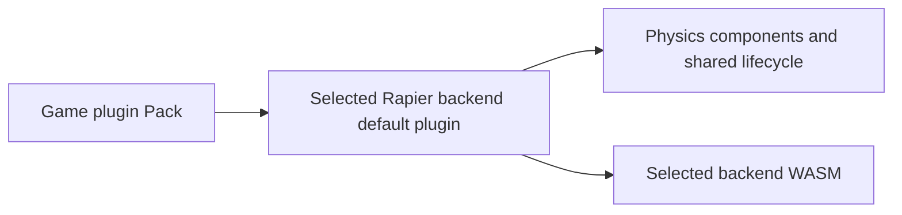
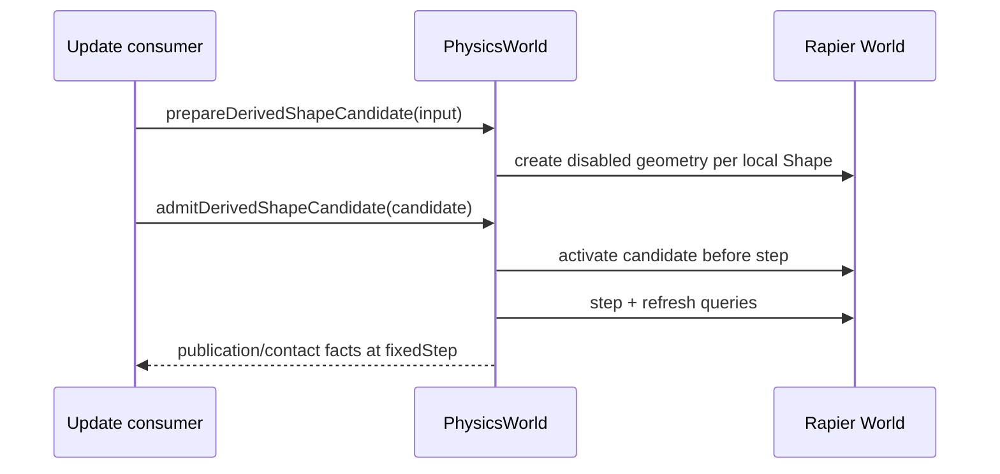

# @forgeax/engine-physics

Physics interface package: ECS component schemas, PhysicsWorld resource shape, error codes, and enum constants. Backend implementations live in `@forgeax/engine-physics-rapier3d` and `@forgeax/engine-physics-rapier2d`.

## Quick Start

Attach three components to an entity and the physics engine drives its position every frame:

```ts
import { Collider, ColliderShapeValue, RigidBody, RigidBodyTypeValue } from '@forgeax/engine-physics';
import { Transform } from '@forgeax/engine-scene';

// Dynamic body: falls under gravity, responds to forces.
world.spawn(
  { component: Transform, data: { pos: [0, 5, 0] } },
  { component: RigidBody, data: { type: RigidBodyTypeValue.dynamic, mass: 1 } },
  { component: Collider, data: { shape: ColliderShapeValue.sphere, radius: 0.5 } },
);

// Static body: immovable, ground/collision target.
world.spawn(
  { component: Transform, data: { pos: [0, 0, 0] } },
  { component: RigidBody, data: { type: RigidBodyTypeValue.static } },
  { component: Collider, data: { shape: ColliderShapeValue.cuboid, halfExtents: [5, 1, 5] } },
);
```

Enable physics by passing the selected backend plugin to `createApp`:

```ts
import physics3d from '@forgeax/engine-physics-rapier3d';

const app = await createApp(canvas, { plugins: [physics3d] });
```

The selected backend module is the build-time authority. Use the default export from
`@forgeax/engine/physics-rapier2d` for 2D, or omit both for a game without simulation.
WASM initialization remains asynchronous and completes during native plugin activation.
`physicsComponentsPlugin()` registers vocabulary for previews without importing either solver.



Backend implementers use `definePhysicsPlugin({ name, load, create, registerSystems })`
to share readiness, structured load failures, resource publication and Cordis cleanup.
Its callbacks carry the implementation; the helper never discovers or imports backends.

## Solver precision

Configure either selected backend through native plugin configuration in your root plugin:

```ts
import physics3d from '@forgeax/engine/physics-rapier3d';

// Inside the root plugin's apply(ctx):
await ctx.plugin(physics3d, { solverIterations: 2 });
```

| Setting | Default | Contract |
|:--|--:|:--|
| `PhysicsOptions.solverIterations` | `4` | Integer [1,32], selected once at backend activation; shared by 2D and 3D. |
| `RigidBody.additionalSolverIterations` | `0` | Adds iterations for the body's connected contact/joint island; does not lower the global setting. |

Fewer iterations reduce contact/joint solve work but can increase penetration,
soften stacks and joints, cause jitter, and delay sleep. More iterations improve
constraint convergence at additional CPU cost. The fixed timestep, CCD, rendering
and floating-point representation are unchanged. Invalid values reject activation
with `PhysicsError` (`invalid-body-config`, detail field `solverIterations`).
Changing startup configuration requires a fresh plugin activation. Manual backend
constructors and `createRapier2DPhysicsWorld` / `createRapier3DPhysicsWorld` accept
the same optional `PhysicsOptions` argument. Omission retains four iterations.

## Three-Phase Tick Pipeline

Three ECS systems run in order every frame (registered by The selected backend plugin during `createApp`):

| Phase | System Name | Runs After | What It Does |
|:--|:--|:--|:--|
| 1. Sync | `physicsSyncBackend` | `propagateTransforms` | Reconciles Transform-bearing entities with Collider or RigidBody; a RigidBody-only entity creates a native body without a placeholder collider |
| 2. Step | `physicsStepSimulation` | `physicsSyncBackend` | Reads the constant `FixedTime.delta`; calls `PhysicsWorld.step()` once per bounded fixed iteration |
| 3. Writeback | `physicsWriteback` | `physicsStepSimulation` | Calls `writebackDynamicBodies()`, which visits only awake dynamic bodies (plus newly registered or ECS-overwritten ones); writes the pose to ECS `Transform` only when it differs, so sleeping and resting bodies stay out of `changed: [Transform]`. Kinematic and static bodies are never written back |

Native plugin activation awaits WASM readiness and installs the resource before simulation starts.

The ECS `World` owns host-frame recovery. It clamps `Time.delta` to the configured
`maxDeltaSeconds`, advances at most `FixedTime.maxStepsPerUpdate` fixed steps,
records discarded whole fixed intervals in `FixedTime.droppedSeconds` and
`FixedTime.droppedUpdates`, and retains only the fractional `overstep`. A later
healthy frame consumes only its own fixed delta; discarded time is never replayed.
The backend `dt <= 0` / `dt > 0.1` guard remains defensive because physics receives
`FixedTime.delta`, not the host-frame gap.

RigidBody requires Scene's transient `TransformInterpolation` marker. Scene
captures the actual local pose at each fixed boundary and supplies its sampled
presentation to Render and follow cameras. Physics reads and writes only the
exact simulation Transform/GlobalTransform.world; no interpolated coordinate
is fed back into Rapier. A teleport inside a fixed tick also calls
`resetTransformInterpolation` after changing the author pose.

### Transform Pose Projection

`Transform` is the authoring source for a Collider's world-space pose. After
`propagateTransforms`, the backend projects the resolved world translation,
rotation, and scale into Rapier. This applies at creation and on every later
sync for static and non-CharacterController kinematic bodies; dynamic bodies
own their pose after creation and write it back through the physics step.

| Shape | 3D scale projection | 2D scale projection |
|:--|:--|:--|
| `cuboid` | `halfExtents × abs(worldScale)` componentwise | `halfExtents.xy × abs(worldScale.xy)` |
| `sphere` | `radius × max(abs(worldScale))` | `radius × max(abs(worldScale.xy))` |
| `cylinder` / `cone` | Y half-height × `abs(scaleY)`; radius × `max(abs(scaleX), abs(scaleZ))` | Unsupported; rejected before native allocation |
| `convexHull` / `trimesh` | Mesh positions × `abs(worldScale)` componentwise | Unsupported; rejected before native allocation |
| `capsule` | Y-axis half-height × `abs(scaleY)`; radius × `max(abs(scaleX), abs(scaleZ))` | Y-axis half-height × `abs(scaleY)`; radius × `abs(scaleX)` |

Negative scale is treated as its absolute magnitude; it does not mirror a
Rapier collision shape. A parented Collider consumes the resolved world pose,
not its local TRS. 2D projects the resolved Z-axis quaternion rotation to its
Rapier angle; out-of-plane rotation is not represented by Rapier 2D.

## Ordinary managed joints and body motion

Optional `PhysicsWorld` capabilities support ordinary rigs independently of derived
geometry publications. Consumers test capability presence; Rapier3D implements them.

| Capability | Contract |
|:--|:--|
| `createManagedJoints(inputs)` | Validate an entire array of at most 256 fixed/hinge joint objects and every body endpoint before native allocation; malformed JSON returns a structured failure. Distinct nonnegative body pairs, finite local anchors, normalized frames/axes, ordered [-π,π] hinge limits and an optional boolean contact flag are required. Default connected-body contacts are disabled. |
| `ManagedJointBinding.dispose()` | Idempotently retire the owned native constraints without exposing handles. Failed native retirement throws a structured managed failure requiring backend rebuild. |
| `getBodyMotion(entity)` | Return a detached world-space pose, linear/angular velocity and sleeping state through Result. |
| `setBodyMotion(entity, motion)` | Explicit teleport plus velocities; validates finite Float32 vectors and unit quaternion before mutation and queues ordinary ECS writeback. This is a handoff/reset operation, not visual blending. |
| `applyBodyImpulse(entity, impulse)` | Existing dynamic body only, world-space linear impulse; wakes the body. Missing/static bodies return structured errors. |
| `getJointCount()` | Native constraint count for lifecycle evidence; includes other managed or derived constraints. |

`ManagedPhysicsFailure` is the closed discriminated failure union. Group creation
rolls back all newly allocated handles after a partial native failure. Recovery is
`old-state-retained` only if their retirement is confirmed; otherwise it is
`rebuild-required`. An unavailable capability or missing body is data, not a reason
to reach into raw native APIs. See [managed skeletal motion](../animation/README.md#managed-spring-and-physical-bone-motion)
for animation-owned resource and bone conversion policy.

## Enum Constants and Narrowing Helpers

ECS `enum` fields map to `Uint32Array` numeric columns. Use named constants to avoid magic numbers:

### RigidBodyType

```ts
RigidBodyTypeValue.static    // 0
RigidBodyTypeValue.dynamic   // 1
RigidBodyTypeValue.kinematic // 2
```

Narrowing helper: `rigidBodyTypeFromF32(n: number): RigidBodyType` returns the `@forgeax/engine-types` `RigidBodyType` union (`'static' | 'dynamic' | 'kinematic'`), also carried by `controller-requires-kinematic` detail.

### ColliderShape

```ts
ColliderShapeValue.cuboid  // 0
ColliderShapeValue.sphere  // 1
ColliderShapeValue.capsule // 2
ColliderShapeValue.cylinder // 3
ColliderShapeValue.cone // 4
ColliderShapeValue.convexHull // 5
ColliderShapeValue.trimesh // 6
```

Narrowing helper: `colliderShapeFromF32(n: number): ColliderShape` returns the union derived from `ColliderShapeValue`.

Backend implementations use the narrowing helpers in `switch` statements for exhaustive matching (no default arm).

Backends read a Collider row as `ColliderData` (derived from the schema; `halfExtents` is a zero-copy World view) and retain it only through `snapshotCollider(data): ColliderSnapshot`, which copies `halfExtents` into an owned tuple.

## Component Schemas

### RigidBody

| Field | Type | Default | Description |
|:--|:--|:--|:--|
| `type` | `enum` | `1` (dynamic) | `static` / `dynamic` / `kinematic` |
| `mass` | `f32` | `1` | Additional mass (dynamic only; collider mass comes from density) |
| `linearDamping` | `f32` | `0` | Velocity damping per second |
| `angularDamping` | `f32` | `0` | Angular velocity damping per second |
| `gravityScale` | `f32` | `1` | Multiplier for world gravity |
| `ccdEnabled` | `bool` | `false` | Continuous collision detection |
| `lockRotation` | `bool` | `false` | Lock all simulated rotation axes (the Z axis in 2D), preserving the current orientation |
| `additionalSolverIterations` | `u32` | `0` | Integer [0,32]; additional Rapier iterations for the connected contact/joint island. Both backends apply authored changes. Higher precision increases native step cost. |

Rapier3D completes collider and additional-mass initialization during
`physicsSyncBackend`. Gameplay systems ordered after that phase can apply an
impulse immediately; they do not need a preliminary simulation step to obtain
the authored total mass.

`lockRotation` clears angular velocity when enabled. Contacts, torque, angular
impulses and restored motion cannot spin a locked body; linear movement, collider
geometry and authored mass properties remain unchanged. Explicit pose writes can
still orient the body. Disabling the field restores angular response without
restoring discarded angular velocity. Ordinary edits and derived shape/body-type
changes retain the policy. Restore ECS `RigidBody` data before restoring derived
physics geometry so the same policy also governs restored motion.

### Collider

| Field | Type | Default | Description |
|:--|:--|:--|:--|
| `shape` | `enum` | `0` (cuboid) | See `ColliderShapeValue`; the 2D backend supports the original three primitives |
| `mesh` | `asset<mesh>` | `0` (unbound) | Managed Mesh identity for convexHull/trimesh |
| `halfExtents` | `array<f32, 3>` | `[0.5, 0.5, 0.5]` | Cuboid half-width/height/depth |
| `radius` | `f32` | `0.5` | Sphere, capsule, cylinder, or cone radius |
| `halfHeight` | `f32` | `0.5` | Capsule, cylinder, or cone half-height (along Y) |
| `friction` | `f32` | `0.5` | Coulomb friction coefficient |
| `restitution` | `f32` | `0` | Bounciness (0 = inelastic, 1 = perfectly elastic) |
| `density` | `f32` | `1` | Mass per volume (affects dynamic body total mass) |
| `isSensor` | `bool` | `false` | Sensor-only collider (no contact response) |
| `collisionGroups` | `u32` | `0x0001ffff` | Rapier collision groups bitmask |
| `solverGroups` | `u32` | `0xffffffff` | Rapier solver groups bitmask |

### Source mesh collision

`Collider.mesh` holds an `asset<mesh>` owned by `world.assets`. Create geometry
with `assets.create(mesh)` or load the Mesh with `assets.load(guid, 'mesh')`,
then bind its handle with `ColliderShapeValue.convexHull` or `ColliderShapeValue.trimesh`.
The component and native geometry retain their own asset holds; the author can
release its original hold after binding.

| Shape | Body policy | Geometry |
|:--|:--|:--|
| `convexHull` | Static, kinematic, dynamic | Native Rapier hull of mesh positions; concavities become solid |
| `trimesh` | Static or kinematic | Triangle coverage preserves cavities; dynamic use is rejected |

Source attachments prepared with `buildMeshCollision` or
`importSettings.meshCollision: true` are validated once per Mesh version. Runtime
geometry edits invalidate those attachments; the same Geometry-owned preparation
kernel supplies collision from the edited Mesh. Skinned/morphed sources, automatic
convex decomposition and dynamic concave bodies remain outside this contract.

The backend owns one native geometry root per Mesh and collider kind. Asset edits
replace that immutable root at fixed sync without recreating colliders, scanning
instances or marking each consumer dirty. The native spatial hierarchy composes
current root bounds with instance transforms. Real queries and solver work resolve
the current geometry; fixed snapshots keep the previous version. Affected dynamic
bodies, including sleeping isolates and complete contact/joint/multibody closures,
prepare current mass, center of mass, inertia and CCD extents and integrate in the
same step. Removing support is solver work even when no new contact exists.

Authored reference or scale changes use the ordinary entity mutation path,
preserving body, velocity and joint identity. Scale-specific shapes are prepared
when requested and cached by immutable native version, with at most eight entries
and 16 MiB of requested shape allocations per version; oversized or unsupported
cache accounting remains query-local. Scale comparison uses four relative Float32
epsilons against the last admitted native scale, preserving both rotation-noise
stability and accumulated scale edits.

#### Reproduce the collider behavior

After building the package graph, run the [native effect probe](../physics-rapier3d/bench/mesh-collision-effect.mjs):

```sh
node packages/physics-rapier3d/bench/mesh-collision-effect.mjs > collision-effect.json
```

The probe admits ordinary managed components into real Rapier and records every
position from 240 scheduled World ticks. It exits nonzero on a violated invariant.

| Scenario | Required result |
|:--|:--|
| Radius-0.2 ball falls into a U-shaped triangle mesh | Ball center near -0.55m; contact with the bottom at -0.75m |
| Same source admitted as a convex hull | Ball center near 1.45m; filled cavity surface at 1.25m |
| Cylinder and cone, 625 downward rays each | Round footprint and analytical surface height; square-corner rays miss |
| Replace a dynamic hull's mesh | Same native body, exact linear/angular velocity preservation; one rebuild |
| 120 unchanged synchronizations | Zero native hull rebuilds |
| Attempt dynamic triangle-mesh replacement | Structured rejection; previous collider retained |

JSON trajectories and ray hits are native physics evidence. Rendering screenshots
and frame-rate qualification belong to their separate consumers. The existing
[performance probe](../physics-rapier3d/bench/mesh-collision.mjs) reports full World
tick distributions as well as native admissions; do not infer a 60-FPS budget from
zero shape rebuilds alone.

### CollidingEntities

| Field | Type | Default | Description |
|:--|:--|:--|:--|
| `entities` | `array<entity>` | `[]` | Set of entities currently colliding with the holder |

### CharacterController

Tuning + grounded output for the kinematic character movement primitive. Spawn
alongside `RigidBody({ type: 'kinematic' })` + `Collider` to opt an entity into
`moveAndSlide` (see below). Slope angles are in **degrees** (the backend converts
to radians). `autoStepMaxHeight === 0` disables auto-step; `snapToGroundDist === 0`
disables ground-snap — one field carries both the switch and the value. The same
component is used by 2D and 3D (every field is dimension-agnostic).

| Field | Type | Default | Description |
|:--|:--|:--|:--|
| `offset` | `f32` | `0.01` | Skin thickness; prevents penetration |
| `maxSlopeClimbDeg` | `f32` | `45` | Max climbable slope angle (degrees) |
| `minSlopeSlideDeg` | `f32` | `30` | Slope angle past which sliding starts (degrees) |
| `autoStepMaxHeight` | `f32` | `0.3` | Max auto-step height (`0` = off) |
| `autoStepMinWidth` | `f32` | `0.2` | Min step width to be steppable |
| `snapToGroundDist` | `f32` | `0.2` | Downhill ground-snap distance (`0` = off) |
| `grounded` | `bool` | `false` | **Engine-written** — true after the last `moveAndSlide` resolved a ground contact. Read-only for game code. |

> [!NOTE]
> `grounded` is a `bool` schema field; `world.get(e, CharacterController).value.grounded`
> materializes as a JS `boolean` (not `0`/`1`) — compare `=== true`, never `!== 0`.
> On a continuous slope Rapier reports `grounded === false` while sliding; the
> snap-to-ground effect shows in the resolved position (the character stays on the
> surface), not in the flag.

## Teleport and same-tick movement

`PhysicsWorld.teleport(entity, worldPosition)` and the 2D
`PhysicsWorld2D.teleport(entity, worldPosition, worldAngle)` place an existing
body before returning. The backend moves its attached
colliders and ECS `Transform` in the same call, clears velocity, and updates a
kinematic body's next-step target. A following `moveAndSlide` therefore solves
from the new position, including against geometry at the destination.

> [!IMPORTANT]
> Check `hasBody(entity)` before teleporting: native bodies are created on a
> physics sync tick. An absent body throws `body-not-found`; non-finite position
> or 2D angle throws `invalid-body-config`. Static bodies can also be repositioned.

```ts
if (pw.hasBody(character)) {
  pw.teleport(character, authoritativePosition);
  pw.moveAndSlide(character, unconfirmedInputDelta); // unconfirmedInputDelta: Vec3 from vec3.create()
}
```

## Character Movement: `moveAndSlide`

`PhysicsWorld.moveAndSlide(entity, desiredDelta): Vec3` (and the symmetric
`PhysicsWorld2D.moveAndSlide(entity, desiredDelta: Vec2): Vec2`) is the engine's
unopinionated kinematic character primitive (modeled on Unity
`CharacterController.Move`). The game layer computes `desiredDelta` from input +
gravity + jump each frame; `moveAndSlide` resolves it against world geometry with
collision response, slope handling, auto-step, and ground-snap, then writes the
resolved position back to the entity's `Transform` and the contact state to
`CharacterController.grounded`. It returns the actual displacement applied. Rapier 2D/3D controllers apply native
contact impulses to solid dynamic bodies while excluding sensors. Game code
must not duplicate ordinary pushing with an additional contact impulse.

```ts
import { vec3 } from '@forgeax/engine-math';
import { CharacterController, Collider, ColliderShapeValue, RigidBody, RigidBodyTypeValue } from '@forgeax/engine-physics';

const character = world.spawn(
  { component: Transform, data: { pos: [0, 0.45, 0] } },
  { component: RigidBody, data: { type: RigidBodyTypeValue.kinematic } },
  { component: Collider, data: { shape: ColliderShapeValue.capsule, radius: 0.3, halfHeight: 0.5 } },
  { component: CharacterController, data: {} },
).unwrap();

// Once per FixedUpdate, after physicsSyncBackend and before physicsStepSimulation:
const pw = world.getResource('PhysicsWorld'); // PhysicsWorld | PhysicsWorld2D
// desiredDelta is a Vec3 (branded Float32Array); a plain [dx, dy, dz] array does not typecheck.
const actual = pw.moveAndSlide(character, vec3.create(dx, dy, dz)); // Vec3; Transform + grounded written back
```

Requirements: the entity must carry a kinematic `RigidBody`, a `Collider`, and a
`CharacterController`. There is no per-call options object and no `dt` parameter —
tuning is read from the component each call, and the delta already encodes elapsed
time. Spawn the collider at its resting height (capsule center = ground top +
radius + halfHeight); a capsule penetrating the floor has a degenerate contact and
will not auto-step or report grounded correctly.

In the 3D Rapier backend, contacted moving supports contribute their tangential
motion through the native KCC friction accumulator before shape casting. This
also carries a character when a descending platform produces no cast hit. Call
`moveAndSlide` once per fixed tick with input and integrated gravity; adding
platform displacement again duplicates that carry. Author platform motion before
fixed Scene propagation, then solve the character after `physicsSyncBackend` and
before `physicsStepSimulation`. Presentation reads Scene's sampled poses, never
feeds those poses back into Physics. The moving-support integration regression
covers reversals, mixed host deltas, relative presentation and support retirement.

Character entities are routed exclusively through `moveAndSlide`: the
`physicsSyncBackend` kinematic mirror skips any archetype carrying
`CharacterController` so it does not double-write the body the primitive owns.

**Readiness contract**: the Rapier body is built asynchronously by the first
`physicsSyncBackend` tick after `app.start()` (the first fixed synchronization after plugin readiness). Before
that tick, `PhysicsWorld.hasBody(entity)` returns `false`. Fixed-step drivers must
guard with `if (!pw.hasBody(entity)) return;` before calling `moveAndSlide` --
do not rely on catching `body-not-found` as control flow.

## Error Codes

`PhysicsErrorCode` (8 members, closed union). Exhaustive `switch` without `default`. The public re-export is `packages/physics/src/errors.ts`; the union SSOT is `packages/types/src/index.ts`.

`moveAndSlide` throws `PhysicsError` with `controller-requires-kinematic` (body is
not kinematic), `body-not-found` (no Rapier body for the entity), or
`collider-not-found` (body has no collider).

## Mobility and RigidBody

Scene `Mobility` is the rendering/baking authority; `RigidBody.type` is the
simulation authority. Physics never derives one from the other: a static body's
authored `Transform` can move its collider, and a kinematic body can be
teleported or moved with `moveAndSlide`.

The selected backend plugin installs one Update check. An entity with
`Mobility { kind: MobilityKindValue.static }` and a `RigidBody` of type
`dynamic` or `kinematic` reports `mobility-physics-conflict` once through the
scene Mobility diagnostic channel (`subscribeMobilityDiagnostics`), with
`detail.entity`, `detail.rigidBodyType`, and `detail.sceneEntityRef` when
authored. Simulation is unchanged. Repair by declaring
`MobilityKindValue.movable` for simulated bodies, or `RigidBodyTypeValue.static`
for bodies that never move. Templates may write both components; the engine
only checks them. The union SSOT is `MobilityDiagnosticCode` in
`packages/scene/src/errors.ts`, not `PhysicsErrorCode`.

## Architecture Notes

- **Not a backend**: this package defines interfaces and schemas only. Runtime simulation requires a backend (`@forgeax/engine-physics-rapier3d` or `@forgeax/engine-physics-rapier2d`).
- **Backend selection**: import the default plugin from the selected backend module. This package has no runtime dependency on either backend. The umbrella installation carries both, while a game bundles only the modules its selected plugins reference.
- **ECS bridge**: backend packages call `registerPhysicsSystems(world, Transform)` to wire the three-phase tick pipeline into the ECS schedule.
- **Readiness**: plugin activation awaits WASM initialization and publishes the ready PhysicsWorld before App startup completes.
- **Component schemas SSOT**: `packages/physics/src/components.ts` is the authoritative definition for all physics component fields, defaults, and types.

## Simulation participant boundary

Physics backends may register one ready simulation participant with the ECS
World. The participant owns only portable backend state; ECS owns the versioned
record, atomic restore, fixed-tick trace, comparison report, tolerance, and
closed errors.

Use the minimum path: create a source World, capture its record, create a fresh
target World with the same participant version/schema fingerprint, restore, and
compare semantic collision facts. Do not pass Rapier WASM handles, native
vectors, or backend World objects through App, Preview, or Remote.

On failure, branch on `error.code`, read `expected`, `hint`, and the narrowed
`detail`, then rebuild the participant or target named by the hint. A physics
participant is not a network rollback store, RHI tape, or game replay owner.

## Derived shape candidates (3D)

A Transform-bearing RigidBody can receive derived shapes without an ordinary
Collider. Adding, editing, or removing an ordinary Collider preserves committed
derived shapes on that same body. Prepared native shapes are disabled and
massless; only the admitted shape set contributes automatic density.

For paired standard geometry, pass the optional synchronous `commitGeometry`
argument to `admitDerivedShapeCandidate`. Physics invokes this once after native
staging and before step/publication; failure rolls back through the same native
old-state restoration as an admission failure. The callback performs only the
complete Renderer binding or source geometry commit and returns its Result. It must not query physics,
draw, enqueue more work, or perform fallible work after a successful binding change.
The borrowed `getDerivedAdmission(entity)` proof exists only in that interval;
publications remain unavailable until the normal step/writeback boundary. See the
[paired Render example](../render/README.md#paired-physics-admission).

Ordinary ECS collider changes made by a successful geometry commit are synchronized
before that same native step. Removed source colliders cannot overlap their newly
admitted replacement for an extra tick; new source colliders also participate immediately.

For splits or replacements across several bodies, use
`admitDerivedShapeCandidates(candidates, commitGeometry)`. A nonempty group uses
the existing preparation slots (at most 32 independently prepared bodies);
constraint identities must also be unique. The backend validates the projected endpoint revisions,
stages every member, then invokes one callback. `getDerivedAdmission(entity)`
exposes each member only during that callback. A kth-member native failure or a
returned geometry failure restores every earlier member; an uncertain rollback
blocks the whole PhysicsWorld for reconstruction. Cancelling or destroying one
unpublished member cancels/rejects the entire group. Snapshot restoration uses
the same group path, including constraints referencing multiple restored bodies.

For a larger indivisible replacement, call
`prepareDerivedShapeCandidates(inputs)` with the complete roster first. It prepares
up to `DERIVED_PHYSICS_LIMITS.maxBatchCandidates` (4096) distinct bodies as one
in-flight transaction, retaining the shared 8 MiB source/native POD budget. All
native shapes remain disabled and no member token escapes before the complete
preparation succeeds. Admit exactly the returned group through
`admitDerivedShapeCandidates`; single-member admission, subsets, duplicate members
and mixing groups are refused. Cancelling any member retires the complete group.
A later preparation failure releases all earlier disabled native colliders. Input
copying and native preparation run behind the existing native-execution fence.

Candidate input metadata is detached during preparation. Its public `shapes`
snapshot copies the private geometry on first inspection and retains that copy
for later reads, including after cancellation. Reading entity/revision and
admitting the token do not allocate a second geometry snapshot. Mutating the
inspected buffers cannot alter native admission. The candidate byte budget
continues to reserve both copies, including the optional inspection snapshot.

For settling, waking, or another body-type-only policy, call
`prepareDerivedBodyTypeCandidates([{ publication, bodyType }])` with each exact
current receipt returned by `getDerivedPublication`. Admit that complete group
through `admitDerivedShapeCandidates` and write any matching ECS RigidBody types
in its paired callback. This retains the accepted entity, geometry revision,
shape inputs, native collider handles and constraints; it performs no shape cook.
The group shares the existing preparation credit/byte limits, next-step fence,
cancellation and rollback. A copied receipt, foreign PhysicsWorld, replaced body
or changed backend generation is stale. A geometry or material change still uses
the complete shape/Render replacement path.

An empty `shapes` array clears a body's derived collision set. It neither removes
an ordinary Collider nor destroys the ECS entity; the consumer retires its
render/body binding after the matching publication. Optional `motion.rotation`
is a world-space xyzw quaternion, normalized and copied at preparation. It is
applied together with COM and velocity before step and restored on rollback.
Omitting it preserves the body's current orientation. Captured derived motion
includes the current native orientation so restored or newly split bodies do not
implicitly inherit the orientation of an unrelated placeholder entity.

| Paired result | Observable state |
|:--|:--|
| Native staging fails | Geometry commit not called; old state retained or explicit rebuild required |
| Geometry refuses | Native rollback; no new physics publication; old MeshFilter retained |
| Geometry callback throws | Its ECS writes are uncertain; physics queries and rendering stop with explicit rebuild-required state |
| Geometry succeeds | Step and writeback precede physics publication; Renderer draw follows World update |
| Zero fixed steps | Both candidates stay pending and old state remains visible |

Wave 1 keeps derived geometry inside the one `PhysicsWorld`. A consumer submits
an immutable, standard-data description; the Rapier 3D owner creates disabled
native geometry colliders during preparation, then admits the whole candidate at
the next fixed-step boundary. No Rapier handle, native world, worker, or second
transaction registry crosses this API.

```ts
import type { PhysicsWorld, DerivedPhysicsCandidateInput } from '@forgeax/engine-physics';

declare const physics: PhysicsWorld;
declare const candidateInput: DerivedPhysicsCandidateInput;

const prepared = physics.prepareDerivedShapeCandidate?.(candidateInput);
if (prepared?.ok) {
  const admitted = physics.admitDerivedShapeCandidate?.(prepared.value);
  if (admitted?.ok) {
    // Physics systems call step() from FixedUpdate. In an ECS-bound world the
    // publication becomes visible only after physicsWriteback and
    // physicsCollisionSync complete; direct PhysicsWorld consumers finalize in
    // step() because they have no ECS writeback phase.
    void physics.getDerivedPublication?.(candidateInput.entity);
  }
}
```

The fixed-step ownership is deliberately small:



`ConvexCompoundShapeInput` has `kind: 'convex-compound'` and a nonempty
`pieces` array. Each Float32Array contains local-space x/y/z points describing
one positive-volume convex hull. The pieces form one logical Shape with one
stable `id`, local origin/rotation, material and collision filters. A concave
source supplies a decomposition; Physics never infers a source grid or performs
source-specific merging. One native compound retains that logical shape identity.

Preparation bounds buffers before element reads or copies, detaches all point
arrays, and creates massless disabled colliders. One logical compound owns one
point buffer with disjoint views for its pieces; retaining any piece view keeps
that compound's point storage alive. Recovery copies detach from this buffer.
Unknown fields and shape kinds are refused. A malformed hull returns a structured preparation failure, without
publishing any part of the candidate. Native geometry and simulation use
Float32 precision. Producers validate their own source-to-Float32 conversion.
Source-specific precision, decomposition, boundary composition and source
snapshots remain with the producer.

`getDerivedShapes()` reports only committed kind, identity, revision and local
pose. Recovery captures the ordinary geometry and existing body/motion/constraint
facts. No source-specific metric, grid, cell or seam state enters that snapshot.
Automatic mass uses native convex volumes; explicit mass properties remain the
sole authority when supplied. Compound pieces should have disjoint interiors
when the producer requests automatic mass.

The candidate may also carry a body type, explicit mass/center of mass/principal
inertia (including its principal frame), a `preserve | reset` velocity policy,
an explicit `motion` snapshot (`centerOfMass`, `linearVelocity`, and
`angularVelocity`), and bounded spring/hinge updates. Every candidate carries a producer
`sourceKey` and revision. Every constraint endpoint carries a
`{ sourceKey, revision }` dependency; migration is rejected when either end is
stale or missing, and these dependencies are included in the portable
snapshot. Explicit mass zeros collider density before
Rapier applies the authored mass properties, so the same density is not counted
twice. With `preserve`, the committed linear velocity follows
`v_new = v_old + omega_old x (COM_new - COM_old)` and angular velocity is
retained; `reset` intentionally clears both. Constraints use the same Rapier
solver and expose only the consumer's stable `id` and revision.

Preparation and cancellation are non-visible. A stale revision, duplicate
Shape identity, invalid mass, pending duplicate, missing Body, or bounded
candidate overflow returns `DerivedPhysicsError` with `code`, `expected`,
`hint`, and narrowed `detail`; the last publication remains intact. A
PhysicsWorld bounds 32 in-flight preparations (an independent candidate or one
declared group), 64 shapes/64 constraints per candidate and 8 MiB of staged candidate data, at most 65536 convex pieces and 262144
heightfield samples. The byte estimate includes retained private/public copies
and native geometry POD.
Published bodies retain their native shapes and publication identity but release
their preparation records, so they do not consume those transient slots or bytes.
If a native operation fails after admission, `getDerivedFailure(entity)` returns
a structured failure receipt and the candidate is failed/cleaned while the
prior body, shapes and constraints remain queryable; the backend never silently
swallows the native error. `getContactObservations()` contains only detached facts from the real Rapier
event drain: `fixedStep`, entity identities, optional Shape identities, and
optional sampled point/normal. It does not claim impulse or energy data.

`getCurrentContacts(entity, filterMask?)` is an optional, separate live contact query. It returns
a `Result<PhysicsContactSnapshot, ManagedPhysicsFailure>` after the completed
physics writeback boundary, with `fixedStep`, the native `deltaTime` in seconds,
and detached `manifolds`. Each manifold names `other`, optional derived `shape`
and `otherShape`, a world-space `normal` from the queried body toward `other`,
all world-space solver `points`, and the total current-step `normalImpulse` in
newton seconds. The impulse is a manifold total: geometric contacts and solver
points have different cardinalities and must never be zipped or divided evenly.
Consumers that spatially qualify a load must qualify the whole manifold.

The optional packed 32-bit collision-group mask uses the same two-way matching
as `raycast`: its high 16 membership bits must intersect the partner collider's
low 16 filter bits, and its low 16 filter bits must intersect the partner's
membership bits. Omission includes every eligible contact. Rejected partners
are skipped before manifold/point decoding; the native solver, contact events
and other queries are unchanged. Filtering applies equally to static,
kinematic, dynamic and sleeping contact partners.

`getCurrentContactNeighbors(entity, filterMask?, normalFilter?)` returns a detached
`PhysicsContactNeighborsSnapshot` with the same completed-step `fixedStep` and
`deltaTime`, plus unique `entities`. A partner qualifies when at least one actual
solver manifold has points. The optional finite `direction` and `minimumDot`
apply the strict world-space predicate `dot(normalTowardOther, direction) > minimumDot`;
the direction is not normalized and the threshold is not clamped. The native
projection transports no points, impulses or per-manifold objects. It shares
the full query's body-generation, enabled/sensor and two-way collision-group
filters, with no persistent contact registry. Its 4096-visit budget counts
colliders, pairs and the complete solver-manifold roster of each examined pair;
point visits are absent. Budget failure is atomic and reports the entity and
per-category visit counts. Use the full query when geometry or load is needed.

Compound contact clusters use the actual solver manifold roster, including its
selected contact identities. Sleeping pairs retain current contact geometry but
return `normalImpulse: null`:
their native warm-start cache is not a newly solved impulse. An active gameplay
interaction can explicitly call `wakeBody(entity)` to request continued native
solving without changing pose or velocity. Waking invalidates contact readiness
until the next completed step; it does not turn cached impulses into fresh loads. Sensor intersections
and manifolds without solver points are omitted. Empty contacts are a successful
query, while missing/retired bodies, unavailable step evidence, poisoned state
or a query exceeding 4096 native collider/pair/manifold/point visits fail without
returning a partial result. Pose, motion, gravity, KCC and collision-policy changes
require another completed physics step before querying. Removal immediately
removes the retired body's contacts; no transition-event history is consulted.
Rapier's package-local source build excludes the preceding-step warm-start seed
from the observation at native writeback. Internal restitution and contact
persistence continue to consume their original solver state.

For explicit recovery, call `captureDerivedPhysicsState()` only at a committed
boundary. The returned geometry, Shape revisions, mass policy, velocity
policy, committed COM/linear/angular motion, and constraint inputs are portable;
`restoreDerivedPhysicsState()` admits the complete snapshot as one dependency-
consistent batch, so a two-body constraint is never restored against a stale
endpoint and native handles/pending candidates are never serialized. A native
failure after mass/body/constraint mutation either restores the complete old
state and exposes `old-state-retained`, or reports `rebuild-required` and blocks
queries; it is never reported as a ready partial commit. Device or World teardown
invalidates pending work; the 2D `PhysicsWorld2D` contract remains unchanged and
does not implement these 3D derived shapes.

### Bounded interaction impulses

`PhysicsWorld.applyDerivedImpulse` applies a world-space impulse at a world-space
point on a committed dynamic derived body. The caller supplies its exact
`sourceKey` and `revision`; stale ownership, pending admission, invalid vectors,
and non-dynamic bodies are refused. Apply it in a FixedUpdate system after
`physicsSyncBackend` and before `physicsStepSimulation`, bounding magnitude to
`maxForce * FixedTime.delta`. It changes native velocity, including the lever-arm
angular response, without teleporting the body. A partial native failure marks
the PhysicsWorld as requiring recovery. This is an optional backend capability;
Rapier 3D implements it. Native integration consumes that same fixed delta.

Contact observations carry optional world-space surface samples, with the normal
oriented from entityA toward entityB. Rapier prefers solver contact points; when
a manifold contains only geometric contacts, the backend can transform a point
from an ordinary ball, box, or capsule collider. Composite-only contacts without
solver points remain unsampled because subshape coordinates are not collider
coordinates. Consumers must handle absent points, including sensor transitions,
and must not infer impact energy or a solver impulse from a started event.

### Live 3D property edits

The Rapier3D adapter updates ordinary and derived bodies through the same native
body. Changes to friction, damping, gravity scale or authored collider shape
preserve body identity, linear/angular velocity and attached joints. Shape
changes replace only the authored collider. Body-type changes still apply the
native static/kinematic/dynamic semantics; explicit velocity and teleport APIs
retain their own meaning.

## Terrain heightfield admission (3D)

`HeightfieldShapeInput` remains available to explicit derived-shape transactions.
Ordinary `Terrain + RigidBody(static)` instead binds one shared native geometry
root per Terrain asset. Its persistent ECS projection handles entity admission,
reference changes, pose validation, removal and Disabled; asset changes reach only
the geometry root. Author height edits and spacing/topology changes use the same
fixed-sync boundary as Mesh adoption. Recentring belongs inside the shared shape,
so extent edits never move every collider instance.

Terrain admits finite translation, identity rotation and unit scale. Author
samples are X-fast; the pure terrain adapter transposes them into the backend's
column-major rectangular matrix. Mesh, gameplay query and Rapier use the same
10→01 cell diagonal. The actual completed physics step establishes collision and
solve adoption; an asset read or rendered frame does not. See
[Terrain](../terrain/README.md).

Terrain collider readiness uses `getTerrainAssetVersion?(entity)`: its `{asset, version}`
reflects the source bytes successfully adopted at fixed sync. Author updates retaining
the handle cannot advance this fact until the backend applies them.
## Navigation character composition

The selected backend plugin installs Scene before binding physics systems, so moveAndSlide
always has the real Transform/CharacterController writeback context in a fresh
World. World-space KCC displacement is converted through the current parent's
GlobalTransform inverse before writing local Transform.

[NavigationCharacter](../navigation/README.md#static-navigation-assets-and-physical-characters)
owns path and local avoidance intent. It runs after physicsSyncBackend and before
physicsStepSimulation; PhysicsWorld remains the sole collision and position owner.

KCC translation refreshes only the moved body's attached collider world positions;
parent-local offsets remain unchanged. Repeated KCC calls retain collision queries
and actual pose without repeatedly propagating the accumulating whole-body roster.

### Compact voxel shapes

`VoxelShapeInput` adds `kind: 'voxels'`, `regions: Int32Array` and
`voxelSize: PhysicsVector` to the derived shape contract. Each sextuple is a
half-open integer box `[minX, minY, minZ, maxX, maxY, maxZ]`; overlapping boxes
form a union. Pose, friction, restitution, sensor and collision masks use the
same shape metadata as convex inputs. Empty bodies clear their shape roster.

The 3D Rapier backend supports these shapes in the existing atomic candidate
transaction, including automatic or explicit mass and portable recovery.
Preparation bounds native expansion, not just compressed input length, and
copies accepted buffers before staging. This contract carries a complete shape;
raw native batch edits do not imply a published Engine revision.

### Guarded admission and explicit activation

The optional `admitDerivedShapeCandidatesGuarded(candidates, guard, commitGeometry?)`
uses the ordinary bounded candidate transaction. Before native mutation it gives one
synchronous predicate a frozen, detached roster of every candidate's current body
motion and producer identity. Only literal `true` admits the complete group; false,
exceptions and asynchronous results retain the previous state. Managed physics access
is fenced during the predicate. The later geometry commit and rollback rules are
unchanged; the roster is not permission to read a partially committed World.

| Capability | Contract |
|:--|:--|
| `sleepBody(entity)` | Explicitly stops native motion and invalidates contact readiness. Callers choose eligibility; body type, colliders, ownership and automatic wake behavior remain native-owned. |
| `wakeBody(entity)` | Requests continued solving without setting pose or velocity. |
| `getBodyConstraintCount(entity)` | Counts current native impulse and multibody joints for one live body. No native handle escapes. |

Discover optional operations on the selected backend. Activation and joint reads fail
for missing/retired owners, during native execution/admission, or after disposal.
