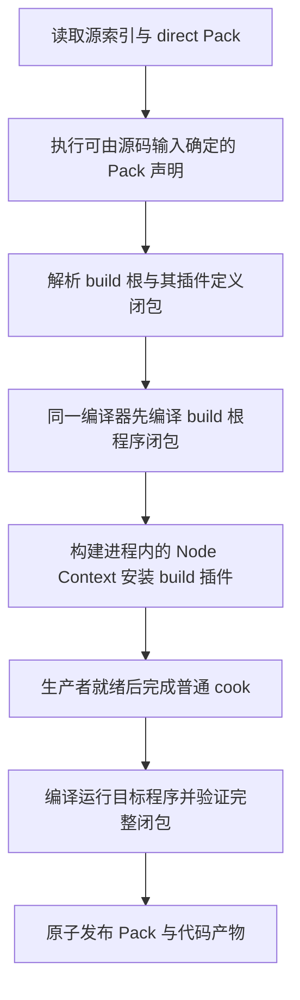

# 插件资产化：基于原生 Cordis 的创作、构建与运行设计

> 状态：主线集成修订已实现；验收见[实现记录](plugin-assets-implementation.md)及 [PR #3345](https://github.com/ForgeaX-Games/forgeax-engine/pull/3345) 当前提交检查，历史结果不替代当前验证。日期：2026-09-22。
> 原版与本修订均经过 Astra / high 独立严格评审；本修订的评审阻塞项已关闭，实现验收另行记录。
> 集成基线：`origin/main@7a06b414d`；固定运行语义仍为 `@deepseek-ai/cordis@4.0.1`。

## 1. 决策与交付目标

**让插件成为 Pack 中可引用、可配置、可交付的一种资产；运行时仍直接使用原生 Cordis Plugin、Context、Fiber、effect 与 provide。**

作者交付的 Pack 可以包含模型、动画、场景和行为。项目引用根插件资产，根插件用普通代码组合能力，取代 Group / Entry 安装树。

> [!IMPORTANT]
> 用户明确授权重新设计 Cordis 以上的所有机制。现有 `definePluginGroup`、`usePlugin`、Entry 树、Catalog、项目清单和 Pack 管线只是迁移输入，不是本设计的不可变约束。原生 DSH Loader 属于外部宿主时，保留在其边界；不把它继续作为 Engine 项目的必经运行层。

核心选择：定义与配置归 Pack，实例归 Fiber；每个执行入口一个根资产；代码静态构建，首版更新重建会话。交付包含角色 Pack 搬运、冷构建、浏览器 / Worker 运行与旧路径删除。

### 本轮调整

| 调整 | 设计结果 |
|:--|:--|
| 主线新增常驻后端与独立 UI | 四个执行目标：Node `host`、浏览器 `frontend`、World `engine`、隔离生产 `build`；均引用 PluginAsset |
| 移除 `cordis-plugin-loader` | 删除项目 Entry 持久安装树；资产、程序表与原生 Fiber 分别承担定义、解析、实例职责 |
| 不再要求特殊 `plugin.ts` | 小行为同文件具名导出；复杂实现拆普通 TS 模块；`game-3d` 用六个功能 Pack 验证组合 |
| 工作区与 Play 多会话 | 连接绑定自己的 assembly；借用后端不覆盖其他页面，也不卸载常驻能力 |

### 范围

覆盖插件创作、构建、启动、检查和交付，保留 GUID、生产者证据与领域职责。不包含脚本 VM、运行时 TS 编译、跨环境 Fiber、状态保存或闭包序列化。

## 2. Cordis 事实与概念边界

| 原生事实 | 设计后果 |
|:--|:--|
| Plugin 支持函数、构造器和 apply 对象；Config 使用同步 Standard Schema | 不另造行为基类，不假定 schema 可反射或异步执行 |
| ctx.plugin 的子 disposer 归父 Fiber；provide 的注册归当前 effect | 不增加 Group 或清理镜像；服务对象自身资源仍需 effect |
| Context.extend 不隔离服务，isolate 才提供指定服务作用域 | 不默认每个资产实例拥有私有容器 |
| generator effect 内可以顺序等待清理；Fiber 的独立 effects 可以并发，清理错误可能仅记录 | 必须做领域残留检查，dispose resolve 不等于清洁 |
| update 默认重启；await 可能在 PENDING 时返回 | 使用外部启动检查；首版不增加 diff / rollback |

资产 GUID 标识持久定义，Fiber ID 标识本次运行。代码版本和 Fiber ID 不替代资产身份。

只有资产持久配置受序列化约束；源码中的原生调用保留 Cordis 完整能力，不修改其配置类型或状态机。

### Loader 的职责迁移

| 原路径 | 新路径 |
|:--|:--|
| `forge.json.plugins[]` 中的 Entry / config | Pack 中的 GUID 定义 / config，`roots` 只选择入口 |
| Loader 的模块解析 | DevKit 构建生成的字面量程序表 |
| EntryTree / Group 组合 | 根资产对应的普通原生 Plugin 代码 |
| 安装、服务依赖与释放 | 原生 `ctx.plugin()`、`inject/provide/effect`、Fiber |
| Entry 逐项 reconcile / rollback | 首版删除；源码与持久配置改变时重建会话 |

因此不再需要 Engine 的 `plugin/loader` 入口或浏览器 Loader 补丁，也不新建 Loader 替代品。
保留的是 Cordis 底座与薄资产挂载边界。运行中直接调用原生 Fiber API 仍遵循 Cordis，
但不把这类临时操作写回 Pack，也不把它当作持久编辑协议。外部 DSH 的 Loader 留在外部宿主。

## 3. 资产合同与作者接口

### 3.1 作者源与运行产物

以下概念形状用于阅读；严格 schema 与导出类型由 `pack` / `types` owner 持有。

```ts
type GuidString = string; // schema-validated canonical UUID text, not AssetGuid bytes
type AssetConfig =
  | null | boolean | number | string
  | { readonly $asset: GuidString }
  | readonly AssetConfig[]
  | { readonly [key: string]: AssetConfig };

interface PluginAssetSource {
  readonly kind: 'plugin';
  readonly module: {
    readonly specifier: string;
    readonly export?: string; // omitted means "default"
  };
  readonly config?: AssetConfig;
  readonly toolContract?: { readonly specifier: string; readonly export?: string };
}

interface PluginAsset {
  readonly kind: 'plugin';
  readonly program: string; // portable logical module + export key; not a code version
  readonly config?: JsonValue; // asset markers have become GUID strings
}
```

| 字段 / 事实 | 权威与规则 |
|:--|:--|
| GUID | 沿用 `(packageId, sourceKey)` 派生；同一输出不再加 `.meta.json` |
| `module.specifier` | 相对声明所在源文件解析，或通过项目锁定依赖解析 npm specifier |
| `module.export` | 明确的具名导出；缺省 `default`；不靠遍历导出猜插件 |
| `$asset` | 保留标记，恰好一个字段；值是规范 UUID 文本。TS 作者显式 `AssetGuid.format(bytes)`；普通字符串不被猜成引用 |
| `refs` | 生产者从 `$asset` 标记派生，作者不另抄同一依赖列表 |
| `program` | 从可搬运的逻辑模块定位和导出名派生；不含绝对路径、配置、目标环境或代码版本 |
| 模块产物摘要 | 构建实际输出字节的完整性证据，与 `program` 的输入身份分开 |

PluginAsset 只保存定义与配置；安装和销毁仍归 Cordis。

原始 config 必须是有限数值组成的 JSON 树或明确引用标记；传输前拒绝 NaN、Infinity、函数、循环、类实例及嵌套 undefined。缺省 config 向原生 Plugin 传 undefined，不自动 deep merge。

生产者输出普通 JSON 对象；`__proto__` 等自有键保留数据含义。源码检查与运行交付使用相同的配置形状，不依赖序列化来修正对象类型。

现有 `AssetGuid` 是带品牌的字节数组。磁盘标记与运行配置使用 GuidString；需要字节的插件由 `Plugin.Config` 显式转换，不扫描普通字符串猜测引用。

### 3.2 pack.ts 路径

插件与其他资产共用输出映射（TS 示例见第 5 节）。参数化时把 `values.speed` 等生成输入写入 `config`，运行实现从原生配置读取。

Pack 参数是生成输入，`Plugin.Config` 是运行输入，按需映射。Pack 实例沿用独立 GUID，不新增插件专用的 parent / overrides 协议。

### 3.3 pack.json 路径

direct Pack 使用现有外层 `payload` 形式：

```json
{
  "schemaVersion": "3.0.0",
  "packageId": "01900000-0000-7000-8000-000000000102",
  "assets": {
    "plugin/player": {
      "kind": "plugin",
      "payload": {
        "module": { "specifier": "./player.ts" },
        "config": { "speed": 8 }
      }
    }
  }
}
```

插件 source 分支中的 `refs` 改为生产者派生、禁止手写；这要求同步调整 direct Pack schema，而不能让示例悄悄绕过当前必填 `refs` 校验。现有其他 kind 的迁移以其已有生产者合同为准，不借本轮改写全部资产格式。

相对模块路径以原始定义文件为基准，移动 Pack 实例不改变指向。克隆成果必须复制完整闭包并更新定位。

### 3.4 加载与安装

`assets.load(guid, 'plugin')` 返回受管定义句柄，不求值代码，也不安装能力。插件生产者在加载协议上声明引用延迟消费：其 `refs` 用于闭包与验证，不触发所有场景、音频或自定义 kind 的递归预加载。

延迟消费属于 loader 合同，避免“先解码资源才能安装其 loader”的循环。

薄边界 `mountPluginAsset(ctx, guid: GuidString): Promise<Result<Fiber, PluginAssetError>>`。它读取定义、解析实现，在调用原生 `ctx.plugin()` **之前**建立来源 Context，然后返回原生 Fiber；不建立包装 Fiber 或实例管理器。核心降级如下：

```ts
const scope = ctx.extend({ [pluginAssetOrigin]: origin });
const installed = scope.plugin(plugin, structuredClone(config));
return ok(installed.ctx.fiber);
```

`origin` 是不可变的资产 GUID、program 和发布来源投影。原生 `internal/plugin` 在构造期间同步发出，事后补 WeakMap 会漏掉首次观测；不得修改共享 Plugin 对象。直接原生后代继承“最近的资产来源”，不伪称独立资产。宿主为每个原生根 Context 提供会话内身份，配合 sessionGeneration 与 Fiber uid 消除跨 registry 歧义。

返回值包在 Result 内并使用实际 `installed.ctx.fiber`，避免原生返回包装对象的 thenable 被异步函数自动等待。成功只表示 Fiber 已创建，ACTIVE 由宿主 barrier 判定；模块解析、同步创建失败返回错误，之后的失败沿原生状态观察。

调用者声明 `inject: ['assets', 'pluginPrograms']`；内部仅在读取资产时把显式 guid 参数解析成字节。程序表只有模块加载函数与代码证据，不保存安装状态。取消后、创建前必须再次校验调用方 Fiber 与会话 sessionGeneration。

mount 原子读取 payload 与完整 publication tuple，按 GUID 对照构建 inventory 锁定的快照项（见 5.2）；不能先读 payload、后查当前 Catalog 版本拼接证据。bootstrap 改为匹配冻结的源快照身份。读取能力是资产 owner 的投影，不新增缓存权威。

定义 ready 与 Fiber active 分开报告。

## 4. 项目入口与组合

### 4.1 项目 manifest

将项目 schema 升为 `3.0.0`，移除 `plugins[]` 和 `defaultScene`，新增根资产引用：

```json
{
  "id": "my-game",
  "name": "My Game",
  "schemaVersion": "3.0.0",
  "roots": {
    "engine": "00000000-0000-4000-8000-000000000001",
    "frontend": "00000000-0000-4000-8000-000000000002",
    "host": "00000000-0000-4000-8000-000000000004",
    "build": "00000000-0000-4000-8000-000000000003"
  }
}
```

`roots` 必填，各键可省略，空项目允许 `{}`。每键一个 GUID；关闭根删除引用，内部可选能力由配置和源码表达。

| 根 | 物理环境与基础能力 | 根插件职责 |
|:--|:--|:--|
| `build` | 独立 Node 构建进程；源定义读取、Importer/Cooker registry | 注册生产者与构建工具，原始函数留在该进程 |
| `host` | 常驻 Node 后端；Host transport、ToolApi、工作区服务、源定义读取 | 安装后端服务和工具；不依赖浏览器或 World |
| `frontend` | 浏览器页面；UI 容器、资产读取与宿主通道 | 安装 DOM 表现，通过既有通道连接游戏与后端 |
| `engine` | World 所在主线程或 Worker；资产与领域服务 | 安装场景、仿真与玩法 |

这四个名字是构建放置，不是四种插件类型。定义中不保存 realm；同一逻辑实现可以在多个
受支持目标编译，基础能力与源码依赖决定能否运行。DOM 根不会同时送入 Node。
旧 schema 的 `host/frontend/engine/build` 分别迁入同名 roots，不把 Node host 重释为浏览器。

App 负责 Engine / Render / Kernel Worker 策略、输入与帧推进；程序表只提供当前执行环境的
原生插件。Context、Fiber、World 与函数不跨 Worker。浏览器与游戏间的 MessagePort 属于
实例，关闭一个实例不能关闭同后端的其他会话。

### 4.2 原生组合

根插件配置可以引用多个插件资产。下面只展示组合关系；启动完成由第 7 节的宿主 barrier 判定。

```ts
const gameplay: Plugin<{ children: readonly GuidString[] }> = {
  inject: ['assets', 'pluginPrograms'],
  async apply(ctx, config) {
    const children = await Promise.all(
      config.children.map((guid) => mountPluginAsset(ctx, guid)),
    );
    for (const result of children) {
      if (!result.ok) throw result.error;
    }
  },
};
```

子 Fiber 归父所有；部分失败使父 apply 失败并进入原生清理。服务由 `inject` 决定就绪；私有子插件直接 `ctx.plugin()`。

不保留 keyed child diff；`sourceKey` 稳定资产身份，Fiber ID 仅供当前会话诊断。

### 4.3 场景与角色所有权

场景所有者插件实例化场景、登记 effect 并 provide 实例绑定；玩法注入该绑定。组件必须在场景实例化前可用，以原生服务依赖表达，不增加 register/start 两阶段接口。

当前玩家插件有默认场景、固定系统与服务名，不能原样多实例化。World 级行为安装一套查询系统，多角色数据放 ECS；独立生命周期的组合才用子 Fiber。

`Context.isolate()` 不隔离 World。系统名称、实体、lease 和共享引用的冲突仍由领域 owner 处理。

## 5. 代码构建与同文件创作

### 5.1 有限且可实现的源码合同

支持普通模块和同文件具名导出；build 不返回函数。

```ts
import type { Plugin } from '@forgeax/engine/plugin';
import { definePack, definePackageId } from '@forgeax/engine/pack/source';
import { ok } from '@forgeax/engine/types';

export const movement: Plugin<{ speed: number }> = {
  inject: ['world'],
  apply(ctx, config) {
    // Register and undo ECS work through ctx.effect.
  },
};

export default definePack({
  schemaVersion: '2.0.0',
  packageId: definePackageId('01900000-0000-7000-8000-000000000103'),
  build: () => ok({
    'plugin/movement': {
      kind: 'plugin',
      module: { specifier: './movement.pack.ts', export: 'movement' },
      config: { speed: 5.5 },
    },
  }),
});
```

| 规则 | 编译 / 诊断要求 |
|:--|:--|
| 同文件的运行代码来自具名导出 | `module.export` 必须能静态解析；不能引用 default Pack 对象 |
| 生成参数跨阶段传递 | 经 `config` 传递；运行导出不能捕获 build 回调的局部变量 |
| 构建专用依赖 | 放在 `build()` 内的字面量动态 import，或单独的构建模块中 |
| 运行投影 | TS transform 移除已识别的 default `definePack(...)` 声明，再使用标准 bundler 的导出选择与 tree shaking |
| 顶层执行 | 只定义模块词汇；资源创建、I/O、World 修改和服务注册进入 apply / effect |
| 残留构建依赖 | 对最终运行闭包检查 Node 内建与 Engine compiler 包边界；不能以“应该已 tree-shake”放行 |
| 动态模块入口 | 只接受可枚举的静态构建输入；未知动态 specifier 返回构建错误 |

其余代码按普通 TS 编译，非法跨阶段引用编译失败。

### 5.2 逻辑程序、构建目标与物理模块图

`program` 定位一个逻辑导出：项目源码使用项目相对的规范模块路径，npm 源码使用规范包 specifier；两者均包含导出名，不含机器绝对路径。同模块不同导出必须不同键；不同配置资产指向同一逻辑导出。

程序表按 `(program, buildTarget)` 绑定源闭包、锁定依赖、SDK、编译选项、产物摘要及所属 `sessionGeneration`。代码变化更新证据，逻辑 program 保持；一个定义可以有多个目标产物。

`sessionGeneration` 负责项目会话切换与取消；Pack 的 `publication.generation` 是每源发布证据，两者不比较数值。构建 inventory 按资产 GUID 锁定完整 publication tuple（含 scopeId、generation、digest、outputSetDigest），mount 必须匹配对应项。不同 Pack 可以具有不同 publication generation，同时在一个会话共享 program；不得用旧快照执行新定义。

模块去重以**物理 JS 环境**为边界：同一页面里的 frontend 和主线程 engine 共享一次模块图和缓存；Engine Worker 是另一物理环境。即使分别生成逻辑入口，也不能独立打包两份 Cordis / ECS / token。构建使用字面量 import 与共享 chunk，最终字节摘要不参与自身解析表的循环派生。

Plugin 形状在目标环境解析时验证。顶层无运行贡献是作者合同，以导入探针验证；静态分析不能证明任意 JS 无副作用。

发布时把全部 JS chunk、WASM 和静态资源纳入同一构建 inventory。字节完整性在构建 / 交付 gate 验证；浏览器原生 import 不提供这里假想的执行前逐 chunk SHA 校验，运行侧验证的是已绑定程序身份与 sessionGeneration。单 HTML 的程序表由封装器派生，不能在其中恢复文件系统 specifier 或运行时源码编译。

跨 Pack 引用按完整生产代次校验。JSON 插件可以引用程序化场景：候选暂存期间不把“尚未产出”判为缺失；所有产出形成后、发布 Catalog 前，仍必须拒绝真正缺失的引用。

## 6. 依赖与构建插件启动

### 6.1 三种依赖各有来源

| 关系 | 唯一来源 | 消费者 |
|:--|:--|:--|
| 资产引用 | 配置 `$asset` 和已有资产生产者的字段合同 | Pack 闭包校验、交付 inventory |
| 代码依赖 | 静态模块解析图、项目 lockfile | Bundler、程序证据与缓存 |
| 服务依赖 | 实际原生 `inject` 与 Context 中的 provider | Cordis；宿主只观察未满足条件 |

固定资源用配置引用；代码拼接 GUID 不会自动进入交付闭包。运行选择限于已交付候选，`$asset` 不自动安装插件。

定义互相引用不等于执行环。内容读取等待由构建 worklist 处理，服务等待由 Cordis 处理；不新增通用依赖调度器。

### 6.2 解决“需要插件才能构建插件资产”的启动问题

插件**定义的解码与模块编译**是引擎自带的基础能力，不能由项目 Cooker 提供。Node 构建宿主创建一个基础 Cordis Context，再安装项目的 build 根。



启动规则：

1. direct `.pack.json` 的插件行直接可读；`.pack.ts` 通过已有执行器产出定义。
2. bootstrap 不提供 cooked 内容读取；执行器记录这种读取尝试，即使源捕获错误也不能发布本次输出，而应 deferred 到普通生产。其他解析 / 执行错误必须保留，不能当作 deferred 吞掉。
3. build 根及其依赖的插件定义必须来自 direct Pack，或不读取 cooked 内容的 ScriptablePack。通过源扫描产出的 GUID 查找它们；缺失时报告目标 GUID 和尚未可发现的源，不猜测拥有者。
4. 冻结可发现定义后，用同一编译器生成 build 根闭包的 Node 程序表，再通过同一 mount 边界安装。bootstrap 读取绑定源快照的内部定义，不伪装为已发布 Catalog；decoder / 模块解析协议与正常路径相同。
5. build 根通过 producer registry 注册 Cooker / importer，逆操作归 effect。**独立构建进程同时拥有 build Context、registry 和全部项目生产者的 cook 调用**；主 DevKit 只传源快照与请求，接收数据、诊断和产物引用，不传递函数 registry。
6. 根树就绪后该进程完成普通生产，再编译运行目标。同一源若执行两次，插件定义必须一致；依赖自身 Cooker 产物才能描述自己的插件返回启动依赖错误。

不保留裸模块清单绕过自举。按源 revision 缓存 deferred 结果与待满足读取，禁止无界重复执行。

`loadProjectCookers()` 的导出扫描改为原生安装。注册 API 返回 disposer，同 key 冲突由 registry 报错；构建进程持有生产者直到会话结束。普通 ScriptablePack 执行器仍可使用内部 Worker 返回 POD，Cooker 函数始终留在拥有 registry 的构建进程。

### 6.3 常驻 Node 根

`host` 与 `build` 共用 Node 程序编译器及同一原生 Cordis 身份；生命周期不同。
`host` 在常驻后端中挂载，和工作区、ToolApi 一起销毁；`build` 在可终止子进程中注册和调用生产者。
Node 自举读取冻结的源定义，不借启动之名运行依赖自己的 Cooker。
未配置 `roots.host` 时后端仍可提供 Engine 自带的工作区能力，不隐式安装 browser 根。
临时模块目录保留至 host 根及活动工具完成清理；启动失败也先清理贡献，再删目录。
清理须等待原生 `inertia` 收敛，不能把重复 disposer 的空返回当作首次清理已完成。

## 7. 运行、启动与销毁

### 7.1 启动 barrier

宿主提供一次有截止时间的启动操作，不调度插件，也不复制 Fiber 状态机。默认启动时限为 30 秒，可由宿主显式设置。

| 步骤 | 操作与完成条件 |
|:--|:--|
| 订阅 | 在创建根 Fiber 前订阅原生 `internal/plugin` / `internal/status`；观察者不能改变插件行为 |
| 解析与安装 | 验证根资产和代码身份，调用 `ctx.plugin()`；保存当前会话的根 Fiber |
| 收敛 | 观察根及实际后代的创建、转换和销毁；等待正在进行的原生生命周期工作 |
| 成功 | 根及仍存活的启动后代均为 ACTIVE，且没有未完成转换；下一次事件循环检查无新生命周期事件 |
| 失败 | 任一必需 Fiber FAILED，根被提前销毁，或截止时间内仍有 PENDING / LOADING / UNLOADING |
| 清理 | 先保留失败证据，再销毁候选根并检查领域贡献；失败的清理不能被改写为成功 |

启动后代默认必需；可选能力不创建，或由之后的显式操作安装。apply 必须包含必要异步初始化，不能把它藏在脱离 effect 的 timer / Promise 中。

观测集合仅服务当前操作：按 `fiber.parent.fiber` 归属、去除已销毁节点、读取原生状态与实际缺失 inject；不保存持久 child ledger 或按名字猜 provider。

> [!WARNING]
> 父插件提供服务，同时创建注入该服务的子插件时，子插件可能要等父插件 ACTIVE 才启动。不得让父插件等待“所有后代 ACTIVE”后才返回；完整 barrier 必须位于外部宿主，避免父子启动死锁。

运行后 PENDING 按真实状态展示；是否暂停由领域能力合同决定，不新增恢复管理器。

### 7.2 所有权与销毁

| 对象 | 所有者 | 清理规则 |
|:--|:--|:--|
| 子插件 Fiber | 创建它的父 Fiber | 原生父子销毁，不另存子插件清理数组 |
| 服务注册 | 调用 provide 的 Fiber | 原生撤销；服务持有的外部资源另登记 effect |
| ECS 系统 / lease / 实体 | 创建贡献的领域插件 | 注册后立即登记逆操作；借用数据不被擅自删除 |
| 普通加载资产 | 资产运行库 / 使用方领域合同 | 卸载插件不删除其他实例共享的资产 |
| DOM / 音频 / 网络对象 | 对应 frontend / host 领域插件 | effect 释放，运行对象不穿过 Worker |
| 模块与 token | JS 环境 | Fiber 销毁不删除 ESM cache；代码更新需要新环境 |

页面退出监听必须先于异步 App 初始化注册；退出期间迟到的 App 在发布服务前回收。有释放顺序的贡献放入同一 generator effect；安装后立即登记逆操作。玩家插件只撤回自己新增的动画关系和目标 ID，保留场景原有 ID；系统先撤，再释放组件 lease / 共享引用。检查部分初始化失败及重复装卸后的系统、实体、监听器和资源残留。原生清理异常保留在诊断通路，不能凭 dispose resolve 或解析日志宣称清洁。

## 8. 配置变更、代码更新与恢复

### 8.1 首版选择整环境重建

持久配置编辑写入 Pack；运行时不写 Entry 配置，也不维护自动 merge 链。调用原生 `fiber.update()` 仍是合法程序行为，但不会暗中持久化为另一份作者状态。

| 变更 | 发布与运行动作 |
|:--|:--|
| 未激活的插件资产配置 | 重建定义与 refs；不启动插件 |
| 已激活的插件资产配置 / 根引用 | 验证候选定义和闭包，重建相关项目运行会话 |
| 插件代码或代码依赖 | 编译新闭包；以新页面或新 Worker 的 JS 环境运行 |
| build 插件与生产者配置 | 重建独立构建会话与受影响内容，再发布新运行会话 |
| 常驻 host 插件源码或配置 | 显式重启后端并重新挂载；不由浏览器 HMR 顺带替换 |
| 与插件无关的普通资产内容 | 沿资产 owner 的原有更新路径，不强制全部插件重启 |

同一游戏的 frontend / engine 与本次构建结果按运行会话提交；主线程重载页面，Worker 更换实例并更新桥接 sessionGeneration。常驻 host 有独立生命周期与来源快照，其代次不与页面比较。
存在常驻 host 根时，首版保守要求其冻结项目源码快照的文件集合与内容保持不变；源码或 host 根变化后，先显式重启后端，再允许依赖它的浏览器候选发布。可缩小判定范围是后续优化，不能靠旧后端配新页面冒充一致更新。

替换前的编译失败可以保留旧运行；替换后的启动失败不能称为仍运行 lastKnownGood。用旧产物重试会创建新会话和 World，不恢复进度。

无损局部更新需要未来单独定义领域状态迁移，不把旧 keyed diff 换名保留。

### 8.2 并发与 sessionGeneration

同一项目会话的构建 / 启动 / 替换串行，新请求取消或排队旧请求；所有迟到结果校验 sessionGeneration。独立连接的会话代次不相互比较。

apply 不响应取消时不能宣称清洁。到清理截止时间终止该 Worker / 页面 / 子进程并报告中止；build 根始终在独立 Node 构建进程执行，避免挂死主 DevKit。

## 9. 工具、Host 与外部 DSH

| 现有边界 | 目标与必要迁移 |
|:--|:--|
| `ToolPlugin` 包装 | 普通 Plugin 通过 ToolApi 注册，以 effect 撤回并等待活动调用结束；删除 unwrap 和 Fiber.effect 改写 |
| CLI 工具发现 | 读取下述纯数据合同投影；不执行 executor / apply |
| Host 前后端 assembly | 改为根程序与配置的版本化投影；Host 接收注入的原生解析入口，不依赖 Pack 包或项目 schema |
| Host 能力调用与 transport | 保留请求、取消、断开与 sessionGeneration 语义；激活对象从 Entry 转为实际根 Fiber |
| Engine 内的 DSH connector | 作为普通插件资产安装 |
| 外部 DSH profile / Loader | 留在 DSH 边界；不修改其 wire 协议或原生 Entry 语义 |
| 公共 inspector 协议 | 新字段与错误按既有兼容规则增加；内部删除 Entry 不等于删除已公开 wire 字段 |

工具发现与执行的首版合同：

1. `toolContract` 来自 bootstrap 可发现的插件定义，导出 tool-runtime 所有的纯数据合同。发现可以执行受限的源声明和纯合同模块，但**不安装 build 根、不运行 Cooker、executor 或任何 apply**。需要 cooked 内容才能发现的源明确标为不可发现，不能返回空工具列表冒充成功。
2. executor 字符串是编译输入边，以合同文件为基准、按声明目标解析并纳入模块图 / inventory。冷发现绑定来源 revision 与合同摘要，发布后再绑定 sessionGeneration；未发布描述不伪装为已交付程序。
3. 原生插件在 apply 中显式注册资产工具。薄注册 helper 从最近的资产来源和生成的合同 / executor 表派生 ToolApi 注册，不再手写第二份描述；executor 按既有 ToolRun 路径在调用时加载。注册的 effect 先 revoke 并 drain 活动调用，再允许相关资源释放。
4. 声明存在表示可发现；只有对应 provider 已安装且原生 Fiber ACTIVE 才可调用。关闭或未安装的插件显示未激活，不因发现自动启动。未进入当前目标代码闭包的 executor 返回未交付错误，要求重新构建。
5. provider 身份包含会话、Context / realm、来源资产及原生 Fiber uid。多实例用 provider 身份区分；仅命令 ID 匹配多个 provider 时返回歧义，不能随意挑选。合同内部重复 ID 在验证时拒绝。

来源元数据不保存安装状态。可独立发现和安装的工具能力须拥有自己的插件资产。

Host 只依赖已解析代码与配置，资产 GUID 仅作来源。同步迁移 Engine 调用者；外部 assembly 协议显式升版，不静默重释旧字段。

### 9.1 多会话宿主投影

`HostAssembly` 是 schema v2 的 `root(program, codeRevision, config, source?)` 与
`sessionGeneration/revision` 投影。Pack 源保持持久权威；Host 不依赖 Pack 解码器或项目 schema。

`backend.bindProjection(caller, { assembly })` 绑定 transport 确认仍在线、capability 匹配的一条连接。
该连接读取自己的 assembly，报告必须匹配其获准投影的 revision 和 sessionGeneration。
只接受当前投影的报告，不保留旧 bootstrap 别名。后端默认 assembly 更新不广播给已有专属投影的连接。替换后旧 disposer 不撤回新绑定；
主动撤回后连接拒绝读取，不能回落到别人的默认 assembly。断开与后端销毁释放绑定。

工作区浏览器只安装自己的 UI 与查看能力；Play 另有实例并装入游戏根。关闭 Play 只撤回该
实例的 Fiber、端口与投影，常驻后端、其他页面和项目源保留。外部产品注入的 frontend
根由宿主用 `frontendModule { specifier, export? }` 提供不可变模块定位，DevKit 生成字面量导入；wire 的 `program` 仍是不透明身份。项目 frontend 根与外部根同时被选中即失败。
外部 `codeRevision` 是提供方对完整代码闭包的不可变声明；描述符相等不等于 DevKit 验证了产物字节。实际字节摘要仍归构建交付 inventory。外部代码变化须由提供方更新 revision / binding 并替换页面。首版保守地拒绝此类绑定页面中所有非生成目录的 client HMR 事件，包括普通项目源码变化；需要重新绑定并替换页面。
不扫描 npm，不把外部原生 DSH EntryTree 纳入项目 Pack。

## 10. 诊断与证据合同

资产边界用闭合错误联合及 `code / expected / hint / detail`，保留 Cordis cause，不折叠为统一失败。

| 失败类别 | 必需 detail | 恢复 owner |
|:--|:--|:--|
| 源 / 配置不能序列化 | packageId、sourceKey、字段路径 | Pack 作者 |
| 模块 / 导出错误 | 源文件、specifier、export、目标环境 | 源码 / DevKit 编译器 |
| 程序未被交付或身份不匹配 | asset GUID、program、sessionGeneration、产物证据 | 构建发布 owner |
| 自举定义不可发现 / 内容读取被阻止 | 根 GUID、deferred 源与阻塞读取 | build 根作者 |
| 原生配置或 apply 失败 | 根 GUID、Fiber 身份、原生原因 | 插件实现 |
| 启动依赖未满足 | 根与后代、原生状态、缺失服务、截止时间 | 组装作者 / Host |
| 清理或中止失败 | 实际残留贡献、环境身份、已尝试操作 | 领域 owner / 执行宿主 |

资产检查展示 subject、sourceKey、sourceRevision、代码闭包和 refs；运行检查从 Context 来源元数据关联真实 Fiber / effect / provider。身份必须带会话与 sessionGeneration，不能以 registry 局部 uid 作为跨环境身份，不能把“已 cooked”显示成“已运行”。

program、程序表和延迟引用策略进入 authority audit 与 inventory。

## 11. 实现归属与具体改动

| Owner | 负责的改变 | 不承担的职责 |
|:--|:--|:--|
| `types` | PluginAsset POD、程序身份、配置引用的跨包数据类型 | 导入 Cordis 或执行模块 |
| `pack` | 源 schema、稳定身份、模块定位、资产引用标记、库存与证据合同 | 安装插件、维护 Fiber |
| `import` | 插件输出生产者、定义降级、refs 派生、bootstrap / cook 交接 | 运行时源码解释 |
| `assets-runtime` | 插件定义 decoder、通用 loader 引用消费策略 | 因 load 而执行代码 |
| `plugin` | 原生 Cordis 公共入口、薄 mount 边界、原生运行投影 | Group、Entry reconciliation、第二生命周期 |
| `devkit` | 程序闭包构建、同文件 transform、构建进程、manifest 降级、CLI / ZIP / 单 HTML | World / Renderer 的直接业务逻辑 |
| `project` | `roots` schema v3、旧字段错误、一次性迁移输入校验 | 模块扫描和自动安装 |
| `app` | 初始 Context、运行根启动 barrier、现有执行 tier 与重建协调 | 复制 Cordis 的调度 / 状态机 |
| `host` | 根描述的传输、连接投影、会话切换与激活报告 | 引入 Pack 或业务资产依赖 |
| `tool-runtime` | 工具合同、注册、撤回和活动调用结束合同 | 管理插件安装树 |
| 模板与示例 | 真实根资产、原生组合、场景与资源所有权 | 绕过引擎缺口的 ad-hoc bootstrap |

`plugin` 的 mount 边界通过 Context 中的 reader / program resolver 能力工作，避免 `plugin -> assets-runtime -> plugin` 依赖环。DevKit / App 负责注入适配，类型放在能保持 DAG 的最低合同层。

源码入口见第 14 节。实施时同步更新 AGENTS 包地图、README、authority audit 与 assets / app / cli / sdk 技能。

## 12. 实施顺序与删除清单

原有源码已迁移；本轮保持单一作者路径，重点整合新增主线行为并重跑下节验收。

### game-3d 的具体迁移

1. 创建小型 `game.pack.ts`，只输出 engine 根；physics、场景所有者、player、camera、UI 分别由各功能 Pack 持有定义、配置与依赖，原有模型 / 动画 Pack 保留。
2. 根实现直接作为 `game.pack.ts` 的具名导出，调用薄 mount 边界；删除 `assets/plugin.ts` 和 `definePluginGroup/usePlugin`。小型行为同文件创作，大型实现按需拆成普通 TS 模块，不设特殊插件文件名。
3. 场景 GUID 移进场景所有者资产配置；用 effect 管理实例。原 `resolveGameEntity()` 改为消费明确的场景实例绑定。
4. 玩家速度、跳跃、动画引用等移进可配置合同；硬编码动画 GUID 改成 `$asset` 配置输入。World 级系统与角色数据保持清晰边界。
5. DOM UI 放入 frontend 根，以既有 POD 输入 / 状态投影通信；删除 Worker 中靠 `typeof document` 跳过 UI 来掩盖部署错误的路径。
6. `forge.json` 替换为 roots；静态资源 Preview 使用基础预览宿主，不因查看模型而启动游戏根。

### 角色 Pack 的可搬运单位

首版搬运**作者 Pack + 源码 / 资源闭包 + 声明的外部 npm 依赖**，在目标项目重新构建。闭包包含 Pack、模块与 helper、源资源及必要 Meta；外部依赖使用标准 package.json 声明，版本由导入事务核对来源锁定证据并进入目标 lockfile，冲突明确失败，不静默升级。

保留 GUID 的导入代表同一资产；目标已有同 GUID 不同内容时失败，创建独立变体必须显式克隆身份并重写可识别引用。目标构建重新生成 program 绑定和目标产物，不依赖原项目的绝对路径或生成文件。**cooked 插件定义不能脱离其项目程序 inventory 单独搬运**；它只随完整项目发行物交付。这里扩展资产闭包导入 / 克隆操作，不新增 Pack 发布平台。

### 必须删除或迁出的旧机制

| 当前表面 | 最终处理 |
|:--|:--|
| `definePluginGroup` / `usePlugin` 与 composition 状态表 | 删除公共导出、实现及专用 diff 测试；必要原生行为转为 core 回归 |
| Engine 项目的 CatalogLoader / EntryTree 激活路径 | 从项目路径删除；纯模块加载函数作为程序解析产物保留 |
| `forge.json.plugins[]` / `defaultScene` | 新 schema 拒绝；一次性迁移工具输出完整候选项目 |
| 持久化 `plugin install/configure/enable/disable` Entry 命令 | 替换为资产创作与根引用操作；不保留命令别名模拟旧状态 |
| 模块 `cookers` 命名导出扫描 | 改为原生 build Plugin 注册 |
| `ToolPlugin` unwrap 与 Fiber.effect 改写 | 转为领域注册 disposer；活动 tool run 撤回后才能释放其依赖 |
| 按 Entry id 推导工具 / 检查身份 | 来源资产 + 当前原生 Fiber；外部 wire 兼容在投影边界处理 |
| 引擎项目对 cordis-plugin-loader 的基础依赖及浏览器补丁 | 删除；外部 DSH 自己需要的 Loader 留在其宿主 |

迁移工具转换直接 Entry / 静态 Group；动态 children、闭包配置、更新钩子和隐式所有权报告需改写的位置，不猜任意 AST。失败不半写项目，候选通过后原子提交。

## 13. 验收矩阵

以下为实现 gate，文档中的原生探针不能替代。

| ID | 用户 / 系统路径 | 通过条件 |
|:--|:--|:--|
| AC01 | pack.ts 与 pack.json 表达同一插件 | 定义语义一致；GUID 派生稳定；配置引用往返完整 |
| AC02 | 只读取插件资产 | 无模块求值、服务注册、Fiber、场景或 DOM 创建 |
| AC03 | 两个资产共享实现与相同配置 | 模块 / token 共享；Fiber、配置副本与来源准确独立；相同 primitive / undefined 也可区分 |
| AC04 | 普通父插件组合两个子插件 | 原生所有权成立；删除一父不影响另一父；无需 Group |
| AC05 | 子插件注入父插件提供的服务 | 外部启动 barrier 正确收敛，无父子等待死锁 |
| AC06 | 缺失服务 / apply 失败 / 超时 | 根报告失败及实际后代；PENDING 不算 ACTIVE；残留可检查 |
| AC07 | 同名服务的隔离与冲突 | isolate 后独立；未隔离的真实冲突可诊断；不谎称隔离 World |
| AC08 | generator 内有顺序的释放 | 系统先撤、数据与 lease 后撤；含失败和部分初始化路径 |
| AC09 | 同文件、同模块双导出、同资产双目标 | 导出键不冲突；同页面 frontend/engine 共享模块图；不同 Pack publication generation 可共享 program，完整 tuple 须匹配；无构建依赖泄漏 |
| AC10 | 无 DDC / 无预建 Catalog 的自举 | 先编译 build 闭包；同一构建进程注册并调用 Cooker；两次定义确定；自依赖被拒绝 |
| AC11 | 插件引用需自定义 loader 的资源 | 定义可先加载；安装 loader 后再消费内容；不存在递归预加载死锁 |
| AC12 | 改配置、改代码、快速连续更新 | 按 sessionGeneration 发布新会话；旧结果和错配 publication tuple 无效；失败与 lastKnownGood 表达准确 |
| AC13 | 浏览器与 Engine / Render / Kernel Worker 策略 | 同一玩法、UI、输入和通道目标达成；DOM / 音频留在浏览器；无函数跨 Worker |
| AC14 | 打包 ZIP / 单 HTML / SDK carrier | 干净消费端包含完整 JS / WASM / 资源闭包，离线可按各格式合同运行 |
| AC15 | 导入角色作者 Pack 到干净 SDK 项目 | 复制声明的源闭包、安装声明依赖、重新构建并运行；无原项目生成物 / 路径依赖；GUID 冲突不覆盖 |
| AC16 | 冷工具发现、关闭、多实例与独立 executor | 无 apply / Cooker；executor 入交付闭包；provider 状态与歧义准确；撤回无泄漏；Preview / DSH 边界保持 |
| AC17 | 更新后删除审计 | 仓库与 SDK 模板中没有旧作者入口、Group 状态表或备用 Entry 激活路径 |
| AC18 | 常驻 host、工作区、两个 Play 连接 | 四根准确放置；后端能力不由页面安装；专属投影不串线；迟到报告拒绝；关闭一实例保留其他实例 |

运行门槛：相关 package 的 typecheck / unit / lint；真实 Node 构建进程集成；真实浏览器 pack transport 与 Worker probe；引擎变更所需的全部 hello-* / learn-render Dawn 300 帧、`pnpm test:browser`、`pnpm test:dawn`；最后执行干净 SDK 交付验证。确切命令与当前 roster 从 [CI operating guide](../../../scripts/ci/README.md) 和 [runtime smoke 合同](../../runtime/README.md) 读取，不在本文维护第二份列表。

测量冷构建时间、模块体积、启动与空闲观测开销；解析和监督不得进入帧热路径。

## 14. 调查证据与可重跑探针

### 已确认的源码位置

| 证据 | 位置与意义 |
|:--|:--|
| 原生父子所有权、状态与更新 | 安装的 Cordis `src/fiber.ts`：构造器把子 disposer 登记到父 effect；`await` / `update` 定义边界 |
| 原生作用域与 provide | Cordis `src/context.ts`、`src/reflect.ts`：显式隔离与服务的 effect 所有权 |
| 原生插件形状 | Cordis `src/registry.ts`：function / constructor / object；按 callback 共享 runtime |
| 当前 Pack 限制 | [pack-authoring.ts](../../pack/src/pack-authoring.ts)、[scriptable-pack-worker.ts](../../pack/src/scriptable-pack-worker.ts)：完整输出 map 与 Worker 传输 |
| 基线 Group 额外机制 | 基线提交的 `packages/plugin/src/composition.ts`：稳定 key、diff、替换与 rollback 均在引擎层；实现已删除该文件 |
| 基线 build 路径 | 基线提交的 `packages/devkit/src/build/cookers.ts` 使用 SSR 命名导出扫描；当前 [cookers.ts](../../devkit/src/build/cookers.ts) 已改为原生构建进程会话 |

原版的 Cordis 探针已经收敛到 [资产与启动测试](../src/__tests__/asset.test.ts)
和 [浏览器后代就绪测试](../src/__tests__/composition.browser.test.ts)。运行它们验证原生组合、
来源、PENDING、失败与销毁，避免文档维护第二份可执行测试。

新修订还需 [Host 连接投影测试](../../host/src/__tests__/host.test.ts)、
[真实项目启动](../../devkit/src/__tests__/scene-bootstrap.e2e.test.ts)、
[工作区会话](../../devkit/src/__tests__/workspace-provider.unit.test.ts) 与完整模板旅程。
文档评审不替代实现验收；每轮结果及其源码 / SDK 快照边界记录在[实现记录](plugin-assets-implementation.md)。
