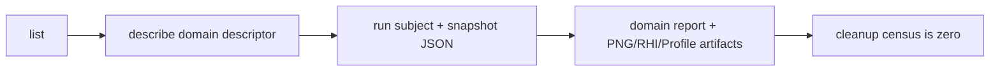

# `@forgeax/engine-preview`

This focused package owns the Engine preview substrate. Its native
`createPreviewHost(mechanisms)` supplies one `preview.host` capability to domain
plugins. `withPreviewSession(adapter, request, callback)` owns the distinct
open/use/dispose lease for typed binding, frame and capture actions. It does not own Project writes, ToolRun execution, a catalog, or an
Editor session.

## Minimal host contract

```ts
const terminal = await withPreviewSession(
  adapter,
  {
    subject: { kind: 'mesh', guid: 'mesh:fixture' },
    snapshot: { revision: 3, digest: 'sha256:project' },
  },
  async (session) => {
    const binding = await session.loadAsset('mesh:fixture');
    await session.frame({ frame: 0, deltaSeconds: 0 });
    return { binding, capture: await session.capture() };
  },
);
```

The callback receives only POD binding and presentation actions. World, Renderer,
Canvas, GPU, and ToolRun handles remain inside the adapter. `withPreviewSession` always
disposes the lexical lease and returns a cleanup census. A non-zero `worlds`,
`renderers`, `canvases`, or `leases` count throws `PreviewCleanupError` with the
stable `preview-cleanup-live-resources` code.

The native host accepts admitted mechanisms, supports one domain invocation and
rejects reuse or an aborted signal. It owns no physical resource disposal; the
carrier that supplied those mechanisms retains that responsibility.

## AI disclosure order

1. `list` exposes a domain descriptor and its physical realm.
2. `describe` expands the selector, `SnapshotRef`, result schema, required evidence,
   and structured errors.
3. `run` accepts JSON subject and snapshot values only.
4. The terminal carries the subject report, `ArtifactRef` values, and the cleanup
   census. A live resource or carrier handle is never portable evidence.

## Canonical domain contributions

M2 adds four peer contributions. Each request carries a `ToolSubjectRef`, a
revisioned `SnapshotRef`, and a domain binding; each terminal returns a
subject-bound report plus `rhi-tape`, `png`, and `profile-capture` artifacts.

| Descriptor | Subject | Presentation oracle | Domain falsifier |
| --- | --- | --- | --- |
| `asset.material.preview` | `MaterialAsset` | Fixed studio sphere and lighting | Fallback sphere, disconnected program, or background-only capture |
| `asset.mesh.preview` | `MeshAsset` | All submeshes with source AABB framing | Partial buffers or inverted framing |
| `asset.vfx.preview` | `ParticleEffectAsset` | Fixed seed, delta, and bounded compute/draw timeline | Stale seed/delta or missing compute/draw output |
| `asset.texture.preview` | `TextureAsset` | Aspect-correct quad and alpha checker | Replacement texture, format/color-space drift, or wrong aspect |

> [!IMPORTANT]
> `asset.preview`, `preview.run`, and `preview.analyze` are not part of
> the default discoverable catalog. The old generic proof helpers remain
> private implementation utilities until their consumers are retired.



The domain files are deliberately separate so each subject can reject its own
fallback and binding substitutions. They share only the lexical host helpers;
they do not create a second registry, executor, World, Renderer, or authoring
session.

The Preview producer generates a compact 64 x 32 latitude-gradient environment
and its `cook-receipt.json` together, with no bundled or private HDR library input.
`sky.hdr` is the generated asset's transport encoding; the original library image
is not a default dependency. Engine builds refresh and publish the complete kit,
including its Meta, after fresh builds and package cache hits. Resource and workspace
previews admit this kit; ordinary game builds and Play use only their declared asset
roots and libraries. DevKit rejects preview source or Meta bytes that disagree
with their receipt.

A game that deliberately uses the canonical environment declares
`"@forgeax/engine/preview"` in `forge.json#assetLibraries` alongside its other
libraries. This is an explicit read-only asset mount; ordinary games do not
inherit preview resources. The Game 3D template supplies its own generated sky.

Resource domain execution consumes the mechanisms from one PreviewHost session. Material and Mesh read readiness from that session's Renderer, as Texture and VFX do; callers do not supply a second readiness projection. The Host supplies one fixed `{ guid, asset, digest?, ownerFacts? }` subject after Catalog admission. All four domains verify that identity before their inspection and render oracle; Preview has no loader or runtime asset catalogue. Resource requests, asset records and canonical kit receipts use the same object admission; arrays cannot stand in for records, even when they carry named fields.

### Bound request admission

Material, Mesh, Texture and VFX contribution schemas share subject, snapshot and
binding-identity admission. Domain validators then admit complete binding facts
before constructing typed requests. Null or partial nested objects return schema
failures, including missing Texture alpha and malformed Mesh bounds or submeshes.
The native GUID-only preview commands retain their separate project-resolution
contract; they do not require a caller-built binding.

## Interactive texture inspection

`TextureViewInfo`, `TextureViewOptions` and `TextureViewControl` describe one
bound TextureAsset or EquirectAsset. `describeTextureView` derives actual mip and
slice limits through Types; `validateTextureViewOptions` rejects unknown fields,
out-of-range levels and projections unsupported by that source. Options never
modify authored assets. Equirect sources have one mip; IBL prefilter mips remain
Renderer resources. `dist/texture-view` contains build-generated ordinary
material contracts for 2D, 2D-array and 3D sampling. DevKit compiles them into
the shader manifest; App creates the matching runtime material only for a
texture preview. They are not project Catalog assets. No shader compilation
occurs in the browser.
The same options admit transparent output for cached thumbnails; source alpha
and transparent margins are preserved instead of baking the interactive checker.
Normalized, compressed and floating-point color formats use their actual GPU
samples. Integer and depth/stencil sources fail admission explicitly; their
numeric visualization is outside this color-image inspector.

## Unreal TextureEditor source review

Reference: knowledge-base `unreal-engine`, commit
`71fe36aac5a8df5ccd66c763ffc902b29b6a9c43` (manifest label UE 5.8.1).
The sparse checkout lacked the editor blobs and its origin returned 404.
Files were recovered from the already documented Arkfall mirror at
`546b25d9e1eead201ec92ae6580cd471abec39ea`; every file below has the **same Git
blob** as the original pinned tree. This is a review of those exact sources,
not an inference from screenshots or the mirror's version label. No Epic
source is redistributed in this change.

| Source under `Engine/` | Original and recovered blob |
| --- | --- |
| `Source/Editor/TextureEditor/Private/Models/TextureEditorCommands.cpp` | `478d346a45df4bd71ed20d7243af442331840a6e` |
| `Source/Editor/TextureEditor/Private/Models/TextureEditorViewportClient.cpp` | `143947d828a95ee2422bb1a6ffbebae0571a05c0` |
| `Source/Editor/TextureEditor/Private/TextureEditorToolkit.cpp` | `bbfedc4fb614da2afcd8d159987dd5ee2dfba7c0` |
| `Source/Editor/TextureEditor/Private/Widgets/STextureEditorViewport.cpp` | `308969595e0eb32e0cea63198b1f7427215ce929` |
| `Source/Editor/TextureEditor/Classes/TextureEditorSettings.h` | `34e0a5dbd85fd24ea3e2d90a4d51105da20b547e` |
| `Shaders/Private/SimpleElementTexture2DPreviewPixelShader.usf` | `6e0714619dee4fe0ec9682a72ab871460830ac41` |
| `Shaders/Private/SimpleElementColorChannelMaskPixelShader.usf` | `58e698ce915ae83426972617c5b7778f4a4965ba` |
| `Shaders/Private/CubemapCommon.ush` | `c4b4b73cba8d4c204d5812d9fe896f7f3229ebf2` |

### Behavior and fit

| UE behavior and source authority | ForgeAX decision |
| --- | --- |
| Commands declares independent R/G/B/A toggles. Toolkit `GetColourChannelBlendMode` automatically desaturates a single selected color channel. The preview shader applies channel weights before display gamma. | Independent RGBA buttons; a single color channel or alpha alone is grayscale. RGB with alpha enabled composites over the selected background. All channels off is black. Changes affect the preview only. |
| Toolkit `GetMipLevel` returns a fixed level or -1 for automatic selection; the 2D shader uses explicit `SampleLevel` for fixed levels. `GetUseSpecifiedMip` disables selection for a one-level texture. | Explicit selection from the real `TextureAsset.mips` chain; dimensions derived by the Types layout owner. Generated mips are produced by Renderer. No CPU resize substitutes for a mip. One-level controls are disabled. |
| Settings and commands define Fit, Fill, natural 100%, custom zoom, checker/checker-fill/solid backgrounds, optional border and default/point sampling. Viewport owns centering, scrollbars and drag interaction. | Fit, 100%, wheel zoom, drag pan, nearest/linear sampling, checker/black/white backgrounds. Fill, configurable checker colors and an independent border preference are omitted as presentation refinements. |
| Viewport multiplies HDR color by `2^ExposureBias`. Toolkit QuickInfo shows source/displayed dimensions, format, mip count, memory and alpha facts. | Exposure in stops; bound dimensions, format, color space, mip count and source byte count. Source bytes are labelled KiB and are not claimed as resident GPU memory. |
| Viewport selects cubemap-specific sampling, 2D long-lat unwrap or 3D orientation, and explicit DDS-order faces +X/-X/+Y/-Y/+Z/-Z. | `EquirectAsset` opens in an environment view. It also offers source panorama, six-face cross and individual faces. Direction-to-source UV uses Renderer shader's existing `sampleSphericalMap`, preserving Skybox orientation. |
| Toolkit offers array layer/slice selection. Viewport selects 2D-array or volume sampling and volume trace versus depth slices. | Existing `2d-array` layers and `3d` depth slices are inspected at their actual selected mip. Volume ray marching is omitted: it introduces transfer/opacity policy beyond texture slice inspection. |
| The shader handles normal-map decode, grayscale replication, virtual textures and UDIM page-table sampling; Toolkit exposes platform compression, streaming/LOD, reimport and recompression. | View remains read-only. It shows sampled stored channels without inventing normal-map semantics. Import/compression belongs to asset producers. Virtual texture/UDIM and platform-specific editing do not map to the current public sampled texture contract. |
| Render-target and cube-array UTexture subclasses share UE's editor. | ForgeAX has no public catalogued CubeTextureAsset: it was replaced by EquirectAsset. Runtime RenderTargets and internal IBL cubes are not misrepresented as editable source assets. |

### Environment identity

Both `Skylight.equirect` and `SkyboxBackground.equirect` name an EquirectAsset.
Renderer derives its cube, diffuse convolution and roughness prefilter privately.
The source contract has one 2D image and no authored mip chain. Therefore this
viewer reports **one source mip**, uses the original bytes in a normal 2D texture
binding, and offers directional cube views by projection. It does not claim to
inspect the renderer's roughness-prefilter mips. Those are distinct GPU resources
observable through RHI Debug.

### Ownership

Preview owns the options/facts contract and validates selections against the
bound source. App retains the managed source handle and assembles an ordinary
preview Mesh/Material/Camera. Option changes use `assets.update` on that same
material handle; ECS bindings stay stable. DevKit
compiles their shared material contracts through the existing shader pipeline. Renderer remains the sole upload, mip, submission and resource owner.
The existing workspace target/generation guards wrap `preview.texture.get/set`.
View owns labels, input mapping and optimistic form state; it sends bounded
options to the exact target and borrows its existing surface. No image decoder,
asset registry, rendering context or camera authority is added to View.

## Cached thumbnails

`THUMBNAIL_PREVIEW` specializes the ordinary resource presentation at 128x128:
transparent background, neutral white lighting, no Bloom or temporal antialiasing,
and a deterministic 30-frame VFX sample. Material spheres and meshes share the
existing AABB framing owner. Texture previews retain source aspect and alpha;
the interactive checker background is a presentation choice. Texture, 2D-array
and 3D thumbnails use mip 0 / slice 0 through the same texture inspection material.
Equirect thumbnails show the source panorama at its original aspect ratio;
opening the asset retains the interactive directional environment view.

`previewThumbnailInput(catalog, guid)` derives a sorted recursive dependency
closure from current output digests. It excludes names, URLs, session generations,
and unrelated sibling outputs. Missing, stale or unversioned dependencies are
not cacheable. DevKit combines this input with the preset and actual transitive
Engine runtime bytes; Preview owns neither filesystem storage nor a second
renderer.

Preview sessions and ToolRuntime terminals share `ToolCleanupCensus`,
`ToolCleanupReport` and the post-disposal failure check. Explicit cleanup
failures precede live-resource counts. ToolRun keeps the executor's original
failed outcome unless lease cleanup itself fails; a successful result requires
a clean report before terminal publication.

All native resource descriptors, Engine preview descriptors and their terminal
evidence checks consume `REQUIRED_PREVIEW_EVIDENCE`. Each subject still owns
its binding, presentation and pixel falsifiers.
