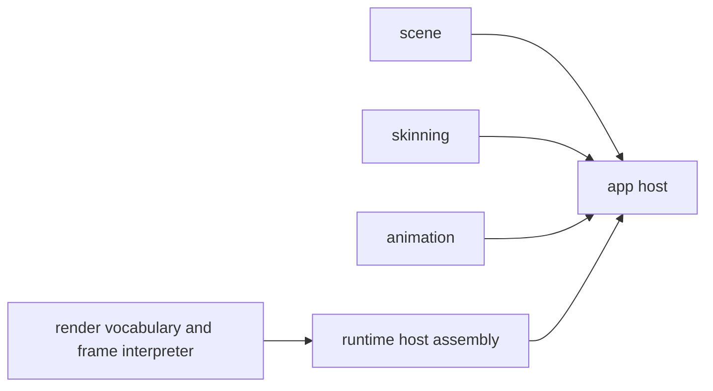

# `@forgeax/engine-runtime`

## Water local fluid assembly

The existing Water Scene plugin reconciles `WaterFluidSimulation` components
into the Scene-local `WaterSystem.fluid` owner. It resolves the specified Body
generation, saved recipe version and the recipe's ordinary `impulseNoiseGuid`
dependency; there is no game-side noise loader or parallel RT registry.
The component's explicit `waveFoamCenterM` joins the same input snapshot as the
solver transform. Water retains its submitted outer-frame history; Render derives
the material mapping from that producer rather than a second authored mapping.
`WaterSceneStatus.waterFluidFailures` reports source-owned, code-discriminated
admission failures. Render extracts one frame-shared simulation and acknowledges
queued inputs only after complete graph submission. CPU query and buoyancy
inputs do not acquire visual RT data. See the [Water entry](../water/README.md#local-fluid-simulation).

## Water River Native collision lifecycle

Runtime keeps a source-owned River's accepted Water snapshot and Native collision
paired. A saved collision disable or re-enable commits only after the matching
Native receipt publishes; an empty retirement receipt is required to accept a
disable, and preparation/admission failures leave the previous River active for
retry. A material or source-version rebind with unchanged collision geometry
and full Scene matrix retains the accepted Bake and Native receipt. Replacing
the River with another Water Body kind requires removing `WaterBodyInstance`,
waiting for Native source retirement, and then mounting the replacement. See
the [Water Scene lifecycle contract](../water/README.md#scene-and-material-status).

Durable cold Bake admission requires a loaded `/2` recipe with both its exact
grid and direct solver-normal textures. Each loaded texture's handle, GUID,
AssetRegistry revision and value must agree with the recipe pair; the normal
descriptor also retains its accepted format and basis. The source Body GUID,
collision-geometry projection and complete Scene matrix must match the current
River. A historical source Body generation remains valid across a generation
bump when that geometry and matrix are unchanged; a live capture must match its
captured Body generation and `sourceFrame`. `/1` remains readable but cannot
authorize cold publication. Worker completion is supported, while
feature-texture readback and River Bake publication remain pending because
those bytes stay receiver-local; capture requests return structured unavailable
errors. These lineage checks qualify Bake inputs, while visual and selected R8
acceptance remain separate gates.

`publishWaterRiverBake` captures the exact loaded solver-normal texture version
with its decoded `/2` grid. `waterSceneRiverBakeNormalTexture` exposes it only
after that paired Bake becomes the accepted query source; the last accepted
texture stays readable while a replacement waits for its Native receipt.
Runtime disposes accepted and candidate texture snapshots when their Bake or
Water Scene is retired.

## Water fixed-step buoyancy

Gameplay systems use the exported `WaterSceneReconcile`, `WaterContactProbes`,
`WaterBuoyancy` and `WaterBuoyancyCompletion` ordering tokens for the installed
Water boundaries. These are the same source-owned sets used by Runtime;
diagnostic system names do not provide ordering identity. Register application
systems with `defineSystem`, retain that token for removal, and order fixed
motion through Physics's `PhysicsSync` and `PhysicsSimulation` tokens.

The existing Water Scene plugin installs `waterBuoyancy` after
`physicsSyncBackend` and before `physicsStepSimulation`. `WaterPontoonSet`
binds one ordinary dynamic root body to relative centers or live descendant
sockets. Physics owns mass, COM, inertia, native point forces and the last
completed sensor roster; Water owns candidate queries and the synchronous
source formulas. Presentation matrices never supply a force application point.
Relative anchors retain signed scale. Socket world centers include the
descendant hierarchy, while coefficient inputs use the immediate-parent-local
socket position. The root itself is not a descendant socket.
An enabled participant without Physics reports `buoyancy-physics-unsupported`.
Participant cache and disabled wet-state lifetimes are defined in the Water contract.

`WaterBuoyancy.asyncEnabled`, `WaterPontoonSet.useAsyncPath` and an available
Worker solver select async Water. The same fixed-step owner submits detached
Water inputs before integration and consumes completed outputs after
`physicsCollisionSync`. It validates task/root/source generations before
publishing state or events, retains cancelled native readers until acknowledgement,
and exposes bounded current/next/alpha selection in `WaterBuoyancyState.async`.
The backend results clock owns the cutoff; wave query time remains a separate
input. The synchronous path remains available per participant. Explicit gameplay
motion commands run after Physics sync and before `waterBuoyancy`, so the force
snapshot observes the accepted reset/launch pose.
Changing one root to synchronous cancels only that root's pending tasks. The
shared solver stays alive while any enabled root opts into async and is released
when no enabled async roots remain, independently of their query order.

Read `WATER_BUOYANCY_RESOURCE` (`WaterBuoyancyState`) for the complete point
traces and admitted force events. `splashWakeEvents` publish only after
`physicsCollisionSync` confirms the exact step and root generation. A VFX
consumer keeps the event's completed source step and specified Water body
generation. See the [Water contract](../water/README.md) and
[R4–R5 app](../../apps/water/r5-gpu-mesh-async-pontoons/README.md).

> [!IMPORTANT]
> A render tape establishes submitted GPU work and resources. It cannot prove
> buoyancy forces or sensor candidates; retain the full fixed-step traces too.

This file documents the Runtime ownership unit. Game authors install the
umbrella `@forgeax/engine` package and use its public facades, such as
`@forgeax/engine/runtime`, `@forgeax/engine/app`, and
`@forgeax/engine/render`; the physical `@forgeax/engine-*` names below are for
repository source and package tests.

> [!NOTE]
> Worlds may have zero cameras. Renderer clears/composes UI normally without a
> camera error, and scene rendering begins when a camera is authored. No default
> camera is inserted into the World.
> A clear/UI frame requires no Cluster shader reflection or AO transport; those
> capabilities are admitted when an authored camera consumes the Standard scene.
> A camera-only empty shader publication also consumes no Standard material
> bindings. Local lights and AO retain their reflected transport requirements.

## Shader source preparation

The publication host supplies the portable shader program service lazily when a
source-template manifest is loaded. Camera-only and precompiled publications do
not initialize that service. ShaderRegistry retains verified modules and
selected CPU programs; device forks share these inputs while retaining separate
GPU lifetimes. Runtime imports the compiler's `/program` entry only; file
discovery and Node material cooking remain tool responsibilities.

## Adaptive resolution

Runtime's default device admission enables supported timestamps for late camera
DRS requests without allocating query resources. Author `DynamicResolution`
beside a TAA Camera and inspect `renderer.inspect().dynamicResolution`; the
[Render contract](../render/README.md#adaptive-dynamic-resolution) owns controller
policy, fallback, bounds and successful-submit dimensions. Runtime owns no
second resolution controller or CPU frame-time fallback.

For spatial SMAA, use `Camera.antialias: ANTIALIAS_SMAA`; the
[Render SMAA contract](../render/README.md#smaa) owns its quality, ordering and
Browser/Dawn/RHI Debug verification path.

## Host entry and frame evidence

`createRenderer` is the host assembly entry. It selects the backend services
and returns the render package's single `Renderer` contract; game code does
not construct a device, graph, or second submit path. Pass the attached lease,
camera, and environment facts to `draw`, then bind diagnostics to the
returned `FrameReceipt`:

```ts
const result = await createRenderer(canvas);
if (!result.ok) throw result.error;
const renderer = result.value;
const lease = renderer.attach(world);
if (!lease.ok) throw lease.error;
const frame = renderer.draw({
  source: lease.value,
});
if (!frame.ok) throw frame.error;
const facts = renderer.inspect();
const observation = await renderer.observe(frame.value, { include: ['timings'] });
const output = facts.output;
// output.autoExposure / output.standardLut are receipt-bound detached facts.
// Read output.error before choosing a retry or producer recovery path.
void facts;
void output;
void observation;
```

The public runtime factory resolves only after its internal initialization
chain succeeds. The lower-level render construction seam retains the
`initialization` Promise for package-owned tests and adapters; callers of
`createRenderer()` use the returned `Result` as the readiness barrier.

`Renderer.inspect().output` is the single public subtree for the Standard
output transform: it contains display encoding, surface formats, the auto
exposure receipt, the ordinary shared-texture 3D LUT receipt, and structured
availability errors. Camera exposure and color grading remain authored on the
Camera; runtime only assembles the renderer and forwards the detached facts.

For renderer-wide active/candidate/retiring graph allocation facts and their
recovery interpretation, follow the [`render` allocation inspection guide](../render/README.md#renderer-wide-graph-allocation-inspection).

## Bloom forwarding and inspection

Runtime forwards the Camera Bloom fields unchanged to the Render owner; it
does not construct a second post-process graph or retain Bloom GPU handles.
The enabled Standard path is the bounded five-level `D0..D4` downsample,
`U3..U0` tent upsample, and HDR composite chain. `Camera.bloom ===
BLOOM_DISABLED`, `bloomIntensity === 0`, or an ineligible `tonemap` keeps the
path at exact zero work; Bloom is admitted only when the existing HDR/tone
output path is active.

Read `renderer.inspect().bloom` for detached level dimensions, pass counts,
compiled target bytes, resident child bytes, generation, and active/retiring
state. These values are descriptor-derived and invalid graphs fail closed;
they are not inferred from the canvas size. Browser/Dawn readback and visual
PNG evidence remain separate from this structural inspection.

## Progressive recovery index

Start with the public recovery route: `state() -> inspect() -> recover() ->
FrameReceipt`. Only an `alive` Renderer accepts `World.update` plus `draw`.
`device-lost` and `recovering` keep the host alive while freezing simulation
and submit; concurrent `recover()` calls share one flight. A `faulted` Renderer
must be disposed and recreated, while `disposed` is terminal. After recovery,
retry the identical draw input and bind `observe(receipt, request)` to its new
receipt and device generation.

Use the closed `error.code` with `expected`, `hint`, and typed `detail` to
choose waiting, an explicit retry, repairing the named producer/capability, or
rebuilding the Renderer. Do not parse text or reach into graph, device, or
history state. Target and history identities survive, but new contents remain
uninitialized until a successful new-generation receipt; fallback output is
not Browser/Dawn proof. Structural inspection, real Browser/Dawn readback,
and PNG evidence remain separate evidence classes.

Before the first `attach` or `draw`, await `createRenderer()` and branch on its
returned `Result`; the public `Renderer` value is ready after that check. A
failed construction is either an `EngineEnvironmentError`, which reports that
no usable backend was admitted through `reason` and `detail`, or a `RenderError`
from the Render construction boundary. For a `RenderError`, branch on its
closed `code`; inspect a typed `detail` only for variants that define one.
`renderer-contract-failed` carries the failed `operation` and a string `cause`.
Do not traverse nested backend objects. Use `renderer.recover()` only after a
`Renderer` has been admitted.

```ts
import { createRenderer, EngineEnvironmentError } from '@forgeax/engine-runtime';

const result = await createRenderer(canvas);
if (!result.ok) {
  const error = result.error;
  if (error instanceof EngineEnvironmentError) {
    repairBackend(error.reason, error.detail);
  } else if (error.code === 'renderer-contract-failed') {
    repairRendererOwner(error.detail.operation, error.detail.cause);
  } else {
    repairRendererOwner(error.code, error.hint);
  }
  throw error;
}
const renderer = result.value;
```

Carrier manifests and schemas expose current source/build provenance, backend,
runner, and frame identity. Structural graph checks are distinct from real
Browser/Dawn readback and PNG evidence; a historical oracle is reference data,
not a runtime pass. `unavailable` remains an explicit result.

`inspect()` is detached and bounded. `observe()` is receipt-bound, so a
stale receipt is a structured failure rather than an implicit read of the
current frame. Repair the owner named by `error.detail`, then retry the same
request.

## GPU-driven PBR / shadow / skin navigation

Runtime is the host-side entry for the prepared Standard PBR frame. Follow the
owner links when a frame is rejected:

| Entry | Owner | Next action |
|:--|:--|:--|
| [`shader`](../shader/README.md#gpu-driven-pbr--shadow--skin-navigation) | WGSL, schema, reflection, cooked receipt | repair source or recook |
| [`render`](../render/README.md#gpu-driven-pbr--shadow--skin-navigation) | scene index, topology, shadow views, indirect record | inspect lane and retry |
| [`hello-skin`](../../apps/hello/skin/README.md#gpu-driven-skin-carrier) / [`hello-fbx-skin`](../../apps/hello/fbx-skin/README.md#gpu-driven-fbx-carrier) | imported skin carrier and smoke | rerun the declared smoke |

The offline exercise is deterministic: read `renderer.inspect().renderScene.gpuDriven`,
branch on the closed `lane`/`reason`, and for a blocked channel use
`failure.detail.owner` plus `failure.detail.recovery` to repair the named
producer before retrying the unchanged frame request. `failure.hint` is
human-readable only. `blocked/resource-not-ready` means promotion stopped; it
is not permission to route the same candidate through CPU semantics.

## Directional shadow authoring and recovery index

The cold-AI entry is `DirectionalLight.shadowFilter`, followed by one read of
`renderer.inspect().directionalShadow` read. The closed labels are
`pcf1`, `pcf3`, `pcf5`, `pcssMedium`, and `pcssHigh`; the default is `pcf3`.
`shadowAngularRadius` is measured in radians, defaults to `0.00465`, and must
be in `[0.0001, 0.05]`. `maxPenumbraTexels` is a finite integer measured in
texels, defaults to `32`, and must be in `[1, 64]`. These are Directional
author facts; Point/Spot `pcfKernelSize` remains a separate contract.

The detached `directionalShadow` projection explains the next action without
reading renderer private state:

| Inspection field | AI interpretation |
|:--|:--|
| `requested` / `effective` | Author request and admitted profile |
| `status` | `accepted`, explicit `fallback`, or `rejected` |
| `fallbackReason` | `rhi-null-structural` or `candidate-failed`; legacy `webgl2-unsupported` remains a wire label |
| `lastKnownGood` | Whether the previous admitted profile was retained |
| `pixelEvidence` | `available` or `not-available`; structural evidence is not pixel proof |
| `deviceGeneration` / `graphGeneration` | Generation identity of the current inspection result |
| `cascadeCount`, `mapSize`, `shadowMapBytes`, `writerPasses`, `blockerTaps`, `filterTapUpperBound`, `seamTapUpperBound` | Bounded CSM and tap-budget facts |

For `error.code === 'shadow-invalid-config'`, use the structured properties
`error.expected`, `error.hint`, and `error.detail.field`, `actual`, `bound`, and
`reason`. Set the named field to the bound described by `detail`, then retry;
the prose `error.message` is not an API. For a failed capable candidate, keep
the `lastKnownGood` projection, repair or rebuild its producer, call
`renderer.recover()`, and retry the identical draw. WebGL2 admits PCSS through raw-depth blocker reads and shader comparisons;
its requested and effective quality agree only after the real candidate is admitted.
RhiNull remains structural (`pixelEvidence: not-available`) and supplies no PCSS
pixel proof. A
`not-run` Browser/Dawn/PNG/timing receipt stays `not-run`.

The complete author → inspect → recover path is:

```ts
const renderer = (await createRenderer(canvas)).unwrap();
// Spawn DirectionalLight with a legal shadowFilter and PCSS units first.
const frame = renderer.draw(request);
if (!frame.ok) {
  // Read frame.error.code, .expected, .hint, and typed .detail.
  throw frame.error;
}
const shadow = renderer.inspect().directionalShadow;
// Repair the named owner, renderer.recover(), then retry request when needed.
void shadow;
```

The labels, units, defaults, structured error shape, and fallback vocabulary
are shared with [`@forgeax/engine-render`](../render/README.md); runtime owns
host assembly and recovery invocation, not a second Directional schema.

## Spot shadow inspection route

Author `SpotLight` beside its `Transform`, then use the renderer-owned channel
projection after `draw`; Runtime does not create a second light or shadow
registry. The render package has the complete authoring table and source
anchors in [Point and Spot shadow authoring → view inspection](../render/README.md#point-and-spot-shadow-authoring--view-inspection).

```ts
const channels = renderer.inspect().renderScene.gpuDriven.channels;
const spot = channels.filter((channel) => channel.viewPass === 'spot-shadow');
const point = channels.filter((channel) => channel.viewPass === 'point-shadow');
void spot; // viewIndex, lane, reason, and drawCount are bounded facts.
void point; // point views additionally expose face for cube-array inspection.
```

If a channel is `blocked`, follow its structured `failure.detail.owner` and
`failure.detail.recovery`; do not retry the candidate through CPU semantics or
infer ownership from an array position. Static `TextureAsset` cookies and
projectors follow the existing Catalog/resource route, while video and render
target sources remain dynamic semantic inputs.

## Render happy path

`createRenderer -> attach -> draw -> inspect/observe/recover` assembles one
`RenderScene -> Standard Pipeline -> DeviceScope -> FrameReceipt`
path. `draw` returns `Result.ok(FrameReceipt)` only after the host finishes and
submits the frame. Bind observation requests to that receipt; repair the owner
named by `error.detail`, rebuild or cold-cook its source, and retry.

> [!IMPORTANT]
> Runtime is the sole public host-assembly entry for `createRenderer`. It selects browser/backend services, invokes render's internal construction seam, and cleans up partial construction. It does not own scene, skinning, animation, or render-domain APIs. The split-render source asset registry installs the same post-spawn joint resolver as the co-located renderer registry, so scene instantiation binds Skin joints before publication.

## Large instance lifecycle and recovery

Large layouts are authored through `Instances.transforms` in World or Scene
assets, independently of Runtime assembly and Renderer creation. World owns
the managed matrix array and publishes normal component changes; Render derives
its private persistent projection and GPU residency. Two Renderers can attach
the same World without creating or synchronizing separate authoring collections.

Read `renderer.inspect().instanceCollections` for accepted projection revision,
count, device generation, lane, upload ranges/bytes and structured failures.
The diagnostic collection ID is never saved into an asset. Repair author data
through World/Scene; repair capability or GPU failures through the named owner.

On device loss, `await renderer.recover()` prepares replacement resources from
retained CPU facts. The next draw observes any newer World edits. Unload and
component removal retire their projections; Renderer disposal leaves the World
intact. See the complete
[Instances contract](../render/README.md#world-owned-instances-and-cpu-bounds).

## Standard profile recovery

The host exposes one `forgeax::standard` profile. `lightCount` is the local-light
budget, an integer from 1 to 1024 (default 1024, the cluster maximum; the cluster
buffers are sized for 1024 at every budget, so the default costs no memory). Over
the budget the Cluster shades the first lights by (kind, world, entity), drops the
rest and warns once; the frame is not rejected. Change it with
`renderer.setProfile({ ...renderer.inspect().profile, lightCount })`.
`renderPath` is `forward | deferred`, and local finite lights
are always prepared for the shared Cluster transport. Invalid profile input
returns `standard-profile-invalid` with `expected`, `hint`, and `detail`; the
failed transaction keeps the last-known-good profile and device generation.

### lightCount migration

- `lightCount` was one of `1 | 32 | 256` with default 256. It is now any integer
  from 1 to 1024, default 1024. Existing values 1, 32 and 256 keep working.
- Over `lightCount` the Cluster keeps the first lights in (kind, world, entity)
  order, drops the rest and warns once per renderer. The kept set does not
  depend on the camera. `renderer.inspect().standardLighting.droppedLocalLights` reports
  the dropped count.
- When one cell's lights do not fit the 1,048,576-entry index list, every cell
  keeps its first K lights, with K the largest value that fits; the renderer
  warns once and inspection reports `clusterEntryCapK` and
  `droppedClusterEntries`. At the default 3456-cell grid K stays at or above 303.
- Additional `DirectionalLight`s (every one after the first) no longer count
  toward `lightCount` and no longer enter the light grid; the shader loops them
  separately. They still take light slots, so with D of them at most
  `min(lightCount, 1024 - D)` point, spot and rect lights are kept.
- The errors `standard-light-budget-exceeded` and
  `standard-cluster-index-overflow` are deleted; frames are no longer rejected
  for either case. Remove handlers that matched these codes.

## Point-shadow creation recipe

Point shadows stay discoverable through the App recipe while the renderer
remains the sole owner of atlas admission and frame facts. Install
`pointShadowPlugin()` beside the existing renderer provider, then preflight a
caster count and read the detached inspection after a successful frame:

```ts
import { pointShadowPlugin } from '@forgeax/engine/app';

// Include this in the same App/Worker plugin list as rendererPlugin(renderer).
const pointShadow = app.pluginContext.pointShadow;
const result = pointShadow?.admit(1);
if (result !== undefined && !result.ok) throw result.error;
const facts = pointShadow?.inspect();
void facts?.shadowed;
```

`admit()` returns a structured `PointShadowRecipeError` for missing
`storageBuffer`, an invalid request, or a count above the renderer's shared
`ShadowAtlas` capacity. A World without `PointLightShadow` is the real inactive
case; there is no pseudo-disabled mode. `inspect()` reports `requested`,
`admitted`, `shadowed`, occupancy, and capacity from the last submitted frame;
it is not a second shadow registry. Directional CSM remains the renderer's
separate global path, and Runtime does not create another provider or submit
path.

## Assemble producer features

The host receives a heterogeneous list of producer-owned
`RenderFeature<FrameData>` values through one `createRenderer` options bag.
Import the feature contract and render vocabulary from
`@forgeax/engine/render`; import only assembly from `@forgeax/engine/runtime`.

```ts
import { ok } from '@forgeax/engine/types';
import type { RenderFeature } from '@forgeax/engine/render';
import { createRenderer } from '@forgeax/engine/runtime';

type FrameData = { readonly visibleCount: number };
const feature = {
  identity: 'package.feature',
  extract: ({ owner }) => ok<FrameData>({ visibleCount: owner }),
  plan: (data, context) => {
    void data.visibleCount;
    void context;
    return ok({ work: [] });
  },
} satisfies RenderFeature<FrameData>;

const created = await createRenderer(canvas, { features: [feature] });
if (!created.ok) throw created.error;
const renderer = created.value;
```

`renderer.inspect()` is the machine-readable lifecycle
surface. Read `status` and `latestError?.code`; use `latestError?.hint` for
the next action. `failed` retries on the next frame, `disabled` is revisited
by `renderer.recover()`, and `disposed` is terminal. `dispose()` is
idempotent. Feature plans are fixed during host assembly; graph replacement and
last-known-good recovery stay inside the Standard host.

Prepared compute remains a render-owned projection: program reflection,
bindings, direct or indirect dispatch shape, and persistent GPU buffers become
typed graph accesses before encoding. Runtime does not open a compute pass,
submit a second command buffer, or infer fallback from a backend name. The
selected render lane must be compatible with `RhiCaps.compute`, storage, and
indirect capabilities before it reaches graph compilation.

Features are declared before host assembly. A producer returns a closed
`RenderFeaturePlan`; the host owns identity, capability, error, and lifecycle
state. The plan contains shared frame work and view-scoped work. One feature instance
receives the full view roster once, including low-frequency views holding their
previous picture. The Renderer prepares all scopes, records shared work and view
work, submits once, and delivers one accepted source acknowledgment. The plan
is the producer's execution declaration; see Render's
[feature ownership contract](../render/README.md#renderfeature-the-producer-seam-first-read-index).

## Asset producer readiness boundary

Runtime consumes the validated Catalog and Pack/DDC projection; it does not
make a source package ready. For a missing or failed asset, the host follows
`inspect` -> producer `rebuild` or `cold-cook` -> `verify` -> retry of the same
GUID. Branch on structured asset errors and evidence details, never on console
text or a guessed file suffix.

Importer registration, source plus Meta repair, DDC persistence, receipt
creation, and Catalog publication belong to the build or dev producer host.
`createRenderer` does not add a hidden importer registry or runtime source
fallback. This keeps browser startup, player bundles, and render assembly
outside the asset authoring and cooking boundary.

## Plan execution boundary

The producer plan is compiled into the active typed graph. It declares cooked
programs, bindings, buffers, logical targets, and draw/dispatch commands; the
host derives access and owns preparation, recording, recovery, and submit.
There is no producer-side prepared-resource store and no private encoder seam.
See the detailed render contract in [`packages/render/README.md`](../render/README.md)
and the producer contract in [`packages/vfx/README.md`](../vfx/README.md).

The four concepts stay separate: `RenderFeature` is a producer callback
contract, Standard Pipeline is the single host-owned frame policy, a
RenderGraph pass is a declared execution node, and a material pass is a
shader-facing asset pass. The feature API and its structured error model are documented by
[`@forgeax/engine/render`](../render/README.md); this README documents only
the runtime assembly boundary.

## Assemble a renderer

```ts
import { createRenderer } from '@forgeax/engine/runtime';

const created = await createRenderer(canvas);
if (!created.ok) return created.error;
const renderer = created.value;
const attached = renderer.attach(world);
if (!attached.ok) return attached.error;
return renderer.draw({
  source: attached.value,
});
```

`createRenderer(canvas, options?, bundler?)` reports environment failures through
its structured construction error. After construction, `attach`, `draw`,
`inspect`, `observe`, and `recover` remain receipt-bound and `dispose()` is
idempotent.

`CreateRendererOptions.captureReflectionFallbackReadback` forwards the explicit
Render pixel-diagnostic option unchanged. Its default is off; Runtime owns no
reflection readback or publication policy.

## GPU pass timing forwarding

`CreateRendererOptions.gpuPassTiming` is forwarded unchanged through the
existing renderer-options projection. Runtime does not request timestamp
features, create a timing session, retain RHI handles, inspect a pass catalog,
or change `ProfileCapture`. Use the Render-owned public route: opt in, keep the
`draw()` `FrameReceipt`, call `observe(receipt, { include: ['timings'] })`, and
branch on the four statuses and structured `code`/`hint`. The accepted bounded
contract and recovery path are documented in
[`packages/render/README.md`](../render/README.md).

Membership timing is a separate producer-specific capability. Its records are
not generic accepted GPU pass evidence and must not become a second runtime
owner or controller.

### Browser backend selection and diagnosis

The default browser path prefers native WebGPU and can retry through the
`wgpu`/WebGL2 downlevel backend at most once. Without `navigator.gpu`, it
selects WebGL2 directly and never retries that same backend. An explicitly
injected RHI is authoritative and does not trigger automatic fallback.
Stock Renderer shaders require `caps.depthTextureLoad`. A device lacking that
operation is retired before the canvas is acquired and returns
`feature-not-enabled`, permitting the automatic host's existing WebGL2 attempt.
Explicit RHI injection retains this error. A successful RHI Compatibility Mode
probe does not qualify the stock shaders against the mode's additional
texture-view, cube-array or texture/sampler restrictions.
Consequently, a native-channel
`adapter-unavailable` error means only that `navigator.gpu.requestAdapter()` did
not produce an adapter; it is not a verdict that the machine cannot run the
game. A thrown native `requestAdapter()` or `requestDevice()` failure is reported
as `webgpu-runtime-error` with its original name/message in `detail.error`, while
a literal `null` remains `adapter-unavailable`. These native creation failures
can select the WebGL2 fallback; other runtime operations, shader, and asset
failures do not.

When both attempts fail, `EngineEnvironmentError.detail.webgpuError` and
`.wgpuError` retain their respective causes, including WASM initialization or
transport failure. The message labels both attempted backends. Missing WebGPU
alone does not establish that a WebView cannot run the game. Verify the actual
host with both backend paths, completed frames, and pixel readback.

Always diagnose the final structured error rather than matching the word
“WebGPU”. Inspect `.code`, `.expected`, `.hint`, and nested backend causes. Asset,
shader, Pack, permission-policy, and application bootstrap failures belong to
their own owners and must not be repaired by replacing ForgeAX with a second
Canvas renderer or by swallowing the entry-module exception.

## Import each domain from its owner

Game authors use the public `@forgeax/engine/<package-directory>` facades. The
physical package names in this table identify repository ownership for Runtime
source and package tests; they are not individual install requirements.

| Need | Canonical package | Example imports |
|:--|:--|:--|
| Transforms and hierarchy | public `@forgeax/engine/scene` (physical owner `@forgeax/engine-scene`) | `Transform`, `GlobalTransform`, `ChildOf`, `scenePlugin` |
| Joint binding | public `@forgeax/engine/skinning` (physical owner `@forgeax/engine-skinning`) | `Skin`, `resolveSkinJoints` |
| Graph playback | public `@forgeax/engine/animation` (physical owner `@forgeax/engine-animation`) | `AnimationPlayer`, `animationPlugin` |
| Render vocabulary and frame interpretation | public `@forgeax/engine/render` (physical owner `@forgeax/engine-render`) | `Camera`, `MeshFilter`, `MeshRenderer`, `DirectionalLight`, `Materials`, `Renderer` |

```ts
import { GlobalTransform, scenePlugin, Transform } from '@forgeax/engine/scene';
import { Skin } from '@forgeax/engine/skinning';
import { animationPlugin, AnimationPlayer } from '@forgeax/engine/animation';
import { Camera, DirectionalLight, Materials, MeshFilter, MeshRenderer } from '@forgeax/engine/render';

void [scenePlugin, Transform, GlobalTransform, Skin, animationPlugin, AnimationPlayer];
void [Camera, DirectionalLight, Materials, MeshFilter, MeshRenderer];
```

> [!NOTE]
> `@forgeax/engine-runtime` is not a compatibility barrel. Importing those domain tokens from runtime is unsupported; follow the focused package README for each domain's roster, errors, and setup.

## Boundary



`@forgeax/engine-render` owns `Renderer`, `RendererOptions`, render components,
declarative feature plans, frame stages, and render errors. Runtime owns only
the concrete `createRenderer` host contract and `EngineEnvironmentError`; it
never re-exports the moved domain APIs.

### Render Worker source assembly

The split Engine realm stages its AssetRegistry and waits for its CPU shader
catalog before starting World plugins. The Render Worker admits the same
shader publication in parallel and forks its own verified catalog into the
ordinary Renderer assembly. Device startup remains at the App commit boundary.
The internal `createPublicationAssets` entry waits for catalog readiness before
returning the source AssetRegistry. See the
[App execution contract](../app/README.md#execution-tiers).

### Planar water capture

Use the Render-owned `PlanarReflection` companion and existing RenderTarget
API; Runtime adds no capture loop or material registry. See
[the authoring and receipt contract](../render/README.md#planar-reflection-capture).
Preview's shoreline offers resolution and update interval controls. Acceptance
requires real capture pixels, opposite-half-space rejection, retained texture /
projection pairing and a water consumer in the same RHI Debug frame; a camera
matrix unit test alone is insufficient.

### Multi-camera composition

Use Render's `CameraView` companion on simultaneous split-screen, minimap or
RenderTarget cameras. Runtime assembles one Renderer/device; Render owns per-view
visibility, depth, post-processing and history, plus one feature host for shared
simulation, per-view projection and the outer submit transaction. Local World
and Engine Worker to Render Worker paths use this same pipeline. Low-frequency
views retain their picture while shared simulation advances. The
[CameraView contract](../render/README.md#multi-camera-viewports-and-composition)
defines coordinates, ordering, cadence, target publication and inspection.

## Surface lighting channels

Runtime forwards Render's [surface channel contract](../render/README.md#surface-direct-light-channels)
through the existing World and RenderPublication assembly. Masks stay source
facts, including dynamic edits, captures and receiver recovery. Runtime owns no
matching function or alternative light registry. The shared real-device owner is
`src/__tests__/lighting-channels.fixture.ts` (Dawn and browser, World and native
publication); its oracle observes linear HDR rather than mesh visibility.

The `createRenderer` target is the RHI-owned structural `RhiCanvasTarget` (physical
width/height and same-realm `getContext`). HTML/Offscreen canvases and native host
targets share this entry; no native package is imported by Runtime. The Host owns
resize and window lifetime, including a replacement `resolveRecoveryCanvas` target.

`createRenderer(canvas, { dynamicGeometryMeshBudgetBytes })` forwards the retained mesh budget to the Render lifecycle. The default is 64 MiB and the bounded maximum is 512 MiB; invalid values return the existing structured construction failure. Inspect `dynamicGeometry.meshBytes` and `maxMeshBytes` to compare use and configured capacity.
