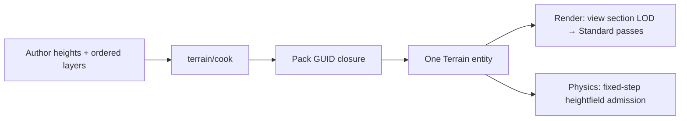

# Terrain

> [!IMPORTANT]
> Landscape foundation uses a finite XZ heightfield in metres, with Y up. `Terrain` uses an ordinary Scene Transform. The foundation admits translation, identity rotation and unit scale; physics requires a static `RigidBody`.

`@forgeax/engine/terrain` owns the component and pure kernels. `@forgeax/engine/terrain/cook` builds ordinary Pack outputs. Renderer submission and Rapier state remain with their existing owners.



## Source and cooking

Cooked section coordinates, bounds and active layers derive from `TerrainSection`; root height range and material encoding derive from `TerrainAsset`. Cook retains texture values until `buildTerrainAssets` assigns the published GUID references.

| Fact | Contract |
|:--|:--|
| Samples | `columns × rows` finite `Float32Array`, X-fast row-major, no holes |
| Subsection | Power-of-two 2–128 vertices; each axis contains complete `vertices − 1` quad subsections |
| Weights | Sample-major, one value for every ordered author layer; values in [0,1], nonzero weight group sums to one |
| Layers | Weight, height-adjusted weight, then ordered alpha composition; zero weight uses Standard defaults |
| Active budget | Ordinary controls: at most four active layers per subsection; ID controls: 1–32 original author layers with at most three candidates per fine control triangle |
| Height | One root RGBA8 atlas stores exact little-endian f32 height bytes; near-square section tiles retain their addresses across all mips, independent of author aspect ratio |
| Bounds | Independent conservative source min/max, never averaged height mip bounds |
| Topology | Every cell uses the 10→01 diagonal, shared by mesh indices, gameplay query and real Rapier; equivalent 16-bit and 32-bit index storage is accepted |
| Material | Default Standard base color/opacity, tangent normal, metallic, roughness, emissive and occlusion channels |
| Closure budget | Source ≤4,194,304 samples; source textures ≤1024 per axis; distinct active source image bytes ≤128 MiB per Terrain |

`cookTerrain(source)` derives height and weight textures without identities. `buildTerrainAssets(source, guidForSourceKey, assetsByGuid)` also derives grid meshes, controls and section materials, returning a Pack output map. The containing Pack supplies stable source keys and GUID derivation. Its complete read closure remains explicit.

`terrainDerivedLayoutValid` validates the complete ordered subsection roster and shared grids. Loader and inline Catalog admission use this same layout contract. Cooking samples the author grid directly, avoiding a decimal-spacing world/sample round trip.

Admission validates each canonical LOD grid, height mip and control byte, author bounds and the section material height/control bindings before exposing a candidate. A partial same-GUID rewrite cannot repin an existing root.

Section materials use the fixed Engine Standard Terrain programs (`forgeax::standard-terrain` or `forgeax::standard-terrain-ids`, with matching shadow programs) and three canonical forward/deferred/shadow passes. The shared `TERRAIN_MATERIAL_PARAMETERS` contract supplies their ABI. Engine shader builds prepare these fixed compositions; runtime author edits require no shader compilation or material Cook. Altered programs, parameter schemas or pass rosters cannot enter a Terrain closure.

The runtime source adapter accepts resident RGBA8 2D data and encoded textures through the existing texture decoder. Renderer residency retains exact source RGBA8 texels; GPU preparation linearizes sRGB neighbors before filtering and writes derived channels in binary16, with f32 Material values. Each actual selected frame owns four RGBA16F texture arrays at the largest selected source dimensions. Identical selections share active arrays; an edit GPU-copies the previous arrays and rebakes only changed layers when dimensions still match. Fragment sampling is four ordinary repeated, bilinear array samples. Preparation requires compute and RGBA16F storage-texture support. Unsupported shader/pass, physical-layer or coordinate extensions fail during cooking. Runtime never imports source files or compiles WGSL.

`terrainHeightBounds(min, max, heightRange)` derives conservative GPU geometry bounds from the packed-height half-step and f32 decode/morph rounding. Input validation rejects spacing, extents and derived bounds that cannot be represented by finite f32 values. Author extrema remain author facts.

## Optional material ID specialization

`cookTerrain(source, { kind: 'ids', maxWeightError: 0.001 })` and the fourth argument of `buildTerrainAssets` select a Cook policy. Painting still supplies complete `TerrainSource.layers` and sample-major weights. The default policy is `{ kind: 'weights' }`, preserving height blending and ordered alpha. `TerrainAsset.materialEncoding` records the accepted derived policy; old inline assets must declare the ordinary policy explicitly.

| Fact | ID contract |
|:--|:--|
| Eligible input | Pure weight layers; every weight group nonzero and normalized, or the entire field zero |
| Rejection | Height/alpha, mixed zero coverage, invalid budget or loss beyond budget; no silent fallback |
| Control | RGBA8unorm mip0: R bottom author ID, G top author ID, BA unsigned 16-bit top weight; 255 is the Standard default |
| Repair | Fixed 10→01 triangles; retain bottom IDs and remove top candidates deterministically until each triangle has at most three IDs |
| Edges | Repair one global author-resolution grid before copying shared subsection nodes |
| Sampling | Three discrete `textureLoad` controls, aggregate three candidate weights, then shared derived-channel sampling |
| Layers | Original author indices resolve immutable draw sampling rows; at most 128 MiB of distinct active RGBA8 source bytes per Terrain |
| LOD | Material control remains at mip0 independently of geometry LOD; height retains all canonical mips |

The explicit budget is total variation between the complete author bilinear weight field and decoded triangle weights, before material evaluation. For each original source cell, admission uses

$$E_{cell} \leq \max(E_{corner}) + \frac{1}{4}\operatorname{TV}(w_{00}-w_{10}-w_{01}+w_{11}),$$

capped by the general nonnegative-vector bound. This includes top-two removal, triangle repair, quantization and the bilinear-to-triangle cross term. It bounds every fine-cell point. It is not a pixel, normal or BRDF quality bound; material-specific image tests remain necessary. No coarse ID mip is published with an unproved author-field bound.

Controls remain four bytes per texel. A selected Material and its five source-image versions prepare four GPU channel planes once; ordinary rendering samples color, normal, ORM and emission from that shared cache. Height blending additionally samples its exact height source. Weight/height/alpha blending keeps its existing order and falsifiers. Actual GPU timing, preparation cost and retained memory remain acceptance gates; derived-cache reuse alone does not establish performance parity.

Canonical closure admission re-derives controls and verifies each section's material, sampler and original author indices. The Renderer admits shared layer references and the per-Terrain source-byte budget before capture. Invalid candidates cannot publish a partially changed root.

See material ID implementation and verification.

## Runtime and queries

The owning plugin registers `Terrain` in `World.components` through its ordinary component lease; a directly constructed World uses `world.components.register(Terrain).unwrap()`. One entity retains a managed Terrain asset handle. `assets.create({ kind: 'terrain', ...source })` accepts author height/weight arrays and managed layer handles without a Catalog. Engine assembles the domain decoders for its derived outputs. A standalone `AssetRegistry` must install `samplerContribution` from Render before creating or editing the closure; a missing owner rejects the whole candidate without publishing any outputs. Pack source GUIDs are linked once during loading. The root and all derived outputs are admitted atomically before rendering. Render expands a view-local section draw roster, selects continuous screen-size LOD and clamps to resident levels. Adjacent edges use the coarser of their two LODs. The shared kernel morphs XZ and decoded height using `2^k − 1` normalization; Standard color, GBuffer, depth, temporal and shadow use the same surface coordinates.

`terrainHeight(source, x, z)` queries author triangles. It returns `undefined` outside the source; it is not a display-height query. `terrainHeightfield(source)` converts author samples to the backend's column-major rectangular matrix.

`querySubmittedTerrainHeight(receipt, { worldId, entity, x, z, view?, expectedAsset?, expectedVersion? })` from `@forgeax/engine/render` reconstructs the canonical sampled, morphed triangles identified by the completed receipt. Multiple composed views require an explicit view key. It fails for unissued, failed, pending, stale-generation or expired receipts and for terrain that was not drawn. `expectedAsset` and `expectedVersion` optionally fence the exact ECS root handle and captured source version, including held views after replacement. Each Renderer retains eight terrain receipts, with owned CPU height bytes and no backend resources. Held views retain their previously drawn surface. LOD/mip/revision changes reject temporal deformation history and mark reactive coverage.

The receipt binds exact source bytes, triangle indices, LOD, neighbors and translation. The returned number is a canonical f32 reconstruction, not a bit-identical GPU readback: WGSL permits floating point reassociation and fusion. The height decoder restores the four IEEE f32 bytes with `textureLoad`; normals use neighboring decoded samples across logical section boundaries; LOD grids, mip indices and edge membership use integer operations. Small-coordinate height gates retain the `1e-5 m` threshold. Large-coordinate tests account separately for local arithmetic and world f32 rounding; height storage adds no quantization error. The wide-grid interior-height gate additionally transports horizontal rounding through the submitted triangle plane: `1e-5 m + 2 * ulp(width) * (abs(dh/dx) + abs(dh/dz))`. Vertex-height gates and the opposite-diagonal/bilinear falsifiers retain their original thresholds; degenerate triangles use the original height threshold.

The 3D physics sync phase admits `Terrain + RigidBody(static)` through the existing derived-shape candidate transaction. Read `PhysicsWorld.getDerivedPublication(entity)` after a positive fixed step before releasing gameplay that depends on collision. Rejected input preserves the prior physical publication. Rendering and collision have separate readiness; a common author source does not imply equal coarse-render and collision heights.

## Runtime editing and adoption

```ts
const terrain = assets.create({
  kind: 'terrain', columns: 2, rows: 2, spacing: 1, subsectionVertices: 2,
  heights: new Float32Array([0, 0, 0, 1]), weights: new Float32Array(4).fill(1),
  layers: [{ material: layerMaterial, blend: 'weight' }],
}).unwrap();
world.spawn({ component: Transform }, { component: Terrain, data: { asset: terrain } }).unwrap();
assets.update(terrain, { heights: new Float32Array([0, 0, 0, 3]) }).unwrap();
```

`update` captures author fields, prepares the complete derived closure, then replaces the root under the existing handle in one asset commit. Readers cannot observe a partially replaced section/material/texture set. Invalid author values or writes to derived fields leave the prior version intact. Derived outputs can be read or copied; direct `update`, `replace` and `writeRange` on those outputs are rejected. A copied output is independent editable content.

The renderer consumes the existing asset change journal into a persistent section tree. Each section owns its fixed packed height tile; a range edit replaces only intersected tiles and tree paths. Worker publications transfer only changed height samples and atlas regions; receiver bounds derive from those samples without copying the section roster. Actual view section execution reads this fixed root. Asset edits produce no entity extraction, entity upsert, instance fan-out or dependency-version polling, including the Render Worker path. Shared root preparation is reused across instances and views. Submitted sections retain their exact height input, bounds, LOD and material snapshot; a later root edit does not rewrite an old receipt. Source Catalog loading and invalidation leave the bound runtime version usable until explicit source adoption succeeds.

`assets.writeRange(terrain, { origin: { x, z }, size: { columns, rows }, heights })` writes an X-fast author sample rectangle. Preparation reads only that rectangle and its intersecting mip samples, then adopts root heights, conservatively expanded root/section bounds and atlas byte ranges at one revision. Invalid input or an exhausted range/byte budget commits nothing. Full `update` recomputes tight bounds and the complete closure. Explicit Terrain `copy` creates an independent derived closure while sharing the author Layer Material/Texture handles. Editing a shared Layer Material or Texture automatically affects the next render capture without updating Terrain roots, sections or entities. Material rows hold stable source-image identities, so texture edits and resizing do not rewrite Material rows. Fixed CPU captures retain only selected immutable Material inputs and source-image block trees. Actual draw selection derives four texture arrays directly from those inputs, with no GPU metadata table or CPU atlas mirror. Frame references retain the arrays and exact source rectangles. Old and new captures coexist in one submission, and retained CPU inputs recreate evicted GPU versions. A texture range update copies touched source blocks and uploads changed texels plus affected repeated borders. The changed selected layer is rebaked on GPU; other Terrain roots and sections receive no update. Arrays and source rectangles retire after their last actual frame and queued GPU use. Localized weight rebuilding remains a separate unfinished capability.

Collision adopts through its fixed-step publication; rendering and physics readiness remain separate. Use `PhysicsWorld.getTerrainAssetVersion(entity)` and a completed submitted-height receipt with `expectedAsset` / `expectedVersion` when gameplay requires both. The physics query derives the bound collider and successfully adopted shared geometry version; queued author edits do not advance it. A structured `frame-submit-rejected` records that queue acceptance did not occur and issues no successful receipt.

## Boundaries

> [!NOTE]
> The foundation is a bounded closure, not world streaming. CDLOD, virtual-texture page pools, biome streaming and holes require their own measured admission; they are not enabled by this package.

Pure kernels and compiler gates accompany the implementation. Real backend, browser pack-fetch, visual, timing, recovery and RHI Debug evidence belongs to the terrain scene and delivery report. Passing a pure-kernel test alone does not establish rendering acceptance.

Implementation, runtime evidence and performance boundaries.
