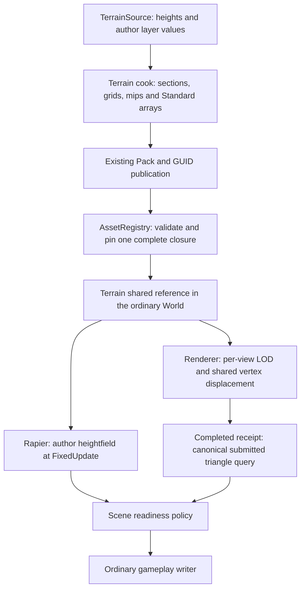

# Landscape foundation implementation and verification

> [!IMPORTANT]
> This document describes the bounded Landscape foundation (stage A) and its known curved/folded shadow-quality limitation. Captured runs and raw reports are not retained in the Engine source tree; current changes require fresh final-head acceptance. Virtual texturing, streaming, grass, CDLOD and GPU compression belong to later stages and have no placeholder implementation here.

## Reference and ownership

The implementation starts from classic Unreal Landscape: author height samples, subsection grids, explicit height mips, per-view continuous LOD, layer blending and independent heightfield collision. The research uses UE commit `71fe36aac5a8df5ccd66c763ffc902b29b6a9c43`. Engine organization follows existing ForgeaX owners rather than copying Unreal's object model.

| Reference | Mechanism used | Deliberate boundary |
|:--|:--|:--|
| UE Landscape component, edit and data-access source | Shared author edges, subsection storage and explicit height/control mips | Metres, Y-up and normalized local height encoding are the ForgeaX contract |
| UE Landscape render and vertex-factory source | Shared regular grid buffers, screen-diameter LOD and horizontal/vertical morph | Ordinary Standard material and one existing Renderer submission |
| UE Landscape layer-blend source | Weight group, height-adjusted group and ordered alpha overlay | Supported Standard base channels; unsupported extensions fail cooking |
| UE Landscape collision source | Collision derived independently from the author heightfield | Rapier's column-major convention is adapted by its backend |
| [Delta Force 2024 slides](https://media.gdcvault.com/gdc2024/Slides/GDC%2Bslide%2Bpresentations/Yang%2BShi%2BDelta%2BForce%2BTechniques%2B2024-03-29%2B06.26.49.pdf) and [2025 slides](https://media.gdcvault.com/gdc2025/Slides/Jiao_Hang_Delta+Force+Performant.pdf) | Future comparisons for local material sets and bounded working sets | Their VT, biome and CDLOD optimizations are not claimed as implemented |

Detailed talk/source analysis and the condensed design remain in the Engine Harness Knowledge Base and `docs/specs/2026-10-02-delta-force-terrain-forgeax-design.md` there. Engine package contracts describe the delivered API.

## Spatial and material contract

| Fact | Contract |
|:--|:--|
| Author samples | X-fast finite `Float32Array` heights in metres, positive regular spacing and one fixed triangle diagonal |
| Subsection | Power-of-two vertex width 2–128; adjacent sections derive the same logical edge samples |
| Topology | Heightfield without holes; caves and overlapping surfaces use another explicit geometry source |
| Pose | Finite translation, identity rotation, unit scale and static rigid body |
| Source bound | At most 4,194,304 author samples; real collision admits at most 262,144 cells |
| Material bound | 1–32 author layers, at most four active layers per subsection; exceeding the bound fails without silently dropping layers |
| Derived textures | RG16 height plus BA gradient in RGBA8 mips, RGBA8 control mips and bounded RGBA16-float Standard channel arrays |
| Layer semantics | Pure weight groups preserve normalized author weights; height groups apply the UE-style epsilon correction and normalization; alpha overlays retain author order |
| Zero group | Standard defaults; no fabricated active layer |
| Coordinate sampling | Height/control mips have explicit texel-centre and edge/halo rules; author material textures use the supported repeat sampling contract |
| Bounds | GPU bounds derive from author extrema plus RG16 half-step and conservative f32 decode/morph rounding; unrepresentable spacing, extents and bounds fail input validation |

Render height is quantized and its LOD morph can differ from author/collision height. `terrainHeight` answers the author triangles; `querySubmittedTerrainHeight` reconstructs canonical quantized, morphed triangles from an identified completed picture. Their errors and precision budgets are reported separately.

GPU floating point results are not bit-identical across implementations. [WGSL floating point evaluation](https://gpuweb.github.io/gpuweb/wgsl/#floating-point-evaluation) permits reassociation and fusion. A preserved real Metal compute tape reproduces a `2.097778 m` min/span cancellation in both constant and uniform input variants. The repair restores integer RG16 codes, uses the nearer height endpoint and moves discrete LOD/edge decisions to integer arithmetic. The small-coordinate `1e-5 m` height gate remains separate from large-world f32 rounding and author-to-render quantization. Six real Dawn kernel cases, including large-coordinate cancellation and noncoplanar triangles, passed the separate budgets. A real display tape additionally feeds its exact uniforms, mip bytes, VBO and IBO into the shared native-GPU kernel: 560 triangle interior and boundary-adjacent samples differ from the completed-picture query by at most `5.41e-6 m`. This is kernel recomputation from actual raster inputs, not hardware vertex-stage transform feedback.

## Publication and recovery

### Primitive normals and directional shadow reception

Terrain's baked gradient and material normal map describe shading. A coarser submitted triangle can have a different geometric normal. The real coarse-LOD carrier exposed self-shadow bands when directional receiver offset and filter-plane coverage used that shading normal. The shared Standard owner now derives its receiver normal from world-position derivatives before clipping or material evaluation. Scaling each derivative before the cross product preserves small and large nondegenerate triangles. Degenerate derivatives use a receiver fallback, while SSR still observes the raw geometric-validity result.

| Consumer | Normal authority | Cost |
|:--|:--|:--|
| Forward directional receiver | Primitive derivatives | No new attachment |
| Deferred directional receiver | Primitive derivatives packed with the existing 12-bit oct encoder | One view-owned `r32uint` attachment, four bytes/pixel and one lighting sample |
| Material, decals and BRDF | Authored/baked shading normal | Existing material path |

Ordinary Deferred now needs six color attachments and writes 28 attachment bytes/sample including SceneColor. Visible-surface Deferred needs seven attachments and 48 aligned bytes/sample. Device admission requests the latter byte limit only when available and preserves the default eight-attachment capacity. The receiver texture participates in the existing graph lifetime and the lighting bind-group cache key; an owner-level guard-removal experiment made the texture-replacement regression fail before its correction.

The first shadow matrix showed a grazing-angle receiver issue against a frozen 2/255 threshold. The producing shader now retains filter-footprint coverage at front-facing angles and bounds total bias before the strict sampler comparison. Captured matrices and replay receipts have been removed from Engine Git; these historical notes do not qualify a current source revision.

The subsequent per-tap PCF sampling correction, pinned Three.js/Godot/Unreal comparisons and remaining quality/performance boundaries are recorded in [shadow-pcf-followup.md](shadow-pcf-followup.md).

### Completed-picture publication

Catalog publication validates the complete candidate before adoption. The terrain root pins transitive immutable assets. A partial same-GUID rewrite cannot repin the old root. Admission compares canonical grid vertices/indices, height/control mip bytes, all four encoded Standard arrays, layer blend modes and canonical control sampling against the author root; extraction also checks the GPU material bindings against the pinned closure.

During asynchronous catalog replacement, an incoherent terrain source is omitted from new extraction. The scene readiness policy blocks the actual gameplay writer until the new root has both a positive FixedUpdate collision publication and a completed submitted query with the same root handle. The ordinary shared-reference acquire/release contract owns component replacement. Late load/query results cannot release a newer barrier.

A failed queue submission aborts candidate publication, temporal state and shared feature consumption before reporting `frame-submit-rejected`. Engine-only Worker execution settles simulation credit without inventing a render receipt; its next retry retains a pending temporal reset. Split rendering permits one bounded Render Worker replacement, invalidates old-session submitted queries and preserves the existing World. Successful work resets the retry budget.

Receipts retain bounded CPU surface facts from actual display draw callbacks, not GPU resources. Hidden and omitted sections cannot satisfy a submitted-picture query. Height reconstruction retains source bytes and evaluates the canonical f32 decode/morph; nondegenerate small triangles use their actual determinant rather than an absolute area cutoff. The result binds the submitted surface facts precisely and allows WGSL numerical variation; it is not a GPU position readback. The eight-receipt window and explicit view key make held views, expiration and asset identity observable. Queries fail for pending, failed, unissued, expired or stale-generation pictures.

## Verification evidence

> [!WARNING]
> These checkpoints precede the final delivery checks. Engine PR #3613 contains the authoritative final-head browser/Dawn/smoke, independent review and CI receipts. The first isolated performance run failed its CPU budget; it is retained below.

| Checkpoint | Measured result | Evidence boundary |
|:--|:--|:--|
| Source, canonical layout/material and cache gates | 33 tests PASS | Rejects decimal-boundary loss, shifted/missing/reordered sections, altered Standard programs and stale fractional/neighbor shadow content |
| Material cooker | Root and inherited Terrain material PASS | All raster contexts select terrain and include the shared vertex kernel |
| Physics | Six real Rapier cases PASS | Decimal-spacing outer edges and asymmetric/noncoplanar author triangles; rendering error is separate |
| Surface reconstruction | Query contract derives height from the submitted raster triangles | Captures and numeric outputs are generated locally and not stored in Engine Git. |
| Layer semantics | Real Dawn fragment gate PASS | Cooked channels, zero weight defaults, two-alpha order, height epsilon and cancelling normals |
| Views and shadows | Uses existing Renderer submission, view, and shadow ownership | Runtime results must be regenerated locally for acceptance. |
| Standard effects | Forward/Deferred, fog, decal, SSR/TAA remain ordinary consumer paths | Pixel captures are generated locally and not stored in Engine Git. |
| Split Worker HMR/recovery | Uses existing Browser Catalog transport and bounded worker lifecycle | Runtime results must be regenerated locally for acceptance. |
| Browser replay | Chrome fresh-device replay PASS, maximum pixel difference `1/255`, coverage 0.506 | Real 60-frame display capture; epsilon 0.05 retained |
| Isolated performance | Historical performance gate remains a separate current-head acceptance requirement | Run outputs and process audits are not stored in Engine Git. |
| Final directional receiver matrix | Must be regenerated by the maintained Forward/Deferred native gates | No saved matrix is checked in. |
| Final view isolation/rejected submission | Must be regenerated by the maintained view and submission gates | No saved receipt is checked in. |
| Full smoke/browser/Dawn and latest-head CI | [Final-head check receipts](https://github.com/ForgeaX-Games/forgeax-engine/pull/3613) | Complete required gates before merge |

Historical image exports were stored outside this Engine repository. This Engine tree now contains source and authoring contracts only; run-specific captures must be regenerated locally.

Actual Forward Landscape
Two view-local LODs

| Current evidence | Result | Boundary |
|:--|:--|:--|
| Final native surface | 16 raster works, 560 probes; peak `5.41e-6 m` | Actual captured mips/grid/uniforms; shared-kernel recomputation, not vertex-stage readback |
| Primitive normal lineage falsifier | Correct tape PASS; second view rebound to first view's Ng fails | Exact capture and assertion block; original bytes unchanged |
| Cancellation fresh-device replay | All 64 vec4 records PASS; small-height peak error 0 | Output and provenance; declared large-domain f32 budget retained |
| Engine-only Worker | 60 completed frames, Native submit rejected once, accepted history unchanged, old and retry receipt queries succeed; same World, final `inFlight=0` | Actual report; single-camera `Renderer.inspect().temporal` owns observation |
| Browser fresh-device replay | Mean pixel difference approximately 0, max channel `1/255` at 1280×720 | Same-capture report; node replay is a separate diagnostic |
| Split Worker HMR | Source changes, collision barrier and bounded Render Worker replacement PASS | Actual report |
| Six native performance runs | Three runs PASS, three FAIL; six of 48 CPU p95 cases exceed 8 ms, worst `17.600 ms` | Every sample and window; GPU union and completion budgets pass every case |

All six performance runs with original budgets

### Integrated-main negative controls and response window

The expanded 66-case planar/grazing/PCF3/PCF5/caster matrix passes, while four real vertical-light curved controls fail their unchanged 2/255 budget (peaks 41/59). Unmodified fresh-device replay is byte-identical to the live frame; replacing only its receiver shadow-factor function with one is byte-identical to the shadow-off reference. This identifies the receiver/filter chain, not a successful product workaround. Full receiver radius alone and caster slope alone both leave failures. A combined frozen-source diagnostic closes the tested curve and two continuous-fold phases. Its production revision subsequently fails PCF5 curved/fold controls and existing near-caster gates (PCF1/PCF5 dark coverage 10/0; centimeter contact ratio 1). Independent review rejects the same bias merely scoped to Terrain because a nonconstant heightfield can contain a flat receiving patch. The full-radius/default-caster-slope product experiment is withdrawn; the primitive-normal, per-tap plane and one-bilinear-texel implementation remains. Curved and folded terrain shadow quality remains a limitation, including default PCF3; this is functional foundation evidence rather than a complete visual-quality PASS.

Normal `App.start()` movement/collision semantics pass across the entire fixed 60-submission window, with 60 completed ready frames, zero pre-update submissions and zero pending settlements. The first updated submission is 8.1 ms after the intent; first completion is 197.2 ms. Completion-interval p95/peak are 132.5/245.8 ms, and submission-to-completion p95/peak are 168.7/246.0 ms. Seven completion intervals exceed 100 ms. This shared correctness window proves collision/response identity and preserves unresolved tail latency; it does not replace exclusive timing acceptance.

The second predetermined timing series keeps all six runs: 38/48 CPU p95 cases and 25/48 frame-completion cases fail, with zero GPU interval-union failures. The worst CPU wall p95 is 110.280 ms. Separate thread-CPU diagnostics never replace or reduce the original wall samples. Immutable paired raw data and plot also retain all curved controls, counterfactuals and normal response data.

### Final shadow-policy recovery

The wide-footprint experiment is withdrawn after independently reproducing its near-caster regressions. The retained shader passes all 74 real planar/grazing/filter/caster controls, 19 shadow/cache unit cases, and the original five browser centimeter-contact cases at their unchanged gates. The first browser cold-start PCF1 timeout is preserved alongside the complete five-case rerun. The source-built shader producer fingerprint is `9fd75cd1037eb32a3af61b47d209ad388459226f11264144b5f3bbc4301030bf`; its Git parent still names the withdrawn experiment, so the exact source hashes identify the actual producing shader separately.

All four near-caster cases pass: both receiver types and raster paths retain 36,846 lit pixels and 100/97 PCF1/PCF5 dark pixels at the original >50/85% gates. The new near-caster fixture requires a fully adopted Terrain closure and genuinely cooked/loaded Ready section materials. GUID references use the actual Catalog; compiled module references follow the existing material loader contract. A minimum lit coverage rejects missing terrain before testing shadow retention. Optional RHI capture checks actual Terrain color work and the initial PCF1 Standard plate shadow writer, and closes the recorder on failure. The intermediate empty-ground and module-reference fixture failures remain preserved.

These functional recoveries do not change the original curved/folded image failures or performance results. The evidence includes actual failed-pixel depth/Ng/View readbacks and finite-filter tap diagnostics; the JavaScript reconstruction does not establish the shader-selected cascade or replace GPU quality validation.

### Cost and timing boundaries

The Landscape authoring bound is 125 × 125 samples, 16 sections, and five grid levels. Historical serialization and memory inventories were removed from Engine Git; these source notes are not a GPU-memory or streaming result.

Performance records eight static/moving LOD0/auto/LOD2 cases at 960 × 540 with 1024-pixel directional shadows, 60 warmup frames and 60 measured completed frames each. Budgets were declared before measurement: GPU interval-union p95 ≤16.67 ms, CPU draw p95 ≤8 ms, and frame-to-completion p95 ≤33.34 ms. GPU interval sum, union, duplicated overlap and envelope remain separate; native outer timestamps are unavailable. Queue wait and observer overhead are included without subtraction. The exclusive lock/PID audit qualifies isolation, while a later shared-lock CPU profile is diagnostic only. Three repetitions of each raster path retained all six results at those thresholds. The cooperative exclusive lock does not stop unrelated system services; process audits observed background `lsof` activity. This remains a possible confounder, not proven causation. CPU sampling attributes startup `equalBytes` to asset publication rather than the draw stack. A draw-wall/thread-CPU diagnostic is required to separate execution growth from off-CPU time; no guessed overhead is deducted.

Preserved failures and owner fixes

- A real browser tape exposed an incompatible terrain bind-group layout; assembly now derives the actual Standard terrain ABI.
- Distinct section draws incorrectly shared the entity-keyed validated IBO. The owning draw key now includes the section; the tape confirms one shared VBO and distinct integer-LOD IBOs.
- Packed uncompressed height textures advertised all mips while uploading only the base level. The shared packed-texture upload owner now writes every level; its regression failed before the fix.
- Real Metal arithmetic reproduced a `2.097778 m` cancellation. Integer RG16 decode, nearest-endpoint anchoring and discrete LOD operations fixed the numerical owner while preserving separate small/large-coordinate budgets.
- Decimal spacing mapped a valid outer author vertex outside the sample domain. World queries clamp only after the actual extent check; cooking samples the author grid directly.
- Inline Catalog candidates could shift, omit or reorder sections. Loader and closure now share canonical derived layout validation.
- Fractional and neighboring LOD changes could satisfy the old World/caster shadow proof. Mandatory terrain content comparison now precedes cache reuse, with a red guard-removal regression.
- Initial HMR missed Vite Catalog deltas; it now uses the existing CatalogSource subscription. A subsequent fixture used a production bootstrap on a dev server; it now sets the development environment explicitly.
- An acceptance build used app-shard shader deltas without the complete consumer transport. Its empty global shader manifest caused a real ShadowCaster rejection before the first submit. The full source-build route restored the required entries. The harness now subscribes directly to Renderer errors and checks that required shader publication before starting GPU acceptance. No shader or shadow owner was changed for this fixture failure.
- The first isolated CPU timing exceeded its budget. Its raw samples are not retained in Engine Git; passing functional gates does not erase that historical result.

## Final recovery evidence publication

Assets PR #43 publishes the independently reviewed shadow-policy recovery, all original failures and actual RHI resource lineage. The immutable revision is `156e827561a9e7985535ef3209f78fd7be024eab` and its SHA-256 inventory covers 1,218 files. Six new near-caster tapes were losslessly compressed after their decompressed digests matched the originals; the RHI carrier proves actual plate casting and Terrain reception.

Actual failed fold depth footprint

74-cell actual receiver matrix, four actual near-caster cases, complete five-case browser contact rerun, and independent review separate measured functionality from unresolved quality/performance. Final required CI, the complete 99-entry smoke roster and exact-head admin merge are tracked by [Engine PR #3613](https://github.com/ForgeaX-Games/forgeax-engine/pull/3613).

The archived recipes were later renamed byte-identically to `.ts.txt` after Vite discovered their old test suffixes as executable tests. Assets PR #44 fixes this evidence packaging boundary at `141151dd809d2500ad33df376117166e7ae22194`; all original recipe bytes, measurements and failing browser logs remain retained. Copy a historical recipe back to its producing Engine test path to execute it. This changes no product shader, actual Engine test or numerical gate.
