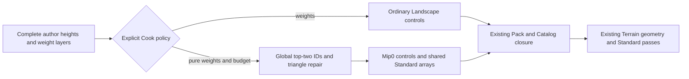

# Terrain material ID specialization

> [!IMPORTANT]
> This is the first bounded Delta Force material specialization on the existing UE Landscape foundation. Complete author layers remain the source of truth. Verification is in progress; no runtime, visual or performance acceptance is claimed before its evidence is recorded below.

## Evidence and implementation boundary

The Knowledge Base's Delta Force research supports ID/weight material controls, at most three material IDs per triangle and shared texture arrays. It does not establish our byte packing, repair algorithm or error metric. Those are ForgeaX choices. The UE Landscape base continues to own author heights, layers, shared grid LOD/morphing and independent heightfield collision. The source comparison remains in the [foundation report](../landscape/implementation.md#reference-and-ownership). The Knowledge Base terrain synthesis and its linked Unreal source leaves separate disclosure, analysis and ForgeaX decisions. Source references to Unreal, Godot and Three.js inform boundaries rather than act as proof of ForgeaX execution.

| Decision | Reason |
|:--|:--|
| Optional pure-weight policy | Height adjustment and ordered alpha are nonlinear; silently pruning them changes semantics |
| Original author IDs | A 32-layer terrain needs no per-section layer-index remapping |
| Global repair before edge copy | A shared author node has one encoded value across neighboring subsections |
| Mip0-only material control | The actual renderer uses mip0; a coarse corner bound does not cover interior fine author peaks |
| Shared source arrays | Avoid duplicating every original author layer in every subsection |
| Complete author arrays retained | Editing and collision keep the source authority; compact runtime roots are a later measured decision |
| Existing Cook/Render owners | No alternate publication registry, renderer or shader compilation in the player |

Independent review found that coarse mip corners could miss a fine author peak with total variation 1. Those unused mips were removed, preserving the fine-cell bound and original height mip chain. Review also removed an unvalidated public helper and repeated validation of the same shared arrays. A regression retains the source peak and asserts that no coarse control is published.

## Acceptance

| Dimension | Required evidence |
|:--|:--|
| Author semantics | Source bytes unchanged; height/alpha and mixed zero requests rejected; 32-layer ID lookup and zero default |
| Derived closure | Fine-cell whole-domain bound, three candidates per triangle, byte-identical section edges, control/array/program tampering rejected |
| Production path | Pack Cook, JSON transport, Catalog readiness and actual Renderer shader selections |
| Appearance | Same author data, scene and geometry; Forward/Deferred, LOD0/auto/LOD2/motion; peak RGBA difference ≤2/255 |
| RHI Debug | Actual control bytes and mip descriptor, shared texture identities, submitted LOD/neighbor uniforms, original fresh-device replay |
| Costs | Author bytes, control bytes, global/per-section array costs, Cook and admission intervals |
| Performance | Exclusive physical device, three ABBA series per path, 60 warm +60 measured; raw timestamps and unchanged budgets |
| Delivery | Full required CI at final head, immutable images/data inventory, independent final review, admin merge and origin/main proof |

## Shadow writer stability

The initial real Forward pair exceeded the existing two-byte gate at one pixel: peak 5/255. Unmodified fresh-device replay reproduced it. Replacing only both directional receiver factors with one reduced the paired peak to 1/255, localizing the difference to shadows without accepting that counterfactual as a repair.

Actual writer frames were then captured by changing LOD0 to LOD2 and restoring LOD0, which exercises the existing cache invalidation owner. Each frame contains 13 terrain caster draws over four cascades. Baseline replay found 87,435 / 110,820 / 78,113 / 938 differing depth texels, with maximum absolute depth difference up to 3.04e-6. Adding only `@invariant` to both shadow position outputs made all four depth32float cascades byte-identical and reduced final paired color peak to 1/255. The shared shadow template now carries that attribute. This constrains identical position arithmetic across material specializations; it does not promise cross-device float identity or fix the prior curved/folded filter limitations. See [WGSL invariant semantics](https://www.w3.org/TR/2026/CRD-WGSL-20260921/#invariant-attribute).

The preserved original tapes and counterfactuals are diagnostic evidence. Acceptance additionally requires unmodified production captures after the fix.

The user's review identified visible polygon outlines shared by both material paths. Those remain a quality failure. The independently reviewed [Terrain self-shadow repair contract](terrain-self-shadow.md) records the required geometry semantics, existing owner boundaries and unchanged falsifiers; its production validation is still pending.

## Preliminary measurements

These are retained measurements before the pending self-shadow repair. They establish the material specialization's behavior and costs, not final visual acceptance. Final rendering changes require new captures and timings.

| Fixture cost | Ordinary weights | IDs |
|:--|--:|--:|
| Complete author height / weight bytes | 64,516 / 258,064 | 64,516 / 258,064 |
| Four Standard array channels | 16 arrays, 2,097,152 B | 4 arrays, 524,288 B |
| Material control bytes | 87,376 | 65,536 |
| Height bytes | 87,376 | 87,376 |
| Cook median / p95 | 188.255 / 203.981 ms | 83.112 / 83.481 ms |
| Admission median / p95 | 191.222 / 191.236 ms | 91.355 / 93.167 ms |
| Unique closure backing buffers | 3,178,516 B | 1,583,812 B |
| Logical metadata / artifact inventory | 9,883,497 / 7,035,832 B | 9,901,524 / 5,448,351 B |

The array saving is 75%; removed unused control mips save 25%. Mip0 itself is four bytes per node in both paths. The fixture publishes both roots in one actual 19,774,928-byte package, so these logical inventories do not establish a selected-root download reduction. Arrays, author storage and shader text remain distinct costs; backing-buffer counts exclude transient decoding, JS objects and opaque driver memory.

Eight paired image comparisons at 960x540, Forward/Deferred, LOD0/auto/LOD2/motion, had peak 1/255 and zero channels outside the unchanged 2/255 gate. Original fresh Metal replay reproduced captured pixels exactly. Actual RHI bindings showed mip0 controls and one shared four-channel array set for IDs, including the submitted LOD/neighbor data. Both images still contain the user's reported shadow outlines.

The retained third performance run used an Apple M4 Pro Metal adapter, exclusive GPU admission, three ABBA series per path and 60 warm +60 measured frames per case. Each entry below is the median of six per-case p95 values, followed by the worst p95, in milliseconds.

| Path / encoding | CPU draw | GPU interval union | Frame to completed |
|:--|--:|--:|--:|
| Forward / weights | 2.457 / 2.899 | 3.801 / 3.867 | 7.078 / 8.399 |
| Forward / IDs | 2.689 / 3.392 | 3.736 / 3.801 | 7.621 / 10.576 |
| Deferred / weights | 3.290 / 4.189 | 3.178 / 3.211 | 9.445 / 12.245 |
| Deferred / IDs | 3.404 / 3.571 | 3.080 / 3.146 | 9.093 / 9.581 |

The unchanged budgets were CPU draw p95 <=8 ms, GPU interval union p95 <=16.67 ms and frame-to-completed p95 <=33.34 ms. All 24 cases passed in that run. The preceding complete run failed three ordinary Deferred CPU cases at 8.027 / 8.299 / 9.752 ms; this result remains evidence, and the passing rerun does not prove its cause fixed. An earlier partial run exhausted the V8 heap after six cases when the harness used a new manifest URL per App; the harness now uses its stable published manifest identity. No general frame-speed improvement is claimed. Raw pass sum, union, duplicated overlap and measured envelope remain separate; native outer GPU timing was unavailable.

Both ordinary Host browser roots passed real JSON transport, source/root assertions and fresh browser replay. Worker validation exposed a fixture transport error: a streaming TapeArtifact contains a function and cannot pass structured clone. The existing inspection seam now receives its byte/digest/type projection; the actual executeScript plus production tapeArtifact regression reproduced DataCloneError before the correction and passed after it. Real Worker capture/replay is pending.

The prior foundation's disclosed curved/folded-shadow and CPU/frame-completion failures remain in [its report](../landscape/implementation.md). Final self-shadow acceptance, required CI, immutable evidence publication and merge are pending.

## Candidate source validation

The committed repair is based on `a6d0259749ba2e27fa9bee224a9631a65b5e540d`. Its affected packages, shared shader producer and Terrain app build pass. Renderer Node tests passed 570 files and 3,054 tests before the final partial-update regression was added; that updated six-test fixture also passes separately. The complete render test TypeScript project and repository lint pass; lint retains six existing warnings.

[Independent source review](candidate-review.md) found two concrete gaps, each reproduced before correction: a failed graph replacement could reuse old shadow resolution with new receiver parameters, and a static-layer retry after rejected submission could skip Terrain family copies. The graph-owner gate now checks root identity, cascades, resolution, capacity exhaustion and rejected candidate retry. The real RHI-null graph/encoder fixture checks full static copies after abort and after partial updates, producer/copy/raster ordering, and zero copies on subsequent cache hits. Its empty caster scene proves scheduling rather than GPU depth or image quality.

Immutable original-frame replay verifies the mechanism: baseline is byte-equal to the original live capture, changing only Terrain shadow culling removes the shared outlines, and the weights/IDs counterfactual pair remains within one byte. This is diagnosis. The earlier post-work Deferred Ng/depth audit agrees with 49 submitted-triangle probes; it does not validate the later failed pixel.

The exclusive candidate sequence at `0923f76ac980c4aad47cb0e47d9d6c489b7ae541` failed and stopped after a native crash. Its results remain immutable:

| Actual candidate result | Meaning and follow-up |
|:--|:--|
| Metal selector, twelve folded vertical pairs, real folded blockers and 74 receiver controls passed | Preserve the original numerical gates and finite-edge falsifiers |
| Curved vertical light failed one pixel at `(718,234)`, peak 38–43/255 in six Forward/Deferred PCF cases | Actual post-work receiver/face routing diagnosis is pending; no image threshold change |
| Writer lacked an actual GPU static producer | The fixture used an uncooked CPU material; load the existing cooked Catalog layer and rerun the unchanged depth-conservation gate |
| Original eight-centimetre controls passed; default one-centimetre controls failed | Actual Terrain View UBO contains a five-centimetre authored normal offset, above the whole plate; retain that negative and add a separately named zero-offset causal control |
| Original four multi-view controls passed; new target capture failed an API call | Correct the fixture's plain `RenderResult` handling, then rerun auxiliary capture/held-view checks |
| Local-light sequence exited with native signal 11 | Preserve the failure and add PID, source/build hashes and pre-native phase checkpoints to localize it |
| Effects interrupted; Browser/Workers and performance not run | None can be claimed as candidate acceptance |

Full CI passed all 21 required contexts at the earlier `57d65af82680fa0f1dc301ccc87a6c013f2202cf` checkpoint, taking 56 minutes including queueing. It neither meets the 30-minute efficiency target nor establishes final-head delivery. The final implementation, effects, static depth, captures/Workers, timings, independent review and latest-head CI must all complete before merge.

## Image publication

[Foundation PR #3613](https://github.com/ForgeaX-Games/forgeax-engine/pull/3613) now uses four native GitHub image attachments. Each attachment and each authenticated rendered image source was downloaded and checked byte-for-byte against the pinned original PNG. New candidate images use the same attachment route; immutable repository files retain the complete archived evidence. Native attachment validation proves the fetched image source, without claiming a browser UI screenshot.
