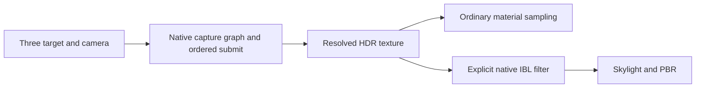

# Three.js objects on the Forgeax renderer

`@forgeax/engine/three` targets **Three.js 0.187.0 `WebGPURenderer`, using WebGPU**.
It reuses Three's CPU objects and projects them into Forgeax Scene, Geometry,
Material, Skin and managed assets. Forgeax owns the render graph, GPU submission,
resource lifetime and RHI capture. The package does not ship a Three GPU renderer
or a runtime shader compiler.

Start with the package design and maintenance guide for ownership, field synchronization, proposed direct ECS access and the evidence for a compatibility claim. The [package design map](#package-design-map) below links directly to this revision's code. The earlier compatibility review records version-specific measurements and physical texture recipes.
WebGL backends are outside the target. The supported Three post-processing
addon sequence is described below. The 118 public CPU addon subpaths share
the facade's original constructor family and import no native renderer or cooked
material programs. They include the existing OrbitControls, GLTFLoader,
BufferGeometryUtils, SkeletonUtils and MeshSurfaceSampler, plus:

- RoundedBoxGeometry, ParametricGeometry, ConvexGeometry, BoxLineGeometry and TextGeometry.
- FontLoader, STLLoader, PLYLoader and XYZLoader (synchronous parse returns BufferGeometry).
- OBB, Octree, ConvexHull, Capsule, ImprovedNoise, SimplexNoise, CurveExtras and SceneUtils.
- EdgeSplit/Simplify/Tessellate modifiers, DecalGeometry, ParametricFunctions and TeapotGeometry.
- OBJ/MTL/HDR loaders and OBJ/STL/PLY exporters; PLYExporter returns data synchronously without a callback.
- AnimationClipCreator, CCDIKSolver, CameraUtils, ColorUtils, GeometryUtils, Lut and normal/tangent/Octree helpers.
- FBX/SVG/BVH/PCD/VTK/MDD/PDB/NRRD loaders, TGA/DDS/KTX/EXR/IES and Cube/3DL LUT loaders.
- NURBSCurve/Surface/Volume/Utils, LoftGeometry, ConvexObjectBreaker, ColorConverter, ColorSpaces and SortUtils.
- Arcball/Drag/FirstPerson/Fly/Map/PointerLock/Trackball/Transform controls and SelectionBox/SelectionHelper.
- Collada/3MF/AMF/VOX/TDS/VRML/GCode/RGBE loaders, GLTFExporter, AnimationPathHelper and SceneOptimizer.
- MD2/TIFF/PVR/KMZ/LUTImage/HDRCube loaders, CPU DataTexture EXR export, UVsDebug, WorkerPool and GeometryCompressionUtils.
- MarchingCubes, Gyroscope, MorphAnimMesh/MorphBlendMesh, MD2 character managers, TubePainter and RollerCoaster geometries.
- USD/USDZ/LWO loaders, texture-free USDZ export, Volume/VolumeSlice, InteractiveGroup, CSMFrustum and Color/Debug/Room environments.

Import each through `@forgeax/engine/three/addons/<category>/<name>.js`.
Generated geometry uses the existing native topology and material admission.
Points transport RGB/RGBA vertex colors through the existing native point tint
stream, including normalized attributes, source color revisions and color-enable
changes. Stock PointsMaterial supports size, perspective attenuation, and map
sampling over generated sprite coordinates. Points with source UVs, separate alpha
maps, and custom node point sizes need a separate sampling or sizing path.
PointsNodeMaterial retains its admitted uniform/reference inputs. Lines still
reject textures and per-vertex colors. Octree and OBB are CPU queries.
OBJ/MTL keep their original Phong CPU materials; select a supported native material
explicitly for rendering. HDRLoader parsing does not install environment lighting
or PMREM. Modifiers, exporters, clip generation and CCD IK run only when called;
there is no implicit worker, animation tick, helper render or per-frame export.
SimplifyModifier retains its original embedded meshoptimizer WASM initialization
and readiness; await modify(). It is not installed in the frame loop.
Exporters retain upstream format limits; binary STL and PLY are round-trip tested.

FBX preserves its original CPU scene, skeleton and material data; select supported
native materials explicitly. SVG path parsing requires a real DOMParser; shape
geometry then uses ordinary native mesh projection. BVH/MDD data, NRRD volumes,
IES textures, LUT descriptors and color-space definitions do not install native
animation, volume, lighting or post-processing systems. DDS/KTX compression still
needs the existing native format/device capability admission. ConvexObjectBreaker
produces CPU meshes and writes their userData; it creates no physics bodies.

VTKLoader.parse accepts ArrayBuffer without a path (the upstream r187 loader is
deprecated and its format sniff expects at least 250 bytes). NRRDLoader.parse also
consumes ArrayBuffer; setSegmentation returns void. Its field parser helpers are
module-private. ColorConverter.getHSV writes h/s/v to the caller's original target.
ConvexObjectBreaker outputs nullable Mesh fragments, and radixSort accepts
Uint32Array with matching caller-owned scratch. These declarations retain the
original runtime identities. Network loading,
arbitrary files and native LUT/volume/IES consumption are not new acceptance claims.

Controls retain upstream DOM listeners and explicit updates. FlyControls and
FirstPersonControls require `update(deltaSeconds)`. Dispose controls when their
canvas is retired; Arcball keeps upstream optional inertia animation. No extra
Engine frame driver or View editor is installed. PointerLock movement is tested;
browser lock permission is not. TransformControls attach/mode state is available,
but its helper uses nonfinite renderOrder and remains rejected by native admission.
SelectionHelper needs an HTMLCanvasElement host (`{ domElement: canvas }`), not a
WebGLRenderer or OffscreenCanvas. SelectionBox remains a CPU frustum query.

Collada/AMF/3MF parsing requires DOMParser; loaded materials retain upstream
models, so select supported native materials explicitly. AMF units are converted
to millimeters by its original loader. VOXLoader.parse can return undefined, and
its result.scene can be null for files without scene nodes; use chunks/buildMesh
for those files. RGBELoader retains its deprecated HDRLoader alias behavior.
AnimationPathHelper uses UUID position tracks; line/points may be absent if no
track matches. Its existing Line/Points children render through native projection.
GLTFExporter retains original FileReader and injected compressed-texture utilities;
only texture-free JSON/GLB round trips are newly verified here. SceneOptimizer
explicitly rewrites the source scene and disposes replaced meshes/assets. Its
BatchedMesh result uses the existing CPU expansion route, not native GPU instancing;
this export is not a frame-time improvement claim.

MD2 parsing preserves absolute morph frames and clips; invalid MD2/PVR headers can
return undefined. TIFF decoding and DataTexture EXR export operate on CPU bytes;
EXR renderer readback overloads are not newly supported. KMZ uses a real DOMParser
and retains Collada material models. HDRCube loading returns six CPU DataTextures,
not native IBL filtering. LUTImage builds Data3DTexture data without native 3D-LUT
sampling. PVRTC parsing does not establish device compression support.
GeometryCompressionUtils explicitly mutates attributes into packed encodings;
these require matching shader decode and are not admitted as native mesh inputs
by this addition. UVsDebug requires Canvas2D. WorkerPool creates workers only via
the caller factory and explicit postMessage calls; dispose terminates them. It
adds no Engine scheduler. Its real queue field replaces the upstream type typo.

MarchingCubes and MorphAnimMesh/MorphBlendMesh use the existing Mesh/morph route;
call their update methods explicitly. MarchingCubes reuses its field/output buffers
until resolution changes. MorphBlendMesh requires morph geometry at construction;
its inherited clone() retains the upstream missing-geometry constructor failure.
AnimationClip morph-sequence factories accept named BufferAttributes
without obsolete vertex arrays and retain their original constructor/static identity.
The ordinary scene traversal drives Gyroscope's original `updateMatrixWorld`
behavior. MD2 character managers retain
explicit update/load ownership and create no frame driver or native controller.
Assign controls before calling MD2CharacterComplex.update().
TubePainter exposes moveTo/lineTo/setSize/setColor/update; the historical public
stroke/updateGeometry declarations describe private helpers. It retains upstream's
three eagerly allocated attribute arrays (36 MB total), even for a short stroke;
this export does not establish an efficient native dynamic-stroke renderer.
RollerCoaster exports ordinary CPU geometries; TreesGeometry retains upstream
randomness and raycasting. ShadowMesh retains its planar matrix and stencil
material; native projected-shadow rendering is not newly qualified here.

USD/USDZ and LWO preserve original hierarchies, transforms and material models;
select supported materials explicitly for native rendering.
Zero/constant UVs remain valid without tangent-space inputs: the native vertex ABI uses
normal-plane tangents instead of requiring an unused UV-derived frame. Normal,
bump, clearcoat-normal and anisotropy inputs retain authored-UV tangent validation. Changing that material requirement also
changes the geometry cache variant.

Texture-free USDZ
export/reload is verified; compressed-texture readback and external asset networks
are separate contracts. Update source world matrices before USDZ export. The deprecated USDZLoader alias retains the original
warning. Volume accepts backing buffers, and map callbacks return replacement
voxel values. NRRDLoader returns that same Volume constructor family and supplies
orientation/window metadata before slicing. VolumeSlice uses real Canvas2D and
explicit repaint; it is not native volume ray marching. InteractiveGroup only
needs `{ domElement: HTMLElement }` and a Camera for direct-child CPU picking;
disconnect it when retiring the host. XR event transport is not newly qualified.
CSMFrustum is CPU split math, not native CSM integration. Color/Debug/Room are
disposable source scenes, not a new PMREM or environment-capture implementation.

`setRenderTarget(null, face, mip)` retains default-framebuffer selection metadata:
face is an integer from 0 to 5 and mip is a nonnegative safe integer. Omitting them
resets both to zero; RendererUtils save/restore preserves them. They select no GPU
subresource on the default framebuffer. The ordered target contract below covers
non-null targets.

## Package design map

| When changing | Start in this package | Behavior to preserve |
|:--|:--|:--|
| r187 exports, declarations, loaders and CPU addons | [Public facade](src/index.ts), [CPU exports](src/cpu.ts), [bundled Three sources](tsup.config.ts), [API inventory](scripts/audit-api.mjs) | Imports must resolve to the same constructor family. A name or type match establishes API availability. Native consumption needs a behavioral check. |
| Rendering or mounting into an existing World | [Renderer](src/renderer.ts), [mount](src/interop.ts), [scene projection](src/scene.ts) | Both entrances project the same source semantics. The host of a mixed World controls simulation and submission. See [World ownership](#share-a-native-world). |
| Draw preparation and view selection | [Frame state](src/scene-state.ts), [mesh planning](src/scene-mesh-planning.ts), [view selection and order](src/scene-view.ts) | Scene projection owns ECS publication. Planning selects draw inputs and the view applies Three-specific ordering where required. |
| Direct Three field edits, hierarchy, camera and view-dependent draws | [Change observation](src/source-changes.ts), [field storage](src/source-fields.ts), [owned collections](src/source-collections.ts), [camera](src/camera.ts) | Strict reads and opt-in tracking preserve source identity, publication order and visibility. Each projection consumes changes independently. See [tracking](#change-driven-scene-projection). |
| Geometry, instances, animation poses and lights | [Geometry](src/geometry.ts), [instances](src/instance-geometry.ts), [skinning](src/skinning.ts), [shared skeletons](src/skeleton-changes.ts), [shadows](src/shadow.ts) | Publish native inputs. Keep Three-specific view selection and ordering where observable. Native Render owns eligible culling and command recording. |
| Materials, live inputs, textures and leases | [Material projection](src/material.ts), [Surface producer](src/build/surface.ts), [Surface binding](src/node-surface.ts), [textures](src/texture.ts), [resource cache](src/shared-assets.ts) | Cook structural shader changes in the build. Publish admitted live values at runtime and retire shared assets through their owner. See [Surface contracts](#cooked-surface-expressions). |
| Composer, targets, readback and environment capture | [Composer](src/addons/postprocessing/EffectComposer.ts), [render targets](src/render-targets.ts), [environment](src/environment.ts) | Preserve pass order, target readiness and the point where results become visible to later consumers. See [Composer](#three-addon-post-processing) and [target ordering](#ordered-hdr-targets-and-cube-environments). |

**Hierarchy and transforms.** Scene consumes finite authored local TRS and preserves the source hierarchy with `ChildOf`. Scene derives `Children` and composes `GlobalTransform`, including affine world transforms inherited from non-uniformly scaled parents. The same pass writes back to the Three matrix cache. Rounded source quaternions are accepted as authored.

A finite nonsingular manual local matrix publishes its decomposed TRS at the same position in the hierarchy. The original local matrix remains writable. A warning reports discarded authored shear without changing pose ownership. Scenes with frozen world matrices or custom update methods use source-driven projection. Explicit camera view overrides still require a rigid transform.

Tracked stock `Points` can keep their draw and material observers across position or color version changes. With native transparent ordering and a previously accepted full-range, single-material point layout, content edits update the submitted geometry and its bounds directly. Changes to layout, point style or binding follow normal admission.

In a standalone renderer, a full-range point list with stock, unnormalized Float32 position and optional RGB or RGBA color can reuse an accepted packed layout across content revisions. Each publication owns its vertex rows. The projection refreshes position, color and local bounds while reusing the static vertex lanes and index sequence. Custom readers, ranged or indexed geometry and shared native Worlds use general geometry projection.

For ordinary contiguous unsigned geometry indices, projection can read the original typed buffer directly during admission. The published mesh owns its index bytes so a later source edit becomes visible on the next admitted revision. Group remapping, wireframe, normalized indices and custom getters use the general reader. A persistent alias from a Three field into a live ECS column remains a proposal.

When changing behavior, update the corresponding contract in this README and the owning section of the design guide. Keep revision-specific measurements and game-port evidence in the linked design records.

## Use

Install `@forgeax/engine` and add its shader plugin to the application's Vite
configuration:

```ts
import { defineConfig } from 'vite';
import { forgeaxShader } from '@forgeax/engine/vite-plugin-shader';

export default defineConfig({ plugins: [forgeaxShader()] });
```

Ordinary Three authoring code keeps its object model:

```ts
import * as THREE from '@forgeax/engine/three';

const renderer = new THREE.WebGPURenderer({ canvas });
await renderer.init();
const scene = new THREE.Scene();
const camera = new THREE.PerspectiveCamera(50, canvas.width / canvas.height, 0.1, 2000);
camera.position.z = 5;
scene.add(new THREE.Mesh(
  new THREE.BoxGeometry(),
  new THREE.MeshStandardMaterial({ color: 0x55ccaa }),
));
const sun = new THREE.DirectionalLight(0xffffff, 3);
sun.position.set(2, 3, 5);
scene.add(sun);
await renderer.setAnimationLoop(() => renderer.render(scene, camera));
```

Rendering requires HTTPS or localhost. `init()` admits the renderer and packaged
compressed material publications. The first use of a packaged Physical recipe or
the skinned-unlit family decodes and installs its programs synchronously. Mounts
sharing an AssetRegistry reuse the installation. An ordinary Basic or Standard
draw leaves these recipes compressed. Subsequent asset preparation can still be pending;
`renderer.inspect().receipt.presentation` reports readiness. `render()` submits
synchronously and does not advance an AnimationMixer or simulation clock.
`renderAsync()` additionally admits borrowed GPU/video texture inputs before
submitting. Video inputs require `texture.colorSpace = THREE.SRGBColorSpace`.

Additional Physical texture combinations use the build-only `cookPhysicalMaterials()`
entry and `forgeax.materialPrograms`; the exact recipe workflow and bundled sets are
listed in COMPATIBILITY.md.

The build entry also exports `physicalTextureRecipe(material)` to inspect the
exact authored map set with the same normal-over-bump selection as the player:

```ts
import { cookPhysicalMaterials, physicalTextureRecipe } from '@forgeax/engine/three/build';
const publication = await cookPhysicalMaterials([physicalTextureRecipe(material)]);
// Supply this build-produced string through forgeax.materialPrograms.
```

`Scene.fog` supports `Fog` and `FogExp2` through the existing native view-depth
laws, including source edits, removal and per-material `fog = false` changes.
The compatibility fixtures compare opaque and blended output against r187,
including unpremultiplication before tone/color conversion and premultiplication
afterward. Authored clear colors use the same premultiplied coverage law.

### Change-driven scene projection

Enable source tracking at the ForgeaX integration entry before constructing a scene.
The scope covers new facade-owned scenes and containers, including assets constructed
later while the scope is active. Call the returned function on game teardown. A scene
created in the scope keeps its tracking policy after the scope ends.

```ts
import { enableThreeSourceTracking } from '@forgeax/engine/three';

const endTrackingScope = enableThreeSourceTracking();
const game = createGame(); // Ordinary Three constructors and field assignments.
game.start();
// On teardown, dispose the renderer or mount and close the creation scope.
game.dispose();
endTrackingScope();
```

The first successful projection indexes the hierarchy and shared resources. Both
`renderer.render()` and `mountThreeScene().sync()` consume subsequent changes.
An edit wakes the affected objects or shared resource users. Each projection
consumes the changes independently. Existing references to colors, vectors,
children arrays, matrix elements and geometry attributes retain their identity.
Three's `needsUpdate` contract still applies to typed-array contents.
Stock Matrix4 write kernels use the owned array storage and notify observers
once per operation. The exposed elements array still observes direct writes.

| Input | Work on subsequent submissions |
|:--|:--|
| Ordinary opaque meshes and transforms | Keep the native binding. The standalone renderer stages validated local TRS once and commits changed hierarchy links separately. Scene propagates the f32 world matrices, and the bridge reflects changed results to the existing Three caches. A mixed mount leaves propagation to its host. Explicit source-matrix and callback paths retain their source semantics. Publish changes to a shared material once per affected variant. |
| Transparent meshes, lines, points, sprites, ordinary instances and grouped meshes | Keep eligible geometry and material bindings as the camera moves. The standalone renderer delegates mesh, line and point frustum visibility and default transparent order to Render. Stock sparse instance updates borrow a validated input window until the ECS range write. Tracked Sprites keep their bindings while the view controls submission. Pose-only edits skip material work. Re-entry restores the draw with its current material. Point size follows its projection inputs. Mixed World mounts and custom comparators retain the source ordering path. |
| Basic and Standard NodeMaterial model fields | Original models with ordinary fields and inactive node inputs can retain the same native mesh binding as stock materials. Color and scalar edits patch the material parameters. Assigning a node input invalidates the binding and runs the current leaf or cooked-surface admission. |
| Hidden ordinary draws | Keep accepted source resources pinned to the tracked binding while attached. Replacement, removal and source disposal retire the affected cache leases. Edits made while hidden are applied as the draw becomes visible. LOD-owned branches use the LOD selection rules. |
| Explicit order and clipping | A single-material transparent Mesh or InstancedMesh with explicit order keeps a local view-dependent path. Its visibility changes do not require re-indexing the scene. A visible drawable outside every clipping group proves that a common camera plane cannot apply. Reevaluate this witness on visibility, hierarchy and layer changes. |
| Stock texture and camera inputs | Observe CanvasTexture uploads through the source version. An active mesh can publish a texture revision independently of camera frustum visibility. If only out-of-view Sprites use a texture, the next admitted Sprite consumes the latest version. Eligible sRGB RGBA CanvasTexture revisions use the native Canvas producer on the default browser backend. Other revisions use the managed bytes route. Compatible Textures with one Source can share accepted managed bytes while preserving independent revisions and samplers. An ordinary camera can be a parent of retained draws. The cached view inverse comes from the Scene world matrix for an eligible rigid camera. |
| Ambient, point, directional, spot and rectangular area lights | Propagate edits to light parameters, layers, pose and target. Retain the ambient sum for an unchanged camera mask. Observable stock shadow lights publish projection changes and manual refresh requests. Render owns the shadow map update policy. |
| Camera, fog and background | Reuse an unchanged tracked camera descriptor and simple fog or background values. Dynamic texture sources retain their update rules. |
| LOD, morphs, skinning and batched draws | Observe owned LOD levels and morph-weight arrays. For stock LODs reuse settled distance selections. A tracked bone layout directs world-matrix notifications to each mesh sharing the skeleton. Native palettes patch the changed joints. Foreign arrays retain matrix comparisons; opaque callback-driven matrix updates preserve Three traversal. BatchedMesh uses Three's selected draws and rebuilds geometry when its evaluated selection changes. |
| Existing scenes, foreign arrays and live callbacks | `setThreeSceneTracking(scene, true)` enrolls existing objects. Containers with external aliases keep local comparisons. Custom callbacks and live Surface inputs are evaluated on submission. |
| Structure, global ordering and external edits | Enroll or release changed branches. The default native order path keeps the existing bindings of unaffected source branches. Ambiguous indexed edits reconcile the affected parent. Global ordering, clipping and scene overrides can require a full projection. A mount consumes World changes for its owned entity slots, restores affected bindings and checks native pose-writer conflicts. |
| First use of an equivalent stock material | A texture-free Basic or Standard mesh may reuse an admitted material definition of the same layout and render state. Its new handle has independently writable values and follows the source material's lifetime. |

Tracked standard groups, bones and skinned meshes reuse resolved matrices across
synchronous Three updates. Source-driven renderer preparation shares that result. A local pose edit invalidates composition, while a
derived world write only publishes the new world result. Existing Three matrix
objects, update flags and custom update dispatch retain their roles. A direct
world edit remains visible to a child that updates without refreshing its
parents.

Attached skins use existing ECS joint entities when those rows represent the
current source joint matrices and the attached bind cancels the mesh transform.
Tracked standalone draws with ECS-owned joints keep their geometry, material,
and skeleton bindings while the pose changes. Edits to joint identity, inverse
binds, or draw inputs invalidate the binding. Foreign inverse-bind matrix
arrays remain observable through comparisons. Detached bind, foreign or stale
joint rows, and transforms that need a per-mesh correction use the projected
pose path.

Within an explicit construction scope, each new Object3D position, scale and quaternion receives shared component accessors before Three initializes the values. They remain instances of the original constructors. The public axes are enumerable; reflection can see accessors and private backing symbols before the first mount. Standalone math objects and objects created outside that scope start with the upstream descriptors. Late enrollment checks their existing fields. Each mount subscribes independently and the last release restores writable data fields for the tuples it observed.

Tracking installs instance accessors on other observable fields. Select the default
strict path with `setThreeSceneTracking(scene, false)` and synchronize before
reflective edits such as deleting fields, redefining accessors, changing prototypes,
or freezing observed objects. If objects are shared, switch every observing
projection to strict mode before these operations. Final release restores the
property descriptors with their current values.

Inspect `renderer.inspect().sourceWork` or `mount.sourceWork()` for the last successful
projection. It reports the mode, world-pose authority, resident nodes, retained view bindings, source nodes prepared
(excluding the scene root and active camera), mesh plans, distinct material uses,
changed transforms, moved draws checked for view reuse (`viewPoseChecks`), retained transparent ranks shifted by dynamic draws (`retainedRankUpdates`), tracked joint matrices examined (`jointReads`), foreign-input checks and parent-roster entries examined.
These counts describe CPU compatibility work. Native rendering and per-view GPU
work have their own measurements. After building this package, reproduce CPU
samples and retained heap for each combination of scene and mode from the repository root.

```sh
node --expose-gc packages/three/scripts/measure-source-projection.mjs mixed tracked
```

The script accepts `meshes`, `mixed`, `lod`, `lod-posed`, `indices` or `custom-indices` and `strict`, `tracked` or `tracked-existing`. The last mode constructs ordinary objects first and opts in the completed scene. The two index workloads publish the same 300,000-index geometry after a version change. The custom case installs the stock getter as an own method to exercise general dispatch. The `lod` workload places one LOD with a moving transparent mesh beside 9,999 static transparent meshes. The `lod-posed` variant gives each static mesh a distinct starting rotation and position. Run each mode in a fresh process. `totalMiB` measures the JS heap increment from before scene creation through mount after GC. `retainedMiB` isolates the mount increment. The script also times
source edits plus `mount.sync()` with a real World and a stub presentation endpoint.

The source objects own their mutable state. Use ordinary `needsUpdate`, geometry
attributes, material properties, skeleton poses, morph weights and disposal.
Source color morphs rebuild existing vertex-color bytes only when geometry,
targets or weights change; RGB/RGBA and relative/absolute targets retain source
data. They currently require ordinary Mesh color attributes; per-instance color
morphs remain explicit gaps. Stock Standard skins can use the native GPU skin
and shadow path when the joint transforms are compatible, the world scale is
positive and uniform, and morph targets are absent. ForgeaX applies Three's
point transform after skinning, including for non-unit weight sums. Contiguous
stock normalized Uint8 and Uint16 weights retain their packed storage through
GPU vertex fetch. Other lit skins reuse projected rest geometry and bake
changed poses on the CPU. Instances sharing one RGB
tint and ordinary orientation-preserving TRS matrices use one colored geometry
and native instance transforms. Varying instance
colors, instance morphs and BatchedMesh reuse the projected base geometry and
expand the affected draw on a source revision.
An InstancedMesh can hide pooled slots using finite affine matrices with all
three scale axes collapsed to zero. Later matrix revisions can reactivate them.
These paths have different costs from Three's native instancing. Native Skylight continues to own
both diffuse environment lighting and reflections.

## Three addon post-processing

The `addons/postprocessing/` subpaths support an `EffectComposer(renderer)`
display sequence of `RenderPass`, optional `GTAOPass`, optional
`UnrealBloomPass`, and final `OutputPass`. Pass `enabled` settings control their
native graph work. The renderer owns scene MSAA, AO, HDR Bloom, and output
encoding. Parameters map to the native filter and composition methods.
The adapter multiplies r187 `UnrealBloomPass.strength` by nine at submission so
the native HDR composite applies the same gain to the filtered levels.

The GTAOPass adapter requests Standard GTAO with internal geometry inputs.
Deferred uses GTAO and Forward uses Standard SSAO. Radius and intensity map
to the active Standard method, and AO contributes to indirect lighting.
The active renderer supplies the display size and GPU outputs. Caller-owned targets,
pass-owned GPU texture reads, custom passes and GLSL are outside this sequence.

## Ordered HDR targets and cube environments



`setRenderTarget(target, face, mip)` selects a renderer-owned 2D or cube target.
Each `render` is a separate ordered native submission; it does not queue a later
scene traversal. The canvas is not acquired during a target write. Target color
is linear HDR, without display tone mapping or output transfer. Use RGBA
`HalfFloatType` for HDR or `UnsignedByteType` for LDR, and samples 0/1/4.
Target resize/disposal retires native storage behind its allocation queue fence.

Offscreen passes share the existing asset usage epoch until a canvas draw or
readback closes it. A warmed composition reuses geometry/material/texture leases
across its passes. Later unused leases are swept at the next boundary; source
`dispose` invalidates them even during an offscreen-only window, and renderer
`dispose` releases the entire cache. Clear-only submissions keep the window open.

| Operation | Contract |
| --- | --- |
| Cold target preparation | Await `renderAsync`; it waits for real preparation and a completed target write. Synchronous `render` throws `renderer-not-ready` if the target write was held. The receipt remains inspectable. |
| Target switching | Separate ordered submissions preserve source callbacks and edits at each invocation. A later target can sample an earlier successfully submitted target. |
| Clear/load | Full-target independent color/depth/stencil clears and `autoClear` flags; `clearAsync` waits for preparation. Native reverse-depth clears remain owned by Render. |
| Sampling | 2D color maps sample mip 0 with Linear/Nearest filtering; mip-filtered target maps are rejected. |
| Face/mip | Explicit 2D mip or cube face/mip writes. Face numbering follows r187 WebGPU CubeCamera; the adapter projects its X faces into native cube order. |
| Depth | Cube scene writes clear private depth each face; retaining depth between cube faces is rejected. |
| MSAA | Native private multisample color/depth attachments resolve into the sampled target, including explicit mip writes. |
| Readback | `readRenderTargetPixelsAsync` returns the complete mip-0 raw target as a byte/half-float array, with r187 textureIndex/faceIndex arguments. |
| Rejected scope | MRT, depth textures, partial viewport/scissor, automatic mip generation, target feedback, implicit framebuffer sampling and arbitrary composer/WebGL state. Unsupported operations raise structured diagnostics. |

```ts
const target = new THREE.RenderTarget(256, 256, {
  type: THREE.HalfFloatType, samples: 4, generateMipmaps: false,
});
renderer.setRenderTarget(target);
await renderer.renderAsync(offscreenScene, offscreenCamera);
renderer.setRenderTarget(null);
material.map = target.texture;
renderer.render(scene, camera);
```

`WebGLCubeRenderTarget` is a CPU constructor alias for `CubeRenderTarget`; it does
not create a WebGL backend. Cube initialization uses the CPU `CubeCamera` and
`CubeRenderTarget` constructors
with an explicit awaited native execution boundary:

```ts
const cube = new THREE.CubeRenderTarget(128, {
  type: THREE.HalfFloatType, generateMipmaps: false,
});
const probe = new THREE.CubeCamera(0.1, 100, cube);
await renderer.captureCubeAsync(probe, scene);
scene.environment = cube.texture;
await renderer.captureCubeAsync(probe, scene); // optional second lighting bounce
```

`captureCubeAsync` projects six real face cameras into the native capture operation.
Render submits all six ready writes and native diffuse/PMREM in GPU queue order.
The returned promise waits for the finished environment and replaces the previous
environment once per round. Scene callbacks run per face at preparation and
submission, and the promise covers GPU completion. `prepareEnvironment(cube.texture)`
explicitly filters a cube written by
other admitted target operations. Filtering snapshots the source entirely on the
GPU; its completed output feeds existing native Skylight/PBR binding. Material
binding never filters that output again. Disposal releases the environment lease.
Capture admits world translation, six original matching face lenses and mip 0 for
environment filtering; rotated/scaled probes and customized child views are rejected.

> [!IMPORTANT]
> Game initialization must await this boundary instead of the old synchronous
> `CubeCamera.update`/WebGL `PMREMGenerator.fromCubemap` sequence. This adapter does
> not execute Three's PMREM shaders or promise universal WebGL renderer compatibility.
> GPU cube backgrounds, material-local `envMap` and partial-target composer passes
> remain separate unsupported consumers. Use an admitted Color/equirect background.

## CPU addons and Matcap coverage

The root `UniformsUtils.clone/merge` export is the original r187 CPU utility.
It clones marked Three values and arrays of those values using their original
constructors. Ordinary arrays are shallow copies; plain objects and typed arrays
remain shared. Render-target texture values warn and become null as upstream.
This export does not enable ShaderMaterial or post-processing execution.

When source-linking the SDK and importing external r187 addons through a `three`
root alias, keep that constructor family outside Vite's dependency optimizer:

```ts
optimizeDeps: { exclude: ['three', '@forgeax/engine/three', '@forgeax/engine-three'] },
```

The linked facade and its public CPU addons must use the same module graph as
those external addons. Prebundling only one side can create duplicate Three
constructors; including only the root facade still leaves linked public addon
chunks separate. Check geometry and material identity as well as module linkage.
Ordinary public addon imports retain the configuration shown above in Use.

Custom `Material.onBeforeCompile` hooks return `three-migration-required` with
the material UUID before native publication. Forgeax does not execute their
WebGL GLSL edits. Migrate surface edits through cooked WGSL/MaterialAsset
authoring and lighting/pass edits through their native owners. Default hooks
and ordinary supported materials retain their existing admission.

Import the supported CPU utilities through the public facade. Their ordinary
upstream APIs are retained; no renderer, World synchronization or shader compiler
is created by these imports.

```ts
import { mergeGeometries, mergeVertices } from '@forgeax/engine/three/addons/utils/BufferGeometryUtils.js';
import { clone } from '@forgeax/engine/three/addons/utils/SkeletonUtils.js';
import { MeshSurfaceSampler } from '@forgeax/engine/three/addons/math/MeshSurfaceSampler.js';
```

Merged geometry can be used directly in a Three Mesh. SkeletonUtils clones the
bone hierarchy and rebinds the cloned Skeleton; geometry and material remain
shared as in r187. MeshSurfaceSampler writes to caller-owned vectors/colors/UVs.
Rebuild its distribution after in-place position/weight edits; create a new
sampler after replacing the geometry or attribute objects.

`MeshMatcapMaterial.alphaMap` uses ordinary UVs (including channels, transforms
and wrapping), the r187 red-channel coverage rule and existing native alpha
bindings. The Matcap sphere texture retains its independent lookup and ignores
its image alpha. Alpha-map image/version edits, alpha testing, blending and
removal follow the normal texture/material lifetime. If one source texture is
used for both lookups, the existing two orientation variants are retained only
while referenced. No new native shader, binding slot, pass or per-frame compiler
is added. Matcap color, normal, bump and displacement maps, Basic AO/light maps,
and the other deferred material inputs remain explicit compatibility gaps.

CPU-backed `RedFormat` textures follow r187 scalar sampling: color slots expand
R to RGB with opaque alpha, vector/data slots splat R to all four components,
and scalar R-only slots retain compact storage. Upload variants share existing
orientation caches and samplers and retire with their actual material uses.
Expansion runs only on source revisions and only for a used role; those variants
consume RGBA storage. Borrowed external textures must already have the required
RGBA layout because their GPU bytes are not read back for conversion.

## Explicit texture preparation

After `await renderer.init()`, `renderer.initTexture(texture)` prepares a
CPU-backed 2D texture through the same native asset/residency cache as drawing.
`await renderer.initTextureAsync(texture)` also initializes the renderer and
continues to admit borrowed GPU/video sources. This prepares texture storage;
it does not compile scene materials or promise a ready first scene frame.

Unchanged texture versions reuse storage; `needsUpdate` admits new bytes. The
call submits no scene or hidden frame. Generated mips submit only this texture's existing native blits and retain its allocation through queue completion. Ordinary no-mip uploads use queue writes only. An explicit init
retains its source lease across scenes until texture disposal is observed by
synchronization, or renderer disposal. `onUpdate` runs after successful ready
image admission and does not repeat on an unchanged draw. Raw eager storage is
shared with ordinary UV uses; scalar/vector or Matcap orientation variants are
still built only when actually needed. Unsupported shapes/formats stay explicit.

## Core interfaces in r187

| Interface | Supported behavior | Boundary |
|:--|:--|:--|
| `initTexture` / `initTextureAsync` | Explicit CPU texture residency, source versions, update callbacks and disposal/reinitialization | Shares the native owner; pending images, role variants and pipeline readiness retain their own contracts |
| `SpotLight.decay` | Live non-negative distance exponent with the existing cone, range, and shadow path | The engine near-light safety floor applies |
| `IESSpotLight` | Original constructor, copy/clone, ordinary untextured spot lighting and edits | iesMap and projector maps remain rejected; ProjectorLight rectangular attenuation is deferred |
| Node descriptors / diagnostics | Original NodeAttribute, NodeCode, NodeFunctionInput, NodeUniform, NodeVar, NodeVarying, NodeError and StackTrace objects | Data and error handling only; no runtime node compiler or native graph conversion |
| Node parameter types | Original declaration-only parameters, JSON, context, scope and event interfaces | Parameters alone do not imply native shader-graph support; the model subset below owns its actual behavior |
| `BundleGroup` | Ordinary Group hierarchy, visibility, transforms and source edits | Native automatic bundle reuse owns submission; Three's explicit static bundle cache is not reproduced |
| `QuadMesh` | Shared fullscreen triangle, material replacement, `render` and `renderAsync` | Uses supported ordinary Material and plain NodeMaterial families; authored node/TSL effects remain unsupported |
| Storage buffer attributes | Original constructors, count/typed-array forms, updates, ordinary geometry/index/instance inputs | CPU-backed authoring; no compute, indirect GPU submission or GPU writeback |
| `BlendMode`, node constants | Original data configuration, copy/clone and metadata values/types | Exporting node metadata does not enable a runtime node compiler |
| `onDeviceLost`, `onError` | Native lifecycle-gated device loss and actual uncaptured WebGPU error event objects; replaceable callbacks | Disposal removes observers and cancels pending loss delivery; native error handling remains installed |
| `setTransparentSort` | Source RenderItem comparator, projected depth, null reset, `sortObjects` control | Single-material, unclipped objects |
| `renderOrder`, Group order, `setOpaqueSort` | Source opaque ordering, caller comparator, null reset and traversal order with `sortObjects = false` | At most 1000 visible ordinary single-material, unclipped opaque meshes when ordering is requested; instance, BatchedMesh and line/point/sprite combinations remain explicit gaps |
| `CanvasTarget`, `getCanvasTarget` / `setCanvasTarget` | Original canvas sizing/event object, one authority for logical size, DPR, viewport and scissor; direct source edits and same-canvas target selection | Changing physical canvas, partial viewport/depth/scissor and framebuffer texture sampling remain rejected |
| NodeMaterial model subclasses | Original Basic, Standard, Physical, Lambert, Normal, Matcap, LineBasic, LineDashed, Points and Sprite NodeMaterial models render ordinary properties through existing native models and caches | Only the documented uniform, sampled-texture and direct value-reference leaves are projected; other node inputs stay null. Custom subclasses, shader-hook overrides, unsupported lighting modes and physical lobes fail admission. NodeMaterial itself is a CPU base, not a generic native shader |
| `NodeMaterialInstance` | Original shared definition, copied instance data, read-only graph inputs, clone/userData and version behavior; Basic/Standard/Sprite/dashed instances reuse existing native materials | Physical prototype accessors and nested/custom definitions remain rejected; no graph compiler or shader-method copies |
| CPU material libraries | Original Phong, Toon, SSS, Shadow, Volume and Line2 node models; BasicNodeLibrary / StandardNodeLibrary conversions, Lighting scene caches, and NodeMaterialObserver CPU inspection | These six models are CPU descriptors and fail native rendering admission. Libraries are not installed on the native renderer; unmatched fromMaterial returns null |
| CPU expressions / references | TempNode, AssignNode, ConditionalNode, StackNode, LoopNode, OperatorNode, MathNode, BitcastNode, RotateNode, UniformArrayNode, ReferenceNode, ReferenceBaseNode, ReferenceElementNode, UserDataNode, OutputStructNode, SubBuildNode, IndexNode, VertexColorNode, FrontFacingNode, TextureNode, CubeTextureNode and Texture3DNode | Original CPU operands, references and JSON; caller-driven updates, no native graph evaluation |
| CPU graph authoring | ArrayNode, ArrayElementNode, BypassNode, ContextNode, ConvertNode, ExpressionNode, FlipNode, JoinNode, MemberNode, ParameterNode, PropertyNode, SetNode, SplitNode, StructTypeNode and UniformNode preserve original identity, references, values and JSON | Does not supply a NodeBuilder or native shader-graph conversion |
| `EventNode`, `ReadbackBuffer` | Original update-phase callbacks via caller-owned NodeFrame; release/dispose events and readback data fields | The facade does not drive node events or allocate/read GPU buffers; pipeline events need a separate upstream builder owner |
| `RendererUtils` | Original save/reset/restore functions for renderer, scene and combined state; reusable caller state objects | Current canvas/default draw state; non-null MRT and render-object overrides remain unsupported; explicit render targets use the native capture path |
| `Node`, `InputNode`, `ConstNode`, `UniformGroupNode`, `NodeCache`, `NodeFrame`, `NodeUtils` | Original CPU node identity/events, weak cache inheritance, manually driven updates and value/hash utilities | Not connected to native material compilation or the renderer animation loop |
| `waitForGPU` | Physical completion of prior native queue work | Retained legacy declaration API; distinct from renderAsync submission |
| `hasCompatibility`, `resetState` | WebGPU comparison capability and pass-local state boundary | Unknown hints return false; resetState retains authored renderer settings, matching WebGPU |

The r187 runtime passes `{ api, type, message, originalEvent }` to `onError`.
The facade types describe that actual object. The pinned @types string signature
is an upstream declaration discrepancy retained in the raw audit.

NodeFunctionInput types include the real type/name fields, nullable count and
static flag. StackTrace includes its actual formatting methods and accepts the
working string/null forms; the upstream-declared Error input throws in r187.
Those declaration differences remain visible in the raw audit.

EventNode admits all nine actual r187 event phases. JoinNode admits its optional
node-type argument; MemberNode exposes the actual `structNode` field; SetNode
admits string components and the existing array form. NodeFrame includes the real
`updateAfterNode` method. These declaration overlays retain upstream constructors;
raw differences from the pinned declarations remain in the audit. Other inherited
upstream declarations, including NodeFrame's historical bookkeeping fields, have
not been exhaustively corrected.

CanvasTarget edits share state with renderer getters and setters. The active target
owns the desired logical and physical extent; selecting an earlier same-canvas target
restores its dimensions on the next accepted operation. An unchanged extent does not
write canvas dimensions. Validation uses fixed renderer-owned scratch and precedes
scene publication. CanvasTarget's framebuffer color/depth objects are CPU descriptors,
not leases on native attachments; unsupported framebuffer sources fail before the
ordinary image-loading fallback. Renderer disposal dispatches dispose once on the
active target after releasing its native resources. Default DPR remains 1.

Original NodeMaterial classes bring their upstream CPU TSL definitions into the
facade. No upstream GPU renderer or NodeBuilder is included. The admitted model
constructors share the existing unlit/Lambert/Normal/Matcap/PBR projection and shader
programs; source objects and material handles keep their original identity.
Admission reads a fixed list of r187 node inputs and source-derived shader-hook
references; it never walks or compiles a graph. Ordinary Material sources skip
that scan. Unsupported graph inputs reject the draw and leave the accepted asset revisions
and existing draw bindings intact. Source entities, local poses, and parent links
can already be published when resource admission fails.
Physical diffuseRoughness and retroreflectivity remain unsupported, alongside the
existing dispersion and nonuniform clearcoat-normal-scale boundary.

Plain PointsNodeMaterial is admitted only on Points (one-pixel WebGPU primitives),
and SpriteNodeMaterial only on Sprite (the existing camera-facing transform,
rotation, center and sizeAttenuation). PointsNodeMaterial on Sprite needs a native
screen-space sizing path and is rejected. LineDashedNodeMaterial shares affine
lineDistance projection and adds its actual dashOffset, including constant-gap
coverage at zero scale. Sprite positionNode, rotationNode and scaleNode replace local
position, rotation and scale through the same billboard transform; source positionNode
is inherited by a scene override, while override rotation/scale remain selected.
Line offsetNode, dashScaleNode, dashSizeNode and gapSizeNode replace the ordinary
dash parameters. A constant phase exactly equal to dashSize remains visible,
including non-binary decimal values. Existing line/point texture and vertex-color boundaries
remain. AssignNode declarations include its real targetNode/sourceNode references;
other inherited upstream declaration discrepancies remain in the raw audit.

Additional StructNode, VarNode, OverrideContextNode, IsolateNode, AttributeNode,
BufferNode, CodeNode, FunctionCallNode, FunctionNode and FunctionOverloadingNode
exports retain CPU data and references. StructNode accepts named or array values;
code includes and the actual `parametersNodes` field are declared. These are not
native WGSL calls or GPU buffer submission. Raw upstream declaration differences
remain visible. `init()` continues to resolve to the renderer, matching r187 runtime;
the pinned `Promise<void>` declaration remains an audit difference.

These are bounded name/type additions, not full conformance percentages. The
player still imports no upstream GPU renderer or NodeBuilder. Default sorting
does not create opaque RenderItems or object-specific material variants. Explicit
opaque ordering reuses native material queue priorities 2000 through 2999, below
the transparent queue. Stable source identities preserve material handles when
ranks change; unchanged ranks issue no material updates. This path can split native
material batches and costs a bounded CPU sort. Default opaque scenes retain native
batching and have no 1000-object limit. Mixed-world mounts retain their existing
opaque-order rejection because the host owns ordering with native objects.
One shared fullscreen geometry/camera serves
all QuadMesh instances. The r187 output route selects one premultiplied-alpha
fragment entry in the existing output pass. It adds no binding layout, render pass or per-source
shadow registry. Native straight-alpha output entries keep their existing path.

Camera and mesh layer masks project into the native view and mesh components.
An admitted ordinary opaque Basic or Standard mesh retains its binding across
camera changes on the default ordering path. First use and source replacement
still use view admission. Geometry and material edits continue to be observed.
The native renderer consumes the source `frustumCulled` setting in both draw lanes.

## Share a native World

`mountThreeScene({ world, renderer, scene, camera })` projects into an existing
World and borrows its asset owner and initialized renderer. Assemble the renderer
with the public `createThreePipeline()` and install the normal runtime asset
decoder contributions. The runnable [mixed example](example/mixed.ts) shows the
complete public setup (`example/mixed.html`).

```ts
const mount = (await THREE.mountThreeScene({ world, renderer, scene, camera })).unwrap();
// Once per host input update, before native simulation:
mount.sync().unwrap();
const selected = mount.entityFor(camera).unwrap();
// After scheduled native simulation and transform propagation:
const result = renderer.draw({
  source: mount.source,
  camera: { entityKey: selected },
  geometryLane: 'direct',
});
if (!result.ok) throw result.error;
// Later: releases source entities and leases; native entities remain.
mount.dispose().unwrap();
```

The host owns the frame loop, simulation, propagation and rendering. The mount
never ticks the World or submits a frame; keep its borrowed `source` lease alive
until unmount. Source objects retain authority over their projected components.
Native entities can share depth, lighting, shadows and projected asset handles;
static colliders and business components may be attached to source entities.
Native references retain shared assets after unmount through the existing asset
owner. Source removal also removes any components attached to that source entity.

This surface allows one mount, one Three camera and one global Three
environment per World. The mount owns the native edges mirrored from the Three
hierarchy. Read `Transform` for the projected local pose and `GlobalTransform`
after host propagation for the world pose. The mount rejects externally edited
hierarchy edges, native children on source entities, and dynamic physics writers
on source entities. CPU-backed resources follow the compatibility contract. Mixed mode does
not provide external/video texture import, custom Scene render callbacks,
reverse Object3D proxies, automatic pose writeback or Worker object transport.
Strict synchronization discovers direct source edits during submission. Opt-in tracking consumes field notifications and reevaluates the inputs that require a view or an explicit check. Both routes skip unchanged component writes and resource replacements. Native entities outside the mount retain their own update path. This is an experimental, bounded interoperation surface.

## Pending textures and shadows

`TextureLoader.load()` returns immediately. Rendering continues while its image
is pending, using the WebGPU zero placeholder for a first upload or the last
admitted bytes for an existing texture. A network failure reaches the loader's
`onError`; it does not turn a missing image into a renderer exception. Invalid
ready texture formats still report structured errors.

```ts
const texture = new THREE.TextureLoader().load('/albedo.png', undefined, undefined,
  (error) => console.error('Image download failed', error));
texture.colorSpace = THREE.SRGBColorSpace;
material.map = texture;
// For later direct image/data edits:
texture.needsUpdate = true;
```

`Texture.version` controls admission. Assigning `image` or setting
`source.dataReady` alone does not upload new pixels. `texture.onUpdate` runs when
the version is admitted to a ready native submission.

Shadows remain off until explicitly enabled:

```ts
renderer.shadowMap.enabled = true; // PCFShadowMap by default: five Vogel taps
sun.castShadow = true;
mesh.castShadow = true;
ground.receiveShadow = true;
sun.shadow.mapSize.set(1024, 1024);
sun.shadow.camera.left = sun.shadow.camera.bottom = -5;
sun.shadow.camera.right = sun.shadow.camera.top = 5;
sun.shadow.camera.updateProjectionMatrix();
```

PCFSoftShadowMap is rejected, following its removal from r187 WebGPU.
Directional shadows use the authored shadow camera. Point and spot shadows,
Basic/PCF selection, shadow side/layers, bias, normal bias, radius,
intensity and manual `autoUpdate`/`needsUpdate` project to the native renderer.
As in r187, point lights use Vogel filtering for every non-Basic selection.
The adapter explicitly owns Three's shadow-sidedness policy: a null
`shadowSide` reverses single-sided color culling. An explicit `shadowSide` overrides this default. This
projection stays independent of native generated casters, which preserve
authored culling for contact correctness.
Native Forgeax CSM defaults and the Game3D template's shadow distance are unchanged.

## Inspect and compare

```ts
const capture = await renderer.captureFrame(scene, camera);
const { renderer: nativeState, sources, receipt } = renderer.inspect();
await renderer.dispose();
```

Capture requires a ready scene and preserves the actual native RHI commands,
resources, source identities and submitted output. It does not capture Three's
reference renderer. The browser fixtures compare against a separate, actual r187
WebGPU renderer and replay the native capture on a fresh device.

```sh
pnpm --filter @forgeax/engine-three build
pnpm --filter @forgeax/engine-three typecheck
pnpm --filter @forgeax/engine-three test
pnpm --filter @forgeax/engine-three example
node packages/three/scripts/audit-api.mjs --output artifacts/three-compat/api-audit.json
```

The API inventory reports names and TypeScript admission, including unsupported
native-dependent surfaces. It is not a compatibility percentage. Its full-surface
`--check` remains deliberately red while those interfaces are missing.

### Profile a render loop

Use the existing Renderer profiler and GPU pass timing options to sample the CPU
and GPU of an ordinary Three render loop. The Engine checkout provides the
browser-side [frame capture helper](../../skills/forgeax-engine-performance/scripts/three_frame_capture.mjs).
Import it from the local tools directory in the project running the capture.

```ts
import { readThreeFrame, WebGPURenderer } from '@forgeax/engine/three';
import { createProfiler } from '@forgeax/engine-profiler';
import { createThreeFrameCapture } from './tools/three_frame_capture.mjs';

const profiler = createProfiler();
const renderer = new WebGPURenderer({
  canvas,
  forgeax: { renderer: { profiler, gpuPassTiming: {} } },
});

// Start after normal scene preparation has completed.
const capture = createThreeFrameCapture({
  profiler,
  readFrame: () => readThreeFrame(renderer),
  frameLimit: 24,
});

function recordFrame() {
  capture.recordFrame((measure) => {
    measure('game update', updateGame);
    measure('render', () => renderer.render(scene, camera));
  });
}

// Call recordFrame for 24 animation callbacks, then save this as JSON.
const profile = await capture.finish();
```

> [!NOTE]
> The helper records the latest submission from each synchronous callback. Use
> one display submission per callback, including an ordinary
> `EffectComposer.render()`. Call `readThreeFrame` immediately after a different
> draw when you need to observe that draw independently.

The result preserves unsubmitted and pending callbacks. Its `cpu` value is the
original Engine Profiler artifact for `forgeax profile summary`. Each completed
ready submission carries its own GPU timing status and frame identity. Feed a
chosen frame's `submission.observation.timings.frame` into the performance
skill's `gpu.mjs timing` command. CPU wall time and GPU timestamps have
independent clocks.

## TSL authoring and bounded material inputs

Import original TSL functions through the matching constructor family:

```ts
import * as THREE from '@forgeax/engine/three';
import { uniform, texture } from '@forgeax/engine/three/tsl';

const tint = uniform(new THREE.Color(0xff6633));
const material = new THREE.MeshStandardNodeMaterial({ transparent: true });
material.colorNode = tint;
material.opacityNode = uniform(0.75);
tint.value.setHex(0x33aaee); // caller-owned updates are read on the next draw
material.colorNode = texture(albedo); // ordinary 2D sampling; replaces map and color
```

The `TSL` namespace on the main facade exposes the same functions. The focused
`three/tsl` entry loads CPU authoring without native runtime packages or cooked
material program payloads. It does not supply a NodeBuilder or upstream GPU renderer.

| Input | Projected values | Boundary |
|:--|:--|:--|
| colorNode UniformNode | Color, vec3, or vec4; vec4 alpha multiplies opacity | Exact original UniformNode, finite RGB, alpha in [0, 1] |
| opacityNode UniformNode | Float in [0, 1] | Replaces opacity and alphaMap |
| colorNode TextureNode | Ordinary sampled 2D source, source UV channel/matrix and texture color space | Replaces map and color; texture alpha remains part of coverage |
| opacityNode TextureNode | Red-channel sampling, including the source texture's color-space conversion | Replaces alphaMap and opacity |
| roughnessNode / metalnessNode | Uniform float in [0, 1] on Standard and Physical | Replaces the ordinary value and corresponding map |
| emissiveNode | Uniform Color or vec3 on Lambert, Standard and Physical | Replaces emissive, emissiveIntensity and emissiveMap |
| clearcoatNode / clearcoatRoughnessNode / sheenRoughnessNode / specularIntensityNode | Uniform float in [0, 1] on Physical | Replaces the ordinary value and corresponding map |
| sheenNode / specularColorNode | Uniform Color or vec3 on Physical | Replaces sheenColor * sheen / specularColor and the corresponding map |
| iorNode | Uniform finite float >= 1 on Physical | Replaces ior |
| iridescenceNode / iridescenceIORNode / iridescenceThicknessNode | Uniform floats in [0, 1], >= 1 and >= 0 on Physical | Replaces iridescence/maps, IOR and the absolute film thickness; native min/max both receive that thickness |
| transmissionNode / thicknessNode | Uniform floats in [0, 1] and >= 0 on Physical | Replaces transmission/thickness and corresponding maps |
| attenuationDistanceNode / attenuationColorNode | Uniform finite float > 0 and Color/vec3 in [0, 1] on Physical | Replaces absorption parameters; null retains ordinary Infinity distance semantics |
| positionNode / rotationNode / scaleNode | Uniform Vector3, finite float, and positive finite Vector2 on SpriteNodeMaterial | Local position, billboard rotation and multiplicative world scale; Points fields remain unsupported |
| offsetNode / dashScaleNode / dashSizeNode / gapSizeNode | Uniform finite floats; dashSize > 0, gapSize >= 0 on LineDashedNodeMaterial | Existing affine lineDistance admission; signed and zero dash scale are supported |

These leaf inputs work without a recipe on Basic, Lambert, Standard, Physical, LineBasic, LineDashed,
Points and Sprite models. The line and point node inputs require untextured primitives. The additional lit inputs accept UniformNode or the direct
material-reference leaves below, with finite RGB values. Normal and Matcap keep their null-input boundary. Unlisted node
inputs remain null. Without a cooked surface recipe, operators and ConstNode (including TSL.color), Fn, custom node
subclasses, update callbacks, precision overrides, custom UV/LOD/gradient/offset
nodes, comparison/fetch sampling and GPU-only attachment textures are rejected.
Use ordinary material color for fixed values and UniformNode for editable inputs.

Sprite scale must stay positive and nonsingular. Position preparation reads values
only from exact UniformNode leaves, so rejected self-referential texture getters
are never evaluated before admission. Transform-only edits retain material handles
and publish no material assets. anisotropyNode remains unsupported: an equivalent
Core material reproduces the captured native anisotropy pixel gap.

Admission checks fixed leaf shapes and original method references; it neither
walks a graph nor mirrors nodes or materials. Successful leaf admission reuses
one Result. Existing material revisions, texture caches and resource lifetimes
own publication, edits and retirement; unchanged values keep native handles.
`renderAsync` and scene override precedence use the same selected inputs.
`physicalTextureRecipe` accepts a Physical NodeMaterial and derives the effective
selected bindings through the same player helper. Additional Physical texture
combinations still require an explicit build-only cook; they are not added to
the default program payload. Inherited upstream declaration/JSON discrepancies
remain visible; for example, PackFloatNode does not serialize its encoding.

### Node JSON loading and storage descriptors

NodeLoader, NodeMaterialLoader and NodeObjectLoader accept explicit upstream
node/material registries. They retain original node constructors, shared input
references and shared scene resources. NodeObjectLoader.parseAsync uses the same
hydration route. The facade repairs two pinned r187 load-time defects: restoring
the getter-only Node.uuid through its existing backing field, and restoring a
Physical material's JSON null attenuationDistance to its default Infinity.
Hydration does not patch global prototypes or compile graphs. Loaded materials
must pass the same bounded input admission before native publication. The pinned
upstream registry declarations incorrectly describe constructors as instances;
the facade corrects them to constructor registries and NodeLoader.loadAsync to a
single Node. Fluent loader settings retain that corrected contract. These are
type-only corrections; the inherited source runtime methods are unchanged.

StorageTexture, StorageArrayTexture and Storage3DTexture preserve original CPU
descriptors, resize/dispose and clone behavior. They require native GPU storage
ownership and are rejected before ordinary pending-image allocation, including
when supplied through TextureNode. Export presence does not supply compute,
storage binding, dispatch, upload, copy or readback compatibility.

### Additional CPU graph interfaces

| Group | Original CPU constructors |
|:--|:--|
| Compute / synchronization | ComputeNode, ComputeBuiltinNode, BuiltinNode, AtomicFunctionNode, BarrierNode, SubgroupFunctionNode, WorkgroupInfoNode |
| Storage operands | StorageBufferNode, StorageArrayElementNode, StorageTextureNode, StorageTexture3DNode |
| Lighting descriptions | LightingModel, LightingNode, LightsNode, LightingContextNode, AONode, IrradianceNode, PhongLightingModel, PhysicalLightingModel |
| Light node data | AnalyticLightNode, AmbientLightNode, DirectionalLightNode, HemisphereLightNode, IESSpotLightNode, LightProbeNode, PointLightNode, ProjectorLightNode, RectAreaLightNode, SpotLightNode |
| Outputs / tools / light data | MRTNode, RenderOutputNode, ClippingNode, DebugNode, InspectorNode, InspectorBase, ProjectorLight |

These preserve original constructors, operand references, scopes, access flags,
callbacks as data, MRT outputs, blend/clear metadata and CPU lifecycle. They do
not install a native lighting model, inspector or projector, compile graphs,
dispatch compute, bind GPU storage, or enable MRT. Non-null graphs still fail
material admission. Source callbacks are never automatically driven by the facade.
ComputeNode uses mutable count/dispatchSize; declared-only setCount/getCount are
omitted, including after fluent naming. StorageBufferNode exposes the real
setAtomic and typed storage elements, omitting setAtmoic and bufferObject.
The compute, computeKernel, storage and storageElement TSL factories return these
corrected facade types through both the root namespace and the focused subpath.
Their runtime functions retain upstream identity, with no wrapper. Compute accepts
a numeric count or explicit dispatch array. Storage accepts an ordinary
BufferAttribute with explicit type/count; literal buffer types and fluent
access/name/atomic chains preserve the corrected element type. Other NodeElements
paths still inherit upstream declarations; declaration and JSON limitations are
not exhaustively corrected. Light-node CPU updates preserve original source
references, color/falloff, SH coefficients and area axes when explicitly called;
the native renderer does not execute their graph or drive their callbacks.

Transmission ordering follows Three's node presence, including a zero-valued
transmissionNode: sorted transparency, override inheritance and double-sided
transmission passes use the same predicate. Ordinary Core material policy stays
on that shared path. Default material programs and layouts are unchanged.

The optical fixtures retain an explicit IOR=1 uniform through JSON. r187's
NodeMaterial JSON omits ordinary IOR, so use iorNode when that value must survive
serialization. A separate captured IOR=1.5 transmission case still exceeds the
pixel gate for both Core and NodeMaterial; their native outputs match exactly.
That native refraction gap remains deferred, independently of uniform projection.

### Direct material parameter references

```ts
const definition = new THREE.MeshStandardNodeMaterial();
definition.colorNode = THREE.TSL.materialReference('tint', 'color');
definition.opacityNode = THREE.TSL.materialReference('alpha', 'float');
const instance = new THREE.NodeMaterialInstance(definition);
Object.assign(instance, { tint: new THREE.Color(0x55dd88), alpha: 0.8 });
```

An exact original MaterialReferenceNode reads one direct material property with an ASCII identifier name on the
current selected material or instance. An explicit material target selects that
material instead. Replacing the property value is observed on the next draw;
shared nodes do not share per-instance parameter values. The original factory and
constructor infer the literal node type through both public entries.

Float, Color/vec3 and vec4 references use the same supported surface fields,
model restrictions, bounds and map replacement as uniforms. Sprite position,
rotation and scale remain UniformNode-only. Dotted paths, arrays, textures,
arbitrary ReferenceNode graphs, callbacks and method/precision overrides fail
admission. Reference JSON hydration is not supplied. Missing or incompatible
values fail admission before native asset publication.

Projection reads one property directly; it does not update reference/node caches,
call NodeFrame, build a graph or mirror parameters. An existing pristine scalar/
color UniformNode cache is admitted but ignored for value selection. Current
material revisions and native handles remain authoritative; quiet syncs publish
no unchanged assets. Default programs, layouts and passes are unchanged.

### Explicit object and userData parameter stores

```ts
const parameters = { tint: new THREE.Color(0x55dd88), alpha: 0.8 };
material.colorNode = THREE.TSL.reference('tint', 'color', parameters);
material.opacityNode = THREE.TSL.userData('alpha', 'float', parameters);
parameters.tint = new THREE.Color(0xff6633);
```

Exact ReferenceNode, ReferenceBaseNode and UserDataNode leaves can read an
explicit object using the same direct ASCII property, scalar/color/vec4 bounds,
model restrictions and map replacement as MaterialReferenceNode. UserDataNode
reads its explicit userData field; ReferenceNode/Base read object. Replacing that
selector or its property is observed on the next draw, even when the source
reference/uniform cache still points at an older store. The original constructors
and factories infer literal node types; the legacy object-first generic parameter
on ReferenceBaseNode remains available.

These stores can be maintained by ordinary authoring code or native gameplay
systems. Projection does not clone stores, mirror native entities, drive NodeFrame
or allocate per-object material variants. Existing revision checks and material
handles own updates; quiet synchronization publishes nothing. Share a store for
shared parameters or bind separate stores to separate materials.

Implicit frame.object / frame.object.userData lookup is not supplied: it needs
object-specific material ownership when a material is shared. Such references,
Sprite pose fields, paths, array/buffer/texture values and custom hooks fail
admission before native publication. Reference serialization is unchanged.

### Additional CPU pass descriptors

GLSLNodeParser parses original GLSL function signatures and code without compiling
or executing shaders. RTTNode owns its original CPU render target, resolution
controls and disposal. ReflectorNode retains explicit target, color/depth views,
virtual-camera and render-target caches. ToonOutlinePassNode retains scene,
camera, outline inputs and target lifecycle. Their original TSL factories share
these constructors. These three pass/texture nodes remain rejected as native
material inputs; exporting them does not add RTT, mirror or toon rendering.

### Shared node material instances

```ts
const definition = new THREE.MeshStandardNodeMaterial();
const left = new THREE.NodeMaterialInstance(definition);
const right = new THREE.NodeMaterialInstance(definition);
left.color = new THREE.Color(0xff5533);
right.color = new THREE.Color(0x3355ff);
// Node inputs are read-only on instances and shared through the definition:
definition.colorNode = THREE.TSL.uniform(new THREE.Color(0x55dd88));
definition.needsUpdate = true;
```

The original constructor copies ordinary model data and shares node references.
Colors are shared initially, so assign a new Color for an independent instance.
userData values use the original first-level clone rules; textures stay shared.
The typed facade exposes copied data, getter-only node fields and correct fluent
clone/copy/fromJSON results without copying shader methods onto instances.
A Sprite accepts its original material instance without a cast. sizeAttenuation
belongs to the Sprite definition; it is not copied onto an instance. The native
billboard reads that same definition, including sizeAttenuation=false. The Sprite
material property retains the upstream SpriteMaterial declaration.

Native instance admission uses the existing model table, fixed input scan and
source hook identities. Instance build/cache-key overrides, invalid or nested
definitions, changed model families and unsupported graph leaves fail admission.
Shared uniform edits retain each instance's native material handle; quiet syncs
publish no unchanged assets. No graph traversal, additional material mirror,
callback loop, default program, layout or render pass is introduced.

Physical instances remain CPU descriptors: r187 copies own properties but omits
Physical prototype accessors such as clearcoat and dispersion. Their native draw
is rejected. Configure a supported Physical NodeMaterial directly. A distinct
instance used as scene.overrideMaterial is rejected before coverage projection;
use a compatible shared definition for an override instead. Direct instance
materials remain supported. Instance JSON hydration and arbitrary
materialReference graphs are not enabled by this addition.

Additional original BasicEnvironmentNode, BasicLightMapNode, EnvironmentNode,
CubeMapNode, PMREMNode, ShadowBaseNode, ShadowNode, PointShadowNode, VelocityNode,
ViewportTextureNode, ViewportSharedTextureNode, ViewportDepthTextureNode, PassNode
and CubeRenderTarget exports preserve CPU references, descriptor sizing, sharing,
explicit history updates and disposal. Shadow constructors admit their actual
optional shadow argument and expose shadow/map/depth-layer metadata. Their
native environment conversion, framebuffer copies, shadow graphs, pass/MRT
execution and motion-vector generation remain unsupported; the renderer does
not drive their GPU setup/update callbacks. Viewport/pass texture leaves fail
native material admission before publication.

### Cooked surface expressions

`cookThreeSurface` from `@forgeax/engine/three/build` accepts an explicitly
constructed, host-neutral r187 Standard or Basic NodeMaterial. It admits a
bounded expression DAG, lowers `evaluate_surface`, and uses the existing native
material cooker, reflection and publication. Basic uses the Engine emission-only
Standard Surface mapping with specular disabled. Ordinary materials and existing leaf inputs keep their
current path and need no expression recipe.

```ts
// Shared authoring function; no canvas, renderer, DOM or implicit clock.
function authorSurface() {
  const wetness = THREE.TSL.uniform(0.25);
  const material = new THREE.MeshStandardNodeMaterial();
  material.roughnessNode = THREE.TSL.mix(0.15, 0.9, wetness.mul(0.8).add(0.1));
  return { material, wetness };
}
// Build process only:
const cooked = await cookThreeSurface(authorSurface().material);
// Save cooked.recipe and cooked.publication as build outputs.
// Player, using a fresh graph from the same authoring function:
const { material, wetness } = authorSurface();
THREE.bindThreeSurface(material, cooked.recipe).unwrap();
const renderer = new THREE.WebGPURenderer({
  forgeax: { materialPrograms: [cooked.publication] },
});
wetness.value = 0.8;
```

| Contract | Accepted subset |
|:--|:--|
| Roots | Standard color, roughness, metalness, emissive, opacity and alphaTest; Basic color, opacity and alphaTest |
| Values | Finite float, Vector2/3/4 and linear Color constants/uniforms; direct float/Color/vec3/vec4 references |
| Expressions | Float/vector construction, vector swizzles, arithmetic, scalar comparison/select, mix/clamp/smoothstep and bounded pure math |
| Textures | At most eight unsigned-byte RGBA 2D image/DataTexture inputs; explicit uv(0..7), arithmetic UVs, texture.channel 0..3, default UV matrix, declared sRGB/linear space |
| Cook target | Existing WebGPU storage raster contexts; Ray/Card programs are not emitted |
| Limits | At most 256 authored dependency nodes, depth 64 and 64 live value inputs |
| Failures | `ThreeSurfaceError.detail.path` and `.reason` identify the source root/dependency and typed refusal |

> [!IMPORTANT]
> Graph structure is immutable while bound. After editing nodes, constants,
> references' property/type selectors, roots or texture structure, explicitly
> bind a matching cooked recipe; recook when the normalized shader structure
> changes. Root replacement, ordinary map membership
> changes, incompatible live value types and texture class/format/space/channel
> changes are checked before publication. In-place edits of deeper graph structure
> are checked at rebind, not by walking or hashing the graph every frame.

Recipes require the default linear-sRGB working color space. Other working spaces
fail admission rather than treating their values as linear sRGB.

Uniform/reference values and same-contract texture replacement remain live source
inputs and do not change program identity. The current store and source Three
textures remain authoritative; Engine resource caches own upload, sampler and
retirement. Program selection includes graph structure, generated Surface bytes,
verified compiler identity and the cooker's source identity. Parameter layouts
come from the existing schema/reflection; the player imports no shader compiler.
Pure expressions are canonicalized by typed content, so upstream constant
interning does not affect a host-neutral recipe's identity. Distinct mutable
inputs retain separate reflected slots.
A missing cooked program or unmatched recipe fails explicitly.
Provide publications for all structural revisions through `forgeax.materialPrograms`. Reuse the same publication list when mounting the same programs in the same asset registry. Each mount selects its own list, and edits to a reused list are checked on the next mount. The build emits base64-encoded Zstandard data containing an FXM1 header, validated material records and deduplicated binary shader artifacts. The player also reads earlier JSON-array publications. Ship a matching player when rebuilding assets in the new format.
A promise for the publications lets loading overlap device startup. Await
`renderer.init()` before drawing. The producer cooks new recipes, and the player
loads the resulting publications before binding them.

A supplied root replaces its ordinary parameter/map; absent roots retain the
normal Standard parameters, maps and default normal path. Color texture RGB is
decoded by the existing sRGB texture projection; alpha and data remain distinct.
An ordinary `map` can be a previously written native 2D render target while an
independent root uses a cooked expression. Include that map slot when cooking;
replace its source texture before binding the player recipe. Await target writes
before sampling. Render-target textures inside expression TextureNodes remain
outside this subset. Target writes also support Basic vertex colors. Pipeline
preparation keeps the current receipt pending even after earlier ready frames;
`renderAsync` waits for the actual target draw instead of exposing a clear-only result.
Custom normal spaces, derivatives, Fn/JS callbacks, vertex overrides, physical
extensions, skinning, implicit timers, framebuffer/depth/history/pass/light nodes,
texture LOD/fetch/gradients, alphaHash and alphaToCoverage are outside this recipe
subset. Raster casters use Engine Surface opacity/clip semantics; Three's shadow
material and shadow silhouette equivalence are not qualified. Ray, Card, custom
deformation and view-dependent shadow inputs need separate acceptance. Exporting
a CPU node does not admit its execution.
