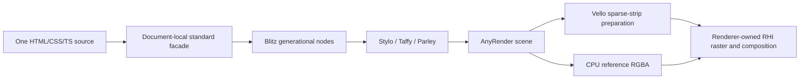

# Blitz UI binding

`@forgeax/engine/ui-blitz` owns the headless implementation of the portable UI
surface. It uses a persistent Blitz document and the host's JavaScript runtime.
Browser UI continues to use real browser DOM.

The qualified subset covers dynamic Grid, number and range controls, open ShadowRoot,
event propagation, pointer/keyboard defaults, companion CSS/images and bundled
WOFF2 font families. Closed roots, slots and delegated focus fail explicitly.
The shared [portable authoring table and checker](../ui/README.md#portable-authoring-support)
validate initial documents, UiAsset import/mount and dynamic DOM/CSS writes.
Target/device acceptance remains separate from source validation.



## Ownership and observable behavior

| Boundary | Contract |
| --- | --- |
| Document | `createBlitzUi` returns a document-local facade. No global `window`, `document`, `WebAssembly` or rendering context is installed. |
| Scripting | The native document uses the host's enabled JavaScript capability. Full HTML and live fragments parse `noscript` as raw text; the native UA suppresses its fallback layout and pixels. Template contents use inert parsing/serialization semantics. Detachment and cloning preserve that ownership; insertion adopts the target subtree's semantics, including shadow descendants. |
| Nodes | Facades wrap exact 64-bit generational Blitz identities. Attributes, children, values and focus are read from the core; weak facade caches do not mirror the tree. |
| Mutations | Create/insert/remove, inert template content, deep cloning, fragment `innerHTML`, text, attributes, class, dataset and inline style synchronously update the core. Removed nodes remain usable while referenced. |
| Unsupported source | Initial HTML, `innerHTML`, style text, `style.setProperty`, `style.cssText`, and attributes are checked before mutation. `UiDomError` retains `code`, `operation`, `cause` and structured `diagnostics` with ranges and recovery hints. The shared table governs all targets; native parsing cannot silently widen it. |
| Read barrier | Computed style, rectangles and hit tests resolve current derived state before returning. Client rectangles include the same resolved CSS transforms as painting and hit testing; offset geometry stays untransformed. A scroller's border box stays fixed while ancestor scrolling moves descendant rectangles. Viewport-fixed descendants retain matching pixels, rectangles and hit targets when excess user scrolling reaches the viewport; a transformed ancestor keeps its own fixed-position containment. Hidden flattened descendants expose zero geometry. Layout shrink clamps existing scroll offsets before reads and paint. `scrollIntoView`, including focus/validation reveal, aligns each scrolling ancestor in its own CSS coordinate space; viewport transforms do not scale scroll offsets. Transformed descendants extend the same layout-owned scroll extent used by CSSOM and clamping, with inner scrollport clipping retained. Default focus centers a fully hidden target on each axis, reveals a partly visible target at the nearest edge, and retains already visible controls; `preventScroll` skips that reveal. Explicit `scrollIntoView` keeps its requested alignment. Nested scrollports share the core alignment and clamp owner, and the facade delivers events only for actual changes after releasing the native borrow. Single-line input measurement uses the resolved content space, so constrained controls do not leak the parent width into ancestor scroll extents. Single-line `clientWidth` and `scrollWidth` describe the content-space editor viewport and its current text overflow; their `scrollHeight` stays at the vertical client extent because text scrolls only horizontally. Multiline and non-text control metrics retain their padding-box owner. Text input and textarea intrinsic `normal` height measures an empty Parley line from the current computed font and viewport scale, including leading; the current value and fallback glyphs cannot resize the control. Explicit numeric/length line-height keeps its CSS value. Grid changes do not replace nodes. Block scroll extents include the final collapsed child margin and padding, so maximum scrolling can expose the complete trailing space. |
| ShadowRoot | Open roots use native Stylo author cascades and real fragments. Queries remain scoped; inheritance and layout follow the flattened tree. Event paths snapshot retargeting before callbacks. `mountUi` uses this same surface. |
| Events | Snapshot paths before listeners; release the WASM borrow before JavaScript. Capture/target/bubble, nested dispatch, cancellation, once and AbortSignal subscriptions are synchronous. A callback may dispose its UI Host: removed listeners and remaining input/default actions stop before reading the freed document. Listener errors go to the supplied `onError`. |
| Input | The `input` port consumes logical pointer/wheel/key/string facts. It applies control activation, focus, label forwarding, scroll/click cancellation and default submission on the same document. Tab can enter an initially unfocused document and honors canceled key defaults. Native sequential navigation retains its starting position after blur or focused-subtree removal; later insertions and removals adjust that position, while current native eligibility and inert ancestry select the next control. The facade requests a candidate and releases the native borrow before dispatching focus transitions. Accepted sequential focus selects a text control's current content before focus callbacks through the native editor; script and pointer focus preserve their existing selection behavior. Changed replacement strings clear that selection, and its highlight only paints on the focused control. Escape preserves an ordinary editor's focus and draft; dropdown cancellation remains control-owned. Focus transfer commits the old edit before blur with no provisional new focus. Change/blur callbacks can redirect focus or retire the intended target, which native eligibility rechecks before adoption. After `beforeinput` callbacks, text defaults recheck the control's current attachment, editability, inert ancestry and native layout/focus eligibility; a retired editor receives neither a write nor a following `input` event. `focusedText` and `subscribeFocus` expose focus state; `subscribeTextEdit` reports accepted input/label taps that request native editing. Form validation rereads each control after earlier `invalid` callbacks and routes uncanceled feedback to the first control that native focus accepts, preserving callback-directed focus changes. These ports do not acquire platform events. |
| Touch panning | `touch-action` admits `auto`, `none`, `pan-x`, `pan-y`, `pan-x pan-y` and `manipulation`. At touch contact start, native computed styles intersect through composed ancestry up to the responsible scroller; each contact keeps its initial axis permissions even if a pointer callback changes styles. `none` keeps control gestures out of default scrolling; wheel and programmatic scrolling remain independent. Canceling Pointer Events does not suppress panning. Directional `pan-*` values and explicit `pinch-zoom` are rejected; viewport zoom is outside this input port. |
| Inert regions | `inert` reflects the native attribute. The input and focus owner checks composed ancestry across open roots, retires active focus and contacts when a region becomes inert, and excludes its controls from pointer, wheel and Tab defaults. Clearing the attribute permits new interaction without replaying retired contacts. |
| Focus appearance | The native UA applies `1px auto rgb(16,16,16)` through `:focus-visible`, painted as a light/dark ring so authored light and dark surfaces both retain contrast. Author outlines still override it. The `:focus-visible` state follows native Document focus modality: initial/scripted keyboard focus and keydown without Ctrl/Alt/Meta (including Shift) show it; an accepted pointer default moving to a button or checkbox hides it. Text controls (including readonly) and select retain it. Script transfers, blur, cancelled pointer defaults and tapping the same focused control preserve the prior modality; cancelled keydown still exposes focus. DOM focus and the existing native `FOCUSRING` bit remain authoritative. `:focus-within` is unimplemented and fails portable admission with a positioned `unsupported-css-selector` diagnostic. |
| Button inputs | Button-input values use the native value attribute, and property/attribute changes refresh the same generated label without accumulating children. Submit inputs share the existing form submission path; button and submit inputs accept Enter/Space, preserve canceled defaults and never acquire a text keyboard. |
| Number controls | Current value differs from the default attribute; programmatic sanitization, native editing drafts/`badInput`, `valueAsNumber`, required/min/max/step, invalid events and cancellable submit are tested against Chromium. Default disabled inputs, textareas, selects and buttons use muted text and borders, while author colors retain priority. Readonly fields retain ordinary styling. Native number buttons remain visible at the content edge before hover/focus, including touch Hosts, disappear for disabled/readonly controls, and share transformed/clipped hit geometry with painting. Pointer buttons and ArrowUp/ArrowDown use the existing numeric constraints and emit input/change; `stepUp`/`stepDown` share that derivation without events. Button taps do not request a string keyboard. `validationMessage` derives the constraint failure, and uncanceled `reportValidity` focuses the first invalid control and displays native shaped feedback outside author overflow clips. Its arrow remains attached to the invalid field when viewport edges shift or flip the bubble. Editing, focus retirement, removal and disposal clear the popup. Message wording is currently English; message wrapping and platform popup styling may differ from Chromium. |
| Range controls | The native node owns current/default values, min/max/step sanitization and thumb pixels. Pointer drags, arrow/Home/End/Page keys and canceled defaults emit standard input/change events through the existing input port; range controls never acquire a text keyboard. The ordinary capability-lab settings UiAsset is compared with Chromium. |
| Single-selection dropdowns | Native option nodes own current selectedness and dirty defaults. Layout shapes the authored option labels, refreshes cached glyphs on device-scale changes, and derives closed-control dimensions from the font line and option widths. Popup spacing derives from that same line; its rectangle also owns pointer selection. Default controls use border-box sizing and disabled foreground cues, while authored padding, sizes and color survive. Keyboard selection and pointer commits emit input/change; the open control previews its existing highlighted option without changing `value`, and closing with Escape follows the Chromium commit behavior. Canceled defaults, disabled options and focus retirement preserve ownership. `multiple` and `size > 1` listboxes are rejected at source admission. |
| Checkbox/radio | Native `ElementState` owns current `checked`; `defaultChecked` reflects the attribute until a script/user write dirties checkedness. Radios exclude only same-name peers in the same DOM tree/form. Click listeners observe preactivation; cancellation restores it, and accepted changes emit bubbling `input` then `change`. Pointer, label, Space and radio arrow keys share this path. `checked` on other element/control types fails explicitly. |
| Painting | `paintGpu(monotonicMilliseconds)` returns owned `UiGpuFrame` preparation; `paint(time)` returns CPU reference RGBA. Both return `null` when unchanged. The selected painter is allocated lazily. No GPU device, surface, frame scheduler or FrameReceipt is created here. |
| Raster images | `object-fit` and `object-position` resolve intrinsic dimensions in CSS pixels before device scaling, including `none` and `scale-down`. Replaced pixels clip to the content box, preserving authored padding. Device-scale changes invalidate cached transforms and overflow bounds even when CSS layout is unchanged, so partially visible images remain in the native paint stream. The composed Grid/Flex gallery and fixed modal retain image identity, fitted pixels and geometry across scrolling and DPR/viewport resize. |
| Memory | Bindings copy prepared scene bytes or RGBA into JS ownership. No pointers cross WASM modules. Frame-boundary collection drops detached subtrees without reachable wrappers; listeners retain their node. Dispose is reentrant, attempts every resource/input/document release even if a callback or its error reporter throws, and frees the core once. A single cleanup failure retains its identity; multiple failures are aggregated. |
| Resources | The core discovers CSS, nested imports, fonts and images from the document. `resources.read` receives resolved URLs and an AbortSignal; initial creation waits for them, `paint` starts dynamic reads, and `loadResources()` explicitly waits for the current closure. |
| Cancellation | A supplied AbortSignal fences initialization and disposes this document. The initialized WASM realm remains available to other documents using the original host object. |

The output covers the requested physical dimensions: positive integers up to
4096, with positive finite pixel ratio. GPU preparation retains paths, alpha
coverage, glyphs, images, clipping and filtered layer order; the Renderer performs
the raster work. The portable Vello feature adds no wgpu dependency to the UI WASM.
The [shared data contract](../types/src/ui-paint.ts) is the public type authority;
the native ABI records packed instance and shader bindings.

Pass `{ kind: 'sparse-strips', shaders: gpuShaders, paint: time => ui.paintGpu(time) }`
as `RendererOptions.ui`. A CPU reference uses `{ kind: 'rgba', paint: time => ui.paint(time) }`.
The caller owns document disposal and must not mutate transferred preparation.
Color-matrix filters are prepared on the GPU route; the CPU reference rejects them
with recoverable `ui-cpu-unsupported-filter` instead of panicking. Unsupported
custom paints and filter graphs fail explicitly. Actual backend pixels and
dynamic performance must be qualified separately; a static cache does not prove
the 30–60 FPS target.

The ordinary guide's complete dynamic vase form is qualified with real browser DOM
and WASM for English/French language changes: labels and all generation feedback,
retained input identity and edits, focus/validation, busy/error recovery, independent
instances and disposal. Long translated feedback remains actionable in a narrow
viewport. This uses the shared localization owner and the same authored controller;
system fonts, native control decoration and validation popup wording may differ.
The guide gate compares control overflow relative to each native client box and
still requires matching outer widths and ancestor scroll extents. Chromium 157's
number controls report a different inner client width from Chromium 154; that
decoration must not hide an input leaking its parent width into scroll overflow.

Setting an ancestor to `display: none` cancels descendant CSS animations in the
native style owner, so a hidden loading spinner does not invalidate the complete
UI raster. Showing the subtree starts its authored animations again with the same
DOM node identities. Visible animations continue to follow the host clock.

## Native input integration

Pass `ui.input` to the platform's existing input backend. Pointer and wheel
coordinates are logical viewport pixels; UI hit testing and scroll state share
core layout. CPU/GPU painting applies scrolling once in the element's local
coordinates, including CSS transforms. Native hit testing inverts transforms before
applying the local scroll offset and rejects clipped descendants against the
unscrolled scrollport, so invisible content cannot intercept sibling controls.

Horizontal text-entry inputs expose their content clip through inline client
geometry, including `clientLeft`; block-axis padding and the control border box
remain unchanged. Script scrolling, caret clamping, wheel input and painting use
the existing native editor offset and viewport, including number-button space.
Textarea and ordinary overflow boxes retain their padding-box client geometry.

Fixed descendants retain their ancestor stacking contexts even when the viewport
owns their layout. Paint and hit culling share bounds from that paint tree, so an
open game settings modal stays below the Host fatal surface and viewport scrolling
cannot hide a still-visible fixed control. These bounds do not enlarge CSS scroll
ranges.
Root `overflow: hidden` blocks user scroll chaining into the viewport while
retaining programmatic scrolling; wheel input cannot reset a script-owned offset.

Focus and label activation use standard
shadow retargeting, and
`cancel()` revokes contacts before their cancellation callbacks, then releases
active/hover state and the focused editor. Reentrant cancellation cannot notify
the same contact twice; an error reporter failure does not skip the remaining
contacts or editor release. Startup gameplay gating is separate from UI
acquisition, so fatal/Reload controls stay usable.
For a display-only change, `cancel({ preserveFocus: true })` revokes contacts and
active/hover state while retaining the focused editor and its native edit lease.

A string-only native keyboard opens on `subscribeTextEdit`, reads `focusedText`,
and closes its lease on `subscribeFocus`. Programmatic focus and validation focus
keep ordinary DOM behavior without requesting a keyboard. Accepted input or
associated-label taps request editing even when that control is already focused;
canceled clicks do not. The provider calls `text(value)` for replacements,
`confirm()` for ordinary form submission, and `commitText()` on completion to emit
a pending change without submission or blur. This preserves feedback after an
invalid Done action. The document retains number drafts separately from sanitized
`value`, emits input/change, and validates before ordinary submit activation.
Enter also activates a form's default submitter from readonly inputs, checkboxes,
radios and ranges; editability does not determine submission. Canceled key/click
defaults and a disabled default submitter still suppress submission. Without a
submitter, only the form's single text or number field can submit implicitly;
ranges and checkable controls do not count as blocking fields. Textareas commit
without submission, and select Enter remains owned by the dropdown.
Native providers must not invent selection ranges or IME composition events. The `key` port currently covers focus and control activation/navigation; raw character insertion, text-caret navigation and Backspace/Delete editing are not connected. String providers continue to deliver complete replacements through `text`, independent of the displayed Tab selection.
Required textareas participate in the same `checkValidity`, `reportValidity` and
submit defaults as other form controls. Empty editable fields block submission;
uncanceled feedback focuses the field, and filling its current value permits
submission. Disabled and readonly textareas are excluded. The
[feedback-form differential](src/__tests__/textarea-validation.browser.test.ts)
compares cancellation, focus, validity and submit events with Chromium.
`form.reset()` and reset buttons dispatch a bubbling, cancelable `reset` event
before resetting current form-owned native controls. Reentrant resets are ignored,
and disposal during a listener stops the default. The core restores current
defaults and clears dirty value, checkedness and selectedness; associated controls
outside the form participate, while controls assigned to another form stay unchanged.
Disabled controls also reset, and reset emits no `input` or `change` events,
including later blur of an editor that retained focus. The
[mixed-form differential](src/__tests__/form-reset.browser.test.ts) checks pointer
and keyboard activation, cancellation, callback mutations and later default changes.
Checkbox and radio controls retain native intrinsic dimensions when authored width
or height is `auto`; each explicit axis remains independent. Native checkmarks and
radio rings fill that measured box, and range painting uses an 8px track with the
shared 16px thumb layout/hit box. Cyclic percentage widths do not inflate Grid
minimum tracks; auto fields retain their intrinsic columns. Single-select intrinsic
height uses the normal font strut independently of CSS line-height, while authored
height remains authoritative. Disabled fields compose native translucent fills
over the authored backdrop; text fields, buttons and select opacity retain their
separate UA defaults. Author border/background rules opt out of native default
painting through Stylo's existing cascade flag, while CSS colors remain observable. The
[GPU control appearance differential](../render/src/__tests__/gpu-ui-checkable-intrinsic.browser.test.ts)
compares the unchanged profile form with Chromium, checks CPU/GPU pixels, and
retains a real GPU frame plus matching fresh-device replay.
Native text inputs and textareas use a black foreground with their default white
background, independently of ancestor text color. Authored control colors override
these UA defaults through the normal cascade.
Text-control intrinsic widths use the resolved font metrics, including variable
weights: textarea defaults to 20 columns and two rows, invalid dimensions retain
those defaults, and text input `size` defaults to 20. Number inputs ignore `size`.
Inline controls and flex/grid boxes contribute their actual baseline while a line
is measured, keeping settings rows and containing panels aligned with Chromium.
`reducedMotion` at creation and `setReducedMotion` feed the actual CSS media
preference; `paint(time)` remains the sole host clock input.

## Published fonts and companion resources

Native hosts supply prepared font bytes; there is no machine-font dependency.
`fontFamily` aliases the bootstrap font to its CSS `@font-face` family so companion
subsets extend the same generic and script fallback. Every loaded companion family
joins the document's script fallback once, after the bootstrap. Missing glyphs in a
named UiAsset family can use these published families without OS discovery; explicit
CSS family order remains authoritative.
An isolated document must publish every required glyph through its own font
companions or supply a prepared bootstrap fallback; a Latin subset alone does
not provide arrows or Chinese. WOFF and WOFF2 decode
through Blitz's maintained decoder. Variable weights stay in Parley.

Generated disclosure/list symbols use Blitz's bundled Bullet font, registered even
when the host supplies its own prepared font context. User font coverage does not
own these UA markers. Checkbox/radio default appearance uses vector paths. These
native resources do not replace the published fonts needed for authored text.

```ts
const ui = await createBlitzUi({
  wasm,
  html: '<link rel="stylesheet" href="ui-fonts/index.css">',
  width,
  height,
  font: latinWoff2Bytes,
  fontFamily: 'Noto Sans SC Variable',
  resources: { baseUrl: publishedRootUrl, read: readPublishedBytes },
  onError,
});
```

The normal WeChat build publishes DevKit's exact
`@fontsource-variable/noto-sans-sc@5.3.0` dependency: `index.css`, the complete
`files/` directory and OFL-1.1 `LICENSE`. The bootstrap Latin subset covers the
current English/French guide; the same published stylesheet supplies the tested
Chinese glyphs. Requests are currently eager for each declared font face.
Font payload coverage, not arbitrary `unicode-range` filtering, determines subset
fallback; CSS local fonts and system font discovery are not claimed.

The reader implements package/network access policy and returns `Uint8Array`.
Blitz retains URL resolution, parsers, decoded resources and font registration;
JavaScript keeps only in-flight request identities. Transport runs at most eight
reads concurrently, with a 32 MiB per-resource limit. Initial resource failures
reject creation; dynamic failures reach `onError`, while explicit
`loadResources()` rejects. `UiResourceError` preserves the URL and original
transport cause; decoding failures retain the core diagnostic. Multiple failures
are an `AggregateError`. Disposal aborts reads and rejects late publication.
PNG companion pixels, nested CSS and WOFF2 are regression-qualified; this does
not claim every image codec or SVG feature.

Ordinary `UiAsset` companions enter through `createUiLoader` and AssetRegistry's
publication-scoped artifact reader. `mountUi` projects those verified bytes to
standard data URLs; Blitz decodes them with the maintained `data-url` crate and
its existing image/font handlers, without a second host reader or resource map.
The same Pack/font/image fixture runs through browser DOM and generated WASM.
Removed stylesheet nodes cannot adopt late font or CSS results.

## Build and provenance

The Engine gitlink at `third_party/blitz` and this package's `Cargo.lock` fix the
source graph. Rust 1.99.0, wasm-bindgen 0.2.129, sequential style, default features
disabled except `blitz-dom/woff,raster`, and `anyrender_vello_cpu` 0.18.0 define the current headless build.
Release optimizes for size globally and uses `opt-level = 3` for `vello_common`'s
CPU path/strip preparation. This changes compilation, not the portable GPU ABI
or the renderer's ownership; measured scope and payload identity are recorded in
the current consumer acceptance.

```sh
pnpm --filter @forgeax/engine-ui-blitz build:wasm
pnpm --filter @forgeax/engine-ui-blitz build
```

Set `CARGO`, `WASM_BINDGEN` or `CARGO_TARGET_DIR` to explicit installed tools/cache
paths when needed. `CARGO_TARGET_DIR` is a cache root, resolved from this package;
each source digest gets its own compiler output directory. Cargo and bindgen use
that same directory, so concurrent source variants cannot replace the WASM between
compilation and binding generation. The release recipe belongs to the hashed
source: external Rust flags, compiler wrappers and Cargo profile overrides are
rejected; change the checked recipe when requalifying it.
The generator preserves all ABI wrappers and the finalizer,
replaces only the browser loader, and records source inputs, resolved features,
fork identity, glue and WASM digests in `pkg/provenance.json`. A dirty-fork receipt
is diagnostic only. `pkg/` is generated as a unit and is included in SDK/npm
outputs. Install attempts content-keyed release hydration; `prebuild` verifies
every generated output and the current source identity. CI falls back to the
locked Rust build when cache/release verification fails. Run `fetch-wasm` or
`build:wasm` to repair a missing or stale bundle.

The content key covers the binding, generator, lockfile and maintained core source.
Expanded SDK source has the same key without Git. Rebuilding modified source
records its actual bytes; absent original revision evidence is represented by
`null`, never inferred from a parent repository. Generation occurs in a staging
directory and rejects source changes before replacing the last usable bundle.

`UiWasmHost.readWasm` and `instantiate` must use the same immutable module.
The generated initializer verifies bytes before adoption and shares concurrent
initialization. Read/instantiate failures can retry; a failed Rust start is
terminal for that module realm. A different host cannot replace an adopted host.
`createWechatWasmHost` binds both operations to one native packaged path.

## Verification

The current consumer acceptance matrix
maps the complete game guide and shared startup UI to retained core/browser
evidence, ordinary-package simulator scenarios and remaining target/cost checks.

| Gate | What it proves |
| --- | --- |
| `cargo +1.99.0 test --locked --manifest-path packages/ui-blitz/Cargo.toml` | Real core Grid pixels, mutations, collection, nested CSS/failures, companion PNG pixels and published Chinese WOFF2 coverage |
| Package `pnpm test` | Real generated WASM: DOM/input, published WOFF2 and PNG, transport/decode failures, cancellation and late-result fencing |
| Package `pnpm test:browser` or `dom.browser.test.ts` via the repository browser gate | Identical form/event/localized-guide operations and Grid rectangles against actual browser DOM; the focused gate requires no renderer shader/asset publication |
| WeChat diagnostic | Native WXWebAssembly loading and the qualified simulator actions; separate from Engine composition |

The maintained fork's deterministic headless test prerequisites and fixes are
recorded in [`FORGEAX.md`](../../third_party/blitz/FORGEAX.md). The licensed ASCII
font fixture lives in that pinned source, alongside its reproduction instructions.
It is a test fixture only. Production font and representative Chinese coverage
use the published Noto Sans SC dependency described above.

Portable scroll containers currently reserve no scrollbar gutter. The native-control
and transformed-scroll differential fixtures select Chromium's matching zero-gutter
display setting through CDP and restore it afterward; headed Linux Chromium otherwise
reserves 15 CSS pixels that headless Chromium does not. The authored CSS, scrolling,
focus, client extents and transformed-coordinate assertions remain unchanged.
These comparisons do not qualify classic desktop scrollbar appearance or dragging.
