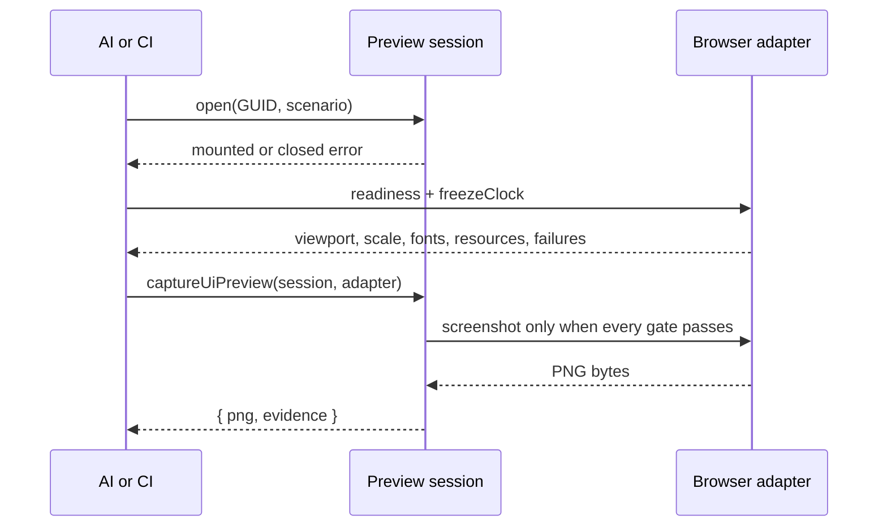
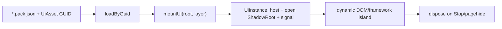
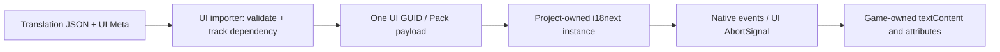

# `@forgeax/engine-ui`

UI is an asset plus a small behavior island. The asset package owns the stable HTML/CSS payload; game code supplies dynamic text, template clones, input and lifecycle.

> [!IMPORTANT]
> `mountUi` uses its root's `ownerDocument`, open ShadowRoot and standard AbortController.
> Browsers supply native DOM; the [Blitz implementation](../ui-blitz/README.md)
> supplies the qualified subset in non-DOM hosts. Preview remains browser-only.
> A headless validator without either implementation cannot mount UI.

## Evidence and recovery

UI authoring is a producer boundary. The source declaration and its cook receipt are joined with catalog `packageUrl`/`cookReceiptUrl` and Pack v2 HTML/CSS/artifact verification as `AssetEvidence`. Preview and runtime mounting do not infer readiness from the catalog alone.

Use `notCooked`, `ready/current`, `ready/stale`, and `unknown` as distinct states; artifact/package results are `notChecked`, `passed`, or `failed`. Recover by fixing the authoring source or recooking, then run `lookup/verify --guid --project --catalog --json`. A headless probe can validate evidence, but `mountUi` still requires a DOM.

## Shortest recipe

Headless validation is available without a DOM:

```ts
import { validateUiAuthoring } from '@forgeax/engine-ui/authoring';

const checked = await validateUiAuthoring({ sourcePath: 'hud.ui.html', html, css });
if (!checked.ok) return emitJson(checked.error.detail.diagnostics);
```

Use `checked.value.category` (`native`, `normalizable`, or `runtime-bound`) and `checked.value.diagnostics` as the machine-readable authoring result. The source strings are returned byte-for-byte unchanged.

```ts
import { mountUi } from '@forgeax/engine-ui';

const loaded = assets.loadByGuid<UiAsset>(HUD_GUID);
if (!loaded.ok) return report(loaded.error);
const mounted = mountUi(loaded.value, { root: ctx.uiRoot, layer: 60 });
if (!mounted.ok) return report(mounted.error);
ctx.effect(() => () => mounted.value.dispose(), 'game/hud');
```

## Preview and deterministic capture

The public preview seam keeps browser-only work behind `@forgeax/engine-ui/preview`:

```ts
import {
  captureUiPreview,
  createDomPartScenario,
  createUiPreviewSession,
} from '@forgeax/engine-ui/preview';

const session = createUiPreviewSession({
  guid: HUD_GUID,
  assets,
  root: previewRoot,
  rect: { width: 320, height: 180 },
  scenario: createDomPartScenario({ requiredParts: ['root', 'score'] }),
});
const opened = await session.open();
if (!opened.ok) return recover(opened.error.code, opened.error.hint);
const captured = await captureUiPreview(session, browserAdapter);
if (!captured.ok) return recover(captured.error.code, captured.error.detail);
await writePng(captured.value.png);
await writeJson(captured.value.evidence);
```

When subscribing to asset changes, await the listener result. A subscribed target refresh that
rebuilds an invalid revision returns structured `preview-load-failed`; read
`error.detail.diagnostics` for each source path/range and repair hint, then call
`session.retry()` after fixing the source. Do not parse `message`.



The adapter must report `viewport`, `deviceScale`, `fonts`, `resources`, `scenario`, and `clock` as true, with empty `console`, `page`, and `request` failure arrays. Its `screenshot` seam should return the actual mounted host screenshot from the browser compositor, not a fixture byte string. `evidence` records the frozen clock, discovered `data-ui-part` names, DOM host count, focus, resource failures, and lifecycle state. Keep the PNG and evidence together; the image is visual context, while the JSON is the functional authority.

| Capture code | Recovery action |
| --- | --- |
| `capture-not-ready` | Read `error.detail.unmet`, satisfy each named gate, then retry in the same fixed browser. A failed result never has `png`. |
| `capture-failed` | Read `error.detail.stage`, repair the adapter's screenshot capability, and retry. |
| `preview-scenario-missing-part` | Restore the declared `data-ui-part` and call `retry()` or rebuild the session. |
| `preview-load-failed` | Inspect `error.detail.diagnostics` for source-located repair hints, fix the target source, then call `retry()`. |

> [!WARNING]
> Do not treat a screenshot as proof that fonts, companions, focus, or disposal succeeded. Do not parse `message`, mount a fallback into `document.body`, or replace a missing companion with a stand-in asset.



Mounted number controls expose their native adjustment buttons before hover or
focus, including on touch Hosts. The browser mount corrects UA spin-button
opacity when that pseudo-element is supported; native painting uses the same
visible default. Disabled and read-only controls retain their opt-outs, and author CSS keeps precedence over the mount's base style.

## Producer authoring descriptor

Every `kind: 'ui'` catalog row publishes the versioned `AssetAuthoringCapability.ui` descriptor from
`@forgeax/engine-types`. It is the discovery contract for AI and editor consumers: `preview` names
`createUiPreviewSession`, `mount` names the `mountUi` lifecycle and `onAction` port, and the state,
action, and read projections point to the host's JSON-shaped `gameProjection` seam. Input and
navigation use the DOM-native focus/ownership contract; font files remain producer-owned UI artifact
companions; localization exposes the native `i18next` operation through the opt-in localization entry.

This descriptor exposes existing producer seams. It does not give an editor permission to inspect a
game World or invent a second binding registry. Runtime action/read IDs and their semantic bodies stay
owned by the game bootstrap, while the Gateway and Content Browser project the catalog facts unchanged.

## Authoring and resources

### Profile and diagnostics

Run `forgeax project check --json` from a game project to read the complete
current profile at `value.uiAuthoringProfile`, including
`css.nativeProperties`, supported selectors, media features, HTML elements and
custom-property prefixes. This report comes directly from the validator's table.
Unsupported portable properties remain errors; browser-only assets may declare
`browserExtensions: ['css']` as described below.

The versioned profile is exported as `UI_AUTHORING_PROFILE` and described by [`src/authoring/profile.schema.json`](src/authoring/profile.schema.json). Classification precedence is `runtime-bound` then `normalizable` then `native`; quality findings remain warnings and do not change an otherwise accepted result.

Blocking diagnostics use the shared import shape: `code`, `severity`, `sourcePath`, `sourceRange`, `rule`, `expected`, `actual`, `hint`, and optional `relatedLocations`. Branch on `error.code === 'source-validation-failed'` and inspect `error.detail.diagnostics`; do not parse error messages.

Normalizable surfaces (inline style, global selectors, root or parent URLs, generated classes) are reported without changing source. Runtime-bound surfaces (scripts, inline handlers, remote URLs, CSS imports, and CSS-in-JS markers) must be moved to a consumer-side framework island.

### Portable authoring support

[`UI_AUTHORING_PROFILE`](src/authoring/profile.ts) is the shared implementation
table for every target. `parseCssAuthoring` uses css-tree's stylesheet/declaration
AST and property, descriptor and at-rule grammars; `parseHtmlAuthoring` uses the
parse5 tokenizer and tree builder, including template content, optional end tags
and contextual table fragments. Unsupported properties, values, controls and
parser recovery retain source ranges and recovery hints. Neither checker changes
author source or treats successful Stylo parsing as proof of native painting.

`validateUiAuthoring` adds the UiAsset companion/scoping policy above.
`parseHtmlAuthoring(html, path, { portableOnly: true, context: 'document' })`
checks a host shell, including embedded styles; `parseCssAuthoring(css, path,
{ portableOnly: true, context: 'declarationList' })` checks inline declarations.
The portable mode admits document shell elements and host-owned URLs without
relaxing implementation support. `mountUi` checks that same support before
mutating either browser or native DOM; failure is `invalid-asset` with
`detail.diagnostics`. Full game-3d guide CSS and the shared DevKit startup
document are regression inputs, read directly from their owners.

An asset can explicitly require browser-only CSS with
`browserExtensions: ['backdrop-filter']`. This closed declaration is preserved by
the loader, `importUiSource`, and the HTML importer's
`importSettings.browserExtensions`; hand-authored Pack assets place it in the UI
payload. The declaration leaves the portable profile unchanged and classification
remains `runtime-bound`. CSS property-value grammar is still checked.
`mountUi` verifies support on the receiving document before creating any nodes.
An unavailable extension returns `invalid-environment` with source-located
`ui-browser-extension-unavailable` diagnostics. The ordinary Brotato HUD uses this
declaration to retain its authored `backdrop-filter: blur(10px)` in browsers.

For an existing browser-authored stylesheet, `browserExtensions: ['css']`
selects browser CSS semantics instead of the native property/value, pseudo-selector
and media-feature limits. Native support is unchanged. Classification remains
`runtime-bound`, and the receiving document must expose `CSS.supports` accepting
`selector(:host)` and `display: grid` before any DOM mutation. The native Blitz
document does not provide this browser capability and rejects the asset. This
capability check is not a rendering or per-property compatibility claim: the
browser owns cascade, vendor declarations, unsupported selector handling and
authored fallbacks. Add `'backdrop-filter'` when blur support is required rather
than optional, for example `browserExtensions: ['css', 'backdrop-filter']`.

Browser CSS still passes token/structure syntax checks, known standard
property/value grammar and the existing static at-rule policy. Unknown standard
properties remain errors; vendor-prefixed declarations preserve browser fallback
semantics. HTML script/handler rejection, source scoping, URL companion validation
and font-resource policy remain enforced. Import retains authored CSS bytes;
mount uses the existing resource projection and CSS serialization without
removing browser styling declarations.

| Supported scope | Implementation evidence and enforced limits |
| --- | --- |
| Block, flex, Grid, dimensions, spacing, logical axes and tables | [Stylo/Taffy conversion](../../third_party/blitz/packages/stylo_taffy/src/convert.rs), [table layout](../../third_party/blitz/packages/blitz-dom/src/layout/table.rs). Subgrid, masonry, `display:contents`, size containment and sticky scrolling are excluded. Taffy [documents sticky offsets as caller work](https://github.com/DioxusLabs/taffy/blob/2d936b7701f64b0fe95e50f1bfdcfc65a9f88f6f/src/style/mod.rs); the binding has no such scroll projection. |
| Fonts, wrapping, OpenType features and text decoration/shadow | [Parley projection](../../third_party/blitz/packages/blitz-dom/src/stylo_to_parley.rs), [text painter](../../third_party/blitz/packages/blitz-paint/src/text.rs). Balanced/pretty wrapping, `text-overflow`, CSS font synthesis controls and machine-local font lookup are excluded. Publish font bytes through `@font-face src:url(...)`. |
| Backgrounds, borders, radius, shadows, opacity and compositing | [Background painter](../../third_party/blitz/packages/blitz-paint/src/render/background.rs), [border/outline painter](../../third_party/blitz/packages/blitz-paint/src/render/border.rs), [paint layers](../../third_party/blitz/packages/blitz-paint/src/render.rs). Outline supports solid/none/hidden; patterned outlines and outline offsets are excluded. |
| Planar transforms | [Transform conversion](../../third_party/blitz/packages/blitz-dom/src/stylo_to_kurbo.rs). Two-dimensional functions and statically planar 3D forms are admitted; perspective and non-planar coordinates are excluded. |
| Alpha masks and inline clip shapes | [Mask painter](../../third_party/blitz/packages/blitz-paint/src/render/mask.rs), [clip painter](../../third_party/blitz/packages/blitz-paint/src/render/clip_path.rs). Luminance masks, URL clip references, margin-box clips, evenodd clips and rounded inset clips are excluded. |
| One blur/color-matrix filter or drop-shadow with an explicit color | [Blitz filter conversion](../../third_party/blitz/packages/blitz-paint/src/filters.rs), pinned [CPU filter conversion](https://docs.rs/crate/anyrender_vello_cpu/0.18.0/source/src/filters.rs), [CPU layer input](https://docs.rs/crate/anyrender_vello_cpu/0.18.0/source/src/scene.rs), and [enabled Cargo features](../ui-blitz/Cargo.toml). The CPU backend processes one filter node and ignores backdrop filters. Filter chains, URL filters and drop-shadow's unresolved currentColor are excluded. |
| Selectors, media, keyframes and transitions | Native [query matching](../../third_party/blitz/packages/blitz-dom/src/query_selector.rs), [device projection](../../third_party/blitz/packages/blitz-dom/src/stylo_device.rs), and [document animation state](../../third_party/blitz/packages/blitz-dom/src/document.rs). Portable media inputs cover viewport/device dimensions, aspect ratio, orientation, resolution and reduced motion. `@import` is supported for host-owned stylesheets but rejected by UiAsset's companion policy. |
| Semantic HTML, open shadows, templates, forms and controls | [Native shadow implementation](../../third_party/blitz/packages/blitz-dom/src/shadow.rs), [DOM/input facade](../ui-blitz/src/dom.ts), [number regression](../ui-blitz/src/__tests__/dom.unit.test.ts), and [checkbox/radio browser comparison](../ui-blitz/src/__tests__/dom.browser.test.ts). Number, range, single-selection select, checkbox and radio behavior follows the [binding contract](../ui-blitz/README.md#ownership-and-observable-behavior); default appearance alone does not prove activation. File/date/color pickers, select listboxes (`multiple` or `size > 1`), slots, executable/custom elements and declarative shadow attributes are excluded. Canvas is a host presentation slot, with no UI canvas drawing context. |

This checks source grammar and the listed implementation restrictions, not
cascade equivalence or pixels. CSS variable/environment substitution remains
native cascade work: css-tree cannot type-check an unresolved `var()`/`env()`
value. Names, syntax and visible unsupported forms are still checked. Resource
decoding, font glyph coverage, layout differences and host-specific interaction
need their existing runtime gates; a clean source diagnostic is not a rendering
pass. Extend the table only with evidence from the native owner and its real
consumer regression.

The table describes the portable UI implementation, not a platform acceptance
matrix. Browser comparison, official WeChat simulator interaction, Tauri WebView
execution and Android/iOS device behavior require their own observed results.
It does not qualify arbitrary web frameworks or the complete browser DOM API.

Both CSS source validation and resource projection import css-tree's published
portable ESM distribution. Its default Node entry loads grammar data through
`module/createRequire`, which is not available in native Host bundles. The same
parser and lexer remain in use on browser, native and build-time paths.

Authoring sources (`.ui.html` plus same-name `.ui.css`) remain the source-to-payload input for consumers that own an importer. The importer pairs the files and records relative image/font reads as private companions. The manifest owns exactly one public GUID; companions do not receive consumer GUIDs. Shared/demo author sources remain in the assets submodule; a consumer template may carry a small, template-owned pair under its own `assets/` root when the UI is part of that template's source closure. Use the pair for readable multiline authoring and keep the prepared `.pack.json` output generated.

UI companions use `delivery: 'stream'`: Import and Pack retain their complete bytes,
lengths and SHA-256 facts, while runtime loading validates their descriptors and
locators without preloading every image and font before the UI root can activate.
Parsed HTML/CSS URL nodes let the receiving DOM load media when it uses it. A mounted
UI does not assert that all companions loaded or passed byte-level integrity;
capture still checks native resources and fonts. Explicit artifact verification
still reads complete bodies, and `verifyByGuid` reports the injected evidence
source's result rather than inferring verification from UI readiness.

The standalone DevKit host includes `createUiImporter()` in its default
build-time importer composition. A custom Vite host should register the same
self-declared `{ key: 'ui', import }` owner directly in its
`pluginPack({ importers: [...] })` list; do not maintain a second project
registry or wrap it with another key.

The sidecar's `source` names the `.ui.html` file, and the importer derives the
same-directory `.ui.css` companion. The generated Pack preserves the original
`html`, `css` and the author filename as `sourcePath`, relative to its companion
directory. Physical import paths stay in build diagnostics and dependencies,
outside the portable payload. Relative references resolve within that
author directory to private Pack artifacts; no source token or transport URL
replaces the authored text. PNG/JPEG/WebP/SVG and WOFF/WOFF2/TTF/OTF companions
retain their raw bytes. The sidecar's `importSettings.resources` can declare
additional relative files for dynamic use, including `.txt` license companions.
Escaping paths, remote URLs and undeclared resources fail explicitly.

Install `createUiLoader()` through `assets.installDecoder(uiKind, loader)`.
Its decoder admits streaming URLs through the existing publication-scoped
`artifacts.locate` seam without reading their bodies. When no locator is available,
or the artifact is not streamed, it retains the verified `artifacts.read` path.
`UiAsset.resources` contains the resulting bytes or URL with its media type.
Retired reads return `asset-load-cancelled`, and integrity/transport failures
retain their AssetRegistry error. `loader.load` also accepts an already verified
Pack loader envelope, including its admitted `streams`, or a payload with no
companions; serialized payload fields cannot supply decoded resources.

At mount, parsed HTML attributes and CSS URL nodes project admitted stream URLs
directly and verified bytes to standard data URLs. Browser DOM and Blitz consume
the same asset and projection; the Blitz Host's existing resource reader loads
streamed media through its configured package transport. Literal text and CSS
strings are never globally replaced. Parsed `@font-face`
rules use an instance-owned document stylesheet because browsers do not register
faces from ShadowRoot styles. Disposal removes that stylesheet and the host.
Blitz discards late font/stylesheet results when their owning node has retired.

Dynamic code uses the same declared closure:

```ts
const image = instance.resourceUrl('images/selected.png');
if (!image.ok) return report(image.error);
element.setAttribute('src', image.value);
```

`resourceUrl` returns `ui-resource-invalid` with `guid`, `sourcePath`, `reference`
and `reason` for an unknown/escaping reference or a disposed instance. It never
downloads an undeclared URL. The instance holds only derived URLs; Pack and
AssetRegistry remain the publication and integrity authorities.

The `*.pack.json` file remains the canonical contract for a deliberately prepared UI asset, such as a small hand-authored HUD or settings panel. It owns exactly one public GUID and stores the final HTML/CSS payload directly, so loading it does not invoke an importer, generate DDC, or require an `ImportTransport`. A consumer-owned prepared pack belongs in that consumer's `assets/ui` directory; a template that needs readable multiline UI should keep the `.ui.html` / `.ui.css` source pair and generate this Pack instead.

| Concern | Owner |
| --- | --- |
| Original HTML/CSS, source base and private companions | UI pack |
| GUID and build transport | pack/import pipeline |
| Verified companion reads and publication retirement | AssetRegistry |
| dynamic text, events, template clones | game module |
| mount/dispose and ShadowRoot | `engine-ui` |
| run root and cleanup order | host (`apps/preview`) |

## Dynamic nodes and framework seam

Use ordinary DOM APIs inside the open shadow root. A popup can be cloned from a `<template data-ui-template>` and removed through `UiInstance.signal`. Frameworks may mount an island into an element that the asset exposes; the caller owns `createRoot`, `unmount`, and any portal target. The package does not ship React/Vue/Svelte adapters or claim framework certification.

```ts
const island = instance.host.shadowRoot?.querySelector('[data-framework-island]');
if (island) {
  const root = createRoot(island);
  instance.signal.addEventListener('abort', () => root.unmount(), { once: true });
}
```

## Input, modal and lifecycle

Portable direct-manipulation controls declare `touch-action: none` on their hit region. Axis-constrained scrollers can use `pan-x` or `pan-y`; `auto`, `pan-x pan-y` and `manipulation` permit both pan axes. The native Host samples this CSS policy per contact before `pointerdown` handlers, including shadow-host ancestry. Pointer event cancellation does not replace this declaration; wheel and programmatic scrolling keep their own behavior. Directional `pan-left/right/up/down` and explicit `pinch-zoom` are outside the portable profile.

Interactive asset elements opt in with `pointer-events: auto`. The input package decides UI ownership from `event.composedPath()` and clears held state when ownership changes, focus leaves the window, or the run is stopped. A single settings modal owns its own inert backdrop, focus trap, <kbd>Escape</kbd> close, and focus restore. Settings in the default template are memory-only for the current run; no `localStorage` authority is implied.

`dispose()` is idempotent: it aborts `signal`, removes listeners, derived resource URLs, the host and its font stylesheet. Hosts should dispose instances in reverse registration order and remove the run-scoped `uiRoot` on Stop/pagehide.

`inspectUi(root, request?, reader?)` reads that live tree synchronously, including
open ShadowRoots. Browsers use their actual document hit testing and computed
styles. A native caller passes its existing `BlitzUi` as `reader`; no second DOM
or instance registry is created. The same function accepts
`previewSession.instance?.host`, so Preview observes the mounted consumer.

```ts
import { inspectUi } from '@forgeax/engine/ui';

const result = inspectUi(document.querySelector<HTMLElement>('#game-ui'), {
  selector: 'input, .vase-panel',
  styles: ['font-size', 'overflow-y', 'pointer-events'],
});
if (!result.ok) console.error(result.error);
```

`selector` matches independently in each open tree; omitted means every element.
`styles` selects up to 32 CSS properties, and optional `point: { x, y }` uses
logical viewport coordinates. The default traversal limit is 256 elements,
including unmatched nodes; callers may select 1–512. The same limit bounds direct
child-node text scanning per visited element. Depth is limited to 64,
attributes to 32 per node, and strings to 512 characters. `truncated` explicitly
marks omitted data. Style-element source text is omitted; other `text` is direct
text rather than repeated descendant content.

The JSON-safe success value includes element paths, attributes, source ownership,
rectangles, scroll/client dimensions, selected styles and passive control
value/validity reads. `focused` and `hit` refer to paths in the traversed root,
including retargeted open shadows; their nodes may not match `selector`.
Paths are observations, not retained handles;
read again after a mutation. `source.guid` and `source.path` come from the mounted
UiAsset's existing GUID and optional author-relative `sourcePath`, including for
dynamic descendants. This identifies the owning source; it does not invent
HTML/TS line numbers or CSS rule origins for generated nodes. Invalid requests,
retired roots and reader failures return `inspection-failed` with the cause.

The ordinary DevKit inspection entry exposes this as
`__forgeaxGameInspection.ui(request)` for both browser Host inspection and WeChat.
It uses the current Host's real document. On WeChat it remains available while a live startup
UI waits or shows a game failure, and rejects reads through a replaced or retired
Host. An inspection does not paint, advance time, invoke form validation events,
or establish GPU submission/presentation evidence.

## Errors and prohibited fallbacks

Handle `UiError` by its closed `code` union and machine-readable `detail`; do not parse message strings. Do not silently mount to `document.body`, create a second UI manager, inject stable markup from TS, or hide a missing asset behind an empty root.

The independent Gallery/Preview Workbench, scenario matrix, visual baseline workflow, external design
adapters, and AI iteration workbench remain follow-up design: `2026-07-21-html-css-ui-authoring-workflow-ecosystem-design.md`.

## Offline localization with i18next

Import `createUiLocalization`, `bindUiLocalization`, and `refreshUiLocalization` from
`@forgeax/engine/ui/localization`. This opt-in entry uses native i18next instances;
UI mounting and the Engine runtime root do not load its translation implementation.

| Boundary | Contract |
| --- | --- |
| Source | `.ui.html.meta.json#importSettings.localization` names a relative JSON companion. No remote URLs or parent traversal. |
| JSON | `{ fallbackLng, defaultNS, resources }`, with native i18next JSON v4 language/namespace bundles and string leaves. Arrays and nested keys are accepted; prototype keys, invalid fallback namespaces, sources over 1 MiB and trees beyond 16 levels are rejected. |
| Delivery | Import tracks the JSON as a source dependency and embeds it in the same UI payload/GUID. Pack finalization, Catalog, prepared Packs, and offline loading use the existing route. |
| Runtime | `createUiLocalization(asset, { lng, onMissingKey? })` returns `UiResult<i18n>`. Each call creates independent language and resource state. Use native `t`, `changeLanguage`, `exists`, and `dir`. |
| UI lifetime | `bindUiLocalization(ui, i18n, render)` renders immediately and on native language/resource events. UI abort detaches every subscription; its return value also detaches manually. |
| Revision | Validate/load the newly published same-GUID asset, then await `refreshUiLocalization(i18n, asset)`. It replaces the native resource snapshot, removes deleted keys, recalculates fallback resolution, and notifies bound UI once. Invalid data returns `invalid-asset` and preserves the previous snapshot. |
| Text keys | Derive i18next `CustomTypeOptions.resources` from the same authored JSON import; do not maintain a second key union. |



```ts
import { createUiLocalization, bindUiLocalization } from '@forgeax/engine/ui/localization';

const localized = await createUiLocalization(asset, {
  lng: 'fr-CA',
  onMissingKey: (languages, namespace, key) => reportMissing({ languages, namespace, key }),
});
if (!localized.ok) return report(localized.error);
const i18n = localized.value;
const title = ui.host.shadowRoot?.querySelector('[data-ui-part="title"]');
bindUiLocalization(ui, i18n, (t) => {
  if (title) title.textContent = t('inventory', { count: items.length, name: player.name });
  ui.host.lang = i18n.resolvedLanguage ?? i18n.language;
  ui.host.dir = i18n.dir();
});
await i18n.changeLanguage('en');
```

For typed game code, add a project-local declaration using the authored resource:

```ts
import type messages from './hud.ui.i18n.json';
declare module 'i18next' {
  interface CustomTypeOptions {
    defaultNS: 'game';
    resources: typeof messages.resources.en;
  }
}
```

Enable TypeScript `resolveJsonModule` in that project. This declaration belongs to the
consumer; Engine does not globally augment i18next with one game's keys.

> [!IMPORTANT]
> Interpolation escaping is disabled because the consumer writes DOM text and attributes.
> Never put translated content into `innerHTML`. Consumers own plural counts, interpolation
> values, text direction, accessibility attributes, dynamic nodes, and game-specific diagnostics.
> No backend, language detector, network request, localStorage, or translation frame system is installed.

The `game-3d` control guide and its dynamic vase form share packaged English/French
resources, including field labels, instructions, accessible panel text and
preparing/busy/error/success/unavailable feedback. Switching language updates retained
text nodes without replacing controls, reapplying input values or requesting another
generation; the latest game state supplies the status count. Native validation messages
retain their host language and appearance. A consumer handling
Catalog revisions must fence asynchronous loads with its UI signal before refreshing;
`refreshUiLocalization` does not subscribe to Catalog or own asset lifetimes.

Run `node packages/ui/scripts/bench-localization.mjs` after building to retain hardware,
sampling conditions, initialization/lookup/refresh times and bundle bytes in
`.forgeax-debug/g09/benchmark.json`. The template smoke also measures actual language
actions and saves English/French screenshots. The production probe additionally switches
the browser offline after loading; the development smoke retains its live HMR transport.
After `forgeax project build --root templates/game-3d --out-dir .forgeax/g09-production`,
run `node apps/preview/scripts/smoke-game3d-localization-production.mjs` from the repository
root. This contributor gate serves only the built files, rejects external requests,
requires 60 completed frames and a nonblank canvas, and saves offline action evidence.
