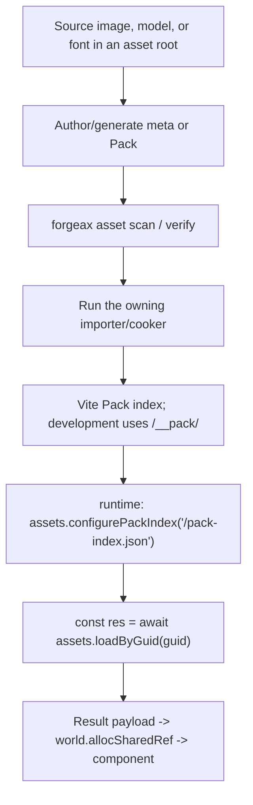
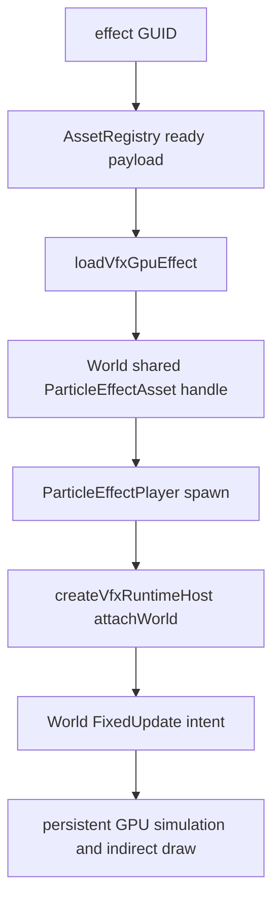

# Runtime asset and mesh contracts

Use this reference for mesh import, runtime registry calls, VFX, handles, identity,
and video assets.

## Multi-UV import: glTF and FBX TEXCOORD_0 through 7

> [!IMPORTANT]
> glTF/FBX preserve up to eight UV sets, matching UE MAX_TEXCOORDS=8. Mesh binary v2 carries uvSetCount explicitly; import preserves available sets and shaders declare consumption without extra author configuration.

### Import behavior

| Source | Behavior | UV sets |
|:--|:--|:--|
| glTF TEXCOORD_0..7 | Parser reads each set; bridge writes interleaved data and uv1Cat..uv7Cat attributes. | 0..8 from source. |
| FBX UV layers | ufbx bridge extracts sets, parse-mesh consumes them, to-asset-pack interleaves. | 0..8 from source. |
| More than eight | Silently retain the first eight. | At most eight. |

> glTF/FBX produce equivalent attribute keys/counts. Canonical interleaving is position/normal/uv/tangent/skinIndex/skinWeight/uv1..uv7, shared with deriveVertexBufferLayout.

### Mesh binary v2 header

The format changed from 16-byte v1 to 28-byte v2 without legacy-format compatibility:

| Byte offset | Field | Type | Value |
|:--|:--|:--|:--|
| 0 | version | u32 | 2 |
| 4 | uvSetCount | u32 | 1..8 |
| 8 | floatsPerVertex | u32 | Explicit stride, 12..26. |
| 12..27 | Four retained AABB/skin fields | u32 each | Retain prior field semantics. |

> Explicit floatsPerVertex removes stride guessing from vlen/12. packMeshBin and unpackMeshBin both validate their boundaries.

### mesh-bin-contract-violation

Invalid version, UV count, or stride produces a structured error:

```ts
// packMeshBin/unpackMeshBin boundary validation failure.
→ Result.err({
    code: 'mesh-bin-contract-violation',
    expected: 'version===2 && uvSetCount in [1,8] && stride self-consistent',
    hint: 're-cook the asset via importer',
    detail: { version: number, uvSetCount: number, stride: number }
  })
```

| Trigger | Boundary |
|:--|:--|
| version != 2 | Decode |
| uvSetCount outside 1..8 | Encode/decode |
| Stride inconsistent with payload length/UV count or truncated data | Decode |

> [!IMPORTANT]
> Shader UV overflow is normal clamp-to-last layout behavior, not this error. Only malformed binary headers/data fail here.

Handle mesh-bin-contract-violation through the AssetErrorCode union and inspect detail.version/uvSetCount/stride.

### Recovery

```ts
const res = await assets.loadByGuid<MeshAsset>(guid);
if (!res.ok && res.error.code === 'mesh-bin-contract-violation') {
  // res.error.hint = 're-cook the asset via importer'
  // Reimport the source through forgeax asset import.
  console.error(res.error.detail); // { version, uvSetCount, stride }
}
```

> Mesh binaries are cooked artifacts. Format changes require producer reimport/cook; generated pack/binary outputs are not authored source.

## Texture kind vocabulary

> [!IMPORTANT]
> Sidecar subAssets and Pack index use texture as the sole texture kind. image remains the importer key, not an asset kind.

- Valid: subAssets[].kind: 'texture'.
- Valid: importer: 'image' to decode PNG/JPEG into textures.
- Invalid: subAssets[].kind: 'image', a retired declaration.

Read the Asset union in engine-types for Engine kinds; host importers/loaders own custom kinds.

## Meta source resolution

source is optional and resolves relative to the sidecar's own directory, without another project path registry:

1. Omit source when source/meta filenames match; strip .meta.json to derive the adjacent source.
2. Otherwise use an explicit relative path from the meta directory.

### Omitted source

When source and meta share the same directory/basename, omit source. The engine removes the .meta.json suffix and selects that neighboring file.

```jsonc
// hero.png.meta.json: omitted source resolves adjacent hero.png.
{
  "importer": "image",
  "importSettings": { /* ... */ }
}

// bleep.mp3.meta.json: omitted source resolves adjacent bleep.mp3.
{ "importer": "audio" }
```

```
Layout:
  assets/
    hero.png              <- Source.
    hero.png.meta.json    <- Derives hero.png.
    sfx/bleep.mp3         <- Source.
    sfx/bleep.mp3.meta.json <- Derives sfx/bleep.mp3.
```

Rename the source and meta together to preserve basename pairing.

### Relative source

```jsonc
// assets/models/hero.glb.meta.json
{ "source": "hero.glb", "importer": "gltf" }

// assets/models/hero.meta.json -> assets/models/meshes/hero.glb
{ "source": "meshes/hero.glb", "importer": "gltf" }
```

Cross-project/submodule assets must be explicit Pack/Meta roots supplied to the build host, preserving local source/sidecar pairing. Meta does not resolve @name or package.json path tables.

### Source errors and recovery

Missing source produces one structured orphan error; inspect its detail after narrowing code:

| Code | Trigger | Hint | Detail | Recovery |
|:--|:--|:--|:--|:--|
| pack-orphan-meta | Derived/relative source does not exist. | Remove orphan meta or restore source. | metaPath and expectedFile absolute path. | Restore expectedFile or repair relative source. |

> [!IMPORTANT]
> Failed omitted-source derivation reports pack-orphan-meta; it never silently ignores a sidecar.

### Distinction from SceneAsset.mounts source

meta.source is a disk path string; SceneAsset.mounts[].source is an integer reference index for nested scenes. Use path terminology for the disk field to avoid mixing these domains.

## Runtime API quick reference

| Name | Package | Form | Purpose |
|:--|:--|:--|:--|
| source.meta.json | pack | external-asset-package | Imported subassets, GUIDs, and settings. |
| name.pack.json | pack | internal-text-package | Self-contained payload/refs and optional names, including final UI HTML/CSS. |
| assets.loadByGuid<T>(guid) | runtime | async Result<T, AssetError\|ImageError\|RhiError> | Load the payload directly, including AudioClipAsset. |
| decodeImageBytes(bytes, mime, opts?) | assets-runtime | async Result<TextureAsset, ImageError> | Decode runtime PNG/JPEG bytes into POD, then allocSharedRef; separate from static sidecar loading. |
| assets.configurePackIndex(url) | runtime | (string) => void | Configure production index URL. |
| assets.register<T>(asset) | runtime | Result<UnmanagedHandle<TagOf<T>>, AssetError> | Register known assets without GUID. |
| assets.registerWithGuid<T>(guid, asset) | runtime | UnmanagedHandle<TagOf<T>> | Register by GUID; used internally during loading. |
| assets.resolveName(guid) | runtime | string | Derive display name without throwing. |
| assets.packageOf(guid) | runtime | Package \| null \| undefined | Package, no-package, or unknown GUID. |
| assets.rename(guid, newName) | runtime | Result<void, AssetError> | In-memory rename; conflicts report asset-invalid-value, unknown GUID reports asset-not-found. |
| assets.invalidate(guid) | runtime | void | Clear catalog/body/index caches and advance GUID generation; next load fetches fresh bytes. |
| assets.invalidateAll() | runtime | { clearedCount: number } | Clear catalog/inflight/body caches, reset index, advance global generation. |
| Package | types | path / assetGuids / assetCount | Runtime package projection. |
| PackIndexEntry | types | POD with optional name | Index row. |
| InspectEntry | types | POD with name | Inspector assets row. |
| FontAsset | types | POD | MSDF atlas handle and glyph metrics. |
| VideoAsset | types | { kind: 'video', url: string } | Descriptor-only video texture, empty refs. |
| videoLoader | runtime | Descriptor-only loader | Installed by wireDefaultLoaders; returns VideoAsset payload synchronously. |
| rootsToSceneAsset(registry, world, roots) | runtime | Result<SceneAsset, collection error> | BFS live entity forest; schema-derived entity/localId and shared/GUID mapping, stripped root ChildOf, no SceneInstance guard. |
| serializeSceneAssetToPack(sceneAsset, guid?) | runtime | Result<Record<string, unknown>, GUID resolution error> | Schema-derived GUID-to-refs indexing; unresolved GUID fails. |
| GlyphText | ecs | Component | World-space MSDF text; layout adds MeshFilter/MeshRenderer. |

> [!IMPORTANT]
> loadByGuid is asynchronous and returns Result; check ok before value. value is payload, not a handle. For audio, load AudioClipAsset and allocate its shared reference for AudioSource.clip; do not parse indexes or invoke URL decoders manually. Configure the production index or use the development index before loading.

## Authoring and load order



## VFX GPU program route

VFX uses the same GUID and readiness ownership as every other Pack v2 asset.
The build-time cooker composes the authored WGSL into a validated program;
runtime loads only that cooked artifact. `@forgeax/engine-vfx` owns the player
and FixedUpdate intents, while `@forgeax/engine-vfx-render` owns persistent GPU
state and indirect drawing.



The shortest public handoff is:

```ts
import {
  ParticleEffectPlayer,
  loadVfxGpuEffect,
} from '@forgeax/engine-vfx';
import { createVfxRuntimeHost } from '@forgeax/engine-vfx-render';
import type { AssetRegistry } from '@forgeax/engine-assets-runtime';

declare const assets: AssetRegistry;
declare const effectGuid: string;
declare const world: import('@forgeax/engine-ecs').World;
declare const camera: import('@forgeax/engine-vfx-render').ParticleRenderCameraSource;

const host = createVfxRuntimeHost({ camera });
const attached = await host.attachWorld({ world, assets });
if (!attached.ok) return attached;
const loaded = await loadVfxGpuEffect(assets, effectGuid);
if (!loaded.ok) return;
const effect = world.allocSharedRef('ParticleEffectAsset', loaded.value);
world.spawn({
  component: ParticleEffectPlayer,
  data: { effect, playing: true, seed: 7, timeScale: 1 },
}).unwrap();
```

Register `host.feature` when constructing the Renderer; features cannot be
added after Renderer creation. `attachWorld` installs the V2 loader and one
FixedUpdate producer. `AssetRegistry` remains responsible for GUID readiness,
the World owns the shared handle lifetime, and ordinary frames do not read
particle state back to the CPU. See [`packages/vfx/README.md`](../../../packages/vfx/README.md)
and [`packages/vfx-render/README.md`](../../../packages/vfx-render/README.md).

## Usage skeleton

```ts
import { createRenderer, MeshFilter, MeshRenderer, type SceneAsset } from '@forgeax/engine-runtime';

const renderer = await createRenderer(canvas);
await renderer.ready;
const assets = renderer.assets;
if (assets === null) throw new Error('backend not initialized');

// 1) point the registry at the build-time pack index
assets.configurePackIndex('/pack-index.json');

// 2) load a disk asset by its GUID -> payload T (async, Result)
const res = await assets.loadByGuid<SceneAsset>('0190a0b1-...-uuidv7');
if (!res.ok) {
  console.error(res.error.code, res.error.hint);
  throw new Error(res.error.code);
}
const scene = res.value; // directly SceneAsset, not Handle<SceneAsset>

// 3) resolveName: human-readable identity (three branches)
const name = assets.resolveName(someGuid); // "hero.glb" | "Body" | "myProcMesh" | ""

// 4) rename (in-memory only, OOS-1)
const r = assets.rename(someGuid, "Torso");
if (!r.ok) {
  switch (r.error.code) {
    case 'asset-invalid-value': // collision with another entry in same package
    case 'asset-not-found':     // GUID not registered
  }
}

// 5) instantiate a scene asset
const instance = assets.instantiate(scene);

// 6) invalidate a cached asset (scene switch / hot-reload) — clears its
//    catalogue entry + this GUID's cached pack-file body + its pack-index
//    entry, bumps per-GUID generation so in-flight loads return
//    asset-invalidated. The next loadByGuid genuinely re-fetches (no stale
//    body cache served).
assets.invalidate(someGuid);
const reloaded = await assets.loadByGuid<SceneAsset>(someGuid);
if (!reloaded.ok) {
  // error.code may be 'asset-invalidated' if in-flight was discarded — retry
  const retry = await assets.loadByGuid<SceneAsset>(someGuid);
}

// 7) invalidate everything — clears all catalogue entries + in-flight +
//    packFileCache, and resets packIndexCache to undefined so the next load
//    re-fetches the pack-index too.
const { clearedCount } = assets.invalidateAll();
```

## Display identity and boundaries

resolveName always prefers an explicit stored name;
otherwise it uses the package basename, or an intrinsic name/empty string without a package.
It never throws; missing names degrade deterministically:

| Asset | resolveName | Evidence |
|:--|:--|:--|
| Package entry with name Body | Body, for single/multi-asset packages. | AC-01/02 |
| Package entry without name | Basename including extension, such as hero.glb. | AC-15 |
| In-memory/builtin without package/name | Empty string. | AC-03/15 |
| No package but explicit name | Supplied name. | AC-03 |

rename updates intrinsic names for no-package assets, stored entry names for multi-asset packages with collision checking, and packagePath leaf for single-asset packages. Consume Result structurally rather than parsing messages.

registerPackage idempotently freezes old derived names when a package grows from one asset to multiple.

CLI discovery and execution use [`forgeax-engine-cli`](../../forgeax-engine-cli/SKILL.md).

## Pitfalls

- **GUID absent from index**: verify index configuration, sidecar scan, and Vite Pack build. Run asset verify first.
- **White texture slots**: do not pass GUID strings directly where resolved payload/shared handles are required. See the debug skill's texture diagnosis.
- **Missing GlyphText**: the authoring component relies on glyphTextLayoutSystem and a loaded font atlas. Bake/load the font before rendering.
- **Empty imported glTF scene**: meta importer must select gltf; dispatch uses the importer field, not filename extension.
- **Picking misses every imported mesh**: missing AABB makes broad-phase skip it. glTF/FBX/geometry producers now derive AABBs from positions; hand-authored meshes must do so too. Empty vertices yield inverted-infinity bounds and deterministic misses rather than crashes. Read MeshAsset.aabb JSDoc.
- **asset-invalidated during load**: invalidation changes generation; old inflight fetches cannot publish. Retry loadByGuid after invalidation; discarded body caches ensure fresh bytes.
- **Video absent in Dawn**: no HTMLVideoElement/VideoFrame means browser-only pixel acceptance. Structural smoke only proves loading does not fail. Missing upload paths produce unsupported status and video-upload-unsupported details.
- **SceneInstance root writeback fails GUID lookup**: its resolved SceneAsset copy is outside catalog. The documented workaround removes SceneInstance before rootsToSceneAsset; registering that copy is not a valid recovery. See smoke-writeback-dawn.mjs and the recorded rootsToSceneAsset/SceneInstance issue for the owner-level fix.

## Handle generation and staleness

resolveAssetHandle distinguishes stale (reused slot/generation mismatch), released (empty slot), and not-found (never registered). Reacquire stale handles, reload released assets, and inspect origin/registration for missing assets.

### Failure semantics

| Code | Slot | Generation | Recovery |
|:--|:--|:--|:--|
| shared-ref-stale | Reused and live | Mismatch | Reacquire from AssetRegistry. |
| unique-ref-stale | Reused and live | Mismatch | Reacquire from producer or respawn. |
| shared-ref-released | Empty | N/A | Reload or register again. |
| unique-ref-released | Empty | N/A | Recreate resource. |
| asset-not-found | Unknown to store | N/A | Inspect GUID/handle registration chain. |

> [!IMPORTANT]
> Stale means the old handle points to a slot now owned by another allocation; released means the slot is empty. Their recoveries differ. Not-found means no slot record exists, often a programming/registration defect.

### Error shape

Stale errors follow the structured closed-union contract; use properties rather than parsing messages:

```ts
// SharedRefStaleError and UniqueRefStaleError share this shape.
interface StaleError {
  readonly code: 'shared-ref-stale' | 'unique-ref-stale';
  readonly hint: string;   // Human-readable recovery guidance.
  readonly expected: string;
  readonly detail: {
    readonly slot: number;                // Slot index.
    readonly expectedGeneration: number;  // Old handle generation.
    readonly actualGeneration: number;    // Current store generation.
  };
}
```

resolveAssetHandle forwards stale errors instead of collapsing them into asset-not-found. Use instanceof and exhaustive code switches; new members require compile-time handling.

### Consumer skeleton

```ts
import { SharedRefStaleError, UniqueRefStaleError } from '@forgeax/engine-ecs';
import { resolveAssetHandle } from '@forgeax/engine-assets-runtime';
import type { MeshAsset } from '@forgeax/engine-types';

const res = resolveAssetHandle<MeshAsset>(world, handle);
if (!res.ok) {
  // Narrow stale Error subclasses first,
  // before handling the general code union.
  if (res.error instanceof SharedRefStaleError || res.error instanceof UniqueRefStaleError) {
    // Reused slot with mismatched generation.
    const { slot, expectedGeneration, actualGeneration } = res.error.detail;
    console.warn(`stale handle: slot ${slot}, expected gen ${expectedGeneration}, actual ${actualGeneration}`);
    // Reacquire the handle.
    const newHandle = /* ... re-acquire from AssetRegistry or re-spawn ... */;
    return;
  }
  // Exhaustive switch without default.
  switch (res.error.code) {
    case 'shared-ref-released':
    case 'unique-ref-released':
      // Empty slot: reload the asset.
      break;
    case 'asset-not-found':
    case 'builtin-slot-not-owned':
      // Invalid GUID/handle origin.
      break;
  }
}
```

> [!NOTE]
> resolveAssetHandle extracts the low 24-bit slot with handleSlot before comparing BUILTIN_BASE, so nonzero generations do not change builtin/user-tier dispatch.

## Automatic Mesh LOD source production

Use `generateMeshLods` from `@forgeax/engine/import/mesh-lod-generator` on a
canonical source Mesh, then publish the root and generated siblings through
the ordinary Mesh producer with stable source-owned GUIDs. Read the
[Import contract](../../../packages/import/README.md#automatic-mesh-lod-production)
for error budgets, material/attribute preservation, conservative deformation
locks, and target-limited results. Renderer consumes the same `MeshAsset.lods`
refs; it performs no simplification. Validate intended-distance images and
actual draws with RHI Debug after publication.
