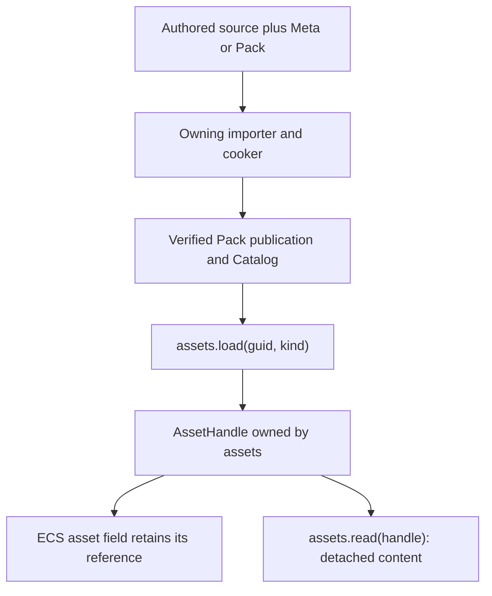

# Runtime asset and mesh contracts

Use this reference for mesh import, runtime ownership, VFX, source reload and
asset reads. [AssetRegistry](../../../packages/assets-runtime/README.md) owns
the complete public API contract.

## Multi-UV import: glTF and FBX TEXCOORD_0 through 7

glTF and FBX preserve up to eight UV sets. Geometry owns the canonical Mesh
attributes, vertex layout and binary format; import, Cook and runtime decode
consume that same contract. Read the [Geometry contract](../../../packages/geometry/README.md)
when changing binary versions, interleaving, bounds or UV cardinality instead
of copying a header layout into a consumer.

Malformed or obsolete mesh artifacts fail at decode with structured evidence.
Inspect `code`, `detail` and `hint`, repair the producer and recook the same
source GUID. Runtime never re-cooks a binary. A missing authored UV set and
invalid binary storage are distinct failures; inspect the material's requested
coordinates and the actual Mesh attributes before changing either.

## Texture kind vocabulary

Sidecar subassets and Catalog rows use `texture`. `image` identifies the
importer that decodes source files. Built-in runtime kinds derive from the
`Asset` union; custom host kinds use an explicit `AssetKind` token.

## Meta source resolution

source is optional and resolves relative to the sidecar's own directory, without another project path registry:

1. Omit source when source/meta filenames match; strip .meta.json to derive the adjacent source.
2. Otherwise use an explicit relative path from the meta directory.

### Omitted source

When source and meta share the same directory/basename, omit source. The engine removes the .meta.json suffix and selects that neighboring file.

```jsonc
// hero.png.meta.json: omitted source resolves adjacent hero.png.
{
  "importer": "image",
  "importSettings": { /* ... */ }
}

// bleep.mp3.meta.json: omitted source resolves adjacent bleep.mp3.
{ "importer": "audio" }
```

```
Layout:
  assets/
    hero.png              <- Source.
    hero.png.meta.json    <- Derives hero.png.
    sfx/bleep.mp3         <- Source.
    sfx/bleep.mp3.meta.json <- Derives sfx/bleep.mp3.
```

Rename the source and meta together to preserve basename pairing.

### Relative source

```jsonc
// assets/models/hero.glb.meta.json
{ "source": "hero.glb", "importer": "gltf" }

// assets/models/hero.meta.json -> assets/models/meshes/hero.glb
{ "source": "meshes/hero.glb", "importer": "gltf" }
```

Cross-project/submodule assets must be explicit Pack/Meta roots supplied to the build host, preserving local source/sidecar pairing. Meta does not resolve @name or package.json path tables.

### Source errors and recovery

Missing source produces one structured orphan error; inspect its detail after narrowing code:

| Code | Trigger | Hint | Detail | Recovery |
|:--|:--|:--|:--|:--|
| pack-orphan-meta | Derived/relative source does not exist. | Remove orphan meta or restore source. | metaPath and expectedFile absolute path. | Restore expectedFile or repair relative source. |

> [!IMPORTANT]
> Failed omitted-source derivation reports pack-orphan-meta; it never silently ignores a sidecar.

### Distinction from SceneAsset.mounts source

meta.source is a disk path string; SceneAsset.mounts[].source is an integer reference index for nested scenes. Use path terminology for the disk field to avoid mixing these domains.

## Runtime API quick reference

| Operation | Result and ownership |
|:--|:--|
| `assets.create(content)` | Validate runtime content and return a caller-owned asset handle |
| `assets.load(guid, kind, { signal }?)` | Asynchronously admit a verified source closure or retain its current runtime handle |
| `assets.read(handle)` | Return detached content with copied arrays and buffers |
| `assets.update(handle, patch)` | Commit validated fields; material `values` merge by parameter name |
| `assets.replace(handle, content)` | Replace complete same-kind content under the same handle |
| `assets.writeRange(handle, range)` | Commit a domain mesh, texture or Terrain range |
| `assets.copy(handle)` | Create an independently editable identity |
| `assets.snapshot(handle)` | Retain fixed content and dependency versions until disposed |
| `assets.source(handle)` / `sourceOf(handle)` | Inspect adopted provenance / provenance with the modified flag |
| `assets.reload(handle, { conflict })` | Explicitly adopt current source content; choose `reject` or `overwrite` |
| `assets.retain(handle)` / `release(handle)` | Own or release a caller reference |
| `assets.configurePackIndex(url)` | Configure the shipped Catalog source |
| `assets.catalogEntry(guid)` / `enumerateCatalog()` | Read navigation and producer evidence |
| `assets.invalidate(guid)` / `invalidateAll()` | Invalidate source read caches; existing runtime content remains admitted |
| `assets.instantiate(sceneHandle, world)` | Instantiate a Scene definition into the supplied World |
| `decodeImageBytes(bytes, mime, options?)` | Return Texture POD for `assets.create`; no network I/O or GPU upload |

All operations returning `Result` require success before reading `value`.
Built-in `load` calls use kind literals such as `'scene'`, `'audio'`, and
`'material'`. Custom kinds use the same `defineAssetKind<P>()` token as their
decoder. Load returns a handle; `read` returns the payload. AudioSource,
VideoPlayer, MeshFilter and other asset fields bind the handle directly.

## Authoring and load order



A standalone World receives the owner through `new World({ assets })`; an
App supplies both services. Components use `asset(kind)` or arrays of asset
fields. Non-asset ECS shared references have their own lifetime and never
store asset payloads.

## VFX GPU program route

The VFX cooker publishes validated program bytes through the same Pack/Catalog
path. `loadVfxGpuEffect` returns the owner handle for ParticleEffectPlayer;
`@forgeax/engine/vfx-render` owns simulation resources and indirect draws.

```ts
import { ParticleEffectPlayer, loadVfxGpuEffect } from '@forgeax/engine/vfx';
import { createVfxRuntimeHost } from '@forgeax/engine/vfx-render';

const host = createVfxRuntimeHost({ camera });
const attached = await host.attachWorld({ world, assets });
if (!attached.ok) return attached;
const loaded = await loadVfxGpuEffect(assets, effectGuid);
if (!loaded.ok) return loaded;
const spawned = world.spawn({
  component: ParticleEffectPlayer,
  data: { effect: loaded.value, playing: true, seed: 7, timeScale: 1 },
});
assets.release(loaded.value).unwrap();
if (!spawned.ok) return spawned;
```

Register `host.feature` when constructing the Renderer. `attachWorld` installs
the domain decoder and FixedUpdate producer; ordinary frames retain the asset
version selected for each tick without reading particle state back to the CPU.
See [VFX](../../../packages/vfx/README.md) and
[VFX Render](../../../packages/vfx-render/README.md) for host disposal and recovery.

## Usage skeleton

```ts
const { assets, world } = app;
assets.configurePackIndex('/pack-index.json');
const loaded = await assets.load(sceneGuid, 'scene');
if (!loaded.ok) {
  console.error(loaded.error.code, loaded.error.hint);
  return;
}
const scene = loaded.value;
const descriptor = assets.read(scene).unwrap(); // detached SceneAsset
const instance = assets.instantiate(scene, world);
assets.release(scene).unwrap();
if (!instance.ok) {
  console.error(instance.error.code, instance.error.hint);
  return;
}
```

Changing a Scene definition affects later instantiations. Existing entities
and playback state remain with their respective World and player owners.

## Runtime edits and explicit source adoption

```ts
const material = (await assets.load(materialGuid, 'material')).unwrap();
assets.update(material, { values: { roughness: 0.2 } }).unwrap();
const provenance = assets.sourceOf(material); // adopted publication, modified: true
const detached = assets.read(material).unwrap();
const independent = assets.copy(material).unwrap();
const fixed = assets.snapshot(material).unwrap();
try {
  // Source refresh does not discard gameplay edits.
  assets.invalidate(materialGuid);
  const reloaded = await assets.reload(material, { conflict: 'reject' });
  if (!reloaded.ok) console.error(reloaded.error.code, reloaded.error.hint);
} finally {
  fixed.dispose();
  assets.release(independent).unwrap();
  assets.release(material).unwrap();
}
```

Repeated loads retain the existing handle and its edits. `reload` prepares and
adopts the current source closure atomically under existing identities.
`conflict: 'overwrite'` explicitly permits replacing edits that preceded the
request; both policies reject changes committed during pending I/O. Invalid
content, missing dependencies, cancellation or source removal preserve the old
closure. Reload grants no extra reference and writes no source file.

`read` isolates arrays, subarrays and backing buffers. Mutating a read or a
retained input cannot modify current content. Use `update`, `replace` and
`writeRange`; the owner derives revisions and consumers adopt changes at their
own boundaries. A Renderer submission retains the versions it actually uses.

## Display identity and boundaries

Source GUIDs identify authored outputs; handles identify content in one runtime
owner. `CatalogEntry.name`, `packageId`, `sourcePath` and `sourceKey` are producer
navigation facts, accessible through `catalogEntry` or enumeration. Rename and
save source through the owning authoring gateway. Runtime creation and editing
do not create source GUIDs, add Catalog rows or change source names.

CLI discovery and execution use [`forgeax-engine-cli`](../../forgeax-engine-cli/SKILL.md).

## Pitfalls

- A GUID absent from the authoritative Catalog is not permission to fetch arbitrary source. Verify the declaration and publication; on-demand production requires a declared unpublished row and an injected producer transport.
- Runtime material/mesh/audio fields take asset handles from their owner. Source Pack fields use GUID references; the load boundary resolves them.
- A bare Registry must install domain decoder contributions. Custom writable kinds also require `prepare`; missing preparation remains a structured error.
- Foreign, released or invalid handles fail with `asset-reference-invalid`; disposed owners fail with `asset-owner-closed`. Use the intended owner and release only references the caller owns.
- `invalidate` affects source reads. Use explicit `reload` for a live asset; invalidation is not a gameplay reset.
- Video pixels require a real browser video source. Dawn structural acceptance cannot prove browser upload or playback behavior.
- Scene collection follows `asset(kind)` schema fields and adopted source provenance. Runtime-created referenced content needs a durable publication before GUID-based source export; do not invent a payload-to-GUID table.

## Automatic Mesh LOD source production

Use `generateMeshLods` from `@forgeax/engine/import/mesh-lod-generator` on a
canonical source Mesh, then publish the root and generated siblings through
the ordinary Mesh producer with stable source-owned GUIDs. Read the
[Import contract](../../../packages/import/README.md#automatic-mesh-lod-production)
for error budgets, material/attribute preservation, conservative deformation
locks, and target-limited results. Renderer consumes the same `MeshAsset.lods`
refs; it performs no simplification. Validate intended-distance images and
actual draws with RHI Debug after publication.
