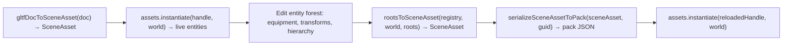

# Scene and custom asset contracts

Use this reference for video, nested scenes, SceneAsset writeback, new asset kinds,
custom loaders, and static asset evidence.

## VideoAsset: world-space video textures

A VideoAsset is a source descriptor `{ kind: 'video', url }`. Use
`assets.load(guid, 'video')` for a verified source publication, or
`assets.create({ kind: 'video', url })` for code-created content. Both return
an asset handle. A host VideoSourceProvider owns native video elements and
playback capability; the asset definition does not create DOM elements.

```ts
const video = assets.create({ kind: 'video', url: '/clip.webm' }).unwrap();
assets.update(material, { values: { baseColorTexture: video } }).unwrap();
// Bind the same video handle to VideoPlayer.clip on the material's entity.
// Release the caller reference once those bindings have retained it.
assets.release(video).unwrap();
```

Engine/Runtime installs its video domain contribution. A bare Registry must
install the matching contribution. `assets.read(video)` is an explicit
metadata read; never allocate another World asset reference from that payload.

- Real browser acceptance must exercise the supplied native video source; Dawn cannot prove video pixels.
- DynamicTextureStore owns frame uploads and device retirement. Playback cursor and native source lifetime remain instance/host state.
- `renderer.importTexture({ kind: 'video', ... })` is the separate caller-owned external-source API. A `texture_external` material slot can use zero-copy sampling when available; see the material skill and Render contract.
- Replacing or reloading a VideoAsset follows normal asset admission. Native playback owners consume its accepted source version at their own boundary.

## Nested SceneAsset mounts

SceneAsset.mounts embeds child SceneAssets through SceneInstanceMount entries:

```ts
interface SceneInstanceMount {
  readonly localId: LocalEntityId;     // Mount entity slot.
  readonly source: number;             // refs index of child SceneAsset GUID.
  readonly memberFirst: LocalEntityId; // Start of the child slot window.
  readonly memberCount: number;        // Must equal child totalSlots.
  readonly parent?: LocalEntityId;     // Defaults to the outer synthetic root.
  readonly components?: Partial<ComponentValuesMap>;
  readonly overrides?: readonly MountOverride[];  // IDs use the parent namespace.
}
```

> [!IMPORTANT]
> Override localId uses the parent SceneAsset namespace, memberFirst+offset, not the child's local ID.

### Mount errors

| Code | Boundary | Meaning |
|:--|:--|:--|
| pack-mount-localid-overlap | Before instantiation | Entity IDs overlap mount/member slots. |
| pack-mount-count-mismatch | After child mapping | memberCount differs from child.totalSlots. |
| pack-mount-override-localid-out-of-range | Pre-spawn override validation | Override ID lies outside the window. |
| pack-mount-override-unknown-field | Pre-spawn override validation | Field is absent from schema. |

World SceneInstance methods: [`forgeax-engine-ecs`](../../forgeax-engine-ecs/SKILL.md).

## Scene save and writeback

rootsToSceneAsset(registry, world, roots) serializes any live entity forest to reusable SceneAsset, deriving entity-to-localId and asset-handle-to-source-GUID conversion from schemas. Engine owns GUID lookup; callers need no handleToGuid table or SceneInstance guard.

### Load and save cycle



### rootsToSceneAsset contract

```ts
// packages/runtime/src/collect-scene-asset.ts
export function rootsToSceneAsset(
  registry: SceneAssetGuidLookup,
  world: World,
  roots: EntityHandle[],
): Result<SceneAsset, SceneCollectEntityRefOutOfClosureError | SceneCollectAssetGuidUnresolvedError>;
```

| Aspect | Retired collectSceneAsset | rootsToSceneAsset |
|:--|:--|:--|
| Entry | One root with SceneInstance guard | Multiple arbitrary roots. |
| Handle/GUID lookup | Injected external table | AssetRegistry load/read and source GUID identity. |
| Field conversion | Hand-maintained names | Schema-derived. |
| Root ChildOf | Preserved | Stripped in the saved scene. |
| Local IDs | Reused | Consecutive BFS numbering from zero. |
| Result | Raw SceneAsset | Structured Result. |

### Schema-derived field conversion

rootsToSceneAsset and serializeSceneAssetToPack share one schema dispatcher:

| Schema vocabulary | Conversion |
|:--|:--|
| entity | Forest-local ID; external references fail scene-collect-entity-ref-out-of-closure. |
| array<entity> | Element-wise local IDs. |
| asset(kind) | Resolve the adopted source GUID; runtime-only content requires a durable publication before source export. |
| array<asset(kind)> | Element-wise GUIDs, including fixed-length forms. |
| Other | Preserve primitive values. |

### Internal GUID lookup

`AssetRegistry.guidOf(handle)` projects adopted source identity. `rootsToSceneAsset` consumes that existing lookup; consumers do not search detached payload identity or maintain a second GUID table.

### Structured collection errors

Scene collection returns these AssetRuntimeErrorCode members:

| Code | Trigger | Detail | Hint |
|:--|:--|:--|:--|
| scene-collect-entity-ref-out-of-closure | Entity reference leaves the selected forest. | entity, field, target | Expand roots or remove the reference. |
| scene-collect-asset-guid-unresolved | Asset handle has no durable source GUID. | field, handle | Publish runtime content or load its source before collection. |

### Consumer skeleton

```ts
import { rootsToSceneAsset, serializeSceneAssetToPack } from '@forgeax/engine-runtime';

// 1. Collect the selected forest into SceneAsset.
const result = rootsToSceneAsset(registry, world, roots);
if (!result.ok) {
  switch (result.error.code) {
    case 'scene-collect-entity-ref-out-of-closure': {
      // detail.entity/field/target identify the external reference.
      // Include the target in roots or remove the reference.
      break;
    }
    case 'scene-collect-asset-guid-unresolved': {
      // detail.field/handle identify an asset without a source GUID.
      // Publish the referenced content or load its durable source first.
      break;
    }
  }
  return;
}
const sceneAsset = result.value; // SceneAsset { kind: 'scene', entities: [...] }

// 2. Optionally serialize Pack POD with GUIDs indexed through refs.
const packResult = serializeSceneAssetToPack(sceneAsset, sceneGuid);
if (!packResult.ok) {
  // packResult.error.code === 'scene-collect-asset-guid-unresolved'
  // A scene GUID could not be mapped to a refs index.
  return;
}
const packJson = packResult.value; // { kind: 'scene', entities: [...], refs: [...] }
// Persist JSON.stringify(packJson) to name.pack.json.
```

### Pitfalls

- rootsToSceneAsset is synchronous over live World and registered assets; failed GUID lookup returns immediately rather than retaining raw handles.
- Empty roots produce an empty SceneAsset without error.
- Root ChildOf is stripped from saved output, but live World components are unchanged; collection is read-only.

## Add an Engine asset kind

The built-in kind vocabulary derives from the `Asset` union. Add its POD type,
producer, domain decoder contribution and runtime preparation at the owning
package. Component references use `asset(kind)`. Declare source dependencies in
the Pack envelope and runtime dependencies through the preparation context;
consumers must not invent a second kind registry or per-kind preload loop.

## Open registration for host kinds

Configuration, dialogue and ability data use an `AssetKind<P>` token without
expanding the built-in union. Share that token between decoder installation,
loads and runtime creation.

```ts
import { assetDecoderPlugin, defineAssetKind } from '@forgeax/engine/assets-runtime';
import { err, type AssetDecoderContribution, type AssetError, type Result } from '@forgeax/engine/types';

interface MyGameConfig {
  level: number;
  maxPlayers: number;
}
// The host implements validation of its complete configuration schema.
declare function validateConfig(value: unknown): Result<MyGameConfig, AssetError>;

const GameConfig = defineAssetKind<MyGameConfig>('my-game-config');
const contribution: AssetDecoderContribution<MyGameConfig> = {
  kind: GameConfig,
  consumer: 'game',
  decoder: {
    async decode({ envelope }) {
      const checked = validateConfig(envelope.payload);
      return checked.ok ? checked : err({
        code: 'asset-decode-failed',
        expected: checked.error.expected,
        hint: checked.error.hint,
        detail: { guid: envelope.guid, kind: envelope.kind, cause: checked.error },
      });
    },
    prepare: validateConfig,
  },
};
const decoderFiber = app.pluginContext.plugin(assetDecoderPlugin(contribution));
const loaded = await app.assets.load(guid, GameConfig);
if (!loaded.ok) {
  console.error(loaded.error.code, loaded.error.hint);
  return;
}
const handle = loaded.value;
const cfg = app.assets.read(handle).unwrap(); // MyGameConfig, detached
app.assets.update(handle, { maxPlayers: 8 }).unwrap();
app.assets.release(handle).unwrap();
// Retire the decoder contribution when the feature's native Fiber ends.
await decoderFiber.dispose();
```

A standalone host can own `assets.installDecoder(GameConfig, decoder)` directly
and dispose the returned lease. A decoder with only `decode` admits read-only
source content; `create(GameConfig, value)`, `update`, `replace` and `copy` need
its synchronous `prepare` contract. Preparation receives a detached complete
candidate and returns validated data; retained aliases cannot modify current
content after commit.

### Cross-kind references

Pack `refs` carries dependency GUIDs. Source loading validates eager closures
before atomic admission. A custom `prepare(value, context)` uses
`context.reference(guidOrHandle, kind)` for each dependency stored in the
accepted content and `context.read(handle)` for explicit detached reads.
The owner retains referenced versions and retires omitted references after a
successful replacement. A declared deferred decoder keeps activation-specific
references deferred rather than loading them during definition inspection.

### Missing decoder recovery

`asset-decoder-missing` identifies the absent kind contribution. Install the
owning decoder lease and retry `assets.load(guid, token)`. A generic type
parameter, optional payload `kind`, or Catalog row cannot bypass this gate.
`asset-kind-mismatch` requires the correct built-in kind or custom token.
Inspect structured `code`, `detail` and `hint`.

### Scope

The asset owner transports, verifies, retains and updates custom content. Host
logic translates domain data into entities or other native consumers; declaring
a custom kind does not add a rendering implementation.

## Further reading

- Disk schemas, GUID tools, and scan validation: packages/pack/README.md and cli-asset.ts.
- AssetRegistry API authority: packages/assets-runtime/src/asset-registry.ts.
- Image import/settings, color space, mipmaps, cubemaps, HDR: packages/image/README.md; ImageErrorCode in engine-types.
- Runtime image-byte decoding: packages/assets-runtime/README.md, Runtime image bytes decoder.
- Import/load separation and ImportTransport: packages/import/README.md. Development uses POST /__import/:guid; shipped paths consume cooked DDC and fail when absent. Build-time import code stays outside players.
- glTF importer, emissive material mapping, and mesh/material/scene/texture/skeleton/skin/animation-clip outputs: packages/gltf/README.md and cli-gltf.ts.
- ufbx importer and Phong-to-roughness conversion: packages/fbx/README.md and fbx-importer.ts. Package postinstall hydrates WASM best-effort; fetch-wasm/build:wasm provide explicit recovery.
- Skin/animation sample: hello/skin loads Khronos Fox (24 joints; Survey/Walk/Run), instantiates three copies with independent players, and resolves joints within each subtree. Asset attribution: khronos-gltf-samples/Fox, CC BY 4.0. Owner: runtime/scene-instances/post-spawn-resolve-joints.ts.
- MSDF bake/FontAsset/GlyphText: packages/font/README.md and runtime/glyph-text-layout-system.ts.
- PackIndexEntry and optional name: engine-types; development/index projection: vite-plugin-pack/src/.
- AssetErrorCode/PackErrorCode/GltfErrorCode/FontErrorCode: engine-types; read source rather than copying unions.
- Asset, entity, and shader name disambiguation: [types README](../../../packages/types/README.md).
- Inspector resolved asset names: [`forgeax-engine-cli`](../../forgeax-engine-cli/SKILL.md).
## Static asset evidence

> [!IMPORTANT]
> Static assets load only from Pack v2 through `packageUrl`. Runtime-only bytes remain an explicit separate exception.

`AssetEvidence` is the read-only GUID evidence view for source declaration, cook receipt freshness, package/artifact verification, and optional runtime readiness. Use `lookup/verify --guid --project --catalog --json`; `notCooked`, `stale`, and `unknown` are explicit states, and `unknown` is never a successful verification.

### Evidence probe recovery

Follow the join in this order: source inventory, catalog locator (`packageUrl` and `cookReceiptUrl`), producer `CookReceipt`, Pack v2 package/artifact verification, then optional runtime evidence. A catalog row only locates bytes; it cannot upgrade `notChecked` to `passed`.

- `notCooked`: the source declaration exists but no successful receipt exists. Fix the importer or recook.
- `ready/current`: the source input fingerprint matches the receipt. `ready/stale`: the source changed; recook before trusting the package.
- `unknown`: a required capability was unavailable. Configure the runtime evidence source or supply the offline project/catalog inputs; do not treat it as success.
- `failed`: follow the structured `.code` / `.hint`, repair the named producer or artifact, and rerun the probe.

Runtime SDK calls are `assets.inspect(guid)` and `assets.verifyByGuid(guid)` after `configureAssetEvidence(source)`. The source is host-injected; the runtime package never imports the CLI, Node filesystem, or Vite. For source-free diagnostics use the pack CLI with `lookup/verify --guid --project --catalog --json`.
