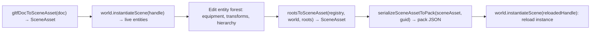

# Scene and custom asset contracts

Use this reference for video, nested scenes, SceneAsset writeback, new asset kinds,
custom loaders, and static asset evidence.

## VideoAsset: world-space video textures

VideoAsset treats video as a changing texture in the 3D world. Load its { kind: 'video', url } payload by GUID and use it through the material texture chain.

VideoAsset belongs to the Engine Asset union as a runtime kind without import/cook. URL points to WebM/MP4; the host VideoElementProvider supplies HTMLVideoElement. The descriptor has no dependency refs.

wireDefaultLoaders installs the descriptor-only videoLoader; it returns VideoAsset synchronously without manual registration.

### Usage skeleton

```ts
import type { VideoAsset } from '@forgeax/engine-types';
// videoLoader is already registered in wireDefaultLoaders — no manual register needed

// 1) register the VideoAsset { url } descriptor via catalog (dev/memory path)
assets.catalog<VideoAsset>(guid, { kind: 'video', url: '/clip.webm' });

// 2) loadByGuid returns the payload directly (descriptor-only loader)
const res = await assets.loadByGuid<VideoAsset>(guid);
if (!res.ok) {
  // res.error.code is an AssetErrorCode (e.g. 'asset-not-found') or
  // runtime video code 'video-upload-unsupported'
  console.error(res.error.code, res.error.hint);
  return;
}
const videoAsset = res.value; // VideoAsset { kind: 'video', url: '/clip.webm' }

// 3) the GUID can be used in MaterialAsset.paramValues texture fields
//    (e.g. baseColorTexture) — identical to a static texture GUID. The
//    texture field takes the DASH-FORM GUID STRING (not the AssetGuid object /
//    Uint8Array — a non-string silently drops to the default white texture):
const mat: MaterialAsset = {
  kind: 'material',
  passes: [{ name: 'Forward', shader: 'forgeax::default-unlit' }],
  paramValues: { baseColorTexture: guid },  // dash-form GUID string, same texture2d slot as static
};
```

### Capability boundaries

| Boundary | Contract | Recovery |
|:--|:--|:--|
| No Dawn video pixels | No HTMLVideoElement/VideoFrame; structural checks can report video-upload-unsupported. | Use browser E2E for pixel acceptance. |
| Host supplies video element | Engine does not create DOM video elements or set src. Register VideoElementProvider as a World resource. | See hello/video-texture. |
| High-performance path is a probe only | GPUExternalTexture upload is unimplemented; general copyExternalImageToTexture works. | Use the supported general path. |
| No audio-track fields | Host or separate audio work owns sound. | Separate owner. |
| Dynamic frames are not static cache entries | DynamicTextureStore uploads per frame, outside ensureResident's permanent cache. | Static invalidate semantics do not apply. |

> [!NOTE]
> Video integration updates Asset, ASSET_BRAND, and default loader registration. Recursive refs loading remains kind-independent; retired collectRefs/storedNameOf paths and Pack build need no change.

### Material consumption

Material texture fields referencing VideoAsset use the extraction branch for kind=video and transient uploads; other material behavior matches static textures. See the material skill.

## Nested SceneAsset mounts

SceneAsset.mounts embeds child SceneAssets through SceneInstanceMount entries:

```ts
interface SceneInstanceMount {
  readonly localId: LocalEntityId;     // Mount entity slot.
  readonly source: number;             // refs index of child SceneAsset GUID.
  readonly memberFirst: LocalEntityId; // Start of the child slot window.
  readonly memberCount: number;        // Must equal child totalSlots.
  readonly parent?: LocalEntityId;     // Defaults to the outer synthetic root.
  readonly components?: Partial<ComponentValuesMap>;
  readonly overrides?: readonly MountOverride[];  // IDs use the parent namespace.
}
```

> [!IMPORTANT]
> Override localId uses the parent SceneAsset namespace, memberFirst+offset, not the child's local ID.

### Mount errors

| Code | Boundary | Meaning |
|:--|:--|:--|
| pack-mount-localid-overlap | Before instantiation | Entity IDs overlap mount/member slots. |
| pack-mount-count-mismatch | After child mapping | memberCount differs from child.totalSlots. |
| pack-mount-override-localid-out-of-range | Pre-spawn override validation | Override ID lies outside the window. |
| pack-mount-override-unknown-field | Pre-spawn override validation | Field is absent from schema. |

World SceneInstance methods: [`forgeax-engine-ecs`](../../forgeax-engine-ecs/SKILL.md).

## Scene save and writeback

rootsToSceneAsset(registry, world, roots) serializes any live entity forest to reusable SceneAsset, deriving entity-to-localId and shared-to-GUID conversion from schemas. Engine owns GUID lookup; callers need no handleToGuid table or SceneInstance guard.

### Load and save cycle



### rootsToSceneAsset contract

```ts
// packages/runtime/src/collect-scene-asset.ts
export function rootsToSceneAsset(
  registry: AssetRegistry,
  world: World,
  roots: EntityHandle[],
): Result<SceneAsset, SceneCollectEntityRefOutOfClosureError | SceneCollectAssetGuidUnresolvedError>;
```

| Aspect | Retired collectSceneAsset | rootsToSceneAsset |
|:--|:--|:--|
| Entry | One root with SceneInstance guard | Multiple arbitrary roots. |
| Handle/GUID lookup | Injected external table | Engine resolveAssetHandle/guidForAsset. |
| Field conversion | Hand-maintained names | Schema-derived. |
| Root ChildOf | Preserved | Stripped in the saved scene. |
| Local IDs | Reused | Consecutive BFS numbering from zero. |
| Result | Raw SceneAsset | Structured Result. |

### Schema-derived field conversion

rootsToSceneAsset and serializeSceneAssetToPack share one schema dispatcher:

| Schema vocabulary | Conversion |
|:--|:--|
| entity | Forest-local ID; external references fail scene-collect-entity-ref-out-of-closure. |
| array<entity> | Element-wise local IDs. |
| shared<T> | Resolve GUID; uncatalogued assets fail scene-collect-asset-guid-unresolved. |
| array<shared<T>> | Element-wise GUIDs, including fixed-length forms. |
| Other | Preserve primitive values. |

### Internal GUID lookup

AssetRegistry._guidForAsset searches envelope payload identity and returns its GUID. Instantiation and skin resolution reuse it. It is internal; rootsToSceneAsset already performs the entire handle-to-GUID path.

### Structured collection errors

Handle these RuntimeErrorCode members exhaustively without default:

| Code | Trigger | Detail | Hint |
|:--|:--|:--|:--|
| scene-collect-entity-ref-out-of-closure | Entity reference leaves the selected forest. | entity, field, target | Expand roots or remove the reference. |
| scene-collect-asset-guid-unresolved | Shared handle cannot resolve to a catalogued asset. | field, handle | Register the asset before collection. |

### Consumer skeleton

```ts
import { rootsToSceneAsset, serializeSceneAssetToPack } from '@forgeax/engine-runtime';

// 1. Collect the selected forest into SceneAsset.
const result = rootsToSceneAsset(registry, world, roots);
if (!result.ok) {
  switch (result.error.code) {
    case 'scene-collect-entity-ref-out-of-closure': {
      // detail.entity/field/target identify the external reference.
      // Include the target in roots or remove the reference.
      break;
    }
    case 'scene-collect-asset-guid-unresolved': {
      // detail.field/handle identify an unresolved shared reference.
      // Register/load the asset first.
      break;
    }
  }
  return;
}
const sceneAsset = result.value; // SceneAsset { kind: 'scene', entities: [...] }

// 2. Optionally serialize Pack POD with GUIDs indexed through refs.
const packResult = serializeSceneAssetToPack(sceneAsset, sceneGuid);
if (!packResult.ok) {
  // packResult.error.code === 'scene-collect-asset-guid-unresolved'
  // A scene GUID could not be mapped to a refs index.
  return;
}
const packJson = packResult.value; // { kind: 'scene', entities: [...], refs: [...] }
// Persist JSON.stringify(packJson) to name.pack.json.
```

### Pitfalls

- rootsToSceneAsset is synchronous over live World and registered assets; failed GUID lookup returns immediately rather than retaining raw handles.
- Empty roots produce an empty SceneAsset without error.
- Root ChildOf is stripped from saved output, but live World components are unchanged; collection is read-only.

## Add an Engine asset kind

After removing collectRefs/storedNameOf/assetBrand switches, kind integration is concentrated in types/importers:

1. Add the Asset union member with its kind and payload fields.
2. Add its ASSET_BRAND record entry; TypeScript rejects missing keys.
3. Populate ImportedAsset refs with dependency GUIDs and sourceField metadata for entity handle fields; texture edges omit sourceField.

Retired paths stay absent:
- No collect-refs switch arm; that file was removed.
- No obsolete recursive type-test guard.
- No per-kind preload branch in loadByGuid; refs use one loop.
- No storedNameOf table; envelope owns names.

Correct importer refs integrate automatically with recursive loading.

## Open registration for host kinds

Engine kinds use the Asset union. Host configuration/dialogue/ability data uses open loader registration and loadByGuid<MyType>, retaining precise types without casts.

### Register and load

**Register the custom loader**:

```ts
import type { Loader, LoaderOutput } from '@forgeax/engine-types';

interface MyGameConfig {
  level: number;
  maxPlayers: number;
}

function myGameConfigLoader(): Loader<MyGameConfig> {
  return {
    kind: 'my-game-config',
    load(payload: Record<string, unknown>): LoaderOutput<MyGameConfig> {
      return payload as unknown as MyGameConfig;
    },
  };
}

import { assetLoaderPlugin } from '@forgeax/engine-assets-runtime';

const loaderFiber = await app.pluginContext.plugin(assetLoaderPlugin(myGameConfigLoader()));
```

**Load the precise payload type**:

```ts
const res = await engine.assets.loadByGuid<MyGameConfig>(guid);
if (!res.ok) {
  console.error(res.error.code, res.error.hint);
  return;
}
const cfg = res.value;  // MyGameConfig without a cast.
cfg.maxPlayers;          // Available through type completion.

// Remove the loader registration when unloading the feature.
await loaderFiber.dispose();
```

### Open payload semantics

AssetEnvelope, ImportedAsset, and Loader each accept P=Asset:

- AssetEnvelope<P> stores the catalog payload; default Asset covers Engine kinds, custom P covers hosts.
- Loader<P>.load returns LoaderOutput<P>, the payload rather than an envelope.
- ImportedAsset<P> carries payload and AssetRef dependencies.

The Asset union remains an Engine convenience, not the registry's sole admissible payload type.

### Cross-kind references

Host/Engine refs can cross in either direction. Loader.load returns payload only; envelope/Pack assets[].refs carry dependencies. Recursive loading reads that envelope graph. The loader refs argument contains already-declared references and may be ignored when unnecessary.

```ts
// refs are in the sidecar, NOT in load()'s return value.
// The pack.json assets[] entry declares refs:
//
// {
//   guid: "...",
//   kind: "my-game-config",
//   payload: { kind: "my-game-config", title: "Parent", ... },
//   refs: [childGuid]   // <-- refs live here
// }
//
// load() just returns the payload P (no envelope, no refs).
function myGameConfigLoader(): Loader<MyGameConfig> {
  return {
    kind: 'my-game-config',
    load(payload: Record<string, unknown>): LoaderOutput<MyGameConfig> {
      return payload as unknown as MyGameConfig;
    },
  };
}
```

The same refs loop handles host/Engine kinds. host-custom-kind-contract.test.ts covers host-to-host, host-to-Engine, Engine-to-host, and cycles.

### Missing loader recovery

Production/upstream loading reports loader-not-registered when an indexed kind requires decoding but has no loader:

```ts
const res = await engine.assets.loadByGuid<SomeType>(guid);
if (!res.ok && res.error.code === 'loader-not-registered') {
  // detail.registeredKinds lists available loaders.
  await app.pluginContext.plugin(assetLoaderPlugin(myLoader));
  // retry...
}
```

This remains a Result, not a thrown exception/rejected Promise; inspect ok/code/detail.

> [!NOTE]
> Direct in-memory catalog registration can pass through custom payloads without a loader. The missing-loader error belongs to production/upstream paths requiring parsing. Register a loader to perform custom parsing/validation, not merely to admit in-memory data.

> [!IMPORTANT]
> registry.loaders.register is the low-level App-free host interface with an idempotent disposer. Games prefer assetsPlugin/assetLoaderPlugin/packLoaderPlugin so registration, removal, and provider recovery share one Cordis Fiber.

### Scope

Engine addresses, transports, catalogs, and recursively loads custom payloads; it does not render them. Host logic must translate domain data into entities/components; GPU stores recognize Engine render kinds only.

## Further reading

- Disk schemas, GUID tools, and scan validation: packages/pack/README.md and cli-asset.ts.
- AssetRegistry API authority: packages/assets-runtime/src/asset-registry.ts.
- Image import/settings, color space, mipmaps, cubemaps, HDR: packages/image/README.md; ImageErrorCode in engine-types.
- Runtime image-byte decoding: packages/assets-runtime/README.md, Runtime image bytes decoder.
- Import/load separation and ImportTransport: packages/import/README.md. Development uses POST /__import/:guid; shipped paths consume cooked DDC and fail when absent. Build-time import code stays outside players.
- glTF importer, emissive material mapping, and mesh/material/scene/texture/skeleton/skin/animation-clip outputs: packages/gltf/README.md and cli-gltf.ts.
- ufbx importer and Phong-to-roughness conversion: packages/fbx/README.md and fbx-importer.ts. Package postinstall hydrates WASM best-effort; fetch-wasm/build:wasm provide explicit recovery.
- Skin/animation sample: hello/skin loads Khronos Fox (24 joints; Survey/Walk/Run), instantiates three copies with independent players, and resolves joints within each subtree. Asset attribution: khronos-gltf-samples/Fox, CC BY 4.0. Owner: runtime/scene-instances/post-spawn-resolve-joints.ts.
- MSDF bake/FontAsset/GlyphText: packages/font/README.md and runtime/glyph-text-layout-system.ts.
- PackIndexEntry and optional name: engine-types; development/index projection: vite-plugin-pack/src/.
- AssetErrorCode/PackErrorCode/GltfErrorCode/FontErrorCode: engine-types; read source rather than copying unions.
- Asset, entity, and shader name disambiguation: [types README](../../../packages/types/README.md).
- Inspector resolved asset names: [`forgeax-engine-cli`](../../forgeax-engine-cli/SKILL.md).
## Static asset evidence

> [!IMPORTANT]
> Static assets load only from Pack v2 through `packageUrl`. Runtime-only bytes remain an explicit separate exception.

`AssetEvidence` is the read-only GUID evidence view for source declaration, cook receipt freshness, package/artifact verification, and optional runtime readiness. Use `lookup/verify --guid --project --catalog --json`; `notCooked`, `stale`, and `unknown` are explicit states, and `unknown` is never a successful verification.

### Evidence probe recovery

Follow the join in this order: source inventory, catalog locator (`packageUrl` and `cookReceiptUrl`), producer `CookReceipt`, Pack v2 package/artifact verification, then optional runtime evidence. A catalog row only locates bytes; it cannot upgrade `notChecked` to `passed`.

- `notCooked`: the source declaration exists but no successful receipt exists. Fix the importer or recook.
- `ready/current`: the source input fingerprint matches the receipt. `ready/stale`: the source changed; recook before trusting the package.
- `unknown`: a required capability was unavailable. Configure the runtime evidence source or supply the offline project/catalog inputs; do not treat it as success.
- `failed`: follow the structured `.code` / `.hint`, repair the named producer or artifact, and rerun the probe.

Runtime SDK calls are `assets.inspect(guid)` and `assets.verifyByGuid(guid)` after `configureAssetEvidence(source)`. The source is host-injected; the runtime package never imports the CLI, Node filesystem, or Vite. For source-free diagnostics use the pack CLI with `lookup/verify --guid --project --catalog --json`.
