# ForgeAX Engine authoring

[Simplified Chinese](SKILL.zh-CN.md)

## Start here for game work

The game-root `AGENTS.md` already gives the hard rules, default commands and routing.
Reach a first correct edit with this short path, not by reading large skills up front:

1. Capabilities and boundaries: read [the engine overview](ENGINE-OVERVIEW.md) first. It maps
   each game need to its engine capability and lists what the engine does not do.
2. Signatures and import paths: [the API index](references/api-index.md) before
   searching `node_modules` READMEs or `.d.ts` files.
3. Use the Quick contract in [`forgeax-engine-cli`](../forgeax-engine-cli/SKILL.md) for commands and [`forgeax-engine-render-pipeline`](../forgeax-engine-render-pipeline/SKILL.md) for camera and light effects.
4. Follow the game-root `AGENTS.md` for delivery. For visual work, run `forgeax dev look` and use the [visual self-review](#visual-self-review) before running the playthrough.

### One engine plugin and one HUD, end to end

The engine root builds the scene and owns the game state; the frontend root owns the DOM.
They talk over `gameHost.port`, and `project play` reads the registered projection.
Export each plugin from a `*.pack.ts` as a `kind: 'plugin'` output and select it in
`forge.json#roots` (as the templates do).

```ts
import type {} from '@forgeax/engine/app';
import type {} from '@forgeax/engine/assets-runtime';
import { Update, defineSystem } from '@forgeax/engine/ecs';
import { createBoxGeometry } from '@forgeax/engine/geometry';
import type { Plugin } from '@forgeax/engine/plugin';
import { Materials, MeshFilter, MeshRenderer } from '@forgeax/engine/render';
import { Transform } from '@forgeax/engine/scene';

// Engine root: builds the scene, pushes HUD state and exposes a read projection.
export const game: Plugin.Object<{}> = {
  name: 'my-game/engine',
  inject: ['world', 'assets', 'gameHost'],
  apply(ctx) {
    const { world, assets, gameHost: host } = ctx;
    ctx.effect(function* () {
      host!.setPointerLockAllowed?.(false); // cursor-aimed game: no mouse-look lock
      const mesh = assets!.create(createBoxGeometry(1, 1, 1).unwrap()).unwrap();
      yield () => assets!.release(mesh).unwrap();
      const material = assets!.create(Materials.standard({ baseColor: [0.8, 0.3, 0.2, 1] })).unwrap();
      yield () => assets!.release(material).unwrap();
      const box = world.spawn(
        { component: Transform, data: { pos: [0, 0.5, 0] } },
        { component: MeshFilter, data: { assetHandle: mesh } },
        { component: MeshRenderer, data: { materials: [material] } },
      ).unwrap();
      yield () => world.despawn(box).unwrap();
      let score = 0;
      const updateHud = defineSystem({
        name: 'my-game/hud', queries: [],
        fn: () => host!.port?.postMessage({ channel: 'hud', state: { score: ++score } }),
      });
      world.addSystem(Update, updateHud).unwrap();
      yield () => world.removeSystem(Update, updateHud).unwrap();
      const unregister = host!.gameProjection?.registerRead({ id: 'my-game.state', title: 'Score', read: () => ({ score }) });
      if (unregister) yield unregister;
    });
  },
};

// Frontend root: owns the DOM and listens on the same channel.
export const hud: Plugin.Object<{}> = {
  name: 'my-game/hud',
  inject: ['gameHost'],
  apply(ctx) {
    const host = ctx.gameHost!;
    ctx.effect(function* () {
      const port = host.presentationPort ?? host.port;
      const label = host.uiRoot?.appendChild(document.createElement('div'));
      const receive = (event: MessageEvent) => {
        if (event.data?.channel === 'hud' && label) label.textContent = `Score ${event.data.state.score}`;
      };
      port?.addEventListener('message', receive);
      port?.start();
      yield () => { port?.removeEventListener('message', receive); label?.remove(); };
    });
  },
};
```

Large skills (`forgeax-engine-cli`, `forgeax-engine-render-pipeline`,
`forgeax-engine-debug`, `forgeax-engine-material`, `forgeax-engine-app`) are references:
search them for the needed heading instead of reading them whole, and reuse a
file already in context.

## Visual self-review

For look-dev use `forgeax dev look --hide-ui true --json` after each lighting, material,
fog or camera edit (seconds against a running `dev start --headless true`; it waits for
your edit and flags only a renderer error or a flat frame; you judge the PNG); use `project play` only for gameplay acceptance. To look at a scene without
playing or a running owner, use `forgeax asset preview --kind scene --guid <guid> --json`; it renders
the SceneAsset through its authored camera. After the first look, and
again before delivery, open the PNG and answer each question in one sentence; fix every
"no", then look again:

1. Brightness: does the frame read as the intended time of day (daylight bright, night dark
   with lit pools), with no blown-out white or crushed black areas? Judge the scene with
   `--hide-ui true`: a menu overlay darkens the frame and hides both.
2. Saturation: are colours as vivid as the intended look? A pale or grey frame usually
   means fog over the subject, a cool `Skylight` fill or AgX.
3. Contrast: does the subject stand out from its background? A flat slab or empty void
   behind it needs a `SkyboxBackground` with an authored sky asset or set dressing.
4. Mood: do palette and lighting match the intended mood (warm, eerie, neon, cosy)?
5. Framing: does the subject fill about half the frame, with nothing clipping the near
   plane or blocking the camera, and the HUD off the subject? For a follow camera, also
   look from a spot where a tree, rock or wall lies between the camera and the player.
6. Subject: do the player character and key props look like what the game is about? The
   template character is a placeholder robot; for any other hero, rebuild its mesh and materials in `character.pack.ts`.

## First five minutes: understand before authoring

Start with [the engine overview](ENGINE-OVERVIEW.md): it is the quick map of what the engine can and cannot do.

`forgeax project init` and `forgeax project new` return the local `AGENTS.md` and this skill in
`onboarding.read`. Read those entries, select the requested delivery scope in the
game's guide, and load only the focused skills/package contracts needed now.
Use [the capability catalog](references/feature-catalog.md) on demand for discovery;
its historical audit snapshot is neither current-HEAD proof nor an enablement list.

For a new or resumed game task, read the game's local `AGENTS.md` before editing.
Its **Run, test, build, and release** section selects local playable delivery, game
release or a specialized task. Follow that selected scope and stop condition. Engine
package verification does not replace game acceptance.

> [!IMPORTANT]
> Available is not enabled. An Engine capability is available for selection; a game enables it only through its `forge.json`, plugin composition, ECS components, assets, renderer features, or build configuration. Install and register only the capabilities the game uses.

Before the first edit, translate the requested game into a capability adoption plan and save it as
`docs/engine-plan.md` (one block per needed feature, about a page in total):

```text
Need: <player-visible or production requirement>
Use: <one ForgeAX capability and its owner>
Entry: <focused skill, CLI operation, or package README>
Proof: <test, asset verification, browser evidence, or package output>
Defer: <available capabilities not needed now>
Gap: <what the engine does not cover, and the smallest hand-written part>
```

Build each feature on the capability its block names. Writing your own version of a capability the catalog or API
index lists (meshes, camera rig, input, particles, collision, UI, post effects) is allowed only after a lookup that
found no match; mark that block `Gap`, keep the custom part minimal and record it in `docs/feedback.md`. Skipping
the plan to save time is the usual cause of hand-rolled replacements and of capabilities left unused.

| Need | Start with | Proof before claiming it works |
|:--|:--|:--|
| Frame loop, execution tier, input, plugin assembly | `forgeax-engine-app`, then `forgeax-engine-ecs` or `forgeax-engine-state` | Real browser interaction; add a unit test only when playing cannot reach the case |
| Scene, imported files, code-first packs, GUID loading | `forgeax-engine-assets`; discover operations through `forgeax-engine-cli` | `asset verify`, build catalog, runtime load by GUID |
| Code-authored props, hard-surface parts and kit meshes | `forgeax-engine-modeling` | `m.validate()` closed/volume facts, exported MeshAsset, browser pixels |
| PBR, textures, custom WGSL | `forgeax-engine-material`, then `forgeax-engine-shader` | Shader check, material readiness, browser pixels |
| Lake, waves, water queries or buoyancy (explicit opt-in) | [Water](../forgeax-engine-render-pipeline/SKILL.md#water) | Verify the lake in a completed browser frame before adding interactions |
| Lighting, shadows, sky, fog, AA, post effects, custom passes | `forgeax-engine-render-pipeline` | Requested pipeline active and real GPU/browser evidence |
| Programmable volumetric clouds, cloud material instances, moving cloud shadows | [Volumetric clouds](../forgeax-engine-render-pipeline/SKILL.md#volumetric-clouds) | Completed material adoption, visible clouds and shadows, temporal motion and fallback |
| Particles: rain, snow, sparks, dust, fire (`Points`, effects/particles-core.md); GPU particles, trails, ribbons, beams | `forgeax-engine-vfx` | Path choice; cooked effect, runtime playback, browser pixels |
| Bodies, colliders, character motion | `forgeax-engine-physics` | Fixed-step/collision test plus playable behavior |
| BGM, SFX, spatial audio | `forgeax-engine-audio` | Host playback, intent/cleanup evidence, user gesture handling |
| Black frame, wrong binding, GPU divergence | `forgeax-engine-rhi-debug`; use `forgeax-engine-debug` for symptom routing | One capture artifact, inspect/replay or paired differential |
| Create, inspect, develop; build/preview/package when requested | `forgeax-engine-cli` | The selected game delivery scope passes |

Create a game only after selecting its template: `forgeax project new <dir> --template game-3d` for every
3D game; use `--template empty` otherwise. Missing selection is `sdk-template-required`.

> [!IMPORTANT]
> `game-3d` is a runnable, contentful third-person reference, not an empty 3D scene. It copies
> authored scene/physics, character/animation, material/mesh, and UI examples into the new project;
> those examples affect visible composition, collision space, and asset closure. After creation,
> read the generated project's `README.md` and keep, adjust, replace, or remove starter content by
> game goal; update scene, runtime, and pack references together when removing it.

Use [the full capability catalog](references/feature-catalog.md) for less common areas such as animation/skinning, UI/font/video, picking, networking, intelligence, profiler, Remote, custom RenderGraph/RHI work, and source-mode Engine development. Then read only the focused skill and owning package README. The catalog is a discovery index, not a substitute for those precise contracts.

For browser capture and local Engine binding, read the relevant CLI skill section.

The default game-consumer route is:

```mermaid
flowchart LR
  A["Install @forgeax/engine"] --> B[Read onboarding paths]
  B --> C[Create external game]
  C --> D[Choose smallest capability set]
  D --> E[Author code and assets]
  E --> F[Test and asset verify]
  F --> G[Browser dev and visual proof]
  G --> H["Deliver local playable game"]
  H -. "User requests release" .-> I["Game release route"]
```



Run `forgeax help --tree --json`, then `forgeax help <command-path> --json`, before guessing authoring-operation inputs. Use the CLI skill for the command boundary. Start the seven-stage ForgeAX closed loop only when the user explicitly authorizes it for the current task.

Project creation checks the selected `@forgeax/engine` channel and reports
`engineUpdate`. Each project pins its Engine version. Read the release notes,
then update and validate each game explicitly.

For Engine work, use the matching source checkout and `forgeax project engine use-local`.
The [Engine release procedure](../../packages/engine/RELEASING.md) covers package production.

## Plugin asset authoring

Create functional Packs: export small native behaviors from the same file, and split
complex implementations into ordinary TypeScript modules. Follow the
[Plugin contract](../../packages/plugin/README.md): persistent definitions live in
Pack, and schema-v3 project `roots` select their GUIDs. Use `asset plugin inspect`
to check sourceKey and definitions, then inspect native Fiber state to confirm
activation. Verify a new session after code or configuration changes; engine and
frontend effects own scene and DOM cleanup respectively. For source reuse, read
`help asset source import` or `help asset source clone` and transfer the author closure.
