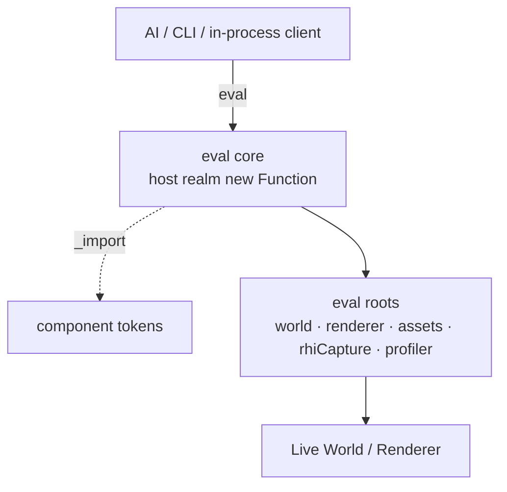
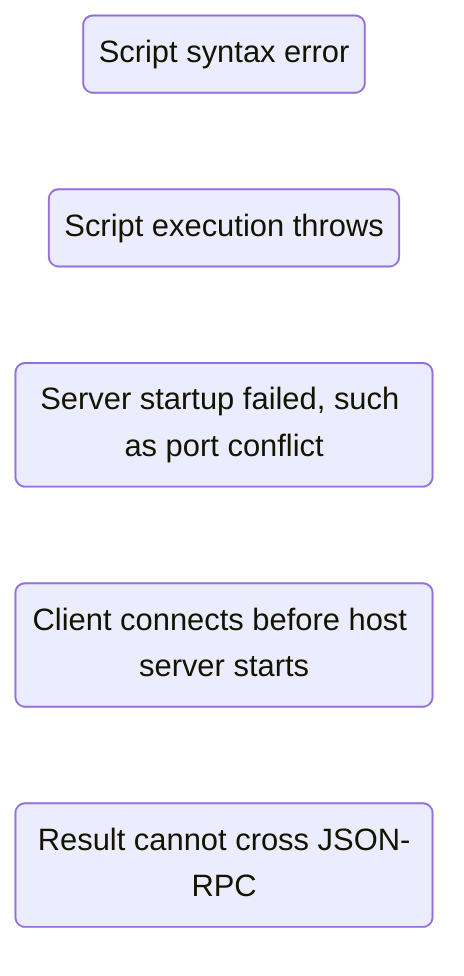

# forgeax-engine-cli 中文参考

[English tool entry](SKILL.md)

供人阅读的简体中文版本。工具仍读取固定名称 `SKILL.md`；命令、标识符和代码示例保持原契约。

## 快速契约

日常游戏工作通常只需本节；任务需要时再读后续章节。从游戏根目录执行 `pnpm exec forgeax <path> ... --json`。精确参数以 `forgeax help <path> --json` 为准；`help --tree --json` 列出完整命令树。输入来自帮助输出。

| 步骤 | 命令 | 说明 |
|:--|:--|:--|
| 检查环境 | `project check` | Node/pnpm、清单、依赖 |
| 单元/类型检查 | `pnpm test`、`pnpm typecheck` | `project test` 执行项目测试门禁 |
| 资产 | `asset verify`、`asset list`、`asset inspect <guid>` | GUID、sidecar、Pack、闭包 |
| 启动游戏 | `dev start [--headless true] [--backend auto]` | 可选常驻 owner；默认有窗口 |
| 状态 | `dev status` | phase、revision、帧、未完成 eval；stopped/unreachable |
| 运行时验收 | `dev verify [--revision <rev>] [--require-ui]` | 验收门禁；阻塞即失败 |
| 脚本游玩 | `project play <script>` | 独立运行时中真实输入及同一门禁 |
| 截图 | `dev capture [--output <png>] [--checkpoint <name>]` | 必须打开 PNG；路径本身不是证据 |
| 视觉迭代 | `dev look [--hide-ui true] [--viewports WxH,...] [--cameras '[…]']` | 每次灯光/材质/相机修改后等待新版本，生成 PNG 并检查渲染错误/平帧 |
| Bloom/HDR | `dev look --view luminance`、`dev pick --x <px> --y <py>` | 色调映射前亮度相对 bloom 阈值的档位热图；像素 HDR 与最前表面 |
| 实时状态 | `dev eval --revision <rev> --code '<js>'` | 必须指定 revision；用 _import() 导入 token |
| 观察 | `dev find --name <n>`、`dev focus --name <n>`、`dev camera set/release` | 临时相机，不编辑场景 |
| 重载/停止 | `dev reload`、`dev stop` | 重载使 revision 与引用失效 |
| 生产输出 | `project build`、`project preview` | HTTP 提供已验证的 dist/ |
| 发布 | `project package [--format web-zip\|single-html\|tauri] [--output <file>]` | 仅在请求发布时执行 |

- 观察返回 `revision`，传给 eval（verify 可选）以拒绝陈旧运行时。磁盘编辑会使运行时失效；依赖或 Engine 修改后执行 dev reload。
- 服务维护只有 dev start/dev stop；look/capture/verify/eval 按需启动 owner，结果一致。
- 错误保留 code、expected、hint、detail；修复错误指出的 owner。结果列出 omitted.fields 时，仅决策需要才加 --detail。
- 项目原生构建根可通过 `devkitAppOptions.canvasPixelRatio` 指定浏览器分辨率策略：正有限比例或 'device'，省略为 1x。Canvas 宽高限制是上限，不是请求尺寸；报告 720p 前检查目标设备已完成帧的实际尺寸。
- dev status 只报告；带不同浏览器选项的 dev start 会替换 owner。--backend auto 优先硬件并报告软件回退。
- 游玩脚本在 host 提供时，首次输入前等待 `html[data-forgeax-input="open"]`，再将检查点名称写入 `document.documentElement.dataset.forgeaxCaptureReady` 供 capture(name) 使用，见[浏览器合成截图](#browser-compositor-capture)。
- 证据仅来自 owner 浏览器；交付 dev status URL。其他标签页可能后台运行，出现 live-bridge-not-owner 属于预期，不能用它验收。
- project play/dev verify 用较长 exec yield 在单次阻塞调用中等待，禁止轮询。
- 仅困难渲染故障（不能用作交付）：dev start --rhi-capture true，复现后 rhi capture，再读 [RHI Debug](../forgeax-engine-rhi-debug/SKILL.zh-CN.md)。

> [!IMPORTANT]
> forgeax 是 Engine 命令入口。逐层使用 help 发现命令；help --tree --json 返回完整结构化命令树。ToolContribution、ToolClient、ToolRun 是 CLI 内部组合契约，不是其他产品入口。

在游戏根运行 `forgeax project view --json`。打开返回的 URL，确认项目和就绪状态。通过同一项目根运行 `forgeax backend status` 或 `forgeax backend stop`。

--json 默认紧凑：较大字段概括并列入 omitted.fields。仅决策需要时加 --detail，例如 project build --detail --json 查看全部产物摘要（也在 dist/forgeax-dist.json），dev status --detail --json 查看完整执行报告。

困难或原因不明的渲染问题从 [RHI Debug](../forgeax-engine-rhi-debug/SKILL.zh-CN.md) 开始，以实时控制复现并捕获失败帧，再由 tape 证据选择状态查询与修复 owner。

## View 开发与宿主验证

自定义 Preview host 使用 @forgeax/engine-devkit 的 readProjectFacts 和 plugin-build 子路径的 loadProjectCookers 激活所选项目构建根。将会话 watchFiles 纳入源码变化处理，关闭或启动失败时 await dispose()。

View 编辑器 Play 借用当前项目资源服务器。它在 World 就绪前返回游戏页；play.ready 等待已认证 World。Stop 退役游戏页，保留编辑器和资源。项目/Engine 源码变化要求新的已接受项目 revision；Play 不绕过捕获源码保护。

启动服务前选择 [View 运行模式](../../tools/forgeax-mcp/README.md#view-operating-modes)。界面开发、人工审查和浏览器标注默认使用 platform independent View，交付实际 View/项目 URL。MCP 桥回归使用 platform simulation，实际宿主行为使用 platform native，分开记录两种证据。

原生 Codex View 实例归客户端所有：最后一个 App/业务 MCP 进程退出（包括异常退出）后三秒宽限期触发 Engine 清理。绑定与项目选择保留；重开目标和 token 更新。仅关闭页面不会停止其他 MCP 用户仍保留的实例。手动启动 backend 保留显式 backend stop 生命周期；切换手动/客户端所有权前先停 daemon。

Linux 无显示器批处理遵循无人值守验证。DevKit 默认启用 Chromium 沙箱。在 Linux root 下，拿到可执行文件路径时会准备非特权身份和独立用户资料目录，无显示时实时会话默认 headless。若沙箱准备或 Chromium 启动明确报沙箱错误，DevKit 记录一次降级，用原浏览器关闭沙箱重试。成功后仍继续检查渲染帧和输入。若启动仍失败，读取报错并把相关验收标记为未验证。借用现有页面无需本地启动浏览器。

## 持续实时控制

游戏项目根运行或传 --root。live owner 在 CLI 调用间保持一个真实游戏；help dev 用于发现命令。

```bash
forgeax dev start --headless false --json
forgeax dev find --name Player --json
forgeax dev focus --name Player --distance 6 --json
forgeax dev camera set --position '[8,6,8]' --target '[0,1,0]' --json
forgeax dev capture --json
forgeax dev camera release --json
forgeax dev stop --json
```

观察默认针对当前运行时，成功返回 revision；下一命令传 --revision 可要求精确运行时。重载/World 替换使旧 revision 与实体引用失效。名称歧义时 find 返回可用于 focus --ref 的引用。focus 根据 Renderer bounds 和当前投影框选子树；--distance 覆盖自动距离。focus --name 精确匹配，绝不取重复名称的第一个。find --limit 默认 20、最大 100。

live 命令等待可自行恢复的就绪状态：编辑/重载替换运行时、编译期间再次保存取代启动代、World 替换、其他 eval/capture 尚在运行。--ready-timeout-ms 默认 120000，0 立即返回原错误。成功在 revision 旁返回 waitedMs；等待失败在 detail.waitedMs 返回。输入未变化或不可读的失败运行时、超过调用方等待的 eval（live-eval-continuing）、无效参数不等待；停止 owner 返回 live-not-running。被新输入取代的启动在替代者就绪前，status.error 为 `live-startup-superseded: <cause>`。断开调用者绝不延后准入。等待不改变固定身份：--revision/--ref 对应运行时被替换时返回 live-revision-stale 和当前 revision。eval、camera set/release、focus 仅在执行前拒绝时重试；未固定 revision 的观察针对新运行时重跑。dev start 对仍启动/等待/重载 owner 在项目启动预算内等待；死掉、失败、陈旧、配置不同的 owner 才替换。

dev eval 必须有 revision，因为任意代码可能持有旧实体句柄。取消等待不停止已执行代码；reload/stop 销毁执行环境。set/focus 获取临时观察相机，get 报告 control，release 交还游戏；不保存场景编辑。

App 桥属于 owner 启动的页面。owner 为每页生成 token，只放该页 URL；dev status.url 省略 token。同一 Vite 的其他页（人工标签、自己用 Playwright 打开 status.url）正常运行游戏，但桥连接以 4403/live-bridge-not-owner 拒绝，页面只警告一次、不重连。owner 页本身重载时最新实例接管，旧 socket 以 4409/live-bridge-displaced 关闭，挂起调用立即报 live-app-bridge-disconnected。dev reload 更新 token，旧代页被拒绝；其他页游玩时 dev 仍控制 owner 页。

### 视觉迭代：dev look

灯光、材质、雾、后处理、相机工作保留一个 dev start --headless true owner，每次编辑后 dev look --hide-ui true --json；project play 用于游戏交互验收。look 等编辑后的 revision（waitedMs）、启动淡出、两个新帧，在常驻 owner 页面截图：--viewports（WxH[,WxH...]，仅 headless）× --cameras（固定 {name?, position, target, up?, lens?}，结束后释放）。每视图返回 PNG、metrics（width/height/flat）、findings；只判断渲染错误和平帧，不以阈值评判美观。打开 PNG，编辑后再 look。

--view luminance 额外写 <view>-luminance.png/.json，显示曝光和色调映射前、用于 bloom 阈值的线性 HDR 帧：相机阈值周围整档假彩色、smoothstep knee 阴影线及 min/max/mean、低于/位于 knee/高于的比例。dev pick --x --y 对这些 PNG 像素返回 HDR rgb、luminance、ev、bloom 类别和权重，以及最前表面的实体、路径、mesh、含 emissive 的材质槽、世界坐标。HDR 是合成像素；实体仅为最近表面，烟/玻璃后可能命中透明层而非光源。

dev capture 返回带绝对路径和摘要的 PNG/JSON 报告引用。默认产物在用户数据目录，停止或删除临时项目后仍保留。--output 指定 PNG，相对路径基于项目。--checkpoint 等待游戏给出的精确就绪标记，不是图片标签，普通截图无需使用。帧号证明截图前有提交，不代表 PNG 精确对应帧。验证截图在截止前等待启动遮罩隐藏再接受 DOM 像素；观察截图保留当前启动/失败诊断表面。

HUD 正常而 Canvas 白/透明通常是渲染错误；JSON 带 rendererError（code/message/frame/framesAgo/count）、pixels.rendered:false、pixels.reason:"renderer-error"、单行 hint。开发 host 对每种渲染错误只 console.warn 一次（dev logs）。按 RHI Debug 排查，不能猜材质/灯光。

--backend auto 优先硬件，可软件回退；status 报请求策略、实际 backend、回退原因。显式 hardware/software 必须匹配适配器。改变浏览器选项前停 owner。有窗口 live 使用原生显示密度，固定尺寸截图保留声明分辨率。

无人值守用 --headless true；--workers '{}' 自动选择 Engine/Render/符合条件的 Kernel Worker。各字段可 auto/true/false，如 --workers '{"kernels":false}'；status 查看实际 workers 决策。省略 workers 也全部 auto，新项目同样如此。DOM/UI entry 声明 realm:"frontend"，Node backend 插件为 host，游戏逻辑为 engine；{"engine":false} 在本地执行同一 bootstrap。dev reload 重读输入；live 定期检查作者文件元数据，并在操作/重载前后再查，不依赖文件事件。直接编辑使运行时失效；读输入失败阻塞观察直至恢复。revision 是运行时身份，非磁盘摘要或多文件原子快照。安装依赖和生成输出不纳入检查；修改 Engine/依赖构建后显式 reload。无注册 owner 时 status 为 stopped；已有 owner 不可联系为 unreachable，绝不静默替换。

## 游戏作品验收

编辑游戏后按生成的游戏 AGENTS.md 中固定的 “Run, test, build, and release” 节选择交付范围；中文阅读使用对应 AGENTS.zh-CN.md。检查 dev status 和截图报告的就绪/错误，打开截图并操作核心输入。范围要求生产输出时验证实际提供的 dist。本地可玩交付不授权发布或压力/性能工作。project preview 只提供文件，浏览器行为仍需观察。plugin-startup-failed 即使 root 活跃也失败；修复所指后代并验证新会话。跨版本诊断区分原固定版本、新版本、修复后证据。按游戏本地可玩证据表处理完成/阻塞检查。运行时验收用 dev verify --json（或 engine.run.verify；--revision 固定执行）；dev capture 保留观察，不能替代门禁。project play 在独立临时运行时对脚本真实输入的最终帧应用同门禁，无 revision。另一执行的证据可诊断 owner，不能验收用户交付目标。

## 可选工作区客户端

使用 help 中精确公共 operation ID：点变 CLI 空格、MCP 下划线。源操作为 asset.source.*；Engine 目标用 engine.asset.inspect、engine.scene.tree.get、engine.entity.inspect。运行中 backend 直接发布：forgeax help engine --tree --json，forgeax engine scene tree get --input '<operation-arguments>' --json。读取 owner 当前契约，不启动缺失 backend。

嵌入 backend 从已认证 Host transport 发现 engine.workspace.capabilities，调用 engine.workspace.call。项目/资产用 projectId；preview/camera 同时传 engine.workspace.get 的 targetId/targetGeneration。替换后刷新身份，不对当前 UI 选择重试旧目标。engine.run.* 使用既有 live owner；headless start 不联系 View carrier。有窗口附着要求持有实际 Page 的进程，端点凭证不能提供 Page。相机事务和幂等重试保持同一连接，断开撤销未完成草案。见 [DevKit workspace](../../packages/devkit/README.md#engine-workspace-provider)。

## 按意图路由

| 意图 | 入口 |
|:--|:--|
| 外部 forge.json 游戏静态构建 | forgeax project build <project> --base <url> --out-dir <dir> --json |
| 安装 Engine 与 CLI | `npm install -g @forgeax/engine` |
| 新建/初始化/检查外部项目 | project new [dir] --template empty\|game-3d / project init / project check |
| 本地 Engine 技能 | project skill install / project skill verify |
| 含 Engine 的 Web ZIP | project package --format web-zip [--output release/game-web.zip] [--compress=false]；默认较大 JSON 用 zstd 存储，false 保留明文 |
| 原生 WebView 安装包 | project package --format tauri --platform windows\|macos\|linux\|android\|ios --json |
| 导出其他宿主 Tauri 项目 | project package --format tauri --platform ios --prepare-only --json |
| 单 HTML 离线候选 | project package --format single-html --output release/game-offline.html --json |
| Canvas + HTML/Shadow DOM 截图 | project capture --backend auto --require-ui --output <png> --json |
| 无头软件合成 | project capture --headless true --backend software --require-ui --output <png> --json |
| 脚本游玩并验收最终帧 | project play scripts/playthrough.mjs [--require-ui] --json |
| 多检查点自定义会话 | node <scenario.mjs> + createBrowserCapture(root).open() / session.capture() |
| 发现命令/参数 | help [path] [--tree] [--json] |
| 构建/资源预览/创作 | project ... / asset ... / rhi ... / profile ... / preview analyze |
| 程序组合 | 普通 Node/Bun 模块导入 Engine command client |
| 插件维护 | project plugin list\|inspect\|configure\|disable\|enable\|install\|uninstall |
| 实时 World/Renderer 查询/修改 | 下文 eval(script) |
| 离线 RHI tape | forgeax-engine-rhi-debug |

Tauri 打包要求新输出目录（--output，默认 release/<id>-tauri-<platform>）。桌面构建在对应 OS；iOS 需 macOS、Xcode/XcodeGen、签名；Android 需 JDK、SDK/NDK。--prepare-only 无原生工具也可封存导出。生成的 pnpm build:<platform> 初始化移动目标并转发 Tauri 参数；移动构建必须用这些脚本，直接 Node 会丢失 IDE callback entry。Windows/Android 使用打包 Host 的精确 loopback origin，保留 IPC 范围和 Android 仅 loopback 网络策略；Android 文档使用已注册 forgeax.localhost:<port>，须与真实 Worker listener 一致。验证冷重启/启动状态及帧推进，错误遮罩可与活跃 Renderer 共存。

区分 ForgeAX 导出/构建与平台工具配置、人工同意。登录、签名凭据、手机信任/开发者模式、首次 keychain 提示由操作人员准备；配置后工具可自动化后续签名部署。ADB 测试不同于普通 APK 安装；iOS 开发测试不同于 App Store/TestFlight。代理辅助安装/快捷方式设置应与 Engine 能力分开描述。见平台配置。设备验收前检查 Android ELF/APK 16 KB 页对齐。原生包在 artifacts/，结果区分 prepared/built，运行时验收仍为 not-run；另跑桌面包 smoke（60 完成帧及 Host 清理），Android/iOS 需设备验收。签名/输出见 [DevKit](../../packages/devkit/README.md)。

> [!IMPORTANT]
> project new 必须明确模板：3D 用 game-3d，其余 empty。目标必须在 Engine 安装目录外，根或子目录报 project-target-inside-sdk；已有外部项目用 project init。game-3d 复制可运行第三人称参考（场景、可见对象/碰撞体、角色/材质/动画 Pack、UI）；保留、调整、替换、删除前读生成 README，同步更新场景、运行代码和 Pack 引用。

项目创建使用已安装 Engine 的模板，并为项目固定该 Engine 版本。将项目的锁文件与游戏源文件一起管理。

项目操作、组合、预览证据、可选服务加速按需读创作操作。

资源预览归 Engine host-realm 插件所有；help asset preview --json 获取精确请求，asset preview --kind material --guid <guid> --json 选择既有操作。支持 material/mesh/texture/VFX/scene。asset preview --kind scene --guid <guid> --json 用创作相机渲染 SceneAsset，不运行游戏逻辑；GUID 用 asset list --type scene --json。Mesh 按 AABB 框选；texture 采用保宽高比无光照呈现。Standard 材质返回 sampledTextureBudget（limit/required/transmission/conflicts），可移植上限 16 纹理；transmission:"exceeded" 表示 16 纹理设备丢失折射。dev start 使用源码开发资产路径；project preview 验证并提供 dist，不启动源码开发服务器。实时控制/下一帧 RHI 捕获需要同项目所属 dev/run session，静态浏览器图片不能接受这些命令。离线 RHI summary/inspect 保留产物身份；GPU replay/read 另需指定原生 provider。

<a id="browser-compositor-capture"></a>
## 浏览器合成截图

> [!IMPORTANT]
> 此开发视觉证据路径通过 backend auto 支持可用适配器。无 X11 用 --headless true；软件验证用 --backend software，无显示器不等于必须软件适配器。普通 preview/player/发布验收不静默切软件。

```bash
forgeax project capture --backend auto --require-ui \
  --output artifacts/capture/game-ui.png \
  --width 1280 --height 720 --wait-ms 4000 --json
```

命令使用源码开发 host，Linux 无 DISPLAY 时加 Xvfb，调用真实 Chromium page.screenshot()。PNG 包含 Canvas、普通 HTML、开放 ShadowRoot；Canvas read/toDataURL 不含 DOM UI。相邻 JSON sidecar 记录 GPUAdapterInfo、Chrome、X display、lavapipe ICD、Canvas/UI witness、console/page 错误。可见 Engine fatal 诊断即使保留帧且无浏览器错误也失败，报告保留 runtime.fatalError。--output（默认 artifacts/）仅写接受图片；拒绝的 fatal/startup/loading/flat 图和临时 witness 放 .forgeax/diag/<同相对路径>/*.failure.png，error.detail.output 指向它。--require-ui 要求生成 host 的 #game-ui 下有游戏 UI 子节点；Engine/browser ShadowRoot 不算。无 UI 游戏会 browser-capture-ui-missing，纯 Canvas 游戏省略该项。

auto 在无 WebGPU adapter 时软件回退，hardware 要非软件适配器，software 固定 SwiftShader/lavapipe 兼容参数。先等非平 Canvas 像素，再等 --wait-ms。即使有 Canvas/adapter/ShadowRoot，全黑也失败。sidecar pixels 记录仅 Canvas 采样亮度范围；witness 暂时隐藏非 Canvas 元素防 HUD 掩盖黑色 3D 帧，最终 PNG 仍全页合成。浏览器固定 viewport/screen、DPR 1、sRGB、light、en-US、UTC，等待 document.fonts.ready；项目需捆绑相同 Web 字体，系统 fallback 不能定义布局/颜色一致性。

本地/远端像素或颜色比较用 --deterministic；CLI 打开 ?forgeaxCapture=1。App 实际提交后在 canvas.forgeaxFrameProgress 保留帧事实，并在 Canvas 发只通知未来的 forgeax:frame-submitted。CLI 读快照、等非平 Canvas crop，再接受游戏的 dataset.forgeaxCaptureReady='true'。就绪前游戏需固定随机种子、逻辑帧、状态和字体；仅 viewport/DPR/耗时不构成一致性。

### 脚本游玩

project play <script> --json 是默认交互循环：启动临时游戏与私有 sandbox 浏览器，等首个就绪帧 html[data-forgeax-input="open"]，以 play helper 调用模块 default export，最终帧执行 dev verify（无 fatal、console/page 错误，非均匀 Canvas，健康执行；--require-ui 再要 #game-ui 子节点）。无需 dev start/revision/轮询/手写就绪等待。每次 play 固定启动成本：timings.openMs 是自身 Vite（新增/变化 Pack cooking 常 10–30 秒，否则数秒，浏览器并行启动），readyMs 是 Engine 到输入开放。每次新 browser profile；Pack 产品和 .forgeax/play/vite 优化依赖保留，一脚本覆盖多项检查。Pack 产品按内容和 Engine release 定址，不按位置：复制项目保留 .forgeax/ddc，project new 复用 Engine 包内模板及预烘焙缓存，FORGEAX_BUILD_CACHE_DIR 跨项目共享。

```js
// scripts/playthrough.mjs (new empty projects include an editable example)
import assert from 'node:assert/strict';
/** @param {import('@forgeax/engine/devkit').PlayContext} play */
export default async function playthrough(play) {
  await play.step('start', () => play.mouse.click([0.5, 0.8])); // canvas-normalized [x, y]
  const running = await play.waitFor((s) => s.phase === 'playing'); // registered read projection
  await play.keyboard.hold('KeyW', (s) => s.speed > 12);
  await play.screenshot('running');
  await play.reload();
  assert.equal((await play.state()).phase, 'menu');
  return { elapsed: running.elapsed };
}
```

PlayContext 来自 @forgeax/engine/devkit；完整签名见[api/play.md](../forgeax-engine-authoring/references/api/play.md) 或 help project play --json。

helper：step(name,run)、state(read?)、waitFor(predicate,{read,timeoutMs})、advance(seconds,{stepSeconds,read})、keyboard.press(key)、keyboard.hold(keys,ms|predicate)、mouse.click/move(point)、mouse.look(dx,dy)（movementDelta 像素，指针锁下直接发送）、mouse.drag(from,to,{button})、screenshot(name)、reload()、wait(ms)、原始 page 和 abort signal。press/click 保持至再完成三帧。state 读 gameHost.gameProjection.registerRead({id,read})，唯一 read 时 id 可省略。脚本 console 进入报告，--json stdout 保持单文档。

默认结果至多 900 字节，warnings 另至多 2400：passed、步骤数、有界 state/returned、截图路径、rendered、错误数、warnings、artifacts/play/<script path>/ 报告（如 artifacts/play/scripts/playthrough/play.json）。warnings 包括锁指针时 mouse.move、mouse.click 命中页面而非 Canvas/控件；不评判画面美观，必须打开截图。失败图在 .forgeax/diag/artifacts/play/<script path>/，--detail 返回完整报告。成功值、失败 detail、play.json 中 warnings 一致：每类 {kind,count,screenshots,message,others?}，按首次顺序，message 保留首例完整原因/修复；紧凑形式至多四类、六截图、无 others，moreWarningKinds 计其余。

--timeout-ms（play-timeout）/取消（tool-run-cancelled）使 helper reject 并关闭浏览器，同步无限循环无法中断。区分点按/长按的游戏用 keyboard.hold(key,ms)。advance 暂停 App，以显式游戏时间整帧推进（默认 1/60 秒，每帧 ≤0.1 秒，每调用 ≤600 秒/36000 帧），恢复并返回 state；末帧前仅 World 更新（advance(180) 约一秒），末帧渲染。{render:true} 每帧绘制，供 GPU picking/已提交地形高度等读提交画面逻辑使用。不发送输入（已按键每帧保持），失败为 play-step-failed，reason advance-invalid/advance-failed。游戏计时器/昼夜/长等待用 advance，不用 wait 或长 waitFor。

失败：play-script-invalid、play-not-ready（含 busy）、play-step-failed（step/action/失败图/state/首个浏览器错误）、play-timeout、play-runtime-failed；后者 detail.reason 为 fatal、renderer-error（报告保留 rendererError）、browser-errors、flat-canvas、ui-missing、execution-unhealthy、execution-unavailable、final-frame-timeout。未改 empty 模板不绘内容，示例在游戏渲染前为 flat-canvas；dev verify 同场景因无相机拒绝。headless 或未聚焦 Chromium 拒绝指针锁，鼠标观察用游戏控制路径如 mouse.drag(a,b,{button:'right'})。

代理契约：play 常 1–3 分钟，单次 shell 最长等待，不反复检查；游戏时间用 advance。stdout 结束输出一个 JSON，stderr 启动行/此前同脚本预计耗时，此后最多每 30 秒进度（排队也如此）。默认预算给 harness 至少 21 分钟（单 play 14，排队再至多 7），或降低 --timeout-ms。同项目 .forgeax/play/lock.json 串行；第二个等待（stderr 一行、timings.lockMs），一个 play 预算后报 play-not-ready/busy，指出 holder/lock 文件；无效脚本立即失败。--viewports 默认 1280x720,1280x600，在第一视口执行，再逐个 resize、截图并应用最终帧门禁；检查 HUD 重叠/裁切/被面板遮挡。

project play <script> --release [--dist <dir>] [--headers isolated|none] 对构建静态发布执行同脚本：先开发运行时迭代（可 --time-scale），再 --release 验构建，不能替代开发运行。先 project build，缺失报 play-not-ready/release-missing。play 独立 loopback server、私有浏览器、无开发 WebGPU flags。isolated 默认发送 preview 的 COOP/COEP/CORP；none 无 headers，普通静态站 crossOriginIsolated=false，App 用非隔离路径；普通站交付用 none，结果 headers 记录模式。所有非本机请求阻止并列 externalRequests，任一使 play-runtime-failed/external-request。输入/page/截图/viewports/require-ui/最终无 fatal、无浏览器错误、非均匀 Canvas 门禁同开发。发布保留游戏注册的只读 registerRead，state/waitFor/predicate hold 不变（数据可见于发行包）；无开发 host，advance 报 advance-failed、不查 execution health，拒绝 time-scale/session（tool-invalid-args）。用 play.release（--release 下 true）保护 advance，其余同脚本通用。

自定义组合重用一个 session；重复单次 capture 会重启页面/World：

```js
import { createBrowserCapture } from '@forgeax/engine/devkit';
const browser = createBrowserCapture(process.cwd());
async function scenario() {
  const session = await browser.open({
    backend: 'auto',
    deterministic: true,
    requireUi: true,
    outputDir: 'artifacts/playthrough/boss-flow',
  });
  try {
    const { page } = session;
    await page.getByRole('button', { name: 'Start' }).click();
    const spawn = await session.capture('spawn');
    await page.keyboard.press('KeyW');
    const arena = await session.capture('arena');
    return { report: session.reportPath, captures: [spawn, arena] };
  } finally {
    await session.close();
    await browser.close();
  }
}
console.log(JSON.stringify(await scenario()));
```

```bash
node tests/playthrough.mjs
```

加载/重载后首次真实输入前等 document.documentElement.dataset.forgeaxInput==='open'（html[data-forgeax-input="open"]）。生成启动 owner 在首个 ready frame 设置；150ms fade 不阻输入，加载/fatal startup 时 closed。游戏状态/HUD 读取可能早于该帧。

游戏把检查点名写入 dataset.forgeaxCaptureReady；capture('arena') 等 Engine frame signal、精确标记、非平 crop 后合成截图。session.page 保留原生 Playwright 输入/断言，无另一 DSL。DevKit 管 Vite/Xvfb/Chrome、稳定化、PNG/evidence、有序 run.json。Node/Bun 只返回 JSON-safe 值，finally 释放自有 Page/session。

| 路径 | Backend | 证据边界 |
|:--|:--|:--|
| Dawn/Node smoke | Mesa lavapipe | GPUTexture 回读，不含 DOM |
| project capture --backend auto | Chrome 硬件，无可用时软件 | Canvas + DOM/Shadow DOM 最终合成 |
| project capture --backend software / 常驻 Engine command client | SwiftShader，无头或 Xvfb | 最终合成；常驻会话跨截图保游戏状态 |

> [!CAUTION]
> 软件像素支持截图迭代和确定性回归，不能证明物理 GPU 性能、厂商驱动兼容性、HDR 显示或发布验收。

## 外部游戏静态构建

```bash
forgeax project build ./games/my-game \
  --base /games/my-game/ \
  --out-dir ./website-staging/games/my-game \
  --json
```

| 输入 | 契约 |
|:--|:--|
| project | 含 forge.json 和 entry 的外部游戏目录，项目文件是创作真相 |
| --base | 传 Vite、Pack index、运行资源 URL 的托管前缀 |
| --html-head | 项目相对 head 片段，Vite/分发封存前应用；平台脚本用它，不事后改 dist |
| --out-dir | 项目相对、专用派生目录，构建前清空 |
| --json | 与 forgeax-dist.json 对应的完整产物/摘要闭包 |

平台集成从 index.html 找 assets/index-*.js 页面 entry；engine-* 是内部分组。保持封存文件名/字节，勿构建后重命名 chunk。

加载/失败页由 build root 的 ctx.devkitAppOptions.startupUi 配置；loading/failure 各接受 'default'、'none' 或 {html,css?,script?}。游戏模块加载前用 inline/data URI 资源。见 DevKit README “Project-owned loading and failure screens” 的 screen 状态/动作和原生可移植边界；Host 保持就绪/输入所有权。关闭和自定义路径需 startup-ui.unit.test.ts 与生成 Browser/WeChat Host 验证。

DevKit 管生成 host、Vite、shader/Pack cooking、dist 清单。forge.json#roots 选插件资产；DevKit 编静态 program table、装 native Cordis Fiber。配置归 Pack；help asset plugin、help project root set 发现创作操作。源码/配置更新先编译后替换会话。

## Web 游戏交付

```bash
forgeax project package --format web-zip --json
forgeax project package --format web-zip --output release/my-game-web.zip --json
```

package 用相对 base 重建生产输出，校验 forgeax-dist.json 每项 size/SHA-256，再输出格式；默认 web-zip。ZIP 根含 index.html、哈希 JS/WASM、shader manifest、Pack index、cooked assets 及 Engine runtime；排除 Engine 源码、node_modules、创作源、远程调试服务。

| 动作 | 入口 | 证据 |
|:--|:--|:--|
| 本地开发 | dev start | HMR/开发 catalog，非发布证据 |
| 本地验收 | project preview | HTTP 提供验证 dist |
| Web 发布构建 | project package --format web-zip | release/*-web.zip 与 SHA-256；JSON files/bundles |
| 分享玩家 | 上传 ZIP 至 HTTPS 静态/HTML 游戏托管 | 玩家开 URL，不直接开 index.html |

浏览器 build 和两种 package 共用 Asset Bundle 的 Pack 产物准备：单 Pack 不跨 Bundle，共享字节只存一次，streaming 保持文件。build root 用 ctx.devkitDelivery={bundles:{<name>:['<source path prefix>/']}} 将共同加载 Pack 分组，未匹配落入 ≤8MiB 自动 Bundle。dist 保留诊断 Catalog 字段/cook receipt；package 去掉并重用编码 Bundle 条目。Catalog/Pack/shader/pipeline 同用 Codec reader，交付文件须经该 Codec 读取。见 DevKit README “Player Asset Bundles”。

> [!CAUTION]
> web-zip 要 HTTP(S)，不能 file:// 开 index.html。single-html 是明确的另一产物，仅通过下述验收才支持 file://。

## 单 HTML 离线交付

```bash
forgeax project package --format single-html \
  --output release/my-game-offline.html --json
```

single-html 与 web-zip 共用 project facts、相对 base 生产构建、完整 dist 验证，再把真实 entry/dynamic module、Engine/Kernel Worker、WASM、Pack、Shader、媒体、字体嵌入 dist 外一个 HTML，旁有 release/my-game-offline.html.sha256。JSON html.path、HTML SHA-256、distManifestSha256、embeddedAssets 标识候选；验收/晋级用同绝对路径。

先过通用检查，再跑游戏自身场景：

| 层 | 必需证据 |
|:--|:--|
| 结构 | 一个 HTML 闭合验证 dist 资源，无相邻 JS/CSS/Worker/WASM |
| 离线 | 目标 Chrome file://，零 HTTP(S)/失败请求/缺失资源 |
| Engine | 无 console/page 错误，正确 Canvas 尺寸、真实提交/非平输出、Worker/WASM/Pack/Shader 正常 |
| 可玩 | 项目场景证明输入、状态变化、关键玩法；ready/Canvas 存在不足 |

browser.open({target:{kind:'single-html',path},launchProfile:'release'}) 复用浏览器生命周期。release profile 不含 --allow-file-access-from-files 等不安全标志。无目标硬件/有窗口 Chrome 时保候选与已完成证据，玩家条件标 not-run；单文件验收依赖目标硬件/有窗口 Chrome，不能用软件截图或 HTTP preview 替代。

实时路径经 @forgeax/engine-remote 把 JS 送运行 Engine；world.query 发现句柄后直接访问 live roots，离线数据用包工具。

## 心智模型

eval(script) 在 host new Function 中执行，注入五个 live roots：

| Root | 类型 | 用途 |
|:--|:--|:--|
| world | @forgeax/engine-ecs World | spawn/despawn/set/query |
| renderer | Renderer | Render target 生命周期和 backbuffer 读取 |
| assets | AssetRegistry | load(guid,kind)/read/update/enumerateCatalog |
| rhiCapture | {captureFrame(options?)} 或 undefined | 单个 {kind:'rhi-tape',digest,bytes}；仅 FORGEAX_ENGINE_RHI_DEBUG=1 注入，先 guard；其他 roots 仍在 |
| profiler | Profiler 或 undefined | startCapture({frameLimit,eventLimit}) 有界 CPU 捕获，仅 host opt-in |

token 用 _import(specifier)，eval 内不可裸 import。

> [!NOTE]
> 协议还有 introspect，返回 OpenRPC L2 方法/eval roots 子集，无需读源码发现。错误映射 JSON-RPC -32001..-32005。

eval 无 API denylist、可读写；Host server 启动是边界。开发默认接 app.remote，生产不启动。破坏性 API 可执行，见警告。

## 传输路径

都汇入 eval(script)：



| 路径 | 形式 | 用途 |
|:--|:--|:--|
| 进程内 | App RemoteHandle；client.eval(script) | 无网络开销的宿主查询/调试 |
| WS JSON-RPC 2.0 | ws://localhost:5732，{"method":"eval","params":{"script":"..."}} | 外部工具/代理 |
| 统一 CLI | forgeax help/asset/debug/dev | 发现、离线操作、实时观察 |

## 核心 API 速查

| 名称 | 来源 | 形式 | 用途 |
|:--|:--|:--|:--|
| client.eval(script) | @forgeax/engine-remote | async (script:string)=>Promise<Result<unknown,RemoteError>> | 实时 JS 与返回值 |
| RemoteHandle | @forgeax/engine-types | {port:number;close():Promise<void>} | app.remote 端口/关闭 |
| RemoteError | @forgeax/engine-remote | 带 code/expected/hint/有界 detail 的 Error | 闭合 RemoteErrorCode 结构化失败 |

> [!IMPORTANT]
> 所有公共操作经命令树。RemoteErrorCode 只描述 live eval 桥失败；离线命令用领域拥有的错误联合。

## 发现句柄

空 descriptor 遍历启用实体；row.entity 是完整 packed handle。

```js
const query = world.query({});
if (!query.ok) throw query.error;
return Array.from(query.value, (row) => row.entity);
```

组件数据需导入 owner token，声明 read/write/optional/filter：

```js
const { MeshRenderer } = await _import('@forgeax/engine/render');
const { Transform } = await _import('@forgeax/engine/scene');
const query = world.query({ read: [Transform], with: [MeshRenderer] });
if (!query.ok) throw query.error;
return Array.from(query.value, (row) => ({
  entity: row.entity,
  position: Array.from(row.get(Transform).pos),
}));
```

## 读写示例

### 读取组件值

```js
const { Transform } = await _import('@forgeax/engine/scene');
const query = world.query({ read: [Transform] });
if (!query.ok) throw query.error;
return Array.from(query.value, (row) => ({
  entity: row.entity,
  position: Array.from(row.get(Transform).pos),
}));
```

Transform.pos 是平坦 array<f32,3> 列，第 i 行从 i*3 开始；quat/scale 步长 4/3。query bundle 无 .x/.y/.z 子字段。

### 写组件与生命周期

```js
// Spawn with components.
const scene = await _import('@forgeax/engine/scene');
const h = world.spawn({
  component: scene.Transform,
  data: { pos: [0, 5, 0], quat: [0, 0, 0, 1], scale: [1, 1, 1] },
}).unwrap();

// Set an existing entity's component values.
world.set(h, scene.Transform, { pos: [1, 2, 3] });

// despawn
world.despawn(h);
```

eval 不拦截写入，spawn/set/despawn 直接执行。inspector-write-denied 随 sandbox 移除，破坏性操作见警告。

<a id="rhicapture-single-frame-capture"></a>
## rhiCapture 单帧捕获

游戏用 dev start --rhi-capture true，再 rhi capture；live owner 调 recorder 并保存 tape。status 报 rhiCapture；recorder 不能附加已运行会话，未开启时返回 capture-unavailable 和重启命令。回复含 frameId/frameIdSource、capturedAt。嵌入 host 可经 eval root：

```js
if (rhiCapture === undefined) return { ok: false, error: { code: 'capture-unavailable' } };
const capture = await rhiCapture.captureFrame();
if (!capture.ok) return capture;
return { kind: capture.value.kind, digest: capture.value.digest };
```

嵌入 host 必须另存 capture.value.bytes、保留 digest；示例只返回概括。离线 rhi.summary（逐 pass --passes/--label）、默认 rhi.inspect 读本地产物，无需 WS/eval/replay 设备。见 [RHI Debug](../forgeax-engine-rhi-debug/SKILL.zh-CN.md)。

## Profiler 产物路径

Host 把公共 profiler capability 传 createApp 后，用既有 eval 启动有界捕获，无新增 RPC/传输变化。

```js
if (profiler === undefined) return { ok: false, error: { code: 'profiler-not-enabled' } };
const started = profiler.startCapture({ frameLimit: 120, eventLimit: 1024 });
if (!started.ok) return started;
// Drive the live App, then finish and persist the returned ProfileCapture.
return started.value.finish();
```

离线使用统一命令：

```bash
forgeax profile summary --root ./game --artifact profile-capture.json --json
forgeax profile frame --root ./game --artifact profile-capture.json --frame-id 12 --json
forgeax profile phase --root ./game --artifact profile-capture.json --source render --phase record --json
```

profiler 包 validateProfileCapture/buildProfileModel 负责 schema/语义恢复。仅覆盖有界 App/Render CPU，不是 ECS span/GPU timestamp/UI/外部 trace。

## 默认 createApp 附着

开发默认启动 remote server：

```ts
import { createApp } from '@forgeax/engine-app';

const app = await createApp({ canvas });

// Development: app.remote is defined and port > 0.
if (app.remote) {
  console.log('remote eval server on port', app.remote.port);
  // Call client.eval(...) in-process,
  // or connect externally to ws://localhost:<port>.
}

// Production: app.remote is undefined; no server starts.
```

RemoteHandle 在 @forgeax/engine-types；host 类型表面不静态导入 engine-remote。

## 实时求值

常规相机/截图用上述 live 命令，自定义检查先 status 取 revision 再 eval。代码运行真实 App realm（含 Engine Worker）。调用超时可停止等待而不停止已准入脚本；live-eval-continuing 在 status 保留 unfinishedEval、阻冲突操作，reload/stop 销毁环境。Node/dawn-node 的 remote/server 和 live 浏览器桥共享执行契约，都不可放公共生产服务。

## 闭合 RemoteErrorCode



| code | JSON-RPC | expected / 恢复 |
|:--|:--|:--|
| script-syntax-error | -32001 | 脚本有效；查 errMessage 位置、修语法重交 |
| script-runtime-error | -32002 | 无抛异常；查错误/符号，eval 完整访问 world/renderer/assets |
| server-startup-failed | -32003 | 请求端口启动成功；查占用（默认 5732），换端口或释放进程 |
| server-not-running | -32004 | ws://localhost:<port> 可达；先启动 demo，检查 app.remote，--port 覆盖默认 |
| eval-result-not-serializable | -32005 | JSON 可序列化；返回 JSON-safe，JSON-RPC 不支持 BigInt/循环 |

switch(err.code) 无 default，严格 TS 强制穷尽：

```ts
import { RemoteError, type RemoteErrorCode } from '@forgeax/engine-remote';

function recover(code: RemoteErrorCode): string {
  switch (code) {
    case 'script-syntax-error':     return 'fix script body syntax and resubmit';
    case 'script-runtime-error':    return 'inspect stack trace; verify symbol availability';
    case 'server-startup-failed':   return 'pick a different port or free port 5732';
    case 'server-not-running':      return 'start demo dev or wire app.remote';
    case 'eval-result-not-serializable': return 'return a JSON-safe eval result';
  }
}
```

## 统一命令

发现/执行来自同插件声明：

```bash
forgeax help
forgeax help asset --tree --json
forgeax asset list --root ./game --json
forgeax asset verify --root ./game --json
forgeax asset import ./model.glb --root ./game --json
forgeax dev status --root ./game --json
```

dev eval 查询当前实例；领域插件拥有 import/Cook/Meta/LKG 策略。

## 易错点

- eval 裸 import：用 _import 和公共 facade 子路径，如 @forgeax/engine/scene。游戏只声明 @forgeax/engine；@forgeax/engine-scene 等独立名仅 hoist/直接依赖（Engine workspace app）才可解析，否则 Failed to fetch dynamically imported module。
- world.query 返回 Result，处理错误后再迭代 value，暴露 descriptor 冲突/span capability 错误。
- 浏览器实例缺失：status 检查 phase/bridgeConnected/worldIdentity，复用已有 Page。只有 Node/Dawn 显式启 remote/server。
- 退役独立 bin 缺失：help --tree 发现统一 asset/debug/dev 命令。

开发 Engine capability 冲突需保留两解析 ID，查物理包所有权/program session。DevKit 自动统一 Vite v cache 版本；重复清 cache/修改安装包字节不修复包或会话身份冲突。

## 延伸阅读

- 包边界/错误/物理隔离：packages/remote/README.md。
- 错误：packages/remote/src/errors.ts；执行：execute.ts；服务器：server.ts。
- RemoteHandle/RemoteErrorCode/RemoteError：packages/types/src/index.ts。
- producer 仍归 packages/pack/src/cli-asset.ts、packages/font/src/cli-font.ts、packages/gltf/src/cli-gltf.ts；DevKit 懒载内部实现，无独立 bin。

## RHI 调试操作

先按 [RHI Debug](../forgeax-engine-rhi-debug/SKILL.zh-CN.md) 捕获真实失败帧。dev start --rhi-capture true 开 recorder，复现后 rhi capture 调 live host 存 tape，不自动启动 App。离线 rhi summary/inspect 用同 path/digest，按 workIndex 选工作；rhi read 单次 replay 批量至多 64 buffer/texture/binding 读取（record/image/atlas tile PNG）；rhi timing 报逐 pass replay GPU 时间。help rhi --tree --json 查看输入/输出。

## 状态和资产命令

状态用 dev eval；资产用 asset list/verify/import。项目插件声明能力，help 暴露支持路径/参数。状态在真实 Engine realm 执行，状态插件保自己的 schema/生命周期，无另一 CLI。

### 深入

[状态机](../forgeax-engine-state/SKILL.zh-CN.md)。

> [!CAUTION]
> eval 可调用 renderer.dispose()、despawn、清 AssetRegistry，无代码级拦截。生产无 server（app.remote undefined）；开发调用者执行前必须检查破坏性调用。

## 可见性诊断入门

使用既有 introspect/eval，无 visibility CLI。先查 components.schemas.Visibility，再求值应用同一路径：

```ts
const render = await _import('@forgeax/engine/render');
const query = world.query({ read: [render.Visibility] }).unwrap();
for (const row of query) console.log(row.get(render.Visibility).state);
console.log(render.resolveVisibility(world).effective(entity));
console.log(renderer.visibilityStats);
```

| 信号 | 含义 | 恢复 |
|:--|:--|:--|
| current | ECS 当前组件意图 | 用反射 label，重试拒绝的 world.set |
| effective | 父级解析后、render candidate 消费状态 | hierarchy 无效时修 snapshot.diagnostics |
| visibilityStats | 显式隐藏 candidate 的 Renderer 计数 | 用既有 read/eval 检查真实渲染 |

remote server 从 App 接 JSON-safe registry projection，保持既有两方法和闭合 RemoteError；生产 remote 仍无 ECS/render/runtime 依赖。相机/picking/生命周期/资产/材质创作/VFX 阴影策略不在范围。

## 通过既有入口检查模拟

introspect 发现 simulation root，经既有 eval 读 simulation.inspect()。消费摘要/schema，只返回摘要，不返回 restore/replay、原始 World/Rapier/Web Audio 对象。错误穷尽 switch 闭合 code，使用 expected/hint/detail；修 owner 或新目标后再查。RHI tape replay 与游戏 replay 的命令和证据 owner 分开。
