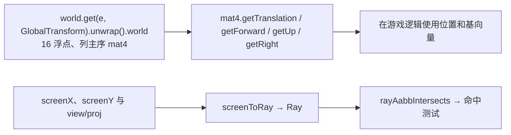

**语言**：[English](SKILL.md) · **简体中文**

> [!NOTE]
> 本文供人阅读；工具入口为英文 `SKILL.md`。

# forgeax-engine-math

ForgeAX 显式分配的向量、矩阵、四元数、颜色和拾取数学。用于计算变换、读取世界姿态、颜色转换、投影或射线。

> 纯函数、out 参数优先、适合 SoA 的数学库。写入输出存储的函数必须显式提供 `out`，以复用调用方缓冲；允许返回同一个 `out`，禁止可选或默认输出分配。覆盖 `@forgeax/engine-math`。

## 理解模型

命名空间 `vec3` / `mat4` / `quat` / `color` 等按功能组织纯函数，`out` 位于首参数：`vec3.add(out, a, b)` 写入并返回 `out`，通过复用缓冲避免 GC。常见任务是读取实体世界姿态：`GlobalTransform.world` 是派生的列主序 16 浮点 mat4，每帧更新。创作本地 TRS，让引擎派生世界变换。使用 `mat4.getTranslation/getForward/getUp/getRight` 读取位置和基向量，不自行拆矩阵。反方向的 `screenToRay` 从屏幕坐标及 view/projection 矩阵构造世界射线。

## 核心 API 速查

| 命名空间或函数 | 形式 | 用途 |
|:--|:--|:--|
| `vec3.add/sub/scale/cross/normalize/lerp(out, ...)` | out 参数 | 向量操作；`vec2` / `vec4` 遵循相同模式 |
| `vec3.smoothDamp(out, current, target, decayRate, dt)` | `=> Vec3` | 与帧率无关的指数平滑：`lerp(current, target, 1−exp(−decayRate·dt))`，等价于 Bevy `Vec3::smooth_nudge` / Three.js `MathUtils.damp`；也提供 vec2/vec4。跟随时不要使用 `lerp(p, target, rate·dt)`，它在 30/60 fps 下不同，`rate·dt>1` 时过冲 |
| `vec3.catmullRom(out, p0, p1, p2, p3, t)` | `=> Vec3` | 穿过控制点、张力 0.5 的 Catmull-Rom 采样；t=0 取 p1，t=1 取 p2，p0/p3 决定端点切线。uniform 模式，等价于 Bevy `CubicCardinalSpline::new_catmull_rom` / Three.js 显式 `catmullrom`；Three.js 默认 centripetal。也提供 vec2。用于相机、动画路径和程序化曲线，避免手写三次矩阵；沿折线滑动四点窗口 `[pts[i-1..i+2]]` |
| `mat4.multiply/invert/lookAt/perspective/compose(out, ...)` | out 参数 | 矩阵操作 |
| `mat4.getTranslation(out, m)` | `=> Vec3` | 从世界 mat4 第 3 列读取位置 |
| `mat4.getForward/getUp/getRight(out, m)` | `=> Vec3` | 读取基向量；forward 为 -Z |
| `mat4.unproject(out, ndcPoint, invVP)` | `=> Vec3` | NDC 转世界坐标 |
| `quat.fromEuler/slerp/multiply/transformVec3(out, ...)` | out 参数 | 旋转 |
| `quat.fromLookAt(out, eye, target, up)` | `=> Quat` | 本地 -Z 朝向 target 的姿态四元数，替代手动 `lookAt→invert→mat3→fromRotationMatrix` |
| `quat.rotateAxis(out, q, axis, angleRadians)` | `=> Quat` | 绕世界 axis 按弧度增量旋转 q 并重新归一化；用于逐帧自转或动画，类似 Bevy `Transform::rotate_y` / `rotate_axis`。左乘增量使用世界轴顺序；反复手动 multiply 而不归一化会偏离单位四元数 |
| `quat.right/up/forward(out, q)` | `=> Vec3` | 以世界空间表示本地基向量：right=q·+X、up=q·+Y、forward=q·−Z。匹配 mat4 的对应方法及 Bevy `Transform::local_x` / `local_y` / `forward`。用于沿本地朝向移动或瞄准，替代手动 `transformVec3(out, q, [0,0,-1])`；单位四元数输入得到单位向量 |
| `color.srgbToLinear/linearToSrgb/fromHex/toHex` | out 参数或值 | 色彩空间转换 |
| `easing.cubicInOut / smoothstep / smootherstep / elasticInOut(t)` | `=> number` | 标量时间重映射，输入钳制到 [0,1]；前三者缓入缓出，elasticInOut 保留弹性过冲，类似 Bevy `EaseFunction`。用于动画、UI、相机过渡，避免手写多项式；easing 为可扩展命名空间 |
| `screenToRay(out, sx, sy, vpW, vpH, view, proj)` | `=> Ray` | 屏幕坐标转世界射线 |
| `worldToScreen(out, worldPos, viewProj, canvasW, canvasH)` | `=> { onScreen, behind }` | 世界坐标转屏幕像素，与 screenToRay 对偶 |
| `rayAabbIntersects(ray, aabb)` | `=> RayAabbResult` | 射线与包围盒求交 |
| `rayTriangleIntersects(r, a, b, c)` | `=> RayTriResult` | 双面 Moller-Trumbore 射线三角形求交 |
| `mat4.computeViewProj(out, eye, target, up, fov, aspect, near, far)` | `=> Mat4` | 便捷组合 perspective * lookAt，普通数字参数，无依赖 |

> [!NOTE]
> `Transform` 只存储创作的本地 TRS；瞬态 `GlobalTransform.world` 存储解析后的世界矩阵，由 `propagateTransforms` 逐帧写入。原始 `world.spawn` 必须附加这两个组件；SceneAsset 和挂载辅助方法自动提供这一对。

## 按距离采样路径

使用默认 `curve3.catmullRom(out, controls, t, { parameterization: 'centripetal' })`，或显式选择 `uniform` / `chordal`。`closed: true` 在不重复端点的情况下环绕控制点。`curve3.catmullRomTangent` 提供解析方向。先构建一次 `curve3.arcLengths(new Float32Array(subdivisions + 1), sample)`，再使用 `curve3.parameterAtDistance(lengths, travelledDistance)` 采样。控制点编辑后重建；增加 subdivisions，直到应用误差预算收敛。表归调用方所有，不增加 Scene 或动画缓存。

## 读取实体姿态



## 使用骨架

```ts
import { mat4, vec3 } from '@forgeax/engine-math';
import { GlobalTransform } from '@forgeax/engine-scene';

// read world-space pose off GlobalTransform.world (a live 16-float column-major Float32Array)
const worldMat = world.get(entity, GlobalTransform).unwrap().world;
const pos = mat4.getTranslation(vec3.create(), worldMat); // m[12..14]
const fwd = mat4.getForward(vec3.create(), worldMat);     // -Z basis
const up = mat4.getUp(vec3.create(), worldMat);           // +Y basis

// out-param idiom: allocate once, reuse across frames
const tmp = vec3.create();
vec3.scale(tmp, fwd, 5);          // tmp = fwd * 5
vec3.add(pos, pos, tmp);          // pos = pos + tmp (writes into pos, returns it)
```

```ts
import { screenToRay, rayAabbIntersects, ray as rayNs } from '@forgeax/engine-math';

const r = screenToRay(rayNs.create(new Float32Array(6)), mouseX, mouseY, vpW, vpH, viewMat, projMat);
const hit = rayAabbIntersects(r, entityAabb); // hit.hit -> boolean
```

```ts
import { ray, mat4, vec2 } from '@forgeax/engine-math';

// world -> screen: project a 3D point to pixels, y-down from top-left.
const vp = mat4.computeViewProj(mat4.create(), eye, target, up, fovY, aspect, 0.1, 100);
const out = vec2.create();
const r = ray.worldToScreen(out, worldPos, vp, canvasW, canvasH);
if (r.onScreen && !r.behind) {
  // out[0], out[1] are valid pixels for DOM overlays or HUD anchors.
}
```

```ts
import { pickVertexOnEntity, pickVertex } from '@forgeax/engine-picking';

// propagateTransforms must have run for this frame (D-9 precondition).
propagateTransforms(world);

// Nearest vertex on one entity; omitted limit -> VertexHit|undefined.
const hit = pickVertexOnEntity(world, cameraEntity, sx, sy, w, h, entity);
if (hit) {
  // hit.worldPos / vertexIndex / screenDist / worldDist / deformed
}

// Whole-scene query with limit -> VertexHit[], ascending screenDist.
const candidates = pickVertex(world, cameraEntity, sx, sy, w, h, { limit: 5 });
```

## worldToScreen：世界坐标转屏幕像素

`ray.worldToScreen` 与 `screenToRay` 对偶，将世界空间 3D 点投影回屏幕像素。内部计算 `mat4 * vec4` 保留透视除法前的 w；`projectPoint` 丢弃 w，因此不能复用。

```ts
import { ray, mat4 } from '@forgeax/engine-math';

const vp = mat4.computeViewProj(mat4.create(), eye, target, up, fovY, aspect, near, far);
const out = vec2.create();
const result = ray.worldToScreen(out, worldPos, vp, canvas.width, canvas.height);
// result.onScreen -- NDC xyz are all inside clip space.
// result.behind -- behind the camera (w < 0); out is meaningless.
// !onScreen && !behind: outside the frustum but in front; out remains valid for screen-edge clamping.
```

- **输出参数：** 首参数 Vec2，写入 Y 向下、左上原点的像素坐标：`px = (ndc.x * 0.5 + 0.5) * w`，`py = (1 - (ndc.y * 0.5 + 0.5)) * h`。
- **普通数据标志：** 返回 `{ onScreen: boolean, behind: boolean }`。
- **退化画布：** `canvasW <= 0 || canvasH <= 0` 返回 `{ onScreen: false, behind: false }`，不修改 out。
- **聚合导入：** `import { ray } from '@forgeax/engine-math'; ray.worldToScreen(...)`，与 screenToRay 命名空间对称。

## computeViewProj：透视与视图组合

`mat4.computeViewProj` 使用普通数字和 Vec3Like 参数组合 `mat4.perspective * mat4.lookAt`。无运行时 POD 依赖，遵循 lookAt / perspective 的抽象，参见约定 P4。

```ts
const vp = mat4.computeViewProj(mat4.create(), eye, target, up, fovY, aspect, near, far);
// Equivalent to:
// const view = mat4.lookAt(mat4.create(), eye, target, up);
// const proj = mat4.perspective(mat4.create(), fovY, aspect, near, far);
// const vp = mat4.multiply(mat4.create(), proj, view);
```

- **签名：** `computeViewProj(out, eye, target, up, fovYRadians, aspect, near, far): Mat4`。
- **out 参数风格：** 写入并返回首参数。
- **组合：** JSDoc 标注的便捷操作，内部先 lookAt 和 perspective，再 multiply。
- **典型用途：** 为 worldToScreen 提供 3D 到 2D 投影，不与引擎组件耦合。

## 屏幕拾取：顶点查询 pickVertex / pickVertexOnEntity

> 顶点拾取只查询，不编辑。从 `@forgeax/engine-runtime` 导入；组合 `rayTriangleIntersects` 和 `screenToRay`。

| 函数或类型 | 形式 | 用途 |
|:--|:--|:--|
| `pickVertexOnEntity(w, cam, sx, sy, vpW, vpH, e)` | `=> VertexHit \| undefined` | 单实体最近顶点；省略 options 返回一个命中或 undefined |
| `pickVertexOnEntity(w, cam, sx, sy, vpW, vpH, e, { limit })` | `=> VertexHit[]` | limit=N 返回最多 N 个候选，screenDist 升序 |
| `pickVertex(w, cam, sx, sy, vpW, vpH)` | `=> VertexHit \| undefined` | 全场景：先粗略 AABB 过滤，再逐实体查询；返回全局最近命中 |
| `pickVertex(w, cam, sx, sy, vpW, vpH, { limit })` | `=> VertexHit[]` | 全场景多候选模式 |
| `VertexHit` | `{ entity: EntityHandle; vertexIndex: number; worldPos: Vec3Like; screenDist: number; worldDist: number; deformed: boolean }` | screenDist 为像素距离；worldDist 为到射线的垂直 3D 距离；worldPos 使用 Vec3Like，避免品牌类型转换 |

**返回契约：** 省略 limit 返回 `VertexHit | undefined`，支持安全 if-hit 收窄，直接访问 `hit.worldPos` 无需断言。提供 limit 返回数组；空数组表示未命中，limit 超出命中数则返回全部候选。TypeScript 区分这两种形式；省略 limit 时不要访问 `hit[0]` 或 `.length`。

**排序：** 按 screenDist 升序，最近屏幕投影优先。世界空间排序或加权使用 worldDist。相机后方顶点 behind=true 会排除；相机前方但屏幕外的顶点仍可作边缘吸附候选。

**退化输入：** 跳过 triangle-strip、line 和 point 子网格，只处理 triangle-list。无索引时使用连续三顶点。与 computeAABB 一致，跳过 Uint16Array positions；排除 NaN/Inf 顶点。空网格返回 undefined 或空数组。

**错误：** 复用 PickError；唯一抛出错误为 `camera-component-missing`。缺失、空或退化顶点作为可恢复的未命中返回 undefined 或空数组，不中断批量查询。

```ts
import { pickVertexOnEntity, pickVertex, type VertexHit } from '@forgeax/engine-picking';

const hit = pickVertexOnEntity(world, cameraEntity, sx, sy, w, h, entity);
if (hit) {
  const { entity, vertexIndex, worldPos, screenDist, worldDist, deformed } = hit;
  // worldPos: Vec3Like (Float32Array-like), world-space coords
  // deformed: true when mesh is Morph/Skin evaluated -> worldPos is current pose
}
```

## 常见问题

- **out 参数覆盖缓冲：** `vec3.add(out, a, b)` 写入并返回 out。`const c = vec3.add(a, a, b)` 会覆盖 a；要保留 a 就使用独立缓冲。
- **列主序：** GlobalTransform.world 匹配 GPU/WGSL `mat4x4<f32>`；平移在第 3 列，即 world[12..14]。以 `data: {}` 新建的 GlobalTransform 首次传播前是单位矩阵，不是未初始化数据。
- **静默退化回退：** 零长度归一化、w'=0 透视除法等无效输入，回退到 (0,0,0) 等安全值，不抛错。调用方负责防护；这层轻量数学库优先性能而非约定 P3。参见 README 退化输入表。
- **屏幕边缘钳制前检查 worldToScreen.behind：** 为 true 时 out 无意义，可能把相机后方点投到相反象限。
- **顶点拾取前执行 propagateTransforms：** 与 pick 一样，查询直接读取 GlobalTransform.world，不自行传播；否则新实体仍是单位矩阵，worldPos 错误但不崩溃。
- **仅使用当前 CPU 姿态：** 顶点与三角形查询共享先 Morph 后 Skin 投影。顶点姿态不可用时无候选；用 pickTriangle 获取结构化不可用结果。先传播关节。不重建自定义着色器、位移或 alpha 覆盖。
- 更高层渲染或拾取症状见 [`forgeax-engine-debug`](../forgeax-engine-debug/SKILL.zh-CN.md)。

## 延伸阅读

- 命名空间与函数速查、命名、退化输入策略和三种 NDC 投影模式：`packages/math/README.md`；导出数量由 README 和 `count-math-exports.mjs` 负责。
- 姿态辅助 getTranslation/getForward/getUp/getRight：`packages/math/src/mat4.ts`。
- screenToRay、rayAabbIntersects、rayTriangleIntersects、mat4.unproject、worldToScreen：`packages/math/src/ray.ts` 及 `mat4.ts`；运行时 pick(...) 见 `packages/runtime/README.md` 的 Picking，顶点辅助见 Vertex Picking。
- 派生 GlobalTransform.world 契约：`packages/runtime/README.md`，Transform 的本地 TRS 与世界 mat4。
