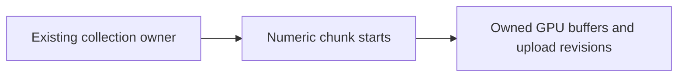

# Render string-key audit

> [!IMPORTANT]
> This 2026-10-14 source audit starts at PR3855 `8a621ca0b8`. The measurements
> below cover named CPU owners only. No current Frontline frequency, whole-frame
> gain, GPU gain or FPS gain has been established by this audit.

The follow-up source refresh through parent `36ccd1ece1` also includes
`RasterGraphIdentity`: unchanged resource/binding/source publications reuse
object tokens, while changed publications still compare sorted string class
identities. This existing PR3855 improvement reduces reconstruction frequency;
it does not make every remaining class or PSO key numeric.

Optimize construction, reverse parsing and the work around lookup before
choosing a different key representation. Existing GUIDs, shader identities and
pass labels are legitimate text identities; looking them up does not imply that
new long strings are generated for every draw.

## Construction frequency and decision

| Owner | Actual key work | Decision |
| --- | --- | --- |
| [Shadow claims](../../../../packages/render/src/gpu-driven/shadow-claims.ts) | Membership-backed snapshot misses formerly formatted entity/material/draw strings | Already replaced by a flat numeric bucket index with complete-field collision checks; see [measured case](persistent-scene-prefix.md#numeric-shadow-claim-lookup) |
| [Main GPU ownership](../../../../packages/render/src/scene/render-scene.ts) and [CPU validation](../../../../packages/render/src/gpu-driven/production-raster.ts) | New snapshot/validation misses still format draw identities before Set lookup; unchanged snapshots/validation can hit their existing memo | High-priority follow-up: carry the admitted numeric draw identity through its existing producer. Preserve material changes, World rebasing and raw mutable-input observations |
| [Instance chunks](../../../../packages/render/src/record/main-pass-geometry.ts) | Every chunk formats owner/start; every owner then scans the complete cache with a text prefix; [frame cleanup](../../../../packages/render/src/record/fold-buckets.ts) parses every owner prefix again | Implemented here: numeric collection owner owns numeric chunk starts; query and stale-chunk cleanup stay inside that collection |
| [Filtered contributions](../../../../packages/render/src/gpu-driven/filtered-plan-contributions.ts) | Changed contributions rebuild group keys; unchanged publications return before grouping | Measure churn first. Retained base keys already avoid repeating complete static serialization |
| [Batch topology](../../../../packages/render/src/gpu-driven/batch-topology.ts) | Batch/LOD JSON and candidate strings are built on membership changes | Do not treat them as unconditional per-frame cost. A replacement needs exact geometry, ABI, LOD and candidate separation |
| [Raster graph identity](../../../../packages/render/src/gpu-driven/raster-graph-identity.ts) | Unchanged publications return retained object tokens; changed publications build/sort class sets | Reuse the existing publication fence before considering another index |
| [Material pipeline](../../../../packages/render/src/gpu-driven/production-raster-material.ts) | A long compatibility key includes render state, layout and program facts | The producer's retained `pipelineForFragment` format cache protects normal repeated encoding. Keep correct cold compatibility; count misses before replacing this key |
| [Visible-window binding](../../../../packages/render/src/gpu-driven/production-raster-material.ts) | Whole-buffer mode uses existing `main`/`shadow` literals; devices without indirect first-instance build base/capacity keys | Ordinary literal lookup is reasonable. Quantify the unsupported-capability path separately |
| [Material artifact lookup](../../../../packages/render/src/gpu-driven/prepared-draw.ts) | Detached owned draws capture their material artifact key once; borrowed/accessor inputs retain live reads | Preserve publication ownership. Object identity alone is insufficient for value-equivalent or mutable inputs |
| [RenderBundle passes](../../../../packages/render/src/record/render-bundle-cache.ts), resource GUIDs and shader names | Existing names/identities index their own cache domains | Keep strings unless their generation or lookup is actually attributed as a hotspot |
| [Shadow view identities](../../../../packages/render/src/gpu-driven/shadow-views.ts) | View indices, faces, layers and terrain receivers format short keys | Cost scales with views and receiver slices rather than pixels. Profile the active view population before changing it |

No aggregate string-key CPU percentage follows from this inventory. A string
Map declaration, including an interface declaration, is not an allocation or a
measured cache decision. A long PSO key behind a retained format lookup is not
interchangeable with a short key rebuilt for every chunk.

## Collection-owned chunk cache

The collection is the existing renderer-owned lifetime. Its blocks have numeric
start offsets; no new handle registry, packed composite ID, memo or transport
format is needed. Storage and uniform fallback share the same owner/start cache.
Despawn releases an absent collection's blocks, while count/capacity changes
replace or retire only its current offsets. Renderer disposal visits all blocks.



For the stable diagnostic shape of 256 collections with four chunks each, the
old per-owner prefix sweep visited 256 x 1024 = 262144 entries per iteration.
The new owner-local sweep visits 256 x 4 = 1024. Frame eviction additionally
checks 256 owner keys rather than parsing 1024 chunk keys. These are derived
walk counts from the frozen production loops and the fixed fixture, not timer
samples. The large gain therefore cannot be attributed to string hashing alone.

The [fixture](../../../../packages/render/bench/instance-chunk-keys.ts) runs real
storage chunk resolution, upload planning, bind-group caching and frame cleanup
with synthetic RHI creation/write/destruction. Each collection has 32 instances
and a capacity of eight instances per chunk. Warmup precedes twelve alternating
pairs. The small case has one collection; the other cases have 256. CPU values
are medians of batch means on Node 26, not frame percentiles. All timed A/B batches
have equal draw checksums and equal buffer/binding creation, write, byte and
destruction counts.

| Iteration | Baseline CPU ms | Candidate CPU ms | Observed reduction |
| --- | ---: | ---: | ---: |
| One collection, unchanged | 0.0009662 | 0.0004616 | 52.2% |
| 256 collections, unchanged | 3.978650 | 0.144550 | 96.4% |
| All collection revisions changed | 4.785150 | 0.770850 | 83.9% |
| Instance count alternates 24/32 | 4.254350 | 0.698350 | 83.6% |
| Replace collection owners and evict old owners | 7.027800 | 1.116100 | 84.1% |

A separate forced-GC experiment retained one complete synthetic 256-collection
fixture in each of six alternating windows. Median heap delta was 697160 versus
671832 bytes, about 3.6% lower. That population includes the context, source
records, bind-group caches and synthetic handles; it is not index-only memory,
GPU allocation, transient peak or a GC-pause result.

```sh
node scripts/bench/run-instance-chunk-keys.mjs \
  --baseline-ref 8a621ca0b8 --output artifacts/instance-chunk-keys
```

The [runner](../../../../scripts/bench/run-instance-chunk-keys.mjs) freezes all
four changed CPU owner sources for both bundles, verifies owner-load coverage,
checks output/work equivalence and preserves raw CPU/wall samples plus digests.
The maintained correctness fixture uses Null RHI for buffer reuse, unchanged
uploads, capacity/count changes, cross-World eviction, disposal and an explicitly
emulated uniform capability. It is not real WebGL2 or GPU visual acceptance.

## Continue from actual ownership

Prioritize the remaining main draw-key consumers when a current capture shows
frequent snapshot/validation misses. Remove their text roundtrip at the admitted
draw producer, preserving raw callers' mutable aliases and failure observations.
For grouping/PSO keys, reduce reconstruction frequency before adding numeric
indexes. Hierarchical containers require a real ownership or data hierarchy,
such as this collection's blocks; field count alone does not justify layers.
A later game comparison must retain the user's three 1024 shadow maps and
ordinary completed submissions.
