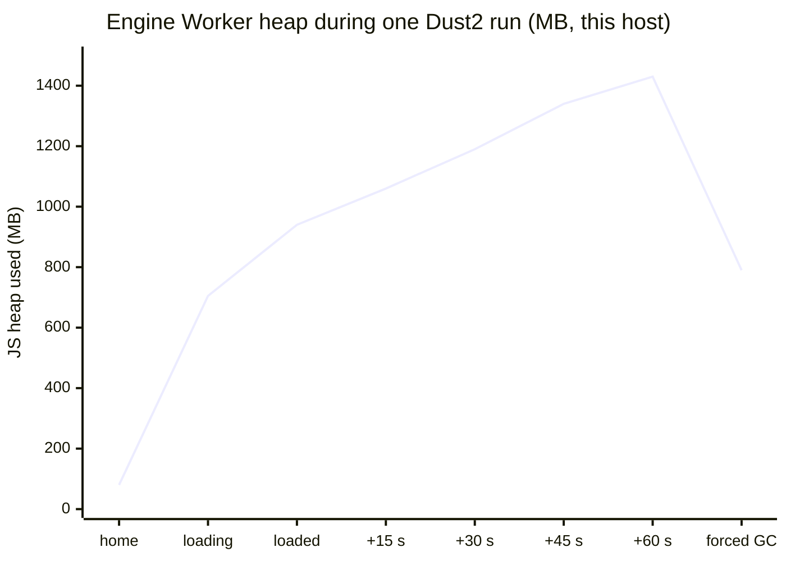
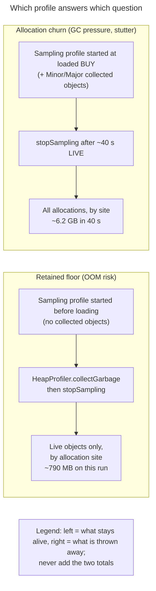
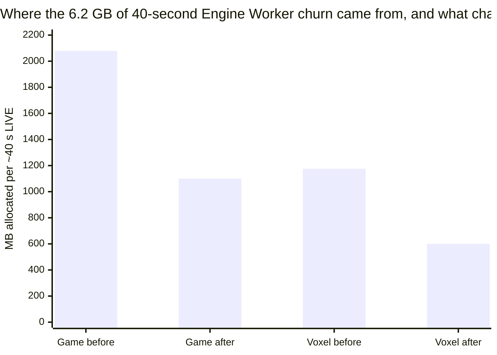
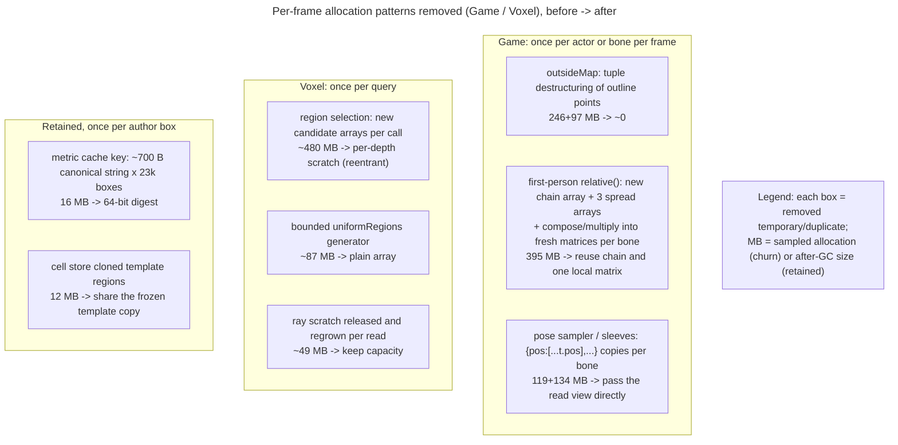
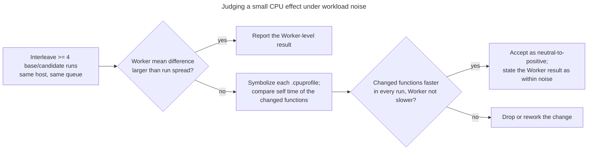
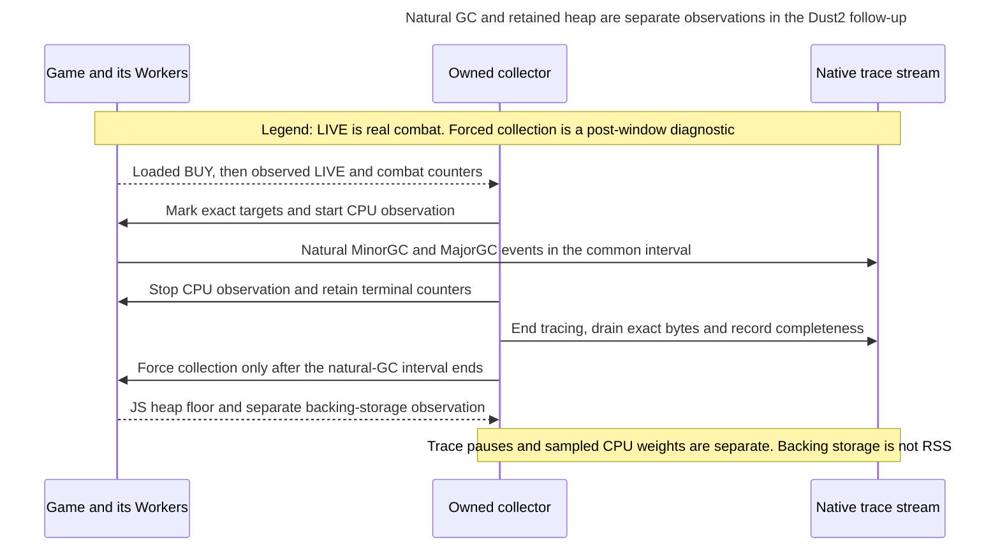

# Worker heap floor and allocation churn: 2026-10-23

| Field | Observation |
| --- | --- |
| Trigger | External browser report on a 4K desktop: Engine Worker JS heap resident ~830 MB, rising ~3.5 MB/s between major GCs to ~1170 MB; three realms ~1.4-1.6 GB together; motion felt uneven at a locked 50 FPS |
| Source | Game dev 809f5212, Voxel 618db946, Engine 5b6898044 built locally with hidden source maps |
| Workload | Dust2 offline demo, normal rules, continuous wall fire, invulnerable player, AI cadence fire; ~40 s of LIVE combat after loading |
| Host | Shared GPU-less Linux server, headless Chrome Beta, [WebGPU stub](../measurement.md#cpu-only-measurement-with-the-webgpu-stub); CPU and heap evidence only, never FPS acceptance |
| Collection | Per-Worker CDP `Runtime.getHeapUsage` series; retained-floor sampling profile (64 KiB) started before loading and read after a forced GC; churn profile (16 KiB, including Minor/Major collected objects) started at loaded BUY; 1 ms CPU profiles of every thread |
| Outcome | Game and Voxel churn halved without a CPU regression; Engine Worker floor moved only 790 -> ~773 MB because most retained storage is Engine-owned |

## Separate the floor from the sawtooth

The report's growth was not a leak: forcing a full collection returned the Engine
Worker to the same floor on every run. Two different problems need two different
profiles.

Forcing collection before `stopSampling` removes not-yet-collected garbage from a
surviving-object profile, so its total approximates the after-GC heap rather than
an arbitrary point on the sawtooth. Keep this diagnostic outside any timed window;
see the [GC reference](../gc.md#measure-the-retained-floor-separately).

## Ownership of the two populations

| Owner | Retained after GC | Churn per ~40 s LIVE |
| --- | ---: | ---: |
| Engine (assets-runtime, shader, render publisher, ECS, animation) | ~430 MB | 2735 MB |
| Game (author data, metric map caches, per-frame rig and probes) | ~180 MB | 2079 MB |
| Voxel (templates, cell stores, region queries) | ~80 MB | 1369 MB |

Largest retained Engine rows: deep-frozen material projection copies (~96 MB),
retained parsed pack JSON (~97 MB), shader/material install records and
manifests (~90 MB). Largest churn rows: ECS change filters and array views, math
compose, Voxel region selection, and Game per-frame first-person/boundary code.

## Removed allocation patterns

| Change | Evidence |
| --- | --- |
| Game per-frame rig, boundary, probe and cache-key changes | Game PR325; 113 related tests; Game churn 2079 -> 1100 MB |
| Voxel per-depth query scratch, array bounded regions, ray scratch capacity, shared frozen regions/pose, exact-size faces | Voxel PR218; 1707 tests plus reentrant/throwing callback regressions; Voxel churn 1176 -> 600 MB, retained 81 -> 60 MB |

## CPU acceptance and its noise

Engine Worker busy time varied by roughly 15% between runs of the same build,
because combat outcomes change query and AI volume. The Game candidate's four
interleaved runs split 603/510/594/496 ms/s against a 571/546/542/528 baseline:
means 551 vs 547, inconclusive at the Worker level. Self time of the changed
functions fell from ~12-14 to ~3-4 ms/s in every run, which is the reliable
signal for a change this size. The Voxel candidate reduced Worker busy time from
564 to ~529 ms/s and GC from 22.4 to ~14.1 ms/s across 2+3 runs.

## Counterexamples and limits

- A Dust2 bot-navigation test failed once while running in parallel with other
  files on the loaded host. Its planner has a wall-time budget; the same file passed
  64/64 alone both with and without the change. Re-run budgeted planning tests in
  isolation before attributing a failure to an allocation change.
- One port collision silently served another session's build for part of an A/B;
  verify the served `index.html` digest against the intended output before each run.
- Reducing churn did not move the floor: the 780 MB resident heap, and therefore the
  low-memory OOM risk, remains an Engine retained-representation problem.
- No real-GPU frame pacing was measured; the report's uneven animation is not yet
  shown to be fixed.

## Takeover counterexamples (2026-10-24)

The follow-up reviewed the unfinished Engine candidates against `8459203f9`.
These are correctness and measurement findings; combined performance numbers
require the final matched Game build.

| Candidate boundary | Counterexample reproduced | Decision |
| --- | --- | --- |
| Shared JSON facts | A canonical child ID immediately followed by a field-name length can collide with a different ID/length pair; valid material ABI extension fields exercise the original decoder | Terminate child IDs and preserve exact JSON observations; reject sparse/accessor/cyclic input before sharing |
| Material uniform upload | A nested queue callback overwrites module-global target scratch used by an outer upload | Traverse the existing physical-page owner without shared per-invocation target arrays |
| Cascade camera math | A camera getter recursively computes another cascade or throws | Keep independent scratch for each active depth and release it in `finally` |
| Public ECS read wrappers | Reusing a wrapper changes the documented identity returned by a public read | Exclude that candidate; preserve the public contract and investigate transient consumers instead |
| Catalog sharing | General descriptor qualification reduces retained values but adds cold decode work and transient allocation | Drop the structural and string-only candidates after the bounded owner comparison below |

The Catalog experiment used the same 27 MB, 24,133-row JSON fixture in fresh
Node processes with four balanced pairs and matching decoded fact digests.
Structural sharing retained 20.96 MiB versus 33.81 MiB, but decode grew from
22.4 to 244.8 ms. String-only sharing retained 28.43 MiB and decoded in 55.9 ms;
its end-of-decode heap observation also grew by 10.4 MiB. These are owner-level
measurements, not browser loading or peak-memory claims. Neither candidate was
kept: the follow-up retained the larger PackReader and startup-lifetime work
without adding another Catalog cache for the smaller saving.

The old collector began after loading, which can still be BUY. New comparisons
wait for observed LIVE, retain the full roster and actual combat counters, and
label boundary snapshots separately from continuous workload evidence. Natural
GC requires exact target markers and a common CPU interval qualified against
native command clock brackets. Preserve original streamed bytes, loss status
and close receipts; stop tracing before diagnostic forced collection. A missing
Major GC in a short window has zero count and an unknown mean pause.

