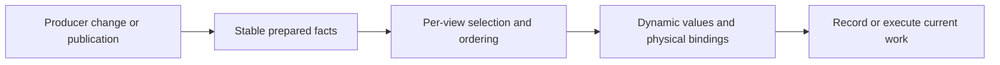

# CPU preparation, submission and data ownership

## Locate work that survives a cache hit

Read the current [RenderBundle owner](../../../packages/render/src/record/render-bundle-cache.ts)
and [prepared bindings](../../../packages/render/src/record/prepared-material-bindings.ts).
Determine whether reuse avoids only native construction, also command recording,
or the whole prepared-data walk. A path that still invokes `record(proxy)` and
compares commands can have excellent hits while paying most setup cost.

| Observed hotspot | Candidate change | Required falsifier |
| --- | --- | --- |
| Full traversal before every cache decision | Prepare stable object/material facts on producer revision changes; frame selects visibility and ordering | Add/remove/move objects and change view-specific work |
| Repeated key serialization and signatures | Carry existing revision/handle identity from the producer; avoid rebuilding equivalent strings/arrays | Unchanged count but changed bytes, resource or program |
| Broad epoch invalidates unrelated objects | Scope observation to the dependencies actually consumed | Changed local caster/material invalidates affected work; unrelated work still reuses |
| Unchanged material queue writes | Reuse successful context-owned bytes against the exact physical target | Intervening context, changed values, new frame, buffer replacement or page growth |
| Many small uploads | Coalesce proven adjacent ranges at the upload owner | Sparse edit preserves untouched data and overlapping page tails |
| Repeated layout/pipeline/bind-group setup | Retain durable handles; update dynamic values through the existing data owner | Layout/program replacement, texture recovery and device loss |
| Duplicate immutable mesh publication | Resolve the already published asset; transfer only producer-owned transport bytes | Sender detach does not corrupt author data; revision and retirement remain correct |
| Allocation/GC in per-frame setup | Reuse bounded typed storage and stable records, removing repeated intermediate collections | Mutable values remain observable; capacity growth and lifecycle release stay bounded |

A structural cache owns commands and their dependency lifetime. A data update
owns changing values. Do not force a command rebuild for a uniform-only change,
or reuse a command after the physical binding/layout changed. Single-frame
resources, query scopes and dynamic encoder state require their actual lifecycle
handling rather than unconditional retention.

For numeric composite keys, first reuse an existing producer identity or slot.
Use hierarchical Maps only when the data or ownership is naturally hierarchical;
replacing strings does not justify adding container levels. A numeric bucket hash
must compare complete fields after lookup and explicitly test collisions. Compare
cold rebuild CPU, retained heap and the already-cached path as well as query cost;
the [shadow claim case](cases/persistent-scene-prefix.md#numeric-shadow-claim-lookup)
rejects nested Maps with a large memory increase despite their CPU improvement.

For Worker allocation distributions and GC measurement, use [GC and allocation ownership](gc.md).

## Decide whether retention pays

Use [cache populations and window deltas](measurement.md#cache-populations-and-window-deltas)
before interpreting hit rate. Measure lookup/key work, dependency validation,
invalidation fan-out, rebuilding, allocation/retention and uploads against the
work actually avoided. Sample hit and miss paths under the same workload when
their individual costs are needed.

| Finding | Next experiment |
| --- | --- |
| High hits but many row checks or long keys every frame | Count checks/key characters and profile the hit path; test an existing producer revision fence that skips the unchanged walk |
| Rare validation reuse alongside frequent unrelated changes | Record the consumed dependencies and miss causes; test local invalidation while preserving same-count content changes and recovery |
| Backing storage reused while content is repacked/uploaded | Measure stable slot/value dirty ranges and exact physical-target writes separately; resizing the pool alone cannot remove payload work |
| Final shadows change while static layers reuse | Attribute view/layer maintenance and saved caster draws separately; keep dynamic rendering and coverage correctness |
| A cache appears unused or expensive | Compare retained/bypassed paths under a matched dynamic workload, preserving correctness, memory and ordinary completion throughput |

Reference-engine counterparts can explain a cache's purpose, but neither their
existence nor absence proves this implementation's net benefit. A deletion is
supported by a matched retained/bypass experiment or proven dead ownership,
not just a low hit rate. The [2026-10-14 audit](cases/cache-maintenance-20261014.md)
shows why near-total prepared-row hits and near-total UBO storage reuse can
coexist with substantial per-frame checking and uploads.

## Choose keys from existing identity

| Representation | Use when | Cost to include |
| --- | --- | --- |
| Existing numeric ID into an Array or TypedArray | IDs are dense and already have stable slots | Holes, growth, occupancy and slot-reuse lifetime |
| Existing numeric ID into a Map | IDs are sparse | Hash lookup and container storage |
| Stable object into a Map or WeakMap | A long-lived object already owns identity within one runtime | Stable references; Map retention or WeakMap collection/reconstruction |
| Losslessly packed integers into a number | Every field has a validated range and the total width fits | Range checks, exact decoding and overflow rejection |
| Custom composite-key hash table | Multiple fields must match and profiling confirms a hotspot | Collision equality, resizing, deletion and retained capacity |
| Nested numeric Maps | The hierarchy already exists and populations are moderate | Multiple lookups and many small Maps |
| Reused string key | Identity is textual or the path is infrequent | Construction, concatenation and text processing |

Reuse the producer's identity first. Do not add an interning registry, generated
ID or parallel membership table merely to replace a string. Stable object keys
are realm-local: cloned or transferred Worker records need their existing wire
identity. An ephemeral wrapper is a new key on every access.

For packed numbers, validate each integer field and the combined safe-integer
range at the owning boundary. JavaScript bitwise operators coerce to 32 bits;
packing wider keys requires exact arithmetic within `Number.MAX_SAFE_INTEGER`.
Reject overflow rather than accepting collisions. Include generation/owner facts
when a recycled slot can refer to a different live subject.

Compare the whole key path: construction, lookup, equality, insertion, deletion,
growth, allocation/GC and retained memory. Preserve occupancy and churn in the
matched workload. Exercise range boundaries, same-count content changes,
remove/reinsert, slot reuse, identity replacement and collision equality where
applicable. A lookup-only microbenchmark does not establish frame-time savings.

## Follow the existing authority

Use the current [GPU scene](../../../packages/render/src/gpu-scene.ts),
[publication](../../../packages/render/src/publication/publisher.ts),
[production preparation](../../../packages/render/src/gpu-driven/production-raster-prepare.ts)
and [batch topology](../../../packages/render/src/gpu-driven/batch-topology.ts)
owners. Derive active membership, revisions and resource references from them;
a parallel dirty catalogue creates another lifecycle to keep synchronized.
Different cameras may share candidate facts while retaining independent frusta,
visibility and indirect commands. Sharing a preparation plan does not authorize
sharing the resulting visible set.

For source transport, preserve the [Render Worker boundary](../../../packages/app/src/execution/source-render-worker.ts).
`postMessage` transfer detaches buffers. Immutable author assets and transport
payloads are different ownership boundaries; transfer a proven owned payload and
retain a valid source for later consumers/recovery. Count receiver allocations,
not just apparent sender savings.

## Publish only the owner changes

Check whether an unchanged payload still marks its consumers dirty. At the
producer of a numeric vector, compare the live destination in its stored
representation before submitting; f32 rounding and signed zero are part of that
comparison. Read the current destination so external author edits are restored.
Keep invalid/non-finite handling and logical clocks/events on their existing path.
Do not apply this rule to all `World.set` payloads: managed aliases and explicit
publications can carry work even when an identity or byte comparison looks equal.

Inside a synchronous internal reader, check whether a public snapshot API builds
an entire component object or copies arrays merely to inspect current values.
A view can already borrow bytes while still paying unrelated field dispatch;
keep those costs distinct. Use an existing borrowed-column seam
only while those values are consumed before the next World mutation. Fixed pose
history, transport payloads and public caller snapshots retain their own storage.
The [Scene presentation owner](../../../packages/scene/reports/borrowed-presentation-owner-20261016.json)
compares the complete moving character subtree with and without those copies;
its separate work-count probe is not the uninstrumented timing result.

Immutable device programs have a different lifetime from graph resources. A
graph replacement can reuse an identical PSO/layout only inside its current live
device scope and with its complete shader/attachment contract. Keep graph views
and physical bind groups local, clear retired ownership and preserve retryable
creation errors. The [deferred lighting owner](../../../packages/render/reports/retained-deferred-program-owner-20261016.json)
uses complete native descriptor equality; repeated labels alone were different
variants elsewhere and did not authorize reuse.

For reverse dependencies, retain the existing accepted binding until its full
handles change. Keep an owned comparison copy when a published array can escape;
TypeScript readonly does not make caller-owned bytes immutable. Exercise rebind,
shared consumers, removal, generation reuse and discard before timing reuse.
The [dated animation/publication case](cases/full-scene-resources-20261016.md#pose-and-publication-change-frequency)
records complete-owner gains and a rejected byte-copy optimization with extra
retention. Fewer copies or allocations select an experiment, not its verdict.

## Retain cooked programs across Worker admission

Source loader ownership is realm-local. Exercise `structuredClone` and the
[actual asset receiver](../../../packages/render/src/publication/receiver.ts)
when validating program reuse; a frame-only transfer with a resolver pointing
back at the Source World misses this boundary. Detach and own plain program JSON
once at accepted publication, then reuse its exact signature evidence and
canonical program key across changing instance membership. Keep all per-frame
values and physical device resources outside that ownership proof.

| Boundary | Required falsifier |
| --- | --- |
| Source to receiver | Mutating borrowed packet data cannot change adopted JSON; copy failure preserves accepted revision and assets |
| Same handle or fingerprint, new publication | Changed code/layout creates new owned evidence; a fingerprint string alone cannot prove equality |
| Custom mutable payload | Typed arrays, Maps, Dates and accessors retain exact observation and payload types; reject the immutable shortcut |
| Published package entries | Receiver, signature checks and VFX share one ownership registry in the built Render module graph |
| Device generation | Reuse declarations while rebuilding pipelines, bindings and storage for the current device |

The [VFX publication regression](../../../packages/vfx-render/src/__tests__/vfx-publication.integration.test.ts)
exercises the receiver rather than reconstructing a Source ownership mark in the
consumer. Verify the normal built package too: source aliases can hide a second
WeakSet accidentally bundled into a downstream package. Measure signature CPU
and preparation on completed frames; isolated traversal savings do not establish
whole-game FPS.

## Separate VFX program, Player and frame ownership

Use a small real producer before a full game: one Player exposes steady/retry
behavior, three can expose repeated shared-material capture, and the scoped
nine-firing-schedule case includes overlap, retirement and source ACKs. These
are diagnostic populations, not a required Engine-wide matrix.

| Reusable owner | Keep live or invalidating |
| --- | --- |
| One stock per-World extraction material capture | Start fresh for every candidate; preserve custom provider reads, absence/error behavior and mutable author fields |
| Stateless immutable emitter program | Share code/layout across Players; retain a preparation request while any consumer needs it; keep each Player's buffers, seed, ticks and feedback independent |
| Detached immutable binding/no-upload buffer metadata | Match the exact logical resource schema; raw/mutable declarations, current uploads, force fields and data-interface providers keep their normal path |
| Successful roster retirement, abort or device recovery | Retire unused templates only at their owning successful boundary; abort preserves accepted state; a new device rebuilds physical resources and requalifies readiness |

Reuse the existing ownership brand across the real published package closure.
A source-only WeakSet from another Render bundle is not receiver evidence.
The [full-effects case](cases/full-scene-resources-20261016.md#full-effects-program-publication-and-preparation-lifetimes)
links the complete producer comparisons and the rejected permanent-Player pool.

## Validate invalidation and memory

For authored scene batching, count published rows, retained mesh assets,
topology candidates, encoded draws and per-instance culling independently.
Collections can already share one GPU batch while retaining separate CPU
publication/preparation work. Hiding an original parent can retain every source
draw and add aggregate storage; verify the actual suppression boundary. The
[scene batching case](cases/full-scene-resources-20261016.md#scene-batching-has-several-independent-populations)
records both outcomes and the retained geometry tradeoff.

| Transition | Observe |
| --- | --- |
| Material/layout/program replacement | The next affected draw binds new resources and old commands retire |
| Texture failure then recovery | Missing-resource diagnostics remain visible and recovery invalidates reuse |
| Geometry changes with the same row/slot count | Bounds and content update without relying on count changes |
| Camera/light change | View selection, retained coverage and shadow dirtiness remain correct |
| Shared asset/material across Worlds | Owner identity prevents accidental cross-World borrowing |
| Device replacement or loss | Physical handles and prepared commands are rebuilt for the new generation |
| Grow/dispose/remove | Physical page identities, retained storage and resource destruction remain correct |

Measure CPU before optimizing a tiny arithmetic loop. If preparation dominates,
a higher native Bundle hit rate alone is unlikely to address it. Retention also
has a memory cost: report bytes/high-water and cleanup behavior with its CPU gain.

Private reference-engine research can inform producer-owned caching and static
material decisions. Query the pinned Knowledge Base reference when needed,
record its revision, and translate the mechanism into ForgeaX's owners. Its
architecture does not establish this Engine's measured benefit.
